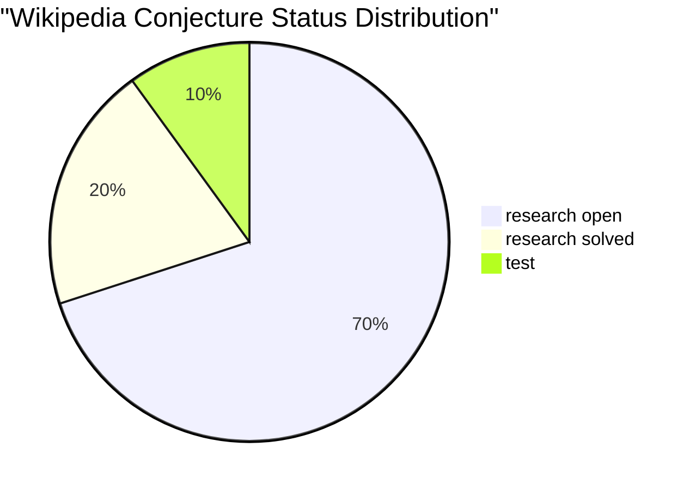
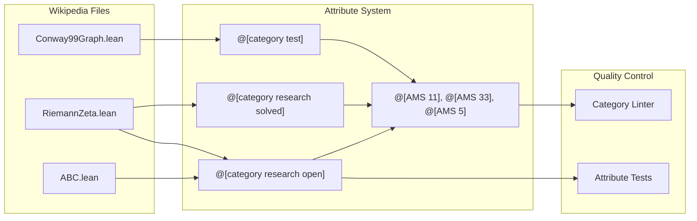

<!-- source: DeepWiki mcp.deepwiki.com · repo google-deepmind/formal-conjectures · page 3.1 Wikipedia Conjectures · fetched 2026-10-26 -->

# Wikipedia Conjectures

<details>
<summary>Relevant source files</summary>

The following files were used as context for generating this wiki page:

- [FormalConjectures/ErdosProblems/11.lean](FormalConjectures/ErdosProblems/11.lean)
- [FormalConjectures/ErdosProblems/427.lean](FormalConjectures/ErdosProblems/427.lean)
- [FormalConjectures/ErdosProblems/942.lean](FormalConjectures/ErdosProblems/942.lean)
- [FormalConjectures/ForMathlib/Combinatorics/SimpleGraph/GraphConjectures/Domination.lean](FormalConjectures/ForMathlib/Combinatorics/SimpleGraph/GraphConjectures/Domination.lean)
- [FormalConjectures/ForMathlib/Data/Nat/Full.lean](FormalConjectures/ForMathlib/Data/Nat/Full.lean)
- [FormalConjectures/Wikipedia/BealConjecture.lean](FormalConjectures/Wikipedia/BealConjecture.lean)
- [FormalConjectures/Wikipedia/BoundedBurnsideProblem.lean](FormalConjectures/Wikipedia/BoundedBurnsideProblem.lean)
- [FormalConjectures/Wikipedia/CollatzConjecture.lean](FormalConjectures/Wikipedia/CollatzConjecture.lean)
- [FormalConjectures/Wikipedia/Conway99Graph.lean](FormalConjectures/Wikipedia/Conway99Graph.lean)
- [FormalConjectures/Wikipedia/DeterminantalConjecture.lean](FormalConjectures/Wikipedia/DeterminantalConjecture.lean)
- [FormalConjectures/Wikipedia/EulerSumOfPowers.lean](FormalConjectures/Wikipedia/EulerSumOfPowers.lean)
- [FormalConjectures/Wikipedia/FermatCatalanConjecture.lean](FormalConjectures/Wikipedia/FermatCatalanConjecture.lean)
- [FormalConjectures/Wikipedia/GaussCircleProblem.lean](FormalConjectures/Wikipedia/GaussCircleProblem.lean)
- [FormalConjectures/Wikipedia/Gilbreath.lean](FormalConjectures/Wikipedia/Gilbreath.lean)
- [FormalConjectures/Wikipedia/Hadamard.lean](FormalConjectures/Wikipedia/Hadamard.lean)
- [FormalConjectures/Wikipedia/InverseGalois.lean](FormalConjectures/Wikipedia/InverseGalois.lean)
- [FormalConjectures/Wikipedia/JacobianConjecture.lean](FormalConjectures/Wikipedia/JacobianConjecture.lean)
- [FormalConjectures/Wikipedia/LonelyRunnerConjecture.lean](FormalConjectures/Wikipedia/LonelyRunnerConjecture.lean)
- [FormalConjectures/Wikipedia/ModularityConjecture.lean](FormalConjectures/Wikipedia/ModularityConjecture.lean)
- [FormalConjectures/Wikipedia/NoetherProblem.lean](FormalConjectures/Wikipedia/NoetherProblem.lean)
- [FormalConjectures/Wikipedia/UnionClosed.lean](FormalConjectures/Wikipedia/UnionClosed.lean)
- [FormalConjectures/Wikipedia/conjecture_1_3_to_2_3.lean](FormalConjectures/Wikipedia/conjecture_1_3_to_2_3.lean)

</details>


This page documents the formalization of well-known mathematical conjectures sourced from Wikipedia. These problems represent some of the most famous open and solved problems in mathematics, spanning multiple domains from number theory to combinatorics. For problems from academic research papers, see [Academic Research Problems](#3.2). For classical problem collections, see [Classical Problem Collections](#3.4).

## Purpose and Scope

The Wikipedia conjecture collection serves as the repository's flagship set of well-documented, historically significant mathematical problems. Each conjecture includes direct references to Wikipedia articles and represents problems that have gained sufficient notoriety to warrant encyclopedic coverage. This collection demonstrates the breadth of mathematical formalization possible in Lean 4 while providing accessible entry points for both automated theorem proving research and educational purposes.

## File Organization Structure

**Wikipedia Conjectures File Structure**

```mermaid
graph TD
    subgraph "FormalConjectures/Wikipedia/"
        BealConjecture["BealConjecture.lean"]
        BoundedBurnside["BoundedBurnsideProblem.lean"]
        CollatzConjecture["CollatzConjecture.lean"]
        Conway99["Conway99Graph.lean"]
        Conjecture13["conjecture_1_3_to_2_3.lean"]
        Determinantal["DeterminantalConjecture.lean"]
        EulerSumOfPowers["EulerSumOfPowers.lean"]
        FermatCatalan["FermatCatalanConjecture.lean"]
        GaussCircle["GaussCircleProblem.lean"]
        Gilbreath["Gilbreath.lean"]
        Hadamard["Hadamard.lean"]
        InverseGalois["InverseGalois.lean"]
        JacobianConjecture["JacobianConjecture.lean"]
        LonelyRunner["LonelyRunnerConjecture.lean"]
        ModularityConjecture["ModularityConjecture.lean"]
        NoetherProblem["NoetherProblem.lean"]
        UnionClosed["UnionClosed.lean"]
    end
    
    subgraph "Import Dependencies"
        ProblemImports["FormalConjectures.Util.ProblemImports"]
    end
    
    subgraph "Category System"
        Research["@[category research open]"]
        Solved["@[category research solved]"]
        Test["@[category test]"]
        AMS["@[AMS classification]"]
    end
    
    Conway99 --> ProblemImports
    Hadamard --> ProblemImports
    GaussCircle --> ProblemImports
    UnionClosed --> ProblemImports
    
    Conway99 --> Research
    Hadamard --> Research
    UnionClosed --> Research
    ModularityConjecture --> Solved
    
    Research --> AMS
    Solved --> AMS
    Test --> AMS
```


Sources: [FormalConjectures/Wikipedia/Conway99Graph.lean:17](), [FormalConjectures/Wikipedia/Hadamard.lean:17](), [FormalConjectures/Wikipedia/GaussCircleProblem.lean:17]()

## Mathematical Domain Coverage

The Wikipedia conjectures span all major mathematical domains, classified using AMS (American Mathematical Society) subject codes:

| Domain | AMS Code | Example Conjectures | File Examples |
|--------|----------|-------------------|---------------|
| Number Theory | 11 | Collatz, Gauss circle, Euler sum of powers, Fermat-Catalan, Gilbreath, Lonely runner, Beal | `CollatzConjecture.lean`, `GaussCircleProblem.lean`, `EulerSumOfPowers.lean`, `FermatCatalanConjecture.lean` |
| Combinatorics | 5, 6 | Conway's 99-graph, Union-closed sets, 1/3-2/3 conjecture | `Conway99Graph.lean`, `UnionClosed.lean`, `conjecture_1_3_to_2_3.lean` |
| Linear Algebra | 15 | Hadamard conjecture, Determinantal conjecture | `Hadamard.lean`, `DeterminantalConjecture.lean` |
| Algebraic Geometry | 14 | Jacobian conjecture, Noether problem | `JacobianConjecture.lean`, `NoetherProblem.lean` |
| Field Theory | 12 | Inverse Galois problem, Noether problem, Modularity conjecture | `InverseGalois.lean`, `NoetherProblem.lean`, `ModularityConjecture.lean` |
| Group Theory | 20 | Bounded Burnside problem | `BoundedBurnsideProblem.lean` |

Sources: [FormalConjectures/Wikipedia/Conway99Graph.lean:29](), [FormalConjectures/Wikipedia/Hadamard.lean:49](), [FormalConjectures/Wikipedia/BoundedBurnsideProblem.lean:31]()

## Conjecture Status Distribution

**Wikipedia Conjecture Status Classification**


The majority of Wikipedia conjectures are classified as `research open`, representing genuinely unsolved mathematical problems. A smaller portion are `research solved`, indicating historically significant problems with known solutions that demonstrate formalization techniques. Test cases provide concrete examples and validation.

Sources: [FormalConjectures/Wikipedia/Conway99Graph.lean:57](), [FormalConjectures/Wikipedia/Hadamard.lean:86](), [FormalConjectures/Wikipedia/UnionClosed.lean:55]()

## Major Conjecture Categories

### Number Theory Conjectures

The number theory collection includes some of mathematics' most famous open problems:

**Collatz Conjecture** ([FormalConjectures/Wikipedia/CollatzConjecture.lean:42-43]())
- `def collatzStep`: The 3n+1 operation
- `theorem collatzConjecture`: Every positive integer eventually reaches 1

**Gauss Circle Problem** ([FormalConjectures/Wikipedia/GaussCircleProblem.lean:48-92]())
- `abbrev N`: Count of lattice points in circle
- `abbrev E`: Error term between count and area
- `theorem error_isBigO`: Conjectured optimal bound on error term

**Euler's Sum of Powers** ([FormalConjectures/Wikipedia/EulerSumOfPowers.lean:36-56]())
- `theorem eulers_sum_of_powers_conjecture`: Main conjecture for k ≥ 6
- `theorem false_for_k4`: Counterexample for k=4
- `theorem false_for_k5`: Counterexample for k=5

**Fermat-Catalan Conjecture** ([FormalConjectures/Wikipedia/FermatCatalanConjecture.lean:45-57]())
- `def FermatCatalanSet`: Solutions to a^m + b^n = c^k with 1/m + 1/n + 1/k < 1
- `theorem fermat_catalan`: Finiteness conjecture

**Beal Conjecture** ([FormalConjectures/Wikipedia/BealConjecture.lean:27-37]())
- `def bealConjecture`: A^x + B^y = C^z implies gcd(A,B,C) > 1
- `theorem flt_of_beal_conjecture`: Beal implies Fermat's Last Theorem

### Graph Theory and Combinatorics

**Conway's 99-Graph Problem** ([FormalConjectures/Wikipedia/Conway99Graph.lean:57-60]())
```lean
theorem conway99Graph : (∃ G : SimpleGraph (Fin 99),
    G.LocallyLinear ∧ NonEdgesAreDiagonals G) ↔ answer(sorry)
```

This conjecture asks for the existence of a graph with 99 vertices where each edge is in a unique triangle and each non-edge is a diagonal of a unique 4-cycle.

**Union-Closed Sets Conjecture** ([FormalConjectures/Wikipedia/UnionClosed.lean:55-61]())
```lean
theorem union_closed [Nonempty n] (h_ne_singleton_empty : A ≠ {∅})
    (h_union_closed : IsUnionClosed A) :
    ∃ i : n, (1 / 2 : ℚ) * #A ≤ #{x ∈ A | i ∈ x}
```

Also known as Frankl's conjecture, it states that in any union-closed family of finite sets, some element appears in at least half the sets.

**1/3-2/3 Conjecture** ([FormalConjectures/Wikipedia/conjecture_1_3_to_2_3.lean:36-41]())
```lean
theorem conjecture_1_3_to_2_3 (P : Type) [Finite P] [PartialOrder P]
    (not_total : ¬ IsTotal P (· ≤ ·)) :
    ∃ x y : P, probability_between_1_3_and_2_3 (x, y)
```

Sources: [FormalConjectures/Wikipedia/Conway99Graph.lean:57-60](), [FormalConjectures/Wikipedia/UnionClosed.lean:55-61](), [FormalConjectures/Wikipedia/conjecture_1_3_to_2_3.lean:36-41]()

### Linear Algebra and Matrix Theory

**Hadamard Conjecture** ([FormalConjectures/Wikipedia/Hadamard.lean:32-88]())
```lean
def IsHadamard {n : ℕ} (M : Matrix (Fin n) (Fin n) ℝ) : Prop :=
    (∀ (i j : Fin n), M i j ∈ ({1, -1} : Finset ℝ)) ∧
    |M.det| = n ^ ((n : ℝ) / 2)

theorem HadamardConjecture (k : ℕ) : ∃ M, IsHadamard (n := 4 * k) M
```

The conjecture states that Hadamard matrices exist for all orders n = 4k.

**Determinantal Conjecture** ([FormalConjectures/Wikipedia/DeterminantalConjecture.lean:43-48]())
```lean
theorem determinantal_conjecture (n : Type) [Fintype n] [DecidableEq n]
    (d1 d2 : n → ℂ) (U1 U2 : unitary (Matrix n n ℂ)) :
    (U1 * Matrix.diagonal d1 * star U1 + U2 * Matrix.diagonal d2 * star U2).det
      ∈ convexHull ℝ { ∏ i, (d1 i + d2 (σ i)) | σ : Equiv.Perm n }
```

### Algebraic Geometry and Field Theory

**Jacobian Conjecture** ([FormalConjectures/Wikipedia/JacobianConjecture.lean:72-76]())
```lean
theorem jacobian_conjecture (F : RegularFunction k σ σ)
    (H : IsUnit F.Jacobian.det) :
    ∃ (G : RegularFunction k σ σ), G.comp F = id k σ ∧ F.comp G = id k σ
```

**Modularity Conjecture** ([FormalConjectures/Wikipedia/ModularityConjecture.lean:83-89]())
```lean
def modularityConjecture (E : WeierstrassCurve ℚ) [E.IsElliptic] : Prop :=
  ∃ (N : ℕ+) (f : CuspForm (Gamma0 N) 2), IsNormalisedEigenform f ∧
    ∀ (p : ℕ), p.Prime → (N : ZMod p) ≠ 0 → a_[p]f = E.ap p
```

This famous theorem (formerly conjecture) states that every elliptic curve over ℚ is modular.

Sources: [FormalConjectures/Wikipedia/Hadamard.lean:32-88](), [FormalConjectures/Wikipedia/JacobianConjecture.lean:72-76](), [FormalConjectures/Wikipedia/ModularityConjecture.lean:83-89]()

## Implementation Architecture

**Category Attribute System Integration**


Each Wikipedia conjecture file follows a standardized structure:
1. Import of `FormalConjectures.Util.ProblemImports`
2. Wikipedia reference documentation
3. Mathematical definitions and helper functions
4. Main theorem statements with category attributes
5. AMS subject classification codes

Sources: [FormalConjectures/Wikipedia/ABC.lean:17](), [FormalConjectures/Wikipedia/ABC.lean:56](), [FormalConjectures/Wikipedia/RiemannZeta.lean:29]()

## Test Cases and Examples

Several Wikipedia files include test cases demonstrating smaller instances or special cases:

**Conway Graph Examples** ([FormalConjectures/Wikipedia/Conway99Graph.lean:65-152]())
- Triangle graph (3 vertices) satisfying conditions
- Conway9 graph (9 vertices) as box product example
- `def Conway9`: Concrete construction using box products

**ABC Conjecture Examples** ([FormalConjectures/Wikipedia/ABC.lean:29-46]())
- `example : radical 16 = 2`: Power case
- `example : radical 17 = 17`: Prime case  
- `example : radical 12 = 6`: Composite case

These examples serve both as validation and as concrete instances for automated theorem proving research.

Sources: [FormalConjectures/Wikipedia/Conway99Graph.lean:65-152](), [FormalConjectures/Wikipedia/ABC.lean:29-46]()

---

