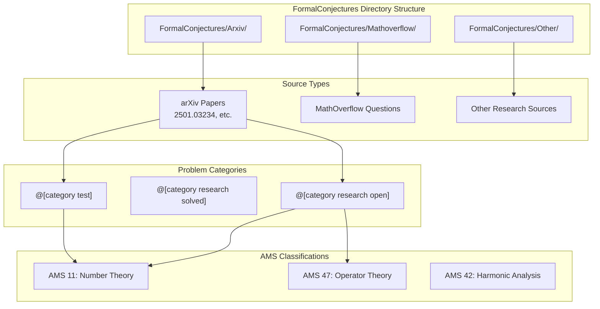
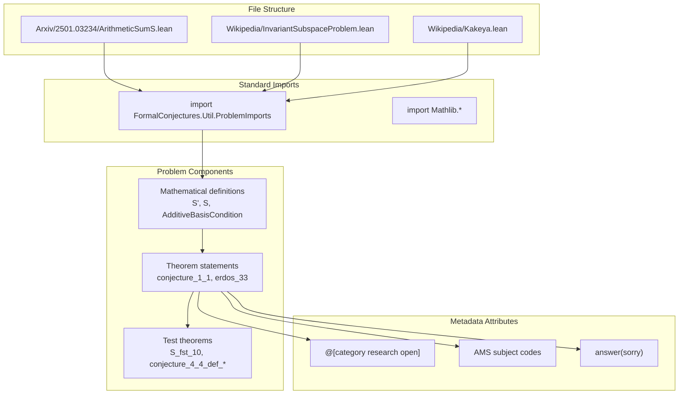
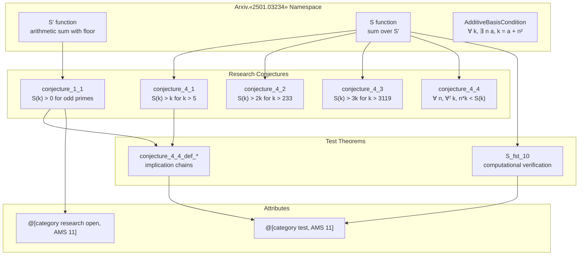
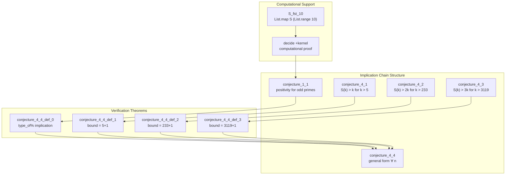
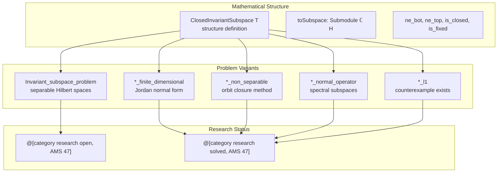
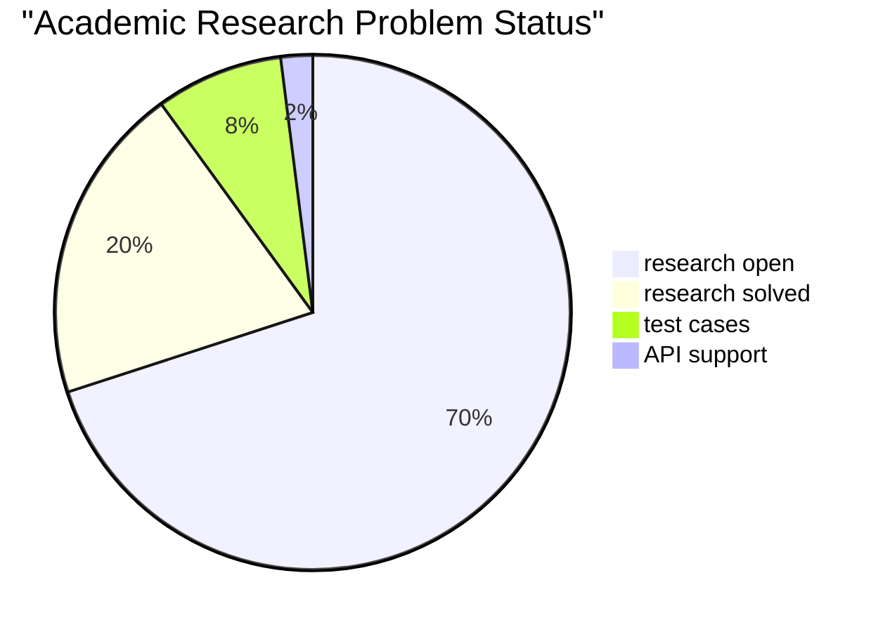

<!-- source: DeepWiki mcp.deepwiki.com · repo google-deepmind/formal-conjectures · page 3.2 Academic Research Problems · fetched 2026-10-26 -->

# Academic Research Problems

Relevant source files

The following files were used as context for generating this wiki page:

- [AUTHORS](AUTHORS)
- [FormalConjectures/Arxiv/2501.03234/ArithmeticSumS.lean](FormalConjectures/Arxiv/2501.03234/ArithmeticSumS.lean)
- [FormalConjectures/ErdosProblems/33.lean](FormalConjectures/ErdosProblems/33.lean)
- [FormalConjectures/Wikipedia/InvariantSubspaceProblem.lean](FormalConjectures/Wikipedia/InvariantSubspaceProblem.lean)
- [FormalConjectures/Wikipedia/Kakeya.lean](FormalConjectures/Wikipedia/Kakeya.lean)

This section documents the formalization of mathematical conjectures and open problems sourced from contemporary academic research literature. These problems represent cutting-edge mathematical research, typically from recent arXiv papers, MathOverflow discussions, and other active research venues. Unlike classical historical problems or established conjectures, these problems often reflect ongoing mathematical developments and emerging research questions.

Academic research problems are distinguished by their contemporary nature, technical sophistication, and often interdisciplinary mathematical scope. The repository organizes these problems by their source publication or discussion venue, maintaining traceability to the original research context.

## Problem Source Classification

Academic research problems are systematically organized by their publication venue and research context. The repository maintains separate directory structures for different source types, enabling clear traceability and appropriate citation practices.

### Academic Research Problem Organization

Sources: [FormalConjectures/Arxiv/2501.03234/ArithmeticSumS.lean:1-26](), [FormalConjectures/Wikipedia/InvariantSubspaceProblem.lean:17](), [FormalConjectures/Wikipedia/Kakeya.lean:17]()

## Implementation Architecture

Academic research problems follow a standardized implementation pattern that integrates with the repository's categorization and validation systems. Each problem source maintains consistent structure while allowing for domain-specific mathematical content.

### Code Organization Pattern

Sources: [FormalConjectures/Arxiv/2501.03234/ArithmeticSumS.lean:16-17](), [FormalConjectures/Wikipedia/InvariantSubspaceProblem.lean:17](), [FormalConjectures/Wikipedia/Kakeya.lean:17]()

## ArXiv Paper Problems

The arXiv collection represents formalized conjectures from recent mathematical research papers. These problems demonstrate the repository's approach to formalizing cutting-edge mathematical content with full traceability to source publications.

### Arithmetic Sum Paper Example

The most complete example is arXiv paper 2501.03234 on arithmetic sums associated with classical theta functions. This paper demonstrates the systematic approach to formalizing interconnected conjectures:

### Mathematical Structure

The paper demonstrates how complex mathematical relationships are formalized with precise dependencies and computational verification:

| Function | Definition | Purpose |
|----------|------------|---------|
| `S'` | `∑ j ∈ Finset.Ico 1 k, (-1 : ℤ) ^ (j + 1 + ⌊(h * j : ℚ) / k⌋₊)` | Core arithmetic sum |
| `S` | `∑ h ∈ Finset.Ico 1 k, S' h k` | Aggregate sum over all h |
| `AdditiveBasisCondition` | `∀ k, ∃ n a, a ∈ A ∧ k = a + n²` | Additive basis property |

Sources: [FormalConjectures/Arxiv/2501.03234/ArithmeticSumS.lean:30-130]()

## Contemporary Research Integration

Academic research problems demonstrate advanced integration patterns with the repository's infrastructure, particularly in handling complex mathematical relationships and computational verification.

### Conjecture Dependency Networks

Research problems often exhibit complex interdependencies, as demonstrated in the arithmetic sum paper:

### Advanced Mathematical Formalization

Contemporary research problems showcase sophisticated mathematical structures that push the boundaries of formal verification:

| Pattern | Example | Technical Implementation |
|---------|---------|-------------------------|
| Filter-based asymptotic statements | `∀ᶠ k in Filter.atTop` | Infinite limit conditions |
| Complex floor function arithmetic | `⌊(h * j : ℚ) / k⌋₊` | Mixed integer-rational computation |
| Parametric conjecture families | `conjecture_4_4 n` | Uniform statements over parameters |
| Computational verification | `decide +kernel` | Kernel-level proof automation |

Sources: [FormalConjectures/Arxiv/2501.03234/ArithmeticSumS.lean:90-129]()

## Specialized Research Areas

Academic research problems demonstrate sophisticated mathematical formalization across specialized domains, with each area requiring domain-specific mathematical infrastructure.

### Advanced Operator Theory

The Invariant Subspace Problem exemplifies complex functional analysis formalization:

### Geometric Analysis Integration

The Kakeya problem demonstrates integration of measure theory, harmonic analysis, and algebraic geometry:

| Problem Variant | Mathematical Framework | Implementation Status |
|------------------|----------------------|----------------------|
| `KakeyaSetConjectureDim n` | Hausdorff dimension theory | `@[category research open, AMS 42]` |
| `kakeya_2d` | Davies 1971 result | `@[category research solved, AMS 42]` |
| `kakeya_3d` | Wang-Zahl 2025 result | `@[category research solved, AMS 42]` |
| `kakeya_finite` | Finite field variant | `@[category research solved, AMS 52]` |

Sources: [FormalConjectures/Wikipedia/InvariantSubspaceProblem.lean:28-87](), [FormalConjectures/Wikipedia/Kakeya.lean:35-102]()

## Research Status Distribution

The academic problems demonstrate a clear distribution across research categories, reflecting their contemporary nature:

Most academic research problems remain open (`research open`), reflecting their cutting-edge nature. The `research solved` category includes problems with partial solutions or results that have been established since publication. Test cases and API support theorems provide computational verification and mathematical infrastructure.

Sources: [FormalConjectures/Arxiv/1609.08688/sIncreasingrTuples.lean:164-229](), [FormalConjectures/Arxiv/2208.14736/ZariskiCancellation.lean:49-69](), [FormalConjectures/Other/EquationalTheories_677_255.lean:35-69]()

---

