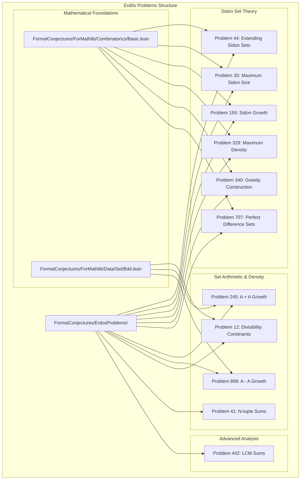
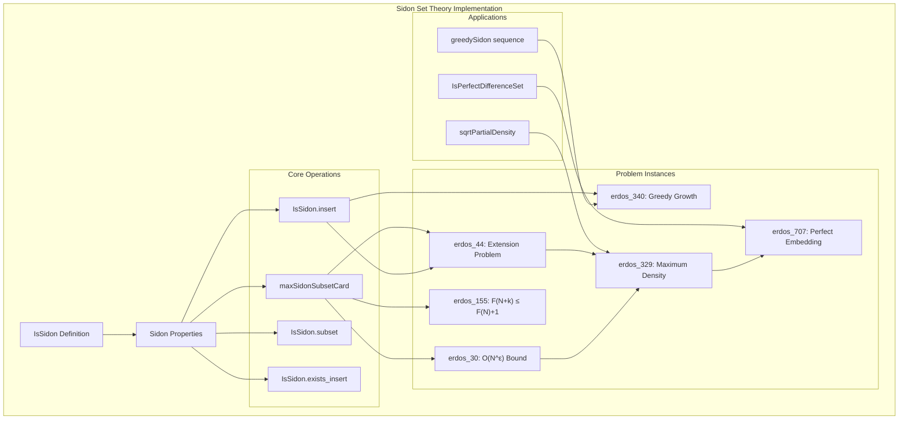
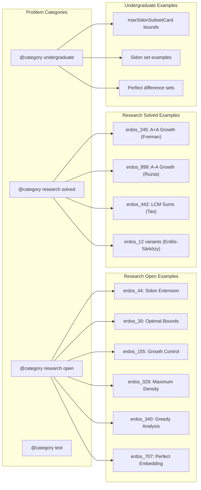

<!-- source: DeepWiki mcp.deepwiki.com · repo google-deepmind/formal-conjectures · page 3.3 Erdős Problems · fetched 2026-10-26 -->

# Erdős Problems

<details>
<summary>Relevant source files</summary>

The following files were used as context for generating this wiki page:

- [FormalConjectures/ErdosProblems/12.lean](FormalConjectures/ErdosProblems/12.lean)
- [FormalConjectures/ErdosProblems/155.lean](FormalConjectures/ErdosProblems/155.lean)
- [FormalConjectures/ErdosProblems/245.lean](FormalConjectures/ErdosProblems/245.lean)
- [FormalConjectures/ErdosProblems/30.lean](FormalConjectures/ErdosProblems/30.lean)
- [FormalConjectures/ErdosProblems/329.lean](FormalConjectures/ErdosProblems/329.lean)
- [FormalConjectures/ErdosProblems/340.lean](FormalConjectures/ErdosProblems/340.lean)
- [FormalConjectures/ErdosProblems/41.lean](FormalConjectures/ErdosProblems/41.lean)
- [FormalConjectures/ErdosProblems/44.lean](FormalConjectures/ErdosProblems/44.lean)
- [FormalConjectures/ErdosProblems/442.lean](FormalConjectures/ErdosProblems/442.lean)
- [FormalConjectures/ErdosProblems/707.lean](FormalConjectures/ErdosProblems/707.lean)
- [FormalConjectures/ErdosProblems/899.lean](FormalConjectures/ErdosProblems/899.lean)
- [FormalConjectures/ForMathlib/Combinatorics/Basic.lean](FormalConjectures/ForMathlib/Combinatorics/Basic.lean)
- [FormalConjectures/ForMathlib/Data/Set/Bdd.lean](FormalConjectures/ForMathlib/Data/Set/Bdd.lean)

</details>


This section covers the extensive collection of mathematical problems posed by Paul Erdős that have been formalized in the FormalConjectures repository. The problems span multiple areas including combinatorics, number theory, and analysis, with a particular emphasis on Sidon sets, set density theory, and additive combinatorics.

For Wikipedia-sourced mathematical problems, see [Wikipedia Conjectures](#3.1). For contemporary research problems from academic sources, see [Academic Research Problems](#3.2).

## Problem Collection Overview

The Erdős problems collection represents one of the most comprehensive formalizations of problems from a single mathematician, covering fundamental questions in additive combinatorics, extremal set theory, and asymptotic analysis.

### Problem Distribution by Mathematical Domain



**Sources:** [FormalConjectures/ErdosProblems/44.lean:1-101](), [FormalConjectures/ErdosProblems/30.lean:1-42](), [FormalConjectures/ErdosProblems/155.lean:1-48](), [FormalConjectures/ErdosProblems/329.lean:1-132](), [FormalConjectures/ErdosProblems/340.lean:1-176](), [FormalConjectures/ErdosProblems/707.lean:1-123](), [FormalConjectures/ErdosProblems/245.lean:1-83](), [FormalConjectures/ErdosProblems/899.lean:1-51](), [FormalConjectures/ErdosProblems/12.lean:1-128](), [FormalConjectures/ErdosProblems/41.lean:1-56](), [FormalConjectures/ErdosProblems/442.lean:1-118]()

## Core Mathematical Concepts

### Sidon Sets and Related Theory

The majority of Erdős problems in this collection revolve around Sidon sets, which are fundamental objects in additive combinatorics. The formal definition and key properties are established in the foundational layer.



**Sources:** [FormalConjectures/ForMathlib/Combinatorics/Basic.lean:26-139](), [FormalConjectures/ErdosProblems/44.lean:44-48](), [FormalConjectures/ErdosProblems/30.lean:36-40](), [FormalConjectures/ErdosProblems/155.lean:42-44](), [FormalConjectures/ErdosProblems/329.lean:46-49](), [FormalConjectures/ErdosProblems/340.lean:97-101](), [FormalConjectures/ErdosProblems/707.lean:44-48]()

The `IsSidon` predicate is defined as:
```lean
def IsSidon {S : Type*} [Membership α S] (A : S) : Prop := 
  ∀ᵉ (i₁ ∈ A) (j₁ ∈ A) (i₂ ∈ A) (j₂ ∈ A),
  i₁ + i₂ = j₁ + j₂ → (i₁ = j₁ ∧ i₂ = j₂) ∨ (i₁ = j₂ ∧ i₂ = j₁)
```

This captures the essential property that all pairwise sums are distinct except for trivial coincidences from commutativity.

### Set Arithmetic and Density Problems

Beyond Sidon sets, several problems focus on the growth rates and densities of sets under arithmetic operations.

| Problem | Focus | Key Concept | Status |
|---------|-------|-------------|---------|
| 245 | `\|(A + A) ∩ {1,...,N}\|` growth | `limsup` ratio ≥ 3 | Solved (Freiman) |
| 899 | `\|(A - A) ∩ {1,...,N}\|` growth | `limsup` ratio = ∞ | Solved (Ruzsa) |
| 12 | Divisibility constraints | `IsGood` sets with density bounds | Multiple variants |
| 41 | N-tuple sum distinctness | `NtupleCondition` with density | Open research |

**Sources:** [FormalConjectures/ErdosProblems/245.lean:42-49](), [FormalConjectures/ErdosProblems/899.lean:44-49](), [FormalConjectures/ErdosProblems/12.lean:33-35](), [FormalConjectures/ErdosProblems/41.lean:33-35]()

## Problem Organization and Categorization

### Research Status Classification

The problems are systematically categorized using the `@category` attribute system to indicate their research status and difficulty level.



**Sources:** [FormalConjectures/ErdosProblems/44.lean:44](), [FormalConjectures/ErdosProblems/30.lean:36](), [FormalConjectures/ErdosProblems/155.lean:41](), [FormalConjectures/ErdosProblems/329.lean:46](), [FormalConjectures/ErdosProblems/340.lean:97](), [FormalConjectures/ErdosProblems/707.lean:44](), [FormalConjectures/ErdosProblems/245.lean:42](), [FormalConjectures/ErdosProblems/899.lean:44](), [FormalConjectures/ErdosProblems/442.lean:81]()

### AMS Subject Classification

Each problem is tagged with appropriate AMS (American Mathematical Society) subject classifications:

- **AMS 5**: Combinatorics (primary for Sidon set problems)
- **AMS 11**: Number theory (for density and divisibility problems)  
- **AMS 26, 30, 33**: Analysis (for asymptotic and limit problems)

## Key Problem Highlights

### Problem 44: Sidon Set Extension

This problem asks whether any Sidon set can be extended to achieve near-optimal density. The formalization includes multiple variants and related results.

**Core Question:** Can every Sidon set `A ⊆ {1,...,N}` be extended with `B ⊆ {N+1,...,M}` such that `|A ∪ B| ≥ (1-ε)√M`?

**Sources:** [FormalConjectures/ErdosProblems/44.lean:36-48]()

### Problem 340: Greedy Sidon Sequence  

This problem analyzes the growth rate of the greedy construction for Sidon sets, which generates the sequence `1, 2, 4, 8, 13, 21, 31, ...`.

The `greedySidon` function is implemented with careful computational verification:
```lean
def greedySidon (n : ℕ) : ℕ := greedySidon.aux n |>.2
```

**Sources:** [FormalConjectures/ErdosProblems/340.lean:62](), [FormalConjectures/ErdosProblems/340.lean:64-88]()

### Problem 442: Advanced LCM Analysis

This recently solved problem (by Tao, 2024) involves sophisticated analysis of least common multiple sums over dense sets.

**Key Innovation:** Uses `Real.maxLogOne` for iterated logarithm expressions and `Set.bddProdUpper` for bounded upper-triangular products.

**Sources:** [FormalConjectures/ErdosProblems/442.lean:35-56](), [FormalConjectures/ErdosProblems/442.lean:82-87]()

## Mathematical Infrastructure

### Utility Functions for Set Analysis

The problems rely on several utility functions for analyzing finite intersections and bounded sets:

- `Set.interIcc`: Intersection with closed intervals
- `Set.interIio`: Intersection with half-open intervals  
- `Set.bddProdUpper`: Bounded upper-triangular products
- Various density and growth rate calculations

**Sources:** [FormalConjectures/ForMathlib/Data/Set/Bdd.lean:22-68](), [FormalConjectures/ErdosProblems/442.lean:44-50]()

### Integration with Answer System

All problems use the `answer()` elaborator system to handle unknown results:

```lean
theorem erdos_44 : (∀ᵉ (N ≥ (1 : ℕ)) (A ⊆ Finset.Icc 1 N), IsSidon A →
  ∀ᵉ (ε > (0 : ℝ)), ∃ᵉ (M > N) (B ⊆ Finset.Icc (N + 1) M),
    IsSidon (A ∪ B) ∧ (1 - ε) * Real.sqrt M ≤ (A ∪ B).card) ↔ answer(sorry)
```

This allows the repository to maintain formal statements even for open problems while clearly marking their status.

**Sources:** [FormalConjectures/ErdosProblems/44.lean:45-47]()

---

