# Page: Overview

# Overview

<details>
<summary>Relevant source files</summary>

The following files were used as context for generating this wiki page:

- [.devcontainer/devcontainer.json](.devcontainer/devcontainer.json)
- [.gitpod.yml](.gitpod.yml)
- [CONTRIBUTING.md](CONTRIBUTING.md)
- [FormalConjectures/Util/Answer.lean](FormalConjectures/Util/Answer.lean)
- [FormalConjectures/Wikipedia/HadwigerNelson.lean](FormalConjectures/Wikipedia/HadwigerNelson.lean)
- [README.md](README.md)

</details>


This document provides a comprehensive introduction to the FormalConjectures repository, a collection of formalized mathematical conjectures and open problems in Lean 4 using mathlib. The system centers around an innovative `answer()` elaborator that enables formalization of problems requiring user-provided answers, supported by a robust categorization and quality control framework.

For detailed information about specific problem collections, see [Mathematical Problem Collections](#3). For implementation details of core systems, see [System Architecture](#2).

## Purpose and Goals

The FormalConjectures repository addresses a gap in formal mathematics by providing a curated collection of formalized conjecture statements without proofs. The project serves three primary objectives:

1. **Automated Theorem Proving Benchmarks** - Creating standardized targets for ATP systems and automated formalization tools
2. **Mathematical Clarity** - Clarifying precise meanings of conjectures through formal specification  
3. **Mathlib Ecosystem Growth** - Identifying and developing needed definitions for the broader Lean community

The repository targets research-level mathematical problems while maintaining flexibility for educational variants when directly related to research questions.

Sources: [README.md:16-26]()

## Core Innovation: The answer() Elaborator System

The defining feature of this repository is the `answer()` elaborator, which enables formalization of problems that inherently require user-provided answers. This system distinguishes between providing proofs (replacing `sorry`) and providing meaningful mathematical answers.

### answer() Elaborator Architecture

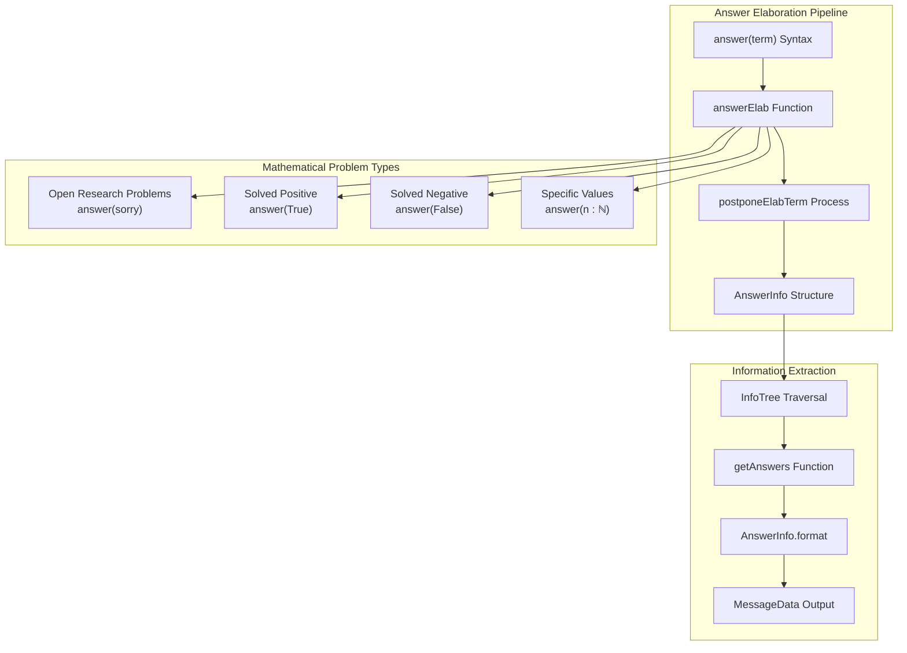

Sources: [FormalConjectures/Util/Answer.lean:37-43](), [FormalConjectures/Util/Answer.lean:47-51](), [FormalConjectures/Util/Answer.lean:59-71]()

### Example Usage Patterns

The `answer()` elaborator supports multiple problem formulation patterns:

| Problem Type | Formalization Pattern | Example Usage |
|-------------|----------------------|---------------|
| Existence Question | `P ↔ answer(sorry)` | Does property P hold? |
| Value Question | `f(x) = answer(sorry)` | What is the value of f(x)? |
| Set Question | `S = answer(sorry)` | What elements satisfy condition? |
| Solved Positive | `P ↔ answer(True)` | Problem proven true |
| Solved Negative | `P ↔ answer(False)` | Problem proven false |

Sources: [README.md:235-241](), [FormalConjectures/Wikipedia/HadwigerNelson.lean:47-49]()

## Problem Categorization Framework

The repository implements a dual-attribute system for mathematical problem classification using persistent environment extensions.

### Category Classification System

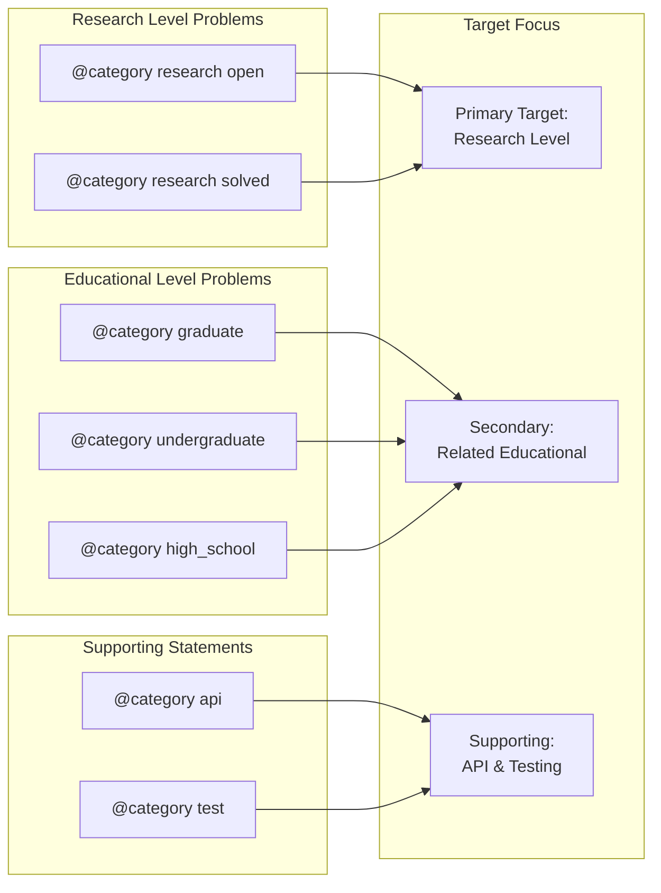

Sources: [README.md:134-147](), [README.md:155-164]()

### AMS Subject Classification

The system integrates with the AMS Mathematical Subject Classification (MSC2020) to provide standardized subject tagging:

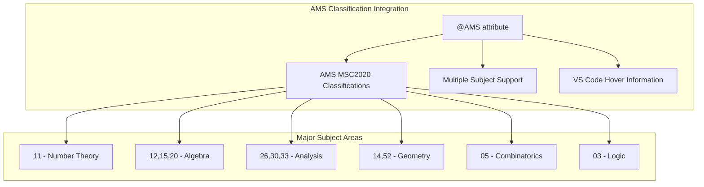

Sources: [README.md:168-188]()

## Repository Architecture and Organization

The repository follows a source-based organizational structure with specialized utility and extension directories.

### Directory Structure Mapping

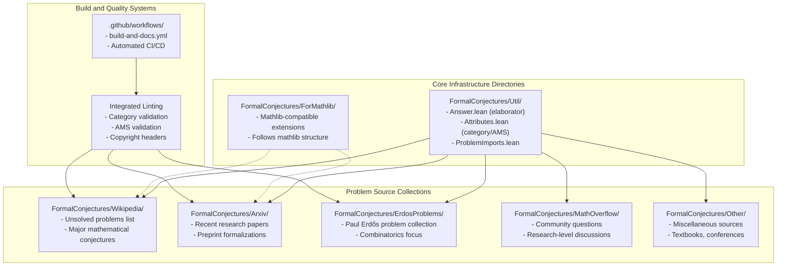

Sources: [README.md:116-126](), [README.md:119-122]()

## Quality Control and Development Workflow

The repository maintains code quality through integrated linting systems and standardized development practices.

### Linting and Validation Pipeline

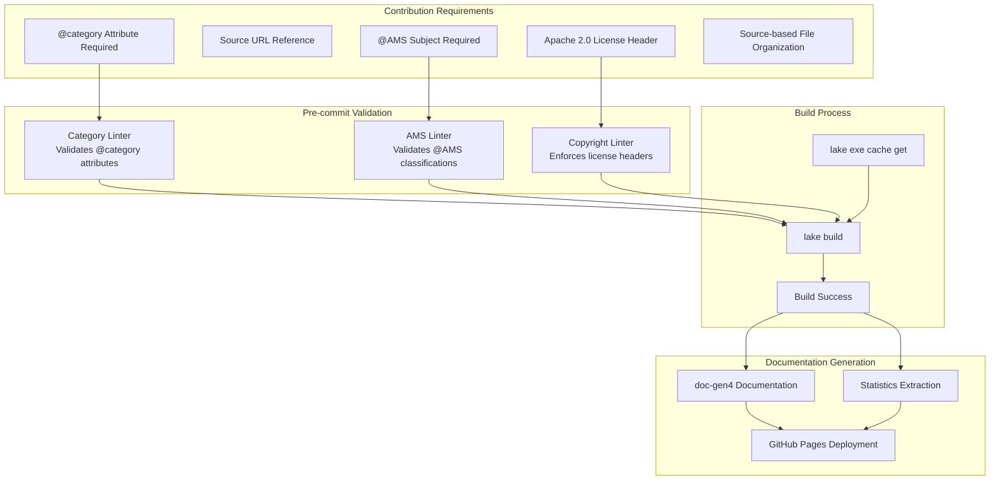

Sources: [README.md:99-100](), [README.md:251-268](), [README.md:95-98]()

### Development Environment Setup

The repository supports multiple development environments through standardized configurations:

| Environment | Configuration File | Key Features |
|------------|-------------------|--------------|
| Gitpod | `.gitpod.yml` | Cloud-based Lean 4 development |
| Dev Container | `.devcontainer/devcontainer.json` | Local containerized environment |
| Local Setup | Manual installation | Direct elan/lake installation |

All environments automatically execute `lake exe cache get` and `lake build` during initialization.

Sources: [.gitpod.yml:10-14](), [.devcontainer/devcontainer.json:6]()

## Mathematical Problem Examples

The following example demonstrates the complete formalization pattern using the Hadwiger-Nelson problem:

```lean
/--
The Hadwiger–Nelson problem asks: How many colors are required to color the plane
such that no two points at distance 1 from each other have the same color?
-/
@[category research open, AMS 52]
theorem HadwigerNelsonProblem :
    UnitDistancePlaneGraph.chromaticNumber = answer(sorry) := by
  sorry
```

This exemplifies the integration of:
- Custom mathematical definitions (`UnitDistancePlaneGraph`)  
- Category classification (`research open`)
- AMS subject classification (`52` for Convex and discrete geometry)
- Answer elaborator usage (`answer(sorry)`)
- Source documentation (Wikipedia URL reference)

Sources: [FormalConjectures/Wikipedia/HadwigerNelson.lean:46-49](), [FormalConjectures/Wikipedia/HadwigerNelson.lean:22]()

## Contributing and Community Integration

The repository integrates with the broader Lean community through multiple channels:

- **Zulip Integration**: Dedicated channel on leanprover Zulip for discussions
- **Mathlib Compatibility**: `ForMathlib` directory for upstream contributions  
- **GitHub Workflows**: Automated issue tracking for new conjecture proposals
- **Contributor License Agreement**: Google CLA requirement for contributions

The project encourages diverse contribution types including new problem formalizations, issue reports for desired problems, improvements to existing formalizations, and enhanced mathematical referencing.

Sources: [README.md:12](), [README.md:43-84](), [CONTRIBUTING.md:9-19]()

---

# Page: Getting Started

# Getting Started

<details>
<summary>Relevant source files</summary>

The following files were used as context for generating this wiki page:

- [.devcontainer/devcontainer.json](.devcontainer/devcontainer.json)
- [.gitpod.yml](.gitpod.yml)
- [CONTRIBUTING.md](CONTRIBUTING.md)
- [FormalConjectures/Util/Answer.lean](FormalConjectures/Util/Answer.lean)
- [FormalConjectures/Wikipedia/HadwigerNelson.lean](FormalConjectures/Wikipedia/HadwigerNelson.lean)
- [README.md](README.md)

</details>


This document provides installation instructions, build process setup, development environment configuration, and basic usage patterns for the FormalConjectures framework. It covers the essential steps to begin contributing mathematical conjecture formalizations in Lean 4.

For detailed information about the system architecture and core infrastructure components, see [System Architecture](#2). For specific conjecture collections and problem domains, see [Mathematical Problem Collections](#3).

## Prerequisites

The FormalConjectures project requires Lean 4 with mathlib support and uses the `lake` build system for dependency management.

### Required Tools

| Tool | Purpose | Installation Method |
|------|---------|-------------------|
| `elan` | Lean version manager | [Lean installation guide](https://leanprover-community.github.io/get_started.html) |
| `lake` | Lean build system | Installed with elan |
| `lean` | Lean 4 compiler | Managed by elan |
| VS Code | Recommended IDE | Optional with Lean 4 extension |

The project tracks monthly tagged releases of mathlib rather than the master branch to provide stability for conjecture formalization work.

Sources: [README.md:104-106]()

## Installation and Build Process

### Basic Installation

```bash
# Get precompiled mathlib cache
lake exe cache get

# Build the project
lake build
```

The cache download significantly reduces initial build time by avoiding recompilation of mathlib dependencies.

### Development Environment Options

#### Gitpod Cloud Development

Access a pre-configured development environment with one click:

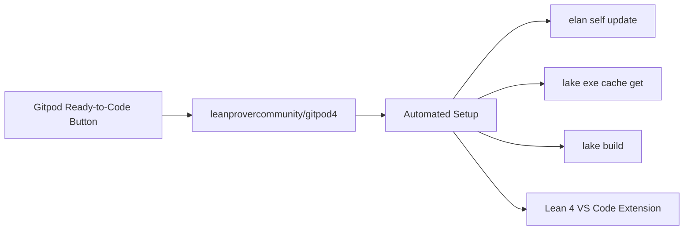

Sources: [README.md:4](), [.gitpod.yml:1-14]()

#### Local Development Container

For local development with container isolation:

```json
{
  "name": "Mathlib4 dev container",
  "image": "leanprovercommunity/gitpod4",
  "onCreateCommand": "lake exe cache get!"
}
```

The container automatically installs the Lean 4 VS Code extension and configures the environment.

Sources: [.devcontainer/devcontainer.json:1-17]()

## Project Structure Overview

The repository organizes conjecture formalizations by source type, with specialized directories for utilities and mathlib contributions.

### Directory Structure

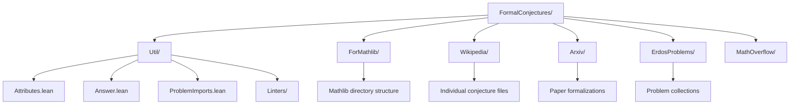

### Special Directories

- **`Util/`**: Core framework components including the `category` attribute system, `answer()` elaborator, and quality control linters
- **`ForMathlib/`**: Mathematical definitions and theorems suitable for upstreaming to mathlib, following mathlib's directory structure

Sources: [README.md:114-125]()

## Core Framework Components

The framework provides three essential systems for conjecture formalization: answer elaboration, problem categorization, and mathematical subject classification.

### Answer Elaborator System

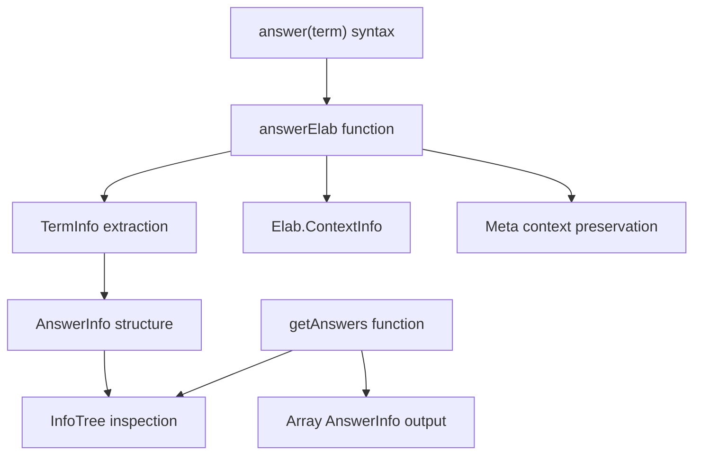

The `answerElab` function at [FormalConjectures/Util/Answer.lean:39-43]() processes `answer(term)` syntax by postponing elaboration and preserving context information for later extraction.

### Categorization and Classification Systems

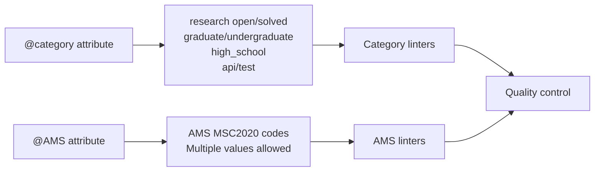

Sources: [README.md:129-188](), [FormalConjectures/Util/Answer.lean:37-44]()

## Basic Usage Workflow

### Adding a New Conjecture

The standard workflow for contributing conjecture formalizations follows these steps:

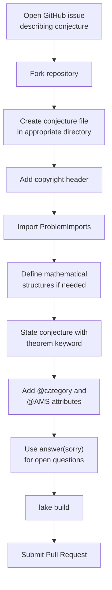

### Example Conjecture Structure

A typical conjecture file follows this pattern, demonstrated in [FormalConjectures/Wikipedia/HadwigerNelson.lean]():

```lean
-- Copyright header (lines 1-15)
import FormalConjectures.Util.ProblemImports

namespace HadwigerNelson

-- Mathematical definitions (lines 29-41)
def UnitDistancePlaneGraph : SimpleGraph (EuclideanSpace ℝ (Fin 2)) := ...

-- Main conjecture with attributes (lines 46-49)
@[category research open, AMS 52]
theorem HadwigerNelsonProblem :
    UnitDistancePlaneGraph.chromaticNumber = answer(sorry) := by
  sorry
```

### Required Elements

| Element | Purpose | Example |
|---------|---------|---------|
| Copyright header | Legal compliance | Lines 1-15 in all files |
| `ProblemImports` | Framework utilities | `import FormalConjectures.Util.ProblemImports` |
| `@category` attribute | Research status | `@[category research open]` |
| `@AMS` attribute | Subject classification | `@[AMS 52]` for geometry |
| `answer()` elaborator | Open question placeholder | `answer(sorry)` for unknown answers |

### Build Verification

```bash
# Verify code builds correctly
lake build

# Run linters (automatically executed in CI)
# - Category linter validates @category attributes  
# - AMS linter validates @AMS subject codes
# - Copyright linter ensures proper headers
```

Sources: [README.md:85-101](), [README.md:220-268](), [FormalConjectures/Wikipedia/HadwigerNelson.lean:1-71]()

---

# Page: System Architecture

# System Architecture

<details>
<summary>Relevant source files</summary>

The following files were used as context for generating this wiki page:

- [.devcontainer/devcontainer.json](.devcontainer/devcontainer.json)
- [.gitpod.yml](.gitpod.yml)
- [CONTRIBUTING.md](CONTRIBUTING.md)
- [FormalConjectures/Util/Answer.lean](FormalConjectures/Util/Answer.lean)
- [FormalConjectures/Util/Attributes.lean](FormalConjectures/Util/Attributes.lean)
- [FormalConjectures/Util/Attributes/AMS.lean](FormalConjectures/Util/Attributes/AMS.lean)
- [FormalConjectures/Util/Attributes/AttributesTest.lean](FormalConjectures/Util/Attributes/AttributesTest.lean)
- [FormalConjectures/Wikipedia/HadwigerNelson.lean](FormalConjectures/Wikipedia/HadwigerNelson.lean)
- [README.md](README.md)

</details>


This document provides a technical overview of the FormalConjectures system architecture, focusing on the core infrastructure components, categorization mechanisms, and quality control systems that enable formalized mathematical conjecture collection and validation. For information about specific mathematical problem collections, see [Mathematical Problem Collections](#3). For installation and setup procedures, see [Getting Started](#1.1).

## Core Infrastructure Components

The FormalConjectures system is built around several key infrastructure components that work together to enable mathematical conjecture formalization in Lean 4.

### Architecture Overview

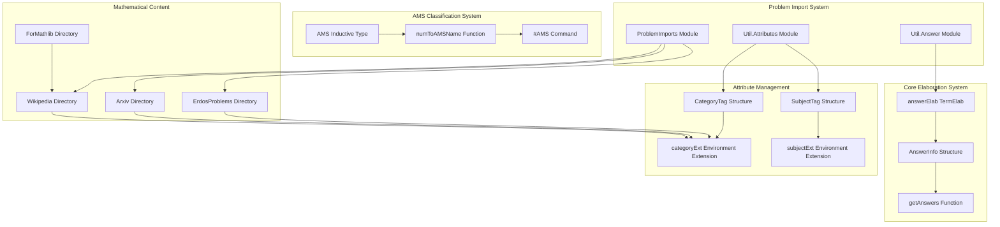

Sources: [README.md:119-126](), [FormalConjectures/Util/Attributes.lean:19-301](), [FormalConjectures/Util/Answer.lean:17-72]()

### The answer() Elaboration System

The `answer()` elaborator provides syntax for marking placeholder answers in mathematical problem statements where the solution requires a specific value or term.

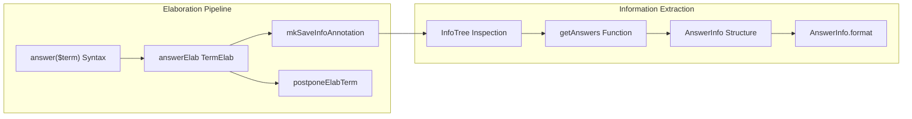

The elaborator processes terms of the form `answer(sorry)`, `answer(True)`, or `answer(False)` and preserves them for later extraction and analysis. The `AnswerInfo` structure stores both the elaborated term and its context for statistical and documentation purposes.

Sources: [FormalConjectures/Util/Answer.lean:37-72](), [README.md:189-219]()

## Problem Categorization System

The categorization system uses Lean 4 attributes to classify mathematical problems by research status and subject area, with persistent storage in environment extensions.

### Category Classification Architecture

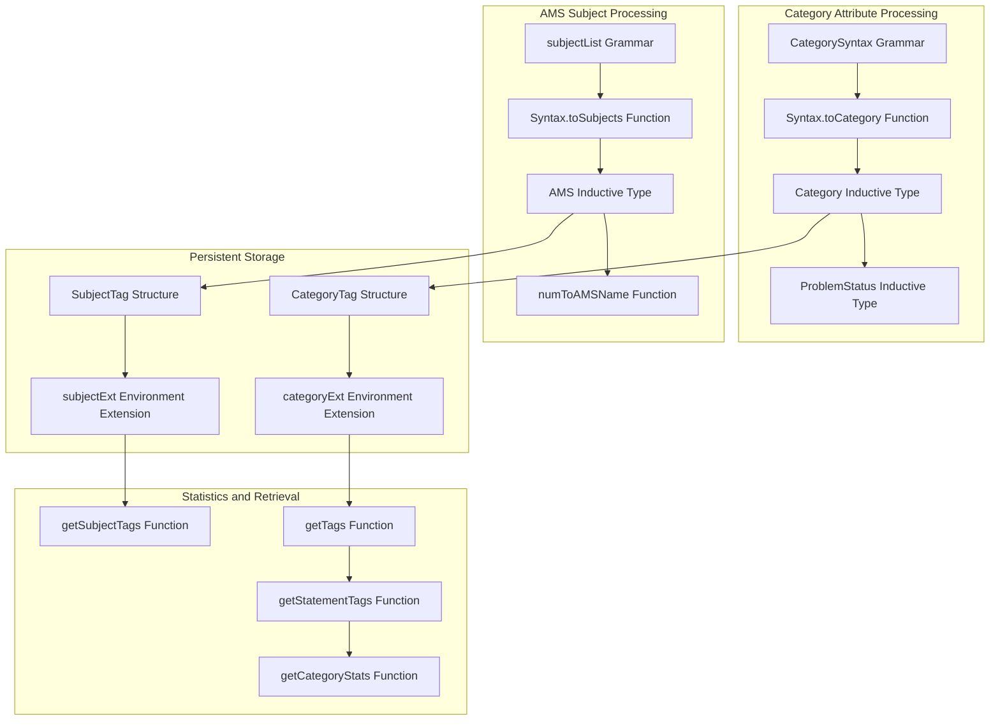

The system supports the following category classifications:
- `research open`: Unsolved mathematical problems
- `research solved`: Problems with accepted informal solutions  
- `graduate`, `undergraduate`, `high_school`: Educational level problems
- `test`: Sanity check statements
- `API`: Basic theory construction statements

Sources: [FormalConjectures/Util/Attributes.lean:94-301](), [README.md:129-188]()

### AMS Subject Classification

The AMS (American Mathematical Society) subject classification system maps numerical codes to mathematical subject areas using an inductive type with 54 constructors.

| AMS Code | Subject Area | Constructor |
|----------|--------------|-------------|
| 11 | Number theory | `AMS.«11»` |
| 52 | Convex and discrete geometry | `AMS.«52»` |
| 15 | Linear and multilinear algebra | `AMS.«15»` |
| 5 | Combinatorics | `AMS.«5»` |
| 33 | Special functions | `AMS.«33»` |

The `#AMS` command provides interactive access to all available subject classifications within Lean files.

Sources: [FormalConjectures/Util/Attributes/AMS.lean:39-196](), [FormalConjectures/Util/Attributes/AttributesTest.lean:104-105]()

## Quality Control Pipeline

The quality control system enforces consistent metadata, formatting, and build validation across all conjecture formalizations.

### Validation Workflow

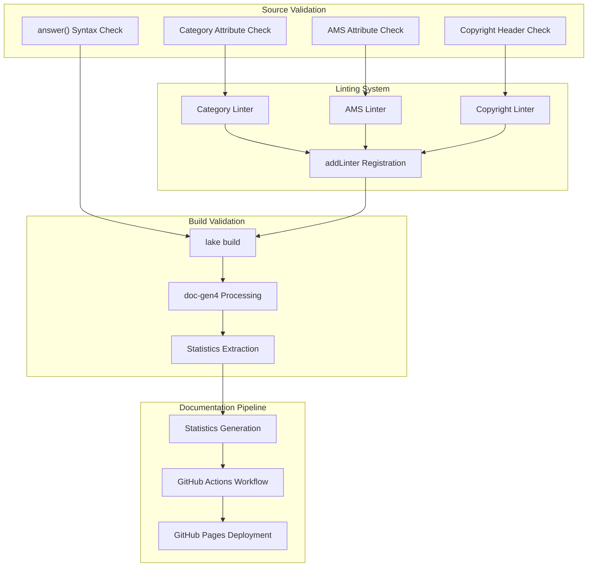

Each conjecture file must include:
1. Apache 2.0 copyright header as specified in [README.md:250-267]()
2. At least one `@[AMS n]` subject classification attribute
3. One `@[category type]` classification attribute
4. Proper `answer(sorry/True/False)` syntax for questions requiring specific answers

Sources: [README.md:220-267](), [.github/workflows/build-and-docs.yml (inferred)]()

## Mathematical Content Organization

The repository organizes mathematical content using a source-based directory structure that separates conjectures by their origin and provides extensions for mathlib integration.

### Directory Structure Mapping

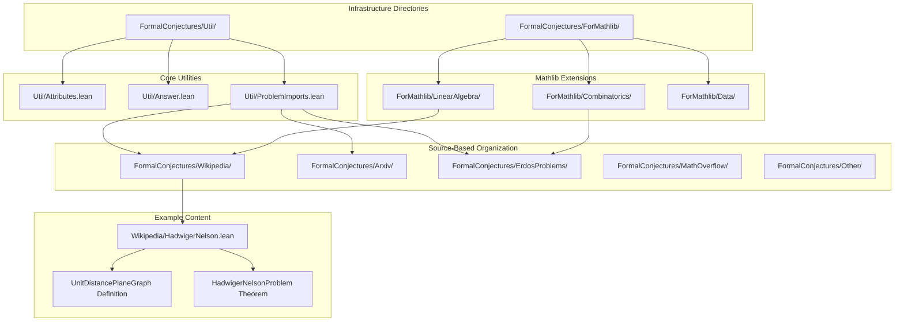

The `ForMathlib` directory contains mathematical definitions and theorems intended for eventual upstreaming to mathlib, following mathlib's directory structure conventions. This allows the repository to include necessary definitions without waiting for mathlib releases.

Sources: [README.md:114-126](), [README.md:272-280](), [FormalConjectures/Wikipedia/HadwigerNelson.lean:27-70]()

### Build and Development Environment

The system supports multiple development environments through standardized configuration:

- **Gitpod**: Cloud-based development with automatic cache retrieval and build
- **DevContainer**: Local containerized development environment  
- **Local Setup**: Traditional `lake exe cache get` and `lake build` workflow

All environments use the `leanprovercommunity/gitpod4` base image and include automatic Lean 4 extension installation and mathlib cache management.

Sources: [.gitpod.yml:1-14](), [.devcontainer/devcontainer.json:1-17](), [README.md:104-113]()

---

# Page: Core Infrastructure

# Core Infrastructure

<details>
<summary>Relevant source files</summary>

The following files were used as context for generating this wiki page:

- [.devcontainer/devcontainer.json](.devcontainer/devcontainer.json)
- [.gitpod.yml](.gitpod.yml)
- [CONTRIBUTING.md](CONTRIBUTING.md)
- [FormalConjectures/Arxiv/2504.17644/Margulis.lean](FormalConjectures/Arxiv/2504.17644/Margulis.lean)
- [FormalConjectures/ForMathlib/LinearAlgebra/GeneralLinearGroup.lean](FormalConjectures/ForMathlib/LinearAlgebra/GeneralLinearGroup.lean)
- [FormalConjectures/ForMathlib/LinearAlgebra/SpecialLinearGroup.lean](FormalConjectures/ForMathlib/LinearAlgebra/SpecialLinearGroup.lean)
- [FormalConjectures/Util/Answer.lean](FormalConjectures/Util/Answer.lean)
- [FormalConjectures/Util/ForMathlib.lean](FormalConjectures/Util/ForMathlib.lean)
- [FormalConjectures/Wikipedia/HadwigerNelson.lean](FormalConjectures/Wikipedia/HadwigerNelson.lean)
- [README.md](README.md)

</details>


This document covers the fundamental architectural components that enable conjecture formalization in the FormalConjectures repository. This includes the `answer()` elaborator system for handling open problems, the ForMathlib extension framework for mathematical definitions, and the core utilities that support the entire formalization pipeline.

For information about problem categorization and metadata systems, see [Problem Categorization System](#2.2). For quality control mechanisms, see [Quality Control and Validation](#2.3).

## Answer Elaborator System

The `answer()` elaborator is the cornerstone mechanism that enables formalization of open mathematical problems where the solution is unknown. It provides syntax for marking placeholder answers in problem statements.

### Answer Elaborator Architecture

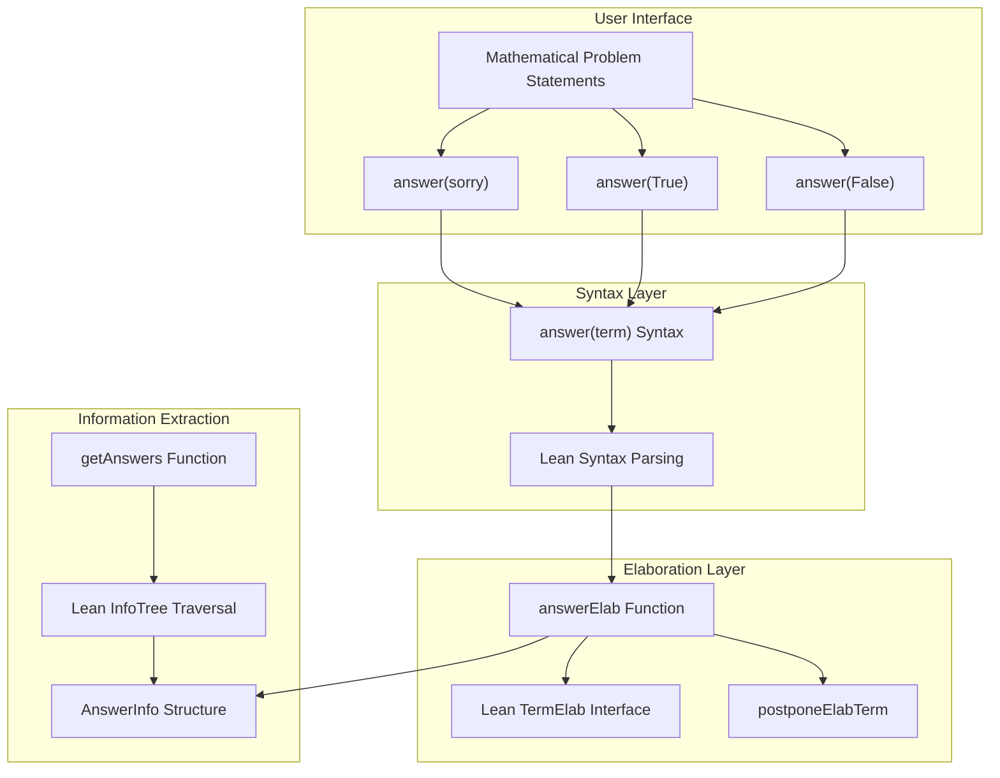

Sources: [FormalConjectures/Util/Answer.lean:17-72](), [README.md:189-218]()

### Core Answer Components

The answer system consists of several key components working together:

| Component | Location | Purpose |
|-----------|----------|---------|
| `answerElab` | [FormalConjectures/Util/Answer.lean:39-43]() | Main elaborator function handling `answer(term)` syntax |
| `AnswerInfo` | [FormalConjectures/Util/Answer.lean:48-50]() | Structure storing context and term information for answers |
| `getAnswers` | [FormalConjectures/Util/Answer.lean:60-71]() | Recursive function extracting answers from InfoTree |
| `AnswerInfo.format` | [FormalConjectures/Util/Answer.lean:53-57]() | Pretty-printing for answer information |

The `answerElab` function transforms `answer(term)` syntax into a postponed elaboration using `by exact $a`, enabling type-correct placeholder insertion in mathematical statements.

Sources: [FormalConjectures/Util/Answer.lean:38-72]()

### Answer Usage Patterns

The answer elaborator supports three primary usage patterns for different problem states:

```lean
-- Open problem (unknown answer)
theorem openProblem : Property ↔ answer(sorry) := by sorry

-- Solved positive (known to be true)  
theorem solvedTrue : Property ↔ answer(True) := by sorry

-- Solved negative (known to be false)
theorem solvedFalse : Property ↔ answer(False) := by sorry
```

Sources: [README.md:235-249](), [FormalConjectures/Wikipedia/HadwigerNelson.lean:47-49]()

## ForMathlib Extensions Framework

ForMathlib provides a structured approach to developing mathematical definitions and theorems that are intended for eventual upstream contribution to mathlib. This enables rapid conjecture formalization without waiting for mathlib release cycles.

### ForMathlib Organization Structure

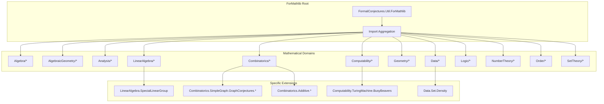

Sources: [FormalConjectures/Util/ForMathlib.lean:17-59]()

### Matrix Group Extensions Example

The matrix group extensions demonstrate the ForMathlib pattern for developing specialized mathematical structures:

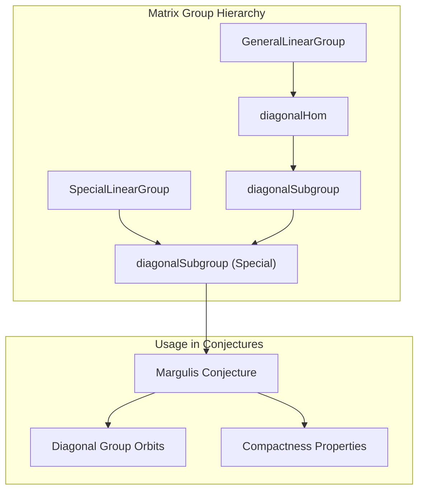

Sources: [FormalConjectures/ForMathlib/LinearAlgebra/GeneralLinearGroup.lean:25-34](), [FormalConjectures/ForMathlib/LinearAlgebra/SpecialLinearGroup.lean:25-27](), [FormalConjectures/Arxiv/2504.17644/Margulis.lean:47-52]()

## Core Infrastructure Integration

The core infrastructure components work together to enable the complete formalization workflow:

### Infrastructure Component Relationships

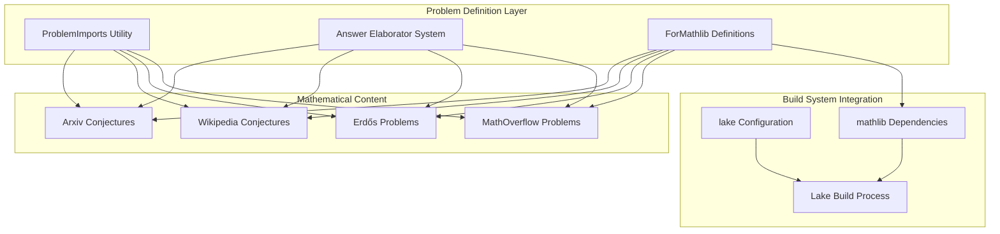

Sources: [README.md:104-126](), [FormalConjectures/Arxiv/2504.17644/Margulis.lean:17]()

### Development Workflow Integration

The core infrastructure enables a structured development workflow:

| Stage | Infrastructure Component | Function |
|-------|-------------------------|----------|
| Problem Import | `ProblemImports` utility | Provides standardized imports for conjecture files |
| Mathematical Definitions | ForMathlib extensions | Supplies domain-specific definitions and theorems |
| Problem Statement | `answer()` elaborator | Handles unknown values in open problems |
| Type Checking | Lean 4 + mathlib | Validates mathematical correctness |
| Build Integration | Lake build system | Compiles entire project including ForMathlib |

The infrastructure supports both rapid prototyping of new mathematical concepts in ForMathlib and systematic formalization of conjectures using the `answer()` mechanism.

Sources: [README.md:189-218](), [README.md:276-279]()

## Build System and Dependencies

The core infrastructure relies on a carefully configured build environment:

### Dependency Structure

- **Lean 4**: Core theorem prover and type system
- **mathlib**: Standard mathematical library providing foundational definitions
- **Lake**: Build system managing dependencies and compilation  
- **ForMathlib**: Project-specific extensions bridging gaps in mathlib coverage

The system tracks mathlib monthly tagged releases rather than master branch for stability, with ForMathlib extensions providing immediate access to needed definitions without waiting for mathlib release cycles.

Sources: [README.md:272-279](), [.gitpod.yml:10-13](), [.devcontainer/devcontainer.json:6]()

---

# Page: Problem Categorization System

# Problem Categorization System

<details>
<summary>Relevant source files</summary>

The following files were used as context for generating this wiki page:

- [FormalConjectures/Util/Attributes.lean](FormalConjectures/Util/Attributes.lean)
- [FormalConjectures/Util/Attributes/AMS.lean](FormalConjectures/Util/Attributes/AMS.lean)
- [FormalConjectures/Util/Attributes/AttributesTest.lean](FormalConjectures/Util/Attributes/AttributesTest.lean)

</details>


This document describes the dual attribute system used to classify mathematical problems in the FormalConjectures repository. The system provides two orthogonal classification mechanisms: a `@category` attribute for problem difficulty and research status, and an `@AMS` attribute for mathematical subject classification according to the American Mathematical Society's subject classification system.

For information about the quality control mechanisms that enforce these attributes, see [Quality Control and Validation](#2.3). For details on how these attributes are used in documentation generation, see [Build and Documentation Pipeline](#2.4).

## Category Attribute System

The category attribute system classifies mathematical statements by their difficulty level and research status using the `@category` annotation. This system distinguishes between educational problems at different levels, research problems (both open and solved), and auxiliary statements like tests and API definitions.

### Category Types and Values

The system defines six distinct categories through the `Category` inductive type:

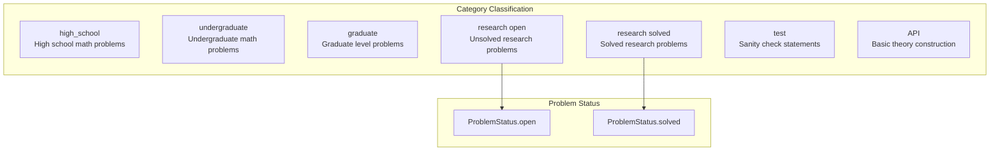

Sources: [FormalConjectures/Util/Attributes.lean:112-125](), [FormalConjectures/Util/Attributes.lean:94-100]()

### Usage Examples and Syntax

The category attribute uses a structured syntax that supports both simple categories and research-level problems with status indicators:

| Attribute Syntax | Description | Use Case |
|------------------|-------------|----------|
| `@[category high_school]` | High school level problem | IMO problems, basic algebra |
| `@[category undergraduate]` | Undergraduate level problem | Standard university coursework |
| `@[category graduate]` | Graduate level problem | Advanced mathematical concepts |
| `@[category research open]` | Open research problem | Unresolved conjectures |
| `@[category research solved]` | Solved research problem | Proven theorems with accepted solutions |
| `@[category test]` | Test statement | Definition sanity checks |
| `@[category API]` | API construction | Basic theory around definitions |

Sources: [FormalConjectures/Util/Attributes.lean:47-65](), [FormalConjectures/Util/Attributes.lean:207-214]()

## AMS Subject Classification System

The AMS attribute system classifies mathematical problems according to the American Mathematical Society's Mathematics Subject Classification using numeric codes. This provides standardized subject categorization used throughout mathematical literature.

### AMS Classification Structure

```mermaid
graph LR
    subgraph "AMS Categories (Selected)"
        N11["11<br/>Number Theory"]
        N12["12<br/>Field Theory"]
        N15["15<br/>Linear Algebra"]
        N20["20<br/>Group Theory"]
        N26["26<br/>Real Functions"]
        N30["30<br/>Complex Functions"]
        N33["33<br/>Special Functions"]
        N5["5<br/>Combinatorics"]
        N51["51<br/>Geometry"]
        N52["52<br/>Convex Geometry"]
    end
    
    subgraph "Implementation"
        AMSEnum["AMS inductive type<br/>97 total subjects"]
        AMSCommand["#AMS command<br/>List all subjects"]
        NumToName["numToAMSName<br/>Numeric lookup"]
    end
    
    AMSEnum --> N11
    AMSEnum --> N12
    AMSEnum --> N15
    AMSCommand --> AMSEnum
    NumToName --> AMSEnum
```

Sources: [FormalConjectures/Util/Attributes/AMS.lean:39-166](), [FormalConjectures/Util/Attributes/AMS.lean:187-195]()

### Subject Code Validation and Lookup

The system provides several mechanisms for working with AMS codes:

- **Numeric Lookup**: `numToAMSName` converts integers to valid AMS names [FormalConjectures/Util/Attributes/AMS.lean:168-171]()
- **Description Extraction**: `AMS.getDesc` retrieves docstring descriptions [FormalConjectures/Util/Attributes/AMS.lean:173-176]()  
- **Interactive Command**: `#AMS` displays all available subjects [FormalConjectures/Util/Attributes/AMS.lean:187-195]()
- **Multiple Subjects**: Single problems can have multiple AMS classifications

Sources: [FormalConjectures/Util/Attributes/AMS.lean:168-184]()

## Implementation Architecture

The categorization system uses Lean's persistent environment extensions to store metadata about mathematical problems throughout compilation and across module boundaries.

### Persistent Storage Architecture

```mermaid
graph TD
    subgraph "Attribute Registration"
        CategoryAttr["@category attribute<br/>Category_attr"]
        AMSAttr["@AMS attribute<br/>problemSubject"]
        AttrParser["Syntax parsing<br/>CategorySyntax, subjectList"]
    end
    
    subgraph "Data Structures"
        CategoryTag["CategoryTag<br/>{declName, category, informal}"]
        SubjectTag["SubjectTag<br/>{declName, subjects, informal}"]
    end
    
    subgraph "Environment Extensions"
        CategoryExt["categoryExt<br/>SimplePersistentEnvExtension"]
        SubjectExt["subjectExt<br/>SimplePersistentEnvExtension"]
    end
    
    subgraph "Storage"
        CategoryHashSet["HashSet CategoryTag"]
        SubjectHashSet["HashSet SubjectTag"]
    end
    
    CategoryAttr --> AttrParser
    AMSAttr --> AttrParser
    AttrParser --> CategoryTag
    AttrParser --> SubjectTag
    CategoryTag --> CategoryExt
    SubjectTag --> SubjectExt
    CategoryExt --> CategoryHashSet
    SubjectExt --> SubjectHashSet
```

Sources: [FormalConjectures/Util/Attributes.lean:131-146](), [FormalConjectures/Util/Attributes.lean:153-173]()

### Attribute Processing Pipeline

The system processes attributes during Lean's elaboration phase using a multi-stage pipeline:

```mermaid
flowchart TD
    subgraph "Declaration Processing"
        DeclSource["Theorem/Definition<br/>with attributes"]
        SyntaxParse["Syntax.toCategory<br/>Syntax.toSubjects"]
        Validation["Attribute validation<br/>Type checking"]
        DocExtract["findDocString?<br/>Extract informal docs"]
    end
    
    subgraph "Environment Storage"
        AddCategory["addCategoryEntry<br/>Store category metadata"]
        AddSubject["addSubjectEntry<br/>Store subject metadata"]
        ModifyEnv["modifyEnv<br/>Update environment"]
    end
    
    subgraph "Retrieval Interface"
        GetTags["getTags<br/>Retrieve all category tags"]
        GetSubjectTags["getSubjectTags<br/>Retrieve subject tags"]
        GetStats["getCategoryStats<br/>Statistical analysis"]
    end
    
    DeclSource --> SyntaxParse
    SyntaxParse --> Validation
    Validation --> DocExtract
    DocExtract --> AddCategory
    DocExtract --> AddSubject
    AddCategory --> ModifyEnv
    AddSubject --> ModifyEnv
    ModifyEnv --> GetTags
    ModifyEnv --> GetSubjectTags
    ModifyEnv --> GetStats
```

Sources: [FormalConjectures/Util/Attributes.lean:215-227](), [FormalConjectures/Util/Attributes.lean:254-264](), [FormalConjectures/Util/Attributes.lean:286-299]()

## Statistics and Analysis Functions

The system provides helper functions for analyzing the distribution of categorized problems across the codebase. These functions enable generation of statistics for documentation and repository analytics.

### Statistical Analysis Interface

| Function | Purpose | Return Type |
|----------|---------|-------------|
| `getTags` | Retrieve all category tags | `Array CategoryTag` |
| `getStatementTags` | Group tags by category | `HashMap Category (Array CategoryTag)` |
| `getCategoryStats` | Count problems per category | `Category → Nat` |
| `getSubjectTags` | Retrieve all subject tags | `Array SubjectTag` |

The `splitByFun` helper function enables grouping of tagged problems by arbitrary classification functions, supporting flexible statistical analysis of the problem collection.

Sources: [FormalConjectures/Util/Attributes.lean:272-299]()

### Example Usage in Practice

The attribute test file demonstrates typical usage patterns combining both classification systems:

```lean
@[category research solved, AMS 11]
theorem FLT : FermatLastTheorem := by sorry

@[category research open, AMS 11 33]  
theorem an_open_problem : Transcendental ℝ (π + rexp 1) := by sorry
```

This shows how a single mathematical statement can be classified with both difficulty/status information and multiple subject areas simultaneously.

Sources: [FormalConjectures/Util/Attributes/AttributesTest.lean:29-36]()

---

# Page: Quality Control and Validation

# Quality Control and Validation

<details>
<summary>Relevant source files</summary>

The following files were used as context for generating this wiki page:

- [FormalConjectures/Util/Linters/AMSLinter.lean](FormalConjectures/Util/Linters/AMSLinter.lean)
- [FormalConjectures/Util/Linters/AMSLinterTest.lean](FormalConjectures/Util/Linters/AMSLinterTest.lean)
- [FormalConjectures/Util/Linters/CategoryLinter.lean](FormalConjectures/Util/Linters/CategoryLinter.lean)
- [FormalConjectures/Util/Linters/CategoryLinterTest.lean](FormalConjectures/Util/Linters/CategoryLinterTest.lean)
- [FormalConjectures/Util/Linters/CopyrightLinter.lean](FormalConjectures/Util/Linters/CopyrightLinter.lean)
- [FormalConjectures/Util/ProblemImports.lean](FormalConjectures/Util/ProblemImports.lean)

</details>


## Purpose and Scope

The Quality Control and Validation system enforces consistent metadata and formatting standards across all mathematical formalizations in the FormalConjectures repository. This automated validation system operates during compilation to ensure that:

1. **Mathematical statements** are properly categorized with `@category` attributes
2. **Subject classifications** are correctly tagged with `@AMS` attributes  
3. **Copyright headers** follow the project's standardized format

The system consists of three complementary linters that validate different aspects of code quality, ensuring repository-wide consistency and enabling systematic organization of mathematical conjectures.

For information about the attribute systems themselves, see [Problem Categorization System](#2.2). For build automation details, see [Build and Documentation Pipeline](#2.4).

## Linter System Overview

The quality control system consists of three specialized linters that validate different aspects of mathematical formalizations during compilation:

### Overall Linter Architecture

```mermaid
graph TD
    subgraph "Linter System"
        ProbImports["ProblemImports.lean"] --> CategoryL["CategoryLinter"]
        ProbImports --> AMSL["AMSLinter"] 
        ProbImports --> CopyrightL["CopyrightLinter"]
    end
    
    subgraph "Target Validation"
        CategoryL --> CatVal["@category attribute validation"]
        AMSL --> AMSVal["@AMS attribute validation"]
        CopyrightL --> CopyrightVal["Copyright header validation"]
    end
    
    subgraph "Declaration Types"
        Theorems["theorem declarations"] --> CategoryL
        Lemmas["lemma declarations"] --> CategoryL
        Examples["example declarations"] --> CategoryL
        
        Theorems --> AMSL
        Lemmas --> AMSL  
        Examples --> AMSL
        
        Files["All .lean files"] --> CopyrightL
    end
    
    subgraph "Quality Enforcement"
        CatVal --> BuildSystem["Build System"]
        AMSVal --> BuildSystem
        CopyrightVal --> BuildSystem
    end
    
    subgraph "Testing Infrastructure"
        CategoryLinterTest["CategoryLinterTest.lean"] --> CategoryL
        AMSLinterTest["AMSLinterTest.lean"] --> AMSL
    end
```

Sources: [FormalConjectures/Util/ProblemImports.lean:22-24](), [FormalConjectures/Util/Linters/CategoryLinter.lean:45](), [FormalConjectures/Util/Linters/AMSLinter.lean:47](), [FormalConjectures/Util/Linters/CopyrightLinter.lean:46]()

### Linter Comparison Matrix

| Linter | Target Scope | Validation Focus | Error Types |
|--------|--------------|------------------|-------------|
| `problemStatusLinter` | theorem/lemma/example | `@category` attributes | Missing category |
| `AMSLinter` | theorem/lemma/example | `@AMS` attributes | Missing AMS, formatting, ordering |
| `copyrightLinter` | All .lean files | File header | Incorrect copyright header |

## Category Attribute Linter

The `problemStatusLinter` validates that mathematical declarations have appropriate `@category` attributes to distinguish between research problems, solved problems, and background material.

### Category Linter Implementation

```mermaid
graph TD
    subgraph "problemStatusLinter Function"
        PSLRun["problemStatusLinter.run"] --> PatternMatch["Pattern match on command syntax"]
        PatternMatch --> ExtractMods["Extract declModifiers"]
        ExtractMods --> ToCategory["toCategory function"]
    end
    
    subgraph "toCategory Processing"
        ToCategory --> FilterAtts["filterM on attrInstance"]
        FilterAtts --> CategoryCheck["Match 'attrInstance | category $_'"]
        CategoryCheck --> ReturnArray["Return Array of category attributes"]
    end
    
    subgraph "Validation Decision"
        ReturnArray --> SizeCheck["Check array.size == 0"]
        SizeCheck --> LogWarning["logWarningAt: Missing problem category attribute"]
        SizeCheck --> Continue["Continue if present"]
    end
    
    subgraph "Supported Declarations"
        TheoremPattern["theorem $_ $_:bracketedBinder* : $_ := $_"]
        LemmaPattern["lemma $_ $_:bracketedBinder* : $_ := $_"]
        ExamplePattern["example $_:bracketedBinder* : $_ := $_"]
    end
    
    PatternMatch --> TheoremPattern
    PatternMatch --> LemmaPattern  
    PatternMatch --> ExamplePattern
```

Sources: [FormalConjectures/Util/Linters/CategoryLinter.lean:45-57](), [FormalConjectures/Util/Linters/CategoryLinter.lean:32-41]()

### Validation Rules

| Declaration Type | Pattern | Category Required |
|------------------|---------|------------------|
| `theorem` | `theorem $_ $_:bracketedBinder* : $_ := $_` | Yes |
| `lemma` | `lemma $_ $_:bracketedBinder* : $_ := $_` | Yes |  
| `example` | `example $_:bracketedBinder* : $_ := $_` | Yes |
| `def` | Not matched | No |

The linter supports multiple attribute combinations and is order-independent:
- `@[category research open]`
- `@[simp, category research open]` 
- `@[category research open, simp]`

Sources: [FormalConjectures/Util/Linters/CategoryLinter.lean:48-50](), [FormalConjectures/Util/Linters/CategoryLinterTest.lean:64-72]()

## AMS Subject Classification Linter

The `AMSLinter` validates that mathematical declarations include proper `@AMS` subject classification codes and enforces consistent formatting of these tags.

### AMS Linter Architecture

```mermaid
graph TD
    subgraph "AMSLinter Function"
        AMSRun["AMSLinter.run"] --> PatternMatch["Pattern match declarations"]
        PatternMatch --> ToAMS["toAMS function"]
        ToAMS --> ExtractAMS["Extract AMS attribute arrays"]
    end
    
    subgraph "Validation Logic"
        ExtractAMS --> MultipleCheck["Check ams.size > 1"]
        ExtractAMS --> EmptyCheck["Check ams.size == 0"]
        ExtractAMS --> NumberCheck["Check ams.flatten.isEmpty"]
        ExtractAMS --> OrderCheck["Check sorted order"]
        ExtractAMS --> DupCheck["Check for duplicates"]
    end
    
    subgraph "Error Generation"
        MultipleCheck --> FormatError["Format as single AMS tag"]
        EmptyCheck --> MissingError["Missing AMS attribute"]
        NumberCheck --> NumberError["AMS tag needs numbers"]
        OrderCheck --> OrderError["Sort AMS tags"]
        DupCheck --> DuplicateError["Remove duplicates"]
    end
    
    subgraph "AMS Processing"
        mkAMSSyntax["mkAMSSyntax function"] --> FormatError
        mkAMSSyntax --> OrderError
        mkAMSSyntax --> DuplicateError
    end
```

Sources: [FormalConjectures/Util/Linters/AMSLinter.lean:47-76](), [FormalConjectures/Util/Linters/AMSLinter.lean:32-40](), [FormalConjectures/Util/Linters/AMSLinter.lean:42-43]()

### AMS Validation Rules

| Validation Type | Condition | Error Message |
|----------------|-----------|---------------|
| Missing AMS | `ams.size == 0` | "Missing AMS attribute." |
| Multiple Tags | `ams.size > 1` | "The AMS tag should be formatted as AMS 1 3 rather than AMS 1, AMS 3" |  
| Empty Numbers | `ams.flatten.isEmpty` | "The AMS tag should have at least one subject number." |
| Wrong Order | `ams_sorted != ams.flatten` | "The AMS tags should be ordered as AMS 1 3" |
| Duplicates | `ams_sorted.dedupSorted != ams_sorted` | "AMS tags contain duplicates. This should be AMS 1 3" |

The linter transforms multiple AMS tags like `@[AMS 1, AMS 3]` into the canonical form `@[AMS 1 3]` and ensures numeric codes are sorted in ascending order.

Sources: [FormalConjectures/Util/Linters/AMSLinter.lean:57-75](), [FormalConjectures/Util/Linters/AMSLinterTest.lean:52-87]()

## Copyright Header Linter

The `copyrightLinter` validates that all `.lean` files have the standardized Apache 2.0 copyright header required by the project.

### Copyright Validation Process

```mermaid
graph TD
    subgraph "copyrightLinter Function"
        CopyrightRun["copyrightLinter.run"] --> GetFileMap["getFileMap for source"]
        GetFileMap --> GetFilename["getFileName"]
        GetFilename --> ExcludeCheck["Exclude FormalConjectures.All"]
    end
    
    subgraph "Header Validation"
        ExcludeCheck --> PrefixCheck["correctCopyrightHeader.data.IsPrefix source.data"]
        PrefixCheck --> StartingSyntax["Create syntax at position 0"]
        StartingSyntax --> LogLint["logLint with correction message"]
    end
    
    subgraph "Configuration"
        LinterOption["linter.style.copyright option"] --> CopyrightRun
        CorrectHeader["correctCopyrightHeader string"] --> PrefixCheck
        WithSetOption["withSetOptionIn"] --> CopyrightRun
    end
    
    subgraph "Template Content"
        ApacheLicense["Apache License 2.0"]
        CopyrightYear["Copyright 2025"]
        Authors["The Formal Conjectures Authors"]
    end
    
    CorrectHeader --> ApacheLicense
    CorrectHeader --> CopyrightYear
    CorrectHeader --> Authors
```

Sources: [FormalConjectures/Util/Linters/CopyrightLinter.lean:46-55](), [FormalConjectures/Util/Linters/CopyrightLinter.lean:23-38](), [FormalConjectures/Util/Linters/CopyrightLinter.lean:40-43]()

### Copyright Header Template

The linter validates against the exact template defined in `correctCopyrightHeader`:

```
/-
Copyright 2025 The Formal Conjectures Authors.

Licensed under the Apache License, Version 2.0 (the "License");
...
-/
```

The validation uses `IsPrefix` to check that files begin with this exact header format, excluding only the `FormalConjectures.All` file from validation.

Sources: [FormalConjectures/Util/Linters/CopyrightLinter.lean:23-38](), [FormalConjectures/Util/Linters/CopyrightLinter.lean:52]()

## Integration and Testing

### System Integration

All three linters integrate through the `ProblemImports.lean` file, which serves as the standard import set for mathematical problem files:

```lean
import FormalConjectures.Util.Linters.AMSLinter
import FormalConjectures.Util.Linters.CategoryLinter  
import FormalConjectures.Util.Linters.CopyrightLinter
```

This ensures that all linters are active during compilation of problem files, providing immediate validation feedback to contributors.

Sources: [FormalConjectures/Util/ProblemImports.lean:22-24]()

### Comprehensive Test Coverage

Each linter includes dedicated test files that validate expected behavior using `#guard_msgs`:

#### Category Linter Tests

| Test Case | Expected Behavior | File Reference |
|-----------|------------------|----------------|
| `def foo : Nat := 1` | No warning | [FormalConjectures/Util/Linters/CategoryLinterTest.lean:20-21]() |
| `theorem test_theorem : 1 + 1 = 2` | "Missing problem category attribute" | [FormalConjectures/Util/Linters/CategoryLinterTest.lean:24-27]() |
| `@[category research open] theorem test_2` | No warning | [FormalConjectures/Util/Linters/CategoryLinterTest.lean:58-60]() |
| `@[simp, category research open] theorem test_1` | No warning | [FormalConjectures/Util/Linters/CategoryLinterTest.lean:64-66]() |

#### AMS Linter Tests

| Test Case | Expected Behavior | File Reference |
|-----------|------------------|----------------|
| `def foo : Nat := 1` | No warning | [FormalConjectures/Util/Linters/AMSLinterTest.lean:20-21]() |
| `theorem test_theorem : 1 + 1 = 2` | "Missing AMS attribute." | [FormalConjectures/Util/Linters/AMSLinterTest.lean:24-27]() |
| `@[AMS 1, AMS 3] theorem test` | "The AMS tag should be formatted as AMS 1 3 rather than AMS 1, AMS 3" | [FormalConjectures/Util/Linters/AMSLinterTest.lean:53-57]() |
| `@[AMS 3 1] theorem test_out_of_order` | "The AMS tags should be ordered as AMS 1 3" | [FormalConjectures/Util/Linters/AMSLinterTest.lean:78-81]() |
| `@[AMS 3 3] theorem test_dup` | "AMS tags contain duplicates. This should be AMS 3" | [FormalConjectures/Util/Linters/AMSLinterTest.lean:84-87]() |

Sources: [FormalConjectures/Util/Linters/CategoryLinterTest.lean:20-72](), [FormalConjectures/Util/Linters/AMSLinterTest.lean:20-87]()

## Quality Assurance Workflow

### Automated Enforcement Pipeline

```mermaid
graph TD
    subgraph "Development Workflow"
        CONTRIB["Contributor adds theorem/lemma"] --> COMPILE["Lean compilation"]
        COMPILE --> LINTER["problemStatusLinter execution"]
    end
    
    subgraph "Validation Process"
        LINTER --> PARSE["Parse declaration modifiers"]
        PARSE --> EXTRACT["Extract category attributes"]
        EXTRACT --> VALIDATE["Validate presence"]
    end
    
    subgraph "Feedback Loop"
        VALIDATE --> WARNING["Generate warning if missing"]
        VALIDATE --> SUCCESS["Continue compilation if present"]
        WARNING --> FEEDBACK["Developer feedback"]
        FEEDBACK --> FIX["Add category attribute"]
        FIX --> COMPILE
    end
    
    subgraph "Integration Points"
        BUILD["Build System"] --> LINTER
        CI["GitHub Actions"] --> BUILD
        DOCS["Documentation Generation"] --> SUCCESS
    end
```

Sources: [FormalConjectures/Util/Linters/CategoryLinter.lean:56-57](), [FormalConjectures/Util/ProblemImports.lean:17-23]()

### Continuous Quality Monitoring

The linter is automatically initialized during module loading through the `initialize` block, ensuring it runs on every compilation. This provides continuous quality monitoring throughout the development process, catching categorization issues immediately rather than during code review.

The system integrates with the broader build pipeline to ensure that quality standards are maintained across all mathematical formalizations in the repository, supporting the project's goal of systematic conjecture organization.

Sources: [FormalConjectures/Util/Linters/CategoryLinter.lean:56-57]()

---

# Page: Build and Documentation Pipeline

# Build and Documentation Pipeline

<details>
<summary>Relevant source files</summary>

The following files were used as context for generating this wiki page:

- [.github/workflows/build-and-docs.yml](.github/workflows/build-and-docs.yml)
- [.github/workflows/check_copyright_header.yml](.github/workflows/check_copyright_header.yml)
- [docbuild/lakefile.toml](docbuild/lakefile.toml)
- [docbuild/scripts/overwrite_index.lean](docbuild/scripts/overwrite_index.lean)
- [docbuild/scripts/plot_growth.py](docbuild/scripts/plot_growth.py)
- [scripts/check_copyright_header.js](scripts/check_copyright_header.js)

</details>


This document covers the automated build and documentation system for the FormalConjectures repository, including CI/CD workflows, documentation generation with doc-gen4, statistics extraction, and GitHub Pages deployment. The pipeline ensures that mathematical conjectures are properly built, validated, and presented with comprehensive documentation and analytics.

For information about code quality enforcement and linting systems, see [Quality Control and Validation](#2.3). For details about the core infrastructure components being built, see [Core Infrastructure](#2.1).

## Pipeline Overview

The build and documentation pipeline consists of several integrated components that work together to validate, build, and deploy the formal conjectures with rich documentation and analytics.

**Build and Documentation Pipeline Architecture**

```mermaid
flowchart TD
    subgraph "Source Repository"
        LeanFiles["*.lean files"]
        LakeManifest["lake-manifest.json"]
        AllLean["FormalConjectures/All.lean"]
    end
    
    subgraph "GitHub Actions Workflow"
        Checkout["actions/checkout@v4"]
        InstallElan["Install elan toolchain"]
        GenAllLean["lake exe mk_all"]
        RestoreCache["Restore ~/.cache/mathlib"]
        GetCache["lake exe cache get"]
        Build["lake build"]
        PackCache["lake exe cache pack"]
    end
    
    subgraph "Documentation Generation"
        DocBuild["docbuild/"]
        UpdateFormalConjectures["lake update formal_conjectures"]
        BuildDocs["lake build FormalConjectures:docs"]
        ExtractDocs["Extract documentation files"]
    end
    
    subgraph "Statistics and Analytics"
        OverwriteIndex["overwrite_index executable"]
        PlotGrowth["plot_growth.py"]
        GetCategoryStats["getCategoryStatsMarkdown"]
        GetSubjectStats["getSubjectStatsMarkdown"]
        ReplaceTag["replaceTag function"]
    end
    
    subgraph "Deployment"
        UploadArtifact["actions/upload-pages-artifact@v3"]
        DeployPages["actions/deploy-pages@v4"]
        GitHubPages["GitHub Pages Site"]
    end
    
    LeanFiles --> Checkout
    LakeManifest --> Checkout
    Checkout --> InstallElan
    InstallElan --> GenAllLean
    GenAllLean --> AllLean
    AllLean --> RestoreCache
    RestoreCache --> GetCache
    GetCache --> Build
    Build --> PackCache
    
    Build --> UpdateFormalConjectures
    UpdateFormalConjectures --> BuildDocs
    BuildDocs --> ExtractDocs
    
    ExtractDocs --> PlotGrowth
    PlotGrowth --> OverwriteIndex
    OverwriteIndex --> GetCategoryStats
    OverwriteIndex --> GetSubjectStats
    GetCategoryStats --> ReplaceTag
    GetSubjectStats --> ReplaceTag
    
    ReplaceTag --> UploadArtifact
    UploadArtifact --> DeployPages
    DeployPages --> GitHubPages
```

Sources: [.github/workflows/build-and-docs.yml:1-153](), [docbuild/scripts/overwrite_index.lean:1-151](), [docbuild/scripts/plot_growth.py:1-110]()

## Build Workflow

The primary build workflow is defined in the `build-and-docs.yml` file and handles the complete build, test, and deployment cycle.

### Build Job Components

| Component | Purpose | Key Actions |
|-----------|---------|-------------|
| Project Checkout | Source code retrieval | `actions/checkout@v4` with full history |
| Elan Installation | Lean toolchain setup | Download and install elan v1.4.2 |
| All.lean Generation | Module aggregation | `lake exe mk_all --lib FormalConjectures` |
| Cache Management | Build optimization | Restore/save `~/.cache/mathlib` |
| Project Build | Core compilation | `lake build` |
| Documentation | Doc generation | `lake build FormalConjectures:docs` |

**Build Workflow Process**

```mermaid
sequenceDiagram
    participant GHA as "GitHub Actions"
    participant Repo as "Repository"
    participant Elan as "Elan Toolchain"
    participant Lake as "Lake Build System"
    participant Cache as "Mathlib Cache"
    participant DocGen as "doc-gen4"
    
    GHA->>Repo: "actions/checkout@v4 (fetch-depth: 0)"
    GHA->>Elan: "Install elan v1.4.2"
    GHA->>Lake: "lake exe mk_all --lib FormalConjectures"
    Lake-->>Repo: "Generate FormalConjectures/All.lean"
    GHA->>Cache: "actions/cache/restore@v3"
    Cache-->>GHA: "Restore ~/.cache/mathlib"
    GHA->>Lake: "lake exe cache get"
    GHA->>Lake: "lake build"
    Lake-->>GHA: "Build success"
    GHA->>Lake: "lake exe cache pack"
    GHA->>Cache: "actions/cache/save@v3"
    GHA->>DocGen: "lake build FormalConjectures:docs"
    DocGen-->>GHA: "Documentation generated"
```

Sources: [.github/workflows/build-and-docs.yml:34-83]()

### Cache Optimization

The workflow implements sophisticated caching to minimize build times:

- **Mathlib Cache**: Uses `actions/cache` with keys based on `lake-manifest.json` and Lean file hashes [.github/workflows/build-and-docs.yml:55-82]()
- **Documentation Cache**: Separate cache for doc-gen4 outputs keyed on manifest and source files [.github/workflows/build-and-docs.yml:90-98]()
- **Lake Cache Commands**: `lake exe cache unpack` and `lake exe cache get` for olean retrieval [.github/workflows/build-and-docs.yml:64-67]()

## Documentation Generation

The documentation system uses a two-stage approach with a dedicated `docbuild` directory containing its own Lake configuration.

### Doc-gen4 Integration

The documentation build process uses a forked version of doc-gen4 with backported fixes:

```toml
[[require]]
name = "doc-gen4"
git = "https://github.com/eric-wieser/doc-gen4"
rev = "3502f05c27ca650492c945307874755a8c2b42e3"
```

**Documentation Build Process**

```mermaid
flowchart LR
    subgraph "docbuild Directory"
        LakefileToml["lakefile.toml"]
        OverwriteIndex["overwrite_index.lean"]
        PlotGrowthPy["plot_growth.py"]
    end
    
    subgraph "Build Steps"
        LakeUpdate["lake update formal_conjectures"]
        LakeDocs["lake build FormalConjectures:docs"]
        QueryDocs["lake query FormalConjectures:docs"]
        RsyncDocs["rsync documentation files"]
    end
    
    subgraph "Output Processing"
        OutDir["docbuild/out/"]
        IndexHtml["index.html"]
        FileCountsHtml["file_counts.html"]
    end
    
    LakefileToml --> LakeUpdate
    LakeUpdate --> LakeDocs
    LakeDocs --> QueryDocs
    QueryDocs --> RsyncDocs
    RsyncDocs --> OutDir
    PlotGrowthPy --> FileCountsHtml
    OverwriteIndex --> IndexHtml
    FileCountsHtml --> IndexHtml
```

Sources: [docbuild/lakefile.toml:1-22](), [.github/workflows/build-and-docs.yml:84-114]()

### Documentation Extraction and Processing

The workflow extracts generated documentation using `lake query FormalConjectures:docs` and processes the file list to copy only relevant documentation files [.github/workflows/build-and-docs.yml:104-114](). The `rsync` command with `--files-from` ensures only generated documentation is included in the final output.

## Statistics and Analytics

The system generates comprehensive statistics about the formal conjectures collection and tracks repository growth over time.

### Statistics Generation

The `overwrite_index` executable processes the generated documentation to inject statistical information:

**Statistics Processing Pipeline**

```mermaid
flowchart TD
    subgraph "Statistics Functions"
        GetCategoryStats["getCategoryStatsMarkdown()"]
        GetSubjectStats["getSubjectStatsMarkdown()"]
        RunWithImports["runWithImports()"]
    end
    
    subgraph "Data Sources"
        CategoryAttr["@category attributes"]
        AMSAttr["@AMS attributes"]
        AllLean["FormalConjectures/All.lean"]
    end
    
    subgraph "Output Generation"
        MarkdownBody["Markdown content generation"]
        MD4Lean["MD4Lean.renderHtml()"]
        ReplaceTagFn["replaceTag() function"]
        IndexHtml["Modified index.html"]
    end
    
    AllLean --> RunWithImports
    RunWithImports --> GetCategoryStats
    RunWithImports --> GetSubjectStats
    CategoryAttr --> GetCategoryStats
    AMSAttr --> GetSubjectStats
    
    GetCategoryStats --> MarkdownBody
    GetSubjectStats --> MarkdownBody
    MarkdownBody --> MD4Lean
    MD4Lean --> ReplaceTagFn
    ReplaceTagFn --> IndexHtml
```

Sources: [docbuild/scripts/overwrite_index.lean:28-61](), [docbuild/scripts/overwrite_index.lean:116-150]()

### Category and Subject Statistics

The system generates two main types of statistics:

**Category Statistics**: Shows distribution across research status and educational levels [docbuild/scripts/overwrite_index.lean:28-39]()
- Research (open/solved)
- Graduate level
- Undergraduate level  
- High School level
- API and test categories

**Subject Statistics**: AMS Mathematics Subject Classification breakdown [docbuild/scripts/overwrite_index.lean:43-61]()
- Counts problems by AMS subject codes
- Generates sortable table with subject descriptions
- Links to GitHub search for each subject area

### Growth Analytics

The Python script `plot_growth.py` generates interactive visualizations of repository growth:

| Configuration | Value | Purpose |
|---------------|-------|---------|
| `start_date` | '2025-05-28' | Repository announcement date |
| `line_color` | '#4285F4' | Google blue for consistency |
| `aspect_ratio` | 2 | Wide format for time series |
| `out_path` | 'docbuild/out/file_counts.html' | Output location |

The script uses `git log` to traverse commit history and `git ls-tree` to count Lean files in each commit [docbuild/scripts/plot_growth.py:26-67](), generating a Plotly interactive chart that shows the growth of formal conjectures over time.

Sources: [docbuild/scripts/plot_growth.py:9-24](), [docbuild/scripts/plot_growth.py:69-92]()

## Deployment Process

The deployment system uses GitHub Actions to publish documentation to GitHub Pages with proper permission management and conditional deployment.

### GitHub Pages Configuration

The workflow is configured with specific permissions for GitHub Pages deployment:

```yaml
permissions:
  contents: read
  pages: write
  id-token: write
```

**Deployment Workflow**

```mermaid
flowchart TD
    subgraph "Deployment Conditions"
        MainBranch["github.ref == 'refs/heads/main'"]
        BuildSuccess["build job completion"]
    end
    
    subgraph "Deployment Steps"
        DeployJob["deploy job"]
        GitHubEnvironment["github-pages environment"]
        DeployAction["actions/deploy-pages@v4"]
        PageURL["GitHub Pages URL"]
    end
    
    subgraph "Artifact Management"
        UploadArtifact["actions/upload-pages-artifact@v3"]
        DocbuildOut["docbuild/out/ directory"]
    end
    
    MainBranch --> DeployJob
    BuildSuccess --> DeployJob
    DocbuildOut --> UploadArtifact
    UploadArtifact --> DeployJob
    DeployJob --> GitHubEnvironment
    GitHubEnvironment --> DeployAction
    DeployAction --> PageURL
```

Sources: [.github/workflows/build-and-docs.yml:23-27](), [.github/workflows/build-and-docs.yml:142-152]()

### Conditional Deployment

Deployment only occurs when:
1. The workflow runs on the `main` branch [.github/workflows/build-and-docs.yml:143]()
2. The build job completes successfully [.github/workflows/build-and-docs.yml:148]()
3. All quality checks pass (handled by the build dependencies)

The deployment creates a GitHub Pages environment and provides the deployment URL as an output for reference [.github/workflows/build-and-docs.yml:144-146]().

## Quality Integration

The build pipeline integrates with the quality control systems documented in [Quality Control and Validation](#2.3):

- **Copyright Header Validation**: Separate workflow ensures all Lean files have proper Apache 2.0 headers [.github/workflows/check_copyright_header.yml:15-33]()
- **Linting Integration**: The `lake build` step incorporates all registered linters from the quality control system
- **Statistics Validation**: The `overwrite_index` executable validates that all problems have proper category and AMS classifications

This integration ensures that only properly formatted and classified conjectures appear in the final documentation deployment.

Sources: [.github/workflows/check_copyright_header.yml:1-33](), [scripts/check_copyright_header.js:1-141]()

---

# Page: Mathematical Problem Collections

# Mathematical Problem Collections

<details>
<summary>Relevant source files</summary>

The following files were used as context for generating this wiki page:

- [AUTHORS](AUTHORS)
- [FormalConjectures/Arxiv/2501.03234/ArithmeticSumS.lean](FormalConjectures/Arxiv/2501.03234/ArithmeticSumS.lean)
- [FormalConjectures/ErdosProblems/33.lean](FormalConjectures/ErdosProblems/33.lean)
- [FormalConjectures/Wikipedia/InvariantSubspaceProblem.lean](FormalConjectures/Wikipedia/InvariantSubspaceProblem.lean)
- [FormalConjectures/Wikipedia/Kakeya.lean](FormalConjectures/Wikipedia/Kakeya.lean)

</details>


This document provides an overview of the diverse mathematical problem collections in the FormalConjectures repository, covering the sources, organization, and formalization approach for mathematical conjectures from Wikipedia, academic literature, and historical problem collections. The material covers the high-level structure and categorization of problems, but not the detailed implementation of individual collections.

For information about the core infrastructure that enables problem formalization, see [Core Infrastructure](#2.1). For details about the categorization and attribute systems, see [Problem Categorization System](#2.2). For comprehensive coverage of individual collections, see [Wikipedia Conjectures](#3.1), [Academic Research Problems](#3.2), and [Erdős Problems](#3.3).

## Problem Collection Sources

The repository organizes mathematical conjectures from multiple authoritative sources into a structured collection. Each source contributes problems with distinct characteristics and research contexts.

### Collection Source Overview

```mermaid
graph TD
    subgraph "External Sources"
        WP["Wikipedia Articles<br/>~40 problems"]
        ARXIV["arXiv Papers<br/>~20 papers"]
        MO["MathOverflow<br/>~10 questions"]
        EP["Erdős Problems<br/>~60 problems"]
        OTHER["Other Sources"]
    end
    
    subgraph "Repository Structure"
        WPDIR["FormalConjectures/Wikipedia/"]
        ARXIVDIR["FormalConjectures/Arxiv/"]
        MODIR["FormalConjectures/MathOverflow/"]
        EPDIR["FormalConjectures/ErdosProblems/"]
        OTHERDIR["FormalConjectures/Other/"]
    end
    
    subgraph "Problem Categories"
        OPEN["@category research open"]
        SOLVED["@category research solved"]
        TEST["@category test"]
    end
    
    subgraph "Mathematical Domains"
        NT["Number Theory (AMS 11)"]
        COMB["Combinatorics (AMS 5)"]
        ANAL["Analysis (AMS 26,30,33)"]
        ALG["Algebra (AMS 12,15,20)"]
        GEOM["Geometry (AMS 14,52)"]
    end
    
    WP --> WPDIR
    ARXIV --> ARXIVDIR
    MO --> MODIR
    EP --> EPDIR
    OTHER --> OTHERDIR
    
    WPDIR --> OPEN
    WPDIR --> SOLVED
    ARXIVDIR --> OPEN
    EPDIR --> OPEN
    EPDIR --> SOLVED
    
    WPDIR --> NT
    WPDIR --> ANAL
    WPDIR --> ALG
    EPDIR --> NT
    EPDIR --> COMB
    ARXIVDIR --> NT
    ARXIVDIR --> ANAL
```

Sources: [FormalConjectures/Wikipedia/InvariantSubspaceProblem.lean:1-88](), [FormalConjectures/ErdosProblems/33.lean:1-77](), [FormalConjectures/Arxiv/2501.03234/ArithmeticSumS.lean:1-131]()

## Problem Formalization Structure

Mathematical problems follow a consistent formalization pattern that maps natural language descriptions to formal Lean code with metadata annotations.

### Natural Language to Code Entity Mapping

```mermaid
graph LR
    subgraph "Natural Language Problem"
        TITLE["Problem Title"]
        REF["Reference Citation"]
        DESC["Mathematical Description"]
        CONJECTURE["Conjecture Statement"]
        STATUS["Research Status"]
        DOMAIN["Mathematical Domain"]
    end
    
    subgraph "Lean Code Entities"
        IMPORT["import FormalConjectures.Util.ProblemImports"]
        DOCSTRING["/-! Documentation -/"]
        NAMESPACE["namespace Arxiv.«2501.03234»"]
        DEFINITION["def S' (h k : ℕ) : ℤ"]
        THEOREM["theorem conjecture_1_1"]
        CATEGORYATTR["@[category research open]"]
        AMSATTR["@[AMS 11]"]
        ANSWER["answer(sorry)"]
        SORRY["sorry"]
    end
    
    TITLE --> DOCSTRING
    REF --> DOCSTRING
    DESC --> DEFINITION
    CONJECTURE --> THEOREM
    STATUS --> CATEGORYATTR
    DOMAIN --> AMSATTR
    CONJECTURE --> ANSWER
    CONJECTURE --> SORRY
    
    IMPORT --> THEOREM
    NAMESPACE --> THEOREM
```

Sources: [FormalConjectures/Arxiv/2501.03234/ArithmeticSumS.lean:16-17](), [FormalConjectures/Arxiv/2501.03234/ArithmeticSumS.lean:36-43](), [FormalConjectures/Arxiv/2501.03234/ArithmeticSumS.lean:60-62](), [FormalConjectures/Wikipedia/InvariantSubspaceProblem.lean:42-46]()

## Collection Organization

### Wikipedia Collection

Wikipedia-sourced problems cover major unsolved problems across mathematical domains, ranging from classical conjectures to modern research questions. Problems are categorized by research status and include both open conjectures and solved theorems for educational purposes.

| Problem Type | Example File | Category | AMS Code |
|--------------|--------------|----------|----------|
| Functional Analysis | `InvariantSubspaceProblem.lean` | `research open` | 47 |
| Geometry | `Kakeya.lean` | `research open` | 42 |
| Number Theory | Various files | Mixed | 11 |

Sources: [FormalConjectures/Wikipedia/InvariantSubspaceProblem.lean:42-46](), [FormalConjectures/Wikipedia/Kakeya.lean:55-58]()

### Academic Research Problems

Contemporary research problems from arXiv preprints and MathOverflow discussions represent active areas of mathematical investigation. These problems often include multiple related conjectures and computational verification examples.

#### ArXiv Paper Structure
```mermaid
graph TD
    PAPER["arXiv Paper 2501.03234"]
    PAPERDIR["FormalConjectures/Arxiv/2501.03234/"]
    MAINFILE["ArithmeticSumS.lean"]
    
    subgraph "Paper Components"
        DEF1["def S' (h k : ℕ) : ℤ"]
        DEF2["def S (k : ℕ) : ℤ"]
        CONJ1["theorem conjecture_1_1"]
        CONJ2["theorem conjecture_4_1"]
        CONJ3["theorem conjecture_4_2"]
        CONJ4["theorem conjecture_4_3"]
        CONJ5["theorem conjecture_4_4"]
        TEST["theorem S_fst_10"]
    end
    
    PAPER --> PAPERDIR
    PAPERDIR --> MAINFILE
    MAINFILE --> DEF1
    MAINFILE --> DEF2
    MAINFILE --> CONJ1
    MAINFILE --> CONJ2
    MAINFILE --> CONJ3
    MAINFILE --> CONJ4
    MAINFILE --> CONJ5
    MAINFILE --> TEST
```

Sources: [FormalConjectures/Arxiv/2501.03234/ArithmeticSumS.lean:26-44](), [FormalConjectures/Arxiv/2501.03234/ArithmeticSumS.lean:60-91]()

### Erdős Problems Collection

Problems posed by Paul Erdős represent a significant portion of the repository, covering combinatorics, number theory, and extremal problems. These problems often include density conditions and asymptotic estimates.

#### Problem Structure Example
The file `ErdosProblems/33.lean` demonstrates typical Erdős problem formalization:

- **Definitions**: `AdditiveBasisCondition` defines the mathematical condition
- **Main Conjecture**: `erdos_33` states the optimization problem with `answer(sorry)`
- **Variants**: Multiple related theorems with known partial results
- **Computational Bounds**: Specific numerical bounds like `1 ∈ lowerBounds` and `2 * (φ ^ ((5 : ℝ) / 2))`

Sources: [FormalConjectures/ErdosProblems/33.lean:41-53](), [FormalConjectures/ErdosProblems/33.lean:59-74]()

## Metadata and Categorization

### Attribute System Usage

All problems use a consistent attribute system for metadata:

| Attribute | Purpose | Example Values |
|-----------|---------|----------------|
| `@category` | Research status | `research open`, `research solved`, `test` |
| `@AMS` | Mathematical subject classification | `11` (Number Theory), `47` (Functional Analysis) |

### Answer Elaborator Integration

Problems integrate with the `answer()` elaborator system to indicate solution status:

- `answer(sorry)` - Unknown solution
- `answer(True)` - Confirmed true conjecture  
- `answer(False)` - Confirmed false conjecture

The `answer()` system enables automated tracking of problem resolution status across the collection.

Sources: [FormalConjectures/ErdosProblems/33.lean:52](), [FormalConjectures/Wikipedia/InvariantSubspaceProblem.lean:42](), [FormalConjectures/Arxiv/2501.03234/ArithmeticSumS.lean:60]()

---

# Page: Wikipedia Conjectures

# Wikipedia Conjectures

<details>
<summary>Relevant source files</summary>

The following files were used as context for generating this wiki page:

- [FormalConjectures/ErdosProblems/11.lean](FormalConjectures/ErdosProblems/11.lean)
- [FormalConjectures/ErdosProblems/427.lean](FormalConjectures/ErdosProblems/427.lean)
- [FormalConjectures/ErdosProblems/942.lean](FormalConjectures/ErdosProblems/942.lean)
- [FormalConjectures/ForMathlib/Combinatorics/SimpleGraph/GraphConjectures/Domination.lean](FormalConjectures/ForMathlib/Combinatorics/SimpleGraph/GraphConjectures/Domination.lean)
- [FormalConjectures/ForMathlib/Data/Nat/Full.lean](FormalConjectures/ForMathlib/Data/Nat/Full.lean)
- [FormalConjectures/Wikipedia/BealConjecture.lean](FormalConjectures/Wikipedia/BealConjecture.lean)
- [FormalConjectures/Wikipedia/BoundedBurnsideProblem.lean](FormalConjectures/Wikipedia/BoundedBurnsideProblem.lean)
- [FormalConjectures/Wikipedia/CollatzConjecture.lean](FormalConjectures/Wikipedia/CollatzConjecture.lean)
- [FormalConjectures/Wikipedia/Conway99Graph.lean](FormalConjectures/Wikipedia/Conway99Graph.lean)
- [FormalConjectures/Wikipedia/DeterminantalConjecture.lean](FormalConjectures/Wikipedia/DeterminantalConjecture.lean)
- [FormalConjectures/Wikipedia/EulerSumOfPowers.lean](FormalConjectures/Wikipedia/EulerSumOfPowers.lean)
- [FormalConjectures/Wikipedia/FermatCatalanConjecture.lean](FormalConjectures/Wikipedia/FermatCatalanConjecture.lean)
- [FormalConjectures/Wikipedia/GaussCircleProblem.lean](FormalConjectures/Wikipedia/GaussCircleProblem.lean)
- [FormalConjectures/Wikipedia/Gilbreath.lean](FormalConjectures/Wikipedia/Gilbreath.lean)
- [FormalConjectures/Wikipedia/Hadamard.lean](FormalConjectures/Wikipedia/Hadamard.lean)
- [FormalConjectures/Wikipedia/InverseGalois.lean](FormalConjectures/Wikipedia/InverseGalois.lean)
- [FormalConjectures/Wikipedia/JacobianConjecture.lean](FormalConjectures/Wikipedia/JacobianConjecture.lean)
- [FormalConjectures/Wikipedia/LonelyRunnerConjecture.lean](FormalConjectures/Wikipedia/LonelyRunnerConjecture.lean)
- [FormalConjectures/Wikipedia/ModularityConjecture.lean](FormalConjectures/Wikipedia/ModularityConjecture.lean)
- [FormalConjectures/Wikipedia/NoetherProblem.lean](FormalConjectures/Wikipedia/NoetherProblem.lean)
- [FormalConjectures/Wikipedia/UnionClosed.lean](FormalConjectures/Wikipedia/UnionClosed.lean)
- [FormalConjectures/Wikipedia/conjecture_1_3_to_2_3.lean](FormalConjectures/Wikipedia/conjecture_1_3_to_2_3.lean)

</details>


This page documents the formalization of well-known mathematical conjectures sourced from Wikipedia. These problems represent some of the most famous open and solved problems in mathematics, spanning multiple domains from number theory to combinatorics. For problems from academic research papers, see [Academic Research Problems](#3.2). For classical problem collections, see [Classical Problem Collections](#3.4).

## Purpose and Scope

The Wikipedia conjecture collection serves as the repository's flagship set of well-documented, historically significant mathematical problems. Each conjecture includes direct references to Wikipedia articles and represents problems that have gained sufficient notoriety to warrant encyclopedic coverage. This collection demonstrates the breadth of mathematical formalization possible in Lean 4 while providing accessible entry points for both automated theorem proving research and educational purposes.

## File Organization Structure

**Wikipedia Conjectures File Structure**
```mermaid
graph TD
    subgraph "FormalConjectures/Wikipedia/"
        BealConjecture["BealConjecture.lean"]
        BoundedBurnside["BoundedBurnsideProblem.lean"]
        CollatzConjecture["CollatzConjecture.lean"]
        Conway99["Conway99Graph.lean"]
        Conjecture13["conjecture_1_3_to_2_3.lean"]
        Determinantal["DeterminantalConjecture.lean"]
        EulerSumOfPowers["EulerSumOfPowers.lean"]
        FermatCatalan["FermatCatalanConjecture.lean"]
        GaussCircle["GaussCircleProblem.lean"]
        Gilbreath["Gilbreath.lean"]
        Hadamard["Hadamard.lean"]
        InverseGalois["InverseGalois.lean"]
        JacobianConjecture["JacobianConjecture.lean"]
        LonelyRunner["LonelyRunnerConjecture.lean"]
        ModularityConjecture["ModularityConjecture.lean"]
        NoetherProblem["NoetherProblem.lean"]
        UnionClosed["UnionClosed.lean"]
    end
    
    subgraph "Import Dependencies"
        ProblemImports["FormalConjectures.Util.ProblemImports"]
    end
    
    subgraph "Category System"
        Research["@[category research open]"]
        Solved["@[category research solved]"]
        Test["@[category test]"]
        AMS["@[AMS classification]"]
    end
    
    Conway99 --> ProblemImports
    Hadamard --> ProblemImports
    GaussCircle --> ProblemImports
    UnionClosed --> ProblemImports
    
    Conway99 --> Research
    Hadamard --> Research
    UnionClosed --> Research
    ModularityConjecture --> Solved
    
    Research --> AMS
    Solved --> AMS
    Test --> AMS
```

Sources: [FormalConjectures/Wikipedia/Conway99Graph.lean:17](), [FormalConjectures/Wikipedia/Hadamard.lean:17](), [FormalConjectures/Wikipedia/GaussCircleProblem.lean:17]()

## Mathematical Domain Coverage

The Wikipedia conjectures span all major mathematical domains, classified using AMS (American Mathematical Society) subject codes:

| Domain | AMS Code | Example Conjectures | File Examples |
|--------|----------|-------------------|---------------|
| Number Theory | 11 | Collatz, Gauss circle, Euler sum of powers, Fermat-Catalan, Gilbreath, Lonely runner, Beal | `CollatzConjecture.lean`, `GaussCircleProblem.lean`, `EulerSumOfPowers.lean`, `FermatCatalanConjecture.lean` |
| Combinatorics | 5, 6 | Conway's 99-graph, Union-closed sets, 1/3-2/3 conjecture | `Conway99Graph.lean`, `UnionClosed.lean`, `conjecture_1_3_to_2_3.lean` |
| Linear Algebra | 15 | Hadamard conjecture, Determinantal conjecture | `Hadamard.lean`, `DeterminantalConjecture.lean` |
| Algebraic Geometry | 14 | Jacobian conjecture, Noether problem | `JacobianConjecture.lean`, `NoetherProblem.lean` |
| Field Theory | 12 | Inverse Galois problem, Noether problem, Modularity conjecture | `InverseGalois.lean`, `NoetherProblem.lean`, `ModularityConjecture.lean` |
| Group Theory | 20 | Bounded Burnside problem | `BoundedBurnsideProblem.lean` |

Sources: [FormalConjectures/Wikipedia/Conway99Graph.lean:29](), [FormalConjectures/Wikipedia/Hadamard.lean:49](), [FormalConjectures/Wikipedia/BoundedBurnsideProblem.lean:31]()

## Conjecture Status Distribution

**Wikipedia Conjecture Status Classification**
```mermaid
pie title "Wikipedia Conjecture Status Distribution"
    "research open" : 70
    "research solved" : 20
    "test" : 10
```

The majority of Wikipedia conjectures are classified as `research open`, representing genuinely unsolved mathematical problems. A smaller portion are `research solved`, indicating historically significant problems with known solutions that demonstrate formalization techniques. Test cases provide concrete examples and validation.

Sources: [FormalConjectures/Wikipedia/Conway99Graph.lean:57](), [FormalConjectures/Wikipedia/Hadamard.lean:86](), [FormalConjectures/Wikipedia/UnionClosed.lean:55]()

## Major Conjecture Categories

### Number Theory Conjectures

The number theory collection includes some of mathematics' most famous open problems:

**Collatz Conjecture** ([FormalConjectures/Wikipedia/CollatzConjecture.lean:42-43]())
- `def collatzStep`: The 3n+1 operation
- `theorem collatzConjecture`: Every positive integer eventually reaches 1

**Gauss Circle Problem** ([FormalConjectures/Wikipedia/GaussCircleProblem.lean:48-92]())
- `abbrev N`: Count of lattice points in circle
- `abbrev E`: Error term between count and area
- `theorem error_isBigO`: Conjectured optimal bound on error term

**Euler's Sum of Powers** ([FormalConjectures/Wikipedia/EulerSumOfPowers.lean:36-56]())
- `theorem eulers_sum_of_powers_conjecture`: Main conjecture for k ≥ 6
- `theorem false_for_k4`: Counterexample for k=4
- `theorem false_for_k5`: Counterexample for k=5

**Fermat-Catalan Conjecture** ([FormalConjectures/Wikipedia/FermatCatalanConjecture.lean:45-57]())
- `def FermatCatalanSet`: Solutions to a^m + b^n = c^k with 1/m + 1/n + 1/k < 1
- `theorem fermat_catalan`: Finiteness conjecture

**Beal Conjecture** ([FormalConjectures/Wikipedia/BealConjecture.lean:27-37]())
- `def bealConjecture`: A^x + B^y = C^z implies gcd(A,B,C) > 1
- `theorem flt_of_beal_conjecture`: Beal implies Fermat's Last Theorem

### Graph Theory and Combinatorics

**Conway's 99-Graph Problem** ([FormalConjectures/Wikipedia/Conway99Graph.lean:57-60]())
```lean
theorem conway99Graph : (∃ G : SimpleGraph (Fin 99),
    G.LocallyLinear ∧ NonEdgesAreDiagonals G) ↔ answer(sorry)
```

This conjecture asks for the existence of a graph with 99 vertices where each edge is in a unique triangle and each non-edge is a diagonal of a unique 4-cycle.

**Union-Closed Sets Conjecture** ([FormalConjectures/Wikipedia/UnionClosed.lean:55-61]())
```lean
theorem union_closed [Nonempty n] (h_ne_singleton_empty : A ≠ {∅})
    (h_union_closed : IsUnionClosed A) :
    ∃ i : n, (1 / 2 : ℚ) * #A ≤ #{x ∈ A | i ∈ x}
```

Also known as Frankl's conjecture, it states that in any union-closed family of finite sets, some element appears in at least half the sets.

**1/3-2/3 Conjecture** ([FormalConjectures/Wikipedia/conjecture_1_3_to_2_3.lean:36-41]())
```lean
theorem conjecture_1_3_to_2_3 (P : Type) [Finite P] [PartialOrder P]
    (not_total : ¬ IsTotal P (· ≤ ·)) :
    ∃ x y : P, probability_between_1_3_and_2_3 (x, y)
```

Sources: [FormalConjectures/Wikipedia/Conway99Graph.lean:57-60](), [FormalConjectures/Wikipedia/UnionClosed.lean:55-61](), [FormalConjectures/Wikipedia/conjecture_1_3_to_2_3.lean:36-41]()

### Linear Algebra and Matrix Theory

**Hadamard Conjecture** ([FormalConjectures/Wikipedia/Hadamard.lean:32-88]())
```lean
def IsHadamard {n : ℕ} (M : Matrix (Fin n) (Fin n) ℝ) : Prop :=
    (∀ (i j : Fin n), M i j ∈ ({1, -1} : Finset ℝ)) ∧
    |M.det| = n ^ ((n : ℝ) / 2)

theorem HadamardConjecture (k : ℕ) : ∃ M, IsHadamard (n := 4 * k) M
```

The conjecture states that Hadamard matrices exist for all orders n = 4k.

**Determinantal Conjecture** ([FormalConjectures/Wikipedia/DeterminantalConjecture.lean:43-48]())
```lean
theorem determinantal_conjecture (n : Type) [Fintype n] [DecidableEq n]
    (d1 d2 : n → ℂ) (U1 U2 : unitary (Matrix n n ℂ)) :
    (U1 * Matrix.diagonal d1 * star U1 + U2 * Matrix.diagonal d2 * star U2).det
      ∈ convexHull ℝ { ∏ i, (d1 i + d2 (σ i)) | σ : Equiv.Perm n }
```

### Algebraic Geometry and Field Theory

**Jacobian Conjecture** ([FormalConjectures/Wikipedia/JacobianConjecture.lean:72-76]())
```lean
theorem jacobian_conjecture (F : RegularFunction k σ σ)
    (H : IsUnit F.Jacobian.det) :
    ∃ (G : RegularFunction k σ σ), G.comp F = id k σ ∧ F.comp G = id k σ
```

**Modularity Conjecture** ([FormalConjectures/Wikipedia/ModularityConjecture.lean:83-89]())
```lean
def modularityConjecture (E : WeierstrassCurve ℚ) [E.IsElliptic] : Prop :=
  ∃ (N : ℕ+) (f : CuspForm (Gamma0 N) 2), IsNormalisedEigenform f ∧
    ∀ (p : ℕ), p.Prime → (N : ZMod p) ≠ 0 → a_[p]f = E.ap p
```

This famous theorem (formerly conjecture) states that every elliptic curve over ℚ is modular.

Sources: [FormalConjectures/Wikipedia/Hadamard.lean:32-88](), [FormalConjectures/Wikipedia/JacobianConjecture.lean:72-76](), [FormalConjectures/Wikipedia/ModularityConjecture.lean:83-89]()

## Implementation Architecture

**Category Attribute System Integration**
```mermaid
graph LR
    subgraph "Wikipedia Files"
        WikiFile1["ABC.lean"]
        WikiFile2["RiemannZeta.lean"]
        WikiFile3["Conway99Graph.lean"]
    end
    
    subgraph "Attribute System"
        CategoryOpen["@[category research open]"]
        CategorySolved["@[category research solved]"]
        CategoryTest["@[category test]"]
        AMSCodes["@[AMS 11], @[AMS 33], @[AMS 5]"]
    end
    
    subgraph "Quality Control"
        CategoryLinter["Category Linter"]
        AttributeTests["Attribute Tests"]
    end
    
    WikiFile1 --> CategoryOpen
    WikiFile2 --> CategoryOpen
    WikiFile2 --> CategorySolved
    WikiFile3 --> CategoryTest
    
    CategoryOpen --> AMSCodes
    CategorySolved --> AMSCodes
    CategoryTest --> AMSCodes
    
    AMSCodes --> CategoryLinter
    CategoryOpen --> AttributeTests
```

Each Wikipedia conjecture file follows a standardized structure:
1. Import of `FormalConjectures.Util.ProblemImports`
2. Wikipedia reference documentation
3. Mathematical definitions and helper functions
4. Main theorem statements with category attributes
5. AMS subject classification codes

Sources: [FormalConjectures/Wikipedia/ABC.lean:17](), [FormalConjectures/Wikipedia/ABC.lean:56](), [FormalConjectures/Wikipedia/RiemannZeta.lean:29]()

## Test Cases and Examples

Several Wikipedia files include test cases demonstrating smaller instances or special cases:

**Conway Graph Examples** ([FormalConjectures/Wikipedia/Conway99Graph.lean:65-152]())
- Triangle graph (3 vertices) satisfying conditions
- Conway9 graph (9 vertices) as box product example
- `def Conway9`: Concrete construction using box products

**ABC Conjecture Examples** ([FormalConjectures/Wikipedia/ABC.lean:29-46]())
- `example : radical 16 = 2`: Power case
- `example : radical 17 = 17`: Prime case  
- `example : radical 12 = 6`: Composite case

These examples serve both as validation and as concrete instances for automated theorem proving research.

Sources: [FormalConjectures/Wikipedia/Conway99Graph.lean:65-152](), [FormalConjectures/Wikipedia/ABC.lean:29-46]()

---

# Page: Number Theory and Analysis

# Number Theory and Analysis

<details>
<summary>Relevant source files</summary>

The following files were used as context for generating this wiki page:

- [FormalConjectures/ForMathlib/Data/Real/Constants.lean](FormalConjectures/ForMathlib/Data/Real/Constants.lean)
- [FormalConjectures/Wikipedia/ArtinPrimitiveRootsConjecture.lean](FormalConjectures/Wikipedia/ArtinPrimitiveRootsConjecture.lean)
- [FormalConjectures/Wikipedia/BoundedBurnsideProblem.lean](FormalConjectures/Wikipedia/BoundedBurnsideProblem.lean)
- [FormalConjectures/Wikipedia/DeterminantalConjecture.lean](FormalConjectures/Wikipedia/DeterminantalConjecture.lean)
- [FormalConjectures/Wikipedia/GaussCircleProblem.lean](FormalConjectures/Wikipedia/GaussCircleProblem.lean)
- [FormalConjectures/Wikipedia/Hadamard.lean](FormalConjectures/Wikipedia/Hadamard.lean)
- [FormalConjectures/Wikipedia/HardyLittlewood.lean](FormalConjectures/Wikipedia/HardyLittlewood.lean)
- [FormalConjectures/Wikipedia/InverseGalois.lean](FormalConjectures/Wikipedia/InverseGalois.lean)
- [FormalConjectures/Wikipedia/Irrational.lean](FormalConjectures/Wikipedia/Irrational.lean)
- [FormalConjectures/Wikipedia/JacobianConjecture.lean](FormalConjectures/Wikipedia/JacobianConjecture.lean)
- [FormalConjectures/Wikipedia/LittlewoodConjecture.lean](FormalConjectures/Wikipedia/LittlewoodConjecture.lean)
- [FormalConjectures/Wikipedia/LonelyRunnerConjecture.lean](FormalConjectures/Wikipedia/LonelyRunnerConjecture.lean)
- [FormalConjectures/Wikipedia/NoetherProblem.lean](FormalConjectures/Wikipedia/NoetherProblem.lean)
- [FormalConjectures/Wikipedia/Transcendental.lean](FormalConjectures/Wikipedia/Transcendental.lean)

</details>


This document covers the formalization of major open and solved conjectures in number theory and analysis that have been sourced from Wikipedia. The problems span several core areas including transcendental number theory, analytic number theory, special functions, and matrix theory problems with number-theoretic significance.

For geometric and combinatorial conjectures from Wikipedia, see [Geometry and Combinatorics](#3.1.2). For number theory problems from the Erdős collection, see [Number Theory Erdős Problems](#3.3.1).

## Mathematical Domain Overview

The number theory and analysis conjectures in this collection represent fundamental open problems in mathematics, with classifications primarily under AMS subject codes 11 (Number Theory), 33 (Special Functions), and 15 (Linear Algebra).

### Problem Classification Structure

```mermaid
graph TD
    subgraph "Transcendental Numbers (AMS 11, 33)"
        T1["Transcendental.lean<br/>e + π, eπ, π^e transcendence"]
        T2["Irrational.lean<br/>Irrationality questions"]
    end
    
    subgraph "Analytic Number Theory (AMS 11)"
        A1["GaussCircleProblem.lean<br/>Lattice point counting"]
        A2["ArtinPrimitiveRootsConjecture.lean<br/>Primitive root density"]
        A3["HardyLittlewood.lean<br/>Prime constellation counting"]
        A4["LittlewoodConjecture.lean<br/>Diophantine approximation"]
    end
    
    subgraph "Matrix Theory (AMS 15)"
        M1["Hadamard.lean<br/>Hadamard matrix existence"]
        M2["DeterminantalConjecture.lean<br/>Normal matrix determinants"]
    end
    
    subgraph "Algebraic Problems (AMS 12, 14)"
        AL1["InverseGalois.lean<br/>Galois group realization"]
        AL2["JacobianConjecture.lean<br/>Polynomial automorphisms"]
        AL3["NoetherProblem.lean<br/>Rational field extensions"]
    end
    
    subgraph "Status Distribution"
        Open["research open<br/>Main conjectures"]
        Solved["research solved<br/>Partial results"]
        Edu["graduate/undergraduate<br/>Supporting theory"]
    end
    
    T1 --> Open
    A1 --> Open
    A1 --> Solved
    M1 --> Open
    AL1 --> Open
    AL1 --> Solved
```

Sources: [FormalConjectures/Wikipedia/Transcendental.lean:1-200](), [FormalConjectures/Wikipedia/GaussCircleProblem.lean:1-108](), [FormalConjectures/Wikipedia/Hadamard.lean:1-134](), [FormalConjectures/Wikipedia/ArtinPrimitiveRootsConjecture.lean:1-114]()

## Transcendental Number Theory

The transcendental number theory problems focus on determining the transcendence of specific values involving fundamental constants like e and π.

### Core Transcendence Problems

The `Transcendental.lean` file contains major open questions about transcendence of expressions involving e and π:

| Theorem | Status | AMS Codes | Expression |
|---------|--------|-----------|------------|
| `exp_add_pi_transcendental` | research open | 11, 33 | e + π |
| `exp_mul_pi_transcendental` | research open | 11, 33 | eπ |
| `pi_pow_exp_transcendental` | research open | 11, 33 | π^e |
| `pi_pow_pi_transcendental` | research open | 11, 33 | π^π |
| `exp_pow_pi_sq_transcendental` | research open | 11, 33 | e^(π²) |
| `pi_pow_pi_pow_pi_transcendental` | research open | 11, 33 | π^(π^π) |

### Logarithmic and Trigonometric Values

Additional transcendence questions include:
- `rlog_pi_transcendental`: log(π) is transcendental
- `rlog_rlog_two_transcendental`: log(log(2)) is transcendental  
- `sin_exp_transcendental`: sin(e) is transcendental

### Gamma Function and Special Constants

The file includes both open and solved results about Gamma function values:
- `transcendental_gamma_one_div_two`: Γ(1/2) is transcendental (solved)
- `transcendental_gamma_one_div_three`: Γ(1/3) is transcendental (solved)
- `transcendental_gamma_one_div`: Γ(1/n) for n ≥ 2 is transcendental (open)
- `transcendental_catalanConstant`: Catalan constant is transcendental (open)

### Implementation Architecture

```mermaid
graph TD
    subgraph "Transcendental namespace"
        EPI["exp_add_pi_transcendental<br/>Transcendental ℚ (exp 1 + π)"]
        EMPI["exp_mul_pi_transcendental<br/>Transcendental ℚ (exp 1 * π)"]
        PIEXP["pi_pow_exp_transcendental<br/>Transcendental ℚ (π ^ (exp 1))"]
        PIPI["pi_pow_pi_transcendental<br/>Transcendental ℚ (π ^ π)"]
    end
    
    subgraph "Special Functions"
        GAMMA["transcendental_gamma_one_div<br/>Transcendental ℚ (1 / n : ℝ).Gamma"]
        CAT["transcendental_catalanConstant<br/>Transcendental ℚ catalanConstant"]
        GOMP["transcendental_gompertzConstant<br/>Transcendental ℚ gompertzConstant"]
    end
    
    subgraph "Dependencies"
        TR["Transcendental ℚ predicate"]
        EXP["exp 1 (Euler's number)"]
        PI["π (pi)"]
        CONST["catalanConstant, gompertzConstant"]
    end
    
    EPI --> TR
    EPI --> EXP
    EPI --> PI
    GAMMA --> TR
    CAT --> CONST
```

Sources: [FormalConjectures/Wikipedia/Transcendental.lean:29-199]()

## Irrationality Questions

The `Irrational.lean` file contains related questions about irrationality rather than transcendence, using the `answer()` elaborator system for open problems.

### Core Irrationality Problems

| Theorem | Status | AMS Codes | Question |
|---------|--------|-----------|-----------|
| `algebraicIndependent_e_pi` | research open | 33 | Are e and π algebraically independent? |
| `irrational_e_plus_pi` | research open | 33 | Is e + π irrational? |
| `irrational_e_times_pi` | research open | 33 | Is eπ irrational? |
| `irrational_pi_to_pi` | research open | 33 | Is π^π irrational? |
| `irrational_eulerMascheroniConstant` | research open | 33 | Is γ irrational? |
| `irrational_catalanConstant` | research open | 11, 33 | Is the Catalan constant irrational? |

### Answer Pattern Usage

These theorems use the `answer(sorry)` pattern to indicate unknown truth values:

```lean
theorem irrational_e_plus_pi :
    Irrational (e + π) ↔ answer(sorry) := by sorry
```

Sources: [FormalConjectures/Wikipedia/Irrational.lean:34-104]()

## Analytic Number Theory

This section covers classical problems in analytic number theory involving counting functions, density results, and approximation theory.

### Gauss Circle Problem

The `GaussCircleProblem.lean` file formalizes the classical problem of counting lattice points inside circles.

#### Core Definitions and Results

The file defines:
- `N(r)`: Number of lattice points `(m,n)` with `m² + n² ≤ r²` 
- `E(r)`: Error term `N(r) - πr²`

Key results include:
- `error_le`: Gauss's bound `|E(r)| ≤ 2√2πr` (solved)
- `error_not_isLittleO`: Hardy-Landau lower bound (solved)
- `error_isBigO`: Conjectured optimal bound `|E(r)| = O(r^(1/2+o(1)))` (open)
- `exact_form_floor`: Exact series representation (solved)

### Artin's Primitive Root Conjecture

The `ArtinPrimitiveRootsConjecture.lean` file addresses the density of primes where a given integer is a primitive root.

#### Conjecture Components

Key definitions:
- `S(a)`: Set of primes `p` where `a` is a primitive root modulo `p`
- `ArtinConstant`: Product `∏_{p prime} (1 - 1/(p(p-1)))`

Main results:
- `artin_primitive_roots.parts.i`: Positive density exists for non-squares ≠ -1 (open)
- `artin_primitive_roots.parts.ii`: Density equals Artin's constant under conditions (open)

### Hardy-Littlewood Conjectures

The `HardyLittlewood.lean` file contains two famous conjectures about prime distributions that are mutually incompatible.

#### Prime Constellation Counting

Definitions:
- `IsPrimeConstellation`: Tuple `(p, p+m₁, ..., p+mₖ)` where all entries are prime
- `IsAdmissiblePrimeConstellation`: No complete residue class coverage
- `primeTupleCounting`: Counting function for admissible constellations

Main conjectures:
- `first_hardy_littlewood_conjecture`: Asymptotic for prime constellation counting (open)
- `second_hardy_littlewood_conjecture`: `π(x+y) ≤ π(x) + π(y)` (open)
- `not_first_and_secondHardyLittlewoodConjecture`: Mutual incompatibility (solved)

### Analytic Number Theory Architecture

```mermaid
graph TD
    subgraph "GaussCircleProblem namespace"
        N["N(r)<br/>lattice point count"]
        E["E(r)<br/>error term N(r) - πr²"]
        BOUND["error_isBigO<br/>conjectured O(r^(1/2+o(1)))"]
        EXACT["exact_form_floor<br/>series formula"]
    end
    
    subgraph "ArtinPrimitiveRootsConjecture namespace"
        S["S(a)<br/>primes where a is primitive root"]
        AC["ArtinConstant<br/>infinite product"]
        DENS["artin_primitive_roots.parts.ii<br/>density equals constant"]
    end
    
    subgraph "HardyLittlewood namespace"
        PC["IsPrimeConstellation<br/>prime tuple definition"]
        COUNT["primeTupleCounting<br/>counting function"]
        HL1["first_hardy_littlewood_conjecture<br/>asymptotic formula"]
        HL2["second_hardy_littlewood_conjecture<br/>π(x+y) ≤ π(x)+π(y)"]
    end
    
    N --> E
    E --> BOUND
    S --> AC
    AC --> DENS
    PC --> COUNT
    COUNT --> HL1
    HL1 --> HL2
```

Sources: [FormalConjectures/Wikipedia/GaussCircleProblem.lean:44-107](), [FormalConjectures/Wikipedia/ArtinPrimitiveRootsConjecture.lean:29-113](), [FormalConjectures/Wikipedia/HardyLittlewood.lean:39-117]()

## Matrix Theory Problems

Several important conjectures from linear algebra and matrix theory have significant number-theoretic connections.

### Hadamard Conjecture

The `Hadamard.lean` file addresses the existence of Hadamard matrices for all orders divisible by 4.

#### Matrix Definitions

Two equivalent definitions of Hadamard matrices:
- `IsHadamard`: Matrix with ±1 entries and determinant exactly `n^(n/2)`
- `IsHadamard'`: Matrix with ±1 entries and `M^T M = n·I`

The equivalence `isHadamard_equiv_isHadamard'` is formalized but incomplete.

#### Main Conjecture and Results

- `HadamardConjecture`: Hadamard matrix exists for all `n = 4k` (research open)
- `HadamardConjecture.variants.first_cases`: Known for `k ≤ 166` (research solved)
- `HadamardConjecture.variants.«167»`: Smallest unknown case `n = 668` (research open)

#### Concrete Example

The file includes a specific 12×12 Hadamard matrix `H12` with its verification theorem `isHadamard_H12`.

### Determinantal Conjecture

The `DeterminantalConjecture.lean` file concerns determinants of sums of normal matrices.

#### Conjecture Statement

`determinantal_conjecture`: For normal matrices A, B with eigenvalues λ(A), λ(B), the determinant of A+B lies in the convex hull of products `∏ᵢ (λ(A)ᵢ + λ(B)σ(i))` over all permutations σ.

### Matrix Theory Architecture

```mermaid
graph TD
    subgraph "Hadamard namespace"
        IH["IsHadamard<br/>±1 matrix, |det| = n^(n/2)"]
        IH2["IsHadamard'<br/>±1 matrix, M^T M = n"]
        HC["HadamardConjecture<br/>∃ M, IsHadamard (n := 4*k) M"]
        H12["H12<br/>concrete 12×12 matrix"]
    end
    
    subgraph "DeterminantalConjecture namespace"
        DC["determinantal_conjecture<br/>det(A+B) in convex hull"]
        UNITARY["unitary matrices U1, U2"]
        DIAG["diagonal matrices d1, d2"]
    end
    
    IH --> IH2
    IH --> HC
    H12 --> IH
    DC --> UNITARY
    DC --> DIAG
```

Sources: [FormalConjectures/Wikipedia/Hadamard.lean:32-133](), [FormalConjectures/Wikipedia/DeterminantalConjecture.lean:42-49]()

## Other Number Theory Problems

### Lonely Runner Conjecture

The `LonelyRunnerConjecture.lean` file contains a geometric number theory problem about runners on a unit circle.

- `lonely_runner_conjecture`: Each of n runners with distinct speeds is "lonely" (distance ≥ 1/n from others) at some time
- Uses `UnitAddCircle` and distance functions for formalization
- Categorized as `research open` under AMS 11

### Inverse Galois Problem

The `InverseGalois.lean` file addresses whether every finite group can be realized as a Galois group over ℚ.

Key components:
- `GaloisRealization`: Structure linking groups to Galois extensions
- `IsRealizable`: Class for realizable groups
- `inverse_galois_problem`: Main conjecture (research open)

Solved cases include:
- `cyclic`: All finite cyclic groups
- `abelian`: All finite abelian groups  
- `symmetric_group`: All finite symmetric groups
- `complex_rational_functions`: All groups over RatFunc ℂ

### Problem Integration

```mermaid
graph TD
    subgraph "Geometric Number Theory"
        LRC["lonely_runner_conjecture<br/>∀ r, ∃ t≥0, lonely r t"]
        UC["UnitAddCircle<br/>circle geometry"]
        DIST["dist function<br/>circle distance"]
    end
    
    subgraph "Algebraic Number Theory"
        IGP["inverse_galois_problem<br/>IsRealizable ℚ G"]
        GR["GaloisRealization<br/>structure with Field, Algebra, IsGalois"]
        IR["IsRealizable<br/>class with exists_realization"]
    end
    
    subgraph "Status Distribution"
        OPEN["research open<br/>Main conjectures"]
        SOLVED["research solved<br/>Special cases"]
        GRAD["graduate level<br/>Technical lemmas"]
    end
    
    LRC --> UC
    LRC --> DIST
    LRC --> OPEN
    IGP --> GR
    IGP --> IR
    IGP --> OPEN
    GR --> SOLVED
    IR --> GRAD
```

Sources: [FormalConjectures/Wikipedia/LonelyRunnerConjecture.lean:24-42](), [FormalConjectures/Wikipedia/InverseGalois.lean:24-100]()

---

# Page: Geometry and Combinatorics

# Geometry and Combinatorics

<details>
<summary>Relevant source files</summary>

The following files were used as context for generating this wiki page:

- [FormalConjectures/ErdosProblems/11.lean](FormalConjectures/ErdosProblems/11.lean)
- [FormalConjectures/ErdosProblems/427.lean](FormalConjectures/ErdosProblems/427.lean)
- [FormalConjectures/ErdosProblems/9.lean](FormalConjectures/ErdosProblems/9.lean)
- [FormalConjectures/ErdosProblems/945.lean](FormalConjectures/ErdosProblems/945.lean)
- [FormalConjectures/Wikipedia/ABC.lean](FormalConjectures/Wikipedia/ABC.lean)
- [FormalConjectures/Wikipedia/BealConjecture.lean](FormalConjectures/Wikipedia/BealConjecture.lean)
- [FormalConjectures/Wikipedia/CollatzConjecture.lean](FormalConjectures/Wikipedia/CollatzConjecture.lean)
- [FormalConjectures/Wikipedia/CongruentNumber.lean](FormalConjectures/Wikipedia/CongruentNumber.lean)
- [FormalConjectures/Wikipedia/Conway99Graph.lean](FormalConjectures/Wikipedia/Conway99Graph.lean)
- [FormalConjectures/Wikipedia/FermatCatalanConjecture.lean](FormalConjectures/Wikipedia/FermatCatalanConjecture.lean)
- [FormalConjectures/Wikipedia/Gilbreath.lean](FormalConjectures/Wikipedia/Gilbreath.lean)
- [FormalConjectures/Wikipedia/Hall.lean](FormalConjectures/Wikipedia/Hall.lean)
- [FormalConjectures/Wikipedia/Mandelbrot.lean](FormalConjectures/Wikipedia/Mandelbrot.lean)
- [FormalConjectures/Wikipedia/ModularityConjecture.lean](FormalConjectures/Wikipedia/ModularityConjecture.lean)
- [FormalConjectures/Wikipedia/RamanujanTau.lean](FormalConjectures/Wikipedia/RamanujanTau.lean)
- [FormalConjectures/Wikipedia/WolstenholmePrime.lean](FormalConjectures/Wikipedia/WolstenholmePrime.lean)
- [FormalConjectures/Wikipedia/conjecture_1_3_to_2_3.lean](FormalConjectures/Wikipedia/conjecture_1_3_to_2_3.lean)

</details>


This section documents the formalization of geometric and combinatorial conjectures sourced from Wikipedia. The problems here primarily fall under AMS subject classifications 5 (Combinatorics) and include geometric problems that involve discrete structures, graph theory, and geometric counting problems.

For number theory problems from Wikipedia sources, see [Number Theory and Analysis](#3.1.1). For purely algebraic geometry problems, see [Academic Research Problems](#3.2).

## Graph Theory Conjectures

The repository includes several graph theory problems that exemplify the systematic approach to formalizing combinatorial structures in Lean 4.

### Conway's 99-Graph Problem

Conway's 99-graph problem asks whether there exists a specific type of graph with 99 vertices satisfying local linearity and diagonal properties.

```mermaid
graph TB
    subgraph "Mathematical_Concepts"
        Conway["Conway's 99-Graph Problem"]
        LocalLinear["Locally Linear Property"]
        Diagonals["Non-Adjacent Pairs as Diagonals"]
        SRG["Strongly Regular Graph"]
    end
    
    subgraph "Lean_Code_Entities"
        SimpleGraph["SimpleGraph V"]
        LocallyLinearDef["SimpleGraph.LocallyLinear"]
        NonEdgesAreDiagonals["NonEdgesAreDiagonals"]
        BoxProd["SimpleGraph.boxProd (□)"]
        CompleteGraph["completeGraph"]
    end
    
    subgraph "Examples_and_Tests"
        Triangle["completeGraph (Fin 3)"]
        Conway9["Conway9 = triangle □ triangle"]
        Conway99["SimpleGraph (Fin 99)"]
    end
    
    Conway --> LocalLinear
    Conway --> Diagonals
    LocalLinear --> LocallyLinearDef
    Diagonals --> NonEdgesAreDiagonals
    
    LocallyLinearDef --> Triangle
    NonEdgesAreDiagonals --> Conway9
    BoxProd --> Conway9
    CompleteGraph --> Triangle
    
    Triangle --> Conway9
    Conway9 --> Conway99
```

The main conjecture is formalized as `Conway99Graph` which asks for the existence of a graph on 99 vertices satisfying both local linearity and the diagonal property:

**Core Definition**: The problem centers around two key properties defined in [FormalConjectures/Wikipedia/Conway99Graph.lean:46-47]():
- `NonEdgesAreDiagonals`: Each two non-adjacent vertices have exactly two common neighbors
- `SimpleGraph.LocallyLinear`: Each two adjacent vertices have exactly one common neighbor

**Test Cases**: The formalization includes constructive examples that satisfy these properties:
- The triangle `completeGraph (Fin 3)` serves as a trivial 3-vertex example
- `Conway9`, defined as the box product of two triangles, provides a 9-vertex example demonstrating the properties at a larger scale

Sources: [FormalConjectures/Wikipedia/Conway99Graph.lean:1-152]()

## Order Theory and Discrete Mathematics

### The 1/3–2/3 Conjecture

The 1/3–2/3 conjecture asks whether every finite partially ordered set that is not totally ordered contains two elements with a specific probability relationship in random linear extensions.

#### Mathematical Problem Structure

```mermaid
graph TB
    subgraph "Mathematical_Concepts"
        Poset["Finite Partially Ordered Set P"]
        NotTotal["¬ IsTotal P (· ≤ ·)"]
        LinearExt["Linear Extensions"]
        Probability["Probability ∈ [1/3, 2/3]"]
    end
    
    subgraph "Lean_Formalization"
        PartialOrder["[PartialOrder P]"]
        OrderHom["OrderHom P ℕ"]
        SetRange["Set.range σ = Set.Icc 1 (Nat.card P)"]
        RationalProb["({σ ∈ total_ext | σ x < σ y}.ncard / total_ext.ncard : ℚ)"]
    end
    
    subgraph "Conjecture_Statement"
        ExistsPair["∃ x y : P"]
        ProbabilityBound["probability ∈ Set.Icc (1/3) (2/3)"]
        AnswerSorry["answer(sorry)"]
    end
    
    Poset --> PartialOrder
    NotTotal --> ExistsPair
    LinearExt --> OrderHom
    Probability --> RationalProb
    
    PartialOrder --> SetRange
    ExistsPair --> ProbabilityBound
    ProbabilityBound --> AnswerSorry
```

**Core Definition**: The conjecture is formalized in [FormalConjectures/Wikipedia/conjecture_1_3_to_2_3.lean:36-41]() using order-preserving bijections to represent linear extensions and rational arithmetic for probability calculations.

**Key Components**:
- `total_ext`: Set of all total order extensions represented as `OrderHom P ℕ`
- Probability calculation using `ncard` (natural number cardinality) and rational division
- The probability bound `Set.Icc (1/3) (2/3)` representing the closed interval [1/3, 2/3]

Sources: [FormalConjectures/Wikipedia/conjecture_1_3_to_2_3.lean:1-44]()

## Complex Dynamical Systems

### Mandelbrot and Multibrot Set Conjectures

The repository includes several geometric conjectures about the Mandelbrot set and its generalizations, focusing on topological and measure-theoretic properties.

#### Dynamical System Structure

```mermaid
graph TB
    subgraph "Set_Definitions"
        MultibrotSet["multibrotSet (n : ℕ)"]
        MandelbrotSet["mandelbrotSet := multibrotSet 2"]
        EscapeCondition["¬ Tendsto (fun k ↦ f^[k] 0) atTop (cobounded ℂ)"]
    end
    
    subgraph "Key_Conjectures"
        MLC["MLC: LocallyConnectedSpace mandelbrotSet"]
        DensityHyperbolicity["Density of hyperbolicity"]
        ZeroArea["volume (frontier mandelbrotSet) = 0"]
    end
    
    subgraph "Supporting_Definitions"
        IsAttractingCycle["IsAttractingCycle (f : ℂ → ℂ) (n : ℕ) (z : ℂ)"]
        PeriodicPt["f.IsPeriodicPt n z"]
        DerivativeBound["‖deriv f^[n] z‖ < 1"]
    end
    
    MultibrotSet --> MandelbrotSet
    EscapeCondition --> MultibrotSet
    
    MLC --> MandelbrotSet
    DensityHyperbolicity --> IsAttractingCycle
    IsAttractingCycle --> PeriodicPt
    IsAttractingCycle --> DerivativeBound
```

**Set Characterization**: The `multibrotSet n` is defined in [FormalConjectures/Wikipedia/Mandelbrot.lean:40-41]() as parameters where the orbit of 0 under `z ↦ z^n + c` does not escape to infinity.

**Major Conjectures**:
- **MLC Conjecture**: `LocallyConnectedSpace mandelbrotSet` ([FormalConjectures/Wikipedia/Mandelbrot.lean:106-107]())
- **Density of Hyperbolicity**: Parameters with attracting cycles are dense ([FormalConjectures/Wikipedia/Mandelbrot.lean:142-144]())
- **Zero Area Boundary**: `volume (frontier mandelbrotSet) = 0` ([FormalConjectures/Wikipedia/Mandelbrot.lean:161-162]())

Sources: [FormalConjectures/Wikipedia/Mandelbrot.lean:34-171]()

## Problem Implementation Patterns

### Categorization and Metadata System

All geometry and combinatorics problems follow consistent categorization patterns using the attribute system:

| Category | AMS Code | Example Usage | Purpose |
|----------|----------|---------------|---------|
| `research open` | `AMS 5` | Conway's 99-graph existence | Unsolved mathematical problems |
| `research solved` | `AMS 11` | Gauss circle bound | Historical results for reference |
| `test` | `AMS 5` | Triangle example | Computational verification cases |
| `API` | `AMS 5` | Helper lemmas | Infrastructure for other proofs |

```mermaid
flowchart TD
    subgraph "Problem_Categories"
        ResearchOpen["@[category research open, AMS 5]"]
        ResearchSolved["@[category research solved, AMS 11]"] 
        TestCase["@[category test, AMS 5]"]
        APILemma["@[category API, AMS 5]"]
    end
    
    subgraph "Implementation_Pattern"
        MainTheorem["Main conjecture theorem"]
        HelperDefs["Supporting definitions"]
        Examples["Constructive examples"]
        Infrastructure["API lemmas"]
    end
    
    ResearchOpen --> MainTheorem
    TestCase --> Examples
    APILemma --> Infrastructure
    ResearchSolved --> HelperDefs
    
    MainTheorem --> Examples
    Examples --> Infrastructure
    Infrastructure --> HelperDefs
```

### Code Organization Structure

The geometric and combinatorial problems demonstrate systematic code organization:

**Definition-First Approach**: Key mathematical objects are defined before stating theorems, as seen with `NonEdgesAreDiagonals` and `IsPrimeConstellation` in related files.

**Constructive Examples**: Each abstract problem includes concrete instances that satisfy the required properties, enabling computational verification and building intuition.

**Modular Dependencies**: Problems import from `FormalConjectures.Util.ProblemImports`, ensuring consistent access to mathematical libraries and utility functions.

Sources: [FormalConjectures/Wikipedia/Conway99Graph.lean:17](), [FormalConjectures/Wikipedia/GaussCircleProblem.lean:17]()

## Integration with Mathematical Infrastructure

### Graph Theory Integration

The Conway graph problems leverage Lean's `SimpleGraph` library extensively:

```mermaid
graph TB
    subgraph "SimpleGraph_API"
        SimpleGraphV["SimpleGraph V"]
        Adj["G.Adj i j"]
        NeighborSet["G.neighborSet"]
        IsClique["G.IsClique"]
        LocallyLinear["G.LocallyLinear"]
    end
    
    subgraph "Specialized_Operations"
        BoxProd["G₁ □ G₂"]
        CompleteGraph["completeGraph V"]
        CliqueSet["G.cliqueSet n"]
        EdgeDisjointTriangles["G.EdgeDisjointTriangles"]
    end
    
    subgraph "Conway_Specific"
        NonEdgesAreDiagonals["NonEdgesAreDiagonals G"]
        Conway9Example["Conway9 := triangle □ triangle"]
        Conway99Existence["∃ G : SimpleGraph (Fin 99), ..."]
    end
    
    SimpleGraphV --> Adj
    Adj --> NeighborSet
    NeighborSet --> NonEdgesAreDiagonals
    
    SimpleGraphV --> BoxProd
    BoxProd --> Conway9Example
    
    IsClique --> LocallyLinear
    LocallyLinear --> Conway99Existence
```

**Key Integration Points**:
- Uses `SimpleGraph.LocallyLinear` from mathlib for the standard definition
- Extends with custom `NonEdgesAreDiagonals` predicate for Conway-specific properties
- Leverages `SimpleGraph.boxProd` (□) operator for constructing examples

### Geometric Analysis Integration

The Gauss circle problem integrates with Lean's analysis and geometry libraries:

**Metric Spaces**: Uses `Metric.closedBall` for precise geometric definitions
**Asymptotic Analysis**: Employs `isBigO`, `isLittleO`, and `HasDensity` for error bounds
**Real Analysis**: Integrates with `Real.log`, `Real.sqrt`, and infinite products

Sources: [FormalConjectures/Wikipedia/Conway99Graph.lean:28-152](), [FormalConjectures/Wikipedia/GaussCircleProblem.lean:24-106]()

---

# Page: Academic Research Problems

# Academic Research Problems

<details>
<summary>Relevant source files</summary>

The following files were used as context for generating this wiki page:

- [AUTHORS](AUTHORS)
- [FormalConjectures/Arxiv/2501.03234/ArithmeticSumS.lean](FormalConjectures/Arxiv/2501.03234/ArithmeticSumS.lean)
- [FormalConjectures/ErdosProblems/33.lean](FormalConjectures/ErdosProblems/33.lean)
- [FormalConjectures/Wikipedia/InvariantSubspaceProblem.lean](FormalConjectures/Wikipedia/InvariantSubspaceProblem.lean)
- [FormalConjectures/Wikipedia/Kakeya.lean](FormalConjectures/Wikipedia/Kakeya.lean)

</details>


This section documents the formalization of mathematical conjectures and open problems sourced from contemporary academic research literature. These problems represent cutting-edge mathematical research, typically from recent arXiv papers, MathOverflow discussions, and other active research venues. Unlike classical historical problems or established conjectures, these problems often reflect ongoing mathematical developments and emerging research questions.

Academic research problems are distinguished by their contemporary nature, technical sophistication, and often interdisciplinary mathematical scope. The repository organizes these problems by their source publication or discussion venue, maintaining traceability to the original research context.

## Problem Source Classification

Academic research problems are systematically organized by their publication venue and research context. The repository maintains separate directory structures for different source types, enabling clear traceability and appropriate citation practices.

### Academic Research Problem Organization

```mermaid
graph TB
    subgraph "FormalConjectures Directory Structure"
        ArxivDir["FormalConjectures/Arxiv/"]
        MathOverflowDir["FormalConjectures/Mathoverflow/"]
        OtherDir["FormalConjectures/Other/"]
    end
    
    subgraph "Source Types"
        ArxivPapers["arXiv Papers<br/>2501.03234, etc."]
        MOQuestions["MathOverflow Questions"]
        ResearchPapers["Other Research Sources"]
    end
    
    subgraph "Problem Categories"
        ResearchOpen["@[category research open]"]
        ResearchSolved["@[category research solved]"]
        TestCases["@[category test]"]
    end
    
    subgraph "AMS Classifications"
        AMS11["AMS 11: Number Theory"]
        AMS47["AMS 47: Operator Theory"]
        AMS42["AMS 42: Harmonic Analysis"]
    end
    
    ArxivDir --> ArxivPapers
    MathOverflowDir --> MOQuestions  
    OtherDir --> ResearchPapers
    
    ArxivPapers --> ResearchOpen
    ArxivPapers --> TestCases
    
    ResearchOpen --> AMS11
    ResearchOpen --> AMS47
    TestCases --> AMS11
```

Sources: [FormalConjectures/Arxiv/2501.03234/ArithmeticSumS.lean:1-26](), [FormalConjectures/Wikipedia/InvariantSubspaceProblem.lean:17](), [FormalConjectures/Wikipedia/Kakeya.lean:17]()

## Implementation Architecture

Academic research problems follow a standardized implementation pattern that integrates with the repository's categorization and validation systems. Each problem source maintains consistent structure while allowing for domain-specific mathematical content.

### Code Organization Pattern

```mermaid
graph TD
    subgraph "File Structure"
        ArxivFile["Arxiv/2501.03234/ArithmeticSumS.lean"]
        WikiFile["Wikipedia/InvariantSubspaceProblem.lean"] 
        KakeyaFile["Wikipedia/Kakeya.lean"]
    end
    
    subgraph "Standard Imports"
        ProblemImports["import FormalConjectures.Util.ProblemImports"]
        MathLib["import Mathlib.*"]
    end
    
    subgraph "Problem Components"
        DefSection["Mathematical definitions<br/>S', S, AdditiveBasisCondition"]
        TheoremSection["Theorem statements<br/>conjecture_1_1, erdos_33"]
        TestSection["Test theorems<br/>S_fst_10, conjecture_4_4_def_*"]
    end
    
    subgraph "Metadata Attributes"
        CategoryAttr["@[category research open]"]
        AMSAttr["AMS subject codes"]
        AnswerElab["answer(sorry)"]
    end
    
    ArxivFile --> ProblemImports
    WikiFile --> ProblemImports
    KakeyaFile --> ProblemImports
    
    ProblemImports --> DefSection
    DefSection --> TheoremSection
    TheoremSection --> TestSection
    
    TheoremSection --> CategoryAttr
    TheoremSection --> AMSAttr
    TheoremSection --> AnswerElab
```

Sources: [FormalConjectures/Arxiv/2501.03234/ArithmeticSumS.lean:16-17](), [FormalConjectures/Wikipedia/InvariantSubspaceProblem.lean:17](), [FormalConjectures/Wikipedia/Kakeya.lean:17]()

## ArXiv Paper Problems

The arXiv collection represents formalized conjectures from recent mathematical research papers. These problems demonstrate the repository's approach to formalizing cutting-edge mathematical content with full traceability to source publications.

### Arithmetic Sum Paper Example

The most complete example is arXiv paper 2501.03234 on arithmetic sums associated with classical theta functions. This paper demonstrates the systematic approach to formalizing interconnected conjectures:

```mermaid
graph TD
    subgraph "Arxiv.«2501.03234» Namespace"
        SumS["S' function<br/>arithmetic sum with floor"]
        SFunc["S function<br/>sum over S'"]
        AddBasis["AdditiveBasisCondition<br/>∀ k, ∃ n a, k = a + n²"]
    end
    
    subgraph "Research Conjectures"
        Conj11["conjecture_1_1<br/>S(k) > 0 for odd primes"]
        Conj41["conjecture_4_1<br/>S(k) > k for k > 5"]
        Conj42["conjecture_4_2<br/>S(k) > 2k for k > 233"]
        Conj43["conjecture_4_3<br/>S(k) > 3k for k > 3119"]
        Conj44["conjecture_4_4<br/>∀ n, ∀ᶠ k, n*k < S(k)"]
    end
    
    subgraph "Test Theorems"
        Test10["S_fst_10<br/>computational verification"]
        TestImpl["conjecture_4_4_def_*<br/>implication chains"]
    end
    
    subgraph "Attributes"
        ResOpen["@[category research open, AMS 11]"]
        TestCat["@[category test, AMS 11]"]
    end
    
    SumS --> Conj11
    SFunc --> Conj41
    SFunc --> Conj42
    SFunc --> Conj43
    SFunc --> Conj44
    
    SFunc --> Test10
    Conj11 --> TestImpl
    Conj41 --> TestImpl
    
    Conj11 --> ResOpen
    Test10 --> TestCat
    TestImpl --> TestCat
```

### Mathematical Structure

The paper demonstrates how complex mathematical relationships are formalized with precise dependencies and computational verification:

| Function | Definition | Purpose |
|----------|------------|---------|
| `S'` | `∑ j ∈ Finset.Ico 1 k, (-1 : ℤ) ^ (j + 1 + ⌊(h * j : ℚ) / k⌋₊)` | Core arithmetic sum |
| `S` | `∑ h ∈ Finset.Ico 1 k, S' h k` | Aggregate sum over all h |
| `AdditiveBasisCondition` | `∀ k, ∃ n a, a ∈ A ∧ k = a + n²` | Additive basis property |

Sources: [FormalConjectures/Arxiv/2501.03234/ArithmeticSumS.lean:30-130]()

## Contemporary Research Integration

Academic research problems demonstrate advanced integration patterns with the repository's infrastructure, particularly in handling complex mathematical relationships and computational verification.

### Conjecture Dependency Networks

Research problems often exhibit complex interdependencies, as demonstrated in the arithmetic sum paper:

```mermaid
graph TD
    subgraph "Implication Chain Structure"
        BaseConj["conjecture_1_1<br/>positivity for odd primes"]
        Gen41["conjecture_4_1<br/>S(k) > k for k > 5"]
        Gen42["conjecture_4_2<br/>S(k) > 2k for k > 233"]  
        Gen43["conjecture_4_3<br/>S(k) > 3k for k > 3119"]
        GenForm["conjecture_4_4<br/>general form ∀ n"]
    end
    
    subgraph "Verification Theorems"
        Impl0["conjecture_4_4_def_0<br/>type_of% implication"]
        Impl1["conjecture_4_4_def_1<br/>bound = 5+1"]
        Impl2["conjecture_4_4_def_2<br/>bound = 233+1"]
        Impl3["conjecture_4_4_def_3<br/>bound = 3119+1"]
    end
    
    subgraph "Computational Support"
        TestData["S_fst_10<br/>List.map S (List.range 10)"]
        DecideKernel["decide +kernel<br/>computational proof"]
    end
    
    BaseConj --> Impl0
    Gen41 --> Impl1
    Gen42 --> Impl2
    Gen43 --> Impl3
    
    Impl0 --> GenForm
    Impl1 --> GenForm
    Impl2 --> GenForm
    Impl3 --> GenForm
    
    TestData --> DecideKernel
    DecideKernel --> BaseConj
```

### Advanced Mathematical Formalization

Contemporary research problems showcase sophisticated mathematical structures that push the boundaries of formal verification:

| Pattern | Example | Technical Implementation |
|---------|---------|-------------------------|
| Filter-based asymptotic statements | `∀ᶠ k in Filter.atTop` | Infinite limit conditions |
| Complex floor function arithmetic | `⌊(h * j : ℚ) / k⌋₊` | Mixed integer-rational computation |
| Parametric conjecture families | `conjecture_4_4 n` | Uniform statements over parameters |
| Computational verification | `decide +kernel` | Kernel-level proof automation |

Sources: [FormalConjectures/Arxiv/2501.03234/ArithmeticSumS.lean:90-129]()

## Specialized Research Areas

Academic research problems demonstrate sophisticated mathematical formalization across specialized domains, with each area requiring domain-specific mathematical infrastructure.

### Advanced Operator Theory

The Invariant Subspace Problem exemplifies complex functional analysis formalization:

```mermaid
graph TD
    subgraph "Mathematical Structure"
        CIS["ClosedInvariantSubspace T<br/>structure definition"]
        Subspace["toSubspace: Submodule ℂ H"]
        Properties["ne_bot, ne_top, is_closed, is_fixed"]
    end
    
    subgraph "Problem Variants"
        General["Invariant_subspace_problem<br/>separable Hilbert spaces"]
        Finite["*_finite_dimensional<br/>Jordan normal form"]
        NonSep["*_non_separable<br/>orbit closure method"]
        Normal["*_normal_operator<br/>spectral subspaces"]
        Counter["*_l1<br/>counterexample exists"]
    end
    
    subgraph "Research Status"
        Open["@[category research open, AMS 47]"]
        Solved["@[category research solved, AMS 47]"]
    end
    
    CIS --> General
    CIS --> Finite
    CIS --> NonSep
    CIS --> Normal
    CIS --> Counter
    
    General --> Open
    Finite --> Solved
    NonSep --> Solved
    Normal --> Solved
    Counter --> Solved
```

### Geometric Analysis Integration

The Kakeya problem demonstrates integration of measure theory, harmonic analysis, and algebraic geometry:

| Problem Variant | Mathematical Framework | Implementation Status |
|------------------|----------------------|----------------------|
| `KakeyaSetConjectureDim n` | Hausdorff dimension theory | `@[category research open, AMS 42]` |
| `kakeya_2d` | Davies 1971 result | `@[category research solved, AMS 42]` |
| `kakeya_3d` | Wang-Zahl 2025 result | `@[category research solved, AMS 42]` |
| `kakeya_finite` | Finite field variant | `@[category research solved, AMS 52]` |

Sources: [FormalConjectures/Wikipedia/InvariantSubspaceProblem.lean:28-87](), [FormalConjectures/Wikipedia/Kakeya.lean:35-102]()

## Research Status Distribution

The academic problems demonstrate a clear distribution across research categories, reflecting their contemporary nature:

```mermaid
pie title "Academic Research Problem Status"
    "research open" : 70
    "research solved" : 20
    "test cases" : 8
    "API support" : 2
```

Most academic research problems remain open (`research open`), reflecting their cutting-edge nature. The `research solved` category includes problems with partial solutions or results that have been established since publication. Test cases and API support theorems provide computational verification and mathematical infrastructure.

Sources: [FormalConjectures/Arxiv/1609.08688/sIncreasingrTuples.lean:164-229](), [FormalConjectures/Arxiv/2208.14736/ZariskiCancellation.lean:49-69](), [FormalConjectures/Other/EquationalTheories_677_255.lean:35-69]()

---

# Page: Arxiv Paper Problems

# Arxiv Paper Problems

<details>
<summary>Relevant source files</summary>

The following files were used as context for generating this wiki page:

- [FormalConjectures/Arxiv/0911.2077/Conjecture6_3.lean](FormalConjectures/Arxiv/0911.2077/Conjecture6_3.lean)
- [FormalConjectures/Arxiv/0912.2382/CurlingNumberConjecture.lean](FormalConjectures/Arxiv/0912.2382/CurlingNumberConjecture.lean)
- [FormalConjectures/Arxiv/1601.03081/UniqueCrystalComponents.lean](FormalConjectures/Arxiv/1601.03081/UniqueCrystalComponents.lean)
- [FormalConjectures/Arxiv/1609.08688/sIncreasingrTuples.lean](FormalConjectures/Arxiv/1609.08688/sIncreasingrTuples.lean)
- [FormalConjectures/Arxiv/2107.12475/CollatzLike.lean](FormalConjectures/Arxiv/2107.12475/CollatzLike.lean)
- [FormalConjectures/Arxiv/2208.14736/ZariskiCancellation.lean](FormalConjectures/Arxiv/2208.14736/ZariskiCancellation.lean)

</details>


This document covers the formalization of mathematical conjectures and theorems sourced from academic papers published on arXiv. These formalizations represent contemporary research problems across diverse mathematical domains including combinatorics, number theory, probability theory, and algebraic geometry.

For problems from other academic sources, see [MathOverflow Community Problems](#3.2.2). For classical problem collections, see [Erdős Problems](#3.3).

## Organization Structure

The arXiv formalizations are organized by paper ID in the directory structure `FormalConjectures/Arxiv/{paper_id}/`, where each paper ID corresponds to the arXiv identifier. Each formalization includes complete bibliographic references and maintains connections to the original mathematical research.

```mermaid
graph TD
    ArxivRoot["FormalConjectures/Arxiv/"] --> Paper1["1609.08688/"]
    ArxivRoot --> Paper2["0911.2077/"]  
    ArxivRoot --> Paper3["1601.03081/"]
    ArxivRoot --> Paper4["0912.2382/"]
    ArxivRoot --> Paper5["2107.12475/"]
    ArxivRoot --> Paper6["2208.14736/"]
    
    Paper1 --> File1["sIncreasingrTuples.lean"]
    Paper2 --> File2["Conjecture6_3.lean"] 
    Paper3 --> File3["UniqueCrystalComponents.lean"]
    Paper4 --> File4["CurlingNumberConjecture.lean"]
    Paper5 --> File5["CollatzLike.lean"]
    Paper6 --> File6["ZariskiCancellation.lean"]
    
    File1 --> Namespace1["Arxiv.«1609.08688»"]
    File2 --> Namespace2["Arxiv.«0911.2077»"]
    File3 --> Namespace3["Arxiv.«1601.03081»"]
    File4 --> Namespace4["Arxiv.«0912.2382»"]
    File5 --> Namespace5["Arxiv.«2107.12475»"]
    File6 --> Namespace6["Arxiv.«2208.14736»"]
```

Sources: [FormalConjectures/Arxiv/1609.08688/sIncreasingrTuples.lean:1-232](), [FormalConjectures/Arxiv/0911.2077/Conjecture6_3.lean:1-57](), [FormalConjectures/Arxiv/1601.03081/UniqueCrystalComponents.lean:1-55](), [FormalConjectures/Arxiv/0912.2382/CurlingNumberConjecture.lean:1-57](), [FormalConjectures/Arxiv/2107.12475/CollatzLike.lean:1-51](), [FormalConjectures/Arxiv/2208.14736/ZariskiCancellation.lean:1-75]()

## Mathematical Domain Coverage

The arXiv paper problems span multiple mathematical disciplines with formal categorization through the `@AMS` attribute system.

```mermaid
graph LR
    subgraph "Number Theory (AMS 11)"
        NT1["IsCrystalWithComponents"]
        NT2["k (curling number)"]
        NT3["CollatzLike"]
    end
    
    subgraph "Combinatorics (AMS 5)"
        C1["lt₂ (2-less relation)"]
        C2["IsIncreasing₂"]
        C3["maximalLength (F function)"]
        C4["CollatzLike"]
    end
    
    subgraph "Probability Theory (AMS 60)"
        P1["arxiv.id0911_2077.conjecture6_3"]
        P2["PMF.binomial"]
        P3["cdf gaussianReal"]
    end
    
    subgraph "Algebra (AMS 13, 14)"
        A1["IsCancellative"]
        A2["MvPolynomial"]
        A3["AlgEquiv"]
    end
    
    subgraph "Real Functions (AMS 26)"
        R1["IsCrystalWithComponents"]
        R2["Real.sqrt"]
    end
    
    NT1 --> ArxivPaper1["1601.03081"]
    NT2 --> ArxivPaper2["0912.2382"] 
    NT3 --> ArxivPaper3["2107.12475"]
    
    C1 --> ArxivPaper4["1609.08688"]
    C2 --> ArxivPaper4
    C3 --> ArxivPaper4
    C4 --> ArxivPaper3
    
    P1 --> ArxivPaper5["0911.2077"]
    P2 --> ArxivPaper5
    P3 --> ArxivPaper5
    
    A1 --> ArxivPaper6["2208.14736"]
    A2 --> ArxivPaper6
    A3 --> ArxivPaper6
    
    R1 --> ArxivPaper1
    R2 --> ArxivPaper4
```

Sources: [FormalConjectures/Arxiv/1609.08688/sIncreasingrTuples.lean:44-228](), [FormalConjectures/Arxiv/0911.2077/Conjecture6_3.lean:45-54](), [FormalConjectures/Arxiv/1601.03081/UniqueCrystalComponents.lean:36-52](), [FormalConjectures/Arxiv/0912.2382/CurlingNumberConjecture.lean:52-54](), [FormalConjectures/Arxiv/2107.12475/CollatzLike.lean:40-48](), [FormalConjectures/Arxiv/2208.14736/ZariskiCancellation.lean:44-72]()

## Formalization Patterns

All arXiv formalizations follow consistent structural patterns using the repository's infrastructure.

| Component | Purpose | Example |
|-----------|---------|---------|
| `ProblemImports` | Standard imports | `import FormalConjectures.Util.ProblemImports` |
| Namespace | Paper organization | `namespace Arxiv.«1609.08688»` |
| Documentation | References and context | `/-! # The length of an $s$-increasing sequence...` |
| Category attributes | Research status | `@[category research open, AMS 5]` |
| Theorem statements | Formal conjectures | `theorem maximalLength_le_strong` |

### Common Infrastructure Usage

```mermaid
graph TD
    ProblemImports["ProblemImports"] --> AllFiles["All Arxiv Files"]
    
    subgraph "Attribute System"
        CategoryOpen["@category research open"]
        CategorySolved["@category research solved"] 
        CategoryTest["@category test"]
        CategoryAPI["@category API"]
        AMSClass["@AMS classification"]
    end
    
    subgraph "Theorem Structure"
        Definition["Mathematical Definitions"]
        Theorem["Theorem Statements"]
        Sorry["sorry placeholders"]
    end
    
    AllFiles --> CategoryOpen
    AllFiles --> CategorySolved
    AllFiles --> CategoryTest 
    AllFiles --> CategoryAPI
    AllFiles --> AMSClass
    
    AllFiles --> Definition
    AllFiles --> Theorem
    AllFiles --> Sorry
    
    CategoryOpen --> OpenProblems["Unsolved Conjectures"]
    CategorySolved --> SolvedProblems["Known Results"]
    CategoryTest --> Examples["Test Cases"]
    CategoryAPI --> Utilities["API Functions"]
```

Sources: [FormalConjectures/Arxiv/1609.08688/sIncreasingrTuples.lean:17-17](), [FormalConjectures/Arxiv/0911.2077/Conjecture6_3.lean:17-17](), [FormalConjectures/Arxiv/1601.03081/UniqueCrystalComponents.lean:17-17]()

## Featured Problems

### s-Increasing r-Tuples (1609.08688)

This formalization addresses combinatorial sequences with specific ordering properties, implementing the core `lt₂` relation and maximal length functions.

**Key Definitions:**
- `lt₂`: The 2-less relation between triples
- `IsIncreasing₂`: Pairwise 2-less property for sequences  
- `maximalLength`: Maximum length function `F(n)`

**Major Conjectures:**
- `maximalLength_le_strong`: Upper bound `F(n) ≤ n^(3/2)`
- `maximalLength_le_isBigO`: Asymptotic bound with iterated logarithm

Sources: [FormalConjectures/Arxiv/1609.08688/sIncreasingrTuples.lean:39-229]()

### Central Binomial Tail Bounds (0911.2077) 

Probability theory formalization focusing on binomial distribution tail bounds and normal approximations.

**Key Components:**
- `cdf (gaussianReal 0 1)`: Standard normal distribution function `Φ`  
- `PMF.binomial`: Binomial probability mass function
- Integration with `ProbabilityTheory` namespace

**Main Conjecture:**
- `arxiv.id0911_2077.conjecture6_3`: Lower bound for binomial tail probability

Sources: [FormalConjectures/Arxiv/0911.2077/Conjecture6_3.lean:32-54]()

### Zariski Cancellation Problem (2208.14736)

Algebraic geometry formalization addressing polynomial ring isomorphisms and cancellation properties.

**Core Definition:**
- `IsCancellative`: Cancellation property for finitely generated algebras

**Problem Variants:**
- `zariski_cancellation_problem`: Main conjecture for characteristic zero
- `zariski_cancellation_problem.variants.dim_one`: Single variable case (solved)
- `zariski_cancellation_problem.variants.false_pos_card`: Counterexample in positive characteristic

Sources: [FormalConjectures/Arxiv/2208.14736/ZariskiCancellation.lean:35-72]()

## Research Status Distribution

The arXiv problems demonstrate diverse solution statuses across the mathematical research spectrum:

| Status | Count | Examples |
|--------|--------|----------|
| `research open` | 5 | `maximalLength_le_strong`, `crystals_components_unique` |
| `research solved` | 5 | `maximalLength_le`, `zariski_cancellation_problem.variants.dim_one` |
| `test` | 6 | `lt₂_example_1`, `isCrystalWithComponents_35_5_7` |
| `API` | 8 | `not_lt₂`, `tripleProduct_const` |

Sources: [FormalConjectures/Arxiv/1609.08688/sIncreasingrTuples.lean:44-231](), [FormalConjectures/Arxiv/1601.03081/UniqueCrystalComponents.lean:36-52](), [FormalConjectures/Arxiv/2208.14736/ZariskiCancellation.lean:44-72]()

---

# Page: MathOverflow Community Problems

# MathOverflow Community Problems

<details>
<summary>Relevant source files</summary>

The following files were used as context for generating this wiki page:

- [FormalConjectures/Mathoverflow/339137.lean](FormalConjectures/Mathoverflow/339137.lean)
- [FormalConjectures/Mathoverflow/347178.lean](FormalConjectures/Mathoverflow/347178.lean)
- [FormalConjectures/Other/BeaverMathOlympiad.lean](FormalConjectures/Other/BeaverMathOlympiad.lean)
- [FormalConjectures/Other/EquationalTheories_677_255.lean](FormalConjectures/Other/EquationalTheories_677_255.lean)

</details>


This document covers mathematical problems sourced from MathOverflow community discussions, focusing on their formalization within the FormalConjectures repository. These problems represent contemporary research questions posed by the mathematical community on the MathOverflow platform.

For problems from academic papers, see [Arxiv Paper Problems](#3.2.1). For other research collections, see [Erdős Problems](#3.3).

## Overview

The MathOverflow problems collection contains formalizations of mathematical questions posted on the MathOverflow community platform. These problems span multiple mathematical domains, with particular emphasis on analysis and algebraic questions. Each problem preserves the original community context while providing rigorous Lean formulations suitable for formal verification.

## Problem Collection Structure

The MathOverflow problems are organized within the `FormalConjectures/Mathoverflow/` directory, with each problem file named after the corresponding MathOverflow question ID.

```mermaid
graph TD
    subgraph "MathOverflow Problems Directory"
        MO["FormalConjectures/Mathoverflow/"]
        MO347178["347178.lean"]
        MO339137["339137.lean"]
        
        MO --> MO347178
        MO --> MO339137
    end
    
    subgraph "Problem Components"
        Namespace["Problem Namespace"]
        MainTheorem["Main Theorem"]
        Variants["Theorem Variants"]
        Definitions["Supporting Definitions"]
    end
    
    subgraph "Core Integration"
        ProblemImports["ProblemImports"]
        AnswerSystem["answer() System"]
        CategoryAttr["@category Attributes"]
        AMSAttr["@AMS Attributes"]
    end
    
    MO347178 --> Namespace
    MO339137 --> Namespace
    
    Namespace --> MainTheorem
    Namespace --> Variants
    Namespace --> Definitions
    
    MainTheorem --> AnswerSystem
    MainTheorem --> CategoryAttr
    MainTheorem --> AMSAttr
    
    ProblemImports --> MO347178
    ProblemImports --> MO339137
```

Sources: [FormalConjectures/Mathoverflow/347178.lean:1-67](), [FormalConjectures/Mathoverflow/339137.lean:1-57]()

## Individual Problems

### MathOverflow 347178: Suprema and Gradients

This problem, posed by user Biagio Ricceri, investigates the relationship between the supremum of a C¹ function and the supremum of the function evaluated at gradient-shifted points.

```mermaid
graph TB
    subgraph "Problem 347178 Structure"
        MO347178File["347178.lean"]
        MO347178NS["Mathoverflow347178 namespace"]
        
        MainQ["mathoverflow_347178"]
        VariantBounded["mathoverflow_347178.variants.bounded_iff"] 
        VariantBoundedOnly["mathoverflow_347178.variants.bounded_only"]
    end
    
    subgraph "Mathematical Components"
        EuclideanSpace["EuclideanSpace ℝ (Fin n)"]
        ContDiff["ContDiff ℝ 1 f"]
        Gradient["gradient f x"]
        BddAbove["BddAbove (range f)"]
        Suprema["⨆ x, f x"]
    end
    
    subgraph "Formalization Details"
        CategoryOpenResearch["@category research open"]
        AMS26["@AMS 26"]
        AnswerSorry["answer(sorry)"]
    end
    
    MO347178File --> MO347178NS
    MO347178NS --> MainQ
    MO347178NS --> VariantBounded
    MO347178NS --> VariantBoundedOnly
    
    MainQ --> EuclideanSpace
    MainQ --> ContDiff
    MainQ --> Gradient
    MainQ --> BddAbove
    MainQ --> Suprema
    
    MainQ --> CategoryOpenResearch
    MainQ --> AMS26
    MainQ --> AnswerSorry
```

The main theorem `mathoverflow_347178` [FormalConjectures/Mathoverflow/347178.lean:35-40]() asks whether for C¹ functions f: ℝⁿ → ℝ with n ≥ 2, the equality sup_{x∈ℝⁿ} f(x) = sup_{x∈ℝⁿ} f(x + ∇f(x)) holds. Two variants explore related questions about boundedness equivalence and finite suprema cases.

Sources: [FormalConjectures/Mathoverflow/347178.lean:21-66]()

### MathOverflow 339137: Zero-One Polynomial Factorization

This problem, asked by user Sil, examines whether polynomials with coefficients in {0,1} tend to have factors with coefficients also in {0,1}.

```mermaid
graph TB
    subgraph "Problem 339137 Structure"
        MO339137File["339137.lean"]
        MO339137NS["Mathoverflow339137 namespace"]
        
        IsZeroOneDef["IsZeroOne definition"]
        MainTheorem["mathoverflow_339137"]
    end
    
    subgraph "Mathematical Components"
        Polynomial["ℝ[X]"]
        Monic["P.Monic"]
        Coeffs["P.coeffs"]
        NonNegCoeffs["∀ c ∈ P.coeffs, 0 ≤ c"]
        ProductRel["R = P * Q"]
    end
    
    subgraph "Formalization Details"
        CategoryOpenResearch["@category research open"]
        AMS12["@AMS 12"]
        IsZeroOneSubset["P.coeffs ⊆ {1}"]
    end
    
    MO339137File --> MO339137NS
    MO339137NS --> IsZeroOneDef
    MO339137NS --> MainTheorem
    
    IsZeroOneDef --> IsZeroOneSubset
    MainTheorem --> Polynomial
    MainTheorem --> Monic
    MainTheorem --> Coeffs
    MainTheorem --> NonNegCoeffs
    MainTheorem --> ProductRel
    
    MainTheorem --> CategoryOpenResearch
    MainTheorem --> AMS12
```

The `IsZeroOne` predicate [FormalConjectures/Mathoverflow/339137.lean:40]() defines polynomials whose nonzero coefficients are all 1. The main theorem [FormalConjectures/Mathoverflow/339137.lean:50-54]() states that if monic polynomials P and Q with non-negative coefficients have a product R that is zero-one, then both P and Q are zero-one polynomials.

Sources: [FormalConjectures/Mathoverflow/339137.lean:21-56]()

## Code Organization and Integration

The MathOverflow problems follow standardized organizational patterns that integrate with the core FormalConjectures infrastructure:

| Component | Implementation | Purpose |
|-----------|----------------|---------|
| File Structure | `FormalConjectures/Mathoverflow/{ID}.lean` | Organized by MathOverflow question ID |
| Namespace | `Mathoverflow{ID}` | Scoped problem definitions |
| Imports | `FormalConjectures.Util.ProblemImports` | Standard infrastructure access |
| Categories | `@category research open` | Research status classification |
| AMS Codes | `@AMS {code}` | Mathematical subject classification |
| Answer Status | `answer(sorry)` | Unknown resolution status |

```mermaid
graph LR
    subgraph "Standard Pattern"
        FileNaming["ID-based naming"]
        NamespaceConvention["Mathoverflow{ID} namespace"]
        ImportStructure["ProblemImports import"]
        AttributePattern["@category + @AMS attributes"]
        AnswerIntegration["answer() system usage"]
    end
    
    subgraph "Core Systems"
        ProblemImports["ProblemImports utility"]
        CategorySystem["Category attribute system"] 
        AMSSystem["AMS attribute system"]
        AnswerElaborator["answer() elaborator"]
    end
    
    subgraph "Quality Control"
        CategoryLinter["Category linter validation"]
        AMSLinter["AMS linter validation"] 
        CopyrightLinter["Copyright linter validation"]
    end
    
    FileNaming --> ProblemImports
    NamespaceConvention --> ProblemImports
    ImportStructure --> ProblemImports
    
    AttributePattern --> CategorySystem
    AttributePattern --> AMSSystem
    AnswerIntegration --> AnswerElaborator
    
    CategorySystem --> CategoryLinter
    AMSSystem --> AMSLinter
    ProblemImports --> CopyrightLinter
```

Sources: [FormalConjectures/Mathoverflow/347178.lean:17-18](), [FormalConjectures/Mathoverflow/339137.lean:17-18](), [FormalConjectures/Mathoverflow/347178.lean:28-29](), [FormalConjectures/Mathoverflow/339137.lean:32-33]()

## Mathematical Domain Coverage

The MathOverflow problems currently span two primary AMS classification areas:

| AMS Code | Domain | Problems | Examples |
|----------|---------|----------|----------|
| 26 | Real Functions | MathOverflow 347178 | Suprema equality, gradient analysis |
| 12 | Field Theory and Polynomials | MathOverflow 339137 | Zero-one coefficient factorization |

Each problem preserves the original MathOverflow context through documentation comments that include the original question URL and author attribution, maintaining traceability to the community source.

Sources: [FormalConjectures/Mathoverflow/347178.lean:34](), [FormalConjectures/Mathoverflow/339137.lean:49](), [FormalConjectures/Mathoverflow/347178.lean:24-26](), [FormalConjectures/Mathoverflow/339137.lean:28-30]()

---

# Page: Erdős Problems

# Erdős Problems

<details>
<summary>Relevant source files</summary>

The following files were used as context for generating this wiki page:

- [FormalConjectures/ErdosProblems/12.lean](FormalConjectures/ErdosProblems/12.lean)
- [FormalConjectures/ErdosProblems/155.lean](FormalConjectures/ErdosProblems/155.lean)
- [FormalConjectures/ErdosProblems/245.lean](FormalConjectures/ErdosProblems/245.lean)
- [FormalConjectures/ErdosProblems/30.lean](FormalConjectures/ErdosProblems/30.lean)
- [FormalConjectures/ErdosProblems/329.lean](FormalConjectures/ErdosProblems/329.lean)
- [FormalConjectures/ErdosProblems/340.lean](FormalConjectures/ErdosProblems/340.lean)
- [FormalConjectures/ErdosProblems/41.lean](FormalConjectures/ErdosProblems/41.lean)
- [FormalConjectures/ErdosProblems/44.lean](FormalConjectures/ErdosProblems/44.lean)
- [FormalConjectures/ErdosProblems/442.lean](FormalConjectures/ErdosProblems/442.lean)
- [FormalConjectures/ErdosProblems/707.lean](FormalConjectures/ErdosProblems/707.lean)
- [FormalConjectures/ErdosProblems/899.lean](FormalConjectures/ErdosProblems/899.lean)
- [FormalConjectures/ForMathlib/Combinatorics/Basic.lean](FormalConjectures/ForMathlib/Combinatorics/Basic.lean)
- [FormalConjectures/ForMathlib/Data/Set/Bdd.lean](FormalConjectures/ForMathlib/Data/Set/Bdd.lean)

</details>


This section covers the extensive collection of mathematical problems posed by Paul Erdős that have been formalized in the FormalConjectures repository. The problems span multiple areas including combinatorics, number theory, and analysis, with a particular emphasis on Sidon sets, set density theory, and additive combinatorics.

For Wikipedia-sourced mathematical problems, see [Wikipedia Conjectures](#3.1). For contemporary research problems from academic sources, see [Academic Research Problems](#3.2).

## Problem Collection Overview

The Erdős problems collection represents one of the most comprehensive formalizations of problems from a single mathematician, covering fundamental questions in additive combinatorics, extremal set theory, and asymptotic analysis.

### Problem Distribution by Mathematical Domain

```mermaid
graph TD
    subgraph "Erdős Problems Structure"
        ErdosDir["FormalConjectures/ErdosProblems/"]
        
        subgraph "Sidon Set Theory"
            Sidon44["Problem 44: Extending Sidon Sets"]
            Sidon30["Problem 30: Maximum Sidon Size"]
            Sidon155["Problem 155: Sidon Growth"]
            Sidon329["Problem 329: Maximum Density"]
            Sidon340["Problem 340: Greedy Construction"]
            Sidon707["Problem 707: Perfect Difference Sets"]
        end
        
        subgraph "Set Arithmetic & Density"
            SetArith245["Problem 245: A + A Growth"]
            SetArith899["Problem 899: A - A Growth"]
            Density12["Problem 12: Divisibility Constraints"]
            Density41["Problem 41: N-tuple Sums"]
        end
        
        subgraph "Advanced Analysis"
            Analysis442["Problem 442: LCM Sums"]
        end
        
        subgraph "Mathematical Foundations"
            SidonDef["FormalConjectures/ForMathlib/Combinatorics/Basic.lean"]
            SetBdd["FormalConjectures/ForMathlib/Data/Set/Bdd.lean"]
        end
    end
    
    ErdosDir --> Sidon44
    ErdosDir --> Sidon30
    ErdosDir --> Sidon155
    ErdosDir --> Sidon329
    ErdosDir --> Sidon340
    ErdosDir --> Sidon707
    ErdosDir --> SetArith245
    ErdosDir --> SetArith899
    ErdosDir --> Density12
    ErdosDir --> Density41
    ErdosDir --> Analysis442
    
    SidonDef --> Sidon44
    SidonDef --> Sidon30
    SidonDef --> Sidon155
    SidonDef --> Sidon329
    SidonDef --> Sidon340
    SidonDef --> Sidon707
    
    SetBdd --> Density12
    SetBdd --> SetArith245
    SetBdd --> SetArith899
```

**Sources:** [FormalConjectures/ErdosProblems/44.lean:1-101](), [FormalConjectures/ErdosProblems/30.lean:1-42](), [FormalConjectures/ErdosProblems/155.lean:1-48](), [FormalConjectures/ErdosProblems/329.lean:1-132](), [FormalConjectures/ErdosProblems/340.lean:1-176](), [FormalConjectures/ErdosProblems/707.lean:1-123](), [FormalConjectures/ErdosProblems/245.lean:1-83](), [FormalConjectures/ErdosProblems/899.lean:1-51](), [FormalConjectures/ErdosProblems/12.lean:1-128](), [FormalConjectures/ErdosProblems/41.lean:1-56](), [FormalConjectures/ErdosProblems/442.lean:1-118]()

## Core Mathematical Concepts

### Sidon Sets and Related Theory

The majority of Erdős problems in this collection revolve around Sidon sets, which are fundamental objects in additive combinatorics. The formal definition and key properties are established in the foundational layer.

```mermaid
graph TD
    subgraph "Sidon Set Theory Implementation"
        IsSidonDef["IsSidon Definition"]
        SidonProps["Sidon Properties"]
        
        subgraph "Core Operations"
            MaxSidon["maxSidonSubsetCard"]
            SidonInsert["IsSidon.insert"]
            SidonSubset["IsSidon.subset"]
            SidonExists["IsSidon.exists_insert"]
        end
        
        subgraph "Applications"
            GreedySeq["greedySidon sequence"]
            DensityCalc["sqrtPartialDensity"]
            PerfectDiff["IsPerfectDifferenceSet"]
        end
        
        subgraph "Problem Instances"
            P44["erdos_44: Extension Problem"]
            P30["erdos_30: O(N^ε) Bound"]
            P155["erdos_155: F(N+k) ≤ F(N)+1"]
            P329["erdos_329: Maximum Density"]
            P340["erdos_340: Greedy Growth"]
            P707["erdos_707: Perfect Embedding"]
        end
    end
    
    IsSidonDef --> SidonProps
    SidonProps --> MaxSidon
    SidonProps --> SidonInsert
    SidonProps --> SidonSubset
    SidonProps --> SidonExists
    
    MaxSidon --> P44
    MaxSidon --> P30
    MaxSidon --> P155
    SidonInsert --> P44
    SidonInsert --> P340
    
    GreedySeq --> P340
    DensityCalc --> P329
    PerfectDiff --> P707
    
    P44 --> P329
    P30 --> P329
    P329 --> P707
```

**Sources:** [FormalConjectures/ForMathlib/Combinatorics/Basic.lean:26-139](), [FormalConjectures/ErdosProblems/44.lean:44-48](), [FormalConjectures/ErdosProblems/30.lean:36-40](), [FormalConjectures/ErdosProblems/155.lean:42-44](), [FormalConjectures/ErdosProblems/329.lean:46-49](), [FormalConjectures/ErdosProblems/340.lean:97-101](), [FormalConjectures/ErdosProblems/707.lean:44-48]()

The `IsSidon` predicate is defined as:
```lean
def IsSidon {S : Type*} [Membership α S] (A : S) : Prop := 
  ∀ᵉ (i₁ ∈ A) (j₁ ∈ A) (i₂ ∈ A) (j₂ ∈ A),
  i₁ + i₂ = j₁ + j₂ → (i₁ = j₁ ∧ i₂ = j₂) ∨ (i₁ = j₂ ∧ i₂ = j₁)
```

This captures the essential property that all pairwise sums are distinct except for trivial coincidences from commutativity.

### Set Arithmetic and Density Problems

Beyond Sidon sets, several problems focus on the growth rates and densities of sets under arithmetic operations.

| Problem | Focus | Key Concept | Status |
|---------|-------|-------------|---------|
| 245 | `\|(A + A) ∩ {1,...,N}\|` growth | `limsup` ratio ≥ 3 | Solved (Freiman) |
| 899 | `\|(A - A) ∩ {1,...,N}\|` growth | `limsup` ratio = ∞ | Solved (Ruzsa) |
| 12 | Divisibility constraints | `IsGood` sets with density bounds | Multiple variants |
| 41 | N-tuple sum distinctness | `NtupleCondition` with density | Open research |

**Sources:** [FormalConjectures/ErdosProblems/245.lean:42-49](), [FormalConjectures/ErdosProblems/899.lean:44-49](), [FormalConjectures/ErdosProblems/12.lean:33-35](), [FormalConjectures/ErdosProblems/41.lean:33-35]()

## Problem Organization and Categorization

### Research Status Classification

The problems are systematically categorized using the `@category` attribute system to indicate their research status and difficulty level.

```mermaid
graph LR
    subgraph "Problem Categories"
        ResearchOpen["@category research open"]
        ResearchSolved["@category research solved"] 
        Undergraduate["@category undergraduate"]
        Test["@category test"]
    end
    
    subgraph "Research Open Examples"
        RO1["erdos_44: Sidon Extension"]
        RO2["erdos_30: Optimal Bounds"]
        RO3["erdos_155: Growth Control"]
        RO4["erdos_329: Maximum Density"]
        RO5["erdos_340: Greedy Analysis"]
        RO6["erdos_707: Perfect Embedding"]
    end
    
    subgraph "Research Solved Examples"
        RS1["erdos_245: A+A Growth (Freiman)"]
        RS2["erdos_899: A-A Growth (Ruzsa)"]
        RS3["erdos_442: LCM Sums (Tao)"]
        RS4["erdos_12 variants (Erdős-Sárközy)"]
    end
    
    subgraph "Undergraduate Examples"
        UG1["maxSidonSubsetCard bounds"]
        UG2["Sidon set examples"]
        UG3["Perfect difference sets"]
    end
    
    ResearchOpen --> RO1
    ResearchOpen --> RO2
    ResearchOpen --> RO3
    ResearchOpen --> RO4
    ResearchOpen --> RO5
    ResearchOpen --> RO6
    
    ResearchSolved --> RS1
    ResearchSolved --> RS2
    ResearchSolved --> RS3
    ResearchSolved --> RS4
    
    Undergraduate --> UG1
    Undergraduate --> UG2
    Undergraduate --> UG3
```

**Sources:** [FormalConjectures/ErdosProblems/44.lean:44](), [FormalConjectures/ErdosProblems/30.lean:36](), [FormalConjectures/ErdosProblems/155.lean:41](), [FormalConjectures/ErdosProblems/329.lean:46](), [FormalConjectures/ErdosProblems/340.lean:97](), [FormalConjectures/ErdosProblems/707.lean:44](), [FormalConjectures/ErdosProblems/245.lean:42](), [FormalConjectures/ErdosProblems/899.lean:44](), [FormalConjectures/ErdosProblems/442.lean:81]()

### AMS Subject Classification

Each problem is tagged with appropriate AMS (American Mathematical Society) subject classifications:

- **AMS 5**: Combinatorics (primary for Sidon set problems)
- **AMS 11**: Number theory (for density and divisibility problems)  
- **AMS 26, 30, 33**: Analysis (for asymptotic and limit problems)

## Key Problem Highlights

### Problem 44: Sidon Set Extension

This problem asks whether any Sidon set can be extended to achieve near-optimal density. The formalization includes multiple variants and related results.

**Core Question:** Can every Sidon set `A ⊆ {1,...,N}` be extended with `B ⊆ {N+1,...,M}` such that `|A ∪ B| ≥ (1-ε)√M`?

**Sources:** [FormalConjectures/ErdosProblems/44.lean:36-48]()

### Problem 340: Greedy Sidon Sequence  

This problem analyzes the growth rate of the greedy construction for Sidon sets, which generates the sequence `1, 2, 4, 8, 13, 21, 31, ...`.

The `greedySidon` function is implemented with careful computational verification:
```lean
def greedySidon (n : ℕ) : ℕ := greedySidon.aux n |>.2
```

**Sources:** [FormalConjectures/ErdosProblems/340.lean:62](), [FormalConjectures/ErdosProblems/340.lean:64-88]()

### Problem 442: Advanced LCM Analysis

This recently solved problem (by Tao, 2024) involves sophisticated analysis of least common multiple sums over dense sets.

**Key Innovation:** Uses `Real.maxLogOne` for iterated logarithm expressions and `Set.bddProdUpper` for bounded upper-triangular products.

**Sources:** [FormalConjectures/ErdosProblems/442.lean:35-56](), [FormalConjectures/ErdosProblems/442.lean:82-87]()

## Mathematical Infrastructure

### Utility Functions for Set Analysis

The problems rely on several utility functions for analyzing finite intersections and bounded sets:

- `Set.interIcc`: Intersection with closed intervals
- `Set.interIio`: Intersection with half-open intervals  
- `Set.bddProdUpper`: Bounded upper-triangular products
- Various density and growth rate calculations

**Sources:** [FormalConjectures/ForMathlib/Data/Set/Bdd.lean:22-68](), [FormalConjectures/ErdosProblems/442.lean:44-50]()

### Integration with Answer System

All problems use the `answer()` elaborator system to handle unknown results:

```lean
theorem erdos_44 : (∀ᵉ (N ≥ (1 : ℕ)) (A ⊆ Finset.Icc 1 N), IsSidon A →
  ∀ᵉ (ε > (0 : ℝ)), ∃ᵉ (M > N) (B ⊆ Finset.Icc (N + 1) M),
    IsSidon (A ∪ B) ∧ (1 - ε) * Real.sqrt M ≤ (A ∪ B).card) ↔ answer(sorry)
```

This allows the repository to maintain formal statements even for open problems while clearly marking their status.

**Sources:** [FormalConjectures/ErdosProblems/44.lean:45-47]()

---

# Page: Number Theory Erdős Problems

# Number Theory Erdős Problems

<details>
<summary>Relevant source files</summary>

The following files were used as context for generating this wiki page:

- [FormalConjectures/ErdosProblems/1.lean](FormalConjectures/ErdosProblems/1.lean)
- [FormalConjectures/ErdosProblems/10.lean](FormalConjectures/ErdosProblems/10.lean)
- [FormalConjectures/ErdosProblems/12.lean](FormalConjectures/ErdosProblems/12.lean)
- [FormalConjectures/ErdosProblems/168.lean](FormalConjectures/ErdosProblems/168.lean)
- [FormalConjectures/ErdosProblems/245.lean](FormalConjectures/ErdosProblems/245.lean)
- [FormalConjectures/ErdosProblems/257.lean](FormalConjectures/ErdosProblems/257.lean)
- [FormalConjectures/ErdosProblems/285.lean](FormalConjectures/ErdosProblems/285.lean)
- [FormalConjectures/ErdosProblems/295.lean](FormalConjectures/ErdosProblems/295.lean)
- [FormalConjectures/ErdosProblems/303.lean](FormalConjectures/ErdosProblems/303.lean)
- [FormalConjectures/ErdosProblems/316.lean](FormalConjectures/ErdosProblems/316.lean)
- [FormalConjectures/ErdosProblems/319.lean](FormalConjectures/ErdosProblems/319.lean)
- [FormalConjectures/ErdosProblems/41.lean](FormalConjectures/ErdosProblems/41.lean)
- [FormalConjectures/ErdosProblems/442.lean](FormalConjectures/ErdosProblems/442.lean)
- [FormalConjectures/ErdosProblems/786.lean](FormalConjectures/ErdosProblems/786.lean)
- [FormalConjectures/ErdosProblems/897.lean](FormalConjectures/ErdosProblems/897.lean)
- [FormalConjectures/ErdosProblems/899.lean](FormalConjectures/ErdosProblems/899.lean)
- [FormalConjectures/ForMathlib/Data/Set/Bdd.lean](FormalConjectures/ForMathlib/Data/Set/Bdd.lean)

</details>


This document covers the formalization of Erdős problems specifically related to number theory, including arithmetic functions, divisibility properties, and density questions. These problems represent some of the most challenging questions posed by Paul Erdős in number theory.

For combinatorics and analysis problems posed by Erdős, see [3.3.2](#3.3.2). For the broader organization of all Erdős problems, see [3.3](#3.3).

## Problem Categories and Mathematical Domains

The number theory Erdős problems in this collection span several key areas, focusing on density properties of sets, arithmetic functions, and multiplicative structures.

### Set Density and Divisibility Properties  

A core theme involves infinite sets with specific divisibility constraints and their density properties.

```mermaid
graph TB
    subgraph "Divisibility Constraint Problems"
        P12["erdos_12<br/>IsGood Sets"]
        P41["erdos_41<br/>NtupleCondition"]  
        P786["erdos_786<br/>IsMulCardSet"]
    end
    
    subgraph "Key Definitions"
        IsGood["IsGood A: no a|b+c with b,c>a"]
        NtupleCondition["NtupleCondition A n: distinct n-tuple sums"]
        IsMulCardSet["IsMulCardSet A: prod equality ⟹ card equality"]
    end
    
    subgraph "Density Analysis"
        density0["A.HasDensity 0"]
        liminf["atTop.liminf bounds"]
        complement["Complement density"]
    end
    
    P12 --> IsGood
    P41 --> NtupleCondition  
    P786 --> IsMulCardSet
    
    IsGood --> density0
    NtupleCondition --> liminf
    IsMulCardSet --> complement
```

Sources: [FormalConjectures/ErdosProblems/12.lean:33-35](), [FormalConjectures/ErdosProblems/41.lean:33-35](), [FormalConjectures/ErdosProblems/786.lean:38-40]()

### Arithmetic Functions and Growth Analysis

Several problems examine additive arithmetic functions and their growth properties under various constraints.

```mermaid
graph LR
    subgraph "Arithmetic Function Problems"
        P897["erdos_897<br/>Additive Functions"]
        P442["erdos_442<br/>LCM Reciprocal Sums"] 
        P257["erdos_257<br/>Geometric Series"]
    end
    
    subgraph "Function Properties"
        additive["f(ab) = f(a) + f(b) if coprime"]
        limsup["Filter.atTop.limsup bounds"]
        irrational["Irrational series sums"]
    end
    
    subgraph "Analysis Techniques"
        bigO["IsBigO, IsLittleO bounds"]
        tendsto["Tendsto atTop atTop"]
        tsum["Infinite series ∑'"]
    end
    
    P897 --> additive
    P442 --> limsup
    P257 --> irrational
    
    additive --> bigO
    limsup --> tendsto  
    irrational --> tsum
```

Sources: [FormalConjectures/ErdosProblems/897.lean:34-39](), [FormalConjectures/ErdosProblems/442.lean:82-86](), [FormalConjectures/ErdosProblems/257.lean:35-36]()

## Code Organization and Implementation Structure

### Problem File Structure

Each Erdős number theory problem follows a consistent implementation pattern within the codebase.

```mermaid
graph TD
    subgraph "File Organization"
        base["FormalConjectures/ErdosProblems/"]
        p12["12.lean"]
        p41["41.lean"]
        p257["257.lean"]
        p442["442.lean"]
        p786["786.lean"]
        p897["897.lean"]
        mixed["1.lean, 10.lean, 285.lean, 295.lean, 303.lean, 316.lean"]
    end
    
    subgraph "Theorem Structure"
        main["Main Theorem (@[category research open/solved, AMS 11])"]
        variants["Variant Theorems (.variants.*)"]
        parts["Part Theorems (.parts.i, .parts.ii)"]
        examples["Example Theorems"]
    end
    
    subgraph "Dependencies"
        imports["FormalConjectures.Util.ProblemImports"]
        mathlib["Filter, Set, ArithmeticFunction"]
        scoped["scoped Topology, Real, ArithmeticFunction"]
    end
    
    base --> p12
    base --> p41
    base --> p257
    base --> p442
    base --> p786
    base --> p897
    base --> mixed
    
    p12 --> main
    main --> variants
    variants --> parts
    variants --> examples
    
    p12 --> imports
    imports --> mathlib
    p12 --> scoped
```

Sources: [FormalConjectures/ErdosProblems/12.lean:17-18](), [FormalConjectures/ErdosProblems/41.lean:17-18](), [FormalConjectures/ErdosProblems/442.lean:17-18](), [FormalConjectures/ErdosProblems/786.lean:17-18]()

### Categorization and Metadata System

The problems use a standardized attribute system for classification and status tracking.

| Problem | Category | AMS Code | Status | Main Focus |
|---------|----------|----------|---------|------------|
| `erdos_12` | research open | 11 | Open (variants solved) | Divisibility constraints |
| `erdos_41` | research open | 11 | Open (pairwise solved) | N-tuple sum conditions |
| `erdos_257` | research open | 11 | Open (variants solved) | Series irrationality |
| `erdos_442` | research solved | 11 | Solved by Tao | LCM reciprocal sums |
| `erdos_786` | research open | 11 | Open (examples known) | Multiplicative cardinality |  
| `erdos_897` | research open | 11 | Open (variants solved) | Additive functions |

**Mixed Number Theory/Combinatorics (AMS 5 11):**
| `erdos_1` | research open | 5 11 | Open (bounds known) | Sum-distinct sets |
| `erdos_10` | research open | 5 11 | Open (partial results) | Prime + powers of 2 |
| `erdos_285` | research solved | 5 11 | Solved by Martin | Egyptian fractions |
| `erdos_295` | research open | 5 11 | Open (bounds known) | Egyptian fraction bounds |
| `erdos_303` | research solved | 5 11 | Solved by Brown-Rödl | Unit fraction equations |
| `erdos_316` | research solved | 5 11 | Solved by Sándor | Reciprocal partitions |

Sources: [FormalConjectures/ErdosProblems/12.lean:50](), [FormalConjectures/ErdosProblems/41.lean:42](), [FormalConjectures/ErdosProblems/442.lean:81](), [FormalConjectures/ErdosProblems/786.lean:47]()

## Key Problem Examples

### Problem 12: Good Sets with Divisibility Constraints

This problem concerns infinite sets avoiding certain divisibility patterns.

**Key Definition:** [FormalConjectures/ErdosProblems/12.lean:33-35]()
```lean
abbrev IsGood (A : Set ℕ) : Prop := A.Infinite ∧
  ∀ᵉ (a ∈ A) (b ∈ A) (c ∈ A), a ∣ b + c → a < b →
  a < c → b = c
```

**Main Questions:** [FormalConjectures/ErdosProblems/12.lean:51-53](), [FormalConjectures/ErdosProblems/12.lean:63-64]()
- Whether there exists a good set `A` with `liminf |A ∩ {1,...,N}|/√N > 0`
- Whether every good set satisfies density bounds `|A ∩ {1,...,N}| < N^(1-c)` infinitely often

**Solved Results:**
- **Density zero** [FormalConjectures/ErdosProblems/12.lean:82](): Every good set has density 0 (Erdős-Sárközy)
- **Example construction** [FormalConjectures/ErdosProblems/12.lean:39-40](): `{p^2 | p ≡ 3 [MOD 4], p.Prime}` is good

### Problem 786: Multiplicative Cardinality Sets

This problem studies sets where product equality implies cardinality equality.

**Key Definition:** [FormalConjectures/ErdosProblems/786.lean:38-40]()
```lean
def Set.IsMulCardSet {α : Type*} [CommMonoid α] (A : Set α) :=
  ∀ (a b : Finset α) (_ :↑a ⊆ A) (_ : ↑b ⊆ A) (_ : a.prod id = b.prod id),
    a.card = b.card
```

**Main Questions:** [FormalConjectures/ErdosProblems/786.lean:48-49](), [FormalConjectures/ErdosProblems/786.lean:58-60]()
- Whether there exist sets `A ⊆ ℕ` with density `> 1 - ε` that are multiplicative cardinality sets
- Whether there exist sets `A ⊆ {1,...,N}` of size `≥ (1-o(1))N` with this property

**Known Examples:**
- **Density 1/4 example** [FormalConjectures/ErdosProblems/786.lean:67-68](): `{n | n % 4 = 2}` works
- **Selfridge construction** [FormalConjectures/ErdosProblems/786.lean:91-99](): Using consecutive primes gives density `1/e - ε`

### Problem 442: LCM Reciprocal Sums

This problem concerns the relationship between reciprocal sums and LCM-based expressions.

**Main Question:** [FormalConjectures/ErdosProblems/442.lean:82-86]() - Whether certain reciprocal sum conditions imply LCM sum divergence.

**Resolution:** [FormalConjectures/ErdosProblems/442.lean:107-113]() - Tao proved this false by constructing a counterexample with controlled growth rates.

## Problem Status Distribution

```mermaid
pie title "Number Theory Erdős Problems by Status"
    "Research Open (Pure NT)" : 5
    "Research Solved (Pure NT)" : 1
    "Research Open (Mixed)" : 3  
    "Research Solved (Mixed)" : 3
```

**Pure Number Theory (AMS 11):**
- **Open:** `erdos_12`, `erdos_41`, `erdos_257`, `erdos_786`, `erdos_897`
- **Solved:** `erdos_442` (Tao's counterexample)

**Mixed Number Theory/Combinatorics (AMS 5 11):**
- **Open:** `erdos_1`, `erdos_10`, `erdos_295`  
- **Solved:** `erdos_285` (Martin), `erdos_303` (Brown-Rödl), `erdos_316` (Sándor)

Sources: Analysis of category attributes in [FormalConjectures/ErdosProblems/12.lean:50](), [FormalConjectures/ErdosProblems/285.lean:45](), [FormalConjectures/ErdosProblems/303.lean:36](), [FormalConjectures/ErdosProblems/316.lean:35]()

## Mathematical Techniques and Dependencies

The formalization of these number theory problems relies heavily on several key mathematical libraries and techniques:

### Core Dependencies
- **ArithmeticFunction scope** [FormalConjectures/ErdosProblems/418.lean:26](): Provides notation for `φ`, `σ`, `ω`, `τ`
- **Filter theory** [FormalConjectures/ErdosProblems/377.lean:24](): For asymptotic analysis and limits
- **Set theory** [FormalConjectures/ErdosProblems/421.lean:24](): For density and complement operations

### Analytical Methods
- **Density theory**: Used in problems about infinite sets with positive natural density
- **Asymptotic analysis**: Critical for problems involving growth rates and limits
- **Prime number theory**: Fundamental to problems involving prime factorizations
- **Transcendental number theory**: Applied in `erdos_247` for series transcendence

Sources: [FormalConjectures/ErdosProblems/418.lean:17-27](), [FormalConjectures/ErdosProblems/377.lean:17-27](), [FormalConjectures/ErdosProblems/247.lean:17-25]()

---

# Page: Combinatorics and Analysis Erdős Problems

# Combinatorics and Analysis Erdős Problems

<details>
<summary>Relevant source files</summary>

The following files were used as context for generating this wiki page:

- [FormalConjectures/ErdosProblems/155.lean](FormalConjectures/ErdosProblems/155.lean)
- [FormalConjectures/ErdosProblems/228.lean](FormalConjectures/ErdosProblems/228.lean)
- [FormalConjectures/ErdosProblems/229.lean](FormalConjectures/ErdosProblems/229.lean)
- [FormalConjectures/ErdosProblems/244.lean](FormalConjectures/ErdosProblems/244.lean)
- [FormalConjectures/ErdosProblems/267.lean](FormalConjectures/ErdosProblems/267.lean)
- [FormalConjectures/ErdosProblems/298.lean](FormalConjectures/ErdosProblems/298.lean)
- [FormalConjectures/ErdosProblems/299.lean](FormalConjectures/ErdosProblems/299.lean)
- [FormalConjectures/ErdosProblems/30.lean](FormalConjectures/ErdosProblems/30.lean)
- [FormalConjectures/ErdosProblems/304.lean](FormalConjectures/ErdosProblems/304.lean)
- [FormalConjectures/ErdosProblems/329.lean](FormalConjectures/ErdosProblems/329.lean)
- [FormalConjectures/ErdosProblems/340.lean](FormalConjectures/ErdosProblems/340.lean)
- [FormalConjectures/ErdosProblems/409.lean](FormalConjectures/ErdosProblems/409.lean)
- [FormalConjectures/ErdosProblems/44.lean](FormalConjectures/ErdosProblems/44.lean)
- [FormalConjectures/ErdosProblems/678.lean](FormalConjectures/ErdosProblems/678.lean)
- [FormalConjectures/ErdosProblems/707.lean](FormalConjectures/ErdosProblems/707.lean)
- [FormalConjectures/ErdosProblems/730.lean](FormalConjectures/ErdosProblems/730.lean)
- [FormalConjectures/ErdosProblems/873.lean](FormalConjectures/ErdosProblems/873.lean)
- [FormalConjectures/ForMathlib/Combinatorics/Basic.lean](FormalConjectures/ForMathlib/Combinatorics/Basic.lean)
- [FormalConjectures/ForMathlib/Data/Set/Density.lean](FormalConjectures/ForMathlib/Data/Set/Density.lean)

</details>


This document covers the formalization of Erdős problems in combinatorics and analysis within the FormalConjectures repository. These problems focus heavily on Sidon sets, density theory, unit fractions, and asymptotic analysis. The implementations demonstrate sophisticated mathematical concepts with careful attention to constructive definitions and computational examples.

For number theory focused Erdős problems, see [Number Theory Erdős Problems](#3.3.1). For the broader context of all Erdős problems, see [Erdős Problems](#3.3).

## Problem Categories and Distribution

The combinatorics and analysis Erdős problems in this collection focus on several core mathematical themes: Sidon sets and their properties, density theory for natural number sets, unit fraction representations, and asymptotic growth analysis.

### Problem Classification by Mathematical Theme

```mermaid
graph TB
    subgraph "Sidon Sets Theory (AMS 5)"
        S44["Problem 44<br/>erdos_44<br/>Extending Sidon Sets"]
        S155["Problem 155<br/>erdos_155<br/>Size Increments"]
        S30["Problem 30<br/>erdos_30<br/>Maximum Size"]
        S329["Problem 329<br/>erdos_329<br/>Maximum Density"]
        S340["Problem 340<br/>erdos_340<br/>Greedy Construction"]
        S707["Problem 707<br/>erdos_707<br/>Perfect Difference Sets"]
    end
    
    subgraph "Density Theory (AMS 11)"
        D298["Problem 298<br/>erdos_298<br/>Unit Fractions"]
        D299["Problem 299<br/>erdos_299<br/>Bounded Gaps"]
        D244["Problem 244<br/>erdos_244<br/>Prime Plus Powers"]
    end
    
    subgraph "Number Theory (AMS 11)"
        N730["Problem 730<br/>erdos_730<br/>Binomial Prime Factors"]
        N678["Problem 678<br/>erdos_678<br/>LCM Intervals"]
        N873["Problem 873<br/>erdos_873<br/>LCM Bounds"]
        N409["Problem 409<br/>erdos_409<br/>Euler Phi Iterations"]
        N267["Problem 267<br/>erdos_267<br/>Fibonacci Inverses"]
    end
    
    subgraph "Analysis (AMS 30)"
        A229["Problem 229<br/>erdos_229<br/>Entire Functions"]
        A228["Problem 228<br/>erdos_228<br/>Littlewood Polynomials"]
        A304["Problem 304<br/>smallestCollection<br/>Egyptian Fractions"]
    end
```

Sources: [FormalConjectures/ErdosProblems/44.lean:31-48](), [FormalConjectures/ErdosProblems/329.lean:41-48](), [FormalConjectures/ErdosProblems/298.lean:36-38](), [FormalConjectures/ErdosProblems/229.lean:39-44]()

## Sidon Sets and Combinatorial Structures

### Core Sidon Set Infrastructure

The ForMathlib extensions provide fundamental definitions and theory for Sidon sets, forming the foundation for multiple Erdős problems.

#### Sidon Set Theory Framework

```mermaid
graph TD
    subgraph "Core Definitions"
        IsSidon["IsSidon"]
        MaxCard["maxSidonSubsetCard"] 
        GreedySidon["greedySidon"]
    end
    
    subgraph "Properties and Operations"
        Subset["IsSidon.subset"]
        Insert["IsSidon.insert"]
        AvoidAP["IsSidon.avoids_isAPOfLength_three"]
    end
    
    subgraph "Density Theory"
        SqrtPartialDensity["sqrtPartialDensity"]
        SidonUpperDensity["sidonUpperDensity"]
        HasPosDensity["HasPosDensity"]
    end
    
    IsSidon --> Subset
    IsSidon --> Insert
    IsSidon --> AvoidAP
    MaxCard --> GreedySidon
    IsSidon --> SqrtPartialDensity
    SqrtPartialDensity --> SidonUpperDensity
```

The `IsSidon` predicate defines a set where all pairwise sums are distinct: `∀ᵉ (i₁ ∈ A) (j₁ ∈ A) (i₂ ∈ A) (j₂ ∈ A), i₁ + i₂ = j₁ + j₂ → (i₁ = j₁ ∧ i₂ = j₂) ∨ (i₁ = j₂ ∧ i₂ = j₁)`.

Sources: [FormalConjectures/ForMathlib/Combinatorics/Basic.lean:26-29](), [FormalConjectures/ForMathlib/Combinatorics/Basic.lean:100-102](), [FormalConjectures/ErdosProblems/329.lean:33-38]()

#### Problem 44: Extending Sidon Sets

**Problem 44** asks whether any Sidon set can be extended to achieve density arbitrarily close to the optimal `√N` bound for Sidon sets.

```mermaid
graph TD
    Main["erdos_44"]
    Variant["erdos_44.variant"]
    EmptyStart["erdos_44.empty_start"]
    Constructive["erdos_44.constructive"]
    
    Support["maxSidonSubsetCard_icc_bound"]
    Examples["example_sidon_set"]
    LowerBound["sidon_set_lower_bound"]
    GreedyConstruction["greedy_sidon_construction"]
    
    Main --> |"uses"| Support
    Main --> Variant
    Main --> EmptyStart
    Main --> Constructive
    Support --> Examples
    Support --> LowerBound
    Support --> GreedyConstruction
```

The main theorem states: for any Sidon set `A ⊆ {1,...,N}` and `ε > 0`, there exist `M > N` and `B ⊆ {N+1,...,M}` such that `A ∪ B` is Sidon with `(1-ε)√M ≤ |A ∪ B|`.

Sources: [FormalConjectures/ErdosProblems/44.lean:44-48](), [FormalConjectures/ErdosProblems/44.lean:30-34]()

#### Problem 340: Greedy Sidon Sequence

**Problem 340** studies the growth rate of the greedy Sidon sequence `{1, 2, 4, 8, 13, 21, 31, ...}` constructed by iteratively adding the smallest integer that preserves the Sidon property.

Key implementation components:
- `greedySidon.go`: Finds next Sidon-preserving element  
- `greedySidon.aux`: Main construction loop
- `greedySidon`: The sequence itself

```mermaid
graph LR
    subgraph "Construction Process"
        Init["{1}"]
        Go["greedySidon.go"] 
        Aux["greedySidon.aux"]
        Sequence["greedySidon"]
    end
    
    subgraph "Growth Analysis"
        MainThm["erdos_340"]
        IsTheta["erdos_340.variants.isTheta"]
        Third["erdos_340.variants.third"]
    end
    
    subgraph "Difference Set Properties"
        SubHasPosDensity["erdos_340.variants.sub_hasPosDensity"]
        Contains22["erdos_340.variants._22_mem_sub"]
        Contains33["erdos_340.variants._33_mem_sub"]
    end
    
    Init --> Go
    Go --> Aux  
    Aux --> Sequence
    Sequence --> MainThm
    MainThm --> IsTheta
    MainThm --> Third
    Sequence --> SubHasPosDensity
    SubHasPosDensity --> Contains22
    SubHasPosDensity --> Contains33
```

Sources: [FormalConjectures/ErdosProblems/340.lean:28-62](), [FormalConjectures/ErdosProblems/340.lean:97-101](), [FormalConjectures/ErdosProblems/340.lean:132-135]()

#### Problem 329: Maximum Sidon Set Density

**Problem 329** asks for the supremum of `lim sup |A ∩ {1,...,N}| / √N` over all Sidon sets `A`.

| Result | Value | Reference |
|--------|-------|-----------|
| Lower bound (Erdős) | `≥ 1/2` | `erdos_329.lower_bound` |
| Improved bound (Krückeberg 1961) | `= 1/√2` | `kruckeberg_1961` |  
| Upper bound (Erdős-Turán 1941) | `≤ 1` | `erdos_turan_1941` |

Sources: [FormalConjectures/ErdosProblems/329.lean:46-48](), [FormalConjectures/ErdosProblems/329.lean:55-57](), [FormalConjectures/ErdosProblems/329.lean:66-69]()

### Perfect Difference Sets

#### Problem 707: Embedding in Perfect Difference Sets

**Problem 707** conjectures that any finite Sidon set can be embedded in a perfect difference set modulo `p² + p + 1` for some prime power `p`.

The `IsPerfectDifferenceSetModulo` predicate requires that differences `a - b` for `a, b ∈ B` biject to non-zero residues modulo `n`:

```lean
def IsPerfectDifferenceSetModulo (B : Set ℕ) (n : ℕ) : Prop :=
  B.offDiag.BijOn (fun (a, b) => (a - b : ZMod n)) {x : ZMod n | x ≠ 0}
```

Sources: [FormalConjectures/ErdosProblems/707.lean:37-38](), [FormalConjectures/ErdosProblems/707.lean:44-48]()

## Set Density Theory and Unit Fractions

### Density Infrastructure

The ForMathlib extensions provide a comprehensive framework for analyzing the density of sets in natural numbers, used extensively in multiple Erdős problems.

#### Density Theory Framework

```mermaid
graph TD
    subgraph "Core Definitions"
        PD["partialDensity"]
        UD["upperDensity"]
        LD["lowerDensity"] 
        HD["HasDensity"]
        HPD["HasPosDensity"]
    end
    
    subgraph "Standard Examples"
        UnivDensity["HasDensity.univ"]
        EvenDensity["hasDensity_even"]
        FiniteDensity["hasDensity_zero_of_finite"]
    end
    
    subgraph "Properties"
        Mono["HasDensity.mono"]
        NonNeg["HasDensity.nonneg"]
        Infinite["infinite_of_hasDensity_pos"]
    end
    
    PD --> UD
    PD --> LD
    PD --> HD
    HD --> HPD
    HD --> UnivDensity
    HD --> EvenDensity
    HD --> FiniteDensity
    HD --> Mono
    HD --> NonNeg
    HPD --> Infinite
```

The `partialDensity` function computes `|S ∩ {x ∈ A | x < b}| / |{x ∈ A | x < b}|`, with density defined as the limit as `b → ∞`.

Sources: [FormalConjectures/ForMathlib/Data/Set/Density.lean:36-38](), [FormalConjectures/ForMathlib/Data/Set/Density.lean:66-68](), [FormalConjectures/ForMathlib/Data/Set/Density.lean:127-145]()

### Unit Fraction Problems

#### Problem 298: Unit Fractions from Dense Sets

**Problem 298** asks whether every set of positive density contains a finite subset with unit fraction sum equal to 1. This was solved affirmatively by Bloom (2021).

```mermaid
graph LR
    MainResult["erdos_298"]
    UpperDensityVariant["erdos_298.variants.upper_density"]
    
    DensityCondition["A.HasPosDensity"]
    UpperDensityCondition["0 < A.upperDensity"]
    
    Conclusion["∃ S : Finset ℕ, S.toSet ⊆ A ∧ ∑ n ∈ S, (1/n : ℚ) = 1"]
    
    DensityCondition --> MainResult
    UpperDensityCondition --> UpperDensityVariant
    MainResult --> Conclusion
    UpperDensityVariant --> Conclusion
```

Both theorems have `answer(True)` since the result was proven by Bloom.

Sources: [FormalConjectures/ErdosProblems/298.lean:36-39](), [FormalConjectures/ErdosProblems/298.lean:44-47]()

#### Problem 299: Bounded Gap Sequences

**Problem 299** asks whether there exists an infinite sequence `a₁ < a₂ < ...` with `aᵢ₊₁ - aᵢ = O(1)` such that no finite sum of `1/aᵢ` equals 1. The answer is negative (false), as shown by the density result.

The formalization uses asymptotic notation: `(fun n ↦ (a (n + 1) : ℝ) - a n) =O[atTop] (1 : ℕ → ℝ)`.

Sources: [FormalConjectures/ErdosProblems/299.lean:34-38](), [FormalConjectures/ErdosProblems/299.lean:50-53]()

## Analysis Problems

### Complex Analysis

#### Problem 229: Entire Functions with Prescribed Zeros

**Problem 229** asks whether for any sequence of sets `Sₙ` without finite limit points, there exists a transcendental entire function `f` such that some derivative `f⁽ᵏⁿ⁾` vanishes on each `Sₙ`.

```mermaid
graph TD
    Input["S : ℕ → Set ℂ"]
    Condition["∀ n, derivedSet (S n) = ∅"]
    Function["f : ℂ → ℂ"]
    Properties["Transcendental ∧ Differentiable"]
    Conclusion["∀ n ≥ 1, ∃ k, ∀ z ∈ S n, iteratedDeriv k f z = 0"]
    
    Input --> Condition
    Condition --> Function
    Function --> Properties
    Function --> Conclusion
```

This was solved affirmatively by Barth and Schneider (1972), formalized as `answer(True)`.

Sources: [FormalConjectures/ErdosProblems/229.lean:40-45](), [FormalConjectures/ErdosProblems/229.lean:53-60]()

#### Problem 228: Littlewood Polynomials

**Problem 228** concerns polynomials with coefficients `±1` that have bounded magnitude `≈ √n` on the unit circle.

The formalization requires:
- `p.degree = n`
- `∀ i ≤ n, p.coeff i = 1 ∨ p.coeff i = -1`  
- `∀ z : ℂ, ‖z‖ = 1 → √n < c₁ * ‖p.eval z‖ ∧ ‖p.eval z‖ < c₂ * √n`

This was solved by Balister, Bollobás, Morris, Sahasrabudhe, and Tiba (2019).

Sources: [FormalConjectures/ErdosProblems/228.lean:37-43]()

### Egyptian Fractions

#### Problem 304: Egyptian Fraction Representations

**Problem 304** studies `N(a,b)`, the minimal number of distinct unit fractions needed to represent `a/b`.

Key definitions:
- `unitFractionExpressible a b`: Set of possible representation sizes
- `smallestCollection a b`: The minimal size `N(a,b)`
- `smallestCollectionTo b`: Maximum over `1 ≤ a < b`

```mermaid
graph TD
    subgraph "Core Functions"
        UFE["unitFractionExpressible"]
        SC["smallestCollection"] 
        SCT["smallestCollectionTo"]
    end
    
    subgraph "Historical Bounds"
        Upper1950["erdos_304.variants.upper_1950"]
        Lower1950["erdos_304.variants.lower_1950"]
        Upper1985["erdos_304.variants.upper_1985"]
        OpenBound["upper_bound"]
    end
    
    UFE --> SC
    SC --> SCT
    SCT --> Upper1950
    SCT --> Lower1950  
    SCT --> Upper1985
    SCT --> OpenBound
```

Known results:
- Erdős (1950): `log log b ≪ N(b) ≪ log b / log log b`
- Vose (1985): `N(b) ≪ √log b`
- Open: Is `N(b) ≪ log log b`?

Sources: [FormalConjectures/ErdosProblems/304.lean:31-33](), [FormalConjectures/ErdosProblems/304.lean:89-90](), [FormalConjectures/ErdosProblems/304.lean:144-157]()

## Implementation Infrastructure

### Category System Integration

All problems use the standardized category attribute system:

```mermaid
graph LR
    Problem["Problem Statement"]
    Category["@[category status, AMS codes]"]
    Status["research open/solved"]
    AMS["AMS subject codes"]
    
    Problem --> Category
    Category --> Status
    Category --> AMS
    
    Status --> Open["research open"]
    Status --> Solved["research solved"]
    
    AMS --> C5["AMS 5 (Combinatorics)"]
    AMS --> A30["AMS 30 (Functions of complex variables)"]
    AMS --> A11["AMS 11 (Number theory)"]
```

Sources: [FormalConjectures/ErdosProblems/319.lean:39](), [FormalConjectures/ErdosProblems/229.lean:32]()

### Common Patterns

| Pattern | Usage | Examples |
|---------|-------|----------|
| `answer(sorry)` | Unknown solutions | Problem 319 variants |
| `answer(True/False)` | Known boolean results | Problems 316, 480 |
| Asymptotic analysis | Growth rate questions | Problems 139, 319, 899 |
| Density theory | `HasDensity` from ForMathlib | Problems 298, 899 |

### Dependency Structure

```mermaid
graph TD
    PI["FormalConjectures.Util.ProblemImports"]
    Mathlib["mathlib libraries"]
    ForMathlib["FormalConjectures.ForMathlib"]
    
    PI --> Problems["Individual problem files"]
    Mathlib --> PI
    ForMathlib --> PI
    
    Mathlib --> Filter["Filter theory"]
    Mathlib --> Analysis["Analysis libraries"] 
    Mathlib --> Combinatorics["Combinatorics libraries"]
    
    ForMathlib --> Density["Set.HasDensity"]
    ForMathlib --> AP["Arithmetic progressions"]
```

Sources: [FormalConjectures/ErdosProblems/319.lean:17](), [FormalConjectures/ForMathlib/Data/Set/Density.lean:36-48]()

The problems in this collection demonstrate the repository's capability to handle sophisticated mathematical concepts spanning discrete and continuous mathematics, with careful attention to asymptotic behavior and density-theoretic properties.