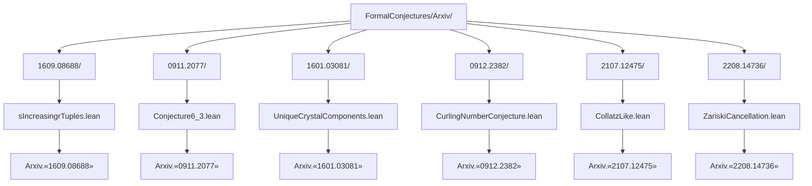
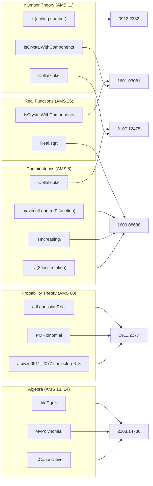
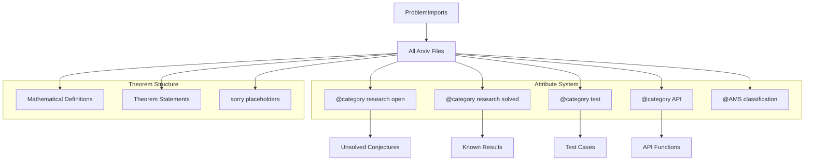

<!-- source: DeepWiki mcp.deepwiki.com · repo google-deepmind/formal-conjectures · extra page Arxiv Paper Problems · fetched 2026-10-26 -->

# Arxiv Paper Problems

Relevant source files

The following files were used as context for generating this wiki page:

- [FormalConjectures/Arxiv/0911.2077/Conjecture6_3.lean](FormalConjectures/Arxiv/0911.2077/Conjecture6_3.lean)
- [FormalConjectures/Arxiv/0912.2382/CurlingNumberConjecture.lean](FormalConjectures/Arxiv/0912.2382/CurlingNumberConjecture.lean)
- [FormalConjectures/Arxiv/1601.03081/UniqueCrystalComponents.lean](FormalConjectures/Arxiv/1601.03081/UniqueCrystalComponents.lean)
- [FormalConjectures/Arxiv/1609.08688/sIncreasingrTuples.lean](FormalConjectures/Arxiv/1609.08688/sIncreasingrTuples.lean)
- [FormalConjectures/Arxiv/2107.12475/CollatzLike.lean](FormalConjectures/Arxiv/2107.12475/CollatzLike.lean)
- [FormalConjectures/Arxiv/2208.14736/ZariskiCancellation.lean](FormalConjectures/Arxiv/2208.14736/ZariskiCancellation.lean)

This document covers the formalization of mathematical conjectures and theorems sourced from academic papers published on arXiv. These formalizations represent contemporary research problems across diverse mathematical domains including combinatorics, number theory, probability theory, and algebraic geometry.

For problems from other academic sources, see [MathOverflow Community Problems](#3.2.2). For classical problem collections, see [Erdős Problems](#3.3).

## Organization Structure

The arXiv formalizations are organized by paper ID in the directory structure `FormalConjectures/Arxiv/{paper_id}/`, where each paper ID corresponds to the arXiv identifier. Each formalization includes complete bibliographic references and maintains connections to the original mathematical research.

Sources: [FormalConjectures/Arxiv/1609.08688/sIncreasingrTuples.lean:1-232](), [FormalConjectures/Arxiv/0911.2077/Conjecture6_3.lean:1-57](), [FormalConjectures/Arxiv/1601.03081/UniqueCrystalComponents.lean:1-55](), [FormalConjectures/Arxiv/0912.2382/CurlingNumberConjecture.lean:1-57](), [FormalConjectures/Arxiv/2107.12475/CollatzLike.lean:1-51](), [FormalConjectures/Arxiv/2208.14736/ZariskiCancellation.lean:1-75]()

## Mathematical Domain Coverage

The arXiv paper problems span multiple mathematical disciplines with formal categorization through the `@AMS` attribute system.

Sources: [FormalConjectures/Arxiv/1609.08688/sIncreasingrTuples.lean:44-228](), [FormalConjectures/Arxiv/0911.2077/Conjecture6_3.lean:45-54](), [FormalConjectures/Arxiv/1601.03081/UniqueCrystalComponents.lean:36-52](), [FormalConjectures/Arxiv/0912.2382/CurlingNumberConjecture.lean:52-54](), [FormalConjectures/Arxiv/2107.12475/CollatzLike.lean:40-48](), [FormalConjectures/Arxiv/2208.14736/ZariskiCancellation.lean:44-72]()

## Formalization Patterns

All arXiv formalizations follow consistent structural patterns using the repository's infrastructure.

| Component | Purpose | Example |
|-----------|---------|---------|
| `ProblemImports` | Standard imports | `import FormalConjectures.Util.ProblemImports` |
| Namespace | Paper organization | `namespace Arxiv.«1609.08688»` |
| Documentation | References and context | `/-! # The length of an $s$-increasing sequence...` |
| Category attributes | Research status | `@[category research open, AMS 5]` |
| Theorem statements | Formal conjectures | `theorem maximalLength_le_strong` |

### Common Infrastructure Usage

Sources: [FormalConjectures/Arxiv/1609.08688/sIncreasingrTuples.lean:17-17](), [FormalConjectures/Arxiv/0911.2077/Conjecture6_3.lean:17-17](), [FormalConjectures/Arxiv/1601.03081/UniqueCrystalComponents.lean:17-17]()

## Featured Problems

### s-Increasing r-Tuples (1609.08688)

This formalization addresses combinatorial sequences with specific ordering properties, implementing the core `lt₂` relation and maximal length functions.

**Key Definitions:**
- `lt₂`: The 2-less relation between triples
- `IsIncreasing₂`: Pairwise 2-less property for sequences  
- `maximalLength`: Maximum length function `F(n)`

**Major Conjectures:**
- `maximalLength_le_strong`: Upper bound `F(n) ≤ n^(3/2)`
- `maximalLength_le_isBigO`: Asymptotic bound with iterated logarithm

Sources: [FormalConjectures/Arxiv/1609.08688/sIncreasingrTuples.lean:39-229]()

### Central Binomial Tail Bounds (0911.2077) 

Probability theory formalization focusing on binomial distribution tail bounds and normal approximations.

**Key Components:**
- `cdf (gaussianReal 0 1)`: Standard normal distribution function `Φ`  
- `PMF.binomial`: Binomial probability mass function
- Integration with `ProbabilityTheory` namespace

**Main Conjecture:**
- `arxiv.id0911_2077.conjecture6_3`: Lower bound for binomial tail probability

Sources: [FormalConjectures/Arxiv/0911.2077/Conjecture6_3.lean:32-54]()

### Zariski Cancellation Problem (2208.14736)

Algebraic geometry formalization addressing polynomial ring isomorphisms and cancellation properties.

**Core Definition:**
- `IsCancellative`: Cancellation property for finitely generated algebras

**Problem Variants:**
- `zariski_cancellation_problem`: Main conjecture for characteristic zero
- `zariski_cancellation_problem.variants.dim_one`: Single variable case (solved)
- `zariski_cancellation_problem.variants.false_pos_card`: Counterexample in positive characteristic

Sources: [FormalConjectures/Arxiv/2208.14736/ZariskiCancellation.lean:35-72]()

## Research Status Distribution

The arXiv problems demonstrate diverse solution statuses across the mathematical research spectrum:

| Status | Count | Examples |
|--------|--------|----------|
| `research open` | 5 | `maximalLength_le_strong`, `crystals_components_unique` |
| `research solved` | 5 | `maximalLength_le`, `zariski_cancellation_problem.variants.dim_one` |
| `test` | 6 | `lt₂_example_1`, `isCrystalWithComponents_35_5_7` |
| `API` | 8 | `not_lt₂`, `tripleProduct_const` |

Sources: [FormalConjectures/Arxiv/1609.08688/sIncreasingrTuples.lean:44-231](), [FormalConjectures/Arxiv/1601.03081/UniqueCrystalComponents.lean:36-52](), [FormalConjectures/Arxiv/2208.14736/ZariskiCancellation.lean:44-72]()

---

