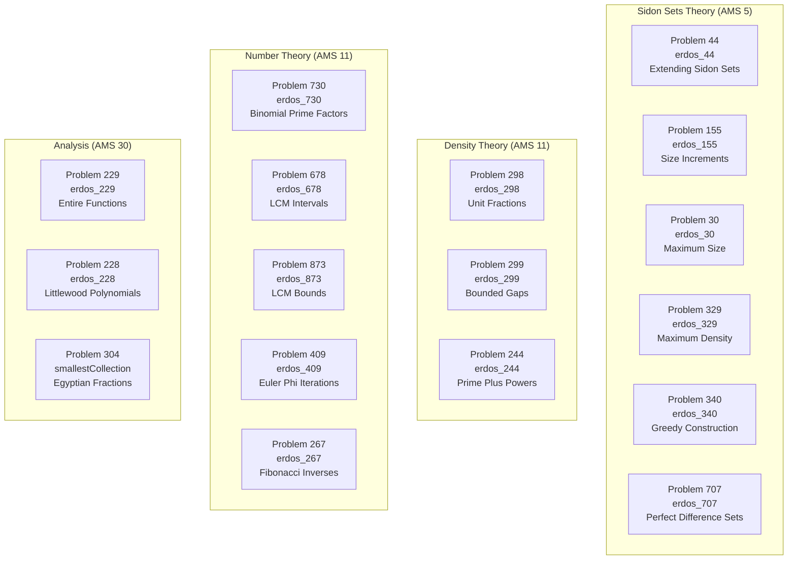
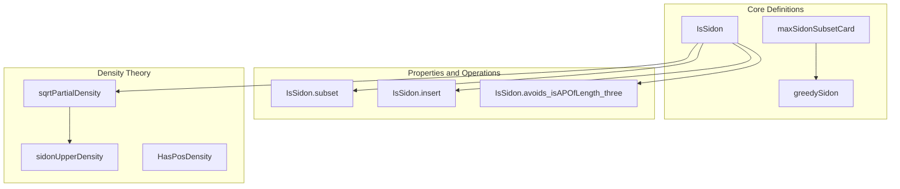
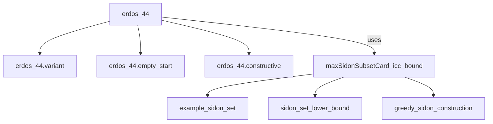
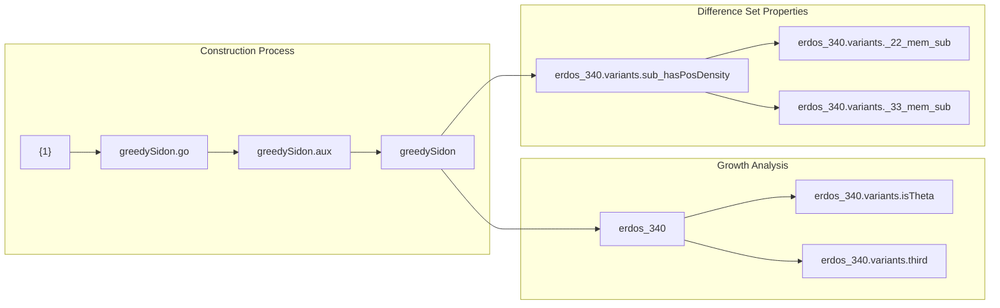
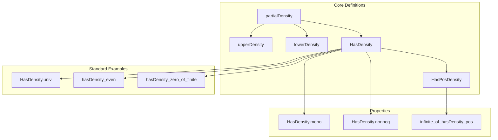
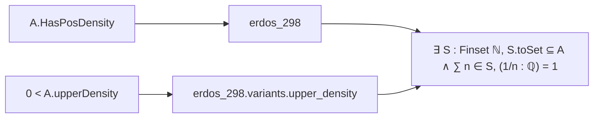
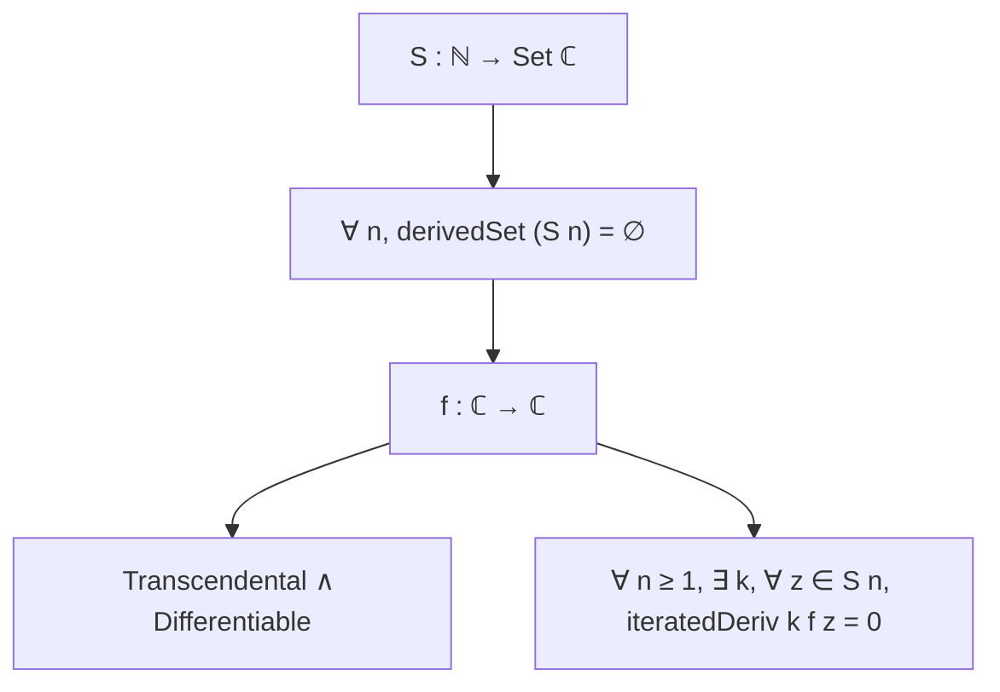
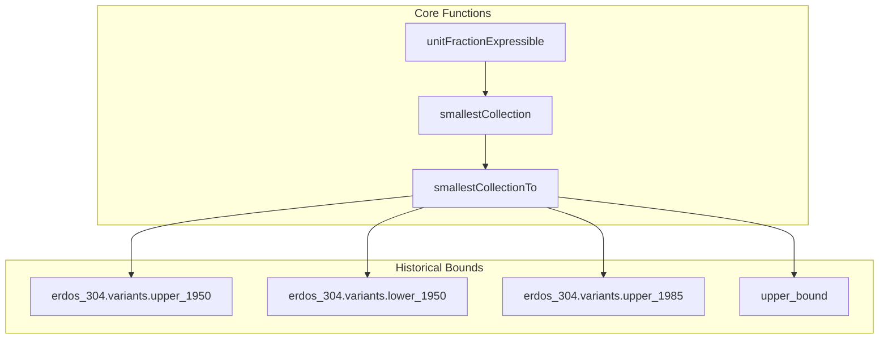
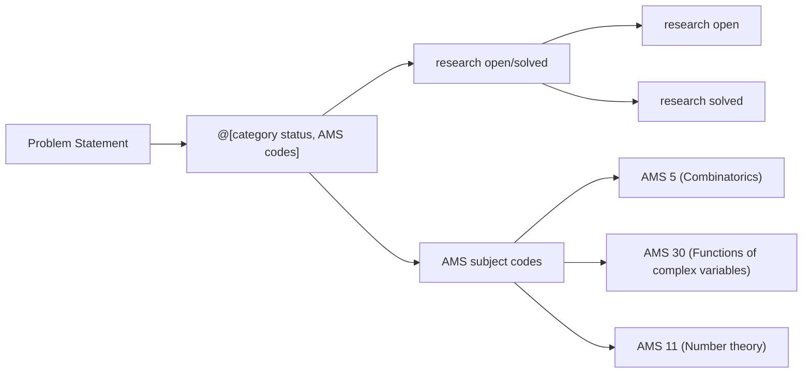
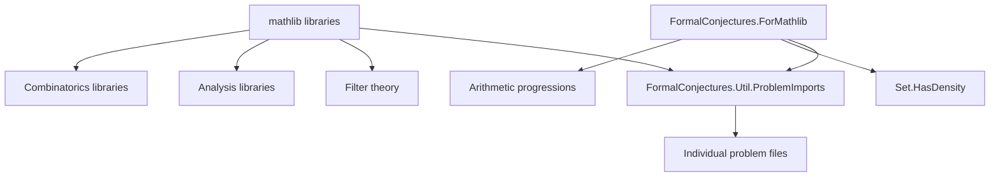

<!-- source: DeepWiki mcp.deepwiki.com · repo google-deepmind/formal-conjectures · extra page Combinatorics and Analysis Erdős Problems · fetched 2026-10-26 -->

# Combinatorics and Analysis Erdős Problems

<details>
<summary>Relevant source files</summary>

The following files were used as context for generating this wiki page:

- [FormalConjectures/ErdosProblems/155.lean](FormalConjectures/ErdosProblems/155.lean)
- [FormalConjectures/ErdosProblems/228.lean](FormalConjectures/ErdosProblems/228.lean)
- [FormalConjectures/ErdosProblems/229.lean](FormalConjectures/ErdosProblems/229.lean)
- [FormalConjectures/ErdosProblems/244.lean](FormalConjectures/ErdosProblems/244.lean)
- [FormalConjectures/ErdosProblems/267.lean](FormalConjectures/ErdosProblems/267.lean)
- [FormalConjectures/ErdosProblems/298.lean](FormalConjectures/ErdosProblems/298.lean)
- [FormalConjectures/ErdosProblems/299.lean](FormalConjectures/ErdosProblems/299.lean)
- [FormalConjectures/ErdosProblems/30.lean](FormalConjectures/ErdosProblems/30.lean)
- [FormalConjectures/ErdosProblems/304.lean](FormalConjectures/ErdosProblems/304.lean)
- [FormalConjectures/ErdosProblems/329.lean](FormalConjectures/ErdosProblems/329.lean)
- [FormalConjectures/ErdosProblems/340.lean](FormalConjectures/ErdosProblems/340.lean)
- [FormalConjectures/ErdosProblems/409.lean](FormalConjectures/ErdosProblems/409.lean)
- [FormalConjectures/ErdosProblems/44.lean](FormalConjectures/ErdosProblems/44.lean)
- [FormalConjectures/ErdosProblems/678.lean](FormalConjectures/ErdosProblems/678.lean)
- [FormalConjectures/ErdosProblems/707.lean](FormalConjectures/ErdosProblems/707.lean)
- [FormalConjectures/ErdosProblems/730.lean](FormalConjectures/ErdosProblems/730.lean)
- [FormalConjectures/ErdosProblems/873.lean](FormalConjectures/ErdosProblems/873.lean)
- [FormalConjectures/ForMathlib/Combinatorics/Basic.lean](FormalConjectures/ForMathlib/Combinatorics/Basic.lean)
- [FormalConjectures/ForMathlib/Data/Set/Density.lean](FormalConjectures/ForMathlib/Data/Set/Density.lean)

</details>


This document covers the formalization of Erdős problems in combinatorics and analysis within the FormalConjectures repository. These problems focus heavily on Sidon sets, density theory, unit fractions, and asymptotic analysis. The implementations demonstrate sophisticated mathematical concepts with careful attention to constructive definitions and computational examples.

For number theory focused Erdős problems, see [Number Theory Erdős Problems](#3.3.1). For the broader context of all Erdős problems, see [Erdős Problems](#3.3).

## Problem Categories and Distribution

The combinatorics and analysis Erdős problems in this collection focus on several core mathematical themes: Sidon sets and their properties, density theory for natural number sets, unit fraction representations, and asymptotic growth analysis.

### Problem Classification by Mathematical Theme



Sources: [FormalConjectures/ErdosProblems/44.lean:31-48](), [FormalConjectures/ErdosProblems/329.lean:41-48](), [FormalConjectures/ErdosProblems/298.lean:36-38](), [FormalConjectures/ErdosProblems/229.lean:39-44]()

## Sidon Sets and Combinatorial Structures

### Core Sidon Set Infrastructure

The ForMathlib extensions provide fundamental definitions and theory for Sidon sets, forming the foundation for multiple Erdős problems.

#### Sidon Set Theory Framework



The `IsSidon` predicate defines a set where all pairwise sums are distinct: `∀ᵉ (i₁ ∈ A) (j₁ ∈ A) (i₂ ∈ A) (j₂ ∈ A), i₁ + i₂ = j₁ + j₂ → (i₁ = j₁ ∧ i₂ = j₂) ∨ (i₁ = j₂ ∧ i₂ = j₁)`.

Sources: [FormalConjectures/ForMathlib/Combinatorics/Basic.lean:26-29](), [FormalConjectures/ForMathlib/Combinatorics/Basic.lean:100-102](), [FormalConjectures/ErdosProblems/329.lean:33-38]()

#### Problem 44: Extending Sidon Sets

**Problem 44** asks whether any Sidon set can be extended to achieve density arbitrarily close to the optimal `√N` bound for Sidon sets.



The main theorem states: for any Sidon set `A ⊆ {1,...,N}` and `ε > 0`, there exist `M > N` and `B ⊆ {N+1,...,M}` such that `A ∪ B` is Sidon with `(1-ε)√M ≤ |A ∪ B|`.

Sources: [FormalConjectures/ErdosProblems/44.lean:44-48](), [FormalConjectures/ErdosProblems/44.lean:30-34]()

#### Problem 340: Greedy Sidon Sequence

**Problem 340** studies the growth rate of the greedy Sidon sequence `{1, 2, 4, 8, 13, 21, 31, ...}` constructed by iteratively adding the smallest integer that preserves the Sidon property.

Key implementation components:
- `greedySidon.go`: Finds next Sidon-preserving element  
- `greedySidon.aux`: Main construction loop
- `greedySidon`: The sequence itself



Sources: [FormalConjectures/ErdosProblems/340.lean:28-62](), [FormalConjectures/ErdosProblems/340.lean:97-101](), [FormalConjectures/ErdosProblems/340.lean:132-135]()

#### Problem 329: Maximum Sidon Set Density

**Problem 329** asks for the supremum of `lim sup |A ∩ {1,...,N}| / √N` over all Sidon sets `A`.

| Result | Value | Reference |
|--------|-------|-----------|
| Lower bound (Erdős) | `≥ 1/2` | `erdos_329.lower_bound` |
| Improved bound (Krückeberg 1961) | `= 1/√2` | `kruckeberg_1961` |  
| Upper bound (Erdős-Turán 1941) | `≤ 1` | `erdos_turan_1941` |

Sources: [FormalConjectures/ErdosProblems/329.lean:46-48](), [FormalConjectures/ErdosProblems/329.lean:55-57](), [FormalConjectures/ErdosProblems/329.lean:66-69]()

### Perfect Difference Sets

#### Problem 707: Embedding in Perfect Difference Sets

**Problem 707** conjectures that any finite Sidon set can be embedded in a perfect difference set modulo `p² + p + 1` for some prime power `p`.

The `IsPerfectDifferenceSetModulo` predicate requires that differences `a - b` for `a, b ∈ B` biject to non-zero residues modulo `n`:

```lean
def IsPerfectDifferenceSetModulo (B : Set ℕ) (n : ℕ) : Prop :=
  B.offDiag.BijOn (fun (a, b) => (a - b : ZMod n)) {x : ZMod n | x ≠ 0}
```

Sources: [FormalConjectures/ErdosProblems/707.lean:37-38](), [FormalConjectures/ErdosProblems/707.lean:44-48]()

## Set Density Theory and Unit Fractions

### Density Infrastructure

The ForMathlib extensions provide a comprehensive framework for analyzing the density of sets in natural numbers, used extensively in multiple Erdős problems.

#### Density Theory Framework



The `partialDensity` function computes `|S ∩ {x ∈ A | x < b}| / |{x ∈ A | x < b}|`, with density defined as the limit as `b → ∞`.

Sources: [FormalConjectures/ForMathlib/Data/Set/Density.lean:36-38](), [FormalConjectures/ForMathlib/Data/Set/Density.lean:66-68](), [FormalConjectures/ForMathlib/Data/Set/Density.lean:127-145]()

### Unit Fraction Problems

#### Problem 298: Unit Fractions from Dense Sets

**Problem 298** asks whether every set of positive density contains a finite subset with unit fraction sum equal to 1. This was solved affirmatively by Bloom (2021).



Both theorems have `answer(True)` since the result was proven by Bloom.

Sources: [FormalConjectures/ErdosProblems/298.lean:36-39](), [FormalConjectures/ErdosProblems/298.lean:44-47]()

#### Problem 299: Bounded Gap Sequences

**Problem 299** asks whether there exists an infinite sequence `a₁ < a₂ < ...` with `aᵢ₊₁ - aᵢ = O(1)` such that no finite sum of `1/aᵢ` equals 1. The answer is negative (false), as shown by the density result.

The formalization uses asymptotic notation: `(fun n ↦ (a (n + 1) : ℝ) - a n) =O[atTop] (1 : ℕ → ℝ)`.

Sources: [FormalConjectures/ErdosProblems/299.lean:34-38](), [FormalConjectures/ErdosProblems/299.lean:50-53]()

## Analysis Problems

### Complex Analysis

#### Problem 229: Entire Functions with Prescribed Zeros

**Problem 229** asks whether for any sequence of sets `Sₙ` without finite limit points, there exists a transcendental entire function `f` such that some derivative `f⁽ᵏⁿ⁾` vanishes on each `Sₙ`.



This was solved affirmatively by Barth and Schneider (1972), formalized as `answer(True)`.

Sources: [FormalConjectures/ErdosProblems/229.lean:40-45](), [FormalConjectures/ErdosProblems/229.lean:53-60]()

#### Problem 228: Littlewood Polynomials

**Problem 228** concerns polynomials with coefficients `±1` that have bounded magnitude `≈ √n` on the unit circle.

The formalization requires:
- `p.degree = n`
- `∀ i ≤ n, p.coeff i = 1 ∨ p.coeff i = -1`  
- `∀ z : ℂ, ‖z‖ = 1 → √n < c₁ * ‖p.eval z‖ ∧ ‖p.eval z‖ < c₂ * √n`

This was solved by Balister, Bollobás, Morris, Sahasrabudhe, and Tiba (2019).

Sources: [FormalConjectures/ErdosProblems/228.lean:37-43]()

### Egyptian Fractions

#### Problem 304: Egyptian Fraction Representations

**Problem 304** studies `N(a,b)`, the minimal number of distinct unit fractions needed to represent `a/b`.

Key definitions:
- `unitFractionExpressible a b`: Set of possible representation sizes
- `smallestCollection a b`: The minimal size `N(a,b)`
- `smallestCollectionTo b`: Maximum over `1 ≤ a < b`



Known results:
- Erdős (1950): `log log b ≪ N(b) ≪ log b / log log b`
- Vose (1985): `N(b) ≪ √log b`
- Open: Is `N(b) ≪ log log b`?

Sources: [FormalConjectures/ErdosProblems/304.lean:31-33](), [FormalConjectures/ErdosProblems/304.lean:89-90](), [FormalConjectures/ErdosProblems/304.lean:144-157]()

## Implementation Infrastructure

### Category System Integration

All problems use the standardized category attribute system:



Sources: [FormalConjectures/ErdosProblems/319.lean:39](), [FormalConjectures/ErdosProblems/229.lean:32]()

### Common Patterns

| Pattern | Usage | Examples |
|---------|-------|----------|
| `answer(sorry)` | Unknown solutions | Problem 319 variants |
| `answer(True/False)` | Known boolean results | Problems 316, 480 |
| Asymptotic analysis | Growth rate questions | Problems 139, 319, 899 |
| Density theory | `HasDensity` from ForMathlib | Problems 298, 899 |

### Dependency Structure



Sources: [FormalConjectures/ErdosProblems/319.lean:17](), [FormalConjectures/ForMathlib/Data/Set/Density.lean:36-48]()

The problems in this collection demonstrate the repository's capability to handle sophisticated mathematical concepts spanning discrete and continuous mathematics, with careful attention to asymptotic behavior and density-theoretic properties.