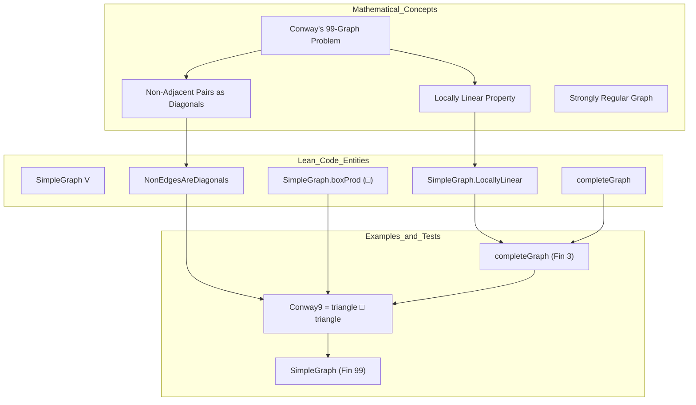
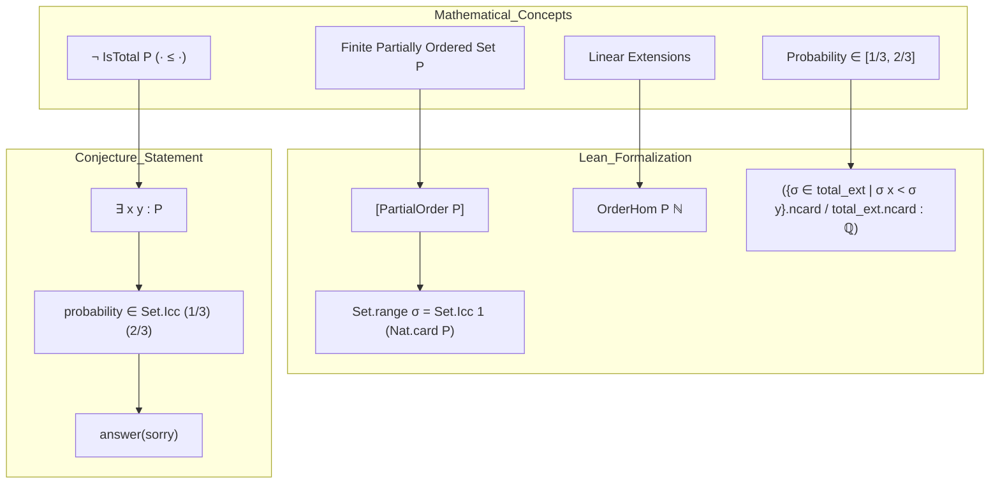
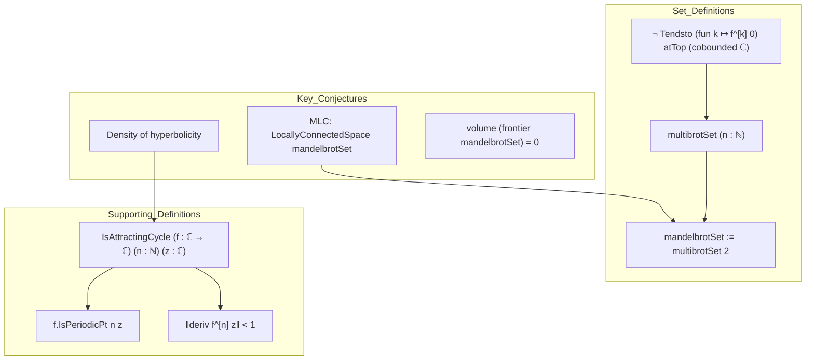
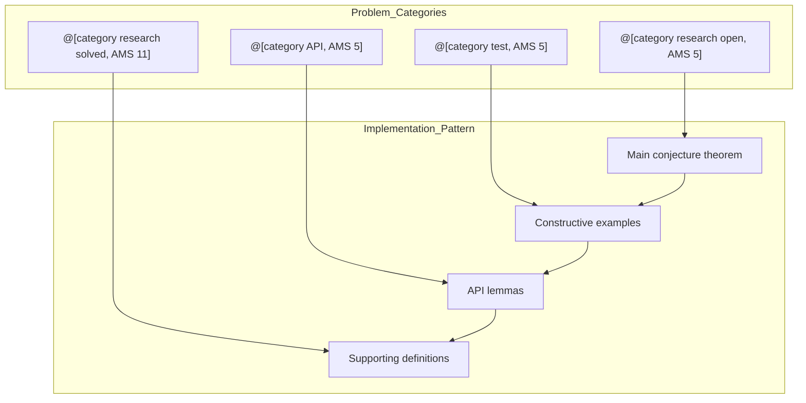
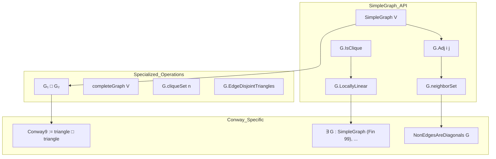

<!-- source: DeepWiki mcp.deepwiki.com · repo google-deepmind/formal-conjectures · extra page Geometry and Combinatorics · fetched 2026-10-26 -->

# Geometry and Combinatorics

Relevant source files

The following files were used as context for generating this wiki page:

- [FormalConjectures/ErdosProblems/11.lean](FormalConjectures/ErdosProblems/11.lean)
- [FormalConjectures/ErdosProblems/427.lean](FormalConjectures/ErdosProblems/427.lean)
- [FormalConjectures/ErdosProblems/9.lean](FormalConjectures/ErdosProblems/9.lean)
- [FormalConjectures/ErdosProblems/945.lean](FormalConjectures/ErdosProblems/945.lean)
- [FormalConjectures/Wikipedia/ABC.lean](FormalConjectures/Wikipedia/ABC.lean)
- [FormalConjectures/Wikipedia/BealConjecture.lean](FormalConjectures/Wikipedia/BealConjecture.lean)
- [FormalConjectures/Wikipedia/CollatzConjecture.lean](FormalConjectures/Wikipedia/CollatzConjecture.lean)
- [FormalConjectures/Wikipedia/CongruentNumber.lean](FormalConjectures/Wikipedia/CongruentNumber.lean)
- [FormalConjectures/Wikipedia/Conway99Graph.lean](FormalConjectures/Wikipedia/Conway99Graph.lean)
- [FormalConjectures/Wikipedia/FermatCatalanConjecture.lean](FormalConjectures/Wikipedia/FermatCatalanConjecture.lean)
- [FormalConjectures/Wikipedia/Gilbreath.lean](FormalConjectures/Wikipedia/Gilbreath.lean)
- [FormalConjectures/Wikipedia/Hall.lean](FormalConjectures/Wikipedia/Hall.lean)
- [FormalConjectures/Wikipedia/Mandelbrot.lean](FormalConjectures/Wikipedia/Mandelbrot.lean)
- [FormalConjectures/Wikipedia/ModularityConjecture.lean](FormalConjectures/Wikipedia/ModularityConjecture.lean)
- [FormalConjectures/Wikipedia/RamanujanTau.lean](FormalConjectures/Wikipedia/RamanujanTau.lean)
- [FormalConjectures/Wikipedia/WolstenholmePrime.lean](FormalConjectures/Wikipedia/WolstenholmePrime.lean)
- [FormalConjectures/Wikipedia/conjecture_1_3_to_2_3.lean](FormalConjectures/Wikipedia/conjecture_1_3_to_2_3.lean)

This section documents the formalization of geometric and combinatorial conjectures sourced from Wikipedia. The problems here primarily fall under AMS subject classifications 5 (Combinatorics) and include geometric problems that involve discrete structures, graph theory, and geometric counting problems.

For number theory problems from Wikipedia sources, see [Number Theory and Analysis](#3.1.1). For purely algebraic geometry problems, see [Academic Research Problems](#3.2).

## Graph Theory Conjectures

The repository includes several graph theory problems that exemplify the systematic approach to formalizing combinatorial structures in Lean 4.

### Conway's 99-Graph Problem

Conway's 99-graph problem asks whether there exists a specific type of graph with 99 vertices satisfying local linearity and diagonal properties.

The main conjecture is formalized as `Conway99Graph` which asks for the existence of a graph on 99 vertices satisfying both local linearity and the diagonal property:

**Core Definition**: The problem centers around two key properties defined in [FormalConjectures/Wikipedia/Conway99Graph.lean:46-47]():
- `NonEdgesAreDiagonals`: Each two non-adjacent vertices have exactly two common neighbors
- `SimpleGraph.LocallyLinear`: Each two adjacent vertices have exactly one common neighbor

**Test Cases**: The formalization includes constructive examples that satisfy these properties:
- The triangle `completeGraph (Fin 3)` serves as a trivial 3-vertex example
- `Conway9`, defined as the box product of two triangles, provides a 9-vertex example demonstrating the properties at a larger scale

Sources: [FormalConjectures/Wikipedia/Conway99Graph.lean:1-152]()

## Order Theory and Discrete Mathematics

### The 1/3–2/3 Conjecture

The 1/3–2/3 conjecture asks whether every finite partially ordered set that is not totally ordered contains two elements with a specific probability relationship in random linear extensions.

#### Mathematical Problem Structure

**Core Definition**: The conjecture is formalized in [FormalConjectures/Wikipedia/conjecture_1_3_to_2_3.lean:36-41]() using order-preserving bijections to represent linear extensions and rational arithmetic for probability calculations.

**Key Components**:
- `total_ext`: Set of all total order extensions represented as `OrderHom P ℕ`
- Probability calculation using `ncard` (natural number cardinality) and rational division
- The probability bound `Set.Icc (1/3) (2/3)` representing the closed interval [1/3, 2/3]

Sources: [FormalConjectures/Wikipedia/conjecture_1_3_to_2_3.lean:1-44]()

## Complex Dynamical Systems

### Mandelbrot and Multibrot Set Conjectures

The repository includes several geometric conjectures about the Mandelbrot set and its generalizations, focusing on topological and measure-theoretic properties.

#### Dynamical System Structure

**Set Characterization**: The `multibrotSet n` is defined in [FormalConjectures/Wikipedia/Mandelbrot.lean:40-41]() as parameters where the orbit of 0 under `z ↦ z^n + c` does not escape to infinity.

**Major Conjectures**:
- **MLC Conjecture**: `LocallyConnectedSpace mandelbrotSet` ([FormalConjectures/Wikipedia/Mandelbrot.lean:106-107]())
- **Density of Hyperbolicity**: Parameters with attracting cycles are dense ([FormalConjectures/Wikipedia/Mandelbrot.lean:142-144]())
- **Zero Area Boundary**: `volume (frontier mandelbrotSet) = 0` ([FormalConjectures/Wikipedia/Mandelbrot.lean:161-162]())

Sources: [FormalConjectures/Wikipedia/Mandelbrot.lean:34-171]()

## Problem Implementation Patterns

### Categorization and Metadata System

All geometry and combinatorics problems follow consistent categorization patterns using the attribute system:

| Category | AMS Code | Example Usage | Purpose |
|----------|----------|---------------|---------|
| `research open` | `AMS 5` | Conway's 99-graph existence | Unsolved mathematical problems |
| `research solved` | `AMS 11` | Gauss circle bound | Historical results for reference |
| `test` | `AMS 5` | Triangle example | Computational verification cases |
| `API` | `AMS 5` | Helper lemmas | Infrastructure for other proofs |

### Code Organization Structure

The geometric and combinatorial problems demonstrate systematic code organization:

**Definition-First Approach**: Key mathematical objects are defined before stating theorems, as seen with `NonEdgesAreDiagonals` and `IsPrimeConstellation` in related files.

**Constructive Examples**: Each abstract problem includes concrete instances that satisfy the required properties, enabling computational verification and building intuition.

**Modular Dependencies**: Problems import from `FormalConjectures.Util.ProblemImports`, ensuring consistent access to mathematical libraries and utility functions.

Sources: [FormalConjectures/Wikipedia/Conway99Graph.lean:17](), [FormalConjectures/Wikipedia/GaussCircleProblem.lean:17]()

## Integration with Mathematical Infrastructure

### Graph Theory Integration

The Conway graph problems leverage Lean's `SimpleGraph` library extensively:

**Key Integration Points**:
- Uses `SimpleGraph.LocallyLinear` from mathlib for the standard definition
- Extends with custom `NonEdgesAreDiagonals` predicate for Conway-specific properties
- Leverages `SimpleGraph.boxProd` (□) operator for constructing examples

### Geometric Analysis Integration

The Gauss circle problem integrates with Lean's analysis and geometry libraries:

**Metric Spaces**: Uses `Metric.closedBall` for precise geometric definitions
**Asymptotic Analysis**: Employs `isBigO`, `isLittleO`, and `HasDensity` for error bounds
**Real Analysis**: Integrates with `Real.log`, `Real.sqrt`, and infinite products

Sources: [FormalConjectures/Wikipedia/Conway99Graph.lean:28-152](), [FormalConjectures/Wikipedia/GaussCircleProblem.lean:24-106]()

---

