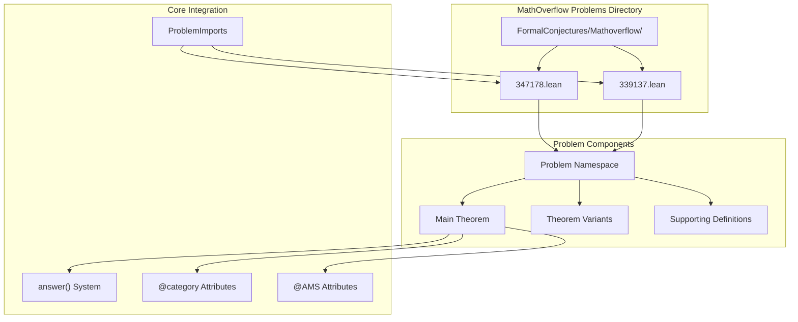
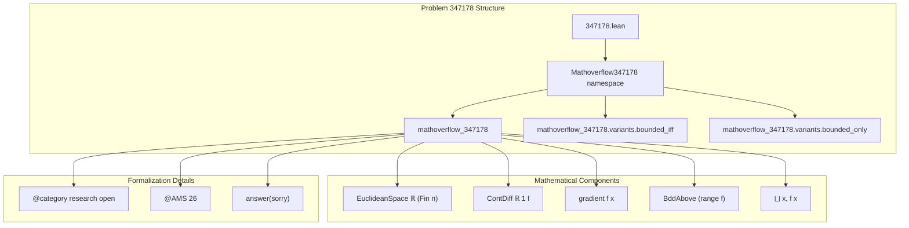
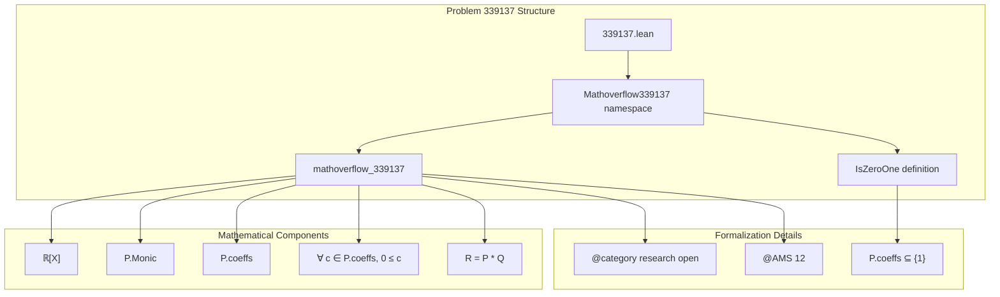
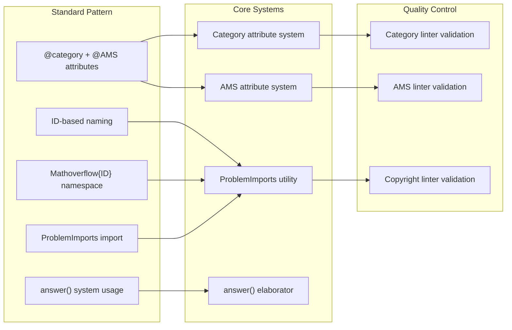

<!-- source: DeepWiki mcp.deepwiki.com · repo google-deepmind/formal-conjectures · extra page MathOverflow Community Problems · fetched 2026-10-26 -->

# MathOverflow Community Problems

Relevant source files

The following files were used as context for generating this wiki page:

- [FormalConjectures/Mathoverflow/339137.lean](FormalConjectures/Mathoverflow/339137.lean)
- [FormalConjectures/Mathoverflow/347178.lean](FormalConjectures/Mathoverflow/347178.lean)
- [FormalConjectures/Other/BeaverMathOlympiad.lean](FormalConjectures/Other/BeaverMathOlympiad.lean)
- [FormalConjectures/Other/EquationalTheories_677_255.lean](FormalConjectures/Other/EquationalTheories_677_255.lean)

This document covers mathematical problems sourced from MathOverflow community discussions, focusing on their formalization within the FormalConjectures repository. These problems represent contemporary research questions posed by the mathematical community on the MathOverflow platform.

For problems from academic papers, see [Arxiv Paper Problems](#3.2.1). For other research collections, see [Erdős Problems](#3.3).

## Overview

The MathOverflow problems collection contains formalizations of mathematical questions posted on the MathOverflow community platform. These problems span multiple mathematical domains, with particular emphasis on analysis and algebraic questions. Each problem preserves the original community context while providing rigorous Lean formulations suitable for formal verification.

## Problem Collection Structure

The MathOverflow problems are organized within the `FormalConjectures/Mathoverflow/` directory, with each problem file named after the corresponding MathOverflow question ID.

Sources: [FormalConjectures/Mathoverflow/347178.lean:1-67](), [FormalConjectures/Mathoverflow/339137.lean:1-57]()

## Individual Problems

### MathOverflow 347178: Suprema and Gradients

This problem, posed by user Biagio Ricceri, investigates the relationship between the supremum of a C¹ function and the supremum of the function evaluated at gradient-shifted points.

The main theorem `mathoverflow_347178` [FormalConjectures/Mathoverflow/347178.lean:35-40]() asks whether for C¹ functions f: ℝⁿ → ℝ with n ≥ 2, the equality sup_{x∈ℝⁿ} f(x) = sup_{x∈ℝⁿ} f(x + ∇f(x)) holds. Two variants explore related questions about boundedness equivalence and finite suprema cases.

Sources: [FormalConjectures/Mathoverflow/347178.lean:21-66]()

### MathOverflow 339137: Zero-One Polynomial Factorization

This problem, asked by user Sil, examines whether polynomials with coefficients in {0,1} tend to have factors with coefficients also in {0,1}.

The `IsZeroOne` predicate [FormalConjectures/Mathoverflow/339137.lean:40]() defines polynomials whose nonzero coefficients are all 1. The main theorem [FormalConjectures/Mathoverflow/339137.lean:50-54]() states that if monic polynomials P and Q with non-negative coefficients have a product R that is zero-one, then both P and Q are zero-one polynomials.

Sources: [FormalConjectures/Mathoverflow/339137.lean:21-56]()

## Code Organization and Integration

The MathOverflow problems follow standardized organizational patterns that integrate with the core FormalConjectures infrastructure:

| Component | Implementation | Purpose |
|-----------|----------------|---------|
| File Structure | `FormalConjectures/Mathoverflow/{ID}.lean` | Organized by MathOverflow question ID |
| Namespace | `Mathoverflow{ID}` | Scoped problem definitions |
| Imports | `FormalConjectures.Util.ProblemImports` | Standard infrastructure access |
| Categories | `@category research open` | Research status classification |
| AMS Codes | `@AMS {code}` | Mathematical subject classification |
| Answer Status | `answer(sorry)` | Unknown resolution status |

Sources: [FormalConjectures/Mathoverflow/347178.lean:17-18](), [FormalConjectures/Mathoverflow/339137.lean:17-18](), [FormalConjectures/Mathoverflow/347178.lean:28-29](), [FormalConjectures/Mathoverflow/339137.lean:32-33]()

## Mathematical Domain Coverage

The MathOverflow problems currently span two primary AMS classification areas:

| AMS Code | Domain | Problems | Examples |
|----------|---------|----------|----------|
| 26 | Real Functions | MathOverflow 347178 | Suprema equality, gradient analysis |
| 12 | Field Theory and Polynomials | MathOverflow 339137 | Zero-one coefficient factorization |

Each problem preserves the original MathOverflow context through documentation comments that include the original question URL and author attribution, maintaining traceability to the community source.

Sources: [FormalConjectures/Mathoverflow/347178.lean:34](), [FormalConjectures/Mathoverflow/339137.lean:49](), [FormalConjectures/Mathoverflow/347178.lean:24-26](), [FormalConjectures/Mathoverflow/339137.lean:28-30]()

---

