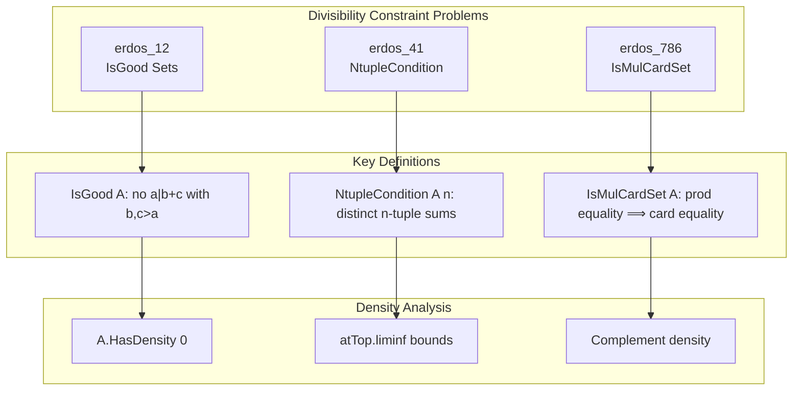
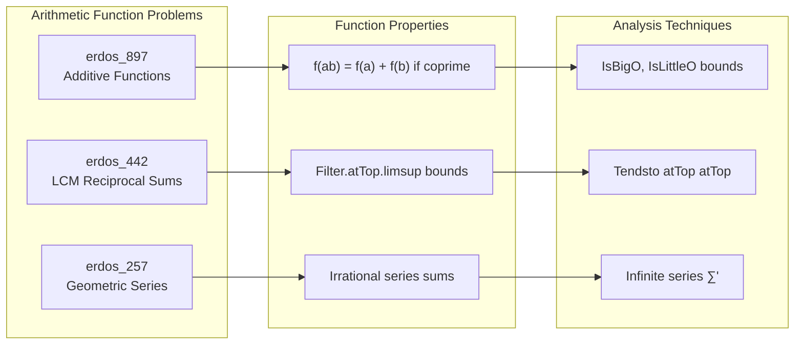
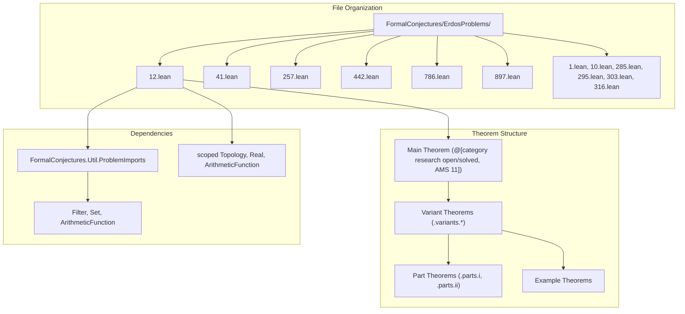
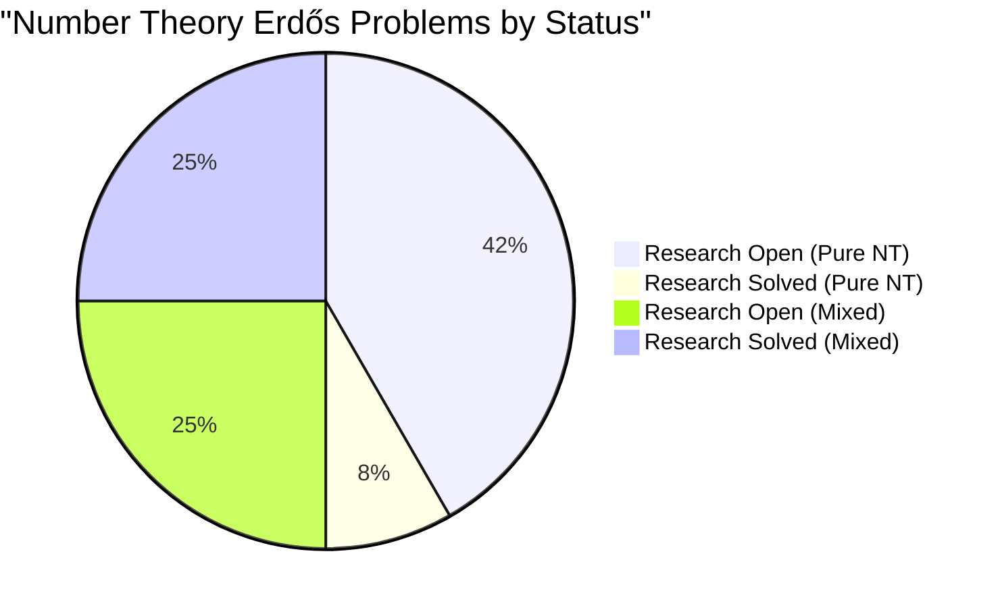

<!-- source: DeepWiki mcp.deepwiki.com · repo google-deepmind/formal-conjectures · extra page Number Theory Erdős Problems · fetched 2026-10-26 -->

# Number Theory Erdős Problems

<details>
<summary>Relevant source files</summary>

The following files were used as context for generating this wiki page:

- [FormalConjectures/ErdosProblems/1.lean](FormalConjectures/ErdosProblems/1.lean)
- [FormalConjectures/ErdosProblems/10.lean](FormalConjectures/ErdosProblems/10.lean)
- [FormalConjectures/ErdosProblems/12.lean](FormalConjectures/ErdosProblems/12.lean)
- [FormalConjectures/ErdosProblems/168.lean](FormalConjectures/ErdosProblems/168.lean)
- [FormalConjectures/ErdosProblems/245.lean](FormalConjectures/ErdosProblems/245.lean)
- [FormalConjectures/ErdosProblems/257.lean](FormalConjectures/ErdosProblems/257.lean)
- [FormalConjectures/ErdosProblems/285.lean](FormalConjectures/ErdosProblems/285.lean)
- [FormalConjectures/ErdosProblems/295.lean](FormalConjectures/ErdosProblems/295.lean)
- [FormalConjectures/ErdosProblems/303.lean](FormalConjectures/ErdosProblems/303.lean)
- [FormalConjectures/ErdosProblems/316.lean](FormalConjectures/ErdosProblems/316.lean)
- [FormalConjectures/ErdosProblems/319.lean](FormalConjectures/ErdosProblems/319.lean)
- [FormalConjectures/ErdosProblems/41.lean](FormalConjectures/ErdosProblems/41.lean)
- [FormalConjectures/ErdosProblems/442.lean](FormalConjectures/ErdosProblems/442.lean)
- [FormalConjectures/ErdosProblems/786.lean](FormalConjectures/ErdosProblems/786.lean)
- [FormalConjectures/ErdosProblems/897.lean](FormalConjectures/ErdosProblems/897.lean)
- [FormalConjectures/ErdosProblems/899.lean](FormalConjectures/ErdosProblems/899.lean)
- [FormalConjectures/ForMathlib/Data/Set/Bdd.lean](FormalConjectures/ForMathlib/Data/Set/Bdd.lean)

</details>


This document covers the formalization of Erdős problems specifically related to number theory, including arithmetic functions, divisibility properties, and density questions. These problems represent some of the most challenging questions posed by Paul Erdős in number theory.

For combinatorics and analysis problems posed by Erdős, see [3.3.2](#3.3.2). For the broader organization of all Erdős problems, see [3.3](#3.3).

## Problem Categories and Mathematical Domains

The number theory Erdős problems in this collection span several key areas, focusing on density properties of sets, arithmetic functions, and multiplicative structures.

### Set Density and Divisibility Properties  

A core theme involves infinite sets with specific divisibility constraints and their density properties.



Sources: [FormalConjectures/ErdosProblems/12.lean:33-35](), [FormalConjectures/ErdosProblems/41.lean:33-35](), [FormalConjectures/ErdosProblems/786.lean:38-40]()

### Arithmetic Functions and Growth Analysis

Several problems examine additive arithmetic functions and their growth properties under various constraints.



Sources: [FormalConjectures/ErdosProblems/897.lean:34-39](), [FormalConjectures/ErdosProblems/442.lean:82-86](), [FormalConjectures/ErdosProblems/257.lean:35-36]()

## Code Organization and Implementation Structure

### Problem File Structure

Each Erdős number theory problem follows a consistent implementation pattern within the codebase.



Sources: [FormalConjectures/ErdosProblems/12.lean:17-18](), [FormalConjectures/ErdosProblems/41.lean:17-18](), [FormalConjectures/ErdosProblems/442.lean:17-18](), [FormalConjectures/ErdosProblems/786.lean:17-18]()

### Categorization and Metadata System

The problems use a standardized attribute system for classification and status tracking.

| Problem | Category | AMS Code | Status | Main Focus |
|---------|----------|----------|---------|------------|
| `erdos_12` | research open | 11 | Open (variants solved) | Divisibility constraints |
| `erdos_41` | research open | 11 | Open (pairwise solved) | N-tuple sum conditions |
| `erdos_257` | research open | 11 | Open (variants solved) | Series irrationality |
| `erdos_442` | research solved | 11 | Solved by Tao | LCM reciprocal sums |
| `erdos_786` | research open | 11 | Open (examples known) | Multiplicative cardinality |  
| `erdos_897` | research open | 11 | Open (variants solved) | Additive functions |

**Mixed Number Theory/Combinatorics (AMS 5 11):**
| `erdos_1` | research open | 5 11 | Open (bounds known) | Sum-distinct sets |
| `erdos_10` | research open | 5 11 | Open (partial results) | Prime + powers of 2 |
| `erdos_285` | research solved | 5 11 | Solved by Martin | Egyptian fractions |
| `erdos_295` | research open | 5 11 | Open (bounds known) | Egyptian fraction bounds |
| `erdos_303` | research solved | 5 11 | Solved by Brown-Rödl | Unit fraction equations |
| `erdos_316` | research solved | 5 11 | Solved by Sándor | Reciprocal partitions |

Sources: [FormalConjectures/ErdosProblems/12.lean:50](), [FormalConjectures/ErdosProblems/41.lean:42](), [FormalConjectures/ErdosProblems/442.lean:81](), [FormalConjectures/ErdosProblems/786.lean:47]()

## Key Problem Examples

### Problem 12: Good Sets with Divisibility Constraints

This problem concerns infinite sets avoiding certain divisibility patterns.

**Key Definition:** [FormalConjectures/ErdosProblems/12.lean:33-35]()
```lean
abbrev IsGood (A : Set ℕ) : Prop := A.Infinite ∧
  ∀ᵉ (a ∈ A) (b ∈ A) (c ∈ A), a ∣ b + c → a < b →
  a < c → b = c
```

**Main Questions:** [FormalConjectures/ErdosProblems/12.lean:51-53](), [FormalConjectures/ErdosProblems/12.lean:63-64]()
- Whether there exists a good set `A` with `liminf |A ∩ {1,...,N}|/√N > 0`
- Whether every good set satisfies density bounds `|A ∩ {1,...,N}| < N^(1-c)` infinitely often

**Solved Results:**
- **Density zero** [FormalConjectures/ErdosProblems/12.lean:82](): Every good set has density 0 (Erdős-Sárközy)
- **Example construction** [FormalConjectures/ErdosProblems/12.lean:39-40](): `{p^2 | p ≡ 3 [MOD 4], p.Prime}` is good

### Problem 786: Multiplicative Cardinality Sets

This problem studies sets where product equality implies cardinality equality.

**Key Definition:** [FormalConjectures/ErdosProblems/786.lean:38-40]()
```lean
def Set.IsMulCardSet {α : Type*} [CommMonoid α] (A : Set α) :=
  ∀ (a b : Finset α) (_ :↑a ⊆ A) (_ : ↑b ⊆ A) (_ : a.prod id = b.prod id),
    a.card = b.card
```

**Main Questions:** [FormalConjectures/ErdosProblems/786.lean:48-49](), [FormalConjectures/ErdosProblems/786.lean:58-60]()
- Whether there exist sets `A ⊆ ℕ` with density `> 1 - ε` that are multiplicative cardinality sets
- Whether there exist sets `A ⊆ {1,...,N}` of size `≥ (1-o(1))N` with this property

**Known Examples:**
- **Density 1/4 example** [FormalConjectures/ErdosProblems/786.lean:67-68](): `{n | n % 4 = 2}` works
- **Selfridge construction** [FormalConjectures/ErdosProblems/786.lean:91-99](): Using consecutive primes gives density `1/e - ε`

### Problem 442: LCM Reciprocal Sums

This problem concerns the relationship between reciprocal sums and LCM-based expressions.

**Main Question:** [FormalConjectures/ErdosProblems/442.lean:82-86]() - Whether certain reciprocal sum conditions imply LCM sum divergence.

**Resolution:** [FormalConjectures/ErdosProblems/442.lean:107-113]() - Tao proved this false by constructing a counterexample with controlled growth rates.

## Problem Status Distribution



**Pure Number Theory (AMS 11):**
- **Open:** `erdos_12`, `erdos_41`, `erdos_257`, `erdos_786`, `erdos_897`
- **Solved:** `erdos_442` (Tao's counterexample)

**Mixed Number Theory/Combinatorics (AMS 5 11):**
- **Open:** `erdos_1`, `erdos_10`, `erdos_295`  
- **Solved:** `erdos_285` (Martin), `erdos_303` (Brown-Rödl), `erdos_316` (Sándor)

Sources: Analysis of category attributes in [FormalConjectures/ErdosProblems/12.lean:50](), [FormalConjectures/ErdosProblems/285.lean:45](), [FormalConjectures/ErdosProblems/303.lean:36](), [FormalConjectures/ErdosProblems/316.lean:35]()

## Mathematical Techniques and Dependencies

The formalization of these number theory problems relies heavily on several key mathematical libraries and techniques:

### Core Dependencies
- **ArithmeticFunction scope** [FormalConjectures/ErdosProblems/418.lean:26](): Provides notation for `φ`, `σ`, `ω`, `τ`
- **Filter theory** [FormalConjectures/ErdosProblems/377.lean:24](): For asymptotic analysis and limits
- **Set theory** [FormalConjectures/ErdosProblems/421.lean:24](): For density and complement operations

### Analytical Methods
- **Density theory**: Used in problems about infinite sets with positive natural density
- **Asymptotic analysis**: Critical for problems involving growth rates and limits
- **Prime number theory**: Fundamental to problems involving prime factorizations
- **Transcendental number theory**: Applied in `erdos_247` for series transcendence

Sources: [FormalConjectures/ErdosProblems/418.lean:17-27](), [FormalConjectures/ErdosProblems/377.lean:17-27](), [FormalConjectures/ErdosProblems/247.lean:17-25]()

---

