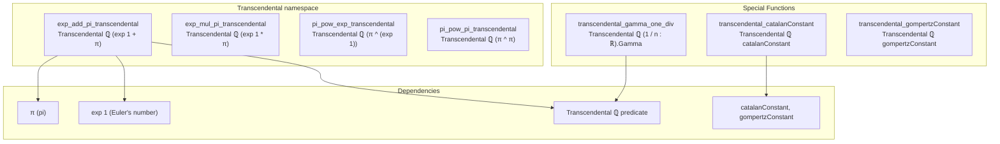
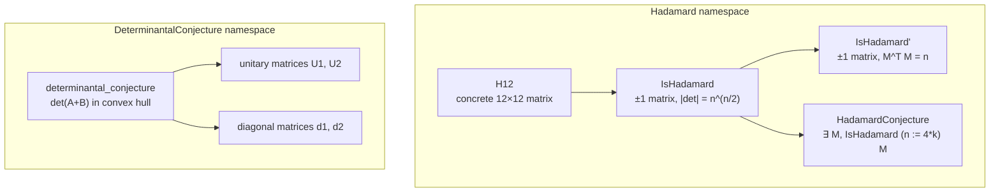
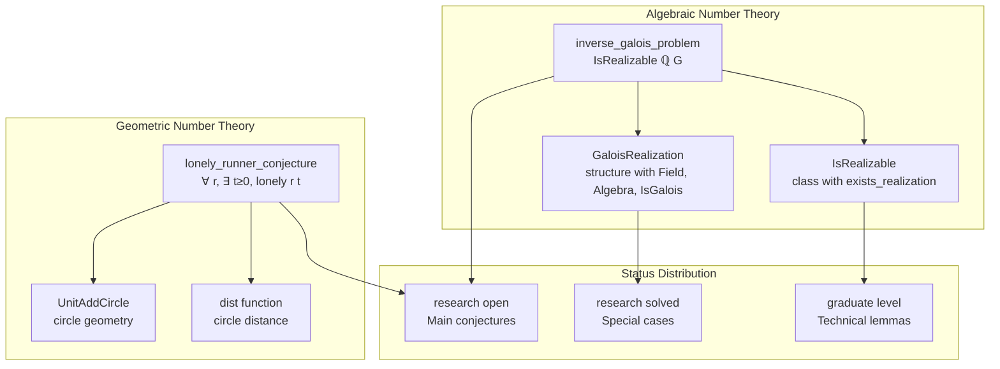

<!-- source: DeepWiki mcp.deepwiki.com · repo google-deepmind/formal-conjectures · extra page Number Theory and Analysis · fetched 2026-10-26 -->

# Number Theory and Analysis

<details>
<summary>Relevant source files</summary>

The following files were used as context for generating this wiki page:

- [FormalConjectures/ForMathlib/Data/Real/Constants.lean](FormalConjectures/ForMathlib/Data/Real/Constants.lean)
- [FormalConjectures/Wikipedia/ArtinPrimitiveRootsConjecture.lean](FormalConjectures/Wikipedia/ArtinPrimitiveRootsConjecture.lean)
- [FormalConjectures/Wikipedia/BoundedBurnsideProblem.lean](FormalConjectures/Wikipedia/BoundedBurnsideProblem.lean)
- [FormalConjectures/Wikipedia/DeterminantalConjecture.lean](FormalConjectures/Wikipedia/DeterminantalConjecture.lean)
- [FormalConjectures/Wikipedia/GaussCircleProblem.lean](FormalConjectures/Wikipedia/GaussCircleProblem.lean)
- [FormalConjectures/Wikipedia/Hadamard.lean](FormalConjectures/Wikipedia/Hadamard.lean)
- [FormalConjectures/Wikipedia/HardyLittlewood.lean](FormalConjectures/Wikipedia/HardyLittlewood.lean)
- [FormalConjectures/Wikipedia/InverseGalois.lean](FormalConjectures/Wikipedia/InverseGalois.lean)
- [FormalConjectures/Wikipedia/Irrational.lean](FormalConjectures/Wikipedia/Irrational.lean)
- [FormalConjectures/Wikipedia/JacobianConjecture.lean](FormalConjectures/Wikipedia/JacobianConjecture.lean)
- [FormalConjectures/Wikipedia/LittlewoodConjecture.lean](FormalConjectures/Wikipedia/LittlewoodConjecture.lean)
- [FormalConjectures/Wikipedia/LonelyRunnerConjecture.lean](FormalConjectures/Wikipedia/LonelyRunnerConjecture.lean)
- [FormalConjectures/Wikipedia/NoetherProblem.lean](FormalConjectures/Wikipedia/NoetherProblem.lean)
- [FormalConjectures/Wikipedia/Transcendental.lean](FormalConjectures/Wikipedia/Transcendental.lean)

</details>


This document covers the formalization of major open and solved conjectures in number theory and analysis that have been sourced from Wikipedia. The problems span several core areas including transcendental number theory, analytic number theory, special functions, and matrix theory problems with number-theoretic significance.

For geometric and combinatorial conjectures from Wikipedia, see [Geometry and Combinatorics](#3.1.2). For number theory problems from the Erdős collection, see [Number Theory Erdős Problems](#3.3.1).

## Mathematical Domain Overview

The number theory and analysis conjectures in this collection represent fundamental open problems in mathematics, with classifications primarily under AMS subject codes 11 (Number Theory), 33 (Special Functions), and 15 (Linear Algebra).

### Problem Classification Structure

```mermaid
graph TD
    subgraph "Transcendental Numbers (AMS 11, 33)"
        T1["Transcendental.lean<br/>e + π, eπ, π^e transcendence"]
        T2["Irrational.lean<br/>Irrationality questions"]
    end
    
    subgraph "Analytic Number Theory (AMS 11)"
        A1["GaussCircleProblem.lean<br/>Lattice point counting"]
        A2["ArtinPrimitiveRootsConjecture.lean<br/>Primitive root density"]
        A3["HardyLittlewood.lean<br/>Prime constellation counting"]
        A4["LittlewoodConjecture.lean<br/>Diophantine approximation"]
    end
    
    subgraph "Matrix Theory (AMS 15)"
        M1["Hadamard.lean<br/>Hadamard matrix existence"]
        M2["DeterminantalConjecture.lean<br/>Normal matrix determinants"]
    end
    
    subgraph "Algebraic Problems (AMS 12, 14)"
        AL1["InverseGalois.lean<br/>Galois group realization"]
        AL2["JacobianConjecture.lean<br/>Polynomial automorphisms"]
        AL3["NoetherProblem.lean<br/>Rational field extensions"]
    end
    
    subgraph "Status Distribution"
        Open["research open<br/>Main conjectures"]
        Solved["research solved<br/>Partial results"]
        Edu["graduate/undergraduate<br/>Supporting theory"]
    end
    
    T1 --> Open
    A1 --> Open
    A1 --> Solved
    M1 --> Open
    AL1 --> Open
    AL1 --> Solved
```



Sources: [FormalConjectures/Wikipedia/Transcendental.lean:1-200](), [FormalConjectures/Wikipedia/GaussCircleProblem.lean:1-108](), [FormalConjectures/Wikipedia/Hadamard.lean:1-134](), [FormalConjectures/Wikipedia/ArtinPrimitiveRootsConjecture.lean:1-114]()

## Transcendental Number Theory

The transcendental number theory problems focus on determining the transcendence of specific values involving fundamental constants like e and π.

### Core Transcendence Problems

The `Transcendental.lean` file contains major open questions about transcendence of expressions involving e and π:

| Theorem | Status | AMS Codes | Expression |
|---------|--------|-----------|------------|
| `exp_add_pi_transcendental` | research open | 11, 33 | e + π |
| `exp_mul_pi_transcendental` | research open | 11, 33 | eπ |
| `pi_pow_exp_transcendental` | research open | 11, 33 | π^e |
| `pi_pow_pi_transcendental` | research open | 11, 33 | π^π |
| `exp_pow_pi_sq_transcendental` | research open | 11, 33 | e^(π²) |
| `pi_pow_pi_pow_pi_transcendental` | research open | 11, 33 | π^(π^π) |

### Logarithmic and Trigonometric Values

Additional transcendence questions include:
- `rlog_pi_transcendental`: log(π) is transcendental
- `rlog_rlog_two_transcendental`: log(log(2)) is transcendental  
- `sin_exp_transcendental`: sin(e) is transcendental

### Gamma Function and Special Constants

The file includes both open and solved results about Gamma function values:
- `transcendental_gamma_one_div_two`: Γ(1/2) is transcendental (solved)
- `transcendental_gamma_one_div_three`: Γ(1/3) is transcendental (solved)
- `transcendental_gamma_one_div`: Γ(1/n) for n ≥ 2 is transcendental (open)
- `transcendental_catalanConstant`: Catalan constant is transcendental (open)

### Implementation Architecture



Sources: [FormalConjectures/Wikipedia/Transcendental.lean:29-199]()

## Irrationality Questions

The `Irrational.lean` file contains related questions about irrationality rather than transcendence, using the `answer()` elaborator system for open problems.

### Core Irrationality Problems

| Theorem | Status | AMS Codes | Question |
|---------|--------|-----------|-----------|
| `algebraicIndependent_e_pi` | research open | 33 | Are e and π algebraically independent? |
| `irrational_e_plus_pi` | research open | 33 | Is e + π irrational? |
| `irrational_e_times_pi` | research open | 33 | Is eπ irrational? |
| `irrational_pi_to_pi` | research open | 33 | Is π^π irrational? |
| `irrational_eulerMascheroniConstant` | research open | 33 | Is γ irrational? |
| `irrational_catalanConstant` | research open | 11, 33 | Is the Catalan constant irrational? |

### Answer Pattern Usage

These theorems use the `answer(sorry)` pattern to indicate unknown truth values:

```lean
theorem irrational_e_plus_pi :
    Irrational (e + π) ↔ answer(sorry) := by sorry
```

Sources: [FormalConjectures/Wikipedia/Irrational.lean:34-104]()

## Analytic Number Theory

This section covers classical problems in analytic number theory involving counting functions, density results, and approximation theory.

### Gauss Circle Problem

The `GaussCircleProblem.lean` file formalizes the classical problem of counting lattice points inside circles.

#### Core Definitions and Results

The file defines:
- `N(r)`: Number of lattice points `(m,n)` with `m² + n² ≤ r²` 
- `E(r)`: Error term `N(r) - πr²`

Key results include:
- `error_le`: Gauss's bound `|E(r)| ≤ 2√2πr` (solved)
- `error_not_isLittleO`: Hardy-Landau lower bound (solved)
- `error_isBigO`: Conjectured optimal bound `|E(r)| = O(r^(1/2+o(1)))` (open)
- `exact_form_floor`: Exact series representation (solved)

### Artin's Primitive Root Conjecture

The `ArtinPrimitiveRootsConjecture.lean` file addresses the density of primes where a given integer is a primitive root.

#### Conjecture Components

Key definitions:
- `S(a)`: Set of primes `p` where `a` is a primitive root modulo `p`
- `ArtinConstant`: Product `∏_{p prime} (1 - 1/(p(p-1)))`

Main results:
- `artin_primitive_roots.parts.i`: Positive density exists for non-squares ≠ -1 (open)
- `artin_primitive_roots.parts.ii`: Density equals Artin's constant under conditions (open)

### Hardy-Littlewood Conjectures

The `HardyLittlewood.lean` file contains two famous conjectures about prime distributions that are mutually incompatible.

#### Prime Constellation Counting

Definitions:
- `IsPrimeConstellation`: Tuple `(p, p+m₁, ..., p+mₖ)` where all entries are prime
- `IsAdmissiblePrimeConstellation`: No complete residue class coverage
- `primeTupleCounting`: Counting function for admissible constellations

Main conjectures:
- `first_hardy_littlewood_conjecture`: Asymptotic for prime constellation counting (open)
- `second_hardy_littlewood_conjecture`: `π(x+y) ≤ π(x) + π(y)` (open)
- `not_first_and_secondHardyLittlewoodConjecture`: Mutual incompatibility (solved)

### Analytic Number Theory Architecture

```mermaid
graph TD
    subgraph "GaussCircleProblem namespace"
        N["N(r)<br/>lattice point count"]
        E["E(r)<br/>error term N(r) - πr²"]
        BOUND["error_isBigO<br/>conjectured O(r^(1/2+o(1)))"]
        EXACT["exact_form_floor<br/>series formula"]
    end
    
    subgraph "ArtinPrimitiveRootsConjecture namespace"
        S["S(a)<br/>primes where a is primitive root"]
        AC["ArtinConstant<br/>infinite product"]
        DENS["artin_primitive_roots.parts.ii<br/>density equals constant"]
    end
    
    subgraph "HardyLittlewood namespace"
        PC["IsPrimeConstellation<br/>prime tuple definition"]
        COUNT["primeTupleCounting<br/>counting function"]
        HL1["first_hardy_littlewood_conjecture<br/>asymptotic formula"]
        HL2["second_hardy_littlewood_conjecture<br/>π(x+y) ≤ π(x)+π(y)"]
    end
    
    N --> E
    E --> BOUND
    S --> AC
    AC --> DENS
    PC --> COUNT
    COUNT --> HL1
    HL1 --> HL2
```



Sources: [FormalConjectures/Wikipedia/GaussCircleProblem.lean:44-107](), [FormalConjectures/Wikipedia/ArtinPrimitiveRootsConjecture.lean:29-113](), [FormalConjectures/Wikipedia/HardyLittlewood.lean:39-117]()

## Matrix Theory Problems

Several important conjectures from linear algebra and matrix theory have significant number-theoretic connections.

### Hadamard Conjecture

The `Hadamard.lean` file addresses the existence of Hadamard matrices for all orders divisible by 4.

#### Matrix Definitions

Two equivalent definitions of Hadamard matrices:
- `IsHadamard`: Matrix with ±1 entries and determinant exactly `n^(n/2)`
- `IsHadamard'`: Matrix with ±1 entries and `M^T M = n·I`

The equivalence `isHadamard_equiv_isHadamard'` is formalized but incomplete.

#### Main Conjecture and Results

- `HadamardConjecture`: Hadamard matrix exists for all `n = 4k` (research open)
- `HadamardConjecture.variants.first_cases`: Known for `k ≤ 166` (research solved)
- `HadamardConjecture.variants.«167»`: Smallest unknown case `n = 668` (research open)

#### Concrete Example

The file includes a specific 12×12 Hadamard matrix `H12` with its verification theorem `isHadamard_H12`.

### Determinantal Conjecture

The `DeterminantalConjecture.lean` file concerns determinants of sums of normal matrices.

#### Conjecture Statement

`determinantal_conjecture`: For normal matrices A, B with eigenvalues λ(A), λ(B), the determinant of A+B lies in the convex hull of products `∏ᵢ (λ(A)ᵢ + λ(B)σ(i))` over all permutations σ.

### Matrix Theory Architecture



Sources: [FormalConjectures/Wikipedia/Hadamard.lean:32-133](), [FormalConjectures/Wikipedia/DeterminantalConjecture.lean:42-49]()

## Other Number Theory Problems

### Lonely Runner Conjecture

The `LonelyRunnerConjecture.lean` file contains a geometric number theory problem about runners on a unit circle.

- `lonely_runner_conjecture`: Each of n runners with distinct speeds is "lonely" (distance ≥ 1/n from others) at some time
- Uses `UnitAddCircle` and distance functions for formalization
- Categorized as `research open` under AMS 11

### Inverse Galois Problem

The `InverseGalois.lean` file addresses whether every finite group can be realized as a Galois group over ℚ.

Key components:
- `GaloisRealization`: Structure linking groups to Galois extensions
- `IsRealizable`: Class for realizable groups
- `inverse_galois_problem`: Main conjecture (research open)

Solved cases include:
- `cyclic`: All finite cyclic groups
- `abelian`: All finite abelian groups  
- `symmetric_group`: All finite symmetric groups
- `complex_rational_functions`: All groups over RatFunc ℂ

### Problem Integration



Sources: [FormalConjectures/Wikipedia/LonelyRunnerConjecture.lean:24-42](), [FormalConjectures/Wikipedia/InverseGalois.lean:24-100]()

---

