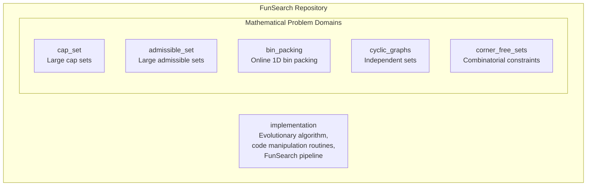
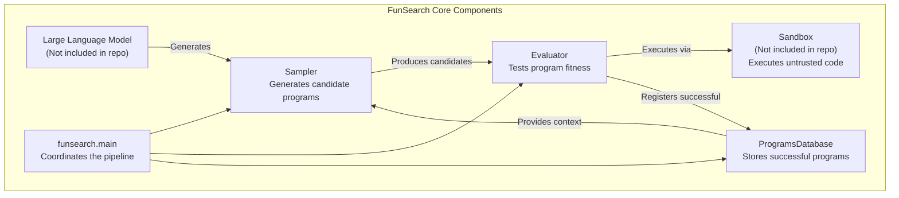
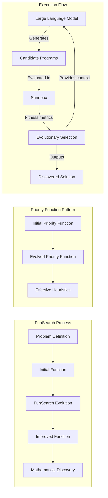
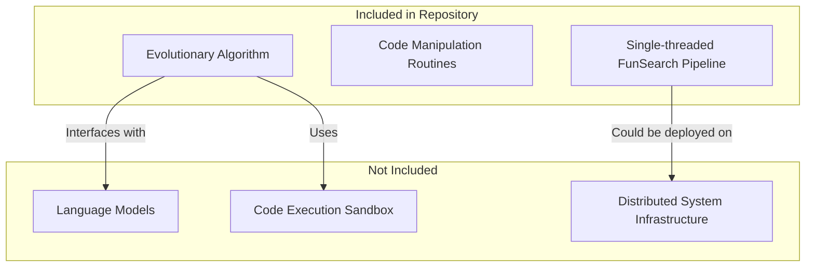

<!-- source: DeepWiki mcp.deepwiki.com · repo google-deepmind/funsearch · page 1 Overview · fetched 2026-10-26 -->

# Overview

Relevant source files

The following files were used as context for generating this wiki page:

- [README.md](README.md)

## Purpose and Scope

This documentation covers the FunSearch repository, which accompanies the scientific publication "Mathematical discoveries from program search with large language models" (Nature, 2023). FunSearch demonstrates how evolutionary program search guided by large language models can solve complex mathematical problems and discover new mathematical insights. This overview provides a high-level introduction to the repository structure, its core components, and the mathematical problems it addresses. For detailed information about the implementation, see [Core Implementation](#2).

## Repository Structure

FunSearch is organized into six independent directories, each serving a distinct purpose:

Sources: [README.md:7-33]()

The repository contains:

1. **Five mathematical problem domains**: Each directory contains functions discovered by FunSearch, along with numerical datasets representing the discovered mathematical objects or solutions.

2. **Implementation directory**: Contains the evolutionary algorithm, code manipulation routines, and a single-threaded implementation of the FunSearch pipeline. It does not include language models, code execution sandbox, or distributed system infrastructure.

## Core Components

The FunSearch system operates through several interconnected components:

Sources: [README.md:28-34]()

Key aspects of the implementation:

- The system leverages language models to generate candidate programs, though the models themselves are not included in the repository
- An evolutionary algorithm selects successful programs based on fitness evaluation
- The system is designed to be adaptable for use with various language models, sandboxes, and distributed systems
- A single-threaded implementation is provided as a reference

## Mathematical Problem Domains

FunSearch addresses five distinct mathematical problem domains, each representing a significant challenge in mathematics:

| Problem Domain | Description | Key Results |
|---------------|-------------|-------------|
| Cap Sets | Sets in n-dimensional space where no three points form a line | Large cap sets discovered |
| Admissible Sets | Sets related to bounds on cap set capacity | Large admissible sets constructed |
| Bin Packing | Online 1D bin packing optimization | New effective heuristics discovered |
| Cyclic Graphs | Independent sets in strong products of cyclic graphs | Large independent sets constructed |
| Corner-Free Sets | Sets satisfying combinatorial degeneration constraints | New sets of indices discovered |

Sources: [README.md:9-26]()

## FunSearch Methodology

FunSearch follows a common pattern across problem domains, evolving functions that construct mathematical objects or optimize solutions:

Sources: [README.md:28-34]()

Rather than directly evolving solutions, FunSearch often evolves "priority functions" that guide greedy algorithms in constructing mathematical objects. This approach has led to state-of-the-art results in several domains.

## Usage

All notebooks in the repository can be opened and run in Google Colab without any installation requirements:

| Problem Domain | Notebook | Colab Link |
|---------------|----------|------------|
| Cap Set | cap_set.ipynb | Available in repository |
| Admissible Set | admissible_set.ipynb | Available in repository |
| Bin Packing | bin_packing.ipynb | Available in repository |
| Cyclic Graphs | cyclic_graphs.ipynb | Available in repository |

Sources: [README.md:36-54]()

The notebooks provide a convenient way to explore the discovered functions and results. For more detailed usage information, see [Usage](#2.3).

## Implementation Boundaries

Sources: [README.md:28-34]()

The repository deliberately excludes certain components to provide flexibility:

- Language models for generating programs are not included
- Code execution sandbox systems are not provided
- Distributed system infrastructure is not included

This design allows users to integrate their own choices for these components while maintaining the core algorithmic approach.

---

