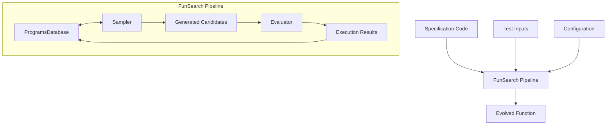
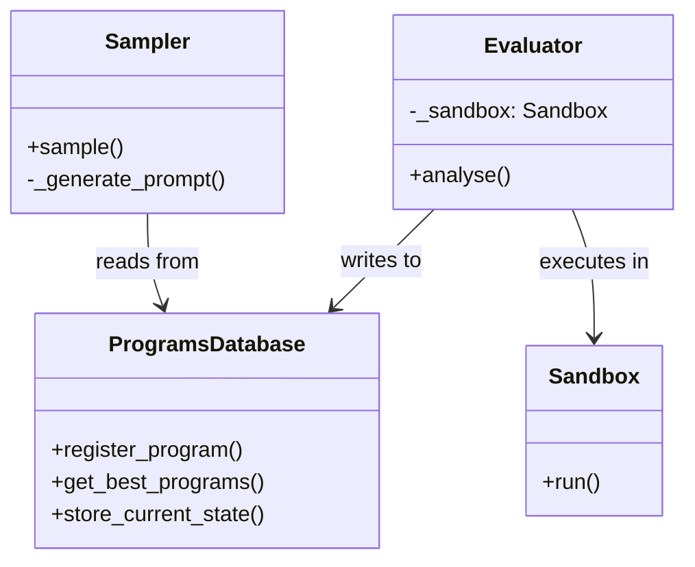
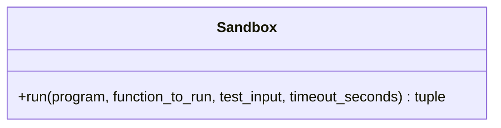
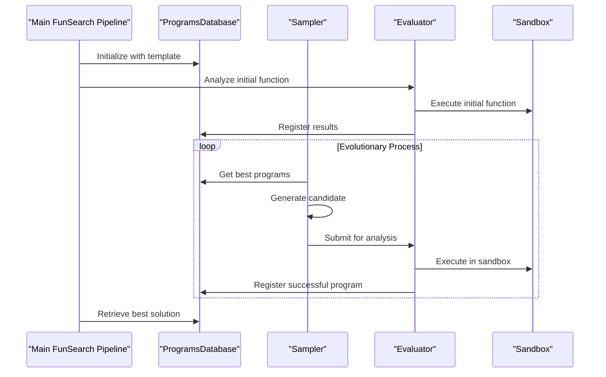
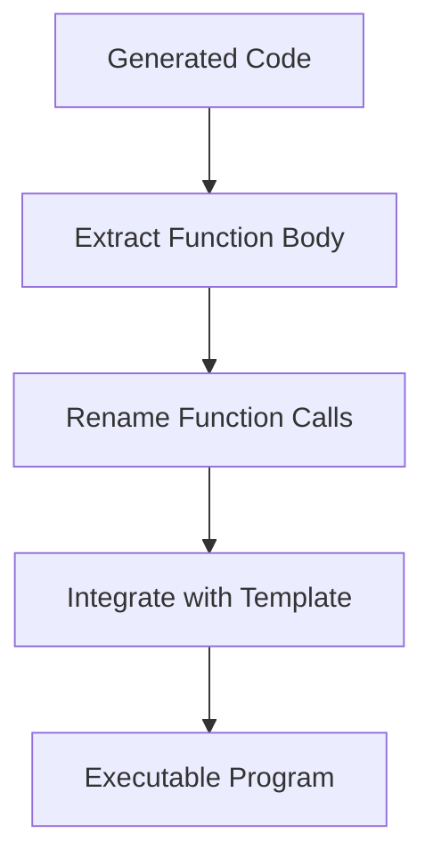

<!-- source: DeepWiki mcp.deepwiki.com · repo google-deepmind/funsearch · page 2 Core Implementation · fetched 2026-10-26 -->

# Core Implementation

Relevant source files

The following files were used as context for generating this wiki page:

- [README.md](README.md)
- [implementation/evaluator.py](implementation/evaluator.py)
- [implementation/funsearch.py](implementation/funsearch.py)

This document describes the core implementation of the FunSearch algorithm, which is the evolutionary system that uses large language models to guide program search for solving mathematical problems. It details the architecture, components, and workflow of the algorithm without focusing on specific problem domains. For information about how FunSearch is applied to specific mathematical problems, see [Problem Domains](#3).

The core implementation consists of an evolutionary algorithm, code manipulation routines, and a single-threaded implementation of the FunSearch pipeline. It deliberately excludes the language models for generating new programs, the sandbox for executing untrusted code, and the infrastructure for distributed execution, allowing users to integrate their own technologies for these components.

## Architecture Overview

FunSearch follows an evolutionary algorithm approach where functions are evolved through repeated cycles of generation, evaluation, and selection.

The core implementation is designed to be modular, with each component having specific responsibilities:

1. **FunSearch Pipeline**: Coordinates the evolutionary process between databases, samplers, and evaluators
2. **Programs Database**: Stores successful programs and provides context for generation
3. **Sampler**: Generates candidate programs using a language model
4. **Evaluator**: Executes and evaluates candidate programs in a sandbox environment

Sources: [implementation/funsearch.py:1-69]()`

## Core Components

The FunSearch implementation consists of four primary components that work together to evolve functions:

### ProgramsDatabase

The `ProgramsDatabase` component maintains the history of successful programs discovered during the evolutionary process. It:
- Stores evolved functions along with their performance metrics
- Ranks programs based on their scores
- Provides context (successful examples) for the sampler to generate new candidates
- Ensures persistence across runs by saving state to disk

### Evaluator

The `Evaluator` class analyzes functions generated by language models to determine their effectiveness. It:
- Compiles candidate functions into executable programs
- Executes programs safely in a sandbox environment
- Scores programs based on their performance on test inputs
- Registers successful programs in the database

The evaluator is responsible for maintaining the integrity of the evolutionary process by ensuring that registered programs:
1. Execute successfully without errors
2. Return appropriate numeric scores
3. Don't call ancestor functions (to prevent trivial extensions)

Sources: [implementation/evaluator.py:115-156]()

### Sampler

The `Sampler` component handles the generation of candidate functions. It:
- Creates prompts based on the best-performing programs from the database
- Interacts with language models to generate candidate code snippets
- Submits generated candidates to evaluators for analysis
- Maintains "islands" of evolution to ensure diversity in the search space

The sampler acts as the creative force in the evolutionary algorithm, leveraging language models to explore the solution space intelligently.

### Sandbox

The `Sandbox` component provides a secure environment for executing untrusted code. While the repository doesn't include a concrete implementation (allowing users to supply their own), it defines the interface:

The sandbox is critical for safety when executing machine-generated code, which might otherwise pose security risks or cause infinite loops.

Sources: [implementation/evaluator.py:88-100]()

## Workflow and Execution

The FunSearch algorithm follows a specific workflow designed to evolve increasingly better functions:

### Initialization

1. The system parses the specification code to identify:
   - The function to evolve (marked with `@funsearch.evolve`)
   - The function to run for evaluation (marked with `@funsearch.run`)

2. A `ProgramsDatabase` is initialized with the template program.

3. Evaluators and samplers are created based on the configuration.

4. The initial implementation is analyzed and registered if successful.

Sources: [implementation/funsearch.py:40-59]()

### Evolution Process

Once initialized, the evolution process continues in an infinite loop:

1. **Sampling**: The sampler selects high-performing programs from the database and generates new candidate functions.

2. **Evaluation**: Candidates are analyzed by the evaluator:
   - The function body is extracted and properly formatted
   - The function is integrated into the template program
   - The program is executed on test inputs in the sandbox
   - Results are scored according to the evaluation function

3. **Selection**: Successful programs are registered in the database, where they're ranked by performance and can be selected for future generations.

4. **Iteration**: The process repeats, creating a continuous evolution toward better solutions.

Sources: [implementation/funsearch.py:61-68](), [implementation/evaluator.py:135-155]()

## Code Manipulation

An essential aspect of the core implementation is the ability to manipulate code programmatically. The system includes utilities for:

- Parsing and modifying Python code
- Extracting function bodies
- Renaming function calls to manage versions
- Detecting calls to ancestor functions

The code manipulation routines ensure that generated code can be properly integrated into the template program and executed safely.

Sources: [implementation/evaluator.py:26-65](), [implementation/evaluator.py:103-112]()

## Configuration

The FunSearch pipeline can be configured with various parameters:

- `num_evaluators`: Number of evaluator instances
- `num_samplers`: Number of sampler instances
- `samples_per_prompt`: Number of samples to generate from each prompt
- `programs_database`: Configuration for the programs database

These parameters allow users to control the balance between exploration and exploitation in the evolutionary process.

Sources: [implementation/funsearch.py:40-68]()

## Summary

The core implementation of FunSearch provides a flexible framework for evolving functions using large language models. By separating the evolutionary algorithm from the language model, sandbox, and distributed infrastructure, the implementation offers a modular design that can be adapted to different problem domains and technical environments.

The continuous cycle of generation, evaluation, and selection enables FunSearch to discover novel solutions to complex mathematical problems, as demonstrated in the various problem domains included in the repository.

---

