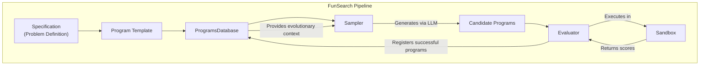
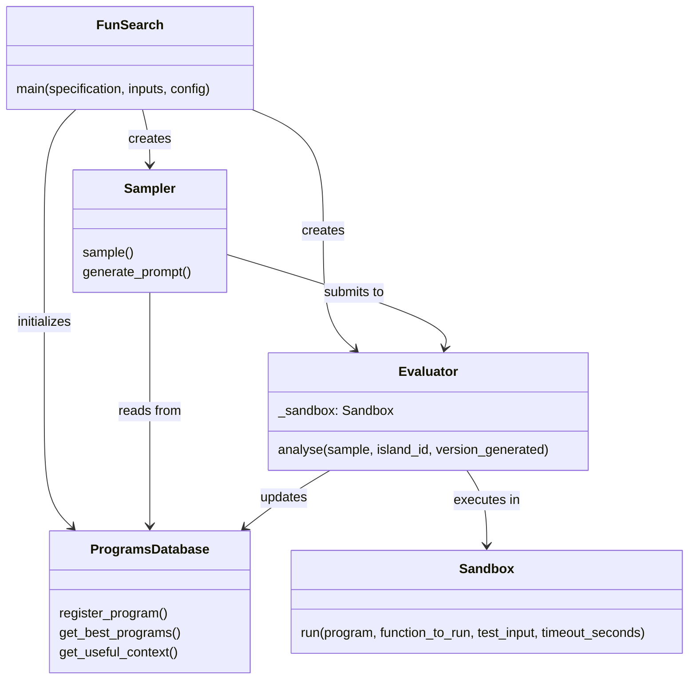
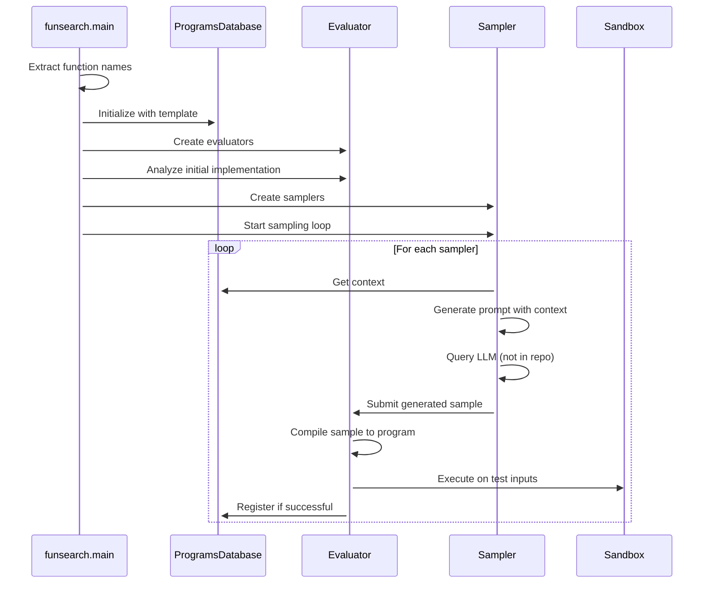
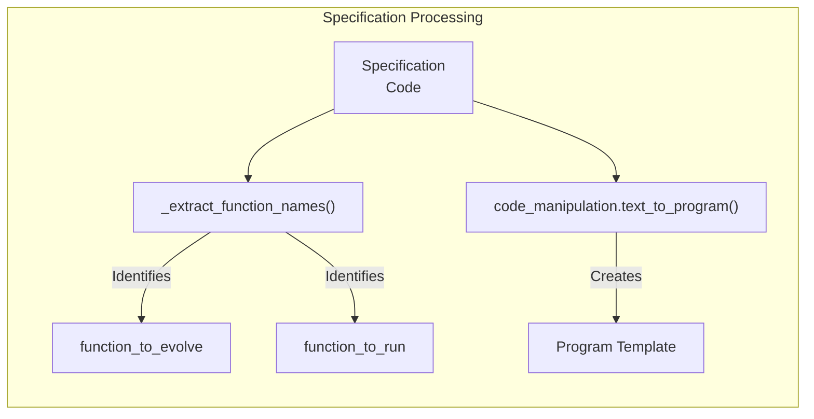
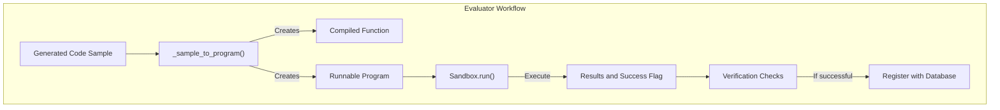
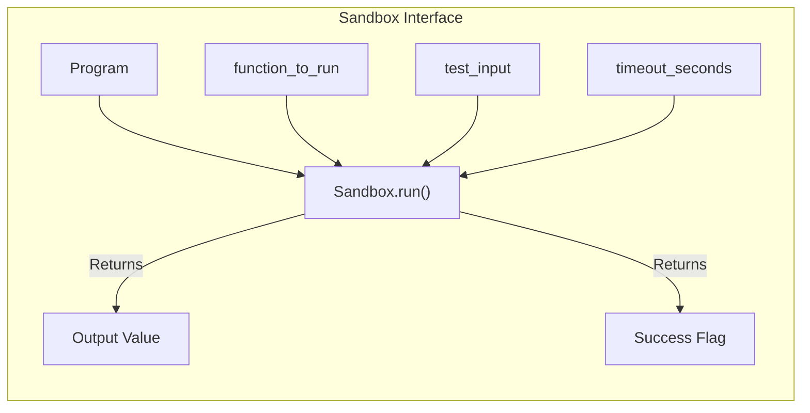
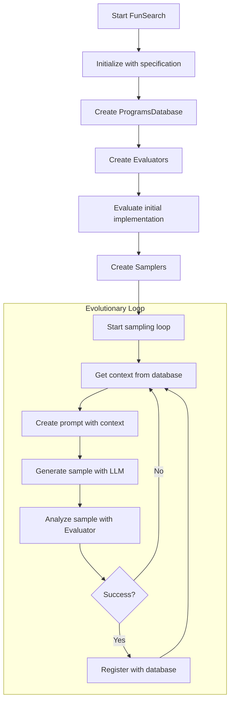
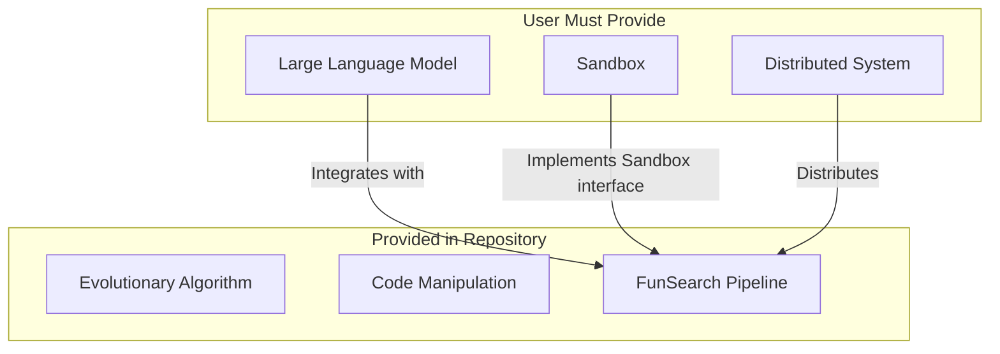

<!-- source: DeepWiki mcp.deepwiki.com · repo google-deepmind/funsearch · page 2.1 Architecture · fetched 2026-10-26 -->

# Architecture

Relevant source files

The following files were used as context for generating this wiki page:

- [README.md](README.md)
- [implementation/evaluator.py](implementation/evaluator.py)
- [implementation/funsearch.py](implementation/funsearch.py)

This document describes the overall architecture of the FunSearch system, including its major components and how they interact within the evolutionary algorithm. For implementation details of specific components, see [Components](#2.2).

## High-Level Architecture Overview

FunSearch employs an evolutionary approach to program search guided by large language models. The system evolves functions through a pipeline of generation, evaluation, and selection to discover effective solutions to mathematical problems.

Sources: [implementation/funsearch.py:27-68](), [implementation/evaluator.py:115-155]()

## Core Components and Their Relationships

The FunSearch architecture contains four primary components that work together in the evolutionary search process:

Sources: [implementation/funsearch.py:40-68](), [implementation/evaluator.py:115-155]()

## Initialization Flow

The FunSearch system begins with a problem specification and test inputs, then initializes its core components:

Sources: [implementation/funsearch.py:40-68]()

## Components in Detail

### Program Template and Function Extraction

The system starts with a specification that includes the problem definition and initial function implementations. The specification must define:

1. A function decorated with `@funsearch.evolve` - the target for evolution
2. A function decorated with `@funsearch.run` - used to evaluate candidates

Sources: [implementation/funsearch.py:27-37]()

### ProgramsDatabase

The `ProgramsDatabase` serves as the evolutionary memory of the system. It stores successful programs, tracks their performance, and supplies context to the Sampler for generating new candidates.

### Evaluator

The `Evaluator` compiles and analyzes functions generated by the language model:

1. It compiles the sample code into a runnable program
2. Executes it on test inputs using a `Sandbox`
3. Verifies that the execution succeeds and doesn't call ancestor functions
4. Registers successful programs with the database, including their scores

Sources: [implementation/evaluator.py:115-155](), [implementation/evaluator.py:67-85]()

### Sampler

The `Sampler` generates new program candidates by:
1. Retrieving context from the database
2. Creating prompts with this context
3. Using an LLM (not included in the repo) to generate samples
4. Submitting samples to the evaluator

### Sandbox

The `Sandbox` is an interface for safely executing potentially untrusted code:

**Note**: The actual sandbox implementation is not included in the repository and must be provided by users.

Sources: [implementation/evaluator.py:88-100]()

## Execution Flow

The full execution flow of FunSearch involves:

Sources: [implementation/funsearch.py:40-68]()

## Integration Points

The repository deliberately excludes three key components to allow users to integrate their own choices:

1. **Language Models**: For generating new programs based on prompts
2. **Sandbox**: For safely executing untrusted code
3. **Distributed System Infrastructure**: For scaling the search process

To implement a complete FunSearch system, users must provide these components and integrate them with the provided pipeline.

Sources: [README.md:28-34]()

## Design Considerations

The architecture follows several key design principles:

1. **Modularity**: Clear separation between components to allow different implementations
2. **Safety**: Sandboxed execution of generated code
3. **Evolution**: A database that maintains the evolutionary history and context
4. **Adaptability**: Designed to work with various language models and problem domains

The implementation provided in the repository serves as a reference that can be adapted to different environments, language models, and distributed systems.

---

