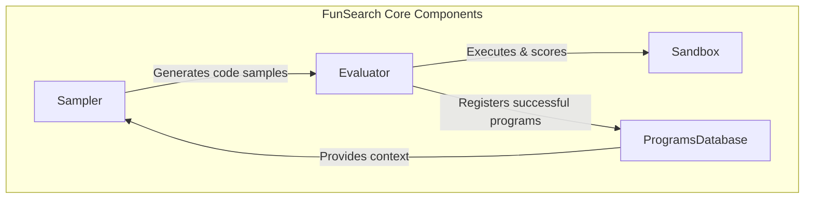
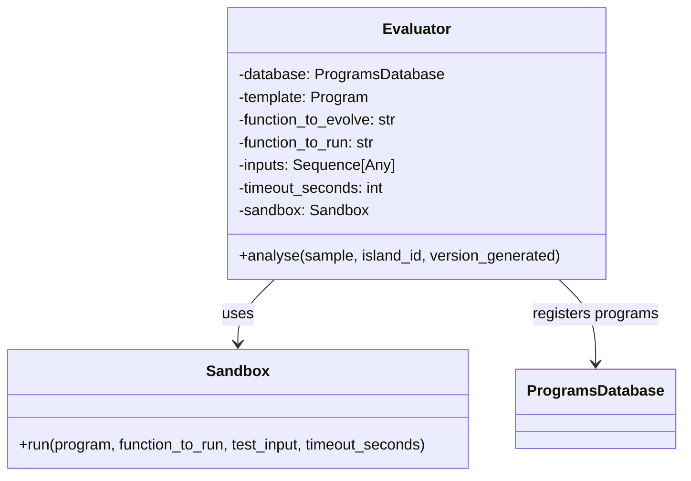
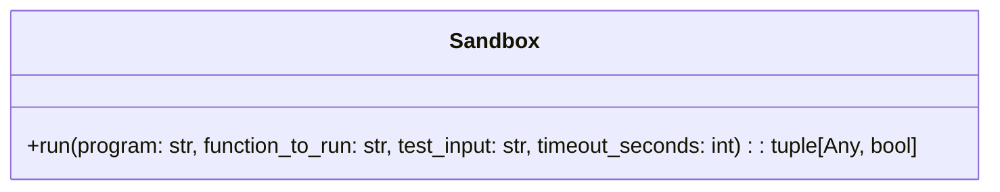
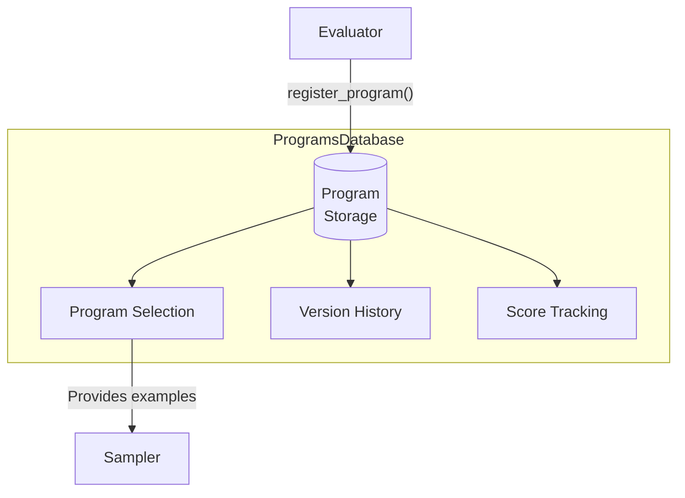
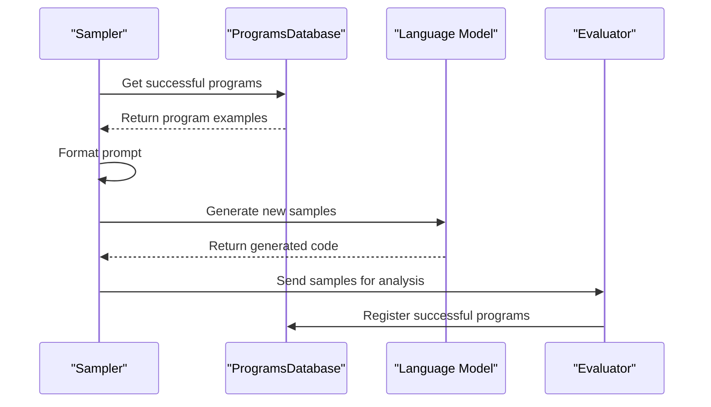
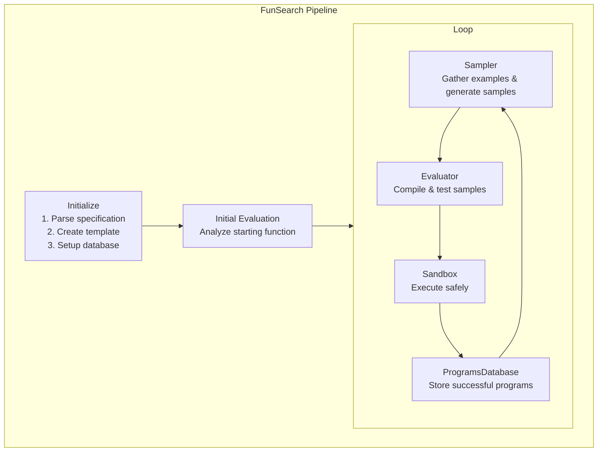
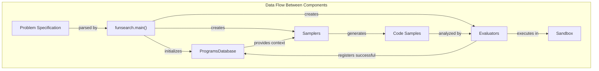
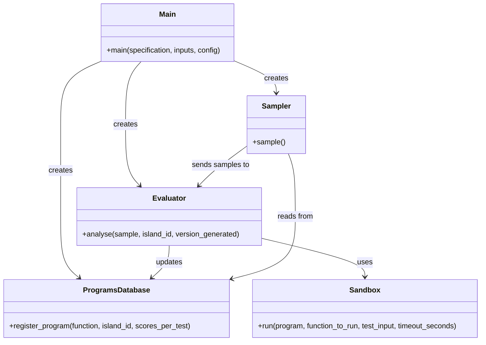

<!-- source: DeepWiki mcp.deepwiki.com · repo google-deepmind/funsearch · page 2.2 Components · fetched 2026-10-26 -->

# Components

Relevant source files

The following files were used as context for generating this wiki page:

- [implementation/evaluator.py](implementation/evaluator.py)
- [implementation/funsearch.py](implementation/funsearch.py)

This page details the key components of the FunSearch implementation. It explains the core modules that make up the system and how they interact to facilitate the evolutionary program search. For information about the overall architecture, see [Architecture](#2.1), and for usage instructions, see [Usage](#2.3).

## Component Overview

FunSearch's implementation consists of four primary components that work together to evolve and discover improved functions:

Sources: [implementation/funsearch.py:40-68]()

## Evaluator

The Evaluator component analyzes functions generated by the language model to determine their effectiveness at solving the specified problem.

### Functionality

- Compiles generated code samples into runnable programs
- Executes these programs on test inputs within a sandbox
- Verifies that programs execute successfully and return valid scores
- Registers successful programs in the database

### Class Structure

Sources: [implementation/evaluator.py:115-155](), [implementation/funsearch.py:48-59]()

### Key Methods

The `analyse()` method is the main entry point of the Evaluator:
1. It first converts the raw code sample into a complete program
2. Runs the program on each test input using the sandbox
3. Checks if execution is successful and doesn't call ancestor functions
4. Registers successful programs in the database with their scores

The Evaluator uses several helper functions:
- `_sample_to_program()`: Converts code samples to executable programs
- `_trim_function_body()`: Extracts just the body of generated functions
- `_calls_ancestor()`: Verifies the function doesn't call previous versions

Sources: [implementation/evaluator.py:135-155](), [implementation/evaluator.py:46-85](), [implementation/evaluator.py:103-112]()

## Sandbox

The Sandbox provides a secure environment for executing potentially unsafe generated code.

### Interface

Sources: [implementation/evaluator.py:88-100]()

### Functionality

- Executes untrusted code safely
- Applies a timeout to prevent infinite loops
- Returns both the execution result and whether execution was successful
- Must be implemented by users of the FunSearch framework (not included in the repo)

The Sandbox interface is intentionally abstract, allowing different implementations based on security and performance requirements. The `run()` method takes a program string, the function name to run, test input, and a timeout, returning both the execution result and a success flag.

Sources: [implementation/evaluator.py:91-100]()

## ProgramsDatabase

The ProgramsDatabase maintains a record of successful programs discovered during the search process.

### Functionality

- Stores and manages successful program implementations
- Tracks program performance across different test inputs
- Provides context for the Sampler to generate improved versions
- Maintains a version history of evolved functions

Sources: [implementation/funsearch.py:45-46]()

## Sampler

The Sampler component generates new code samples by leveraging a language model.

### Functionality

- Retrieves successful programs from the database
- Formats prompts with examples of good programs
- Queries the language model to generate improved versions
- Sends samples to the Evaluator for analysis

Sources: [implementation/funsearch.py:61-68]()

## Component Interaction in FunSearch Pipeline

The following diagram illustrates how these components interact in the complete FunSearch pipeline:

Sources: [implementation/funsearch.py:40-68]()

## Implementation Details

### Core Data Flow

Sources: [implementation/funsearch.py:40-68]()

### Key Class Relationships

The relationship between the main classes shows how the components are instantiated and connected in the FunSearch system:

Sources: [implementation/funsearch.py:40-68](), [implementation/evaluator.py:115-155]()

## Summary

The FunSearch implementation consists of four key components that work together to evolve and discover improved functions:

| Component | Primary Responsibility | Key Methods |
|-----------|------------------------|-------------|
| **Evaluator** | Analyzes and tests generated functions | `analyse(sample, island_id, version_generated)` |
| **ProgramsDatabase** | Stores successful programs | `register_program(function, island_id, scores_per_test)` |
| **Sampler** | Generates new code samples | `sample()` |
| **Sandbox** | Executes untrusted code safely | `run(program, function_to_run, test_input, timeout_seconds)` |

These components form a closed loop where the Sampler generates candidates, the Evaluator tests them, successful programs are stored in the ProgramsDatabase, and the cycle continues with the Sampler using the database contents to generate improved versions.

Sources: [implementation/funsearch.py:40-68](), [implementation/evaluator.py:115-155]()

---

