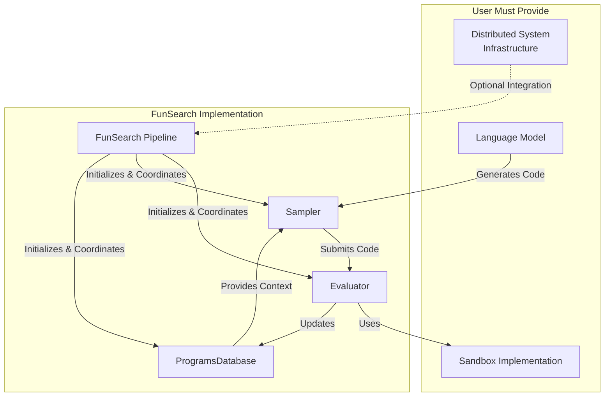
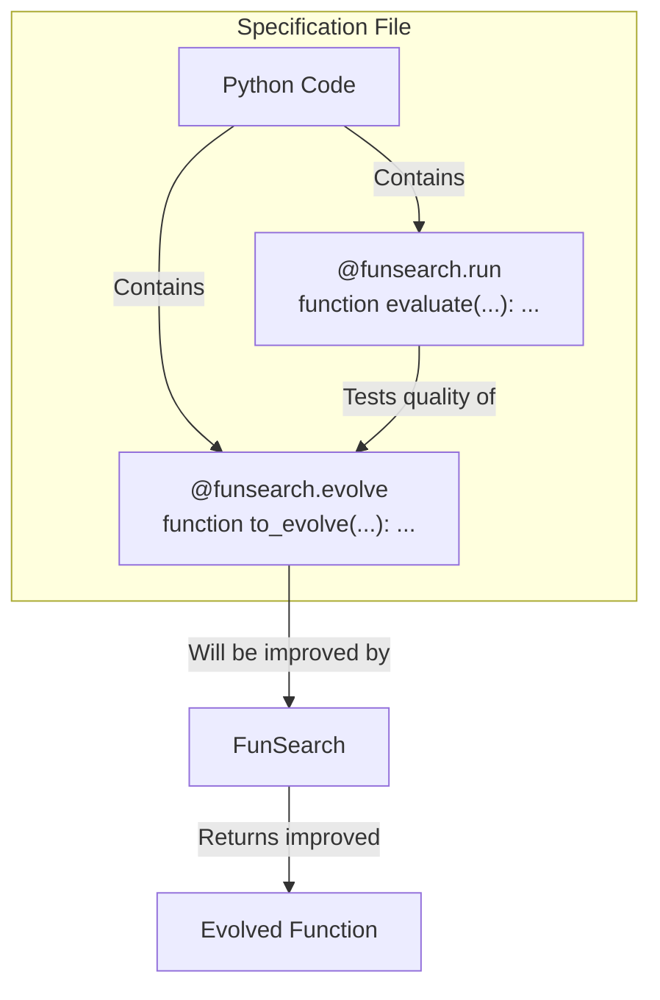
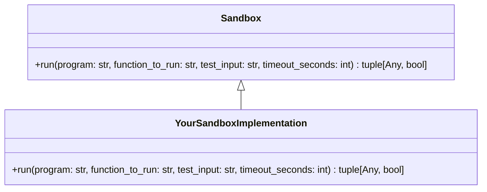
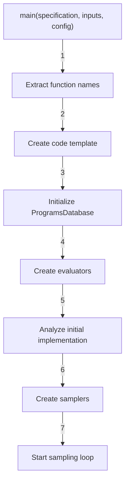
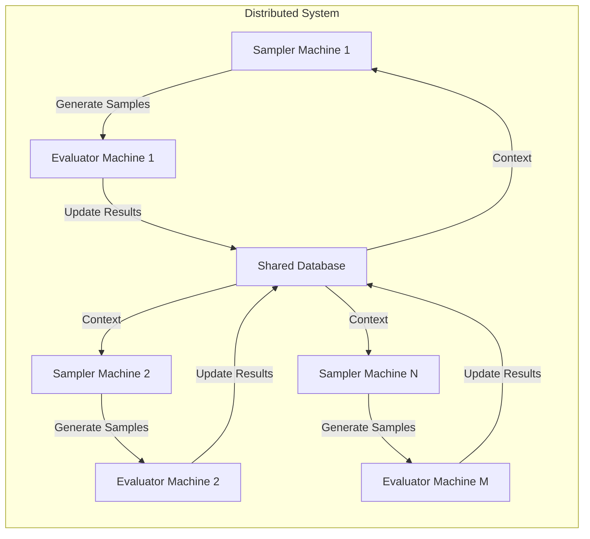

<!-- source: DeepWiki mcp.deepwiki.com · repo google-deepmind/funsearch · page 2.3 Usage · fetched 2026-10-26 -->

# Usage

<details>
<summary>Relevant source files</summary>

The following files were used as context for generating this wiki page:

- [README.md](README.md)
- [implementation/evaluator.py](implementation/evaluator.py)
- [implementation/funsearch.py](implementation/funsearch.py)

</details>


This page provides detailed instructions on how to use the FunSearch implementation from the `implementation` directory. It explains how to adapt this implementation to work with different language models, sandboxes, and distributed systems. For information about the overall architecture of FunSearch, see [Architecture](#2.1), and for details about specific components, see [Components](#2.2).

## Overview of Implementation Usage

The FunSearch implementation provided in this repository does not include language models for generating new programs, the sandbox for executing untrusted code, nor the infrastructure for running FunSearch on a distributed system. Instead, it provides a framework that can be adapted to work with any available language models, sandboxes, and distributed systems.



Sources: [implementation/funsearch.py:16-69](), [README.md:28-34]()

## Setting Up Your Specification

To use FunSearch, you need to create a specification that includes two specially decorated functions:

1. A function decorated with `@funsearch.evolve` - This is the function that FunSearch will attempt to improve.
2. A function decorated with `@funsearch.run` - This function evaluates the performance of the evolved function.



Sources: [implementation/funsearch.py:27-37]()

### Example Specification Structure

Your specification file should contain at least these two functions:

1. The function to evolve (which will be improved by FunSearch):
```
@funsearch.evolve
def priority_function(element, container):
    # Initial implementation 
    # This will be evolved by FunSearch
    return some_score
```

2. The function to run (which evaluates how good the priority function is):
```
@funsearch.run
def evaluate_priority(test_case):
    # Use priority_function to solve the problem
    # Return a numeric score indicating performance
    return score
```

Sources: [implementation/funsearch.py:27-37]()

## Implementing Required Components

### Sandbox Implementation

You must implement a `Sandbox` class for securely executing generated code. The repository includes a base class in `evaluator.py`, but its `run` method is not implemented:



Your implementation must:
1. Execute the specified function from the provided program code
2. Pass the test input to the function
3. Apply the timeout constraint
4. Return the function's output and a boolean indicating whether execution succeeded

Sources: [implementation/evaluator.py:88-100]()

### Language Model Integration

The FunSearch implementation does not include a language model. You need to integrate your own language model that can generate Python code. The language model should:

1. Generate modifications to the function being evolved
2. Receive feedback about successful programs
3. Create new variations that build upon successful programs

Sources: [README.md:28-34]()

## Running FunSearch

The main entry point for running FunSearch is the `main` function in `funsearch.py`:



Sources: [implementation/funsearch.py:40-68]()

### Required Parameters

1. `specification`: A string containing your code specification with `@funsearch.evolve` and `@funsearch.run` decorated functions
2. `inputs`: A sequence of test inputs to evaluate the evolved function
3. `config`: A `Config` object that specifies:
   - `programs_database`: Configuration for the programs database
   - `num_evaluators`: Number of evaluator instances to create
   - `num_samplers`: Number of sampler instances to create
   - `samples_per_prompt`: Number of samples to generate per prompt

Sources: [implementation/funsearch.py:40-68]()

## Distributed Execution

While the provided implementation is single-threaded, it's designed to be adaptable for distributed execution:



The implementation is designed so that:

1. Multiple samplers can run in parallel on different machines
2. Multiple evaluators can process samples in parallel
3. They can all communicate through a shared programs database

To implement distributed execution, you'll need to:
1. Create a distributed version of the `ProgramsDatabase`
2. Run samplers and evaluators on separate machines
3. Ensure communication between the components

Sources: [implementation/funsearch.py:63-68](), [README.md:28-34]()

## Example Usage Workflow

Here's a step-by-step process to use FunSearch with your own components:

1. **Define your problem specification**:
   - Create a file with functions decorated with `@funsearch.evolve` and `@funsearch.run`
   - Define test inputs that will evaluate the performance of evolved functions

2. **Implement required components**:
   - Create a `Sandbox` implementation that can safely execute generated code
   - Set up integration with your language model of choice

3. **Configure FunSearch**:
   - Create a `Config` object with appropriate parameters
   - Set up any additional configuration for distributed execution if needed

4. **Run the FunSearch pipeline**:
   - Call the `main` function with your specification, inputs, and configuration
   - For distributed execution, deploy samplers and evaluators across machines

5. **Analyze results**:
   - Examine the programs database for the best evolved functions
   - Evaluate these functions on additional test cases if needed

Sources: [implementation/funsearch.py:40-68](), [README.md:28-34]()

## Integration Considerations

### Security Considerations

When implementing the sandbox component, ensure that:

1. Generated code cannot access sensitive system resources
2. Execution is properly sandboxed to prevent harmful side effects
3. Timeouts are enforced to prevent infinite loops
4. Memory usage is limited to prevent resource exhaustion

### Performance Optimization

For efficient execution:

1. Consider parallelizing evaluators to process multiple samples simultaneously
2. Implement caching mechanisms in the sandbox to avoid re-executing identical code
3. Use efficient communication methods between distributed components
4. Tune the number of samplers and evaluators based on available resources

### Monitoring and Debugging

To effectively monitor the FunSearch process:

1. Add logging throughout the process to track evolution progress
2. Implement metrics to measure the quality of evolved functions over time
3. Create visualization tools to understand how functions are evolving
4. Store intermediate results to allow resuming interrupted runs

Sources: [implementation/evaluator.py:133-155](), [implementation/funsearch.py:40-68]()

## Summary

The FunSearch implementation provided in this repository offers a flexible framework that can be adapted to work with various language models, sandboxes, and distributed systems. By implementing the required components and following the usage workflow described above, you can apply FunSearch to your own mathematical or algorithmic problems.

For specific examples of how FunSearch has been applied to different problem domains, refer to the problem-specific directories in the repository, such as Cap Sets [Cap Sets](#3.2), Admissible Sets [Admissible Sets](#3.1), Bin Packing [Bin Packing](#3.3), and others.

---

