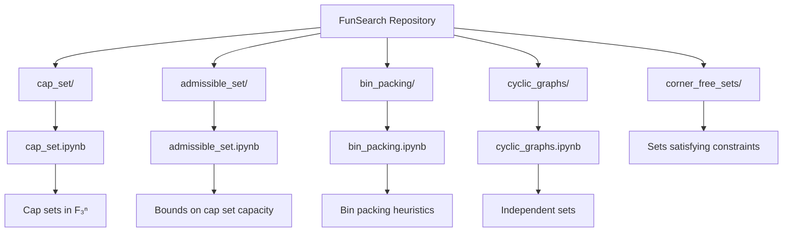
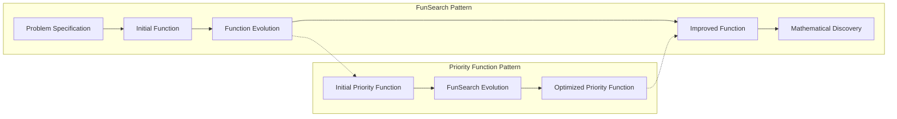
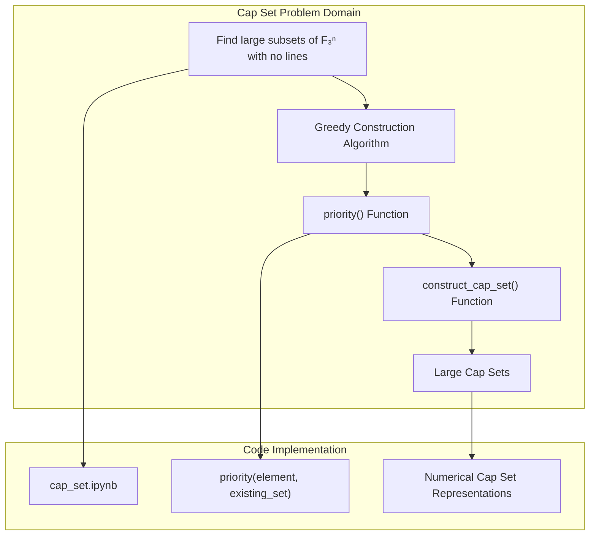
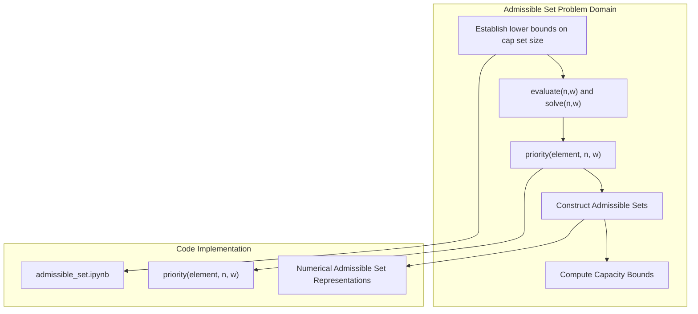
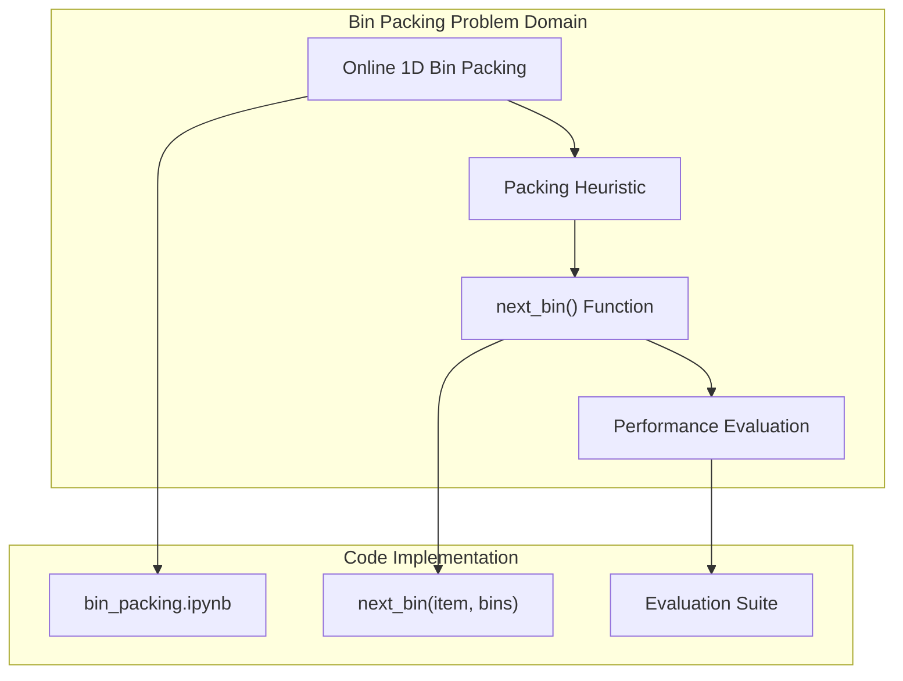
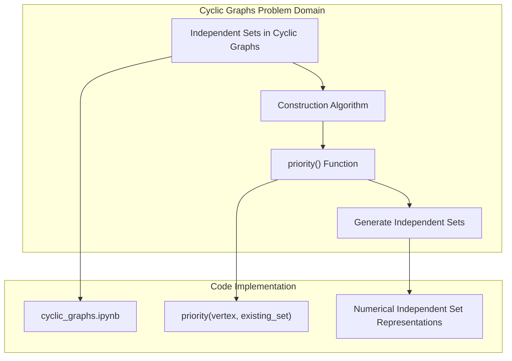
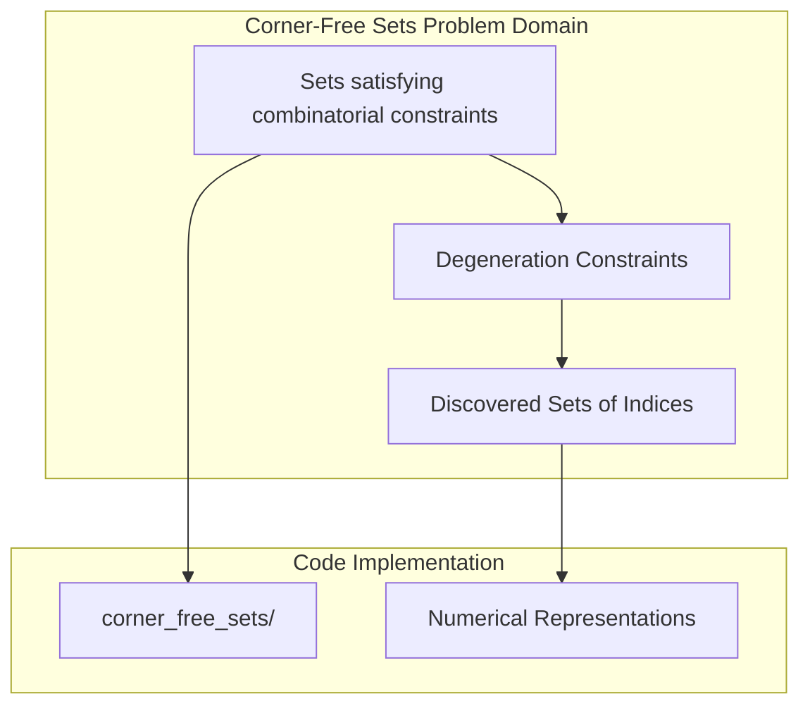
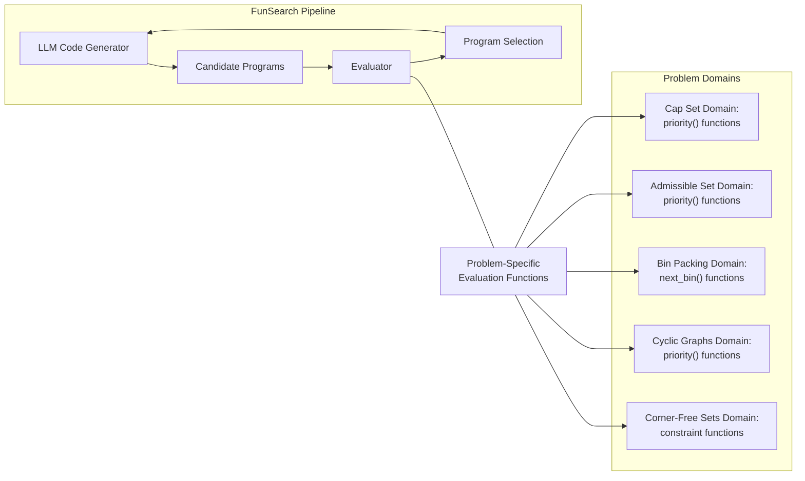

<!-- source: DeepWiki mcp.deepwiki.com · repo google-deepmind/funsearch · page 3 Problem Domains · fetched 2026-10-26 -->

# Problem Domains

Relevant source files

The following files were used as context for generating this wiki page:

- [README.md](README.md)

## Purpose and Scope

This document provides an overview of the mathematical problem domains addressed by FunSearch. Each domain represents a distinct mathematical challenge for which FunSearch was used to discover novel solutions through program search with large language models. For information about the core algorithm and implementation details, see [Core Implementation](#2).

## Overview of Problem Domains

The FunSearch repository contains five mathematical problem domains, each implemented as a standalone directory with its own notebook and discovered solutions:

Sources: [README.md:7-26]()

## Common Search Pattern

All problem domains utilize a similar approach to mathematical discovery through program search:

Sources: [README.md:7-26]()

Rather than directly evolving the solution, FunSearch typically evolves a "priority function" that guides a greedy algorithm to construct the solution step by step. This approach has proven effective across different mathematical domains.

## Problem Domain Descriptions

### Cap Sets

Cap sets are subsets of the three-dimensional space over the field with three elements (F₃ⁿ) that contain no three points in an arithmetic progression (no lines).

Sources: [README.md:9-10]()

The `cap_set` directory contains functions discovered by FunSearch that construct large cap sets, as well as numerical representations of those sets.

### Admissible Sets

Admissible sets provide a way to establish lower bounds on the maximum size of cap sets in F₃ⁿ.

Sources: [README.md:12-14]()

The `admissible_set` directory contains functions discovered by FunSearch that construct large admissible sets, along with numerical representations of these sets.

### Bin Packing

The bin packing problem involves packing items of different sizes into a fixed number of bins to minimize wasted space. FunSearch focuses on the online version where items must be placed immediately upon arrival.

Sources: [README.md:16-18]()

The `bin_packing` directory contains heuristics discovered by FunSearch for online 1D bin packing problems and an evaluation suite to reproduce the results reported in the paper.

### Cyclic Graphs

This problem involves finding large independent sets in strong products of cyclic graphs - sets of vertices where no two vertices are adjacent.

Sources: [README.md:20-22]()

The `cyclic_graphs` directory contains functions discovered by FunSearch that construct large independent sets in strong products of cyclic graphs, as well as numerical representations of those sets.

### Corner-Free Sets

Corner-free sets are sets of indices satisfying specific combinatorial degeneration constraints.

Sources: [README.md:24-26]()

The `corner_free_sets` directory contains the discovered sets of indices in numerical format, satisfying the combinatorial degeneration constraints described for the corners-free problem.

## Problem Domains in the FunSearch Pipeline

The following diagram illustrates how each problem domain integrates with the FunSearch evolutionary algorithm:

Sources: [README.md:7-26](), [README.md:28-34]()

## Technical Implementation Table

| Problem Domain | Directory | Main Notebook | Evolved Functions | Output |
|----------------|-----------|---------------|-------------------|--------|
| Cap Sets | `cap_set/` | `cap_set.ipynb` | `priority()` | Large cap sets in F₃ⁿ |
| Admissible Sets | `admissible_set/` | `admissible_set.ipynb` | `priority()`, `evaluate()`, `solve()` | Lower bounds on cap set capacity |
| Bin Packing | `bin_packing/` | `bin_packing.ipynb` | `next_bin()` | Online packing heuristics |
| Cyclic Graphs | `cyclic_graphs/` | `cyclic_graphs.ipynb` | `priority()` | Independent sets in cyclic graphs |
| Corner-Free Sets | `corner_free_sets/` | N/A | Constraint functions | Sets satisfying constraints |

Sources: [README.md:7-34]()

## Usage and Exploration

All notebooks can be run in Google Colab without installation requirements:

- Cap Set: `cap_set.ipynb` ([README.md:43-44]())
- Admissible Set: `admissible_set.ipynb` ([README.md:46-48]())
- Bin Packing: `bin_packing.ipynb` ([README.md:50-51]())
- Cyclic Graphs: `cyclic_graphs.ipynb` ([README.md:53-54]())

These notebooks allow users to explore the discovered functions and verify the mathematical results reported in the FunSearch paper.

---

