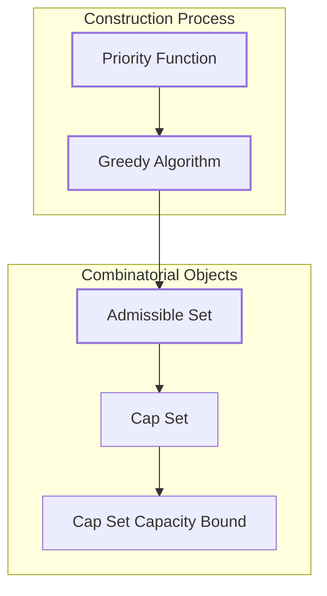
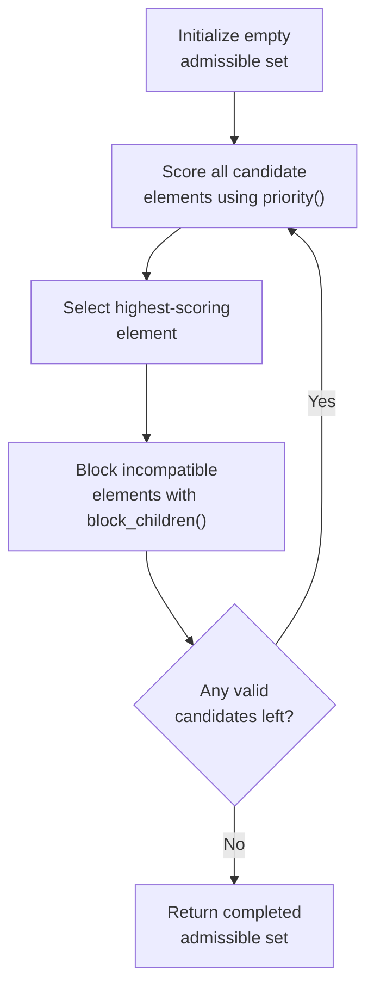
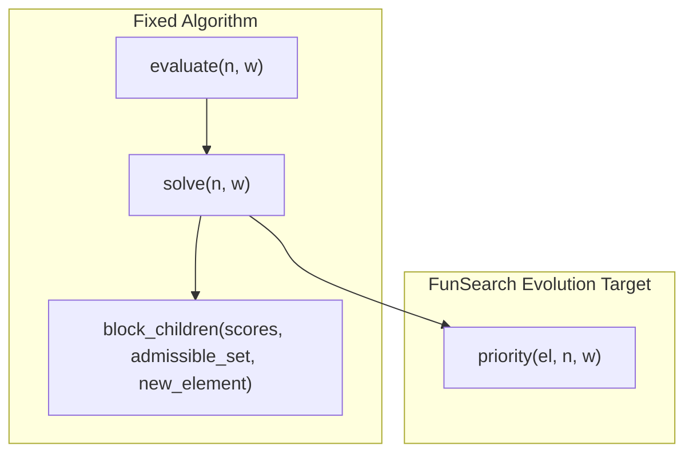
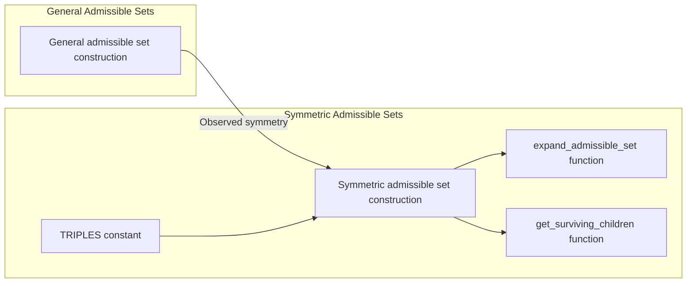
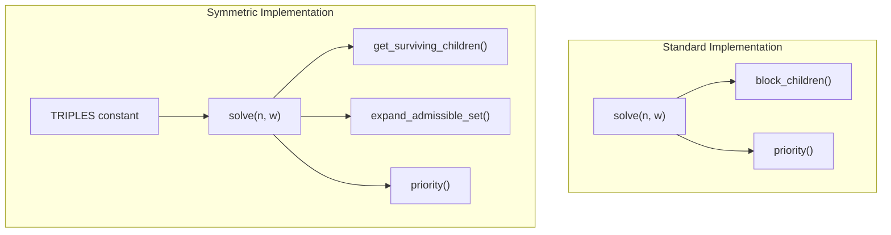

<!-- source: DeepWiki mcp.deepwiki.com · repo google-deepmind/funsearch · page 3.1 Admissible Sets · fetched 2026-10-26 -->

# Admissible Sets

<details>
<summary>Relevant source files</summary>

The following files were used as context for generating this wiki page:

- [README.md](README.md)
- [admissible_set/admissible_set.ipynb](admissible_set/admissible_set.ipynb)
- [admissible_set/admissible_set_n12_w7_size792.txt](admissible_set/admissible_set_n12_w7_size792.txt)
- [admissible_set/admissible_set_n15_w10_size3003.txt](admissible_set/admissible_set_n15_w10_size3003.txt)
- [admissible_set/admissible_set_n21_w15_size43596.txt](admissible_set/admissible_set_n21_w15_size43596.txt)
- [admissible_set/admissible_set_n24_w17_size237984.txt](admissible_set/admissible_set_n24_w17_size237984.txt)

</details>


This page documents the FunSearch implementation for generating large admissible sets and their use in establishing lower bounds on cap set capacity. Admissible sets are mathematical structures that, when applied properly, can be used to construct large cap sets, which in turn lead to improved bounds on the cap set problem in additive combinatorics.

## What are Admissible Sets?

Admissible sets are collections of vectors in Z₃ⁿ (vectors with entries 0, 1, or 2) with specific combinatorial properties that make them useful for constructing cap sets. A cap set is a set of points in Z₃ⁿ where no three points form a line.

In the context of the FunSearch repository, admissible sets are specifically used to prove lower bounds on the cap set capacity, which is a key quantity in the cap set problem. The cap set capacity represents the maximum asymptotic size of cap sets as the dimension grows.



Sources: [admissible_set/admissible_set.ipynb:24-35](), [admissible_set/admissible_set.ipynb:204-256]()

## Admissible Set Construction

FunSearch uses a greedy algorithm to construct admissible sets. The key insight of the FunSearch approach is to evolve an effective priority function that guides the greedy selection process. The basic algorithm works as follows:

1. Start with an empty admissible set
2. Assign scores (priorities) to all potential elements that could be added
3. Select the element with the highest score
4. Block all elements that would violate the admissibility constraints if added
5. Repeat steps 3-4 until no more elements can be added



Sources: [admissible_set/admissible_set.ipynb:86-106]()

## Core Implementation

The implementation consists of several key functions:

1. `evaluate(n, w)`: The main entry point that returns the size of the constructed admissible set
2. `solve(n, w)`: Constructs an admissible set I(n, w) of constant weight w in dimension n
3. `block_children(scores, admissible_set, new_element)`: Modifies the scores array to mark elements that would violate admissibility constraints
4. `priority(el, n, w)`: The evolved function that assigns priorities to candidate elements



Sources: [admissible_set/admissible_set.ipynb:44-117]()

### Block Children Function

The `block_children` function is critical for maintaining the admissibility property. It modifies the scores array by setting scores to `-inf` for elements that would violate the admissibility constraints if added to the set. This function handles two types of blocking:

1. Elements with the same support as the newly added element
2. Elements disallowed by a pair consisting of an extant point and the new element

```python
def block_children(scores: np.ndarray,
                   admissible_set: np.ndarray,
                   new_element: np.ndarray) -> None:
  """Modifies `scores` to -inf for elements blocked by `new_element`."""
  # Implementation details...
```

Sources: [admissible_set/admissible_set.ipynb:50-83]()

### Priority Function

The priority function is the target of FunSearch evolution. It assigns a score to each candidate element, which determines the order in which elements are added to the admissible set. The initial implementation simply returns 0.0, but FunSearch evolves more sophisticated functions.

```python
def priority(el: tuple[int, ...], n: int, w: int) -> float:
  """Returns the priority with which we want to add `el` to the set."""
  return 0.0
```

Sources: [admissible_set/admissible_set.ipynb:114-117]()

## Discovered Solutions

FunSearch discovered several priority functions that lead to optimal or near-optimal admissible sets. Here are some notable examples:

### Full-Size I(12, 7) Admissible Set

FunSearch discovered a priority function that constructs a full-sized admissible set I(12, 7), i.e., of size ${12 \choose 7} = 792$. The function patterns examine relationships between coordinates at 4-index intervals:

```python
def priority(el: tuple[int, ...], n: int, w: int) -> float:
  score = 0.0
  for i in range(n):
    if el[i] == 1:
      score -= 0.9 ** (i % 4)
    if el[i] == 2:
      score -= 0.98 ** (30 - (i % 4))
    if el[i] == 1 and el[i - 4] == 1:
      score -= 0.98 ** (30 - (i % 4))
    # Additional patterns...
  return score
```

This priority function leads to a lower bound on the cap set capacity of 2.2184431522494577, improving on the previous state-of-the-art of 2.218021.

Sources: [admissible_set/admissible_set.ipynb:170-196](), [admissible_set/admissible_set.ipynb:204-256]()

### Symmetric Admissible Sets

The I(12, 7) solution revealed a symmetry property that could be exploited. FunSearch discovered that the constructed admissible set is preserved under independent cyclic permutations of coordinates within specific triples. This observation led to a more specialized implementation for symmetric admissible sets:



The symmetric approach allowed scaling to much larger dimensions, resulting in:
- A full-size I(15, 10) admissible set of size 3003
- An admissible set A(21, 15) of size 43,596
- An admissible set A(24, 17) of size 237,984 (state-of-the-art)

Sources: [admissible_set/admissible_set.ipynb:264-290](), [admissible_set/admissible_set.ipynb:328-405]()

## Computational Results and Implications

The admissible sets discovered by FunSearch lead to progressively better lower bounds on the cap set capacity:

| Admissible Set | Size | Lower Bound on Cap Set Capacity |
|----------------|------|--------------------------------|
| I(12, 7)       | 792  | 2.2184431522494577             |
| I(15, 10)      | 3003 | 2.2194858716370582             |
| A(21, 15)      | 43,596 | 2.220040576961921            |
| A(24, 17)      | 237,984 | 2.2202336538665377          |

The final result represents a new state-of-the-art lower bound on the cap set capacity.

The computation of the capacity bound uses a formula that combines the admissible set with a recursively admissible set:

```python
def compute_capacity_bound(n: int, w: int, size: int, m: int) -> float:
  """Returns the lower bound on the cap set capacity."""
  a0, a1, _ = (12, 112, 112)
  b0 = m * a0 * (a1 ** (m - 1))
  b1 = a1 ** m
  log_cap_set_size = np.log(size) + (n - w) * np.log(b0) + w * np.log(b1)
  log_capacity = log_cap_set_size / (6 * m * n)
  return np.exp(log_capacity)
```

Sources: [admissible_set/admissible_set.ipynb:229-255](), [admissible_set/admissible_set.ipynb:488-528](), [admissible_set/admissible_set.ipynb:584-596](), [admissible_set/admissible_set.ipynb:652-670]()

## Implementation Variants

The repository contains two main implementation variants:

1. **Standard Admissible Set Construction**: The initial implementation that works with general admissible sets.
2. **Symmetric Admissible Set Construction**: An optimized implementation that leverages observed symmetry properties.



The symmetric implementation works by:
1. Defining a set of representative triples (TRIPLES)
2. Working with a reduced representation called a "pre-admissible set"
3. Expanding the pre-admissible set into a full admissible set using the `expand_admissible_set` function
4. Using `get_surviving_children` to enforce admissibility constraints

This approach significantly reduces the search space, enabling the discovery of larger admissible sets.

Sources: [admissible_set/admissible_set.ipynb:44-117](), [admissible_set/admissible_set.ipynb:328-430]()

## Summary

The admissible set component of FunSearch demonstrates how the system can discover sophisticated priority functions that guide greedy algorithms to construct optimal or near-optimal combinatorial objects. The resulting admissible sets lead to improved lower bounds on the cap set capacity, advancing the state of knowledge in additive combinatorics.

The implementation shows a progression from general admissible sets to specialized symmetric ones, with each step allowing for the construction of larger sets and better bounds. This case study illustrates FunSearch's ability to make mathematical discoveries through program search with large language models.

Sources: [admissible_set/admissible_set.ipynb:24-35](), [admissible_set/admissible_set.ipynb:308-311]()

---

