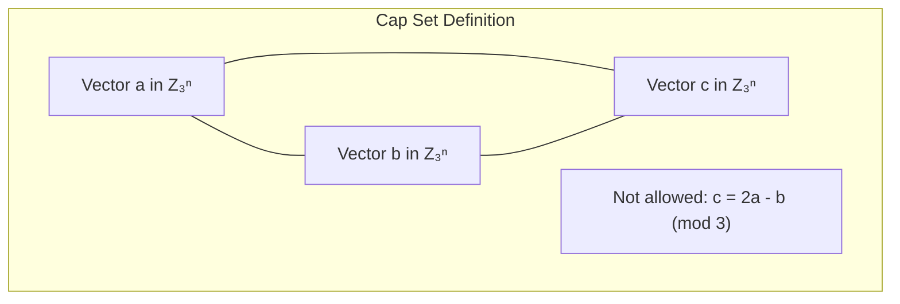
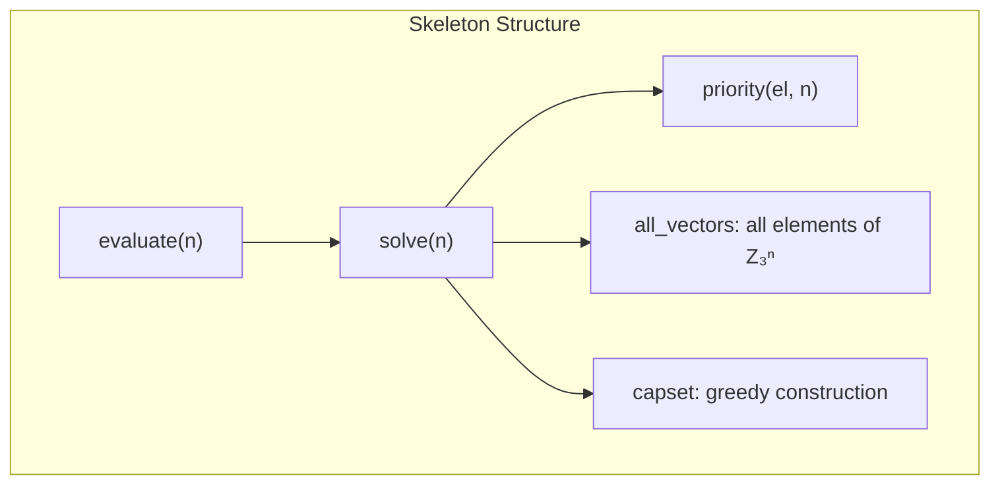
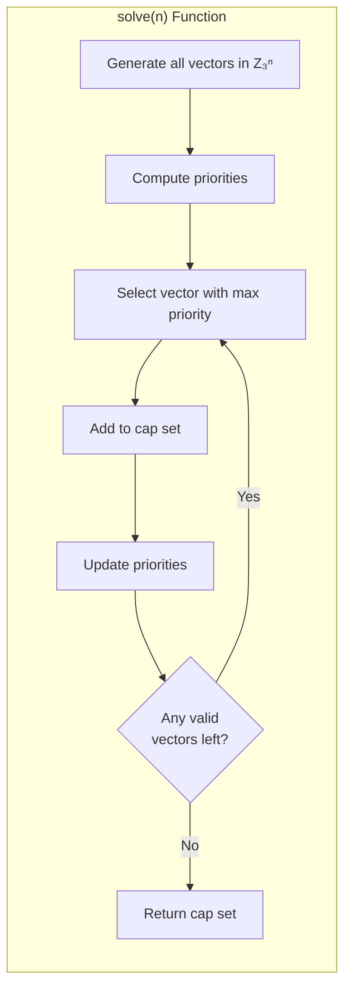
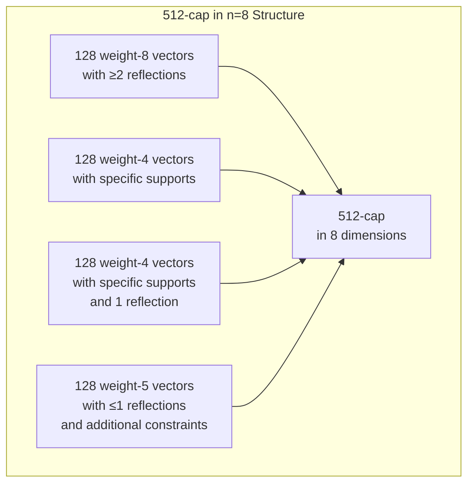
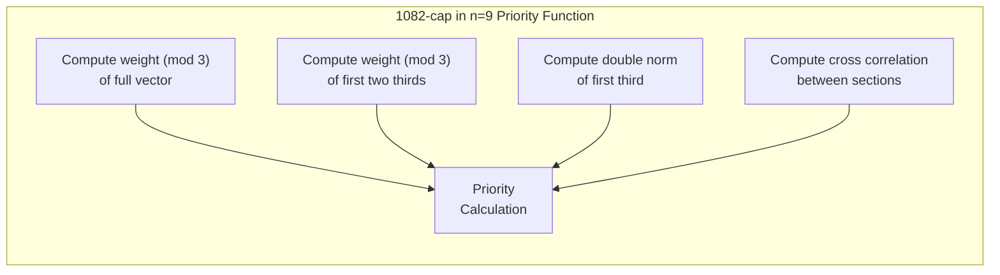
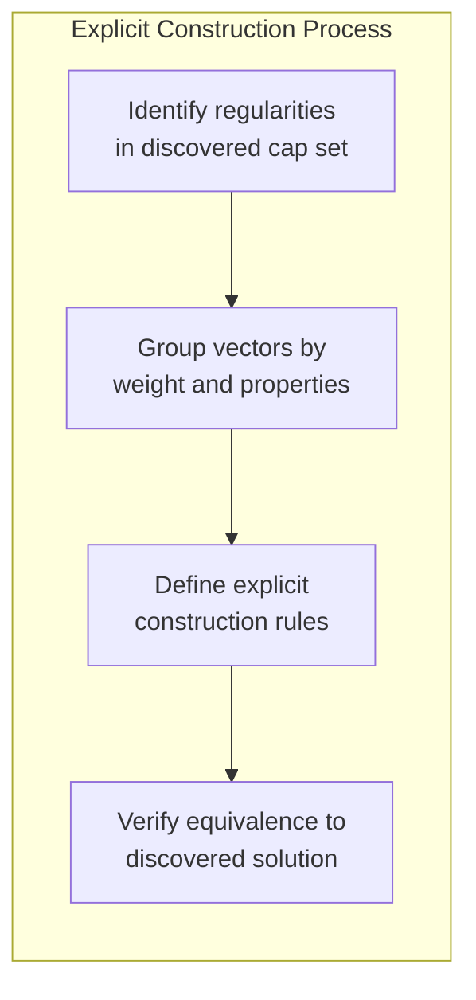
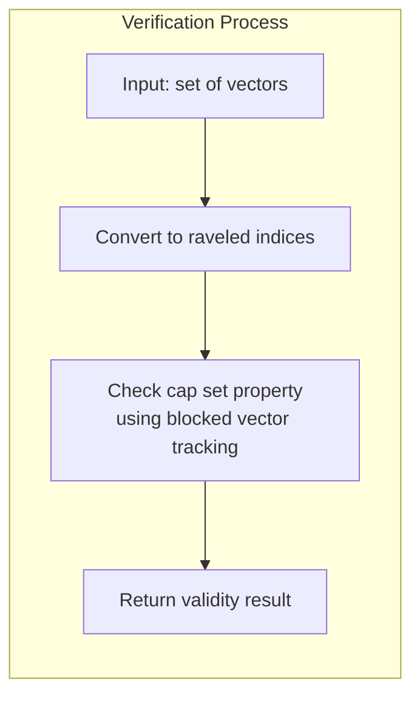

<!-- source: DeepWiki mcp.deepwiki.com · repo google-deepmind/funsearch · page 3.2 Cap Sets · fetched 2026-10-26 -->

# Cap Sets

<details>
<summary>Relevant source files</summary>

The following files were used as context for generating this wiki page:

- [README.md](README.md)
- [cap_set/cap_set.ipynb](cap_set/cap_set.ipynb)

</details>


This document describes the Cap Sets problem domain, the approach used by FunSearch to solve it, and the mathematical discoveries made during the process. Cap Sets is one of the problem domains explored in the FunSearch project, which demonstrates how program search guided by large language models can solve complex mathematical problems.

For information about the overall FunSearch architecture, see [Architecture](#2.1). For other problem domains, see [Problem Domains](#3).

## What is a Cap Set?

In mathematics, a cap set is a subset of vectors in Z₃ⁿ (the n-dimensional space over the field with three elements) where no three distinct vectors form an arithmetic progression. In other words, for any two distinct vectors a and b in the set, the vector 2a - b (mod 3) cannot be in the set.

The cap set problem asks for the maximum size of a cap set in Z₃ⁿ for different values of n. Finding large cap sets is challenging, with implications for combinatorics, number theory, and theoretical computer science.



Sources: [cap_set/cap_set.ipynb:44-85]()

## FunSearch Approach to Cap Sets

The FunSearch approach to finding large cap sets uses an evolutionary algorithm to discover effective priority functions for constructing cap sets. The approach consists of the following components:

1. **Problem Skeleton**: A template for constructing cap sets using a greedy algorithm
2. **Priority Function**: The component that FunSearch evolves
3. **Evaluation Function**: Measures the size of constructed cap sets
4. **Verification**: Ensures discovered cap sets satisfy the mathematical constraints

```mermaid
flowchart TD
    subgraph "Cap Set Discovery Process"
        direction TB
        S["Skeleton Code"] --> P["Priority Function Evolution"]
        P --> G["Greedy Construction"]
        G --> E["Evaluation (Size)"]
        E --> V["Verification"]
        V --> D["Discovered Cap Set"]
    end

    subgraph "Key Components"
        direction TB
        PF["priority(el, n)"] --> SE["solve(n)"]
        SE --> EV["evaluate(n)"]
        VC["is_cap_set(vectors)"]
    end

    "Cap Set Discovery Process" -.-> "Key Components"
```

Sources: [cap_set/cap_set.ipynb:44-85](), [cap_set/cap_set.ipynb:216-248]()

### Problem Skeleton

The cap set problem is approached using a greedy algorithm that constructs a cap set by adding vectors one by one according to a priority function. The skeleton consists of three main functions:

1. `evaluate(n)`: The entry point that returns the size of an n-dimensional cap set
2. `solve(n)`: Constructs a cap set in n dimensions using the priority function
3. `priority(el, n)`: The function evolved by FunSearch to determine the order of vector selection



Sources: [cap_set/cap_set.ipynb:44-85]()

### Greedy Construction Process

The `solve(n)` function implements a greedy algorithm for constructing cap sets:

1. Generate all possible vectors in Z₃ⁿ
2. Compute priorities for all vectors using the `priority` function
3. Iteratively select the vector with the highest priority to add to the cap set
4. Update priorities by setting to -infinity for vectors that would violate the cap set property if added
5. Continue until no more vectors can be added



Sources: [cap_set/cap_set.ipynb:56-77]()

## Discovered Solutions

FunSearch discovered two significant cap set constructions:

1. A 512-cap in 8 dimensions, improving upon the previously known best construction of size 496
2. A 1082-cap in 9 dimensions, matching the previously known best construction

### 512-cap in 8 Dimensions

The discovered function for building a 512-cap in 8 dimensions uses a complex priority scheme that considers:

- The number of zero entries in the vector
- Position-based scoring
- Symmetry patterns (reflections)



Sources: [cap_set/cap_set.ipynb:153-188](), [cap_set/cap_set.ipynb:326-370]()

### 1082-cap in 9 Dimensions

The discovered function for building a 1082-cap in 9 dimensions uses mathematical properties that effectively implement a specialized product construction:

- Divides the 9-dimensional space into thirds
- Computes modular weights of different sections
- Uses cross-correlations between sections



Sources: [cap_set/cap_set.ipynb:392-407]()

## Explicit Construction from Discovered Patterns

By analyzing the regularities in the discovered 512-cap in 8 dimensions, researchers were able to derive an explicit mathematical construction that produces the same cap set. This demonstrates how FunSearch can lead to human-understandable mathematical insights.

The explicit construction divides the vectors into four groups:
1. 128 weight-8 vectors with at least 2 reflections
2. 128 weight-4 vectors with specific support patterns
3. 128 weight-4 vectors with specific support patterns and exactly 1 reflection
4. 128 weight-5 vectors with at most 1 reflection and additional constraints



Sources: [cap_set/cap_set.ipynb:326-370]()

## Verification Methods

To ensure that the discovered sets are valid cap sets, the implementation includes a verification function `is_cap_set(vectors)` that checks whether a set of vectors satisfies the cap set property. This function implements an optimized O(c²n) check instead of the naive O(c³n) approach (where c is the size of the cap set and n is the dimension).



Sources: [cap_set/cap_set.ipynb:216-248]()

## Integration with FunSearch Pipeline

The Cap Sets problem domain integrates with the FunSearch pipeline as one of the mathematical discovery applications. The pipeline evolves the `priority` function to optimize cap set construction.

```mermaid
graph TD
    subgraph "FunSearch Pipeline for Cap Sets"
        LLM["Large Language Model"] -->|"Generates candidate\npriority functions"| EA["Evolutionary\nAlgorithm"]
        EA -->|"Evaluates on\ncap set construction"| Best["Best priority\nfunctions"]
        Best -->|"Used to construct"| Cap["Large cap sets"]
        Best -->|"Provide context for"| LLM
    end

    subgraph "Cap Set Components"
        Eval["evaluate(n)"] --> Size["Cap set size"]
        Solve["solve(n)"] --> CSet["Cap set construction"]
        Priority["priority(el, n)"] -->|"Guides"| Solve
        Verify["is_cap_set(vectors)"] -->|"Validates"| CSet
    end

    "FunSearch Pipeline for Cap Sets" -.-> "Cap Set Components"
```

Sources: [README.md:1-35](), [cap_set/cap_set.ipynb:44-85]()

## Results and Significance

The discoveries made in the Cap Sets problem domain demonstrate the potential of FunSearch for mathematical discovery:

| Dimension | Previously Known Best | FunSearch Discovery | Improvement |
|:---------:|:---------------------:|:-------------------:|:-----------:|
| 8         | 496                   | 512                 | +16         |
| 9         | 1082                  | 1082                | Matched     |

The 512-cap in 8 dimensions represents a meaningful improvement over the previous best known construction, showing that FunSearch can discover genuinely novel mathematical structures.

The explicit construction derived from the discovered patterns also demonstrates how machine-discovered solutions can lead to human-understandable mathematical insights.

Sources: [cap_set/cap_set.ipynb:140-143](), [cap_set/cap_set.ipynb:381-382]()

---

