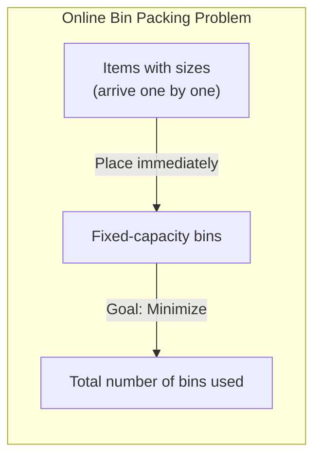
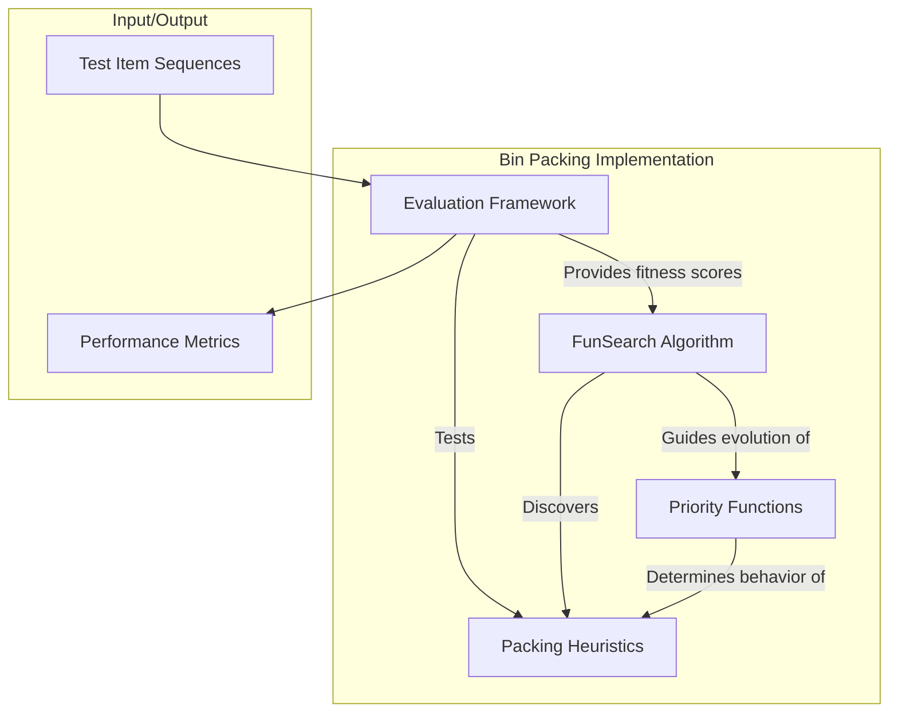
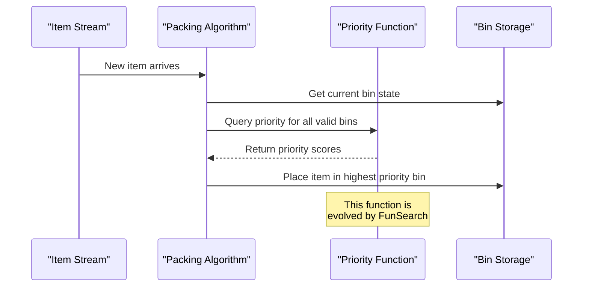
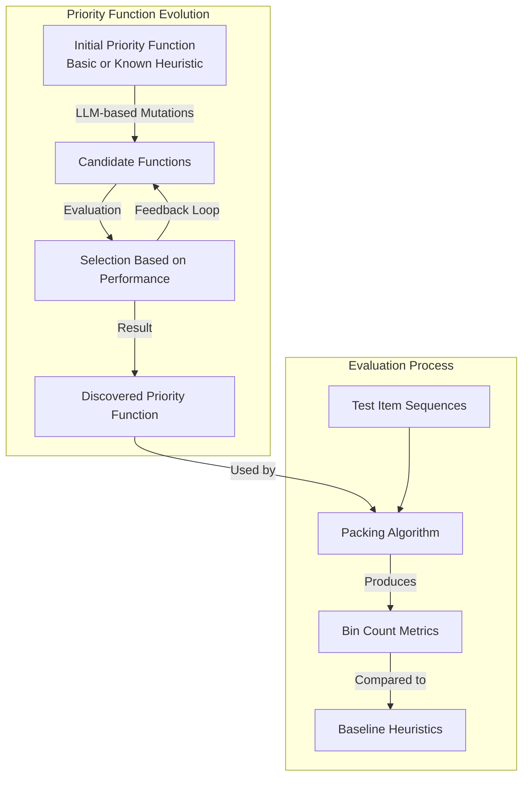
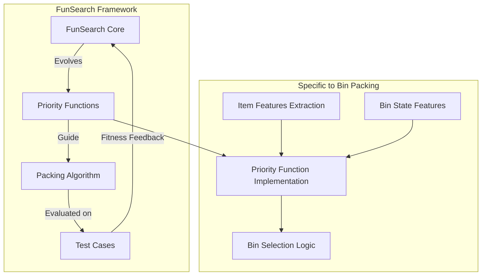

<!-- source: DeepWiki mcp.deepwiki.com · repo google-deepmind/funsearch · page 3.3 Bin Packing · fetched 2026-10-26 -->

# Bin Packing

<details>
<summary>Relevant source files</summary>

The following files were used as context for generating this wiki page:

- [README.md](README.md)
- [bin_packing/bin_packing.ipynb](bin_packing/bin_packing.ipynb)

</details>


This page documents the bin packing problem domain implementation in the FunSearch repository. It covers the problem formulation, heuristic discovery process, and the evaluation suite for analyzing the discovered algorithms for online 1D bin packing problems.

## 1. Problem Definition

The bin packing problem is a classical optimization challenge in computer science. In its 1D online variant, the task is to pack items of different sizes into fixed-capacity bins while minimizing the total number of bins used. The "online" aspect means items arrive sequentially, and decisions about placement must be made before seeing future items.

The FunSearch bin packing implementation focuses on discovering effective packing heuristics through program search and evolution.



Sources: README.md

## 2. Implementation Architecture

The bin packing implementation consists of two main components: a framework for evaluating packing heuristics and the FunSearch system that discovers improved heuristics through evolutionary program search.



Sources: README.md

## 3. Heuristic Discovery Process

FunSearch discovers bin packing heuristics by evolving "priority functions" - specialized functions that guide the packing algorithm by determining which bin should receive each incoming item.

The process follows the general FunSearch methodology:

1. Start with an initial priority function (possibly random or based on known heuristics)
2. Generate variations of this function using a large language model
3. Evaluate each variant on test item sequences
4. Select the best-performing functions to guide further evolution
5. Output the discovered heuristics with the best performance

The priority function assigns scores to potential bin placements, allowing the packing algorithm to make intelligent decisions about where to place each item.



Sources: README.md

## 4. Priority Function Evolution

The core of the bin packing implementation is the evolution of priority functions. FunSearch evolves these functions to discover effective heuristics that outperform classical approaches.



Sources: README.md

## 5. Evaluation Suite

The evaluation suite provides a comprehensive framework for testing and comparing packing heuristics. It likely includes:

1. Various item sequence generators (uniform, normal, etc.)
2. Performance metrics (total bins used, utilization rate, etc.)
3. Comparison with baseline heuristics (First Fit, Best Fit, etc.)
4. Statistical analysis tools

The evaluation suite allows for consistent comparison between different heuristics and ensures that the discovered functions are robust across various problem instances.

```mermaid
graph TD
    subgraph "Evaluation Suite"
        Generator["Item Sequence Generator"] --> |"Produces"| Sequences["Test Sequences"]
        Sequences --> |"Input to"| TestHarness["Test Harness"]
        Heuristics["Packing Heuristics"] --> |"Evaluated by"| TestHarness
        TestHarness --> |"Produces"| Metrics["Performance Metrics"]
        Metrics --> |"Analyzed by"| Analysis["Statistical Analysis"]
    end
    
    subgraph "Comparison"
        Analysis --> Comparison["Heuristic Comparison"]
        BaselineH["Baseline Heuristics<br>(First Fit, Best Fit, etc)"] --> Comparison
        DiscoveredH["Discovered Heuristics"] --> Comparison
    end
```

Sources: README.md

## 6. Types of Discovered Heuristics

The FunSearch approach can discover a variety of heuristic types:

| Heuristic Type | Description | Example Approach |
|----------------|-------------|------------------|
| Simple Priority | Basic scoring based on bin fill level | Place in least/most filled bin |
| Look-ahead | Considers potential future impacts | Reserve space for expected large items |
| Pattern-based | Identifies optimal packing patterns | Group complementary item sizes |
| Hybrid | Combines multiple strategies | Adjust strategy based on item size distribution |

Sources: README.md

## 7. Using the Bin Packing Implementation

The bin packing implementation can be accessed and used through the provided notebook:

```
bin_packing/bin_packing.ipynb
```

This notebook can be run in Google Colab and likely contains:
- Code to load and execute discovered heuristics
- Visualizations of packing results
- Comparative analysis with baseline methods
- Documentation of the discovered algorithms

The notebook allows users to reproduce the results reported in the FunSearch paper and experiment with the discovered heuristics on custom problem instances.

Sources: README.md

## 8. Integration with FunSearch Core

The bin packing implementation integrates with the core FunSearch framework, following the general pattern used across all problem domains in the repository.



Sources: README.md

## Summary

The bin packing problem domain in FunSearch demonstrates how evolutionary program search can discover effective heuristics for a classical optimization problem. By evolving priority functions that guide bin selection, FunSearch finds algorithms that can outperform traditional approaches to online bin packing.

The implementation provides both the discovered heuristics and an evaluation suite to validate their performance, allowing for reproducibility of the results presented in the FunSearch paper and exploration of the discovered algorithms.

Sources: README.md

---

