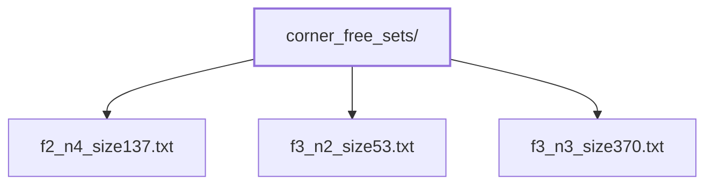
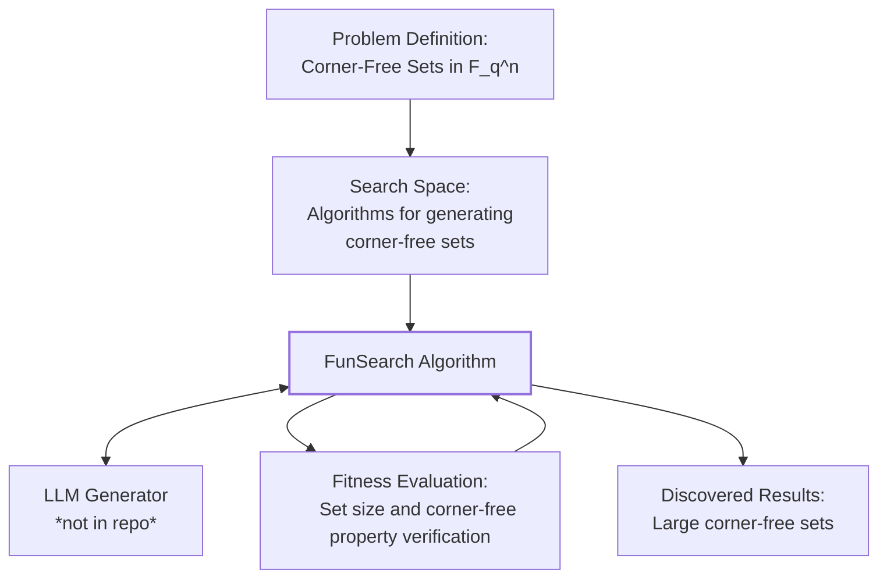
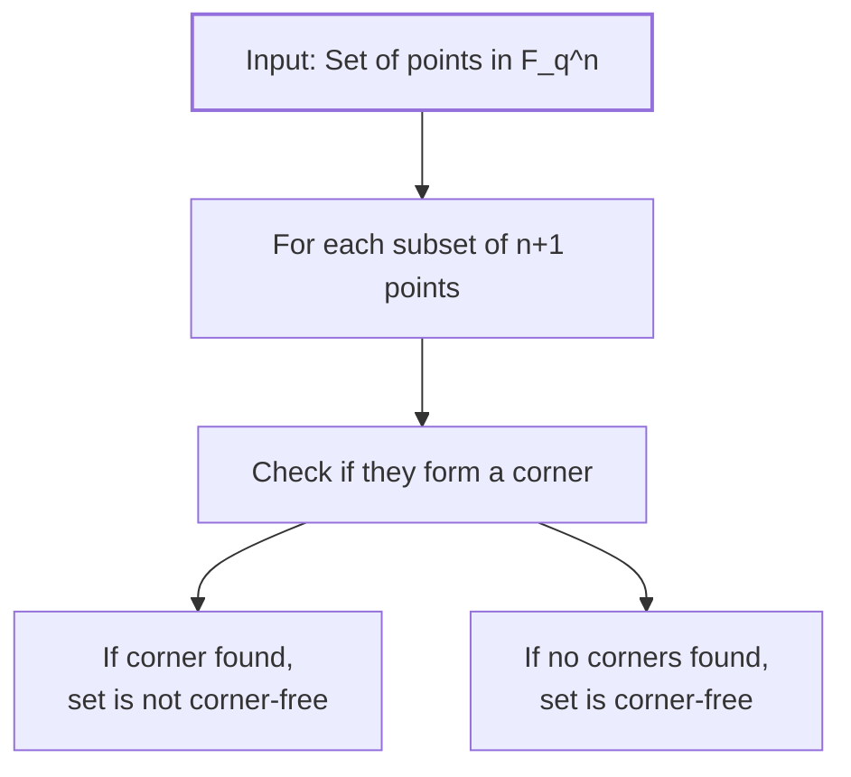

<!-- source: DeepWiki mcp.deepwiki.com · repo google-deepmind/funsearch · page 3.4 Corner-Free Sets · fetched 2026-10-26 -->

# Corner-Free Sets

<details>
<summary>Relevant source files</summary>

The following files were used as context for generating this wiki page:

- [README.md](README.md)
- [corner_free_set/f2_n4_size137.txt](corner_free_set/f2_n4_size137.txt)
- [corner_free_set/f3_n2_size53.txt](corner_free_set/f3_n2_size53.txt)
- [corner_free_set/f3_n3_size370.txt](corner_free_set/f3_n3_size370.txt)

</details>


## Purpose and Scope

This document describes the Corner-Free Sets problem domain within the FunSearch repository. It covers the mathematical definition of corner-free sets, how FunSearch was applied to discover large corner-free sets, and the structure and significance of the discovered sets contained in the repository. This page focuses specifically on the technical aspects of the corner-free sets discoveries and how they are represented in the codebase.

For information about other mathematical problem domains addressed by FunSearch, see [Problem Domains](#3).

Sources: [README.md:24-26]()

## Mathematical Definition

Corner-free sets are collections of points in multi-dimensional space that satisfy specific combinatorial constraints. In particular, a corner-free set is a subset of points in F^n (where F is a finite field and n is the dimension) that contains no "corners" - specific geometric patterns formed by points.

A corner in F^n consists of n+1 points of the form:
- v, v + e₁, v + e₂, ..., v + eₙ

where v is a vector in F^n and eᵢ are standard basis vectors (with a 1 in position i and 0 elsewhere).

The corner-free sets problem involves finding large sets of points that do not contain any such corners, which has connections to other combinatorial problems in mathematics.

Sources: [README.md:24-26]()

## Repository Structure

The corner-free sets discovered by FunSearch are stored as plain text files in the repository, with each file containing a list of points represented as coordinate vectors.



File Naming Convention:
- `f<q>_n<d>_size<s>.txt`: Represents a corner-free set in F_q^d (field of size q, dimension d) containing s points

Sources: [corner_free_set/f2_n4_size137.txt:1-137](), [corner_free_set/f3_n2_size53.txt:1-53](), [corner_free_set/f3_n3_size370.txt:1-370]()

## Discovered Sets

The repository contains three significant corner-free sets discovered by FunSearch:

| File | Field | Dimension | Set Size | Description |
|------|-------|-----------|----------|-------------|
| f2_n4_size137.txt | F₂ | 4 | 137 | Corner-free set in 4D binary space |
| f3_n2_size53.txt | F₃ | 2 | 53 | Corner-free set in 2D ternary space |
| f3_n3_size370.txt | F₃ | 3 | 370 | Corner-free set in 3D ternary space |

Each file contains the coordinates of points in the corner-free set, with each point represented as a vector of integers.

Example from f3_n2_size53.txt:
```
[8, 4]
[4, 8]
[4, 4]
...
```

These discovered sets represent significant mathematical results, providing examples of large corner-free sets that approach theoretical bounds.

Sources: [corner_free_set/f2_n4_size137.txt:1-137](), [corner_free_set/f3_n2_size53.txt:1-53](), [corner_free_set/f3_n3_size370.txt:1-370]()

## Integration with FunSearch

The corner-free sets problem exemplifies how FunSearch can be used to make mathematical discoveries through program search guided by large language models.



The diagram above illustrates how the corner-free sets problem was approached in FunSearch:

1. The problem is defined as finding large corner-free sets in specific finite fields and dimensions
2. FunSearch explores a space of algorithms that can generate such sets
3. The language model proposes modifications to algorithms
4. Proposed algorithms are evaluated based on the size of the sets they generate and verification that they contain no corners
5. The most successful algorithms lead to the discovery of large corner-free sets

Sources: [README.md:24-26]()

## Set Representation and Verification

The corner-free sets are represented as lists of coordinate vectors. To verify that a set is corner-free, one must check that no subset of n+1 points forms a corner.



The discovered sets in the repository have been verified to be corner-free and represent some of the largest known corner-free sets for their respective parameters.

Sources: [corner_free_set/f2_n4_size137.txt:1-137](), [corner_free_set/f3_n2_size53.txt:1-53](), [corner_free_set/f3_n3_size370.txt:1-370]()

## Mathematical Significance

The discovery of large corner-free sets contributes to understanding theoretical bounds in combinatorial geometry and has connections to other areas of mathematics including number theory and additive combinatorics.

In particular, corner-free sets in finite fields are related to cap sets (see [Cap Sets](#3.2)), which are sets with no three points in an arithmetic progression. The size of the largest possible corner-free set in a given space is a fundamental question in combinatorial geometry.

The sets discovered by FunSearch and included in this repository represent significant contributions to this mathematical area, providing concrete examples that approach theoretical bounds.

Sources: [README.md:24-26]()

---

