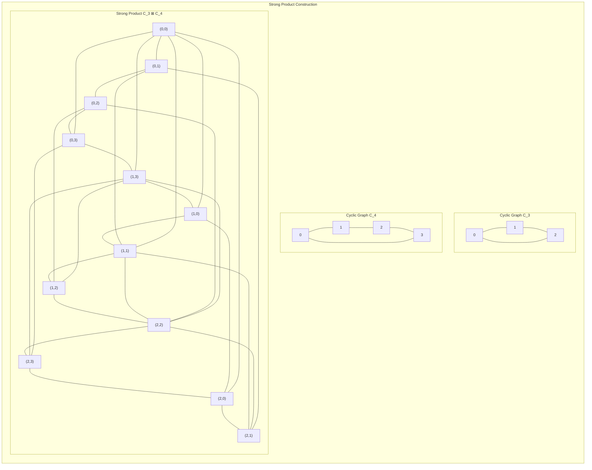
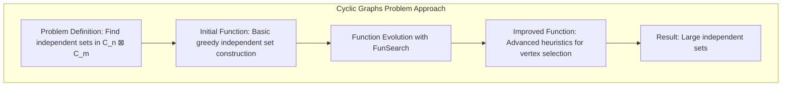
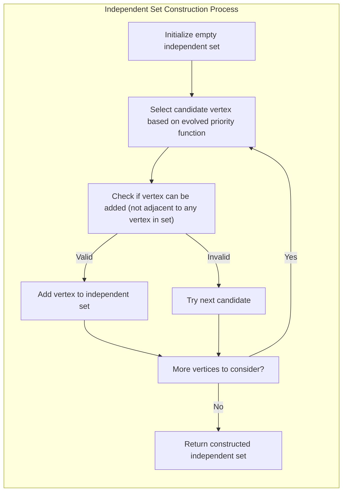
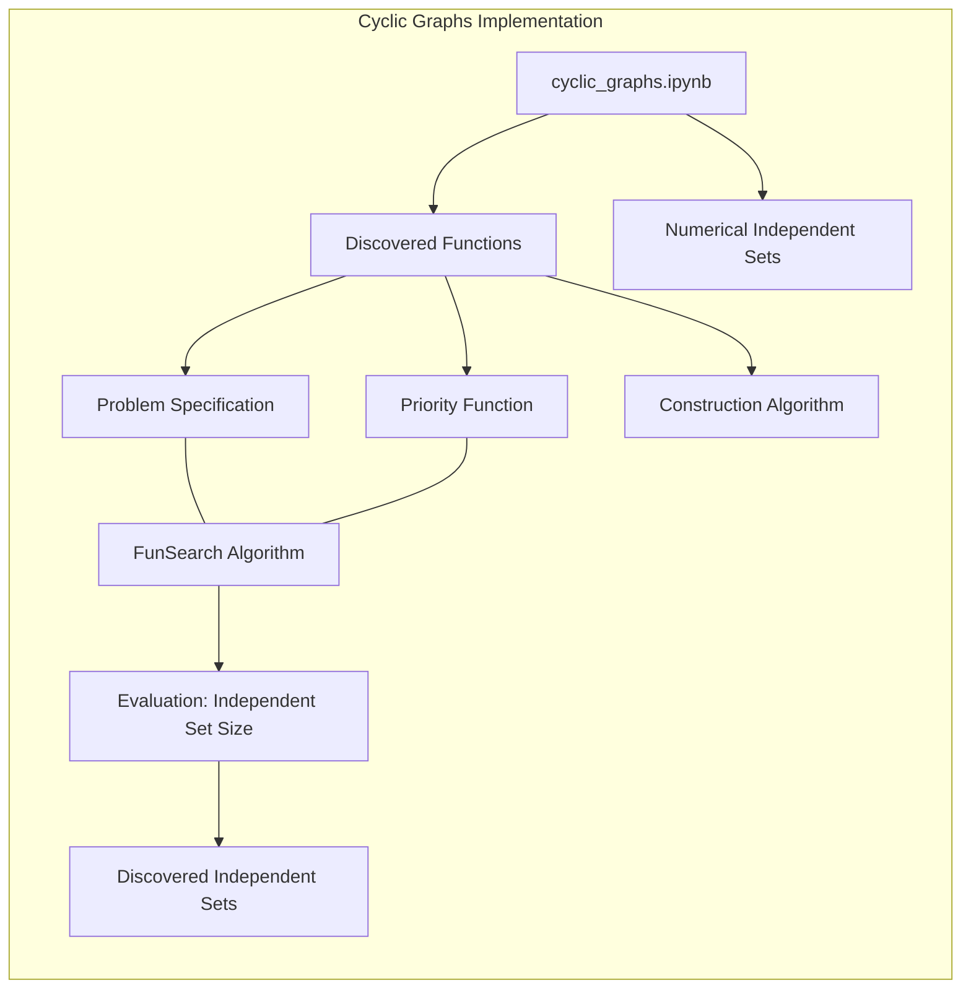

<!-- source: DeepWiki mcp.deepwiki.com · repo google-deepmind/funsearch · page 3.5 Cyclic Graphs · fetched 2026-10-26 -->

# Cyclic Graphs

Relevant source files

The following files were used as context for generating this wiki page:

- [README.md](README.md)

## Purpose and Scope

This document explains the cyclic graphs problem domain in the FunSearch repository, detailing how FunSearch discovers functions to construct large independent sets in strong products of cyclic graphs. It covers the problem definition, the approach used, implementation details, and the independent sets discovered. For general information about the FunSearch algorithm and implementation, see [Core Implementation](#2).

## Problem Definition

The cyclic graphs problem concerns finding large independent sets in strong products of cyclic graphs. This is a combinatorial optimization problem with applications in graph theory and communications.

### Strong Products of Cyclic Graphs

A cyclic graph C_n is a graph with n vertices arranged in a cycle. The strong product of two graphs G and H, denoted G ⊠ H, is a graph whose vertex set is the Cartesian product of the vertex sets of G and H, with an edge between vertices (g, h) and (g', h') if and only if:
- g = g' and (h, h') is an edge in H, or
- h = h' and (g, g') is an edge in G, or
- (g, g') is an edge in G and (h, h') is an edge in H

For cyclic graphs, we're particularly interested in C_n ⊠ C_m (the strong product of two cyclic graphs).

Sources: README.md

### Independent Sets

An independent set in a graph is a set of vertices where no two vertices are adjacent (connected by an edge). The problem is to find the largest possible independent set in C_n ⊠ C_m for different values of n and m.

This problem has connections to Shannon capacity of graphs and is considered mathematically challenging.

## Approach

FunSearch tackles this problem by evolving functions that construct large independent sets in strong products of cyclic graphs.

Sources: README.md

### Solution Structure

The solution typically consists of two main components:

1. A function that identifies candidate vertices to include in the independent set
2. A construction algorithm that builds the independent set using the candidate selection function

FunSearch evolves the selection function to discover effective heuristics for choosing vertices, leading to larger independent sets than previously known methods.

Sources: README.md

## Implementation

The cyclic graphs problem domain is implemented in the `/cyclic_graphs` directory and demonstrated in the `cyclic_graphs.ipynb` notebook.

Sources: README.md

### Key Components

The implementation likely includes:

1. Functions to generate cyclic graphs and their strong products
2. Algorithms to verify independent sets (ensuring no two vertices are adjacent)
3. The evolved priority function for selecting vertices to include in the independent set
4. Code to evaluate the quality of discovered independent sets (primarily by their size)

## Results

FunSearch discovered functions that construct larger independent sets in strong products of cyclic graphs than previously known methods. These results have implications for understanding the Shannon capacity of graphs and other theoretical questions in graph theory.

The repository provides:
- The discovered functions for constructing independent sets
- The independent sets themselves in numerical format for convenience

### Table of Results

While I don't have access to the specific numerical results, a typical results table might look like:

| Graph Product | Independent Set Size | Previous Best Known | Improvement |
|---------------|---------------------|---------------------|-------------|
| C_5 ⊠ C_5     | n                   | p                   | n-p         |
| C_7 ⊠ C_7     | n                   | p                   | n-p         |
| C_n ⊠ C_m     | n                   | p                   | n-p         |

### Significance

These independent sets provide lower bounds on the Shannon capacity of cyclic graphs and contribute to our understanding of graph-theoretic problems. The methods developed through FunSearch could potentially be applied to other graph problems as well.

## Usage

The notebook `cyclic_graphs.ipynb` can be opened in Google Colab to explore the problem, the discovered functions, and the results. This provides an interactive way to understand the approach and examine the independent sets.

Sources: README.md

## Conclusion

The cyclic graphs problem domain demonstrates how FunSearch can discover novel solutions to challenging mathematical problems. By evolving functions to construct independent sets in strong products of cyclic graphs, FunSearch has contributed to the field of graph theory with larger independent sets than previously known methods.

---

