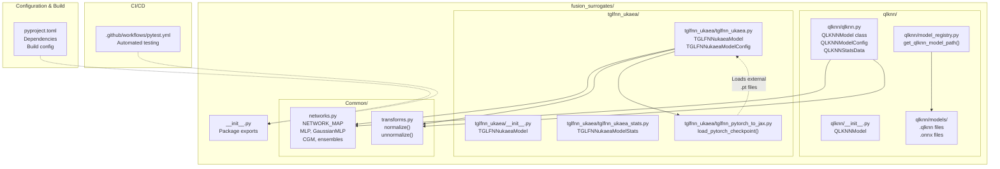
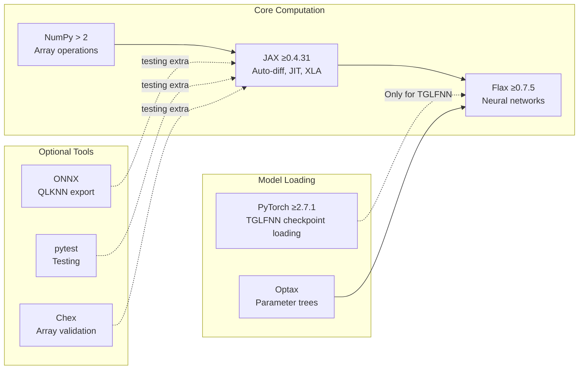
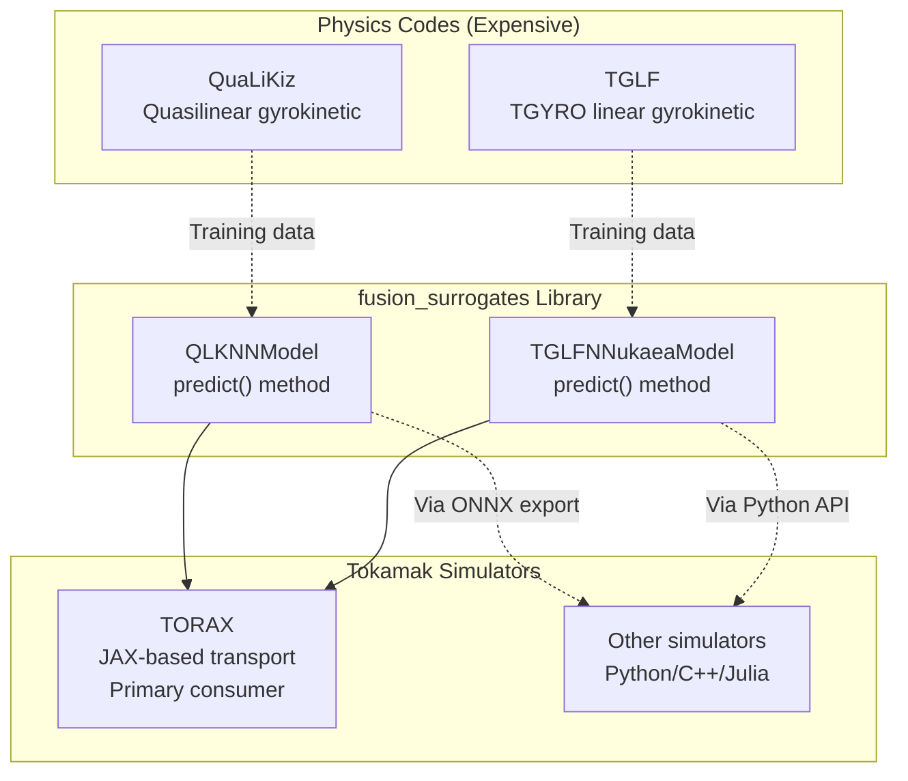

<!-- source: DeepWiki mcp.deepwiki.com · repo google-deepmind/fusion_surrogates · page 1 Overview · fetched 2026-10-26 -->

# Overview

<details>
<summary>Relevant source files</summary>

The following files were used as context for generating this wiki page:

- [.github/workflows/pytest.yml](.github/workflows/pytest.yml)
- [README.md](README.md)
- [pyproject.toml](pyproject.toml)

</details>


## Purpose and Scope

This document provides a high-level introduction to the `fusion_surrogates` library, which implements fast neural network surrogate models for simulating turbulent transport in tokamak fusion reactors. The library includes two primary model families: QLKNN (QuaLiKiz Neural Network) and TGLFNN-UKAEA (TGLF Neural Network from UK Atomic Energy Authority).

For installation instructions, see [Installation and Setup](#2). For detailed documentation of individual model systems, see [QLKNN Model System](#3) and [TGLFNN-UKAEA Model System](#4).

**Sources**: [README.md:1-9](), [pyproject.toml:8-10]()

## What are Fusion Surrogates?

Fusion surrogates are neural network models that approximate expensive physics simulations used in tokamak fusion research. Traditional gyrokinetic codes like QuaLiKiz and TGLF can take minutes to hours to compute turbulent transport properties at a single spatial location. Surrogates reduce this computational time to milliseconds, enabling real-time plasma simulation and control.

The `fusion_surrogates` library provides:

| Component | Description |
|-----------|-------------|
| **Pre-trained models** | Neural network weights trained on large physics datasets |
| **Inference code** | JAX-based implementations for fast evaluation |
| **Normalization statistics** | Pre-computed statistics for input/output scaling |
| **Model registry** | Name-based lookup system for model variants |
| **ONNX export** | Cross-platform deployment capabilities (QLKNN only) |

The library is designed as the transport model backend for [TORAX](https://github.com/google-deepmind/torax), a JAX-based tokamak simulator, but can be integrated into other fusion simulation frameworks.

**Sources**: [README.md:3-8](), [pyproject.toml:10]()

## Library Architecture

The following diagram shows the physical file structure and key code entities in the repository:



**Key code entities**:

- **`QLKNNModel`** ([fusion_surrogates/qlknn/qlknn.py]()): Primary class for QLKNN inference
- **`TGLFNNukaeaModel`** ([fusion_surrogates/tglfnn_ukaea/tglfnn_ukaea.py]()): Primary class for TGLFNN-UKAEA inference
- **`NETWORK_MAP`** ([fusion_surrogates/networks.py]()): Registry mapping architecture names to implementations
- **`normalize()`/`unnormalize()`** ([fusion_surrogates/transforms.py]()): Data scaling utilities
- **`get_qlknn_model_path()`** ([fusion_surrogates/qlknn/model_registry.py]()): Model name resolver

**Sources**: Repository structure, [pyproject.toml:47-48](), [README.md:1-44]()

## Model Systems Overview

### QLKNN: QuaLiKiz Neural Network Surrogate

QLKNN approximates the [QuaLiKiz](https://gitlab.com/qualikiz-group/QuaLiKiz) quasilinear gyrokinetic code. The currently available model, `qlknn_7_11_v1`, combines two training datasets:

| Dataset | Region | Citation |
|---------|--------|----------|
| **QLKNN11D** | Core plasma | [Zenodo 8017522](https://zenodo.org/record/8017522) |
| **QLKNN7D-edge** | Edge plasma | [Zenodo 8106431](https://zenodo.org/record/8106431) |

**Model characteristics**:
- **10 input parameters**: Normalized gradients (R/L_Te, R/L_Ti, R/L_ne, R/L_ni), safety factor (q), magnetic shear (ŝ), inverse aspect ratio (r/R_maj), temperature ratio (T_i/T_e), collisionality (log(ν*)), density ratio (n_i/n_e)
- **8 output predictions per mode**: Heat and particle fluxes for ITG, TEM, ETG modes plus maximum growth rate
- **Bundled weights**: Model files packaged with library in [fusion_surrogates/qlknn/models/]()
- **ONNX support**: Can export to ONNX format for deployment

Based on the QLKNN10D model by [Van de Plassche et al. PoP 2020](https://doi.org/10.1063/1.5134126).

For detailed specifications, see [QLKNN Model System](#3).

**Sources**: [README.md:10-44]()

### TGLFNN-UKAEA: TGLF Neural Network Surrogate

TGLFNN-UKAEA approximates the TGLF (TGYRO Linear) gyrokinetic code. It uses a Gaussian ensemble architecture to provide uncertainty estimates alongside predictions.

**Model characteristics**:
- **13-14 input parameters** (machine-dependent): Includes RLNS, RLTS (normalized gradients), geometric factors, and machine-specific parameters
- **3 output predictions**: Gyro-Bohm normalized fluxes (efe_gb, efi_gb, pfi_gb) with variance estimates
- **Multiple variants**: Separate models for multi-machine applications and STEP (Spherical Tokamak for Energy Production)
- **External weights**: Model files hosted on [ukaea/tglfnn-ukaea GitHub repository](https://github.com/ukaea/tglfnn-ukaea)
- **Ensemble predictions**: Multiple neural networks vote to quantify uncertainty

For detailed specifications, see [TGLFNN-UKAEA Model System](#4).

**Sources**: High-level architecture diagrams, [pyproject.toml:42-45]()

## Technology Stack

The library is built on the following core dependencies:



### Dependency Table

| Package | Version | Purpose | Optional |
|---------|---------|---------|----------|
| `jax` | ≥0.4.31 | Core numerical computation, automatic differentiation | No |
| `flax` | ≥0.7.5 | Neural network implementations | No |
| `numpy` | > 2 | Array operations, modern array protocol | No |
| `torch` | ≥2.7.1 | TGLFNN PyTorch checkpoint loading | Yes (tglfnnukaea extra) |
| `onnx` | — | QLKNN ONNX export | Yes (testing extra) |
| `pytest` | — | Unit testing framework | Yes (testing extra) |
| `chex` | — | JAX array assertions | Yes (testing extra) |

**Python requirement**: ≥3.11

**Sources**: [pyproject.toml:13](), [pyproject.toml:21-45]()

## Integration with Simulators

The following diagram shows how `fusion_surrogates` integrates into the tokamak simulation ecosystem:



**Integration points**:

1. **TORAX integration**: As a JAX-native library, `fusion_surrogates` integrates seamlessly with TORAX's transport solvers. Both QLKNN and TGLFNN models can be used interchangeably via a common interface.

2. **Direct Python API**: Import models using:
   ```python
   from fusion_surrogates.qlknn import QLKNNModel
   from fusion_surrogates.tglfnn_ukaea import TGLFNNukaeaModel
   ```

3. **ONNX deployment**: QLKNN models can be exported to ONNX format for use in non-Python environments (C++, Julia, etc.). See [QLKNN Model Registry and ONNX Export](#3.4).

4. **PyTorch bridge**: TGLFNN models are trained in PyTorch but converted to JAX at load time via [`load_pytorch_checkpoint()`]([fusion_surrogates/tglfnn_ukaea/tglfnn_pytorch_to_jax.py]()). See [PyTorch to JAX Model Conversion](#4.4).

**Sources**: [README.md:6-8](), architecture diagrams

## Package Structure

```
fusion_surrogates/
├── __init__.py                    # Package exports
├── qlknn/                          # QLKNN model system
│   ├── __init__.py
│   ├── qlknn.py                   # QLKNNModel, QLKNNModelConfig
│   ├── model_registry.py          # Model path lookup
│   ├── models/                    # Pre-trained weights (.qlknn, .onnx)
│   └── qlknn_test.py              # Unit tests
├── tglfnn_ukaea/                   # TGLFNN-UKAEA model system
│   ├── __init__.py
│   ├── tglfnn_ukaea.py            # TGLFNNukaeaModel, Config
│   ├── tglfnn_ukaea_stats.py     # Normalization statistics
│   ├── tglfnn_pytorch_to_jax.py  # PyTorch→JAX conversion
│   └── tglfnn_ukaea_test.py      # Unit tests
├── networks.py                     # Neural network architectures
├── networks_test.py                # Network unit tests
├── transforms.py                   # normalize/unnormalize utilities
└── transforms_test.py              # Transform unit tests
```

**Key module purposes**:

| Module | Classes/Functions | Purpose |
|--------|-------------------|---------|
| `qlknn.qlknn` | `QLKNNModel`, `QLKNNModelConfig`, `QLKNNStatsData` | QLKNN inference engine and configuration |
| `qlknn.model_registry` | `get_qlknn_model_path()` | Maps model names to file paths |
| `tglfnn_ukaea.tglfnn_ukaea` | `TGLFNNukaeaModel`, `TGLFNNukaeaModelConfig` | TGLFNN inference engine |
| `tglfnn_ukaea.tglfnn_ukaea_stats` | `TGLFNNukaeaModelStats` | TGLFNN normalization statistics |
| `tglfnn_ukaea.tglfnn_pytorch_to_jax` | `load_pytorch_checkpoint()` | Converts PyTorch to JAX parameters |
| `networks` | `MLP`, `GaussianMLP`, `CGM`, `NETWORK_MAP` | Neural network architecture implementations |
| `transforms` | `normalize()`, `unnormalize()` | Data scaling utilities |

**Sources**: [pyproject.toml:47-48](), repository structure

## Development and Testing

The library includes comprehensive testing infrastructure:

- **Unit tests**: All modules have corresponding `*_test.py` files
- **CI/CD**: GitHub Actions workflow runs `pytest` on every push ([.github/workflows/pytest.yml]())
- **Parallel execution**: Tests run in parallel via `pytest -n auto`
- **Python 3.11**: All tests run on Python 3.11 in Ubuntu environment

For contributors, see [Development Guide](#6) for testing procedures, code style, and how to add new models.

**Sources**: [.github/workflows/pytest.yml:1-31](), [README.md:79-84]()

## Next Steps

- **Installation**: See [Installation and Setup](#2) for dependency management and installation procedures
- **QLKNN usage**: See [Using QLKNN Models](#3.3) for practical examples
- **TGLFNN usage**: See [Using TGLFNN Models](#4.3) for practical examples  
- **Common utilities**: See [Common Infrastructure](#5) for shared components like network architectures and transforms
- **Contributing**: See [Development Guide](#6) for guidelines on extending the library

---

