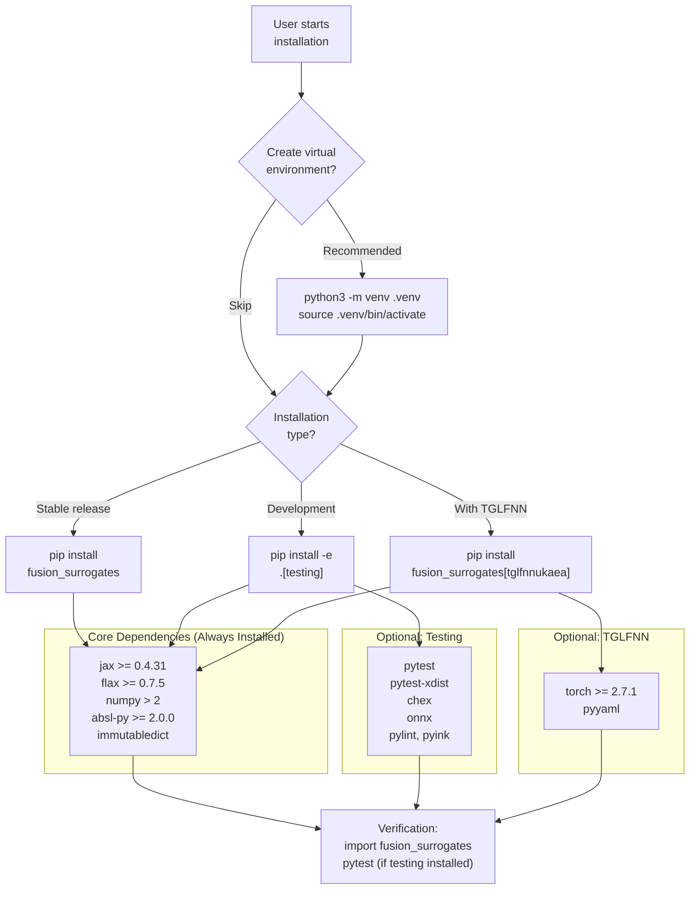
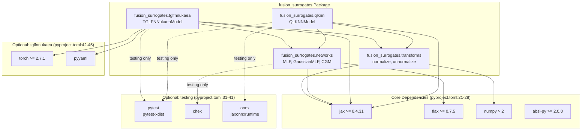

<!-- source: DeepWiki mcp.deepwiki.com · repo google-deepmind/fusion_surrogates · page 2 Installation and Setup · fetched 2026-10-26 -->

# Installation and Setup

<details>
<summary>Relevant source files</summary>

The following files were used as context for generating this wiki page:

- [.github/workflows/pytest.yml](.github/workflows/pytest.yml)
- [README.md](README.md)
- [pyproject.toml](pyproject.toml)

</details>


This page provides instructions for installing the `fusion_surrogates` library, managing its dependencies, and verifying a successful installation. For information about using specific surrogate models after installation, see [QLKNN Model System](#3) and [TGLFNN-UKAEA Model System](#4).

## Prerequisites

The `fusion_surrogates` library has the following system requirements:

| Requirement | Specification |
|------------|---------------|
| Python Version | ≥ 3.11 |
| Operating System | Linux, macOS (tested on Ubuntu in CI) |
| Package Manager | pip |

The library is tested in continuous integration on Ubuntu with Python 3.11 [.github/workflows/pytest.yml:22]().

**Sources:** [pyproject.toml:13](), [.github/workflows/pytest.yml:20-22]()

## Core Dependencies

The library requires the following core dependencies, which are automatically installed:

| Package | Version | Purpose |
|---------|---------|---------|
| `jax` | ≥ 0.4.31 | Numerical computation backend, automatic differentiation, JIT compilation |
| `flax` | ≥ 0.7.5 | Neural network framework built on JAX |
| `numpy` | > 2 | Array operations and data structures |
| `absl-py` | ≥ 2.0.0 | Command-line flags and logging utilities |
| `immutabledict` | (any) | Immutable dictionary data structures |
| `setuptools` | (any) | Python packaging (for Python ≥ 3.11) |

**Sources:** [pyproject.toml:21-28]()

## Installation Methods

### Virtual Environment Setup (Recommended)

It is strongly recommended to use a virtual environment to isolate `fusion_surrogates` dependencies from other Python projects.

**Creating and activating a virtual environment:**

```bash
# Install virtualenv if not already available
pip install --upgrade pip
pip install virtualenv

# Create virtual environment
python3 -m venv .venv

# Activate virtual environment
source .venv/bin/activate
```

**Deactivating the virtual environment when finished:**

```bash
deactivate
```

**Sources:** [README.md:47-69]()

### Stable Release Installation

To install the latest stable release from PyPI:

```bash
pip install fusion_surrogates
```

This installs only the core dependencies required for QLKNN model inference. The installed package includes QLKNN model weights bundled within the distribution.

**Sources:** [README.md:72-77]()

### Development Installation

For development work or running unit tests, install with the `testing` optional dependency group:

```bash
pip install -e .[testing]
```

The `-e` flag installs the package in "editable" mode, allowing changes to the source code to be immediately reflected without reinstalling.

**Sources:** [README.md:79-84](), [.github/workflows/pytest.yml:25]()

## Optional Dependency Groups

The library defines two optional dependency groups in [pyproject.toml:30-45]():

### Testing Dependencies

The `testing` group includes dependencies for running unit tests and development tools:

| Package | Purpose |
|---------|---------|
| `chex` | JAX testing utilities |
| `jaxonnxruntime` | ONNX runtime for JAX |
| `onnx` | ONNX format support |
| `pytest` | Testing framework |
| `pytest-xdist` | Parallel test execution |
| `pylint` | Code linting |
| `pyink` | Code formatting |
| `pyyaml` | YAML file parsing |
| `torch` | PyTorch (≥ 2.7.1 for NumPy 2 compatibility) |

**Installation:**
```bash
pip install fusion_surrogates[testing]
```

### TGLFNN-UKAEA Dependencies

The `tglfnnukaea` group includes dependencies for using TGLFNN-UKAEA models:

| Package | Purpose |
|---------|---------|
| `torch` | PyTorch (≥ 2.7.1) for loading `.pt` checkpoint files |
| `pyyaml` | YAML configuration file parsing |

**Installation:**
```bash
pip install fusion_surrogates[tglfnnukaea]
```

This group is required only if you intend to use TGLFNN models. QLKNN models do not require PyTorch.

**Sources:** [pyproject.toml:30-45]()

## Installation Workflow

The following diagram illustrates the complete installation process and how different installation options relate to dependency groups:



**Sources:** [pyproject.toml:1-49](), [README.md:45-84]()

## Dependency Architecture

This diagram maps the relationship between package components and their dependencies:



**Sources:** [pyproject.toml:21-45]()

## Verification

### Basic Import Test

After installation, verify that the library is correctly installed by importing the main module:

```python
import fusion_surrogates
print(f"fusion_surrogates version: {fusion_surrogates.__version__}")
```

Test loading a QLKNN model (requires no additional dependencies):

```python
from fusion_surrogates.qlknn import QLKNNModel

model = QLKNNModel.from_name("qlknn_7_11_v1")
print(f"Model loaded: {model.model_config.base_model_dir}")
```

**Sources:** [README.md:72-77]()

### Running Unit Tests

If the `testing` dependency group is installed, run the unit test suite to verify all functionality:

```bash
# Run all tests with verbose output
pytest -vv -n auto
```

The `-n auto` flag enables parallel test execution using `pytest-xdist`, automatically detecting the number of CPU cores available.

To run tests from the installed package location:

```bash
pytest .venv/lib/python*/site-packages/fusion_surrogates
```

The CI pipeline runs the same test command to validate each commit [.github/workflows/pytest.yml:30]().

**Sources:** [README.md:79-84](), [.github/workflows/pytest.yml:28-30]()

### Expected Test Output

A successful test run should show output similar to:

```
============================= test session starts ==============================
platform linux -- Python 3.11.x, pytest-x.x.x, pluggy-x.x.x
plugins: xdist-x.x.x, forked-x.x.x
gw0 [XX] / gw1 [XX] / gw2 [XX] / gw3 [XX]
....................                                                     [100%]
============================== XX passed in X.XXs ===============================
```

## Build System Configuration

The library uses `setuptools` with `setuptools-scm` for version management [pyproject.toml:1-6](). The build system configuration specifies:

| Configuration | Value |
|---------------|-------|
| Build backend | `setuptools.build_meta` |
| Build requirements | `setuptools>=64`, `setuptools-scm>=8`, `wheel` |
| Version | `0.4.2` (defined in [pyproject.toml:11]()) |
| Package discovery | Includes all `fusion_surrogates*` packages [pyproject.toml:47-48]() |

**Sources:** [pyproject.toml:1-11](), [pyproject.toml:47-48]()

## Troubleshooting

### NumPy Version Conflicts

The library requires `numpy > 2` [pyproject.toml:25](). If you encounter version conflicts, ensure that all dependencies are compatible with NumPy 2.x. PyTorch version 2.7.1 or higher is specifically required for NumPy 2 compatibility [pyproject.toml:40]().

### JAX Installation Issues

JAX installation may require platform-specific configuration. Refer to the [JAX installation documentation](https://github.com/google/jax#installation) for GPU/TPU support or platform-specific instructions.

### TGLFNN Model Loading

TGLFNN models require external assets from the `ukaea/tglfnn-ukaea` GitHub repository. If you encounter issues loading TGLFNN models:

1. Verify that the `tglfnnukaea` optional dependencies are installed
2. Ensure PyTorch (≥ 2.7.1) and PyYAML are available
3. Check network connectivity for downloading external model files

See [Using TGLFNN Models](#4.3) for detailed information about TGLFNN asset management.

### Python Version

The library requires Python 3.11 or higher [pyproject.toml:13](). If you encounter syntax errors or import failures, verify your Python version:

```bash
python --version
```

**Sources:** [pyproject.toml:13](), [pyproject.toml:25](), [pyproject.toml:40]()

## Continuous Integration Environment

The GitHub Actions CI pipeline provides a reference configuration for installation and testing [.github/workflows/pytest.yml:1-31]():

| Step | Command |
|------|---------|
| Setup Python | `actions/setup-python@v5` with Python 3.11 |
| Install package | `pip install -e .[testing]` |
| Verify installation | `pip freeze` |
| Run tests | `pytest -vv -n auto` |

The CI environment includes:
- **Timeout:** 30 minutes [.github/workflows/pytest.yml:9]()
- **Concurrency control:** Cancels in-progress runs for the same branch [.github/workflows/pytest.yml:11-13]()
- **Triggers:** Runs on every push and manual workflow dispatch [.github/workflows/pytest.yml:4]()

**Sources:** [.github/workflows/pytest.yml:1-31]()

---

