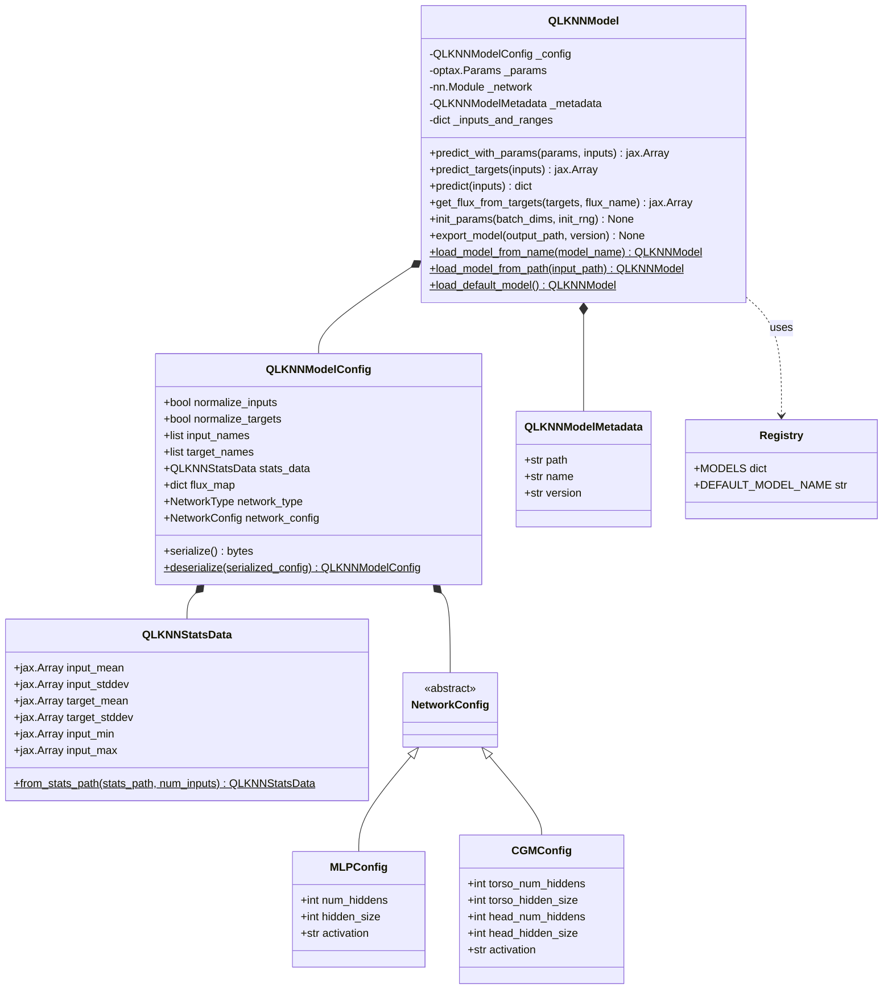
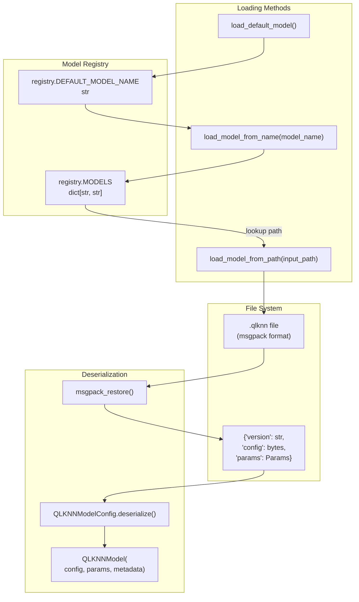
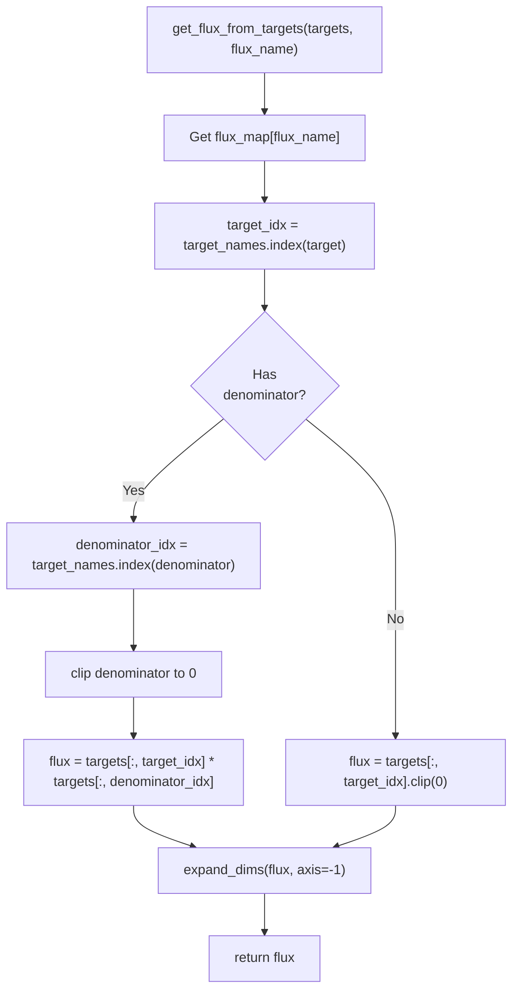

<!-- source: DeepWiki mcp.deepwiki.com · repo google-deepmind/fusion_surrogates · page 3 QLKNN Model System · fetched 2026-10-26 -->

# QLKNN Model System

<details>
<summary>Relevant source files</summary>

The following files were used as context for generating this wiki page:

- [README.md](README.md)
- [fusion_surrogates/common/transforms.py](fusion_surrogates/common/transforms.py)
- [fusion_surrogates/qlknn/qlknn_model.py](fusion_surrogates/qlknn/qlknn_model.py)
- [fusion_surrogates/qlknn/qlknn_model_test.py](fusion_surrogates/qlknn/qlknn_model_test.py)

</details>


## Purpose and Scope

The QLKNN Model System provides neural network surrogate models of QuaLiKiz, a quasilinear gyrokinetic code for turbulent transport in tokamak plasmas. This system enables fast approximations of turbulent transport predictions that would otherwise require expensive physics simulations.

This document covers the QLKNN model implementation, including class structures, prediction pipelines, configuration management, and model loading mechanisms. For details on the neural network architectures used by QLKNN models, see [Network Architectures](#5.1). For data transformation utilities, see [Data Transformation Utilities](#5.2).

**Sources:** [README.md:10-44](), [fusion_surrogates/qlknn/qlknn_model.py:15-20]()

---

## Core Components

The QLKNN system consists of three primary classes that work together to provide model inference:

| Class | Purpose | Key Attributes |
|-------|---------|---------------|
| `QLKNNModel` | Main inference engine | `_config`, `_params`, `_network`, `_metadata` |
| `QLKNNModelConfig` | Model configuration and architecture definition | `input_names`, `target_names`, `stats_data`, `flux_map`, `network_type`, `network_config` |
| `QLKNNStatsData` | Normalization statistics | `input_mean`, `input_stddev`, `target_mean`, `target_stddev`, `input_min`, `input_max` |

### QLKNNModel

The `QLKNNModel` class ([fusion_surrogates/qlknn/qlknn_model.py:166-419]()) is the primary interface for loading and running QLKNN models. It encapsulates the neural network, parameters, configuration, and metadata.

**Key methods:**
- `predict_with_params(params, inputs)`: Raw prediction with custom parameters (used during training)
- `predict_targets(inputs)`: Unnormalized target predictions
- `predict(inputs)`: Physical flux predictions (dictionary output)
- `get_flux_from_targets(targets, flux_name)`: Convert targets to specific flux
- `load_model_from_name(model_name)`: Load from registry
- `load_model_from_path(input_path)`: Load from file path
- `load_default_model()`: Load default registered model

### QLKNNModelConfig

The `QLKNNModelConfig` dataclass ([fusion_surrogates/qlknn/qlknn_model.py:109-139]()) defines the complete model architecture and processing configuration:

```python
@dataclasses.dataclass
class QLKNNModelConfig:
  normalize_inputs: bool
  normalize_targets: bool
  input_names: list[str]
  target_names: list[str]
  stats_data: QLKNNStatsData | None
  flux_map: dict[str, Any]
  network_type: networks.NetworkType
  network_config: NetworkConfig
```

The configuration includes serialization methods (`serialize()`, `deserialize()`) for model persistence.

### QLKNNStatsData

The `QLKNNStatsData` dataclass ([fusion_surrogates/qlknn/qlknn_model.py:46-72]()) stores normalization statistics computed from training data:

- Input statistics: `input_mean`, `input_stddev`, `input_min`, `input_max`
- Target statistics: `target_mean`, `target_stddev`

These statistics are loaded from JSON files using the `from_stats_path` class method.

**Sources:** [fusion_surrogates/qlknn/qlknn_model.py:46-419]()

---

## Architecture Overview

The following diagram shows the class structure and relationships within the QLKNN system:



**Sources:** [fusion_surrogates/qlknn/qlknn_model.py:46-419]()

---

## Prediction Pipeline

The QLKNN prediction pipeline transforms raw plasma parameters into physical flux predictions through four stages:

```mermaid
flowchart LR
    subgraph Input["Input Stage"]
        RawInputs["Raw Plasma<br/>Parameters<br/>(10 features)"]
    end
    
    subgraph Normalization["normalize() Stage"]
        CheckNorm{"normalize_inputs<br/>enabled?"}
        NormInputs["transforms.normalize()<br/>using stats_data"]
        NormalizedInputs["Normalized<br/>Inputs"]
    end
    
    subgraph Network["Network Inference"]
        NetworkApply["_network.apply()<br/>(params, inputs)"]
        RawTargets["Raw Target<br/>Predictions<br/>(N targets)"]
    end
    
    subgraph Denormalization["unnormalize() Stage"]
        CheckDenorm{"normalize_targets<br/>enabled?"}
        DenormTargets["transforms.unnormalize()<br/>using stats_data"]
        PhysicalTargets["Physical<br/>Targets"]
    end
    
    subgraph FluxCalc["Flux Calculation"]
        FluxMap["flux_map<br/>configuration"]
        GetFlux["get_flux_from_targets()<br/>for each flux"]
        ClipNeg["clip(0)<br/>leading flux"]
        Multiply["multiply<br/>by denominator"]
        FinalFluxes["dict of<br/>Physical Fluxes"]
    end
    
    RawInputs --> CheckNorm
    CheckNorm -->|Yes| NormInputs
    CheckNorm -->|No| NormalizedInputs
    NormInputs --> NormalizedInputs
    NormalizedInputs --> NetworkApply
    NetworkApply --> RawTargets
    RawTargets --> CheckDenorm
    CheckDenorm -->|Yes| DenormTargets
    CheckDenorm -->|No| PhysicalTargets
    DenormTargets --> PhysicalTargets
    PhysicalTargets --> FluxMap
    FluxMap --> GetFlux
    GetFlux --> ClipNeg
    ClipNeg --> Multiply
    Multiply --> FinalFluxes
```



### Method Call Flow

The prediction pipeline is exposed through three public methods:

1. **`predict_with_params(params, inputs)`** ([fusion_surrogates/qlknn/qlknn_model.py:252-273]())
   - Applies input normalization if configured
   - Calls `_network.apply(params, inputs)`
   - Returns raw (possibly normalized) targets
   - Used during training when parameters are changing

2. **`predict_targets(inputs)`** ([fusion_surrogates/qlknn/qlknn_model.py:275-296]())
   - Calls `predict_with_params` with stored parameters
   - Applies target unnormalization if configured
   - Returns physical target values
   - Used for direct target predictions

3. **`predict(inputs)`** ([fusion_surrogates/qlknn/qlknn_model.py:324-339]())
   - Calls `predict_targets(inputs)`
   - Iterates through `flux_map` to compute each flux
   - Calls `get_flux_from_targets()` for each flux name
   - Returns dictionary of flux name → flux array

### Flux Calculation Details

The `get_flux_from_targets()` method ([fusion_surrogates/qlknn/qlknn_model.py:298-322]()) computes physical fluxes from targets:

1. Extracts the target index from `flux_map[flux_name]['target']`
2. If denominator exists (`flux_map[flux_name]['denominator']`):
   - Multiplies target by denominator (with denominator clipped to 0)
3. If no denominator:
   - Uses target directly (clipped to 0)
4. Returns flux as `(batch_size, 1)` array

**Sources:** [fusion_surrogates/qlknn/qlknn_model.py:252-339](), [fusion_surrogates/common/transforms.py:21-32]()

---

## Model Configuration and Statistics

### Configuration Structure

The `QLKNNModelConfig` contains all information needed to reconstruct a model:

**Boolean flags:**
- `normalize_inputs`: Whether to normalize inputs before network inference
- `normalize_targets`: Whether targets were normalized during training

**Data schema:**
- `input_names`: List of input parameter names (e.g., `['Ate', 'Ati', 'An', ...]`)
- `target_names`: List of target prediction names

**Statistics:**
- `stats_data`: `QLKNNStatsData` instance with normalization parameters

**Flux mapping:**
- `flux_map`: Dictionary mapping flux names to target/denominator pairs
  ```python
  {
    'flux_name': {
      'target': 'target_name',
      'denominator': 'denominator_name' | None
    }
  }
  ```

**Network architecture:**
- `network_type`: `networks.NetworkType` enum value
- `network_config`: Architecture-specific configuration (MLPConfig or CGMConfig)

### Statistics Data Loading

Statistics are loaded from JSON files using `QLKNNStatsData.from_stats_path()` ([fusion_surrogates/qlknn/qlknn_model.py:57-71]()):

```python
with open(stats_path, 'r') as f:
    data_stats = json.load(f)
return cls(
    input_mean=jnp.array(data_stats['mean'][:num_inputs]),
    input_stddev=jnp.array(data_stats['stddev'][:num_inputs]),
    target_mean=jnp.array(data_stats['mean'][num_inputs:]),
    target_stddev=jnp.array(data_stats['stddev'][num_inputs:]),
    input_min=jnp.array(data_stats['min'][:num_inputs]),
    input_max=jnp.array(data_stats['max'][:num_inputs]),
)
```

The JSON file contains concatenated input and target statistics, which are split based on `num_inputs`.

**Sources:** [fusion_surrogates/qlknn/qlknn_model.py:109-139](), [fusion_surrogates/qlknn/qlknn_model.py:46-72]()

---

## Model Loading and Registry

QLKNN models can be loaded through three mechanisms:



### Loading by Name

The `load_model_from_name()` class method ([fusion_surrogates/qlknn/qlknn_model.py:370-379]()) looks up the model path in the registry:

```python
model_path = registry.MODELS.get(model_name)
if model_path is None:
    raise ValueError(f'Model {model_name} not found in registry.')
return cls.load_model_from_path(model_path, model_name)
```

The registry is defined in `fusion_surrogates/qlknn/models/registry.py`.

### Loading by Path

The `load_model_from_path()` class method ([fusion_surrogates/qlknn/qlknn_model.py:381-401]()) deserializes a `.qlknn` file:

1. Opens the file and reads bytes
2. Calls `serialization.msgpack_restore()` to get dictionary
3. Deserializes config using `QLKNNModelConfig.deserialize()`
4. Creates `QLKNNModelMetadata` with path, name, version
5. Returns new `QLKNNModel` instance

### Loading Default Model

The `load_default_model()` class method ([fusion_surrogates/qlknn/qlknn_model.py:403-406]()) loads the default registered model:

```python
return cls.load_model_from_name(registry.DEFAULT_MODEL_NAME)
```

Currently, the default model is `'qlknn_7_11_v1'` which combines QLKNN11D and QLKNN7D-edge datasets.

**Sources:** [fusion_surrogates/qlknn/qlknn_model.py:370-406](), [fusion_surrogates/qlknn/qlknn_model_test.py:156-162]()

---

## Network Architectures

QLKNN models support multiple neural network architectures through the `networks` module. The architecture is specified in the model configuration.

### Supported Network Types

| Network Type | Config Class | Network Class | Purpose |
|--------------|--------------|---------------|---------|
| `MLP` | `MLPConfig` | `networks.MLP` | Standard multi-layer perceptron |
| `DISJOINT_MLPS` | `MLPConfig` | `networks.DisjointMLPs` | Separate MLPs for each output |
| `MODE_MLPS` | `MLPConfig` | `networks.ModeMLPs` | Separate MLPs per transport mode |
| `CGM` | `CGMConfig` | `networks.CGMNets` | Critical Gradient Model (physics-informed) |

### Network Configuration Classes

**MLPConfig** ([fusion_surrogates/qlknn/qlknn_model.py:79-86]()):
```python
@dataclasses.dataclass
class MLPConfig(NetworkConfig):
  num_hiddens: int       # Number of hidden layers
  hidden_size: int       # Neurons per hidden layer
  activation: str        # Activation function ('relu', 'tanh', etc.)
```

**CGMConfig** ([fusion_surrogates/qlknn/qlknn_model.py:88-97]()):
```python
@dataclasses.dataclass
class CGMConfig(NetworkConfig):
  torso_num_hiddens: int     # Hidden layers in shared torso
  torso_hidden_size: int     # Neurons per torso layer
  head_num_hiddens: int      # Hidden layers in output heads
  head_hidden_size: int      # Neurons per head layer
  activation: str            # Activation function
```

### Network Building Process

The `_build_network()` method ([fusion_surrogates/qlknn/qlknn_model.py:341-357]()) constructs the network based on configuration:

1. Extracts network configuration as dictionary
2. Adds architecture-specific parameters:
   - For MLP-based: `num_targets` parameter
   - For CGM: `driving_gradient_index_map` with gradient indices
3. Looks up network class in `networks.NETWORK_MAP`
4. Instantiates network with configuration

**Example for CGM:**
```python
network_kwargs['driving_gradient_index_map'] = {
    'Ate': self._config.input_names.index('Ate'),
    'Ati': self._config.input_names.index('Ati'),
}
self._network = networks.NETWORK_MAP[self._config.network_type](
    **network_kwargs
)
```

For detailed information on each network architecture implementation, see [Network Architectures](#5.1).

**Sources:** [fusion_surrogates/qlknn/qlknn_model.py:74-107](), [fusion_surrogates/qlknn/qlknn_model.py:341-357](), [fusion_surrogates/qlknn/qlknn_model_test.py:105-154]()

---

## Flux Calculation System

The flux calculation system transforms target predictions into physical turbulent transport fluxes using the `flux_map` configuration.

### Flux Map Structure

The `flux_map` in `QLKNNModelConfig` defines how to compute each flux:

```python
flux_map = {
    'efe_ITG': {
        'target': 'efeITG_GB',      # Leading flux target
        'denominator': None          # No denominator (leading flux)
    },
    'efi_ITG': {
        'target': 'efiITG_ratio',   # Secondary flux ratio
        'denominator': 'efeITG_GB'  # Multiply by leading flux
    },
    'pfe_ITG': {
        'target': 'pfeITG_ratio',
        'denominator': 'efeITG_GB'
    }
}
```

### Flux Computation Algorithm

The `get_flux_from_targets()` method implements this logic:



### Leading vs Secondary Fluxes

**Leading fluxes** are direct predictions from the network:
- No denominator in `flux_map`
- Clipped to 0 to ensure physicality
- Example: `efeITG_GB` (electron heat flux for ITG mode)

**Secondary fluxes** are ratios multiplied by leading fluxes:
- Have denominator in `flux_map`
- Computed as: `ratio × leading_flux`
- Leading flux is clipped before multiplication
- Example: `efiITG_ratio × efeITG_GB` = ion heat flux for ITG

This approach ensures:
- All fluxes in a mode are consistent
- Physical constraint of non-negative leading flux
- Efficient encoding of mode structure

**Sources:** [fusion_surrogates/qlknn/qlknn_model.py:298-339](), [fusion_surrogates/qlknn/qlknn_model_test.py:54-103]()

---

## Model Serialization and Export

### Export Format

QLKNN models are serialized to `.qlknn` files using msgpack format. The `export_model()` method ([fusion_surrogates/qlknn/qlknn_model.py:359-368]()) creates a dictionary:

```python
export_dict = {
    'version': version,           # Version string (default: '11D')
    'config': config.serialize(), # Serialized QLKNNModelConfig (bytes)
    'params': params,             # Model parameters (pytree)
}
```

### Configuration Serialization

The `QLKNNModelConfig.serialize()` method ([fusion_surrogates/qlknn/qlknn_model.py:135-138]()) converts the config to bytes:

1. Converts dataclass to dictionary using `dataclasses.asdict()`
2. Converts `network_type` enum to its string value
3. Serializes to msgpack bytes using `serialization.msgpack_serialize()`

### Configuration Deserialization

The `QLKNNModelConfig.deserialize()` class method ([fusion_surrogates/qlknn/qlknn_model.py:122-133]()) reconstructs the config:

1. Restores msgpack to dictionary
2. Reconstructs `QLKNNStatsData` if present
3. Converts network type string back to `networks.NetworkType` enum
4. Looks up appropriate `NetworkConfig` subclass from `NETWORK_CONFIG_MAP`
5. Instantiates the network config
6. Returns new `QLKNNModelConfig` instance

### Parameter Management

Model parameters are stored as Optax parameter pytrees. The model provides:

- **Property access:** `model.params` to get parameters ([fusion_surrogates/qlknn/qlknn_model.py:207-211]())
- **Setter:** `model.params = new_params` to update parameters ([fusion_surrogates/qlknn/qlknn_model.py:213-215]())
- **Initialization:** `model.init_params(batch_dims, rng)` for new models ([fusion_surrogates/qlknn/qlknn_model.py:183-189]())
- **Counting:** `model.num_params()` returns total parameter count ([fusion_surrogates/qlknn/qlknn_model.py:243-245]())
- **Validation:** `model.has_nan()` checks for NaN values ([fusion_surrogates/qlknn/qlknn_model.py:247-250]())

**Sources:** [fusion_surrogates/qlknn/qlknn_model.py:122-139](), [fusion_surrogates/qlknn/qlknn_model.py:359-368](), [fusion_surrogates/qlknn/qlknn_model_test.py:40-52]()

---

## Model Metadata

The `QLKNNModelMetadata` dataclass ([fusion_surrogates/qlknn/qlknn_model.py:141-148]()) tracks optional model identification information:

```python
@dataclasses.dataclass
class QLKNNModelMetadata:
  path: str = ''      # File path where model was loaded from
  name: str = ''      # Registry name (e.g., 'qlknn_7_11_v1')
  version: str = ''   # Model version (e.g., '11D')
```

This metadata is accessible through model properties:
- `model.path` ([fusion_surrogates/qlknn/qlknn_model.py:192-193]())
- `model.name` ([fusion_surrogates/qlknn/qlknn_model.py:195-197]())
- `model.version` ([fusion_surrogates/qlknn/qlknn_model.py:199-201]())

The metadata is automatically populated when loading models:
- `load_model_from_path()` sets path, name, and version
- `load_model_from_name()` sets path and name from registry

**Sources:** [fusion_surrogates/qlknn/qlknn_model.py:141-201]()

---

