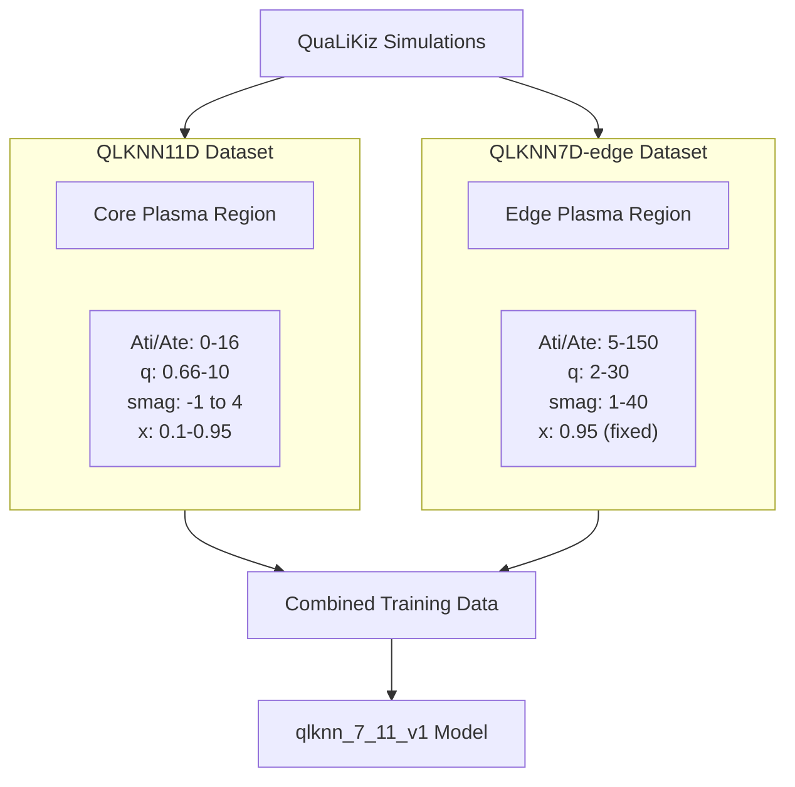
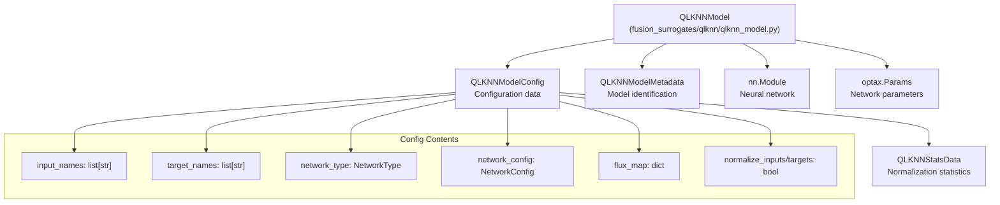
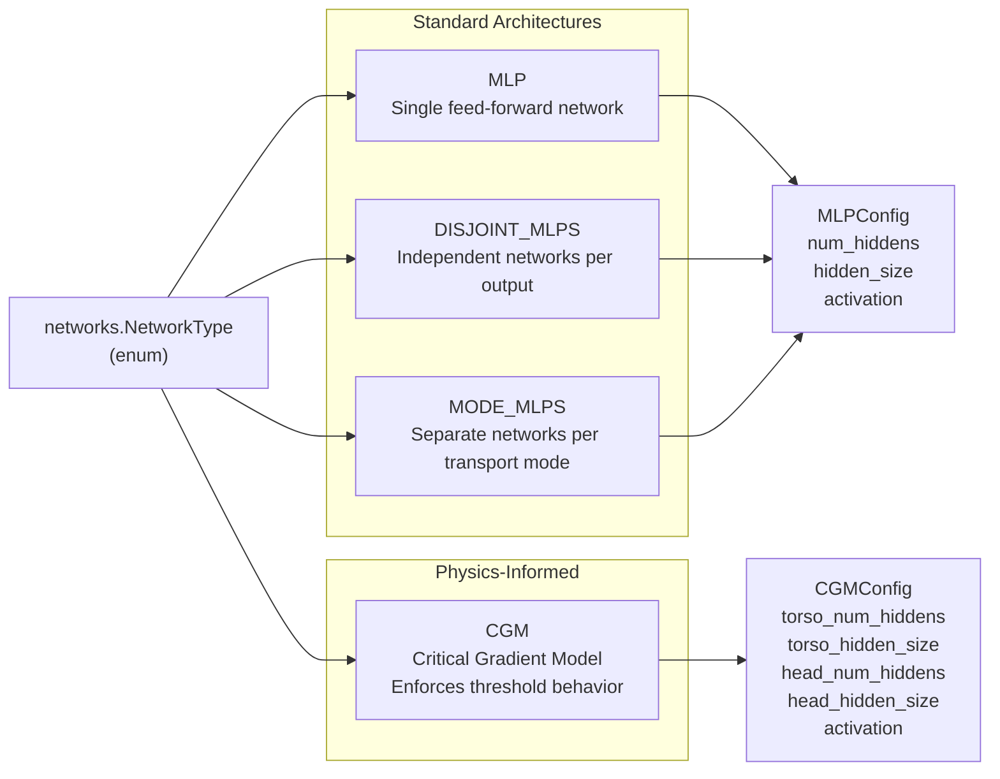
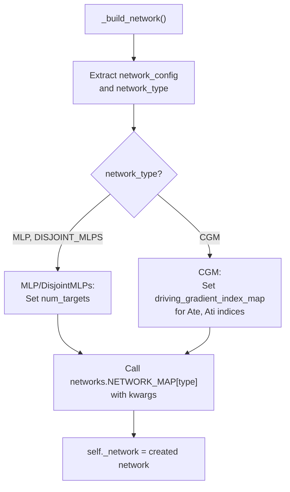
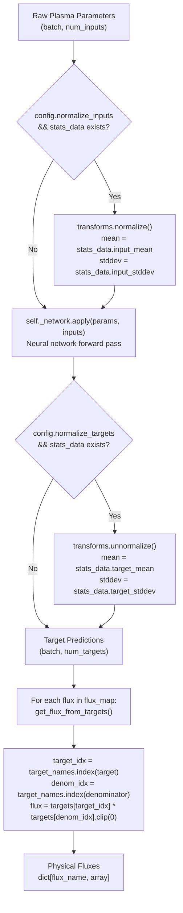

<!-- source: DeepWiki mcp.deepwiki.com · repo google-deepmind/fusion_surrogates · page 3.1 QLKNN Overview and Architecture · fetched 2026-10-26 -->

# QLKNN Overview and Architecture

<details>
<summary>Relevant source files</summary>

The following files were used as context for generating this wiki page:

- [README.md](README.md)
- [fusion_surrogates/common/transforms.py](fusion_surrogates/common/transforms.py)
- [fusion_surrogates/qlknn/models/README.md](fusion_surrogates/qlknn/models/README.md)
- [fusion_surrogates/qlknn/qlknn_model.py](fusion_surrogates/qlknn/qlknn_model.py)
- [fusion_surrogates/qlknn/qlknn_model_test.py](fusion_surrogates/qlknn/qlknn_model_test.py)

</details>


## Purpose and Scope

This document provides an architectural overview of the QLKNN (QuaLiKiz Neural Network) surrogate model system within the `fusion_surrogates` library. It explains the purpose of QLKNN models, their training datasets, available neural network architectures, and the core components that enable inference.

For practical usage instructions and code examples, see [Using QLKNN Models](#3.3). For detailed specifications of input parameters and output predictions, see [QLKNN Input and Output Specifications](#3.2). For information on model storage and cross-platform deployment, see [QLKNN Model Registry and ONNX Export](#3.4).

**Sources:** [README.md:1-105](), [fusion_surrogates/qlknn/qlknn_model.py:15-20]()

---

## What is QLKNN?

QLKNN is a neural network surrogate model that replaces [QuaLiKiz](https://gitlab.com/qualikiz-group/QuaLiKiz), a quasilinear gyrokinetic code used to compute turbulent transport in tokamak plasmas. The surrogate model provides orders-of-magnitude speedup compared to running the full QuaLiKiz simulation, enabling real-time transport predictions for plasma simulation codes like [TORAX](https://github.com/google-deepmind/torax).

The QLKNN model predicts turbulent heat and particle fluxes for three distinct transport modes:
- **ITG** (Ion Temperature Gradient mode)
- **TEM** (Trapped Electron Mode)
- **ETG** (Electron Temperature Gradient mode)

The current default model, `qlknn_7_11_v1`, is based on the original QLKNN10D model described in [Van de Plassche et al., Physics of Plasmas 2020](https://doi.org/10.1063/1.5134126), with improvements from combining multiple training datasets.

**Sources:** [README.md:10-44](), [fusion_surrogates/qlknn/qlknn_model.py:15-20]()

---

## Training Datasets

### Dataset Overview

The `qlknn_7_11_v1` model was trained on a combination of two complementary datasets to provide coverage across different plasma regions:

| Dataset | Purpose | Input Space Coverage |
|---------|---------|---------------------|
| **QLKNN11D** | Core plasma region | Standard gradients, lower inverse aspect ratios |
| **QLKNN7D-edge** | Edge plasma region | Extreme gradients, fixed at plasma edge |


**Diagram: QLKNN Training Data Provenance**

Both datasets are publicly available on Zenodo:
- QLKNN11D: https://zenodo.org/record/8017522
- QLKNN7D-edge: https://zenodo.org/record/8106431

**Sources:** [README.md:15-22](), [fusion_surrogates/qlknn/models/README.md:1-59]()

### Data Filtering Criteria

Training data undergoes extensive filtering to ensure quality and physical validity. The filtering process is described in [Van de Plassche et al. 2020](https://pubs.aip.org/aip/pop/article-abstract/27/2/022310/1062590). Datapoints are rejected if:

- QuaLiKiz convergence was not achieved
- Total heat flux is negative (unphysical)
- Particle flux consistency error > 50% (diffusion vs. convection)
- Mode contribution error > 50% (ITG + TEM vs. total flux)
- Ambipolarity violation > 50%
- Transport coefficient < 10⁻⁴ GyroBohm units when non-zero
- Outliers in unfiltered dataset (lower/upper 2-percentile)

**Sources:** [fusion_surrogates/qlknn/models/README.md:10-22]()

---

## Core Architecture Components

### Component Hierarchy


**Diagram: QLKNN Core Components and Relationships**

**Sources:** [fusion_surrogates/qlknn/qlknn_model.py:46-148]()

### QLKNNModel Class

The `QLKNNModel` class [fusion_surrogates/qlknn/qlknn_model.py:166-419]() is the primary interface for QLKNN inference. It encapsulates:

| Component | Type | Purpose |
|-----------|------|---------|
| `_config` | `QLKNNModelConfig` | Model architecture and data processing configuration |
| `_params` | `optax.Params` | Trained neural network weights |
| `_network` | `nn.Module` | Flax neural network module |
| `_metadata` | `QLKNNModelMetadata` | Model identification (path, name, version) |
| `_inputs_and_ranges` | `dict[str, dict[str, float]]` | Valid input parameter ranges |

**Key methods:**

- `init_params()` [fusion_surrogates/qlknn/qlknn_model.py:183-189](): Initialize random parameters (for training)
- `predict_with_params()` [fusion_surrogates/qlknn/qlknn_model.py:252-273](): Raw network prediction (normalized if configured)
- `predict_targets()` [fusion_surrogates/qlknn/qlknn_model.py:275-296](): Predict unnormalized targets
- `predict()` [fusion_surrogates/qlknn/qlknn_model.py:324-339](): Predict physical fluxes from targets
- `load_model_from_name()` [fusion_surrogates/qlknn/qlknn_model.py:370-379](): Load from registry
- `load_model_from_path()` [fusion_surrogates/qlknn/qlknn_model.py:381-401](): Load from file path
- `load_default_model()` [fusion_surrogates/qlknn/qlknn_model.py:403-406](): Load default QLKNN model

**Sources:** [fusion_surrogates/qlknn/qlknn_model.py:166-419]()

### QLKNNModelConfig

The `QLKNNModelConfig` dataclass [fusion_surrogates/qlknn/qlknn_model.py:109-138]() defines all configuration needed to construct and use a QLKNN model:

```python
@dataclasses.dataclass
class QLKNNModelConfig:
  normalize_inputs: bool          # Apply input normalization
  normalize_targets: bool         # Apply target normalization
  input_names: list[str]          # Names of input features
  target_names: list[str]         # Names of network outputs
  stats_data: QLKNNStatsData      # Normalization statistics
  flux_map: dict[str, Any]        # Target → flux conversion
  network_type: NetworkType       # Network architecture enum
  network_config: NetworkConfig   # Architecture-specific config
```

The `flux_map` dictionary specifies how to compute physical fluxes from network target predictions. Each flux has a `target` (the primary prediction) and optional `denominator` (another target to multiply by). See [QLKNN Input and Output Specifications](#3.2) for details.

**Sources:** [fusion_surrogates/qlknn/qlknn_model.py:109-138]()

### QLKNNStatsData

The `QLKNNStatsData` dataclass [fusion_surrogates/qlknn/qlknn_model.py:46-71]() stores normalization statistics computed from the training data:

| Field | Shape | Purpose |
|-------|-------|---------|
| `input_mean` | `(num_inputs,)` | Mean of each input feature |
| `input_stddev` | `(num_inputs,)` | Standard deviation of each input |
| `target_mean` | `(num_targets,)` | Mean of each target output |
| `target_stddev` | `(num_targets,)` | Standard deviation of each target |
| `input_min` | `(num_inputs,)` | Minimum valid input value |
| `input_max` | `(num_inputs,)` | Maximum valid input value |

These statistics are loaded from JSON files and used by the `transforms.normalize()` and `transforms.unnormalize()` functions [fusion_surrogates/common/transforms.py:21-32]() to standardize data to zero mean and unit variance.

**Sources:** [fusion_surrogates/qlknn/qlknn_model.py:46-71](), [fusion_surrogates/common/transforms.py:1-33]()

---

## Network Architecture Options

QLKNN supports multiple neural network architectures through the `NetworkType` enum and `NETWORK_MAP` registry [fusion_surrogates/common/networks.py]() (see [Network Architectures](#5.1) for implementation details). Each architecture has associated configuration classes:

### Available Architectures


**Diagram: QLKNN Network Architecture Options**

**Sources:** [fusion_surrogates/qlknn/qlknn_model.py:74-106](), [fusion_surrogates/qlknn/qlknn_model_test.py:105-155]()

### MLPConfig

Standard multi-layer perceptron configuration [fusion_surrogates/qlknn/qlknn_model.py:79-85]():

| Field | Type | Description |
|-------|------|-------------|
| `num_hiddens` | `int` | Number of hidden layers |
| `hidden_size` | `int` | Neurons per hidden layer |
| `activation` | `str` | Activation function ('relu', 'tanh', 'sigmoid') |

Used by: `MLP`, `DisjointMLPs`, `ModeMLPs` architectures.

**Sources:** [fusion_surrogates/qlknn/qlknn_model.py:79-85]()

### CGMConfig

Critical Gradient Model configuration [fusion_surrogates/qlknn/qlknn_model.py:88-96]():

| Field | Type | Description |
|-------|------|-------------|
| `torso_num_hiddens` | `int` | Hidden layers in shared torso |
| `torso_hidden_size` | `int` | Neurons per torso layer |
| `head_num_hiddens` | `int` | Hidden layers in output heads |
| `head_hidden_size` | `int` | Neurons per head layer |
| `activation` | `str` | Activation function |

The CGM architecture enforces physics-informed constraints where transport vanishes below critical gradient thresholds. It uses a shared "torso" network and separate "head" networks per output, with special handling for temperature gradients (`Ate`, `Ati`).

**Sources:** [fusion_surrogates/qlknn/qlknn_model.py:88-96](), [fusion_surrogates/qlknn/qlknn_model.py:350-357]()

### Network Construction

The `_build_network()` method [fusion_surrogates/qlknn/qlknn_model.py:341-357]() constructs the appropriate network based on configuration:


**Diagram: Network Construction Flow in _build_network()**

**Sources:** [fusion_surrogates/qlknn/qlknn_model.py:341-357]()

---

## Prediction Pipeline Architecture

The QLKNN prediction pipeline transforms raw plasma parameters into physical flux predictions through a series of well-defined stages:


**Diagram: Complete QLKNN Prediction Pipeline**

**Sources:** [fusion_surrogates/qlknn/qlknn_model.py:252-339]()

### Pipeline Stages

#### Stage 1: Input Normalization

`predict_with_params()` [fusion_surrogates/qlknn/qlknn_model.py:267-272]() optionally normalizes inputs:

```python
if self._config.normalize_inputs and self._config.stats_data is not None:
    inputs = transforms.normalize(
        inputs,
        mean=self._config.stats_data.input_mean,
        stddev=self._config.stats_data.input_stddev,
    )
```

The normalization formula [fusion_surrogates/common/transforms.py:21-25]() is: `(data - mean) / stddev`

#### Stage 2: Network Inference

The normalized (or raw) inputs are passed through the neural network:
```python
return self._network.apply(params, inputs)
```

This calls the Flax `nn.Module` forward pass with the trained parameters.

#### Stage 3: Target Denormalization

`predict_targets()` [fusion_surrogates/qlknn/qlknn_model.py:290-295]() converts normalized outputs back to physical units:

```python
if self._config.normalize_targets and self._config.stats_data is not None:
    outputs = transforms.unnormalize(
        outputs,
        mean=self._config.stats_data.target_mean,
        stddev=self._config.stats_data.target_stddev,
    )
```

The unnormalization formula [fusion_surrogates/common/transforms.py:28-32]() is: `data * stddev + mean`

#### Stage 4: Flux Calculation

`predict()` [fusion_surrogates/qlknn/qlknn_model.py:324-339]() computes physical fluxes from targets using the `flux_map` configuration. The `get_flux_from_targets()` method [fusion_surrogates/qlknn/qlknn_model.py:298-322]() implements the conversion:

1. Extract `target` index from `target_names`
2. Extract `denominator` index if specified
3. Compute: `flux = target * denominator.clip(0)` or `flux = target.clip(0)`

The `.clip(0)` operation ensures negative fluxes are set to zero (unphysical).

**Sources:** [fusion_surrogates/qlknn/qlknn_model.py:252-339](), [fusion_surrogates/common/transforms.py:21-32]()

---

## Model Versioning and Format

### Version Identifier

The current QLKNN version is defined as a constant [fusion_surrogates/qlknn/qlknn_model.py:43]():
```python
VERSION: Final[str] = '11D'
```

This identifier (stored in `QLKNNModelMetadata.version`) indicates that the model is trained on the QLKNN11D dataset (plus QLKNN7D-edge).

### Serialization Format

QLKNN models are serialized using `flax.serialization.msgpack_serialize()` [fusion_surrogates/qlknn/qlknn_model.py:359-368](). The format stores:

```python
export_dict = {
    'version': version,           # Version string
    'config': config.serialize(), # Serialized QLKNNModelConfig
    'params': params,             # Neural network parameters
}
```

Models are saved with the `.qlknn` extension and can be loaded using `QLKNNModel.load_model_from_path()`.

**Sources:** [fusion_surrogates/qlknn/qlknn_model.py:43](), [fusion_surrogates/qlknn/qlknn_model.py:359-401]()

---

## Summary

The QLKNN system provides a complete architecture for surrogate modeling of tokamak turbulent transport:

| Component | Purpose | Key Files |
|-----------|---------|-----------|
| **Training Data** | QLKNN11D + QLKNN7D-edge datasets | [fusion_surrogates/qlknn/models/README.md]() |
| **Model Class** | Inference interface and lifecycle | [fusion_surrogates/qlknn/qlknn_model.py:166-419]() |
| **Configuration** | Architecture and processing settings | [fusion_surrogates/qlknn/qlknn_model.py:109-138]() |
| **Statistics** | Normalization parameters | [fusion_surrogates/qlknn/qlknn_model.py:46-71]() |
| **Networks** | Multiple architecture options | [fusion_surrogates/common/networks.py]() |
| **Transforms** | Data normalization utilities | [fusion_surrogates/common/transforms.py]() |

The architecture separates concerns cleanly: configuration defines the model structure, statistics enable data preprocessing, and the network provides the learned mapping. This modular design allows for flexible experimentation with different architectures while maintaining a consistent inference interface.

For next steps:
- Learn about input/output specifications: [QLKNN Input and Output Specifications](#3.2)
- Get started with practical usage: [Using QLKNN Models](#3.3)
- Explore model storage and deployment: [QLKNN Model Registry and ONNX Export](#3.4)

**Sources:** [fusion_surrogates/qlknn/qlknn_model.py:1-419](), [README.md:1-105]()

---

