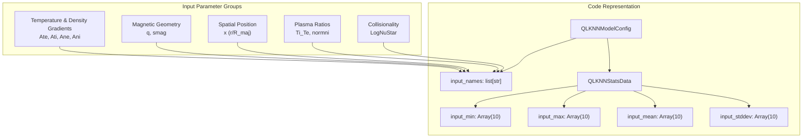
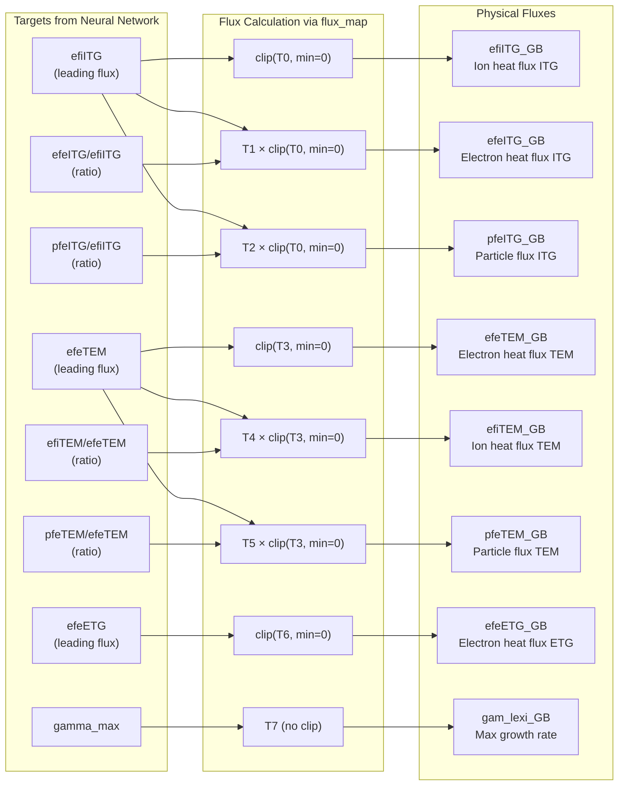
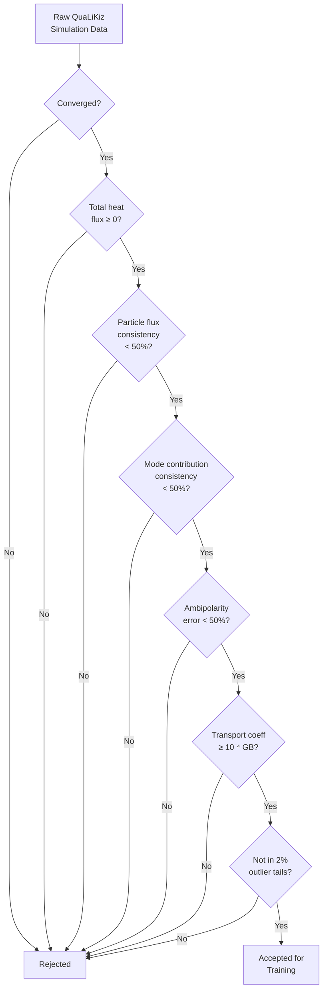
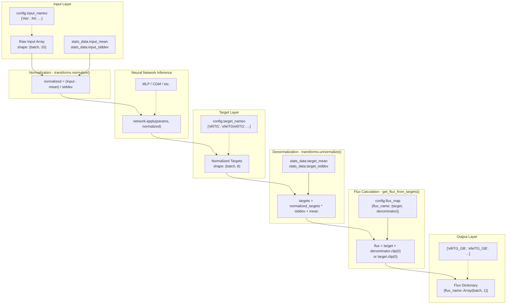

<!-- source: DeepWiki mcp.deepwiki.com · repo google-deepmind/fusion_surrogates · page 3.2 QLKNN Input and Output Specifications · fetched 2026-10-26 -->

# QLKNN Input and Output Specifications

<details>
<summary>Relevant source files</summary>

The following files were used as context for generating this wiki page:

- [README.md](README.md)
- [fusion_surrogates/common/transforms.py](fusion_surrogates/common/transforms.py)
- [fusion_surrogates/qlknn/models/README.md](fusion_surrogates/qlknn/models/README.md)
- [fusion_surrogates/qlknn/qlknn_model.py](fusion_surrogates/qlknn/qlknn_model.py)
- [fusion_surrogates/qlknn/qlknn_model_test.py](fusion_surrogates/qlknn/qlknn_model_test.py)

</details>


This page documents the input parameters, target predictions, and physical flux outputs produced by QLKNN models. It covers the 10 input features, 8 target predictions, filtering criteria applied to training data, and the transformation from targets to physical fluxes.

For information about QLKNN model architecture and network types, see [QLKNN Overview and Architecture](#3.1). For practical usage examples, see [Using QLKNN Models](#3.3).

## Input Parameters

QLKNN models accept 10 normalized plasma parameters as input. These inputs characterize the local plasma conditions and geometry at a specific radial location in the tokamak.

### Input Feature Definitions

The input features are stored in the `input_names` list within `QLKNNModelConfig` [fusion_surrogates/qlknn/qlknn_model.py:115]().

| Input Name | Symbol | Physical Meaning | Stored in Code |
|------------|--------|------------------|----------------|
| `Ate` | $$R/L_{Te}$$ | Normalized logarithmic electron temperature gradient | `config.input_names[0]` |
| `Ati` | $$R/L_{Ti}$$ | Normalized logarithmic ion temperature gradient | `config.input_names[1]` |
| `Ane` | $$R/L_{ne}$$ | Normalized logarithmic electron density gradient | `config.input_names[2]` |
| `Ani` | $$R/L_{ni}$$ | Normalized logarithmic ion density gradient | `config.input_names[3]` |
| `q` | $$q$$ | Safety factor (magnetic field line pitch) | `config.input_names[4]` |
| `smag` | $$\hat{s}$$ | Magnetic shear | `config.input_names[5]` |
| `x` | $$r/R_{maj}$$ | Local inverse aspect ratio | `config.input_names[6]` |
| `Ti_Te` | $$T_i/T_e$$ | Ion-electron temperature ratio | `config.input_names[7]` |
| `LogNuStar` | $$\log(\nu^*)$$ | Logarithmic normalized collisionality | `config.input_names[8]` |
| `normni` | $$n_i/n_e$$ | Normalized ion-electron density ratio | `config.input_names[9]` |



**Diagram: QLKNN Input Parameter Organization**

Sources: [README.md:23-33](), [fusion_surrogates/qlknn/qlknn_model.py:46-71](), [fusion_surrogates/qlknn/qlknn_model.py:110-120]()

### Input Ranges by Dataset

QLKNN_7_11 was trained on two combined datasets with different input ranges. The `QLKNNStatsData.input_min` and `QLKNNStatsData.input_max` arrays store the valid ranges [fusion_surrogates/qlknn/qlknn_model.py:54-55]().

**QLKNN11D Dataset (Core Plasma Region)**

| Input | Minimum | Maximum | Notes |
|-------|---------|---------|-------|
| `Ati` | ~0.0 | 16.0 | Core region typically has moderate gradients |
| `Ate` | ~0.0 | 16.0 | |
| `Ane` | -5.0 | 5.0 | Negative values represent density peaking |
| `Ani` | -15.0 | 15.0 | |
| `q` | 0.66 | 10.0 | Safety factor range for core |
| `smag` | -1.0 | 4.0 | Can be negative in some configurations |
| `x` | 0.1 | 0.95 | Core to edge, excluding separatrix |
| `Ti_Te` | 0.25 | 2.5 | Ion temperature typically comparable to electron |
| `LogNuStar` | -5.0 | -0.0003 | Low collisionality in core |
| `normni` | 0.7 | 1.0 | Near quasi-neutrality |

**QLKNN7D-edge Dataset (Edge Plasma Region)**

| Input | Minimum | Maximum | Notes |
|-------|---------|---------|-------|
| `Ati` | 5.0 | 150.0 | Edge has much steeper gradients |
| `Ate` | 5.0 | 150.0 | |
| `Ane` | 2.0 | 110.0 | Edge density gradients typically positive |
| `Ani` | 2.0 | 110.0 | |
| `q` | 2.0 | 30.0 | Higher safety factor at edge |
| `smag` | 1.0 | 40.0 | Higher magnetic shear at edge |
| `x` | 0.95 | 0.95 | Fixed at edge position |
| `Ti_Te` | 1.0 | 1.0 | Fixed at unity for edge dataset |
| `LogNuStar` | -1.0 | 0.48 | Higher collisionality at edge |
| `normni` | 0.5 | 1.0 | |

Sources: [fusion_surrogates/qlknn/models/README.md:24-59]()

### Input Normalization

Input features are normalized during prediction using the `transforms.normalize()` function [fusion_surrogates/common/transforms.py:21-25]():

```
normalized_input = (raw_input - input_mean) / input_stddev
```

This normalization is controlled by the `normalize_inputs` flag in `QLKNNModelConfig` and applied in the `predict_with_params()` method [fusion_surrogates/qlknn/qlknn_model.py:267-272]().

Sources: [fusion_surrogates/qlknn/qlknn_model.py:252-273](), [fusion_surrogates/common/transforms.py:21-25]()

## Target Predictions

QLKNN models output 8 target predictions representing transport characteristics. These targets are the direct output of the neural network before any post-processing.

### Target Definitions

The targets are stored in the `target_names` list within `QLKNNModelConfig` [fusion_surrogates/qlknn/qlknn_model.py:116]().

| Target Index | Target Name | Physical Meaning | Transport Mode |
|--------------|-------------|------------------|----------------|
| 0 | `efiITG` | Ion heat flux (leading flux for ITG) | ITG |
| 1 | `efeITG` / `efiITG` | Electron-to-ion heat flux ratio | ITG |
| 2 | `pfeITG` / `efiITG` | Electron particle-to-ion heat flux ratio | ITG |
| 3 | `efeTEM` | Electron heat flux (leading flux for TEM) | TEM |
| 4 | `efiTEM` / `efeTEM` | Ion-to-electron heat flux ratio | TEM |
| 5 | `pfeTEM` / `efeTEM` | Electron particle-to-electron heat flux ratio | TEM |
| 6 | `efeETG` | Electron heat flux (ETG mode) | ETG |
| 7 | `gamma_max` | Maximum growth rate on ion scales | All modes |

The model outputs the **leading flux** for each mode directly, and **ratios** of secondary fluxes to the leading flux. This design improves numerical stability during training.

Sources: [README.md:35-41](), [fusion_surrogates/qlknn/models/README.md:61-75]()

### Target Value Ranges

Based on the combined QLKNN11D and QLKNN7D-edge datasets:

| Target | Minimum | Maximum | Units |
|--------|---------|---------|-------|
| `efiITG` | 0.286 | 442.27 | GB (GyroBohm) |
| `efeITG` / `efiITG` | 0.00192 | 446.69 | Dimensionless ratio |
| `pfeITG` / `efiITG` | -133.0 | 132.68 | Dimensionless ratio |
| `efeTEM` | 0.168 | 134.78 | GB (GyroBohm) |
| `efiTEM` / `efeTEM` | 0.000988 | 257.43 | Dimensionless ratio |
| `pfeTEM` / `efeTEM` | -89.0 | 88.95 | Dimensionless ratio |
| `efeETG` | 0.141 | 73.15 | GB (GyroBohm) |
| `gamma_max` | 0.0 | 0.46 | Normalized frequency |

Sources: [fusion_surrogates/qlknn/models/README.md:61-75]()

### Target Denormalization

Targets are denormalized after network inference using `transforms.unnormalize()` [fusion_surrogates/common/transforms.py:28-32]():

```
denormalized_target = normalized_target * target_stddev + target_mean
```

This happens in the `predict_targets()` method when `normalize_targets` is enabled [fusion_surrogates/qlknn/qlknn_model.py:290-295]().

Sources: [fusion_surrogates/qlknn/qlknn_model.py:275-296](), [fusion_surrogates/common/transforms.py:28-32]()

## Flux Outputs

Physical fluxes are computed from targets using the `flux_map` configuration, which defines how to combine target values to produce each flux.

### Flux Calculation Logic

The `flux_map` dictionary [fusion_surrogates/qlknn/qlknn_model.py:118]() maps flux names to:
- `target`: The name of the target to use
- `denominator`: The name of another target to multiply by (or `None`)

The `get_flux_from_targets()` method implements the flux calculation [fusion_surrogates/qlknn/qlknn_model.py:298-322]():

```python
if denominator_name is not None:
    flux = target * denominator.clip(0)  # Multiply ratio by leading flux
else:
    flux = target.clip(0)  # Leading flux, clipped to non-negative
```



**Diagram: Target to Flux Transformation Pipeline**

Sources: [fusion_surrogates/qlknn/qlknn_model.py:298-339]()

### Flux Output Dictionary

The `predict()` method returns a dictionary mapping flux names to arrays [fusion_surrogates/qlknn/qlknn_model.py:324-339](). Each flux is a JAX array with shape `(batch_size, 1)`.

**Example Flux Map Structure:**

```python
flux_map = {
    'efiITG_GB': {
        'target': 'efiITG',
        'denominator': None  # Leading flux, no denominator
    },
    'efeITG_GB': {
        'target': 'efeITG/efiITG',
        'denominator': 'efiITG'  # Multiply ratio by leading flux
    },
    'pfeITG_GB': {
        'target': 'pfeITG/efiITG',
        'denominator': 'efiITG'
    },
    # ... similar for TEM and ETG modes
}
```

### Flux Types by Transport Mode

**Ion Temperature Gradient (ITG) Mode:**
- `efiITG_GB`: Ion heat flux (primary instability driver)
- `efeITG_GB`: Electron heat flux (secondary)
- `pfeITG_GB`: Particle flux

**Trapped Electron Mode (TEM):**
- `efeTEM_GB`: Electron heat flux (primary instability driver)
- `efiTEM_GB`: Ion heat flux (secondary)
- `pfeTEM_GB`: Particle flux

**Electron Temperature Gradient (ETG) Mode:**
- `efeETG_GB`: Electron heat flux (operates on electron scales)

**Growth Rate:**
- `gam_lexi_GB`: Maximum linear growth rate on ion gyroradius scales

Sources: [README.md:35-41](), [fusion_surrogates/qlknn/qlknn_model.py:298-339]()

## Data Filtering Criteria

The training datasets were filtered to ensure physical consistency and numerical reliability. These filters are applied during dataset preparation, not during inference.

### Filtering Rules

Data points were **rejected** if they met any of these criteria:

1. **Convergence failure**: QuaLiKiz simulation did not converge
2. **Negative total heat flux**: Total heat flux < 0 (non-physical)
3. **Particle flux inconsistency**: Difference between total particle flux and flux derived from diffusion/convection coefficients > 50%
4. **Mode contribution inconsistency**: Difference between sum of ITG+TEM mode contributions and self-consistent total flux > 50%
5. **Ambipolarity violation**: Ambipolarity violated by > 50%
6. **Small transport coefficients**: Non-zero transport coefficient < 10⁻⁴ GB (numerical noise)
7. **Outliers**: Data points in lower or upper 2-percentile of unfiltered dataset



**Diagram: Data Filtering Decision Tree**

These filtering criteria ensure that the model learns from physically consistent, numerically stable data points. The filters are based on the methodology described in [Van de Plassche et al. PoP 2020](https://doi.org/10.1063/1.5134126).

Sources: [fusion_surrogates/qlknn/models/README.md:10-22]()

## Input Validation and Ranges

### Accessing Input Ranges

The `inputs_and_ranges` property provides a mapping from input names to their valid ranges [fusion_surrogates/qlknn/qlknn_model.py:240-241]():

```python
model = QLKNNModel.load_default_model()
ranges = model.inputs_and_ranges
# Returns: {'Ate': {'min': ..., 'max': ...}, ...}
```

This mapping is constructed from `QLKNNStatsData.input_min` and `QLKNNStatsData.input_max` in the `_inputs_and_ranges_from_config()` function [fusion_surrogates/qlknn/qlknn_model.py:150-163]().

### Statistical Normalization Parameters

The `QLKNNStatsData` dataclass stores normalization statistics [fusion_surrogates/qlknn/qlknn_model.py:46-71]():

| Attribute | Shape | Purpose |
|-----------|-------|---------|
| `input_mean` | `(10,)` | Mean values for input normalization |
| `input_stddev` | `(10,)` | Standard deviation for input normalization |
| `target_mean` | `(8,)` | Mean values for target denormalization |
| `target_stddev` | `(8,)` | Standard deviation for target denormalization |
| `input_min` | `(10,)` | Minimum valid input values |
| `input_max` | `(10,)` | Maximum valid input values |

These statistics are loaded from JSON files using `QLKNNStatsData.from_stats_path()` [fusion_surrogates/qlknn/qlknn_model.py:57-71]().

Sources: [fusion_surrogates/qlknn/qlknn_model.py:46-71](), [fusion_surrogates/qlknn/qlknn_model.py:150-163]()

## Code Mapping: Inputs to Outputs



**Diagram: Complete Data Flow from Inputs to Flux Outputs**

### Key Methods

| Method | Location | Purpose |
|--------|----------|---------|
| `normalize()` | [fusion_surrogates/common/transforms.py:21-25]() | Normalize inputs to mean=0, std=1 |
| `unnormalize()` | [fusion_surrogates/common/transforms.py:28-32]() | Restore original scale to targets |
| `predict_with_params()` | [fusion_surrogates/qlknn/qlknn_model.py:252-273]() | Raw network inference |
| `predict_targets()` | [fusion_surrogates/qlknn/qlknn_model.py:275-296]() | Denormalized target predictions |
| `get_flux_from_targets()` | [fusion_surrogates/qlknn/qlknn_model.py:298-322]() | Convert single target to flux |
| `predict()` | [fusion_surrogates/qlknn/qlknn_model.py:324-339]() | Complete pipeline returning all fluxes |

Sources: [fusion_surrogates/qlknn/qlknn_model.py:252-339](), [fusion_surrogates/common/transforms.py:21-32]()

## Summary

QLKNN models transform 10 plasma input parameters into 8 physics-informed flux predictions across three transport modes (ITG, TEM, ETG). The architecture separates:

1. **Inputs**: Normalized gradients, magnetic geometry, and plasma ratios
2. **Targets**: Neural network outputs (leading fluxes and ratios)
3. **Fluxes**: Physical quantities computed from targets using `flux_map`

This design ensures numerical stability during training while providing physically interpretable outputs for tokamak transport simulation. Input validation is performed through stored min/max ranges, and normalization/denormalization maintain consistency with training data statistics.

Sources: [fusion_surrogates/qlknn/qlknn_model.py:1-419](), [README.md:10-44](), [fusion_surrogates/qlknn/models/README.md:1-76]()

---

