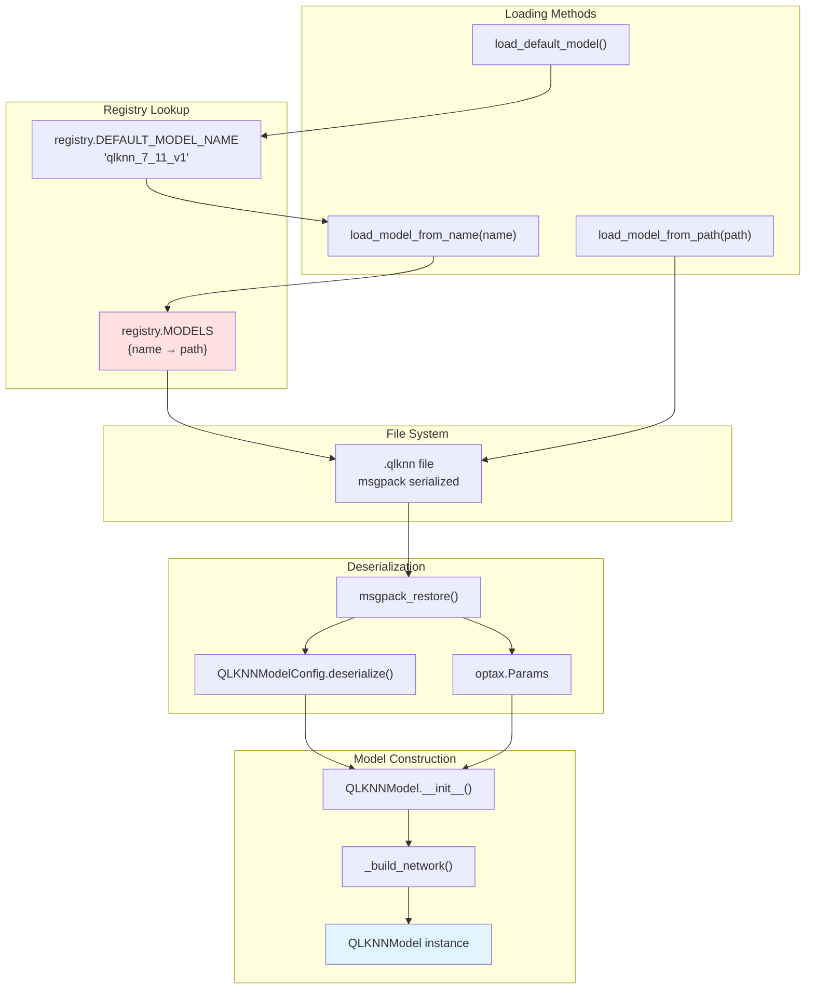
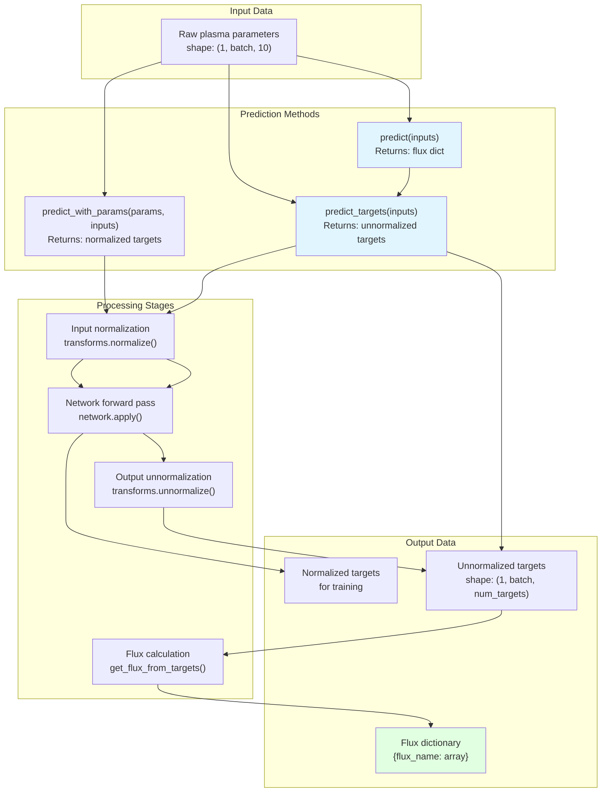
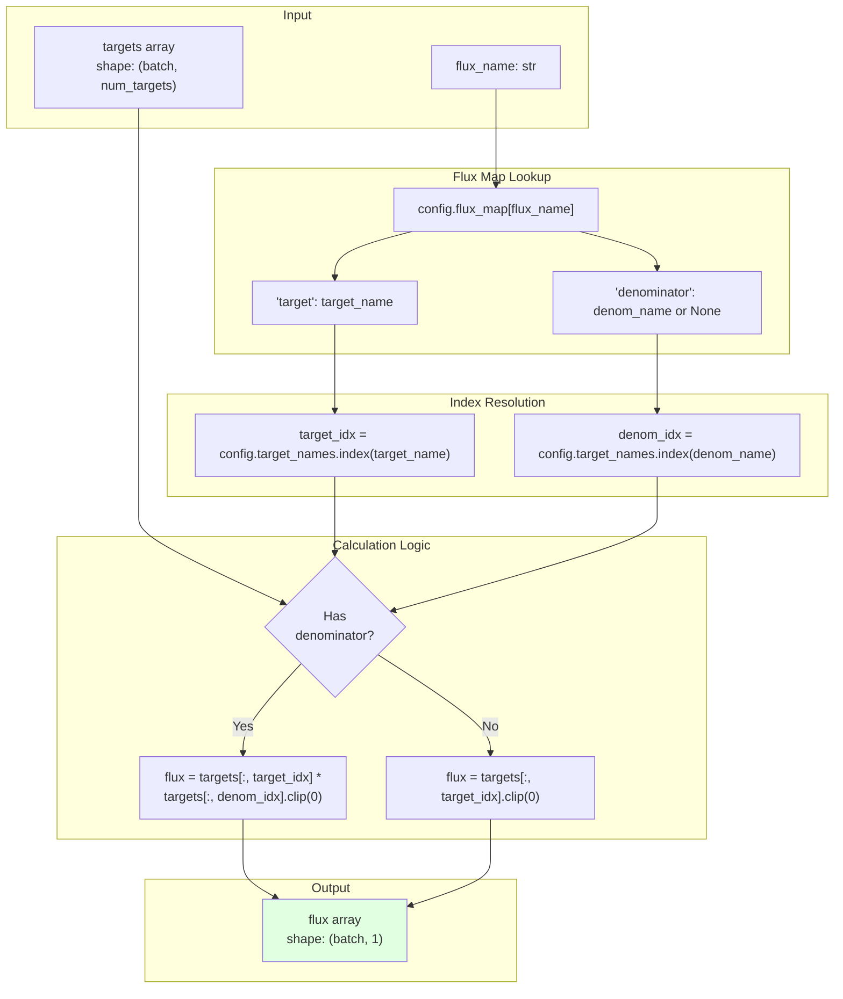
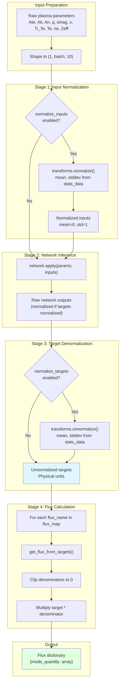

<!-- source: DeepWiki mcp.deepwiki.com · repo google-deepmind/fusion_surrogates · page 3.3 Using QLKNN Models · fetched 2026-10-26 -->

# Using QLKNN Models

<details>
<summary>Relevant source files</summary>

The following files were used as context for generating this wiki page:

- [fusion_surrogates/common/transforms.py](fusion_surrogates/common/transforms.py)
- [fusion_surrogates/qlknn/models/qlknn_7_11_test.py](fusion_surrogates/qlknn/models/qlknn_7_11_test.py)
- [fusion_surrogates/qlknn/models/registry.py](fusion_surrogates/qlknn/models/registry.py)
- [fusion_surrogates/qlknn/qlknn_model.py](fusion_surrogates/qlknn/qlknn_model.py)
- [fusion_surrogates/qlknn/qlknn_model_test.py](fusion_surrogates/qlknn/qlknn_model_test.py)

</details>


This page provides a practical guide to loading QLKNN models and making predictions. For information about QLKNN model architecture and training datasets, see [QLKNN Overview and Architecture](#3.1). For details on input/output parameters and physical quantities, see [QLKNN Input and Output Specifications](#3.2). For model registry internals and ONNX export, see [QLKNN Model Registry and ONNX Export](#3.4).

## Loading Models

The `QLKNNModel` class provides three methods for loading pre-trained models. All loading methods return a fully-initialized `QLKNNModel` instance with parameters ready for inference.

### Loading the Default Model

The simplest approach is to load the default model using the class method `load_default_model()`:

```python
model = qlknn_model.QLKNNModel.load_default_model()
```

This loads the model specified by `DEFAULT_MODEL_NAME` in the registry (currently `'qlknn_7_11_v1'`).

Sources: [fusion_surrogates/qlknn/qlknn_model.py:404-406](), [fusion_surrogates/qlknn/models/registry.py:19]()

### Loading by Model Name

To load a specific model from the registry by name:

```python
model = qlknn_model.QLKNNModel.load_model_from_name('qlknn_7_11_v1')
```

This method looks up the model path in the `MODELS` registry and loads the corresponding `.qlknn` file.

Sources: [fusion_surrogates/qlknn/qlknn_model.py:370-379](), [fusion_surrogates/qlknn/models/registry.py:21-23]()

### Loading from File Path

To load a model from an arbitrary file path:

```python
model = qlknn_model.QLKNNModel.load_model_from_path('/path/to/model.qlknn', model_name='custom_model')
```

The `model_name` parameter is optional and used only for metadata tracking.

Sources: [fusion_surrogates/qlknn/qlknn_model.py:381-401]()

### Model Loading Process



**Diagram: QLKNN Model Loading Flow**

The loading process deserializes a `.qlknn` file containing the model configuration and trained parameters, then constructs a `QLKNNModel` instance with the appropriate network architecture.

Sources: [fusion_surrogates/qlknn/qlknn_model.py:370-406](), [fusion_surrogates/qlknn/models/registry.py:19-27]()

## Model Properties and Metadata

After loading, the model exposes several useful properties:

| Property | Type | Description |
|----------|------|-------------|
| `model.name` | `str` | Model name from registry or loading call |
| `model.version` | `str` | Model version (e.g., `'11D'`) |
| `model.path` | `str` | File path the model was loaded from |
| `model.num_inputs` | `int` | Number of input features |
| `model.num_targets` | `int` | Number of target predictions |
| `model.params` | `optax.Params` | Neural network parameters |
| `model.config` | `QLKNNModelConfig` | Full model configuration |
| `model.inputs_and_ranges` | `dict` | Input names with min/max ranges |

Sources: [fusion_surrogates/qlknn/qlknn_model.py:191-241]()

## Making Predictions

The `QLKNNModel` class provides three prediction methods depending on your use case.

### Input Format Requirements

All prediction methods expect inputs as JAX arrays with the following shape constraints:

```python
# Shape: (num_devices, batch_size, num_inputs)
# For single device:
inputs = jnp.array([[...]])  # Shape: (1, batch_size, 10)
```

The first dimension represents the number of devices for parallel computation (typically 1 for single-device inference). The model automatically handles normalization if enabled in the configuration.

Sources: [fusion_surrogates/qlknn/qlknn_model_test.py:30-38]()

### Prediction Methods



**Diagram: Prediction Method Hierarchy**

Sources: [fusion_surrogates/qlknn/qlknn_model.py:252-339]()

### predict_with_params()

This method is used during training when parameters are changing:

```python
outputs = model.predict_with_params(params, inputs)
# Returns normalized targets if normalization is enabled
```

The method performs input normalization (if configured) and returns raw network outputs. This is useful for computing gradients during training since it can be JIT-compiled with varying parameters.

Sources: [fusion_surrogates/qlknn/qlknn_model.py:252-273]()

### predict_targets()

This method predicts unnormalized target quantities at inference time:

```python
targets = model.predict_targets(inputs)
# Returns shape: (1, batch_size, num_targets)
```

The method automatically handles both input normalization and output unnormalization based on the model configuration. Use this when you need the raw target predictions before flux calculation.

Sources: [fusion_surrogates/qlknn/qlknn_model.py:275-296]()

### predict()

The primary prediction method returns a dictionary of physical fluxes:

```python
fluxes = model.predict(inputs)
# Returns: {'ITG_efe': array(...), 'ITG_efi': array(...), ...}
```

This is the recommended method for inference. It internally calls `predict_targets()` and applies the flux calculation logic defined in the model's `flux_map` configuration.

Sources: [fusion_surrogates/qlknn/qlknn_model.py:324-339]()

## Understanding Predictions

### Targets vs Fluxes

The model outputs are organized in a two-level hierarchy:

**Targets**: Raw neural network predictions representing intermediate quantities. These are the direct outputs from the network, stored as an array with shape `(batch_size, num_targets)`.

**Fluxes**: Physical turbulent transport fluxes computed from targets according to the `flux_map` configuration. Each flux is calculated by combining one or more targets with specific mathematical operations.

Sources: [fusion_surrogates/qlknn/qlknn_model.py:298-322]()

### Flux Calculation from Targets

The `get_flux_from_targets()` method implements the flux calculation logic:



**Diagram: Flux Calculation Logic**

Key operations:
- **Clipping**: Denominators (typically leading fluxes) are clipped to 0 to prevent negative values
- **Multiplication**: If a denominator is specified, the target is multiplied by the clipped denominator
- **Reshaping**: Output is reshaped to `(batch, 1)` for consistency

Sources: [fusion_surrogates/qlknn/qlknn_model.py:298-322]()

## Complete Prediction Pipeline



**Diagram: Complete QLKNN Prediction Pipeline**

Sources: [fusion_surrogates/qlknn/qlknn_model.py:252-339](), [fusion_surrogates/common/transforms.py:21-32]()

## Common Usage Patterns

### Basic Inference

```python
# Load model
model = qlknn_model.QLKNNModel.load_default_model()

# Prepare inputs with shape (1, batch_size, 10)
inputs = jnp.array([[[Ate, Ati, An, q, smag, x, Ti_Te, Te, ne, Zeff], ...]])

# Get flux predictions
fluxes = model.predict(inputs)
# Returns: {'ITG_efe': array(...), 'ITG_efi': array(...), ...}
```

Sources: [fusion_surrogates/qlknn/models/qlknn_7_11_test.py:54-58]()

### JIT Compilation

For performance-critical applications, JIT-compile the prediction function:

```python
jitted_predict = jax.jit(model.predict_targets)
targets = jitted_predict(inputs)
```

The model supports JAX transformations including `jax.jit`, `jax.vmap`, and `jax.grad`.

Sources: [fusion_surrogates/qlknn/models/qlknn_7_11_test.py:70-77]()

### Accessing Individual Fluxes

After calling `predict()`, access specific fluxes by name:

```python
fluxes = model.predict(inputs)
itg_electron_flux = fluxes['ITG_efe']  # Shape: (batch_size, 1)
```

The available flux names depend on the model's `flux_map` configuration. See [QLKNN Input and Output Specifications](#3.2) for details on flux names and physical meanings.

Sources: [fusion_surrogates/qlknn/qlknn_model.py:324-339]()

### Getting Targets Without Flux Calculation

To access intermediate target predictions:

```python
targets = model.predict_targets(inputs)
# Shape: (1, batch_size, num_targets)

# Manually compute a specific flux
flux = model.get_flux_from_targets(targets, 'ITG_efe')
```

This is useful for debugging or when implementing custom flux calculations.

Sources: [fusion_surrogates/qlknn/qlknn_model_test.py:79-103]()

### Batch Processing

The model efficiently handles batched inputs:

```python
# Single sample
inputs_single = jnp.array([[[Ate, Ati, ...]]])  # Shape: (1, 1, 10)

# Multiple samples
inputs_batch = jnp.array([[[...], [...], [...]]])  # Shape: (1, 100, 10)

# Both work with the same API
fluxes_single = model.predict(inputs_single)
fluxes_batch = model.predict(inputs_batch)
```

Sources: [fusion_surrogates/qlknn/models/qlknn_7_11_test.py:52-57]()

## Model Validation

### Checking for Invalid Parameters

Verify that loaded parameters are valid:

```python
model = qlknn_model.QLKNNModel.load_default_model()
if model.has_nan():
    raise ValueError("Model contains NaN parameters")
```

Sources: [fusion_surrogates/qlknn/qlknn_model.py:247-250](), [fusion_surrogates/qlknn/models/qlknn_7_11_test.py:48-50]()

### Counting Model Parameters

Get the total number of trainable parameters:

```python
num_params = model.num_params()
print(f"Model has {num_params} parameters")
```

Sources: [fusion_surrogates/qlknn/qlknn_model.py:243-245]()

### Verifying Input Ranges

Check if inputs are within the model's training range:

```python
input_ranges = model.inputs_and_ranges
for name, ranges in input_ranges.items():
    min_val, max_val = ranges['min'], ranges['max']
    print(f"{name}: [{min_val}, {max_val}]")
```

The model may produce unreliable predictions for inputs outside these ranges.

Sources: [fusion_surrogates/qlknn/qlknn_model.py:150-163](), [fusion_surrogates/qlknn/qlknn_model.py:239-241]()

## Key Classes and Methods Summary

| Class/Method | Location | Purpose |
|--------------|----------|---------|
| `QLKNNModel` | [fusion_surrogates/qlknn/qlknn_model.py:166]() | Main model class |
| `load_default_model()` | [fusion_surrogates/qlknn/qlknn_model.py:404]() | Load default model from registry |
| `load_model_from_name()` | [fusion_surrogates/qlknn/qlknn_model.py:371]() | Load specific model by name |
| `load_model_from_path()` | [fusion_surrogates/qlknn/qlknn_model.py:382]() | Load model from file path |
| `predict()` | [fusion_surrogates/qlknn/qlknn_model.py:324]() | Predict physical fluxes (main API) |
| `predict_targets()` | [fusion_surrogates/qlknn/qlknn_model.py:275]() | Predict unnormalized targets |
| `predict_with_params()` | [fusion_surrogates/qlknn/qlknn_model.py:252]() | Predict with custom parameters (training) |
| `get_flux_from_targets()` | [fusion_surrogates/qlknn/qlknn_model.py:298]() | Convert targets to specific flux |
| `transforms.normalize()` | [fusion_surrogates/common/transforms.py:21]() | Normalize data using statistics |
| `transforms.unnormalize()` | [fusion_surrogates/common/transforms.py:28]() | Unnormalize data to physical units |

Sources: [fusion_surrogates/qlknn/qlknn_model.py:1-419](), [fusion_surrogates/common/transforms.py:1-33]()

---

