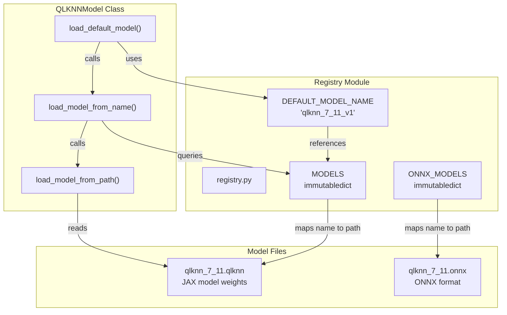
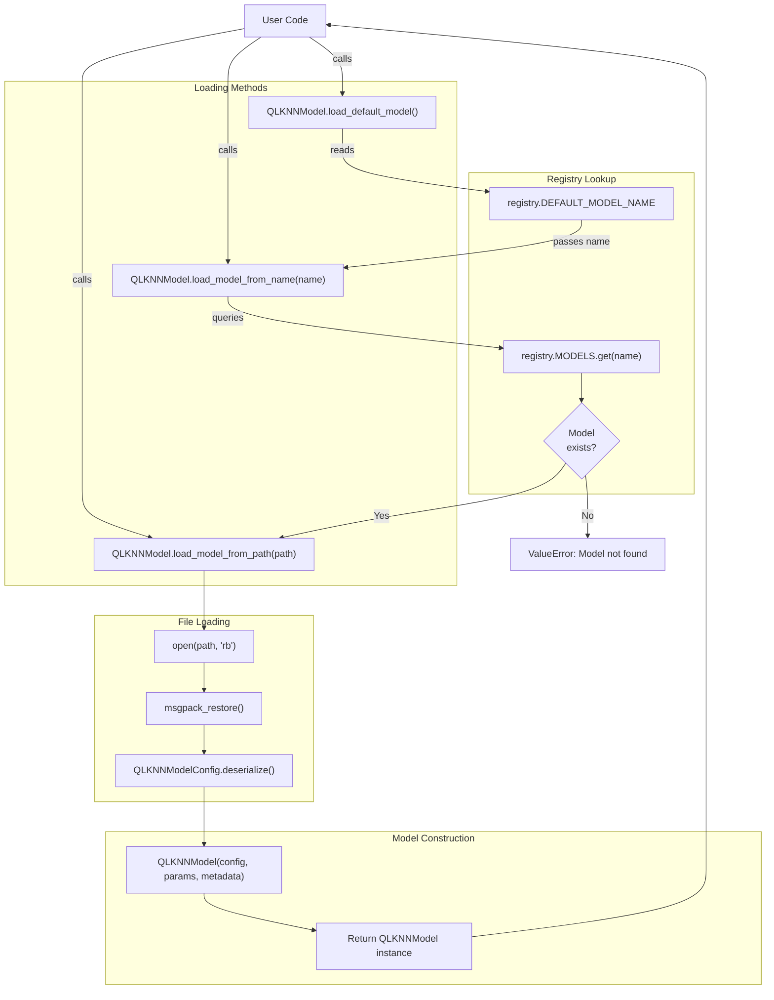
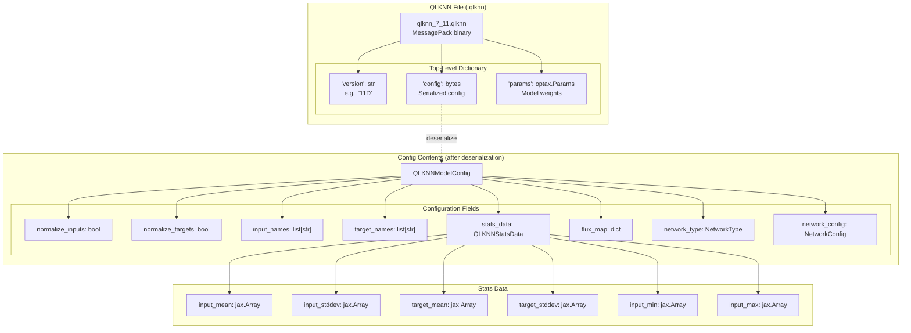
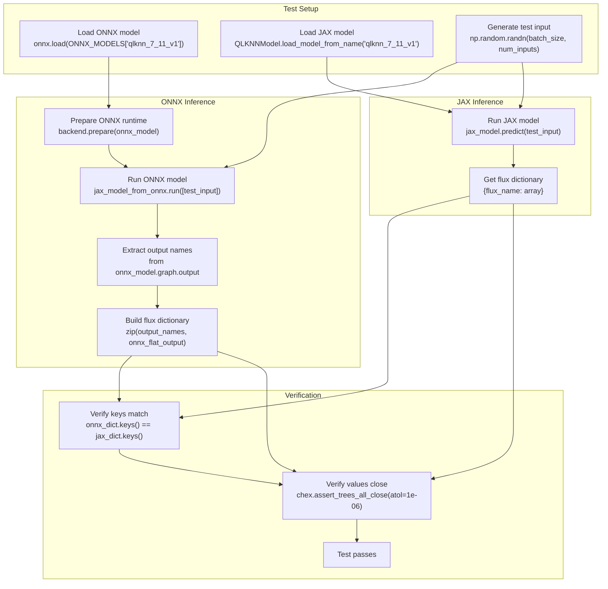

<!-- source: DeepWiki mcp.deepwiki.com · repo google-deepmind/fusion_surrogates · page 3.4 QLKNN Model Registry and ONNX Export · fetched 2026-10-26 -->

# QLKNN Model Registry and ONNX Export

<details>
<summary>Relevant source files</summary>

The following files were used as context for generating this wiki page:

- [fusion_surrogates/common/transforms.py](fusion_surrogates/common/transforms.py)
- [fusion_surrogates/qlknn/models/qlknn_7_11.onnx](fusion_surrogates/qlknn/models/qlknn_7_11.onnx)
- [fusion_surrogates/qlknn/models/qlknn_7_11_onnx_test.py](fusion_surrogates/qlknn/models/qlknn_7_11_onnx_test.py)
- [fusion_surrogates/qlknn/models/registry.py](fusion_surrogates/qlknn/models/registry.py)
- [fusion_surrogates/qlknn/qlknn_model.py](fusion_surrogates/qlknn/qlknn_model.py)
- [fusion_surrogates/qlknn/qlknn_model_test.py](fusion_surrogates/qlknn/qlknn_model_test.py)

</details>


## Purpose and Scope

This page documents the model registry system for QLKNN models and the ONNX export functionality. The registry provides a centralized mapping from model names to file paths, enabling simple model loading by name rather than explicit path specification. The ONNX export capability allows QLKNN models to be deployed in environments that support the ONNX standard, extending beyond JAX-based runtimes.

For information about the QLKNN model architecture and prediction workflow, see [QLKNN Overview and Architecture](#3.1). For details on using QLKNN models for inference, see [Using QLKNN Models](#3.3).

## Model Registry System

The model registry is implemented in [`fusion_surrogates/qlknn/models/registry.py`](fusion_surrogates/qlknn/models/registry.py:1-28) and provides a centralized location for managing available QLKNN models.

### Registry Structure

The registry consists of two immutable dictionaries and a default model constant:

| Registry Component | Type | Purpose |
|-------------------|------|---------|
| `MODELS` | `immutabledict` | Maps model names to `.qlknn` file paths for JAX models |
| `ONNX_MODELS` | `immutabledict` | Maps model names to `.onnx` file paths for ONNX models |
| `DEFAULT_MODEL_NAME` | `str` | Specifies the default model name (`'qlknn_7_11_v1'`) |

The registries use relative paths constructed from the registry file's location:

```python
MODELS = immutabledict.immutabledict({
    'qlknn_7_11_v1': f'{pathlib.Path(__file__).parent}/qlknn_7_11.qlknn',
})

ONNX_MODELS = immutabledict.immutabledict({
    'qlknn_7_11_v1': f'{pathlib.Path(__file__).parent}/qlknn_7_11.onnx',
})
```

This design ensures that model files bundled with the package are automatically discovered relative to the registry module location.

**Diagram: Model Registry Structure**



Sources: [fusion_surrogates/qlknn/models/registry.py:15-28](fusion_surrogates/qlknn/models/registry.py:15-28), [fusion_surrogates/qlknn/qlknn_model.py:371-407](fusion_surrogates/qlknn/qlknn_model.py:371-407)

### Model Name Resolution

The `QLKNNModel` class provides three methods for loading models:

1. **Load by name from registry**: [`load_model_from_name(model_name)`](fusion_surrogates/qlknn/qlknn_model.py:371-379)
   - Looks up the model name in `registry.MODELS`
   - Raises `ValueError` if the model name is not found
   - Passes the resolved path to `load_model_from_path()`

2. **Load by explicit path**: [`load_model_from_path(input_path, model_name=None)`](fusion_surrogates/qlknn/qlknn_model.py:382-401)
   - Loads a model from any file path
   - Does not require the model to be registered
   - Optionally accepts a model name for metadata purposes

3. **Load default model**: [`load_default_model()`](fusion_surrogates/qlknn/qlknn_model.py:404-406)
   - Loads the model specified by `registry.DEFAULT_MODEL_NAME`
   - Convenience method for the most common use case

**Diagram: Model Loading Flow**



Sources: [fusion_surrogates/qlknn/qlknn_model.py:371-407](fusion_surrogates/qlknn/qlknn_model.py:371-407), [fusion_surrogates/qlknn/models/registry.py:19-27](fusion_surrogates/qlknn/models/registry.py:19-27)

### Example Usage

```python
# Load by name from registry
model = QLKNNModel.load_model_from_name('qlknn_7_11_v1')

# Load default model
model = QLKNNModel.load_default_model()

# Load from custom path
model = QLKNNModel.load_model_from_path('/path/to/custom_model.qlknn')
```

Sources: [fusion_surrogates/qlknn/qlknn_model_test.py:156-162](fusion_surrogates/qlknn/qlknn_model_test.py:156-162)

## QLKNN File Format

QLKNN models are saved in a custom binary format with the `.qlknn` extension. This format uses MessagePack serialization for efficient storage and loading.

### File Structure

The `.qlknn` file contains a dictionary with three keys:

| Key | Type | Description |
|-----|------|-------------|
| `version` | `str` | Model version identifier (e.g., `'11D'`) |
| `config` | `bytes` | Serialized `QLKNNModelConfig` object |
| `params` | `optax.Params` | Model parameters (neural network weights) |

**Diagram: QLKNN File Format Structure**



Sources: [fusion_surrogates/qlknn/qlknn_model.py:359-368](fusion_surrogates/qlknn/qlknn_model.py:359-368), [fusion_surrogates/qlknn/qlknn_model.py:122-138](fusion_surrogates/qlknn/qlknn_model.py:122-138), [fusion_surrogates/qlknn/qlknn_model.py:46-71](fusion_surrogates/qlknn/qlknn_model.py:46-71)

### Serialization and Deserialization

The `QLKNNModelConfig` class provides methods for serialization and deserialization:

**Serialization** ([`QLKNNModelConfig.serialize()`](fusion_surrogates/qlknn/qlknn_model.py:135-138)):
- Converts the config to a dictionary using `dataclasses.asdict()`
- Converts `network_type` enum to its string value
- Uses `serialization.msgpack_serialize()` from Flax

**Deserialization** ([`QLKNNModelConfig.deserialize(serialized_config)`](fusion_surrogates/qlknn/qlknn_model.py:122-133)):
- Uses `serialization.msgpack_restore()` to convert bytes to dictionary
- Reconstructs `QLKNNStatsData` object from nested dictionary
- Converts `network_type` string back to enum
- Instantiates appropriate `NetworkConfig` subclass based on network type

### Exporting Models

The [`export_model(output_path, version=None)`](fusion_surrogates/qlknn/qlknn_model.py:359-368) method saves a model to disk:

```python
def export_model(self, output_path: str, version: str | None = None) -> None:
    if version is None:
        version = VERSION  # defaults to '11D'
    export_dict = {
        'version': version,
        'config': self._config.serialize(),
        'params': self._params,
    }
    with open(output_path, 'wb') as f:
        f.write(serialization.msgpack_serialize(export_dict))
```

Sources: [fusion_surrogates/qlknn/qlknn_model.py:359-368](fusion_surrogates/qlknn/qlknn_model.py:359-368), [fusion_surrogates/qlknn/qlknn_model.py:122-138](fusion_surrogates/qlknn/qlknn_model.py:122-138)

### Round-Trip Compatibility

The export and import process preserves model fidelity. The test suite verifies this:

```python
# Export model
orig_model.export_model(f.name, 'my_version')

# Import model
imported_model = QLKNNModel.load_model_from_path(f.name)

# Verify predictions match
orig_outputs = orig_model.predict_targets(inputs)
imported_outputs = imported_model.predict_targets(inputs)
# Arrays are equal
```

Sources: [fusion_surrogates/qlknn/qlknn_model_test.py:40-52](fusion_surrogates/qlknn/qlknn_model_test.py:40-52)

## ONNX Export and Cross-Platform Deployment

ONNX (Open Neural Network Exchange) is an open format for representing neural networks. QLKNN provides ONNX versions of models in the registry, enabling deployment in non-JAX environments.

### ONNX Model Registry

The `ONNX_MODELS` dictionary in [`registry.py`](fusion_surrogates/qlknn/models/registry.py:25-27) maps model names to ONNX file paths:

```python
ONNX_MODELS = immutabledict.immutabledict({
    'qlknn_7_11_v1': f'{pathlib.Path(__file__).parent}/qlknn_7_11.onnx',
})
```

These ONNX files are stored alongside the `.qlknn` files in the `fusion_surrogates/qlknn/models/` directory.

### ONNX Model Structure

The ONNX graph contains:
- **Inputs**: A single tensor of shape `(batch_size, num_inputs)` matching the JAX model
- **Outputs**: Multiple named tensors, one for each flux prediction
- **Operations**: The complete neural network computation graph

The output names in the ONNX graph match the flux names in `config.flux_map`, enabling dictionary-based output access consistent with the JAX interface.

**Diagram: ONNX Compatibility Testing Flow**



Sources: [fusion_surrogates/qlknn/models/qlknn_7_11_onnx_test.py:28-60](fusion_surrogates/qlknn/models/qlknn_7_11_onnx_test.py:28-60)

### Using ONNX Models

ONNX models can be loaded and executed using various runtimes. The test suite demonstrates usage with `jaxonnxruntime`:

```python
import onnx
from jaxonnxruntime import backend

# Load ONNX model
with open(registry.ONNX_MODELS["qlknn_7_11_v1"], "rb") as f:
    onnx_model = onnx.load(f.name)

# Prepare JAX-based ONNX runtime
jax_model_from_onnx = backend.prepare(onnx_model)

# Run inference
test_input = np.random.randn(batch_size, num_inputs).astype(np.float32)
onnx_flat_output = jax_model_from_onnx.run([test_input])

# Extract output names and build dictionary
output_names = [node.name for node in onnx_model.graph.output]
onnx_dict_output = dict(zip(output_names, onnx_flat_output))
```

Sources: [fusion_surrogates/qlknn/models/qlknn_7_11_onnx_test.py:28-60](fusion_surrogates/qlknn/models/qlknn_7_11_onnx_test.py:28-60)

### Compatibility Guarantees

The ONNX test suite ([`qlknn_7_11_onnx_test.py`](fusion_surrogates/qlknn/models/qlknn_7_11_onnx_test.py)) verifies:

1. **Output name consistency**: ONNX output names match JAX flux names
2. **Numerical accuracy**: ONNX predictions match JAX predictions within tolerance (atol=1e-06)
3. **Shape compatibility**: ONNX models accept the same input shapes as JAX models

This ensures that ONNX models can be used as drop-in replacements for JAX models in production environments where ONNX is preferred or required.

### Deployment Scenarios

ONNX models enable deployment in:

| Environment | Runtime | Use Case |
|-------------|---------|----------|
| C++ applications | ONNX Runtime | Integration with legacy fusion codes |
| Python (non-JAX) | ONNX Runtime | Environments without JAX dependencies |
| Web browsers | ONNX.js | Browser-based plasma simulation tools |
| Mobile devices | ONNX Runtime Mobile | Edge computing scenarios |
| Hardware accelerators | Specialized ONNX backends | Optimized inference on specific hardware |

The ONNX format provides portability across these diverse deployment targets while maintaining numerical consistency with the reference JAX implementation.

Sources: [fusion_surrogates/qlknn/models/qlknn_7_11_onnx_test.py:1-64](fusion_surrogates/qlknn/models/qlknn_7_11_onnx_test.py:1-64), [fusion_surrogates/qlknn/models/registry.py:25-27](fusion_surrogates/qlknn/models/registry.py:25-27)

## Summary

The QLKNN model registry and ONNX export system provide:

1. **Centralized model management**: The registry maps model names to file paths, simplifying model loading
2. **Flexible loading options**: Load by name, by path, or load the default model
3. **Custom serialization format**: The `.qlknn` format efficiently stores model configuration and weights
4. **Cross-platform deployment**: ONNX exports enable deployment beyond JAX environments
5. **Verified compatibility**: Test suite ensures ONNX models produce identical outputs to JAX models

This infrastructure enables both convenient development workflows (using the registry) and flexible production deployments (using ONNX).

---

