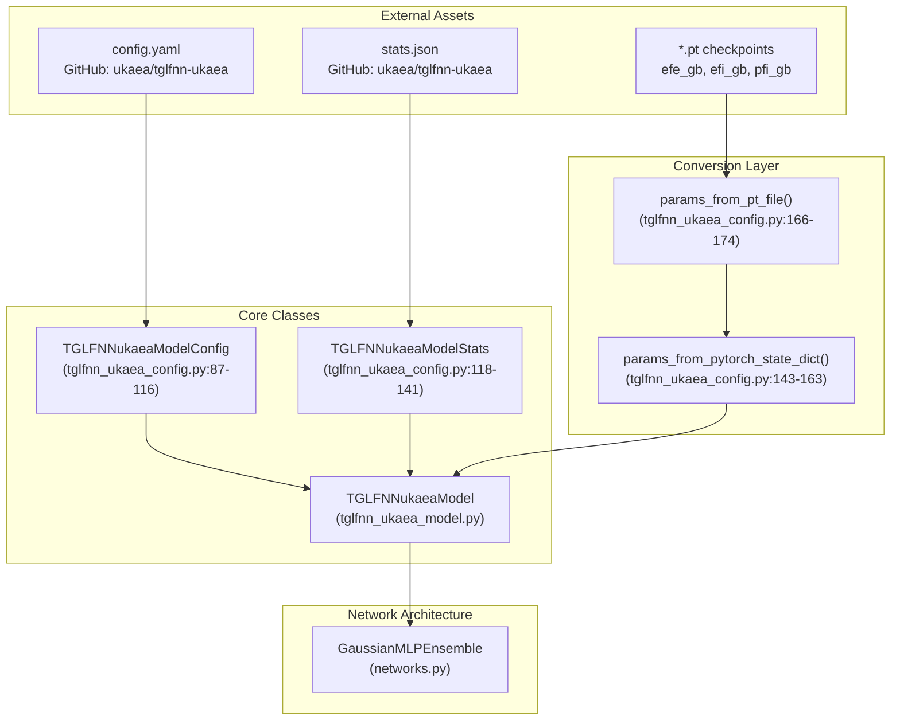
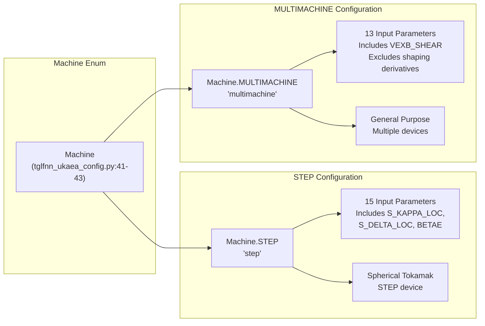
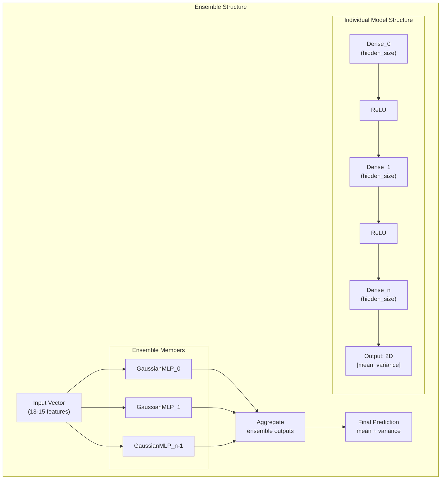
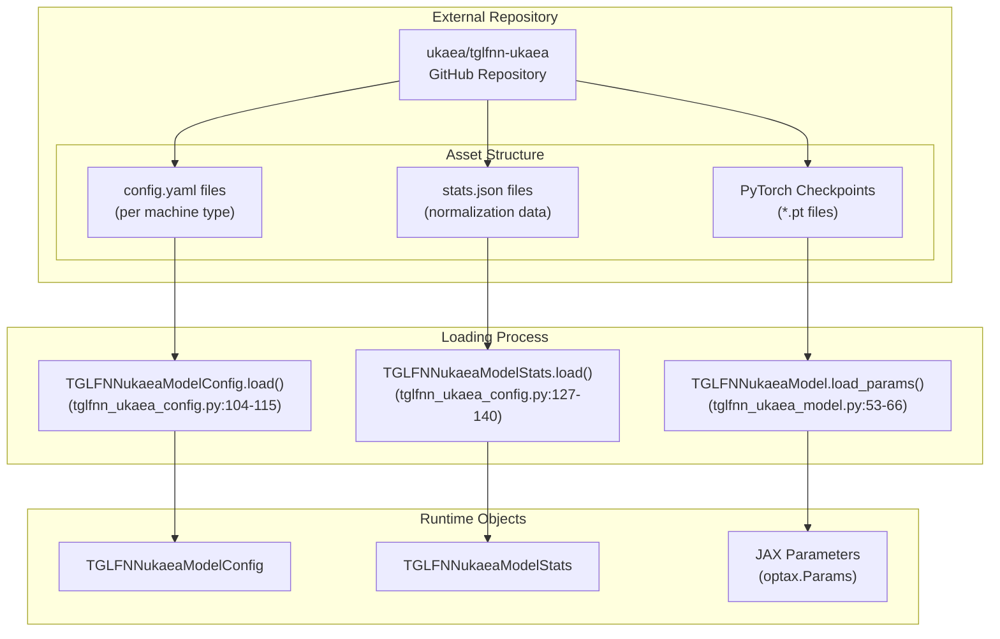
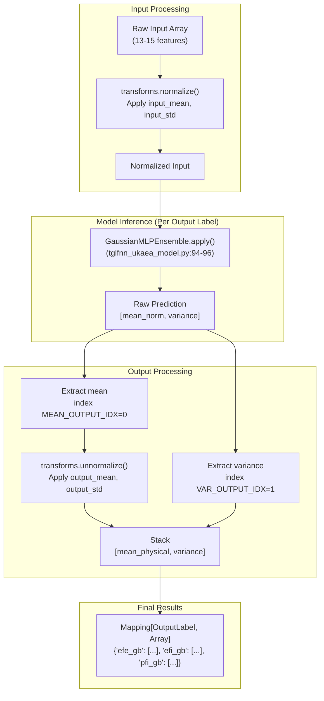
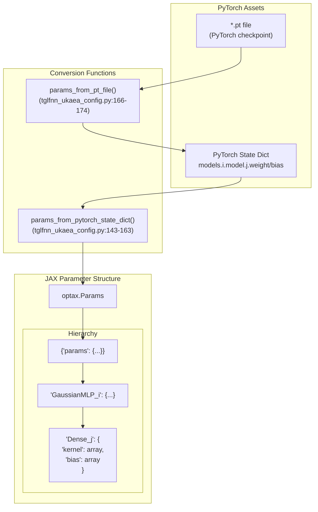

<!-- source: DeepWiki mcp.deepwiki.com · repo google-deepmind/fusion_surrogates · page 4 TGLFNN-UKAEA Model System · fetched 2026-10-26 -->

# TGLFNN-UKAEA Model System

<details>
<summary>Relevant source files</summary>

The following files were used as context for generating this wiki page:

- [fusion_surrogates/tglfnn_ukaea/README.md](fusion_surrogates/tglfnn_ukaea/README.md)
- [fusion_surrogates/tglfnn_ukaea/__init__.py](fusion_surrogates/tglfnn_ukaea/__init__.py)
- [fusion_surrogates/tglfnn_ukaea/tglfnn_ukaea_config.py](fusion_surrogates/tglfnn_ukaea/tglfnn_ukaea_config.py)
- [fusion_surrogates/tglfnn_ukaea/tglfnn_ukaea_model.py](fusion_surrogates/tglfnn_ukaea/tglfnn_ukaea_model.py)

</details>


## Purpose and Scope

This document provides a comprehensive overview of the TGLFNN-UKAEA (TGLF Neural Network - UK Atomic Energy Authority) surrogate model system. TGLFNN-UKAEA is a neural network surrogate for the TGLF (Trapped Gyro-Landau Fluid) gyrokinetic turbulent transport code, providing fast predictions of electron and ion energy fluxes in tokamak plasmas.

The TGLFNN-UKAEA system differs from QLKNN (see [QLKNN Model System](#3)) in its use of **Gaussian ensemble predictions** for uncertainty quantification, its **external asset management** via GitHub, and its specialized configurations for different experimental machines.

For detailed information on specific aspects:
- Architecture details and GaussianMLP ensembles: see [TGLFNN Overview and Architecture](#4.1)
- Machine-specific configurations and input parameters: see [TGLFNN Machine Types and Configuration](#4.2)
- Practical usage instructions: see [Using TGLFNN Models](#4.3)
- PyTorch checkpoint loading: see [PyTorch to JAX Model Conversion](#4.4)

## System Overview

The TGLFNN-UKAEA system provides machine learning surrogates trained on TGLF simulation data to predict gyro-Bohm normalized fluxes. Unlike QLKNN which bundles model files with the library, TGLFNN-UKAEA stores its model weights, configurations, and normalization statistics in an external GitHub repository at [ukaea/tglfnn-ukaea](https://github.com/ukaea/tglfnn-ukaea).

### Key Characteristics

| Characteristic | Description |
|----------------|-------------|
| **Physics Code** | TGLF (Trapped Gyro-Landau Fluid) |
| **Output Quantities** | `efe_gb`, `efi_gb`, `pfi_gb` (gyro-Bohm normalized fluxes) |
| **Architecture** | `GaussianMLPEnsemble` with mean and variance outputs |
| **Machine Types** | `STEP` (spherical tokamak), `MULTIMACHINE` (general) |
| **Input Count** | 13-15 parameters (machine-dependent) |
| **Output Count** | 3 flux predictions, each with mean and variance |
| **Asset Storage** | External GitHub repository |
| **Checkpoint Format** | PyTorch `.pt` files converted to JAX at runtime |

Sources: [fusion_surrogates/tglfnn_ukaea/README.md:1-8](), [fusion_surrogates/tglfnn_ukaea/tglfnn_ukaea_config.py:37-38]()

## Core Components

The TGLFNN-UKAEA system consists of three primary Python classes that work together to provide surrogate model predictions:



### Component Responsibilities

| Component | File | Responsibility |
|-----------|------|----------------|
| `TGLFNNukaeaModel` | [tglfnn_ukaea_model.py:31-109]() | Main inference engine, manages predictions |
| `TGLFNNukaeaModelConfig` | [tglfnn_ukaea_config.py:86-116]() | Stores architecture parameters (`n_ensemble`, `num_hiddens`, `hidden_size`) |
| `TGLFNNukaeaModelStats` | [tglfnn_ukaea_config.py:118-141]() | Stores normalization statistics (mean/std for inputs and outputs) |
| `GaussianMLPEnsemble` | networks.py | Neural network architecture with uncertainty quantification |
| `params_from_pt_file` | [tglfnn_ukaea_config.py:166-174]() | Loads PyTorch checkpoints and converts to JAX parameters |

Sources: [fusion_surrogates/tglfnn_ukaea/tglfnn_ukaea_model.py:31-109](), [fusion_surrogates/tglfnn_ukaea/tglfnn_ukaea_config.py:86-141]()

## Machine Configurations

TGLFNN-UKAEA provides two distinct machine configurations, each trained on different experimental datasets and requiring different input parameters. The `Machine` enum defines these configurations:



### Input Parameter Comparison

| Parameter | STEP | MULTIMACHINE | Description |
|-----------|------|--------------|-------------|
| `RLNS_1` | ✓ | ✓ | Density gradient scale length |
| `RLTS_1` | ✓ | ✓ | Electron temperature gradient scale length |
| `RLTS_2` | ✓ | ✓ | Ion temperature gradient scale length |
| `TAUS_2` | ✓ | ✓ | Ion-to-electron temperature ratio |
| `RMIN_LOC` | ✓ | ✓ | Local minor radius |
| `DRMAJDX_LOC` | ✓ | ✓ | Radial derivative of major radius |
| `Q_LOC` | ✓ | ✓ | Safety factor |
| `SHAT` | ✓ | ✓ | Magnetic shear |
| `XNUE` | ✓ | ✓ | Electron collision frequency |
| `KAPPA_LOC` | ✓ | ✓ | Elongation |
| `S_KAPPA_LOC` | ✓ | ✗ | Shear in elongation |
| `DELTA_LOC` | ✓ | ✓ | Triangularity |
| `S_DELTA_LOC` | ✓ | ✗ | Shear in triangularity |
| `BETAE` | ✓ | ✗ | Electron beta |
| `ZEFF` | ✓ | ✓ | Effective ion charge |
| `VEXB_SHEAR` | ✗ | ✓ | E×B shearing rate |

The input labels are defined in `INPUT_LABELS_DICT` at [tglfnn_ukaea_config.py:46-83]().

### Output Parameters (All Configurations)

All machine configurations predict the same three output quantities, defined in [tglfnn_ukaea_config.py:37-38]():

| Output Label | Description |
|--------------|-------------|
| `efe_gb` | Electron energy flux (gyro-Bohm normalized) |
| `efi_gb` | Ion energy flux (gyro-Bohm normalized) |
| `pfi_gb` | Ion particle flux (gyro-Bohm normalized) |

Each output includes both a **mean prediction** and a **variance estimate** for uncertainty quantification.

Sources: [fusion_surrogates/tglfnn_ukaea/tglfnn_ukaea_config.py:41-83]()

## Model Architecture

TGLFNN-UKAEA uses a `GaussianMLPEnsemble` architecture, which consists of multiple Gaussian Multi-Layer Perceptrons that provide both mean predictions and variance estimates:



### Architecture Parameters

The configuration parameters defined in `TGLFNNukaeaModelConfig` [tglfnn_ukaea_config.py:86-116]() control the ensemble structure:

| Parameter | Type | Description |
|-----------|------|-------------|
| `n_ensemble` | `int` | Number of ensemble members |
| `num_hiddens` | `int` | Number of hidden layers per model |
| `hidden_size` | `int` | Width of each hidden layer |
| `dropout` | `float` | Dropout rate (used during training, not inference) |
| `activation` | `str` | Activation function (hardcoded to `"relu"` in [tglfnn_ukaea_model.py:50]()) |

The `GaussianMLPEnsemble` network is instantiated at [tglfnn_ukaea_model.py:45-51]() and applies the network for each output label separately.

### Output Structure

Each flux prediction returns a 2D output where:
- Index `0` (`MEAN_OUTPUT_IDX`): Mean prediction
- Index `1` (`VAR_OUTPUT_IDX`): Variance estimate

These indices are defined at [tglfnn_ukaea_config.py:34-35]().

Sources: [fusion_surrogates/tglfnn_ukaea/tglfnn_ukaea_model.py:45-51](), [fusion_surrogates/tglfnn_ukaea/tglfnn_ukaea_config.py:86-116]()

## External Asset Management

Unlike QLKNN which bundles model files with the Python package, TGLFNN-UKAEA stores all model assets externally on GitHub. This design decision allows for independent versioning of models and code.



### Asset File Types

| File Type | Purpose | Loader Method |
|-----------|---------|---------------|
| `config.yaml` | Architecture configuration (`num_estimators`, `model_size`, `hidden_size`, `dropout`) | `TGLFNNukaeaModelConfig.load()` [tglfnn_ukaea_config.py:104-115]() |
| `stats.json` | Input/output normalization statistics (mean and std for each parameter) | `TGLFNNukaeaModelStats.load()` [tglfnn_ukaea_config.py:127-140]() |
| `efe_gb.pt` | PyTorch checkpoint for electron energy flux prediction | `TGLFNNukaeaModel.load_params()` [tglfnn_ukaea_model.py:53-66]() |
| `efi_gb.pt` | PyTorch checkpoint for ion energy flux prediction | `TGLFNNukaeaModel.load_params()` [tglfnn_ukaea_model.py:53-66]() |
| `pfi_gb.pt` | PyTorch checkpoint for ion particle flux prediction | `TGLFNNukaeaModel.load_params()` [tglfnn_ukaea_model.py:53-66]() |

### Repository Structure

The external repository follows this structure:
```
ukaea/tglfnn-ukaea/
├── step/
│   ├── config.yaml
│   ├── stats.json
│   ├── efe_gb.pt
│   ├── efi_gb.pt
│   └── pfi_gb.pt
└── multimachine/
    ├── config.yaml
    ├── stats.json
    ├── efe_gb.pt
    ├── efi_gb.pt
    └── pfi_gb.pt
```

Users must clone or download assets from this repository before using TGLFNN-UKAEA models.

Sources: [fusion_surrogates/tglfnn_ukaea/README.md:7-8](), [fusion_surrogates/tglfnn_ukaea/tglfnn_ukaea_model.py:53-66]()

## Prediction Workflow

The TGLFNN-UKAEA prediction workflow consists of several steps that transform raw plasma parameters into normalized flux predictions with uncertainty estimates:



### Workflow Steps

1. **Input Normalization** [tglfnn_ukaea_model.py:85-89]()
   - Raw inputs are normalized using `transforms.normalize()` with `input_mean` and `input_std` from `TGLFNNukaeaModelStats`
   - Transforms inputs to zero mean and unit standard deviation

2. **Network Application** [tglfnn_ukaea_model.py:93-96]()
   - For each output label (`efe_gb`, `efi_gb`, `pfi_gb`), the `GaussianMLPEnsemble.apply()` method is called
   - Uses the corresponding parameters from `self._params[label]`
   - `deterministic=True` disables dropout during inference

3. **Output Extraction** [tglfnn_ukaea_model.py:98-104]()
   - Mean prediction extracted at `MEAN_OUTPUT_IDX` (index 0)
   - Variance prediction extracted at `VAR_OUTPUT_IDX` (index 1)

4. **Mean Denormalization** [tglfnn_ukaea_model.py:98-102]()
   - Only the mean prediction is denormalized using `transforms.unnormalize()` with `output_mean[i]` and `output_std[i]`
   - Variance remains in normalized space

5. **Result Assembly** [tglfnn_ukaea_model.py:104-107]()
   - Mean and variance are stacked into a single array
   - Results are stored in a dictionary mapping output labels to predictions

### Key Implementation Details

| Aspect | Implementation |
|--------|----------------|
| **Normalization** | Uses shared `transforms.normalize()` function |
| **Denormalization** | Uses shared `transforms.unnormalize()` function |
| **Per-label Inference** | Separate network parameters for each of the 3 output fluxes |
| **Variance Handling** | Variance is NOT denormalized, stays in normalized space |
| **Deterministic Mode** | `deterministic=True` flag disables dropout |

Sources: [fusion_surrogates/tglfnn_ukaea/tglfnn_ukaea_model.py:68-109]()

## PyTorch to JAX Conversion

TGLFNN-UKAEA models are trained in PyTorch but deployed in JAX. The conversion process is handled by two functions that translate PyTorch state dictionaries into JAX parameter structures:



### Conversion Process

The conversion happens in two stages:

#### Stage 1: File Loading [tglfnn_ukaea_config.py:166-174]()

`params_from_pt_file(checkpoint_path, config, map_location="cpu")`:
- Opens the `.pt` file
- Uses `torch.load()` to read the checkpoint
- Passes the state dictionary to the conversion function

#### Stage 2: Parameter Translation [tglfnn_ukaea_config.py:143-163]()

`params_from_pytorch_state_dict(pytorch_state_dict, config)`:
- Iterates over `n_ensemble` models
- For each ensemble member `i`:
  - Iterates over `num_hiddens` layers
  - For each layer `j`:
    - Extracts weights from `models.{i}.model.{j*3}.weight`
    - Extracts biases from `models.{i}.model.{j*3}.bias`
    - **Transposes weight matrix** (`.T`) to convert from PyTorch to JAX convention
    - Stores as `kernel` and `bias` in JAX format

### Parameter Structure Mapping

| PyTorch Key | JAX Key | Transformation |
|-------------|---------|----------------|
| `models.{i}.model.{j*3}.weight` | `params/GaussianMLP_{i}/Dense_{j}/kernel` | Transpose (`.T`) |
| `models.{i}.model.{j*3}.bias` | `params/GaussianMLP_{i}/Dense_{j}/bias` | Transpose (`.T`) |

The multiplication by `3` in the PyTorch key (`j*3`) accounts for the fact that PyTorch models may include additional layers (e.g., activations, dropout) between dense layers that are not explicitly represented in the JAX parameter structure.

### Usage Example

```python
# Load a checkpoint for a specific output
params = tglfnn_ukaea_config.params_from_pt_file(
    checkpoint_path="path/to/efe_gb.pt",
    config=config,
    map_location="cpu"
)
# Returns: {'params': {'GaussianMLP_0': {...}, 'GaussianMLP_1': {...}, ...}}
```

The `load_params()` method [tglfnn_ukaea_model.py:53-66]() uses this function internally to load all three output checkpoints (`efe_gb.pt`, `efi_gb.pt`, `pfi_gb.pt`).

Sources: [fusion_surrogates/tglfnn_ukaea/tglfnn_ukaea_config.py:143-174]()

## Summary

The TGLFNN-UKAEA model system provides fast, uncertainty-aware predictions of turbulent transport fluxes for tokamak simulations. Key features include:

- **Two machine configurations**: `STEP` for spherical tokamaks, `MULTIMACHINE` for general-purpose applications
- **Gaussian ensemble architecture**: Provides both mean predictions and uncertainty estimates
- **External asset management**: Model files hosted on GitHub for independent versioning
- **PyTorch-to-JAX conversion**: Seamless loading of PyTorch-trained models into JAX runtime
- **Three output fluxes**: Electron energy, ion energy, and ion particle fluxes in gyro-Bohm normalization

For implementation details, see:
- [TGLFNN Overview and Architecture](#4.1) for architectural deep dive
- [TGLFNN Machine Types and Configuration](#4.2) for configuration details
- [Using TGLFNN Models](#4.3) for practical usage examples
- [PyTorch to JAX Model Conversion](#4.4) for conversion mechanics

Sources: [fusion_surrogates/tglfnn_ukaea/tglfnn_ukaea_model.py:1-109](), [fusion_surrogates/tglfnn_ukaea/tglfnn_ukaea_config.py:1-175](), [fusion_surrogates/tglfnn_ukaea/README.md:1-8]()

---

