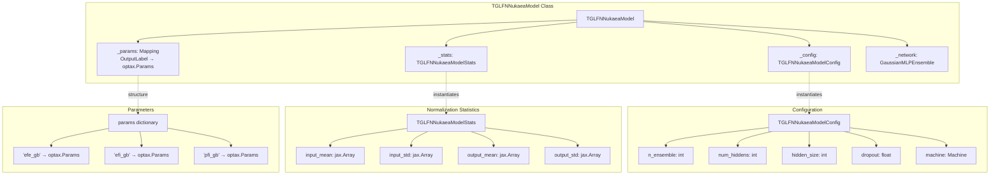
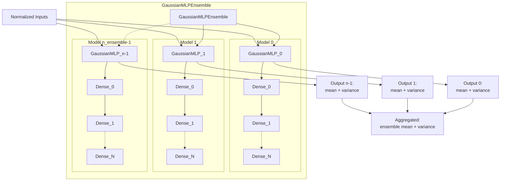
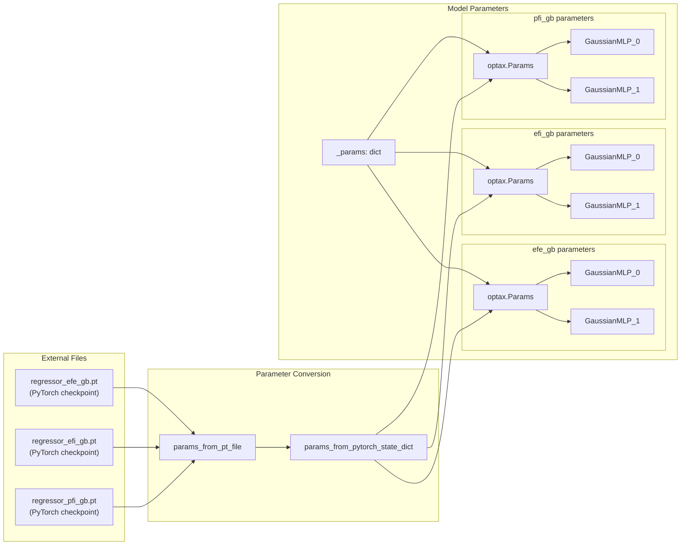
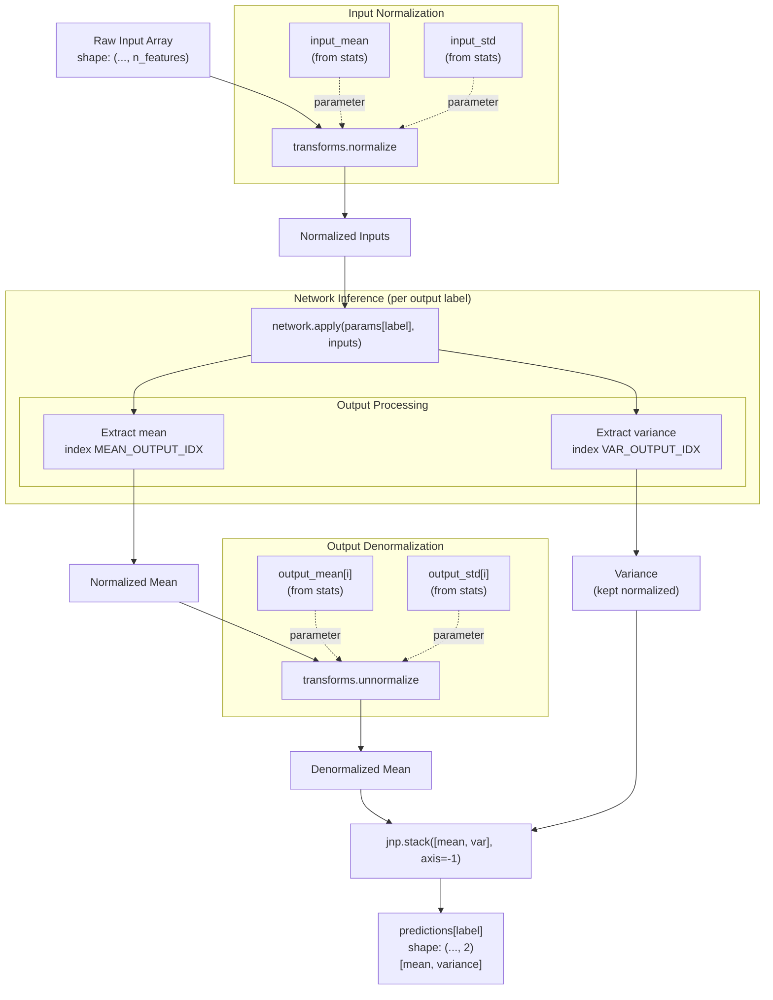
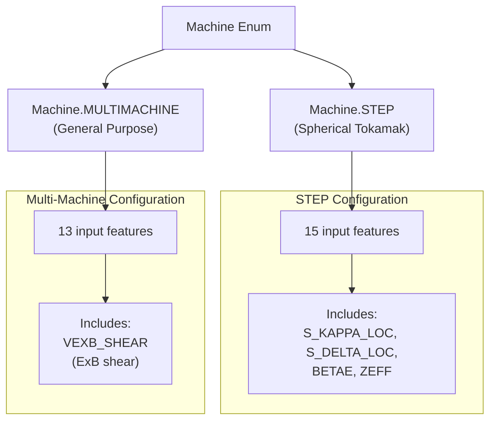
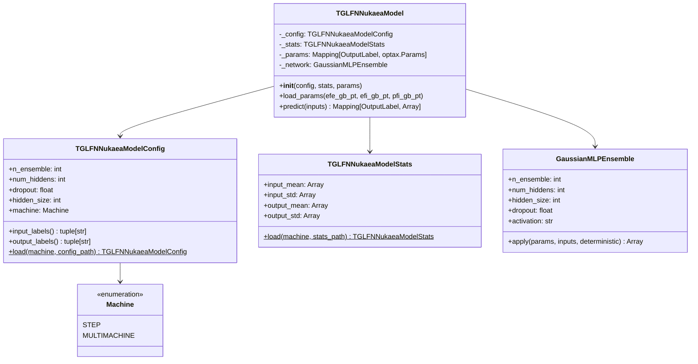

<!-- source: DeepWiki mcp.deepwiki.com · repo google-deepmind/fusion_surrogates · page 4.1 TGLFNN Overview and Architecture · fetched 2026-10-26 -->

# TGLFNN Overview and Architecture

Relevant source files

The following files were used as context for generating this wiki page:

- [fusion_surrogates/tglfnn_ukaea/README.md](fusion_surrogates/tglfnn_ukaea/README.md)
- [fusion_surrogates/tglfnn_ukaea/__init__.py](fusion_surrogates/tglfnn_ukaea/__init__.py)
- [fusion_surrogates/tglfnn_ukaea/tglfnn_ukaea_config.py](fusion_surrogates/tglfnn_ukaea/tglfnn_ukaea_config.py)
- [fusion_surrogates/tglfnn_ukaea/tglfnn_ukaea_model.py](fusion_surrogates/tglfnn_ukaea/tglfnn_ukaea_model.py)
- [fusion_surrogates/tglfnn_ukaea/tglfnn_ukaea_model_test.py](fusion_surrogates/tglfnn_ukaea/tglfnn_ukaea_model_test.py)

## Purpose and Scope

This document describes the TGLFNN-UKAEA surrogate model architecture, its neural network design based on Gaussian MLP ensembles, and how it relates to the UKAEA TGLF (Trapped Gyro-Landau Fluid) physics code. This page covers the conceptual design and implementation structure. For configuration details and machine-specific variants, see [TGLFNN Machine Types and Configuration](#4.2). For practical usage instructions, see [Using TGLFNN Models](#4.3). For PyTorch checkpoint loading mechanics, see [PyTorch to JAX Model Conversion](#4.4).

---

## What is TGLFNN-UKAEA

TGLFNN-UKAEA is a neural network surrogate for the TGLF (Trapped Gyro-Landau Fluid) turbulent transport model developed by the UK Atomic Energy Authority (UKAEA). TGLF is a quasi-linear gyrokinetic transport model that calculates particle and energy fluxes in tokamak plasmas. The neural network surrogate replicates TGLF predictions at a fraction of the computational cost, enabling its use in real-time plasma control and fast transport simulations.

Unlike QLKNN (see [QLKNN Overview and Architecture](#3.1)), which predicts mode-specific fluxes from the QuaLiKiz code, TGLFNN predicts gyro-Bohm normalized fluxes directly:

| Output Label | Physical Quantity |
|-------------|-------------------|
| `efe_gb` | Electron heat flux (gyro-Bohm normalized) |
| `efi_gb` | Ion heat flux (gyro-Bohm normalized) |
| `pfi_gb` | Ion particle flux (gyro-Bohm normalized) |

The TGLFNN implementation is JAX-based but loads weights from PyTorch checkpoints stored in the external repository [ukaea/tglfnn-ukaea](https://github.com/ukaea/tglfnn-ukaea).

**Sources:** [fusion_surrogates/tglfnn_ukaea/README.md:1-8](), [fusion_surrogates/tglfnn_ukaea/tglfnn_ukaea_config.py:37-38]()

---

## Model Architecture Overview

**TGLFNN Model Component Architecture**

The `TGLFNNukaeaModel` class orchestrates four main components:

1. **Configuration** (`TGLFNNukaeaModelConfig`): Defines the ensemble size, layer count, hidden dimensions, and target machine type
2. **Statistics** (`TGLFNNukaeaModelStats`): Stores normalization parameters for inputs and outputs
3. **Parameters** (mapping): Separate neural network weights for each output label (`efe_gb`, `efi_gb`, `pfi_gb`)
4. **Network** (`GaussianMLPEnsemble`): The shared network architecture applied to all outputs

**Sources:** [fusion_surrogates/tglfnn_ukaea/tglfnn_ukaea_model.py:31-51](), [fusion_surrogates/tglfnn_ukaea/tglfnn_ukaea_config.py:86-115]()

---

## GaussianMLPEnsemble Architecture

The neural network architecture is a `GaussianMLPEnsemble`, which consists of multiple `GaussianMLP` models that each predict both a mean and variance. This ensemble approach enables uncertainty quantification.

**GaussianMLPEnsemble Structure**

### Network Configuration

Each `GaussianMLPEnsemble` is configured with:

| Parameter | Description | Typical Value |
|-----------|-------------|---------------|
| `n_ensemble` | Number of independent models | Loaded from config |
| `num_hiddens` | Number of hidden layers per model | Loaded from config |
| `hidden_size` | Neurons per hidden layer | Loaded from config |
| `dropout` | Dropout rate (training only) | Loaded from config |
| `activation` | Activation function | `"relu"` |

### Output Structure

Each individual `GaussianMLP` model produces two outputs:
- **Index 0** (`MEAN_OUTPUT_IDX`): Mean prediction
- **Index 1** (`VAR_OUTPUT_IDX`): Variance (uncertainty) estimate

The ensemble aggregates these individual predictions to provide a final mean and uncertainty estimate.

**Sources:** [fusion_surrogates/tglfnn_ukaea/tglfnn_ukaea_model.py:45-51](), [fusion_surrogates/tglfnn_ukaea/tglfnn_ukaea_config.py:34-35](), [fusion_surrogates/common/networks.py]() (referenced in imports)

---

## Parameter Structure and Loading

TGLFNN maintains separate neural network parameters for each output label. The parameters are loaded from PyTorch checkpoint files (`.pt`) and converted to JAX format.

**Parameter Loading and Conversion Pipeline**

The `load_params` method takes three PyTorch checkpoint paths and converts each to JAX parameters:

1. Calls `params_from_pt_file` for each checkpoint
2. `params_from_pt_file` loads the PyTorch state dict using `torch.load`
3. `params_from_pytorch_state_dict` transforms the structure:
   - PyTorch: `models.{i}.model.{j*3}.weight` and `bias`
   - JAX: `params/GaussianMLP_{i}/Dense_{j}/kernel` and `bias`
4. Weight matrices are transposed (PyTorch uses `[out, in]`, JAX uses `[in, out]`)

**Sources:** [fusion_surrogates/tglfnn_ukaea/tglfnn_ukaea_model.py:53-66](), [fusion_surrogates/tglfnn_ukaea/tglfnn_ukaea_config.py:143-174]()

---

## Prediction Pipeline

**TGLFNN Prediction Data Flow**

The `predict` method implements the following steps:

1. **Input Normalization**: Scale raw inputs using `input_mean` and `input_std` from `TGLFNNukaeaModelStats`
2. **Network Application**: For each output label (`efe_gb`, `efi_gb`, `pfi_gb`):
   - Apply the `GaussianMLPEnsemble` with corresponding parameters
   - Extract mean and variance from the network output
3. **Output Denormalization**: Scale only the mean predictions using `output_mean[i]` and `output_std[i]`
4. **Result Stacking**: Stack denormalized mean and (normalized) variance into final output

Note that variance remains in normalized space and is not denormalized, as it represents uncertainty in the normalized prediction space.

**Sources:** [fusion_surrogates/tglfnn_ukaea/tglfnn_ukaea_model.py:68-108]()

---

## Machine Type Configuration

The `Machine` enum defines two variants of TGLFNN:

**Machine Type Variants**

The `Machine` enum determines which input features are expected:

- **`Machine.STEP`**: 15 inputs including geometric shaping derivatives (`S_KAPPA_LOC`, `S_DELTA_LOC`) and electromagnetic parameters (`BETAE`)
- **`Machine.MULTIMACHINE`**: 13 inputs with `VEXB_SHEAR` (ExB velocity shear) instead of geometric derivatives

Both configurations predict the same three output labels: `efe_gb`, `efi_gb`, `pfi_gb`.

**Sources:** [fusion_surrogates/tglfnn_ukaea/tglfnn_ukaea_config.py:41-83]()

---

## Relationship to UKAEA TGLF

TGLFNN-UKAEA is a surrogate that approximates the behavior of the TGLF (Trapped Gyro-Landau Fluid) physics code developed by UKAEA. The relationship is:

| Aspect | TGLF (Original Code) | TGLFNN-UKAEA (Surrogate) |
|--------|---------------------|--------------------------|
| **Purpose** | Quasi-linear gyrokinetic transport calculation | Fast neural network approximation |
| **Speed** | Computationally expensive (~seconds per evaluation) | Fast inference (~milliseconds) |
| **Outputs** | Detailed turbulent transport quantities | Gyro-Bohm normalized fluxes |
| **Training** | N/A | Trained on TGLF simulation database |
| **Uncertainty** | Deterministic | Provides uncertainty estimates via ensemble |

The neural network was trained on a database of TGLF simulations covering diverse plasma conditions. The ensemble architecture allows TGLFNN to provide uncertainty estimates alongside predictions, indicating when the surrogate may be less reliable (e.g., far from training data).

Model weights and configuration files are maintained in the separate repository [ukaea/tglfnn-ukaea](https://github.com/ukaea/tglfnn-ukaea), not bundled with this library.

**Sources:** [fusion_surrogates/tglfnn_ukaea/README.md:1-8]()

---

## Class Hierarchy Summary

**TGLFNN Class Relationships**

**Sources:** [fusion_surrogates/tglfnn_ukaea/tglfnn_ukaea_model.py:31-108](), [fusion_surrogates/tglfnn_ukaea/tglfnn_ukaea_config.py:41-140]()

---

