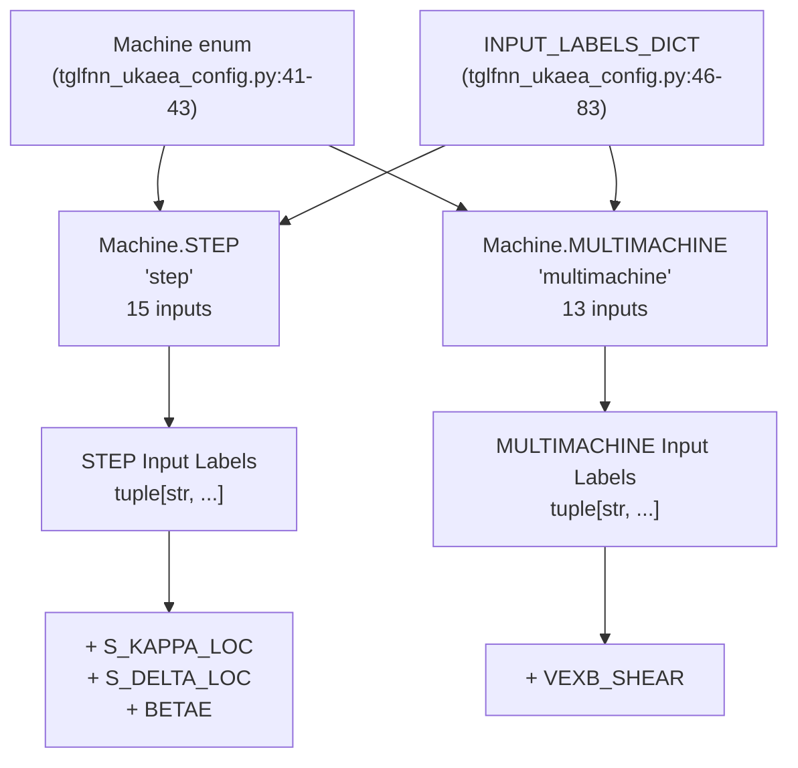
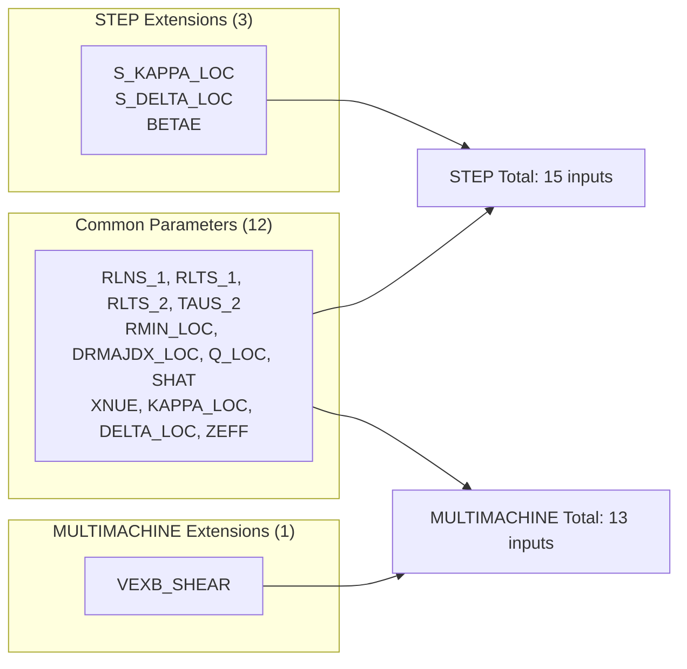
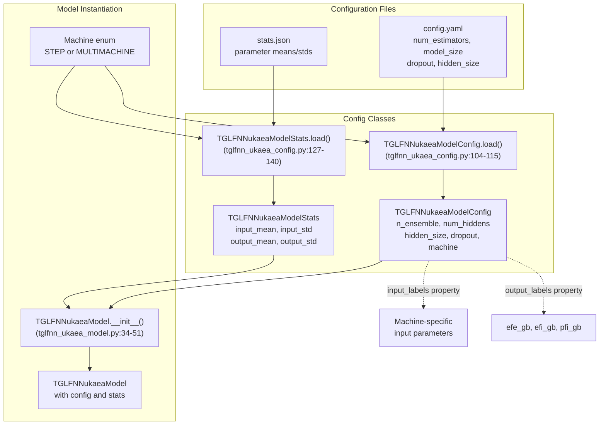
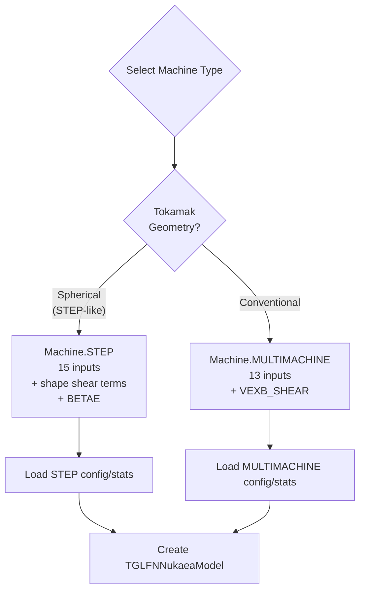

<!-- source: DeepWiki mcp.deepwiki.com · repo google-deepmind/fusion_surrogates · page 4.2 TGLFNN Machine Types and Configuration · fetched 2026-10-26 -->

# TGLFNN Machine Types and Configuration

<details>
<summary>Relevant source files</summary>

The following files were used as context for generating this wiki page:

- [fusion_surrogates/tglfnn_ukaea/README.md](fusion_surrogates/tglfnn_ukaea/README.md)
- [fusion_surrogates/tglfnn_ukaea/__init__.py](fusion_surrogates/tglfnn_ukaea/__init__.py)
- [fusion_surrogates/tglfnn_ukaea/test_data/config.yaml](fusion_surrogates/tglfnn_ukaea/test_data/config.yaml)
- [fusion_surrogates/tglfnn_ukaea/test_data/dummy_torch_checkpoint.pt](fusion_surrogates/tglfnn_ukaea/test_data/dummy_torch_checkpoint.pt)
- [fusion_surrogates/tglfnn_ukaea/test_data/stats.json](fusion_surrogates/tglfnn_ukaea/test_data/stats.json)
- [fusion_surrogates/tglfnn_ukaea/tglfnn_ukaea_config.py](fusion_surrogates/tglfnn_ukaea/tglfnn_ukaea_config.py)
- [fusion_surrogates/tglfnn_ukaea/tglfnn_ukaea_model.py](fusion_surrogates/tglfnn_ukaea/tglfnn_ukaea_model.py)

</details>


## Purpose and Scope

This page documents the machine-specific configuration system for TGLFNN-UKAEA surrogate models. TGLFNN supports two distinct machine types with different input parameter sets tailored to specific tokamak geometries and experimental scenarios. This document details the configuration classes, input/output specifications, and normalization statistics for each machine type.

For practical usage of TGLFNN models with these configurations, see [Using TGLFNN Models](#4.3). For information about the underlying neural network architecture, see [TGLFNN Overview and Architecture](#4.1).

---

## Machine Type Enumeration

The TGLFNN system defines two machine types through the `Machine` enum:

| Machine Type | Enum Value | Description | Input Count |
|--------------|------------|-------------|-------------|
| STEP | `Machine.STEP` | Spherical tokamak configuration optimized for STEP reactor | 15 parameters |
| MULTIMACHINE | `Machine.MULTIMACHINE` | General-purpose configuration trained on multiple tokamak devices | 13 parameters |

The `Machine` enum is defined in [fusion_surrogates/tglfnn_ukaea/tglfnn_ukaea_config.py:41-43]() and serves as the discriminator for selecting the appropriate input parameter set and configuration.



**Sources:** [fusion_surrogates/tglfnn_ukaea/tglfnn_ukaea_config.py:41-83]()

---

## Input Parameter Specifications

Each machine type requires a distinct set of input parameters defined in `INPUT_LABELS_DICT` at [fusion_surrogates/tglfnn_ukaea/tglfnn_ukaea_config.py:46-83]().

### Common Input Parameters

The following 12 parameters are shared by both machine types:

| Parameter | Physical Meaning | Position |
|-----------|------------------|----------|
| `RLNS_1` | Normalized density gradient for species 1 | 0 |
| `RLTS_1` | Normalized temperature gradient for species 1 | 1 |
| `RLTS_2` | Normalized temperature gradient for species 2 | 2 |
| `TAUS_2` | Temperature ratio for species 2 | 3 |
| `RMIN_LOC` | Local minor radius | 4 |
| `DRMAJDX_LOC` | Derivative of major radius | 5 |
| `Q_LOC` | Local safety factor | 6 |
| `SHAT` | Magnetic shear (based on `Q_PRIME_LOC`) | 7 |
| `XNUE` | Electron collisionality | 8 |
| `KAPPA_LOC` | Local elongation | 9 |
| `DELTA_LOC` | Local triangularity | 10 |
| `ZEFF` | Effective ionic charge | 11 |

### STEP-Specific Parameters

The STEP configuration includes three additional shape-related parameters at positions 10-12 (after `KAPPA_LOC`):

| Parameter | Physical Meaning | Position |
|-----------|------------------|----------|
| `S_KAPPA_LOC` | Shear in elongation | 11 |
| `S_DELTA_LOC` | Shear in triangularity | 12 |
| `BETAE` | Electron beta | 13 |
| `ZEFF` | Effective ionic charge | 14 |

### MULTIMACHINE-Specific Parameters

The MULTIMACHINE configuration includes:

| Parameter | Physical Meaning | Position |
|-----------|------------------|----------|
| `VEXB_SHEAR` | ExB velocity shear | 12 |



**Note:** The STEP configuration emphasizes spherical tokamak geometry with detailed shape parameters (`S_KAPPA_LOC`, `S_DELTA_LOC`) and plasma pressure effects (`BETAE`), while the MULTIMACHINE configuration includes ExB shear stabilization effects (`VEXB_SHEAR`).

**Sources:** [fusion_surrogates/tglfnn_ukaea/tglfnn_ukaea_config.py:46-83]()

---

## Output Labels

All machine types produce three output labels representing gyro-Bohm normalized fluxes:

| Output Label | Physical Quantity | Index |
|--------------|-------------------|-------|
| `efe_gb` | Electron energy flux (gyro-Bohm normalized) | 0 |
| `efi_gb` | Ion energy flux (gyro-Bohm normalized) | 1 |
| `pfi_gb` | Ion particle flux (gyro-Bohm normalized) | 2 |

These labels are defined as `OUTPUT_LABELS` at [fusion_surrogates/tglfnn_ukaea/tglfnn_ukaea_config.py:37-38]().

Each output consists of two values:
- **Mean prediction** (index 0): The expected value of the flux
- **Variance prediction** (index 1): The uncertainty estimate

The indices are defined as constants:
- `MEAN_OUTPUT_IDX = 0` [fusion_surrogates/tglfnn_ukaea/tglfnn_ukaea_config.py:34]()
- `VAR_OUTPUT_IDX = 1` [fusion_surrogates/tglfnn_ukaea/tglfnn_ukaea_config.py:35]()

**Sources:** [fusion_surrogates/tglfnn_ukaea/tglfnn_ukaea_config.py:34-38]()

---

## TGLFNNukaeaModelConfig Class

The `TGLFNNukaeaModelConfig` dataclass [fusion_surrogates/tglfnn_ukaea/tglfnn_ukaea_config.py:86-116]() encapsulates the neural network architecture parameters for a specific machine type.

### Configuration Fields

| Field | Type | Description |
|-------|------|-------------|
| `n_ensemble` | `int` | Number of ensemble models (typically for uncertainty quantification) |
| `num_hiddens` | `int` | Number of hidden layers per network |
| `dropout` | `float` | Dropout rate during training |
| `hidden_size` | `int` | Number of neurons per hidden layer |
| `machine` | `Machine` | Machine type enum (STEP or MULTIMACHINE) |

### Properties

The configuration provides two convenience properties:

**`input_labels`** [fusion_surrogates/tglfnn_ukaea/tglfnn_ukaea_config.py:96-98]()
```python
@property
def input_labels(self) -> tuple[str, ...]:
    return INPUT_LABELS_DICT[self.machine]
```
Returns the machine-specific input parameter names as a tuple.

**`output_labels`** [fusion_surrogates/tglfnn_ukaea/tglfnn_ukaea_config.py:100-102]()
```python
@property
def output_labels(self) -> tuple[str, ...]:
    return OUTPUT_LABELS
```
Returns the output flux labels (same for all machine types).

### Loading from YAML

The `load` class method [fusion_surrogates/tglfnn_ukaea/tglfnn_ukaea_config.py:104-115]() creates a configuration from a YAML file:

```python
@classmethod
def load(cls, machine: Machine, config_path: str):
    with open(config_path, "r") as f:
        config = yaml.safe_load(f)
    
    return cls(
        n_ensemble=config["num_estimators"],
        num_hiddens=config["model_size"],
        dropout=config["dropout"],
        hidden_size=config["hidden_size"],
        machine=machine,
    )
```

**YAML Structure:**
```yaml
num_estimators: 2      # Maps to n_ensemble
model_size: 3          # Maps to num_hiddens
dropout: 0.1           # Maps to dropout
hidden_size: 5         # Maps to hidden_size
```

**Sources:** [fusion_surrogates/tglfnn_ukaea/tglfnn_ukaea_config.py:86-116](), [fusion_surrogates/tglfnn_ukaea/test_data/config.yaml:1-5]()

---

## TGLFNNukaeaModelStats Class

The `TGLFNNukaeaModelStats` dataclass [fusion_surrogates/tglfnn_ukaea/tglfnn_ukaea_config.py:118-141]() stores normalization statistics for input and output parameters.

### Statistics Fields

| Field | Type | Description |
|-------|------|-------------|
| `input_mean` | `jax.Array` | Mean values for each input parameter |
| `input_std` | `jax.Array` | Standard deviations for each input parameter |
| `output_mean` | `jax.Array` | Mean values for each output flux |
| `output_std` | `jax.Array` | Standard deviations for each output flux |

### Loading from JSON

The `load` class method [fusion_surrogates/tglfnn_ukaea/tglfnn_ukaea_config.py:127-140]() creates statistics from a JSON file:

```python
@classmethod
def load(cls, machine: Machine, stats_path: str):
    with open(stats_path, "r") as f:
        stats = json.load(f)
    
    input_labels = INPUT_LABELS_DICT[machine]
    return cls(
        input_mean=jnp.array([stats[label]["mean"] for label in input_labels]),
        input_std=jnp.array([stats[label]["std"] for label in input_labels]),
        output_mean=jnp.array([stats[label]["mean"] for label in OUTPUT_LABELS]),
        output_std=jnp.array([stats[label]["std"] for label in OUTPUT_LABELS]),
    )
```

The method extracts machine-specific input statistics based on the provided `Machine` type, ensuring the correct parameters are loaded for STEP or MULTIMACHINE configurations.

**JSON Structure:**
```json
{
    "RLNS_1": {"mean": 0.0, "std": 1.0},
    "RLTS_1": {"mean": 0.0, "std": 1.0},
    ...
    "VEXB_SHEAR": {"mean": 0.0, "std": 1.0},
    "efe_gb": {"mean": 0.0, "std": 1.0},
    "efi_gb": {"mean": 0.0, "std": 1.0},
    "pfi_gb": {"mean": 0.0, "std": 1.0}
}
```

**Sources:** [fusion_surrogates/tglfnn_ukaea/tglfnn_ukaea_config.py:118-141](), [fusion_surrogates/tglfnn_ukaea/test_data/stats.json:1-66]()

---

## Configuration Loading and Usage Flow

The following diagram illustrates how configuration files are loaded and used by the TGLFNN model:



**Usage Example:**

```python
from fusion_surrogates.tglfnn_ukaea import tglfnn_ukaea_config, tglfnn_ukaea_model

# Specify machine type
machine = tglfnn_ukaea_config.Machine.STEP

# Load configuration from YAML
config = tglfnn_ukaea_config.TGLFNNukaeaModelConfig.load(
    machine=machine,
    config_path="path/to/config.yaml"
)

# Load normalization statistics from JSON
stats = tglfnn_ukaea_config.TGLFNNukaeaModelStats.load(
    machine=machine,
    stats_path="path/to/stats.json"
)

# Instantiate model
model = tglfnn_ukaea_model.TGLFNNukaeaModel(
    config=config,
    stats=stats
)

# Access machine-specific input labels
print(config.input_labels)  # Returns 15 labels for STEP or 13 for MULTIMACHINE
```

**Sources:** [fusion_surrogates/tglfnn_ukaea/tglfnn_ukaea_config.py:86-141](), [fusion_surrogates/tglfnn_ukaea/tglfnn_ukaea_model.py:31-51]()

---

## Machine Type Selection Criteria

When choosing between STEP and MULTIMACHINE configurations, consider:

| Criterion | STEP | MULTIMACHINE |
|-----------|------|--------------|
| **Tokamak geometry** | Spherical tokamaks (high aspect ratio) | Conventional tokamaks |
| **Shape parameters** | Requires detailed shear terms (`S_KAPPA_LOC`, `S_DELTA_LOC`) | Simplified shape description |
| **Beta effects** | Includes `BETAE` for high-beta scenarios | Beta effects implicit in training data |
| **ExB shear** | Not explicitly modeled | Includes `VEXB_SHEAR` parameter |
| **Primary use case** | STEP reactor design studies | Multi-device validation, general tokamak simulations |



**Sources:** [fusion_surrogates/tglfnn_ukaea/tglfnn_ukaea_config.py:46-83](), [fusion_surrogates/tglfnn_ukaea/README.md:1-8]()

---

## Configuration File Format Reference

### YAML Configuration Format

The YAML configuration file must contain the following keys:

| Key | Type | Description | Example |
|-----|------|-------------|---------|
| `num_estimators` | integer | Number of ensemble models | `2` |
| `model_size` | integer | Number of hidden layers | `3` |
| `dropout` | float | Dropout rate | `0.1` |
| `hidden_size` | integer | Neurons per hidden layer | `5` |

**Example:**
```yaml
num_estimators: 2
model_size: 3
dropout: 0.1
hidden_size: 5
```

### JSON Statistics Format

The JSON statistics file must contain entries for:
1. All input parameters for the relevant machine type (from `INPUT_LABELS_DICT`)
2. All three output labels (`efe_gb`, `efi_gb`, `pfi_gb`)

Each entry must have `"mean"` and `"std"` fields:

```json
{
    "PARAMETER_NAME": {
        "mean": <float>,
        "std": <float>
    }
}
```

**Note:** The statistics file can contain entries for all possible parameters. The `TGLFNNukaeaModelStats.load()` method will extract only the relevant parameters for the specified machine type.

**Sources:** [fusion_surrogates/tglfnn_ukaea/test_data/config.yaml:1-5](), [fusion_surrogates/tglfnn_ukaea/test_data/stats.json:1-66](), [fusion_surrogates/tglfnn_ukaea/tglfnn_ukaea_config.py:127-140]()

---

