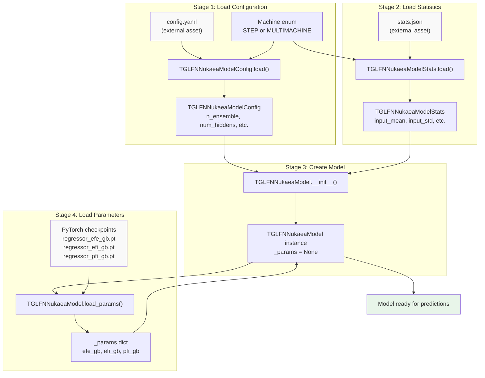

<!-- source: DeepWiki mcp.deepwiki.com · repo google-deepmind/fusion_surrogates · page 4.3 Using TGLFNN Models · fetched 2026-10-26 -->

# Using TGLFNN Models

<details>
<summary>Relevant source files</summary>

The following files were used as context for generating this wiki page:

- [fusion_surrogates/tglfnn_ukaea/README.md](fusion_surrogates/tglfnn_ukaea/README.md)
- [fusion_surrogates/tglfnn_ukaea/__init__.py](fusion_surrogates/tglfnn_ukaea/__init__.py)
- [fusion_surrogates/tglfnn_ukaea/tglfnn_ukaea_config.py](fusion_surrogates/tglfnn_ukaea/tglfnn_ukaea_config.py)
- [fusion_surrogates/tglfnn_ukaea/tglfnn_ukaea_model.py](fusion_surrogates/tglfnn_ukaea/tglfnn_ukaea_model.py)
- [fusion_surrogates/tglfnn_ukaea/tglfnn_ukaea_model_test.py](fusion_surrogates/tglfnn_ukaea/tglfnn_ukaea_model_test.py)

</details>


## Purpose and Scope

This document provides a practical guide for loading and using TGLFNN-UKAEA surrogate models to predict gyro-Bohm normalized turbulent transport fluxes. It covers the complete workflow from loading external model assets to making predictions with uncertainty estimates.

For architectural details about the TGLFNN model structure and GaussianMLP ensembles, see [TGLFNN Overview and Architecture](#4.1). For configuration details about machine types and input parameters, see [TGLFNN Machine Types and Configuration](#4.2). For details about the PyTorch to JAX conversion process, see [PyTorch to JAX Model Conversion](#4.4).

## Model Initialization Workflow

The TGLFNN model initialization follows a three-stage process: loading configuration, loading normalization statistics, and loading model parameters from PyTorch checkpoints.



**Sources:** [fusion_surrogates/tglfnn_ukaea/tglfnn_ukaea_model.py:31-51](), [fusion_surrogates/tglfnn_ukaea/tglfnn_ukaea_config.py:86-115](), [fusion_surrogates/tglfnn_ukaea/tglfnn_ukaea_config.py:118-140](), [fusion_surrogates/tglfnn_ukaea/tglfnn_ukaea_model_test.py:35-56]()

## Loading External Assets

TGLFNN models require three types of external assets stored in the [ukaea/tglfnn-ukaea](https://github.com/ukaea/tglfnn-ukaea) GitHub repository. These assets are not bundled with the `fusion_surrogates` package and must be downloaded separately.

### Asset Types and Structure

| Asset Type | File Format | Purpose | Example Path |
|------------|-------------|---------|--------------|
| Configuration | `config.yaml` | Network architecture parameters (n_ensemble, hidden_size, etc.) | `MultiMachineHyper_1Aug25/config.yaml` |
| Statistics | `stats.json` | Input/output normalization parameters (mean, std) | `MultiMachineHyper_1Aug25/stats.json` |
| Model Weights | `.pt` files | PyTorch state dictionaries for each output label | `MultiMachineHyper_1Aug25/regressor_efe_gb.pt` |

**Sources:** [fusion_surrogates/tglfnn_ukaea/README.md:1-8](), [fusion_surrogates/tglfnn_ukaea/tglfnn_ukaea_model_test.py:77-95]()

### Loading Configuration and Statistics

The `TGLFNNukaeaModelConfig` and `TGLFNNukaeaModelStats` classes provide `load()` class methods that parse YAML and JSON files respectively:

```python
# Load configuration
config = tglfnn_ukaea_config.TGLFNNukaeaModelConfig.load(
    machine=tglfnn_ukaea_config.Machine.MULTIMACHINE,
    config_path="path/to/config.yaml"
)

# Load normalization statistics
stats = tglfnn_ukaea_config.TGLFNNukaeaModelStats.load(
    machine=tglfnn_ukaea_config.Machine.MULTIMACHINE,
    stats_path="path/to/stats.json"
)
```

The `Machine` enum determines which input labels are expected (13 for STEP, 14 for MULTIMACHINE). See [TGLFNN Machine Types and Configuration](#4.2) for details about the differences.

**Sources:** [fusion_surrogates/tglfnn_ukaea/tglfnn_ukaea_config.py:104-115](), [fusion_surrogates/tglfnn_ukaea/tglfnn_ukaea_config.py:127-140](), [fusion_surrogates/tglfnn_ukaea/tglfnn_ukaea_model_test.py:38-46]()

### Loading Model Parameters

After creating a `TGLFNNukaeaModel` instance, use the `load_params()` method to load PyTorch checkpoints for all three output labels:

```python
model = tglfnn_ukaea_model.TGLFNNukaeaModel(
    config=config,
    stats=stats
)

model.load_params(
    efe_gb_pt="path/to/regressor_efe_gb.pt",
    efi_gb_pt="path/to/regressor_efi_gb.pt",
    pfi_gb_pt="path/to/regressor_pfi_gb.pt"
)
```

The `load_params()` method internally calls `params_from_pt_file()` which:
1. Loads the PyTorch state dictionary using `torch.load()`
2. Converts PyTorch tensors to JAX arrays
3. Transposes weight matrices (PyTorch uses row-major, JAX uses column-major)
4. Organizes parameters into the structure expected by `GaussianMLPEnsemble`

**Sources:** [fusion_surrogates/tglfnn_ukaea/tglfnn_ukaea_model.py:53-66](), [fusion_surrogates/tglfnn_ukaea/tglfnn_ukaea_config.py:166-174](), [fusion_surrogates/tglfnn_ukaea/tglfnn_ukaea_config.py:143-163]()

## Prediction Pipeline

The `predict()` method performs inference with automatic normalization and denormalization:

```mermaid
flowchart LR
    subgraph "Input Processing"
        RAW_INPUT["Raw inputs<br/>jax.Array<br/>shape: (..., n_features)"]
        NORMALIZE["transforms.normalize()<br/>input_mean, input_std"]
        NORM_INPUT["Normalized inputs<br/>mean=0, std=1"]
        
        RAW_INPUT --> NORMALIZE
        NORMALIZE --> NORM_INPUT
    end
    
    subgraph "Network Application (per output label)"
        NETWORK["GaussianMLPEnsemble.apply()<br/>_params[label]"]
        RAW_OUTPUT["Raw predictions<br/>(..., 2)<br/>[mean, variance]"]
        
        NORM_INPUT --> NETWORK
        NETWORK --> RAW_OUTPUT
    end
    
    subgraph "Output Processing"
        SPLIT["Split mean and variance"]
        DENORM_MEAN["transforms.unnormalize()<br/>output_mean, output_std"]
        KEEP_VAR["Keep variance normalized"]
        STACK["jnp.stack([mean, var], axis=-1)"]
        FINAL_OUTPUT["Final predictions<br/>(..., 2)<br/>[denormalized mean, normalized variance]"]
        
        RAW_OUTPUT --> SPLIT
        SPLIT -->|"[..., 0]"| DENORM_MEAN
        SPLIT -->|"[..., 1]"| KEEP_VAR
        DENORM_MEAN --> STACK
        KEEP_VAR --> STACK
        STACK --> FINAL_OUTPUT
    end
    
    subgraph "Output Dictionary"
        RESULT["predictions dict<br/>efe_gb: Array(..., 2)<br/>efi_gb: Array(..., 2)<br/>pfi_gb: Array(..., 2)"]
        
        FINAL_OUTPUT --> RESULT
    end
```



**Sources:** [fusion_surrogates/tglfnn_ukaea/tglfnn_ukaea_model.py:68-108]()

### Key Implementation Details

The `predict()` method at [fusion_surrogates/tglfnn_ukaea/tglfnn_ukaea_model.py:68-108]() implements several important behaviors:

1. **Input normalization** uses `transforms.normalize()` with statistics from `TGLFNNukaeaModelStats.input_mean` and `input_std`
2. **Per-label prediction**: Each output label (efe_gb, efi_gb, pfi_gb) has its own set of parameters and is predicted independently
3. **Asymmetric denormalization**: Mean predictions are denormalized back to physical units, but variance predictions remain in normalized space
4. **Ensemble averaging**: The `GaussianMLPEnsemble` network automatically averages predictions across ensemble members

**Sources:** [fusion_surrogates/tglfnn_ukaea/tglfnn_ukaea_model.py:85-89](), [fusion_surrogates/tglfnn_ukaea/tglfnn_ukaea_model.py:93-96](), [fusion_surrogates/tglfnn_ukaea/tglfnn_ukaea_model.py:98-106]()

## Understanding Output Format

The `predict()` method returns a dictionary mapping output labels to JAX arrays containing both mean predictions and uncertainty estimates.

### Output Structure

```python
predictions = model.predict(inputs)
# predictions: Mapping[OutputLabel, jax.Array]
# {
#   "efe_gb": Array(shape=(..., 2)),
#   "efi_gb": Array(shape=(..., 2)),
#   "pfi_gb": Array(shape=(..., 2))
# }
```

| Output Label | Description | Units | Index 0 | Index 1 |
|--------------|-------------|-------|---------|---------|
| `efe_gb` | Electron energy flux | Gyro-Bohm normalized | Denormalized mean | Normalized variance |
| `efi_gb` | Electron particle flux | Gyro-Bohm normalized | Denormalized mean | Normalized variance |
| `pfi_gb` | Ion particle flux | Gyro-Bohm normalized | Denormalized mean | Normalized variance |

**Sources:** [fusion_surrogates/tglfnn_ukaea/tglfnn_ukaea_config.py:37-38](), [fusion_surrogates/tglfnn_ukaea/tglfnn_ukaea_model.py:93-106]()

### Extracting Predictions

```python
# Get mean prediction for electron energy flux
efe_gb_mean = predictions["efe_gb"][..., 0]

# Get variance (uncertainty) for electron energy flux
efe_gb_variance = predictions["efe_gb"][..., 1]

# Standard deviation can be computed from variance
efe_gb_std = jnp.sqrt(efe_gb_variance)
```

The constants `MEAN_OUTPUT_IDX = 0` and `VAR_OUTPUT_IDX = 1` are defined in [fusion_surrogates/tglfnn_ukaea/tglfnn_ukaea_config.py:34-35]().

**Sources:** [fusion_surrogates/tglfnn_ukaea/tglfnn_ukaea_config.py:34-35](), [fusion_surrogates/tglfnn_ukaea/tglfnn_ukaea_model.py:99-104]()

## Batch Processing

The `predict()` method supports arbitrary batch dimensions through standard JAX broadcasting. The final two dimensions are reserved for data points and features.

### Supported Input Shapes

| Input Shape | Description | Output Shape | Example Use Case |
|-------------|-------------|--------------|------------------|
| `(n_points, n_features)` | Single batch | `(n_points, 2)` | Predict at multiple radial locations for single time step |
| `(n_times, n_points, n_features)` | Time-batched | `(n_times, n_points, 2)` | Predict evolution over time |
| `(n_scenarios, n_times, n_points, n_features)` | Scenario-batched | `(n_scenarios, n_times, n_points, 2)` | Compare multiple experimental scenarios |

**Sources:** [fusion_surrogates/tglfnn_ukaea/tglfnn_ukaea_model_test.py:97-117]()

### Shape Validation Tests

The test suite at [fusion_surrogates/tglfnn_ukaea/tglfnn_ukaea_model_test.py:119-142]() validates correct shape handling for:
- Batched inputs: `(5, 10, 13)` → `(5, 10, 2)`
- Non-batched inputs: `(10, 13)` → `(10, 2)`
- Single batch dimension: `(1, 3, 13)` → `(1, 3, 2)`
- Single data dimension: `(3, 1, 13)` → `(3, 1, 2)`

**Sources:** [fusion_surrogates/tglfnn_ukaea/tglfnn_ukaea_model_test.py:97-142]()

## Complete Usage Example

This example demonstrates the full workflow for loading and using a TGLFNN multi-machine model:

```python
import pathlib
from fusion_surrogates.tglfnn_ukaea import tglfnn_ukaea_config
from fusion_surrogates.tglfnn_ukaea import tglfnn_ukaea_model
import jax.numpy as jnp

# Define paths to external assets
weights_dir = pathlib.Path("/path/to/tglfnn-ukaea/MultiMachineHyper_1Aug25")

# Load configuration and statistics
config = tglfnn_ukaea_config.TGLFNNukaeaModelConfig.load(
    machine=tglfnn_ukaea_config.Machine.MULTIMACHINE,
    config_path=weights_dir / "config.yaml"
)

stats = tglfnn_ukaea_config.TGLFNNukaeaModelStats.load(
    machine=tglfnn_ukaea_config.Machine.MULTIMACHINE,
    stats_path=weights_dir / "stats.json"
)

# Create model instance
model = tglfnn_ukaea_model.TGLFNNukaeaModel(
    config=config,
    stats=stats
)

# Load PyTorch checkpoints
model.load_params(
    efe_gb_pt=weights_dir / "regressor_efe_gb.pt",
    efi_gb_pt=weights_dir / "regressor_efi_gb.pt",
    pfi_gb_pt=weights_dir / "regressor_pfi_gb.pt"
)

# Prepare input data
# Multi-machine expects 14 features (see page 4.2)
inputs = jnp.ones((10, 14))  # 10 radial points

# Make predictions
predictions = model.predict(inputs)

# Extract results
efe_gb_mean = predictions["efe_gb"][..., 0]
efe_gb_variance = predictions["efe_gb"][..., 1]
efi_gb_mean = predictions["efi_gb"][..., 0]
pfi_gb_mean = predictions["pfi_gb"][..., 0]

print(f"Electron energy flux shape: {efe_gb_mean.shape}")  # (10,)
print(f"Uncertainty shape: {efe_gb_variance.shape}")  # (10,)
```

**Sources:** [fusion_surrogates/tglfnn_ukaea/tglfnn_ukaea_model_test.py:77-95](), [fusion_surrogates/tglfnn_ukaea/tglfnn_ukaea_model.py:31-108]()

### Environment Variable for Tests

The test suite uses the `TGLFNN_UKAEA_DIR` environment variable to locate external assets. Tests that require full model weights are skipped unless this variable is set:

```python
# Set before running tests
export TGLFNN_UKAEA_DIR=/path/to/tglfnn-ukaea
pytest fusion_surrogates/tglfnn_ukaea/tglfnn_ukaea_model_test.py
```

**Sources:** [fusion_surrogates/tglfnn_ukaea/tglfnn_ukaea_model_test.py:73-95]()

---

