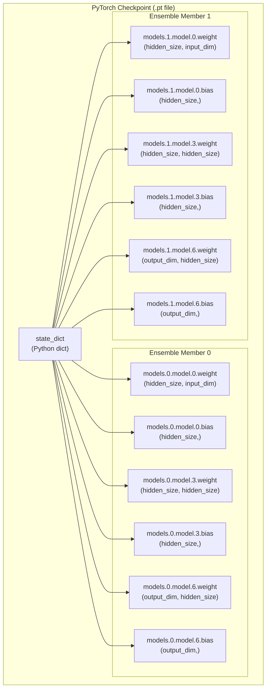
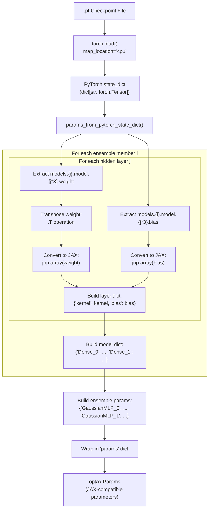
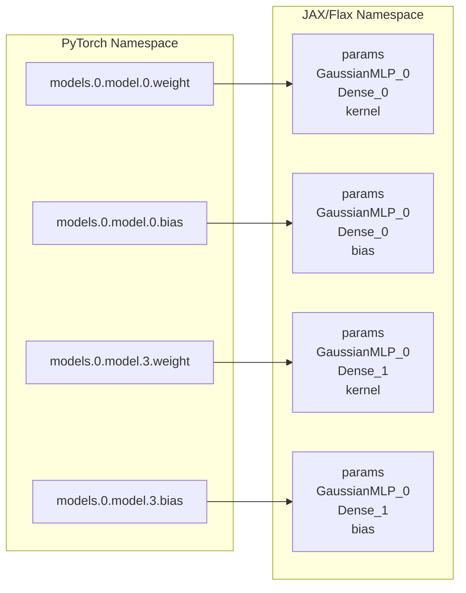
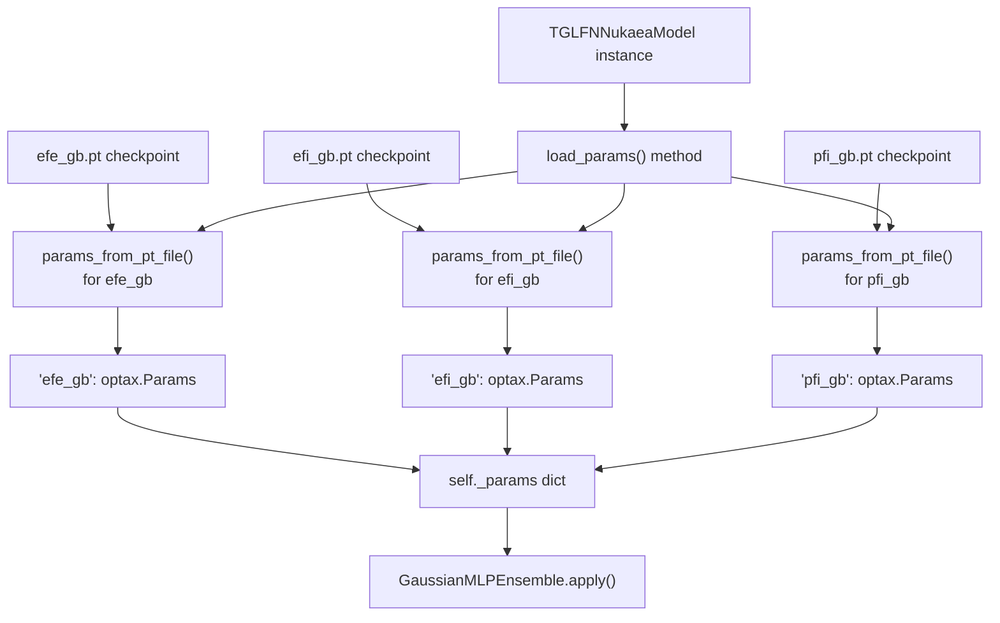
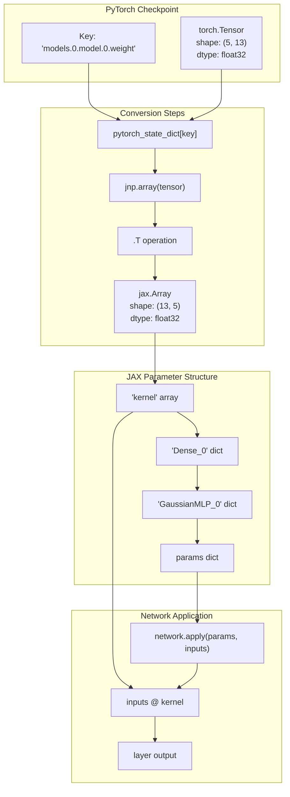

<!-- source: DeepWiki mcp.deepwiki.com · repo google-deepmind/fusion_surrogates · page 4.4 PyTorch to JAX Model Conversion · fetched 2026-10-26 -->

# PyTorch to JAX Model Conversion

<details>
<summary>Relevant source files</summary>

The following files were used as context for generating this wiki page:

- [fusion_surrogates/tglfnn_ukaea/test_data/config.yaml](fusion_surrogates/tglfnn_ukaea/test_data/config.yaml)
- [fusion_surrogates/tglfnn_ukaea/test_data/dummy_torch_checkpoint.pt](fusion_surrogates/tglfnn_ukaea/test_data/dummy_torch_checkpoint.pt)
- [fusion_surrogates/tglfnn_ukaea/test_data/make_dummy_torch_checkpoint.py](fusion_surrogates/tglfnn_ukaea/test_data/make_dummy_torch_checkpoint.py)
- [fusion_surrogates/tglfnn_ukaea/test_data/stats.json](fusion_surrogates/tglfnn_ukaea/test_data/stats.json)
- [fusion_surrogates/tglfnn_ukaea/tglfnn_ukaea_config.py](fusion_surrogates/tglfnn_ukaea/tglfnn_ukaea_config.py)
- [fusion_surrogates/tglfnn_ukaea/tglfnn_ukaea_model.py](fusion_surrogates/tglfnn_ukaea/tglfnn_ukaea_model.py)

</details>


## Purpose and Scope

This document explains the conversion process that loads TGLFNN-UKAEA model weights from PyTorch checkpoint files (`.pt` format) and transforms them into JAX/Flax-compatible parameters. The conversion is implemented in the `tglfnn_ukaea_config` module and is automatically invoked when loading TGLFNN models.

For information about using TGLFNN models after conversion, see [Using TGLFNN Models](#4.3). For details on the neural network architectures that receive these converted parameters, see [Network Architectures](#5.1).

## Conversion Necessity

TGLFNN-UKAEA models are trained using PyTorch in the external [ukaea/tglfnn-ukaea](https://github.com/ukaea/tglfnn-ukaea) repository but must execute in JAX for integration with fusion simulation codes. The conversion bridges these two frameworks by extracting trained weights from PyTorch checkpoints and restructuring them into the JAX parameter format expected by Flax neural network modules.

**Key Framework Differences:**

| Aspect | PyTorch | JAX/Flax |
|--------|---------|----------|
| Parameter Storage | Single flat `state_dict` with string keys | Nested dictionary hierarchy |
| Array Format | `torch.Tensor` | `jax.Array` (via `jnp.array`) |
| Weight Layout | `(out_features, in_features)` | `(in_features, out_features)` (transposed) |
| Parameter Namespace | `models.{i}.model.{j*3}.{weight/bias}` | `GaussianMLP_{i}/Dense_{j}/{kernel/bias}` |

Sources: [fusion_surrogates/tglfnn_ukaea/tglfnn_ukaea_config.py:143-174]()

## PyTorch State Dictionary Structure

PyTorch checkpoints store model weights in a flat dictionary called a `state_dict`, where keys follow a naming convention that encodes the model hierarchy. TGLFNN checkpoints contain multiple ensemble members, each with multiple layers.

**State Dict Key Format:**
```
models.{ensemble_index}.model.{layer_index}.{parameter_type}
```

Where:
- `ensemble_index`: Integer identifying ensemble member (0 to `n_ensemble-1`)
- `layer_index`: Integer `j*3` where `j` is the hidden layer number (0, 3, 6, ...)
- `parameter_type`: Either `weight` or `bias`

**Example Checkpoint Structure:**



**PyTorch Layer Indexing**: Layers are indexed at intervals of 3 because the original PyTorch model alternates `Linear`, `ReLU`, and `Dropout` modules. Only `Linear` layers have trainable parameters.

Sources: [fusion_surrogates/tglfnn_ukaea/test_data/make_dummy_torch_checkpoint.py:21-44]()

## Conversion Process Flow

The conversion transforms PyTorch `state_dict` entries into JAX parameters through a two-stage process: checkpoint loading and parameter restructuring.

**Conversion Pipeline:**



**Core Conversion Functions:**

| Function | Purpose | Inputs | Outputs |
|----------|---------|--------|---------|
| `params_from_pt_file` | Load checkpoint and convert | Checkpoint path, config | `optax.Params` |
| `params_from_pytorch_state_dict` | Convert state dict to JAX params | PyTorch state dict, config | `optax.Params` |
| `torch.load` | Deserialize checkpoint | File path, device location | `state_dict` |

Sources: [fusion_surrogates/tglfnn_ukaea/tglfnn_ukaea_config.py:143-174]()

## Parameter Mapping and Restructuring

The conversion performs three critical transformations: namespace remapping, array conversion, and weight transposition.

**Namespace Transformation:**



**Detailed Mapping Logic:**

The conversion iterates over ensemble members and hidden layers, applying the following transformations:

**PyTorch Key Pattern:**
```
models.{i}.model.{j * 3}.weight
```

**JAX Parameter Path:**
```python
params["GaussianMLP_{i}"]["Dense_{j}"]["kernel"]
```

**Weight Transposition:**

PyTorch and JAX use different matrix multiplication conventions:
- **PyTorch**: `output = input @ weight.T` → weight shape `(out_features, in_features)`
- **JAX**: `output = input @ kernel` → kernel shape `(in_features, out_features)`

The conversion applies `.T` (transpose) to weight matrices to account for this difference.

**Implementation Details:**

```python
# From tglfnn_ukaea_config.py:153-160
layer_dict = {
    "kernel": (
        jnp.array(pytorch_state_dict[f"models.{i}.model.{j * 3}.weight"]).T
    ),
    "bias": (
        jnp.array(pytorch_state_dict[f"models.{i}.model.{j * 3}.bias"]).T
    ),
}
```

**Parameter Hierarchy Table:**

| Level | PyTorch | JAX/Flax | Purpose |
|-------|---------|----------|---------|
| Root | `state_dict` | `{"params": {...}}` | Top-level container |
| Ensemble | `models.{i}` | `GaussianMLP_{i}` | Individual ensemble member |
| Layer | `model.{j*3}` | `Dense_{j}` | Hidden layer within member |
| Weight | `weight` | `kernel` | Linear transformation matrix |
| Bias | `bias` | `bias` | Additive bias vector |

Sources: [fusion_surrogates/tglfnn_ukaea/tglfnn_ukaea_config.py:143-163]()

## Integration with TGLFNNukaeaModel

The converted parameters are consumed by `TGLFNNukaeaModel` through its `load_params` method, which loads separate checkpoints for each output label.

**Model Loading Workflow:**



**Implementation in TGLFNNukaeaModel:**

The `load_params` method [fusion_surrogates/tglfnn_ukaea/tglfnn_ukaea_model.py:53-66]() calls `params_from_pt_file` three times, once for each output quantity (electron heat flux, ion heat flux, particle flux), storing the results in a dictionary keyed by output label.

**Parameter Usage During Prediction:**

During inference, the `predict` method [fusion_surrogates/tglfnn_ukaea/tglfnn_ukaea_model.py:93-96]() retrieves the appropriate parameter set for each output label and passes it to the `GaussianMLPEnsemble` network's `apply` method:

```python
# From tglfnn_ukaea_model.py:94-95
prediction = self._network.apply(
    self._params[label], inputs, deterministic=True
)
```

The converted JAX parameters seamlessly integrate with Flax's `linen.nn.Module` interface, enabling JIT-compiled execution and automatic differentiation.

Sources: [fusion_surrogates/tglfnn_ukaea/tglfnn_ukaea_model.py:53-66](), [fusion_surrogates/tglfnn_ukaea/tglfnn_ukaea_model.py:93-96]()

## Configuration-Driven Conversion

The conversion process depends on `TGLFNNukaeaModelConfig` to determine checkpoint structure, as ensemble size and layer count vary between models.

**Configuration Parameters Used in Conversion:**

| Config Attribute | Purpose in Conversion | Example Value |
|------------------|----------------------|---------------|
| `n_ensemble` | Number of `GaussianMLP_{i}` members to extract | 2 |
| `num_hiddens` | Number of `Dense_{j}` layers per member | 3 |
| `hidden_size` | Validates parameter shapes | 5 |
| `machine` | Determines input dimensionality | `Machine.STEP` or `Machine.MULTIMACHINE` |

**Iteration Logic:**

The conversion uses nested loops [fusion_surrogates/tglfnn_ukaea/tglfnn_ukaea_config.py:148-162]():

```python
for i in range(config.n_ensemble):  # Outer loop: ensemble members
    model_dict = {}
    for j in range(config.num_hiddens):  # Inner loop: hidden layers
        layer_dict = {...}  # Extract and convert parameters
        model_dict[f"Dense_{j}"] = layer_dict
    params[f"GaussianMLP_{i}"] = model_dict
```

This structure ensures the converted parameters match the expected hierarchy of the `GaussianMLPEnsemble` network architecture.

Sources: [fusion_surrogates/tglfnn_ukaea/tglfnn_ukaea_config.py:87-115](), [fusion_surrogates/tglfnn_ukaea/tglfnn_ukaea_config.py:148-162]()

## Complete Conversion Example

The following diagram traces a single weight parameter through the entire conversion pipeline:



**Numerical Example:**

Given a STEP configuration with:
- `n_ensemble = 2`
- `num_hiddens = 3`
- `hidden_size = 5`
- Input dimension = 13

The PyTorch checkpoint contains `2 × 3 × 2 = 12` parameter arrays (weight + bias for each layer). The conversion produces a nested dictionary with structure:

```
params
├── GaussianMLP_0
│   ├── Dense_0: {kernel: (13, 5), bias: (5,)}
│   ├── Dense_1: {kernel: (5, 5), bias: (5,)}
│   └── Dense_2: {kernel: (5, 2), bias: (2,)}
└── GaussianMLP_1
    ├── Dense_0: {kernel: (13, 5), bias: (5,)}
    ├── Dense_1: {kernel: (5, 5), bias: (5,)}
    └── Dense_2: {kernel: (5, 2), bias: (2,)}
```

Sources: [fusion_surrogates/tglfnn_ukaea/test_data/make_dummy_torch_checkpoint.py:21-44](), [fusion_surrogates/tglfnn_ukaea/test_data/config.yaml:1-4]()

---

