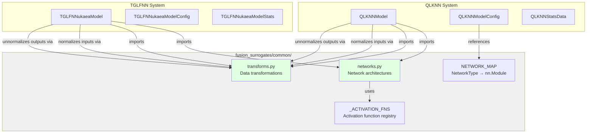
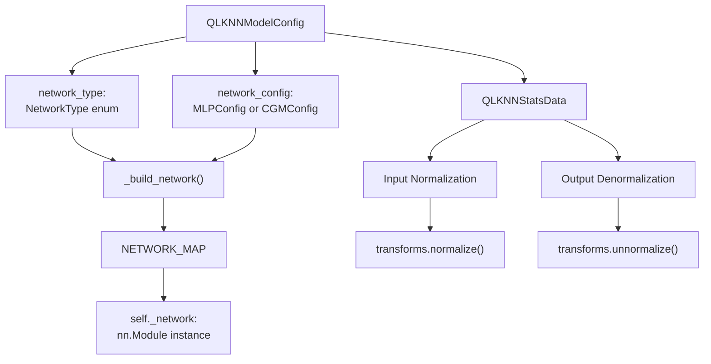
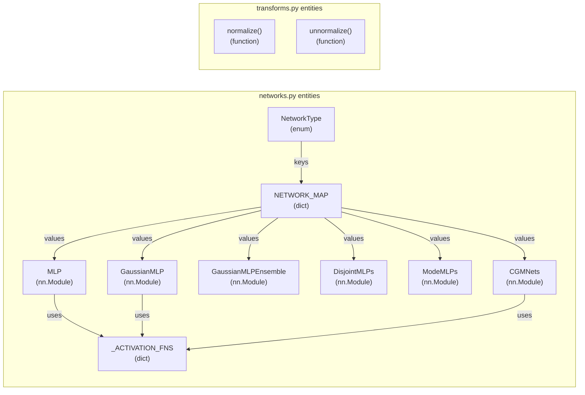

<!-- source: DeepWiki mcp.deepwiki.com · repo google-deepmind/fusion_surrogates · page 5 Common Infrastructure · fetched 2026-10-26 -->

# Common Infrastructure

<details>
<summary>Relevant source files</summary>

The following files were used as context for generating this wiki page:

- [fusion_surrogates/common/networks.py](fusion_surrogates/common/networks.py)
- [fusion_surrogates/common/transforms.py](fusion_surrogates/common/transforms.py)
- [fusion_surrogates/qlknn/qlknn_model.py](fusion_surrogates/qlknn/qlknn_model.py)
- [fusion_surrogates/qlknn/qlknn_model_test.py](fusion_surrogates/qlknn/qlknn_model_test.py)

</details>


## Purpose and Scope

The common infrastructure provides shared components used by both the QLKNN and TGLFNN-UKAEA model systems. This includes neural network architectures, data transformation utilities, and supporting functionality that enables consistent implementation patterns across different surrogate models.

This document covers the architectural design and integration patterns of the shared infrastructure. For detailed information on specific components:
- Network architecture implementations: see [Network Architectures](#5.1)
- Data normalization and transformation: see [Data Transformation Utilities](#5.2)

**Sources:** [fusion_surrogates/common/networks.py:1-301](), [fusion_surrogates/common/transforms.py:1-33](), [fusion_surrogates/qlknn/qlknn_model.py:31-32]()

## Architectural Overview

The common infrastructure follows a modular design where both QLKNN and TGLFNN systems depend on the same underlying components for core functionality. This ensures consistency and reduces code duplication.



**Diagram: Common Infrastructure Module Dependencies**

This diagram shows how both model systems import and utilize shared components from the `common` package.

**Sources:** [fusion_surrogates/qlknn/qlknn_model.py:31-32](), [fusion_surrogates/common/networks.py:1-301](), [fusion_surrogates/common/transforms.py:1-33]()

## Component Inventory

The common infrastructure consists of two primary modules:

### Network Architectures Module

**Location:** `fusion_surrogates/common/networks.py`

Provides neural network architecture implementations built on Flax/JAX. Available architectures include:

| Architecture | Class Name | Primary Use Case |
|--------------|------------|------------------|
| Basic MLP | `MLP` | Standard feedforward networks |
| Gaussian MLP | `GaussianMLP` | Predictions with uncertainty via mean and variance |
| Gaussian Ensemble | `GaussianMLPEnsemble` | Multiple GaussianMLPs for ensemble predictions |
| Disjoint MLPs | `DisjointMLPs` | Independent networks for each output target |
| Mode MLPs | `ModeMLPs` | Separate networks for ITG/TEM/ETG modes |
| CGM Networks | `CGMNets` | Physics-informed Critical Gradient Model architecture |

The module provides the `NETWORK_MAP` registry ([fusion_surrogates/common/networks.py:291-300]()) that maps `NetworkType` enum values to their corresponding `nn.Module` classes.

**Sources:** [fusion_surrogates/common/networks.py:36-301]()

### Data Transformation Module

**Location:** `fusion_surrogates/common/transforms.py`

Provides two core functions for standardizing data:

- **`normalize(data, mean, stddev)`** ([fusion_surrogates/common/transforms.py:21-25]()): Transforms data to have mean 0 and standard deviation 1
- **`unnormalize(data, mean, stddev)`** ([fusion_surrogates/common/transforms.py:28-32]()): Reverses normalization to restore original scale

Both functions handle edge cases where `stddev == 0` to prevent division by zero.

**Sources:** [fusion_surrogates/common/transforms.py:15-33]()

## Integration Patterns

### QLKNN Integration

The QLKNN system demonstrates flexible integration with common infrastructure through its configuration-driven architecture:



**Diagram: QLKNN Integration with Common Infrastructure**

The QLKNN model construction process ([fusion_surrogates/qlknn/qlknn_model.py:341-357]()) uses `NETWORK_MAP` to instantiate the appropriate network architecture based on configuration. Data transformations are applied in prediction methods:

- Input normalization: [fusion_surrogates/qlknn/qlknn_model.py:267-272]()
- Output denormalization: [fusion_surrogates/qlknn/qlknn_model.py:290-295]()

**Sources:** [fusion_surrogates/qlknn/qlknn_model.py:166-357]()

### TGLFNN Integration

The TGLFNN system uses common infrastructure similarly but with a fixed architecture choice:

| Aspect | QLKNN | TGLFNN |
|--------|-------|--------|
| Network selection | Configurable via `NetworkType` | Fixed to `GaussianMLPEnsemble` |
| Normalization | Optional per configuration | Always enabled |
| Output format | Unnormalized physical fluxes | Mean + variance in normalized space |
| Activation functions | Configurable | Fixed to specific activation |

Both systems use identical transformation functions but apply them differently based on their prediction requirements.

**Sources:** [fusion_surrogates/qlknn/qlknn_model.py:267-295](), [fusion_surrogates/common/transforms.py:21-32]()

## Design Principles

### JAX-First Architecture

All components are built using JAX/Flax to ensure:
- **JIT compilation compatibility**: All operations support `jax.jit` for performance
- **Automatic differentiation**: Networks support gradient computation
- **Device agnostic**: Code runs on CPU, GPU, or TPU without modification

**Sources:** [fusion_surrogates/common/networks.py:23-24](), [fusion_surrogates/common/transforms.py:17-18]()

### Immutable Registries

The module uses `immutabledict` for registries ([fusion_surrogates/common/networks.py:27-33](), [fusion_surrogates/common/networks.py:291-300]()), preventing accidental modification and ensuring thread-safety.

### Zero-Division Safety

Transformation functions explicitly handle edge cases where standard deviation is zero:

```python
# From transforms.normalize
return (data - mean) / jnp.where(stddev == 0, 1, stddev)
```

This prevents NaN propagation when features have no variance.

**Sources:** [fusion_surrogates/common/transforms.py:25](), [fusion_surrogates/common/transforms.py:32]()

## Code Entity Reference



**Diagram: Code Entities in Common Infrastructure**

This diagram maps natural language concepts to actual code symbols that can be searched in the codebase.

| Entity | Type | Location | Line Range |
|--------|------|----------|------------|
| `NetworkType` | Enum | networks.py | 282-289 |
| `NETWORK_MAP` | Dict | networks.py | 291-300 |
| `MLP` | Class | networks.py | 36-51 |
| `GaussianMLP` | Class | networks.py | 53-77 |
| `GaussianMLPEnsemble` | Class | networks.py | 79-110 |
| `DisjointMLPs` | Class | networks.py | 112-134 |
| `ModeMLPs` | Class | networks.py | 136-163 |
| `CGMNets` | Class | networks.py | 233-280 |
| `_ACTIVATION_FNS` | Dict | networks.py | 27-33 |
| `normalize` | Function | transforms.py | 21-25 |
| `unnormalize` | Function | transforms.py | 28-32 |

**Sources:** [fusion_surrogates/common/networks.py:27-300](), [fusion_surrogates/common/transforms.py:21-32]()

## Usage Examples

### Network Instantiation Pattern

Both model systems follow a common pattern for network instantiation:

1. Store `NetworkType` enum value in configuration
2. Store architecture-specific parameters in network config
3. Call `NETWORK_MAP[network_type](**network_config)` to instantiate

Example from QLKNN ([fusion_surrogates/qlknn/qlknn_model.py:355-357]()):
```python
self._network = networks.NETWORK_MAP[self._config.network_type](
    **network_kwargs
)
```

**Sources:** [fusion_surrogates/qlknn/qlknn_model.py:341-357]()

### Data Transformation Pattern

The standard pattern for using transformations:

1. Load normalization statistics (mean and stddev)
2. Apply `transforms.normalize()` to inputs before network inference
3. Apply `transforms.unnormalize()` to outputs after network inference

Example from QLKNN prediction ([fusion_surrogates/qlknn/qlknn_model.py:267-272](), [fusion_surrogates/qlknn/qlknn_model.py:290-295]()):
```python
# Input normalization
inputs = transforms.normalize(
    inputs,
    mean=self._config.stats_data.input_mean,
    stddev=self._config.stats_data.input_stddev,
)

# Output denormalization
outputs = transforms.unnormalize(
    outputs,
    mean=self._config.stats_data.target_mean,
    stddev=self._config.stats_data.target_stddev,
)
```

**Sources:** [fusion_surrogates/qlknn/qlknn_model.py:252-296](), [fusion_surrogates/common/transforms.py:21-32]()

## Extension Points

The common infrastructure is designed for extensibility:

### Adding New Architectures

To add a new network architecture:

1. Implement a new `nn.Module` class in `networks.py`
2. Add a new `NetworkType` enum value
3. Register the class in `NETWORK_MAP`
4. Create corresponding configuration dataclass if needed

**Sources:** [fusion_surrogates/common/networks.py:282-300]()

### Supporting New Activation Functions

To support additional activation functions, add entries to `_ACTIVATION_FNS` dictionary ([fusion_surrogates/common/networks.py:27-33]()). All network classes that use activations will automatically support the new function.

**Sources:** [fusion_surrogates/common/networks.py:27-33](), [fusion_surrogates/common/networks.py:47]()

---

