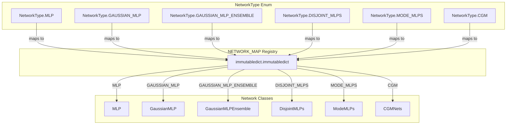
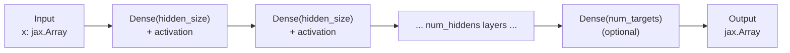
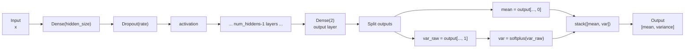
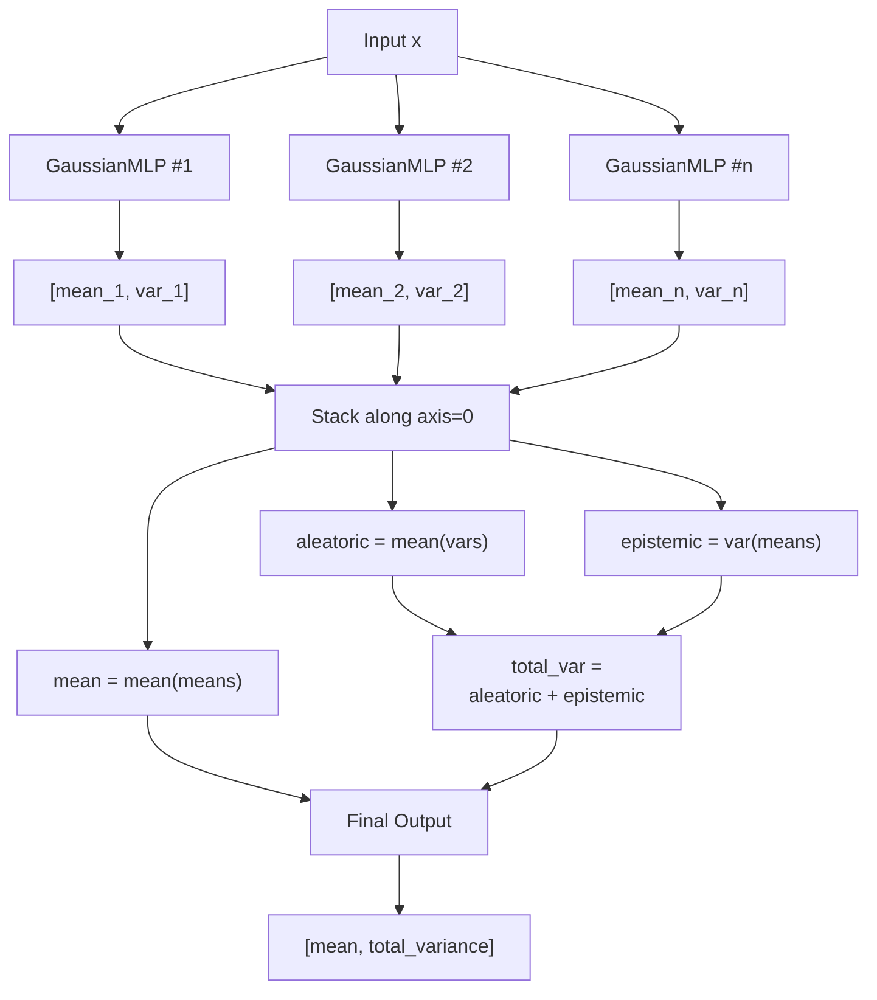
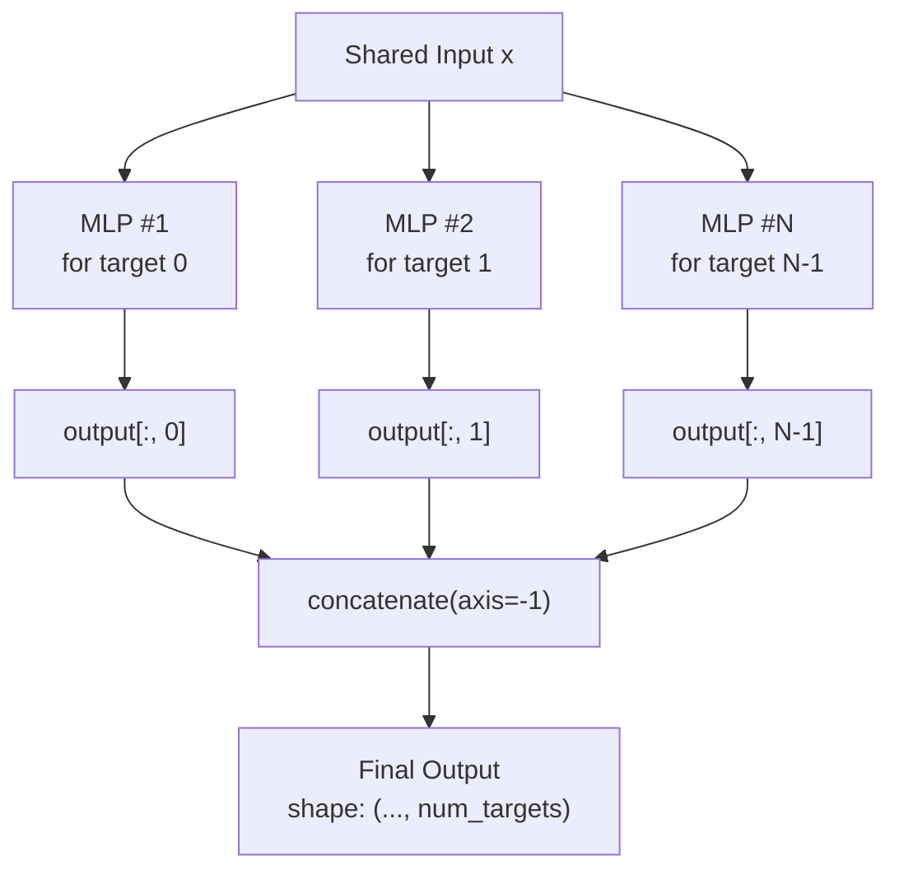
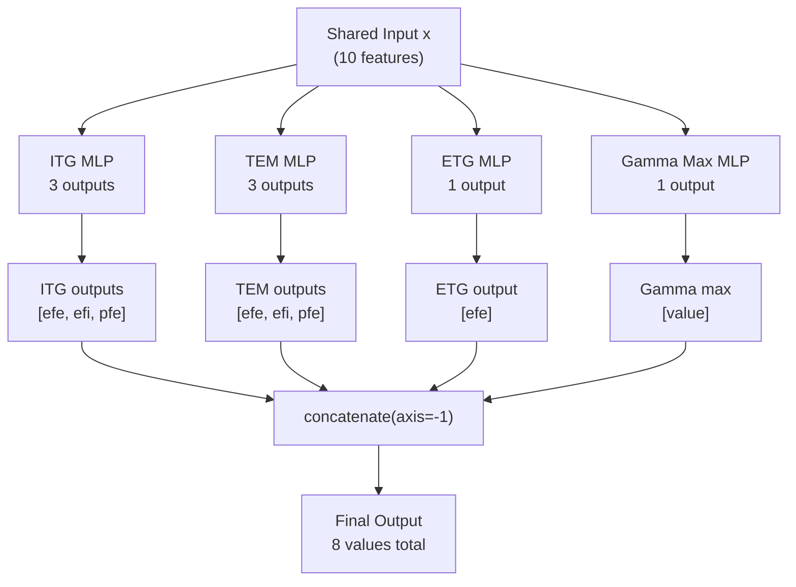
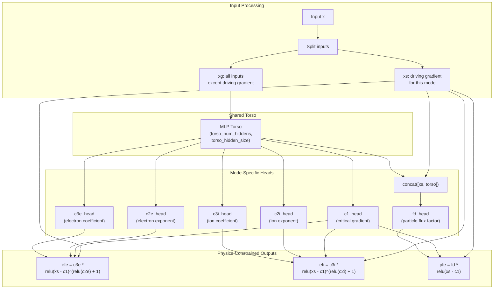
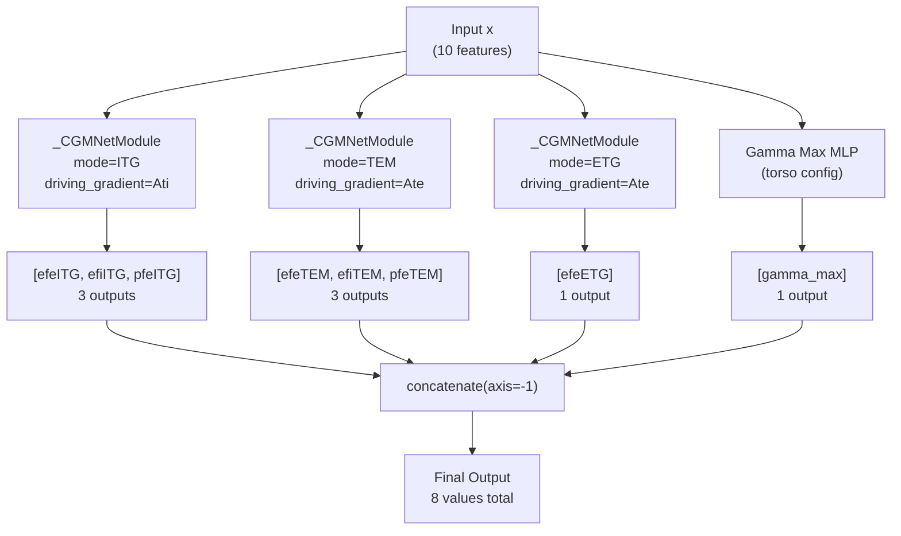
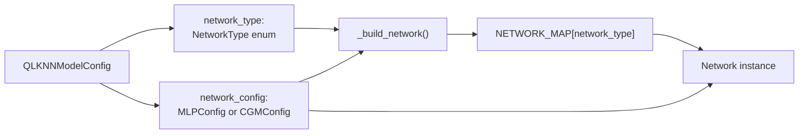

<!-- source: DeepWiki mcp.deepwiki.com · repo google-deepmind/fusion_surrogates · page 5.1 Network Architectures · fetched 2026-10-26 -->

# Network Architectures

<details>
<summary>Relevant source files</summary>

The following files were used as context for generating this wiki page:

- [fusion_surrogates/common/networks.py](fusion_surrogates/common/networks.py)
- [fusion_surrogates/common/networks_test.py](fusion_surrogates/common/networks_test.py)
- [fusion_surrogates/common/transforms.py](fusion_surrogates/common/transforms.py)
- [fusion_surrogates/qlknn/qlknn_model.py](fusion_surrogates/qlknn/qlknn_model.py)
- [fusion_surrogates/qlknn/qlknn_model_test.py](fusion_surrogates/qlknn/qlknn_model_test.py)

</details>


## Purpose and Scope

This document describes the neural network architectures available in the `fusion_surrogates` library. These architectures are shared infrastructure used by both QLKNN and TGLFNN model systems for making predictions about turbulent transport in fusion plasmas. All network implementations are built using JAX/Flax and are located in [fusion_surrogates/common/networks.py]().

For information about how these networks are used in specific models, see [QLKNN Model System](#3) and [TGLFNN Model System](#4). For data preprocessing and postprocessing utilities, see [Data Transformation Utilities](#5.2).

**Sources:** [fusion_surrogates/common/networks.py:1-301]()

## Architecture Overview

The library provides six network architectures, each designed for specific use cases in surrogate modeling:

| Architecture | Use Case | Output Type | Used By |
|-------------|----------|-------------|---------|
| `MLP` | Standard feedforward network | Deterministic predictions | QLKNN |
| `GaussianMLP` | Single network with uncertainty | Mean + variance | TGLFNN |
| `GaussianMLPEnsemble` | Multiple networks voting | Mean + variance | TGLFNN |
| `DisjointMLPs` | Independent network per target | Deterministic predictions | QLKNN (optional) |
| `ModeMLPs` | Mode-specific networks (ITG/TEM/ETG) | Deterministic predictions | QLKNN (optional) |
| `CGMNets` | Physics-informed networks | Deterministic predictions | QLKNN (optional) |

All architectures are registered in the `NETWORK_MAP` dictionary and identified by the `NetworkType` enum.

**Sources:** [fusion_surrogates/common/networks.py:282-301](), [fusion_surrogates/qlknn/qlknn_model.py:99-106]()

## Network Type Registry



**Diagram: Network Type Registry Mapping**

The `NetworkType` enum provides string-based identifiers for each architecture, while the `NETWORK_MAP` dictionary maps these identifiers to the corresponding Flax module classes. This registry pattern enables dynamic network selection during model construction.

**Sources:** [fusion_surrogates/common/networks.py:282-301]()

## MLP - Multi-Layer Perceptron

The `MLP` class implements a standard fully-connected feedforward network. It is the simplest and most commonly used architecture.

### Configuration Parameters

- `num_hiddens`: Number of hidden layers
- `hidden_size`: Number of units per hidden layer
- `num_targets`: Number of output units (can be `None` for intermediate representations)
- `activation`: Activation function name (`'relu'`, `'tanh'`, or `'sigmoid'`)

### Architecture Diagram



**Diagram: MLP Forward Pass**

### Implementation Details

The MLP applies a sequence of dense layers with activation functions. The final output layer is only added if `num_targets` is specified.

```python
# Pseudo-code representation of MLP.__call__
for _ in range(num_hiddens):
    x = activation(Dense(hidden_size)(x))
if num_targets is not None:
    x = Dense(num_targets)(x)
return x
```

**Sources:** [fusion_surrogates/common/networks.py:36-51](), [fusion_surrogates/common/networks.py:27-33]()

## GaussianMLP - Gaussian Multi-Layer Perceptron

The `GaussianMLP` class extends the standard MLP to output both a mean prediction and an uncertainty estimate (variance). It uses dropout for regularization during training.

### Configuration Parameters

- `num_hiddens`: Number of hidden layers
- `hidden_size`: Number of units per hidden layer
- `dropout`: Dropout rate for regularization (typically 0.1-0.3)
- `activation`: Activation function name

### Output Format

The network always outputs a 2-element array in the last dimension:
- `output[..., 0]`: Mean prediction
- `output[..., 1]`: Variance (uncertainty estimate)

### Architecture Diagram



**Diagram: GaussianMLP Forward Pass with Uncertainty**

The variance output is passed through `nn.softplus` to ensure it remains positive, as required for a valid variance estimate.

**Sources:** [fusion_surrogates/common/networks.py:53-77]()

## GaussianMLPEnsemble - Ensemble of Gaussian MLPs

The `GaussianMLPEnsemble` class creates multiple independent `GaussianMLP` networks that vote to produce a final prediction. This provides both aleatoric uncertainty (from individual network variances) and epistemic uncertainty (from disagreement between networks).

### Configuration Parameters

- `n_ensemble`: Number of independent networks in the ensemble
- `num_hiddens`: Number of hidden layers per network
- `hidden_size`: Number of units per hidden layer
- `dropout`: Dropout rate for each network
- `activation`: Activation function name

### Ensemble Voting Process



**Diagram: Ensemble Aggregation Strategy**

The final variance combines:
- **Aleatoric uncertainty**: Average of individual network variances (inherent data noise)
- **Epistemic uncertainty**: Variance of network means (model uncertainty)

**Sources:** [fusion_surrogates/common/networks.py:79-110]()

## DisjointMLPs - Independent Networks per Target

The `DisjointMLPs` class creates completely separate MLP networks for each output target. This architecture is useful when different outputs have minimal correlation or when you want to ensure no information leakage between targets.

### Configuration Parameters

- `num_hiddens`: Number of hidden layers per MLP
- `hidden_size`: Number of units per hidden layer
- `num_targets`: Number of separate networks to create
- `activation`: Activation function name

### Architecture Diagram



**Diagram: DisjointMLPs Architecture**

Each MLP processes the same input independently and produces a single output value. The results are concatenated to form the final output tensor.

**Sources:** [fusion_surrogates/common/networks.py:112-134]()

## ModeMLPs - Mode-Specific Networks for QLKNN

The `ModeMLPs` class is specifically designed for QLKNN models. It creates separate MLPs for different plasma turbulence modes (ITG, TEM, ETG) and an additional network for `gamma_max`.

### Output Structure

The network produces exactly 8 outputs:
- **ITG mode**: 3 outputs (`efeITG`, `efiITG`, `pfeITG`)
- **TEM mode**: 3 outputs (`efeTEM`, `efiTEM`, `pfeTEM`)
- **ETG mode**: 1 output (`efeETG`)
- **Gamma max**: 1 output (maximum linear growth rate)

### Architecture Diagram



**Diagram: ModeMLPs Output Structure**

Each mode-specific network uses the same hyperparameters (`num_hiddens`, `hidden_size`, `activation`) but has different output dimensions.

**Sources:** [fusion_surrogates/common/networks.py:136-163]()

## CGMNets - Critical Gradient Model Networks

The `CGMNets` class implements a physics-informed architecture based on the Critical Gradient Model. This design encodes known physics constraints from plasma turbulence theory directly into the network structure.

### Key Concepts

The Critical Gradient Model posits that turbulent transport fluxes follow power-law relationships with respect to their driving gradients:

```
flux ∝ (gradient - critical_gradient)^exponent
```

This architecture enforces this constraint by construction, ensuring physically meaningful predictions.

### Configuration Parameters

- `torso_num_hiddens`: Number of hidden layers in shared torso
- `torso_hidden_size`: Units per layer in torso
- `head_num_hiddens`: Number of hidden layers per head
- `head_hidden_size`: Units per layer per head
- `activation`: Activation function name
- `driving_gradient_index_map`: Maps gradient names (`'Ate'`, `'Ati'`) to input indices

### Architecture Components



**Diagram: CGM Network Module Structure for a Single Mode**

### Complete CGMNets Architecture



**Diagram: Complete CGMNets Architecture**

### Physics Constraints

The architecture enforces several physical constraints:

1. **Flux vanishes below critical gradient**: The `relu(xs - c1)` term ensures zero flux when the driving gradient is below the critical threshold.
2. **Positive exponents**: `relu(c2e) + 1` and `relu(c2i) + 1` ensure exponents are at least 1.
3. **Power-law scaling**: The `^(exponent)` operation captures the known power-law relationship.
4. **Mode-specific driving gradients**: ITG mode is driven by `Ati` (ion temperature gradient), while TEM and ETG are driven by `Ate` (electron temperature gradient).

**Sources:** [fusion_surrogates/common/networks.py:165-280](), [fusion_surrogates/common/networks.py:228-230]()

## Activation Functions

All network architectures support three activation functions, registered in the `_ACTIVATION_FNS` dictionary:

| Name | Function | Typical Use |
|------|----------|------------|
| `'relu'` | `nn.relu` | Default choice, good gradient flow |
| `'tanh'` | `nn.tanh` | Bounded outputs, smooth gradients |
| `'sigmoid'` | `nn.sigmoid` | Output range [0, 1], rarely used |

The activation function is specified as a string parameter when constructing the network.

**Sources:** [fusion_surrogates/common/networks.py:27-33]()

## Network Selection in Models

### QLKNN Model Network Selection

QLKNN models specify their network architecture through the `QLKNNModelConfig` class:



**Diagram: QLKNN Network Construction Process**

The `_build_network()` method constructs the network by:
1. Looking up the network class in `NETWORK_MAP` using `network_type`
2. Unpacking the `network_config` dataclass into keyword arguments
3. Adding model-specific parameters (e.g., `num_targets`, `driving_gradient_index_map`)
4. Instantiating the network class

**Sources:** [fusion_surrogates/qlknn/qlknn_model.py:341-358](), [fusion_surrogates/qlknn/qlknn_model.py:74-106]()

### TGLFNN Model Network Usage

TGLFNN models exclusively use `GaussianMLPEnsemble` networks. The ensemble configuration is loaded from external PyTorch checkpoints and converted to JAX/Flax format. See [PyTorch to JAX Model Conversion](#4.4) for details.

**Sources:** Referenced in high-level diagrams

## Testing Network Architectures

The [fusion_surrogates/common/networks_test.py]() file provides comprehensive tests for all network architectures. Each test verifies:

1. **Input/output shape consistency**: Networks produce expected output dimensions
2. **Parameter initialization**: Networks can be initialized with random weights
3. **Forward pass execution**: Networks process batched inputs correctly

Example test pattern:

```python
# Test structure from networks_test.py
network = NETWORK_MAP[NetworkType.MLP](
    num_hiddens=2,
    hidden_size=7,
    num_targets=5,
    activation='relu'
)
params = network.init(key, jnp.zeros((batch_size, num_inputs)))
outputs = network.apply(params, inputs)
# Verify: outputs.shape == (batch_size, num_targets)
```

**Sources:** [fusion_surrogates/common/networks_test.py:22-128]()

## Summary Table

| Architecture | Base Class | Outputs | Key Feature | Primary User |
|-------------|-----------|---------|-------------|-------------|
| `MLP` | `nn.Module` | Variable | Standard feedforward | QLKNN |
| `GaussianMLP` | `nn.Module` | 2 (mean, var) | Uncertainty from dropout | TGLFNN |
| `GaussianMLPEnsemble` | `nn.Module` | 2 (mean, var) | Ensemble uncertainty | TGLFNN |
| `DisjointMLPs` | `nn.Module` | `num_targets` | Independent per target | QLKNN (optional) |
| `ModeMLPs` | `nn.Module` | 8 (fixed) | Mode-specific networks | QLKNN (optional) |
| `CGMNets` | `nn.Module` | 8 (fixed) | Physics-informed | QLKNN (optional) |

**Sources:** [fusion_surrogates/common/networks.py:1-301]()

---

