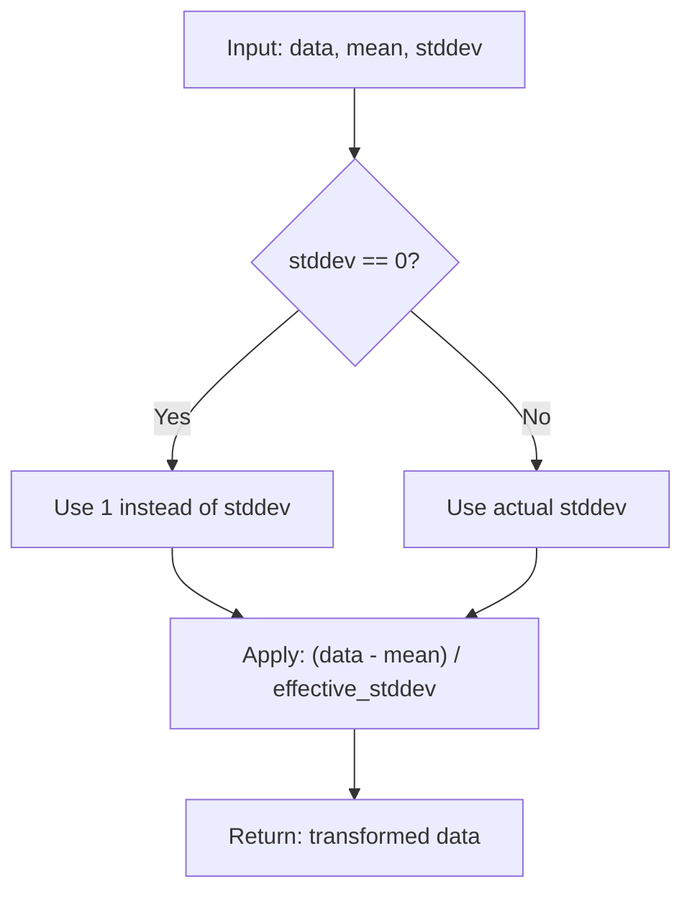
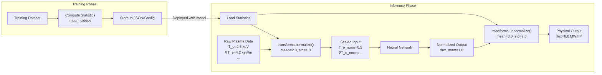

<!-- source: DeepWiki mcp.deepwiki.com · repo google-deepmind/fusion_surrogates · page 5.2 Data Transformation Utilities · fetched 2026-10-26 -->

# Data Transformation Utilities

<details>
<summary>Relevant source files</summary>

The following files were used as context for generating this wiki page:

- [fusion_surrogates/common/transforms.py](fusion_surrogates/common/transforms.py)
- [fusion_surrogates/common/transforms_test.py](fusion_surrogates/common/transforms_test.py)
- [fusion_surrogates/qlknn/qlknn_model.py](fusion_surrogates/qlknn/qlknn_model.py)
- [fusion_surrogates/qlknn/qlknn_model_test.py](fusion_surrogates/qlknn/qlknn_model_test.py)

</details>


## Purpose and Scope

This page documents the data transformation utilities provided by the `fusion_surrogates.common.transforms` module. These utilities handle normalization and unnormalization of input and output data for neural network surrogate models. Both QLKNN and TGLFNN-UKAEA model systems rely on these functions to scale plasma parameters to standardized distributions suitable for neural network training and inference.

For information about the neural network architectures that consume normalized data, see [Network Architectures](#5.1). For details on how specific model systems use these transforms, see [QLKNN Model System](#3) and [TGLFNN-UKAEA Model System](#4).

## Core Functions

The `transforms` module provides two fundamental functions for data scaling operations:

| Function | Purpose | Input Parameters | Return Type |
|----------|---------|------------------|-------------|
| `normalize()` | Scale data to mean=0, stddev=1 | `data`, `mean`, `stddev` | `jax.Array` |
| `unnormalize()` | Reverse normalization to original scale | `data`, `mean`, `stddev` | `jax.Array` |

### normalize()

The `normalize()` function transforms data to a standardized distribution with zero mean and unit standard deviation:

```
normalized_data = (data - mean) / stddev
```

**Function signature:** [fusion_surrogates/common/transforms.py:21-25]()

```python
def normalize(
    data: jax.Array, *, mean: jax.Array, stddev: jax.Array
) -> jax.Array
```

**Key features:**
- Keyword-only parameters for `mean` and `stddev` to prevent parameter confusion
- Handles zero standard deviation gracefully (see [Special Cases](#special-cases))
- Operates element-wise on JAX arrays
- Supports broadcasting across batch dimensions

### unnormalize()

The `unnormalize()` function reverses the normalization operation to restore data to its original scale:

```
original_data = normalized_data * stddev + mean
```

**Function signature:** [fusion_surrogates/common/transforms.py:28-32]()

```python
def unnormalize(
    data: jax.Array, *, mean: jax.Array, stddev: jax.Array
) -> jax.Array
```

**Key features:**
- Exact inverse of `normalize()` when using same statistics
- Preserves data precision through JAX array operations
- Handles zero standard deviation consistently with `normalize()`

**Sources:** [fusion_surrogates/common/transforms.py:15-33]()

## Implementation Details

### Zero Standard Deviation Handling

Both transformation functions implement special logic to handle features with zero standard deviation, which would otherwise cause division by zero or multiplication by infinity:



**Diagram: Zero Standard Deviation Handling Logic**

The implementation uses `jnp.where(stddev == 0, 1, stddev)` to replace zero standard deviations with ones:

- **In normalize():** When `stddev == 0`, division by 1 preserves the centering operation: `(data - mean) / 1 = (data - mean)`
- **In unnormalize():** When `stddev == 0`, multiplication by 1 preserves the shift operation: `data * 1 + mean = data + mean`

This ensures that features with no variation are still properly centered but not scaled, maintaining numerical stability.

**Sources:** [fusion_surrogates/common/transforms.py:25](), [fusion_surrogates/common/transforms.py:32]()

### JAX Array Operations

The transforms module is built on JAX's array operations (`jax.numpy`), providing several benefits:

| Feature | Benefit | Code Reference |
|---------|---------|----------------|
| Automatic differentiation | Enables gradient-based optimization during training | Implicit in JAX |
| JIT compilation | Accelerates repeated transform operations | Implicit in JAX |
| Hardware acceleration | Runs on GPU/TPU when available | Implicit in JAX |
| Broadcasting | Handles batch dimensions automatically | [transforms.py:25, 32]() |

The functions accept and return `jax.Array` types, ensuring compatibility with the rest of the JAX-based model infrastructure.

**Sources:** [fusion_surrogates/common/transforms.py:17-18]()

## Integration with Model Systems

Both surrogate model systems use the transform utilities as part of their prediction pipelines:

```mermaid
flowchart TB
    subgraph QLKNN["QLKNN Model System"]
        Q_Raw["Raw Input\n10 parameters"]
        Q_InputStats["QLKNNStatsData\ninput_mean, input_stddev"]
        Q_Norm["transforms.normalize()"]
        Q_Net["Neural Network"]
        Q_RawOut["Normalized Targets"]
        Q_TargetStats["QLKNNStatsData\ntarget_mean, target_stddev"]
        Q_Unnorm["transforms.unnormalize()"]
        Q_Out["Physical Targets"]
        
        Q_Raw --> Q_Norm
        Q_InputStats --> Q_Norm
        Q_Norm --> Q_Net
        Q_Net --> Q_RawOut
        Q_RawOut --> Q_Unnorm
        Q_TargetStats --> Q_Unnorm
        Q_Unnorm --> Q_Out
    end
    
    subgraph TGLFNN["TGLFNN Model System"]
        T_Raw["Raw Input\n13-14 parameters"]
        T_InputStats["TGLFNNukaeaModelStats\ninput_mean, input_std"]
        T_Norm["transforms.normalize()"]
        T_Net["Gaussian Ensemble"]
        T_RawOut["Normalized Outputs"]
        T_OutputStats["TGLFNNukaeaModelStats\noutput_mean, output_std"]
        T_Unnorm["transforms.unnormalize()"]
        T_Out["Physical Fluxes"]
        
        T_Raw --> T_Norm
        T_InputStats --> T_Norm
        T_Norm --> T_Net
        T_Net --> T_RawOut
        T_RawOut --> T_Unnorm
        T_OutputStats --> T_Unnorm
        T_Unnorm --> T_Out
    end
```



**Diagram: Transform Integration in Model Prediction Pipelines**

### QLKNN Usage

The `QLKNNModel` class uses transforms in two locations during prediction:

**Input normalization** [fusion_surrogates/qlknn/qlknn_model.py:267-272]():
```python
if self._config.normalize_inputs and self._config.stats_data is not None:
    inputs = transforms.normalize(
        inputs,
        mean=self._config.stats_data.input_mean,
        stddev=self._config.stats_data.input_stddev,
    )
```

**Output unnormalization** [fusion_surrogates/qlknn/qlknn_model.py:290-295]():
```python
if self._config.normalize_targets and self._config.stats_data is not None:
    outputs = transforms.unnormalize(
        outputs,
        mean=self._config.stats_data.target_mean,
        stddev=self._config.stats_data.target_stddev,
    )
```

The `QLKNNStatsData` dataclass stores the normalization statistics:

| Field | Type | Description | Source |
|-------|------|-------------|--------|
| `input_mean` | `jax.Array` | Mean of input features | Training data |
| `input_stddev` | `jax.Array` | Standard deviation of inputs | Training data |
| `target_mean` | `jax.Array` | Mean of target outputs | Training data |
| `target_stddev` | `jax.Array` | Standard deviation of targets | Training data |
| `input_min` | `jax.Array` | Minimum input values | Training data |
| `input_max` | `jax.Array` | Maximum input values | Training data |

Statistics are loaded from JSON files via `QLKNNStatsData.from_stats_path()` [fusion_surrogates/qlknn/qlknn_model.py:57-71]().

### TGLFNN Usage

The TGLFNN-UKAEA model system follows a similar pattern, using `TGLFNNukaeaModelStats` to store normalization parameters. Based on the system architecture diagrams, TGLFNN applies:

1. **Input normalization** using `input_mean` and `input_std` statistics
2. **Output unnormalization** for mean predictions using `output_mean` and `output_std`
3. **Variance preservation** in normalized space (variance is not unnormalized)

This asymmetric treatment allows uncertainty quantification to remain in standardized units while predictions are returned in physical units.

**Sources:** [fusion_surrogates/qlknn/qlknn_model.py:31-32](), [fusion_surrogates/qlknn/qlknn_model.py:46-71](), [fusion_surrogates/qlknn/qlknn_model.py:267-295]()

## Data Flow Example

The following diagram shows a complete data transformation cycle:



**Diagram: End-to-End Data Transformation Flow**

**Sources:** [fusion_surrogates/qlknn/qlknn_model.py:57-71](), [fusion_surrogates/qlknn/qlknn_model.py:252-296]()

## Testing and Validation

The `transforms_test.py` module provides comprehensive validation of transformation correctness:

### Normalization Test

Verifies that `normalize()` produces zero-mean, unit-variance output [fusion_surrogates/common/transforms_test.py:26-41]():

**Test approach:**
1. Generate random data with shape `(1, 10, 20)` (devices, batch, features)
2. Compute empirical mean and standard deviation
3. Apply `normalize()` with computed statistics
4. Assert normalized data has mean ≈ 0 and std ≈ 1

```python
normalized_data = transforms.normalize(
    data, mean=data_mean, stddev=data_std
)
testing.assert_array_almost_equal(
    normalized_data.mean(axis=(0, 1)), jnp.zeros(num_features)
)
testing.assert_array_almost_equal(
    normalized_data.std(axis=(0, 1)), jnp.ones(num_features)
)
```

### Reversibility Test

Validates that `unnormalize()` exactly inverts `normalize()` [fusion_surrogates/common/transforms_test.py:43-54]():

**Test approach:**
1. Generate random data with shape `(2, 25, 5)`
2. Compute statistics and normalize
3. Apply `unnormalize()` with same statistics
4. Assert recovered data equals original data (within numerical precision)

```python
normalized_data = transforms.normalize(
    data, mean=data_mean, stddev=data_std
)
unnormalized_data = transforms.unnormalize(
    normalized_data, mean=data_mean, stddev=data_std
)
testing.assert_array_almost_equal(unnormalized_data, data)
```

### Test Configuration

Tests run with:
- **Framework:** `absltest` and `parameterized`
- **Numerical validation:** `numpy.testing` assertions
- **Random seeds:** Fixed keys for reproducibility
- **Array library:** JAX arrays throughout

**Sources:** [fusion_surrogates/common/transforms_test.py:15-59]()

## Function Reference

### normalize()

**Location:** [fusion_surrogates/common/transforms.py:21-25]()

**Signature:**
```python
def normalize(
    data: jax.Array, *, mean: jax.Array, stddev: jax.Array
) -> jax.Array
```

**Parameters:**
- `data`: Input array to normalize (any shape)
- `mean`: Mean values for each feature (keyword-only)
- `stddev`: Standard deviation for each feature (keyword-only)

**Returns:**
- Normalized array with same shape as input

**Formula:**
```
output[i] = (data[i] - mean[i]) / stddev[i]  if stddev[i] != 0
output[i] = (data[i] - mean[i])              if stddev[i] == 0
```

### unnormalize()

**Location:** [fusion_surrogates/common/transforms.py:28-32]()

**Signature:**
```python
def unnormalize(
    data: jax.Array, *, mean: jax.Array, stddev: jax.Array
) -> jax.Array
```

**Parameters:**
- `data`: Normalized array to restore (any shape)
- `mean`: Mean values used during normalization (keyword-only)
- `stddev`: Standard deviation used during normalization (keyword-only)

**Returns:**
- Unnormalized array with same shape as input

**Formula:**
```
output[i] = data[i] * stddev[i] + mean[i]  if stddev[i] != 0
output[i] = data[i] + mean[i]               if stddev[i] == 0
```

**Sources:** [fusion_surrogates/common/transforms.py:21-32]()

## Common Patterns and Best Practices

### Pattern 1: Conditional Normalization

Many model configurations support optional normalization via boolean flags:

```python
# Example from QLKNNModel.predict_with_params()
if self._config.normalize_inputs and self._config.stats_data is not None:
    inputs = transforms.normalize(
        inputs,
        mean=self._config.stats_data.input_mean,
        stddev=self._config.stats_data.input_stddev,
    )
```

This pattern allows models to:
- Support both normalized and unnormalized workflows
- Handle missing statistics gracefully
- Enable/disable normalization per configuration

### Pattern 2: Statistics from Training Data

Statistics should always be computed from training data and stored with the model:

```python
# Compute statistics during training
data_mean = training_data.mean(axis=0)
data_std = training_data.std(axis=0)

# Store in model configuration
config = QLKNNStatsData(
    input_mean=data_mean,
    input_stddev=data_std,
    ...
)

# Apply during inference using same statistics
normalized = transforms.normalize(
    inference_data,
    mean=config.input_mean,
    stddev=config.input_stddev
)
```

**Never compute statistics from inference data** as this would violate the data distribution assumptions the model was trained on.

### Pattern 3: Separate Input/Output Statistics

Models maintain separate normalization statistics for inputs and outputs:

```python
# QLKNNStatsData stores both
stats = QLKNNStatsData(
    input_mean=...,
    input_stddev=...,
    target_mean=...,
    target_stddev=...,
)

# Applied independently
normalized_input = transforms.normalize(data, mean=stats.input_mean, ...)
original_output = transforms.unnormalize(prediction, mean=stats.target_mean, ...)
```

This allows different features to have appropriate scaling without coupling input and output transformations.

**Sources:** [fusion_surrogates/qlknn/qlknn_model.py:46-71](), [fusion_surrogates/qlknn/qlknn_model.py:267-295]()

## Performance Considerations

### JIT Compilation

Transform functions are JAX-compatible and benefit from JIT compilation when used within larger jitted functions:

```python
@jax.jit
def predict_normalized(params, inputs, stats):
    normalized_inputs = transforms.normalize(
        inputs,
        mean=stats.input_mean,
        stddev=stats.input_stddev
    )
    return network.apply(params, normalized_inputs)
```

The transforms compile to efficient XLA operations with zero Python overhead.

### Broadcasting

Statistics arrays broadcast automatically across batch dimensions:

```python
# Statistics: shape (num_features,)
# Data: shape (batch, num_features) or (devices, batch, num_features)
# Result: normalized data with same shape as input
normalized = transforms.normalize(data, mean=mean, stddev=stddev)
```

This eliminates the need for manual shape manipulation and reduces memory usage.

### Memory Efficiency

Transform operations are element-wise and do not require additional memory allocation beyond the output array. JAX's buffer donation can further optimize memory usage in end-to-end pipelines.

**Sources:** [fusion_surrogates/common/transforms.py:17-18](), [fusion_surrogates/qlknn/qlknn_model.py:252-273]()

---

