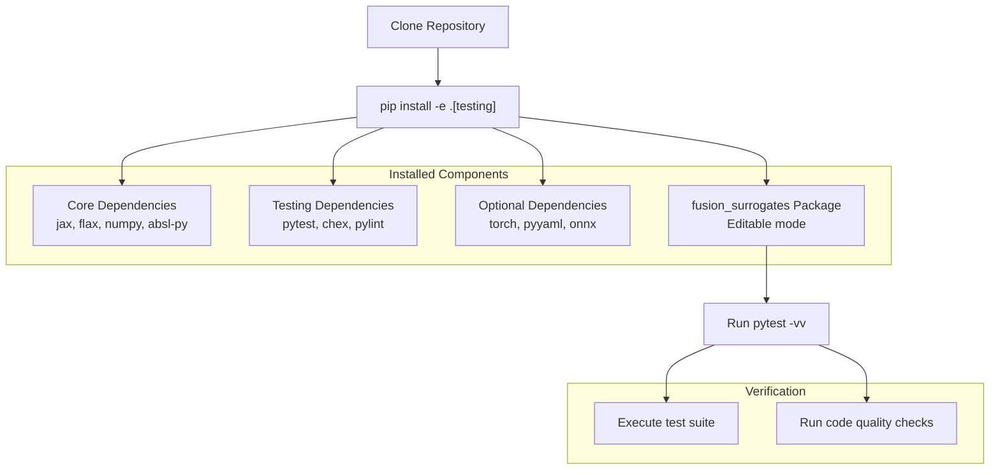
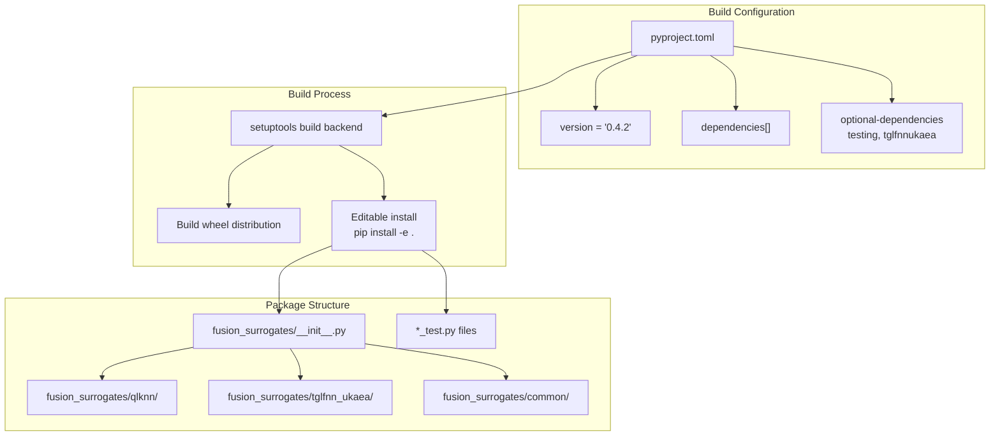
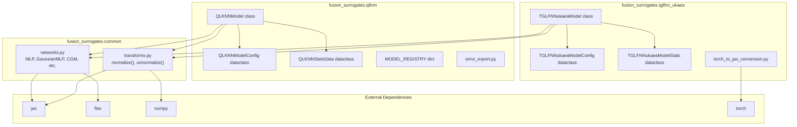
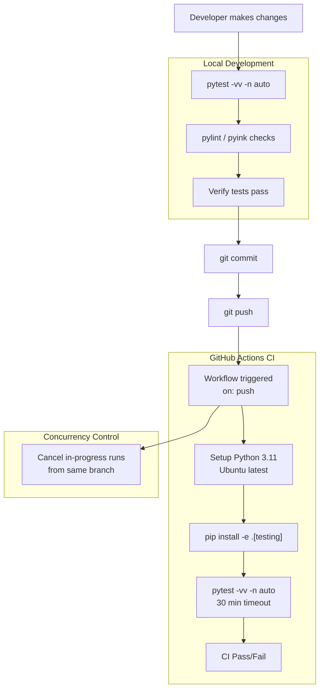

<!-- source: DeepWiki mcp.deepwiki.com · repo google-deepmind/fusion_surrogates · page 6 Development Guide · fetched 2026-10-26 -->

# Development Guide

<details>
<summary>Relevant source files</summary>

The following files were used as context for generating this wiki page:

- [.github/workflows/pytest.yml](.github/workflows/pytest.yml)
- [fusion_surrogates/common/transforms_test.py](fusion_surrogates/common/transforms_test.py)
- [pyproject.toml](pyproject.toml)

</details>


## Purpose and Scope

This document provides guidance for developers contributing to the `fusion_surrogates` library. It covers development environment setup, build system configuration, code organization, and the overall contribution workflow. For detailed information on specific topics:

- Testing framework and writing tests: see [Testing Framework](#6.1)
- GitHub Actions CI/CD pipeline: see [CI/CD Pipeline](#6.2)
- Adding new surrogate models: see [Contributing New Models](#6.3)

This page focuses on the foundational development infrastructure shared across all contributions.

## Development Environment Setup

### Installation for Development

Install the library in editable mode with all development dependencies:

```bash
git clone https://github.com/google-deepmind/fusion_surrogates.git
cd fusion_surrogates
pip install -e .[testing]
```

The `-e` flag creates an editable installation where changes to source code are immediately reflected without reinstalling.

### Dependency Groups

The library defines several dependency groups in `pyproject.toml`:

| Dependency Group | Purpose | Key Packages |
|-----------------|---------|--------------|
| **Core** | Required for all functionality | `jax>=0.4.31`, `flax>=0.7.5`, `numpy>2`, `absl-py>=2.0.0`, `immutabledict` |
| **testing** | Development and testing | `pytest`, `pytest-xdist`, `chex`, `onnx`, `jaxonnxruntime`, `pylint>=2.6.0`, `pyink`, `pyyaml`, `torch>=2.7.1` |
| **tglfnnukaea** | TGLFNN model support | `torch>=2.7.1`, `pyyaml` |

The `testing` group includes all dependencies needed for local development, while `tglfnnukaea` contains only the runtime requirements for TGLFNN models.

**Sources:** [pyproject.toml:1-49]()

### Diagram: Development Environment Setup Flow



**Sources:** [pyproject.toml:21-45](), [.github/workflows/pytest.yml:19-30]()

## Build System

### Build Configuration

The library uses `setuptools` with `setuptools-scm` for version management. The build system is configured in `pyproject.toml`:

**Build Backend:** `setuptools.build_meta` with `setuptools>=64`, `setuptools-scm>=8`, and `wheel` as build requirements.

**Version Management:** The version is statically defined as `"0.4.2"` in the `[project]` section.

**Package Discovery:** Configured via `[tool.setuptools.packages.find]` to include all packages matching the pattern `fusion_surrogates*`.

### Python Version Requirement

The library requires **Python ≥ 3.11**. This is enforced at installation time via the `requires-python` field.

### Package Structure

```
fusion_surrogates/
├── qlknn/              # QLKNN model system
├── tglfnn_ukaea/       # TGLFNN-UKAEA model system
├── common/             # Shared infrastructure (networks, transforms)
└── *_test.py files     # Unit tests co-located with modules
```

**Sources:** [pyproject.toml:1-49]()

### Diagram: Build System Architecture



**Sources:** [pyproject.toml:1-49]()

## Code Organization

### Module Structure

The codebase is organized into three primary modules:

| Module | Purpose | Key Components |
|--------|---------|----------------|
| `fusion_surrogates.qlknn` | QLKNN surrogate models | `QLKNNModel`, `QLKNNModelConfig`, `QLKNNStatsData`, model registry, ONNX export |
| `fusion_surrogates.tglfnn_ukaea` | TGLFNN-UKAEA surrogate models | `TGLFNNukaeaModel`, `TGLFNNukaeaModelConfig`, `TGLFNNukaeaModelStats`, PyTorch-to-JAX conversion |
| `fusion_surrogates.common` | Shared infrastructure | `networks` module, `transforms` module, base classes |

### Test File Organization

Test files follow the naming convention `<module_name>_test.py` and are co-located with the modules they test. For example:

- `fusion_surrogates/common/transforms.py` → `fusion_surrogates/common/transforms_test.py`
- Module tests → `fusion_surrogates/qlknn/qlknn_test.py`

### Common Patterns

**Configuration Classes:** Both QLKNN and TGLFNN use dataclass-based configuration objects to define model architecture and hyperparameters. These configurations are immutable and serializable.

**Data Transformation:** All input/output normalization flows through the `transforms.normalize()` and `transforms.unnormalize()` functions in `fusion_surrogates.common.transforms`.

**Network Architectures:** Neural network definitions use Flax's `linen.nn.Module` API and are registered in `networks.NETWORK_MAP` for dynamic lookup.

**Sources:** Project structure analysis

### Diagram: Code Module Dependencies



**Sources:** Project structure analysis, [pyproject.toml:21-28]()

## Testing Overview

The library uses `pytest` as its testing framework with the following features:

**Parallel Execution:** Tests run in parallel using `pytest-xdist` (invoked with `-n auto` flag) to maximize CPU utilization and reduce total test time.

**Test Categories:**
- **Unit tests:** Validate individual functions and classes (e.g., `transforms_test.py`)
- **Model tests:** Verify numerical accuracy of surrogate model predictions
- **Integration tests:** Test end-to-end workflows including model loading and inference

**Running Tests Locally:**
```bash
# Run all tests in parallel
pytest -vv -n auto

# Run specific test file
pytest -vv fusion_surrogates/common/transforms_test.py

# Run with verbose output
pytest -vvv -n auto
```

For detailed information on the testing framework, test organization, and writing new tests, see [Testing Framework](#6.1).

**Sources:** [.github/workflows/pytest.yml:29-30](), [fusion_surrogates/common/transforms_test.py:1-59]()

### Example Test Structure

Test files in the library follow a standard structure illustrated by `transforms_test.py`:

```python
# Standard imports
from absl.testing import absltest
from absl.testing import parameterized
from fusion_surrogates.common import transforms
import jax
import jax.numpy as jnp
from numpy import testing

# Test class inherits from parameterized.TestCase
class TransformsTest(parameterized.TestCase):
  """Tests for transforms."""
  
  def test_normalize(self):
    # Test implementation
    pass
    
  def test_unnormalize(self):
    # Test implementation
    pass

if __name__ == '__main__':
  absltest.main()
```

**Key characteristics:**
- Uses `absl.testing` framework for compatibility with Google's testing infrastructure
- Supports parameterized tests via `parameterized.TestCase`
- Uses `numpy.testing.assert_array_almost_equal()` for numerical comparisons
- Follows naming convention: `test_<function_name>()`

**Sources:** [fusion_surrogates/common/transforms_test.py:15-59]()

## CI/CD Overview

The library uses GitHub Actions for continuous integration. The CI pipeline:

1. **Triggers:** Runs on every push and supports manual workflow dispatch
2. **Environment:** Ubuntu latest with Python 3.11
3. **Timeout:** 30-minute maximum runtime
4. **Concurrency Control:** Cancels in-progress runs when new commits are pushed to the same branch
5. **Test Execution:** Runs `pytest -vv -n auto` for parallel test execution

The CI configuration is defined in `.github/workflows/pytest.yml`. For complete details on the CI/CD pipeline, test execution strategies, and quality assurance processes, see [CI/CD Pipeline](#6.2).

**Sources:** [.github/workflows/pytest.yml:1-31]()

### Diagram: Development and CI Workflow



**Sources:** [.github/workflows/pytest.yml:1-31]()

## Contribution Workflow

### General Process

1. **Fork and clone** the repository
2. **Create a feature branch** for your changes
3. **Implement changes** following existing code patterns
4. **Write tests** for new functionality
5. **Run tests locally** to verify correctness
6. **Submit pull request** with clear description

### Code Quality Standards

**Testing Requirements:**
- All new code must have corresponding unit tests
- Tests must achieve reasonable coverage of edge cases
- Numerical tests should use appropriate tolerances with `numpy.testing.assert_array_almost_equal()`

**Style Guidelines:**
- Follow existing code patterns and conventions
- Use type hints for function signatures
- Include docstrings for public APIs
- Use `pylint` and `pyink` for code quality checks (included in `[testing]` dependencies)

### Adding New Features

When contributing new features:

**For new surrogate models:** Follow the patterns in existing model systems (QLKNN, TGLFNN). See [Contributing New Models](#6.3) for detailed guidance.

**For new network architectures:** Add to `fusion_surrogates/common/networks.py` and register in `NETWORK_MAP`.

**For new utilities:** Add to `fusion_surrogates/common/` if the functionality is model-agnostic.

**Sources:** [pyproject.toml:30-41](), project conventions

## Dependencies Management

### Core Dependencies Version Requirements

The library has specific version constraints to ensure compatibility:

| Package | Constraint | Reason |
|---------|-----------|--------|
| `jax` | `>=0.4.31` | Required for modern JAX features and bug fixes |
| `flax` | `>=0.7.5` | Neural network API compatibility |
| `numpy` | `>2` | NumPy 2.x required for modern array protocol |
| `torch` | `>=2.7.1` | NumPy 2.x compatibility for TGLFNN model loading |
| `absl-py` | `>=2.0.0` | Testing framework compatibility |

### Optional Dependency Installation

Install specific dependency groups as needed:

```bash
# Install only TGLFNN runtime dependencies
pip install fusion_surrogates[tglfnnukaea]

# Install all testing dependencies
pip install fusion_surrogates[testing]

# Install both
pip install fusion_surrogates[testing,tglfnnukaea]
```

**Sources:** [pyproject.toml:21-45]()

## Package Distribution

### Building Distribution Packages

Build wheel distributions for PyPI:

```bash
# Install build dependencies
pip install build

# Build wheel
python -m build

# Output: dist/fusion_surrogates-0.4.2-py3-none-any.whl
```

### Version Management

The current version (`0.4.2`) is statically defined in `pyproject.toml`. To update:

1. Modify the `version` field in `[project]` section
2. Commit the change
3. Tag the release: `git tag v0.4.2`
4. Push tags: `git push --tags`

**Sources:** [pyproject.toml:1-11]()

---

