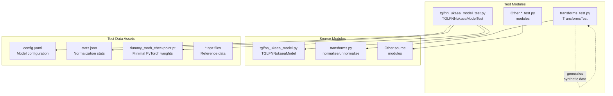
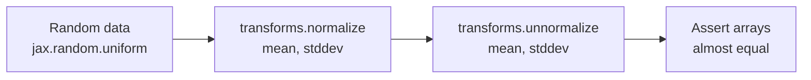
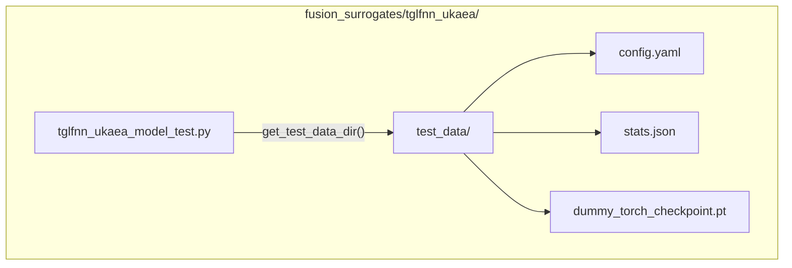
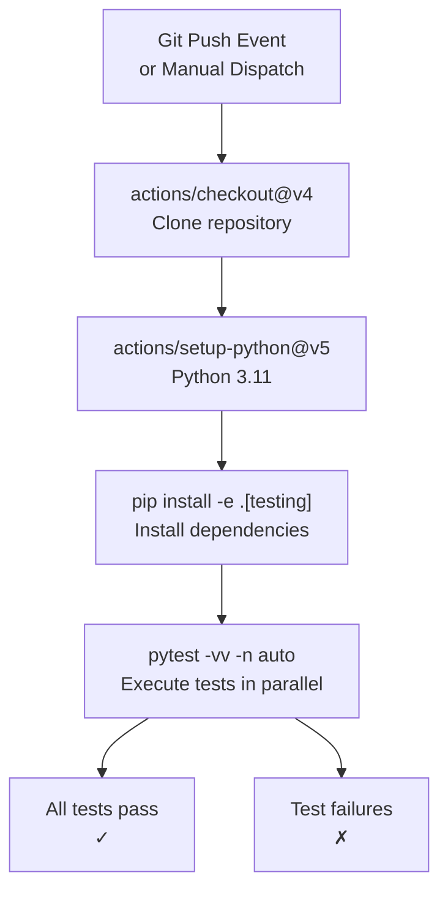
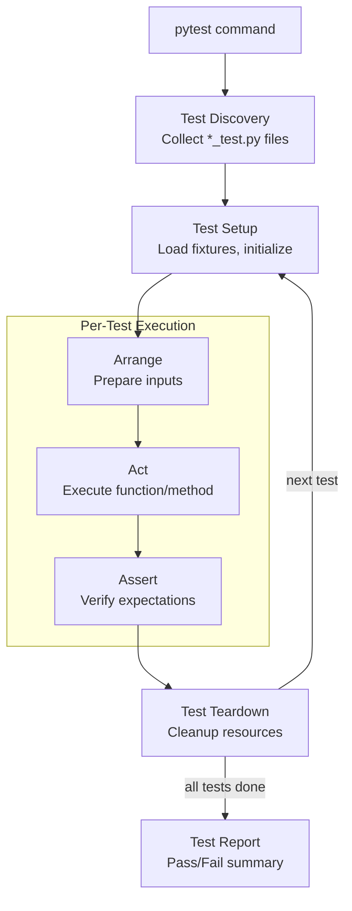

<!-- source: DeepWiki mcp.deepwiki.com · repo google-deepmind/fusion_surrogates · page 6.1 Testing Framework · fetched 2026-10-26 -->

# Testing Framework

<details>
<summary>Relevant source files</summary>

The following files were used as context for generating this wiki page:

- [.github/workflows/pytest.yml](.github/workflows/pytest.yml)
- [fusion_surrogates/common/transforms_test.py](fusion_surrogates/common/transforms_test.py)
- [fusion_surrogates/tglfnn_ukaea/tglfnn_ukaea_model_test.py](fusion_surrogates/tglfnn_ukaea/tglfnn_ukaea_model_test.py)
- [pyproject.toml](pyproject.toml)

</details>


## Purpose and Scope

This document describes the testing infrastructure for the `fusion_surrogates` library. It covers test organization, local test execution, CI/CD integration, and patterns for writing new tests. For information about the CI/CD pipeline configuration, see [CI/CD Pipeline](#6.2).

---

## Test Infrastructure Overview

The library uses **pytest** as its primary testing framework with several supporting tools for comprehensive validation. All test dependencies are defined in the `[project.optional-dependencies]` section under the `testing` group.

### Testing Dependencies

| Package | Version | Purpose |
|---------|---------|---------|
| `pytest` | Latest | Test framework and runner |
| `pytest-xdist` | Latest | Parallel test execution |
| `chex` | Latest | JAX testing utilities |
| `jaxonnxruntime` | Latest | ONNX runtime for JAX compatibility testing |
| `onnx` | Latest | ONNX model validation |
| `torch` | ≥2.7.1 | PyTorch checkpoint loading for TGLFNN tests |
| `pyyaml` | Latest | YAML configuration parsing |
| `pylint` | ≥2.6.0 | Code quality checking |
| `pyink` | Latest | Code formatting validation |

**Sources:** [pyproject.toml:30-41]()

---

## Test Suite Structure

The test suite is organized into test modules that mirror the source code structure. Each module ending in `_test.py` contains tests for its corresponding implementation module.



**Test Organization Patterns:**

- **Test modules**: Located alongside source files with `_test.py` suffix
- **Test classes**: Inherit from `parameterized.TestCase` or `absltest.TestCase`
- **Test methods**: Prefixed with `test_` for automatic discovery
- **Test data**: Stored in `test_data/` subdirectories adjacent to test modules

**Sources:** [fusion_surrogates/tglfnn_ukaea/tglfnn_ukaea_model_test.py:1-147](), [fusion_surrogates/common/transforms_test.py:1-59]()

---

## Test Categories

### Unit Tests

Unit tests validate individual functions and classes in isolation. They typically use synthetic data and test specific behaviors.

**Example: Transform Reversibility Test**



The `TransformsTest` class validates that normalization and unnormalization are inverse operations:

- **`test_normalize`**: Verifies normalized data has mean=0, std=1
- **`test_unnormalize`**: Verifies `unnormalize(normalize(data))` recovers original data

**Sources:** [fusion_surrogates/common/transforms_test.py:26-54]()

### Model Tests

Model tests validate end-to-end model functionality including loading, parameter initialization, and prediction accuracy.

**Example: TGLFNN Model Test Structure**

| Test Method | Purpose | Validation |
|-------------|---------|------------|
| `test_dummy_load` | Config/stats/params loading | Checks parameter structure |
| `test_load_params_without_errors` | Full model loading | Uses real weights (conditional) |
| `test_predict_shape` | Prediction output shapes | Parameterized across input shapes |

**Sources:** [fusion_surrogates/tglfnn_ukaea/tglfnn_ukaea_model_test.py:35-143]()

### Parameterized Tests

The framework extensively uses `parameterized.TestCase` to run the same test logic across multiple scenarios.

**Example from TGLFNN Model Tests:**

```python
@parameterized.named_parameters(
    dict(testcase_name="batched_inputs", 
         input_shape=(5, 10, 13),
         expected_output_shape=(5, 10, 2)),
    dict(testcase_name="non_batched_inputs",
         input_shape=(10, 13),
         expected_output_shape=(10, 2)),
    # ... more cases
)
def test_predict_shape(self, input_shape, expected_output_shape):
```

This pattern tests shape handling for different tensor dimensions without code duplication.

**Sources:** [fusion_surrogates/tglfnn_ukaea/tglfnn_ukaea_model_test.py:97-143]()

---

## Test Data Management

### Test Fixture Directory Structure



**Test Data Access Pattern:**

The `get_test_data_dir()` helper method provides path resolution:

```python
def get_test_data_dir(self):
    src_dir = pathlib.Path(os.path.dirname(__file__))
    path = src_dir.joinpath("test_data")
    assert path.is_dir(), f"Path {path} is not a directory."
    return path
```

This pattern ensures tests can locate fixtures regardless of working directory.

**Sources:** [fusion_surrogates/tglfnn_ukaea/tglfnn_ukaea_model_test.py:29-33]()

### Conditional Test Execution

Some tests require external assets that may not be available in all environments. These use `@absltest.skipUnless`:

```python
@absltest.skipUnless(
    os.getenv("TGLFNN_UKAEA_DIR", None) is not None,
    "TGLFNN_UKAEA_DIR not set",
)
def test_load_params_without_errors(self):
    weights_dir = pathlib.Path(os.getenv("TGLFNN_UKAEA_DIR")) / "MultiMachineHyper_1Aug25"
    # ... test using real weights
```

This allows comprehensive tests when full assets are available while maintaining CI pipeline compatibility with minimal fixtures.

**Sources:** [fusion_surrogates/tglfnn_ukaea/tglfnn_ukaea_model_test.py:73-95]()

---

## Running Tests Locally

### Basic Test Execution

Install testing dependencies:

```bash
pip install -e .[testing]
```

Run all tests:

```bash
pytest -vv
```

Run tests in parallel (recommended for faster execution):

```bash
pytest -vv -n auto
```

### Selective Test Execution

Run specific test module:

```bash
pytest fusion_surrogates/tglfnn_ukaea/tglfnn_ukaea_model_test.py -vv
```

Run specific test class:

```bash
pytest fusion_surrogates/tglfnn_ukaea/tglfnn_ukaea_model_test.py::TGLFNNukaeaModelTest -vv
```

Run specific test method:

```bash
pytest fusion_surrogates/tglfnn_ukaea/tglfnn_ukaea_model_test.py::TGLFNNukaeaModelTest::test_dummy_load -vv
```

### Test Output Flags

| Flag | Purpose |
|------|---------|
| `-vv` | Verbose output showing individual test names and results |
| `-n auto` | Parallel execution using all available CPU cores (requires `pytest-xdist`) |
| `-k EXPRESSION` | Run tests matching the given substring expression |
| `--tb=short` | Shorter traceback format for failures |

**Sources:** [.github/workflows/pytest.yml:28-30]()

---

## CI/CD Integration

### GitHub Actions Workflow

The test suite runs automatically on every push via GitHub Actions.



**Workflow Configuration Details:**

| Setting | Value | Purpose |
|---------|-------|---------|
| **Runner** | `ubuntu-latest` | Consistent Linux environment |
| **Python** | `3.11` | Minimum required version |
| **Timeout** | 30 minutes | Prevents runaway test execution |
| **Concurrency** | Cancel in-progress runs | Saves resources when new commits arrive |

**Sources:** [.github/workflows/pytest.yml:1-31]()

### Concurrency Control

The workflow includes concurrency management to prevent resource waste:

```yaml
concurrency:
  group: ${{ github.workflow }}-${{ github.ref }}
  cancel-in-progress: true
```

This configuration ensures that:
- Only one test run executes per branch at a time
- New commits automatically cancel in-progress test runs for the same branch
- Multiple branches can run tests simultaneously

**Sources:** [.github/workflows/pytest.yml:11-13]()

---

## Writing New Tests

### Test Class Template

```python
from absl.testing import absltest
from absl.testing import parameterized
import jax.numpy as jnp

class MyComponentTest(parameterized.TestCase):
  
  def test_basic_functionality(self):
    """Test description."""
    # Arrange
    inputs = jnp.ones((10, 5))
    
    # Act
    result = my_function(inputs)
    
    # Assert
    self.assertEqual(result.shape, (10, 3))
```

### Key Testing Patterns

#### 1. JAX Random Number Generation

Use JAX's deterministic PRNG for reproducible tests:

```python
data = jax.random.uniform(jax.random.key(0), shape=data_shape)
```

**Sources:** [fusion_surrogates/common/transforms_test.py:30]()

#### 2. Array Comparison

Use NumPy testing utilities for floating-point comparisons:

```python
from numpy import testing

testing.assert_array_almost_equal(actual, expected)
```

**Sources:** [fusion_surrogates/common/transforms_test.py:36-40]()

#### 3. Parameterized Test Definitions

Use `@parameterized.named_parameters` for multiple test cases:

```python
@parameterized.named_parameters(
    dict(testcase_name="case1", param1=value1, param2=value2),
    dict(testcase_name="case2", param1=value3, param2=value4),
)
def test_with_parameters(self, param1, param2):
    # Test logic using param1 and param2
```

**Sources:** [fusion_surrogates/tglfnn_ukaea/tglfnn_ukaea_model_test.py:97-118]()

#### 4. Conditional Test Execution

Skip tests when required resources are unavailable:

```python
@absltest.skipUnless(
    os.getenv("REQUIRED_ENV_VAR", None) is not None,
    "REQUIRED_ENV_VAR not set",
)
def test_requiring_external_resources(self):
    # Test logic
```

**Sources:** [fusion_surrogates/tglfnn_ukaea/tglfnn_ukaea_model_test.py:73-76]()

---

## Test Execution Flow



**Execution Phases:**

1. **Discovery**: pytest scans for files matching `*_test.py` and collects test methods
2. **Setup**: Test class initialization, fixture loading via helper methods
3. **Execution**: Each test method runs with its arrange-act-assert pattern
4. **Teardown**: Automatic cleanup (minimal in JAX-based tests due to functional style)
5. **Reporting**: Summary of passed/failed tests with tracebacks for failures

**Sources:** [.github/workflows/pytest.yml:28-30](), [fusion_surrogates/tglfnn_ukaea/tglfnn_ukaea_model_test.py:1-147]()

---

## Best Practices

### Test Independence

Each test should be fully independent:

- **No shared state**: Use fresh data in each test method
- **Deterministic inputs**: Use seeded random number generators
- **No test ordering dependencies**: Tests must pass in any execution order

### Test Naming Conventions

| Convention | Purpose | Example |
|------------|---------|---------|
| `*_test.py` | Module naming | `transforms_test.py` |
| `Test*` class suffix | Test class naming | `TransformsTest` |
| `test_*` method prefix | Test method naming | `test_normalize` |
| Named parameters | Descriptive test cases | `testcase_name="batched_inputs"` |

### Assertion Strategies

- **Shape validation**: Verify tensor dimensions match expectations
- **Numerical accuracy**: Use `assert_array_almost_equal` for floating-point comparisons
- **Structure validation**: Check dictionary keys, nested structure depth
- **Error conditions**: Use `self.assertRaises` for expected exceptions

**Sources:** [fusion_surrogates/common/transforms_test.py:23-58](), [fusion_surrogates/tglfnn_ukaea/tglfnn_ukaea_model_test.py:27-143]()

---

## Debugging Failed Tests

### Local Debugging Workflow

1. **Run specific failing test**:
   ```bash
   pytest path/to/test.py::TestClass::test_method -vv --tb=long
   ```

2. **Add print statements** or use `pdb`:
   ```python
   import pdb; pdb.set_trace()
   ```

3. **Examine JAX array values**:
   ```python
   print(f"Shape: {arr.shape}, Values: {arr}")
   ```

4. **Check for device issues**:
   ```python
   import jax
   print(f"Available devices: {jax.devices()}")
   ```

### Common Test Failure Patterns

| Symptom | Likely Cause | Solution |
|---------|--------------|----------|
| Shape mismatch | Incorrect broadcasting or reshape | Verify input dimensions |
| NaN in outputs | Division by zero or invalid operation | Check normalization statistics |
| Import errors | Missing optional dependency | Install with `pip install -e .[testing]` |
| File not found | Incorrect test data path | Verify `get_test_data_dir()` implementation |

**Sources:** [fusion_surrogates/tglfnn_ukaea/tglfnn_ukaea_model_test.py:29-33]()

---

