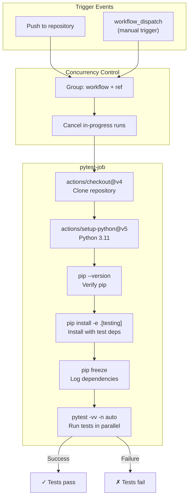
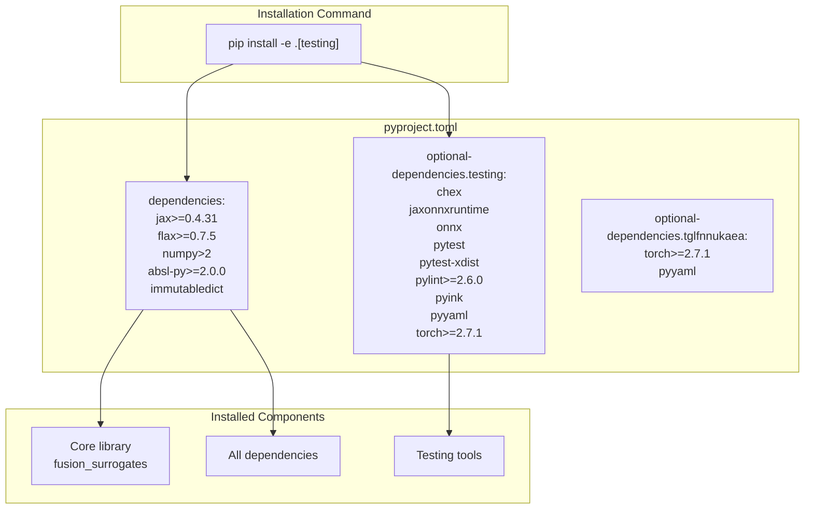
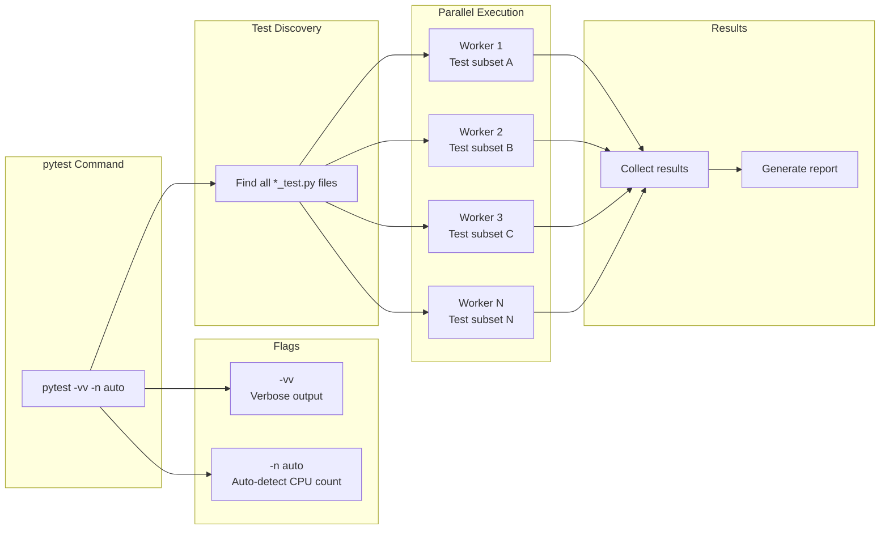
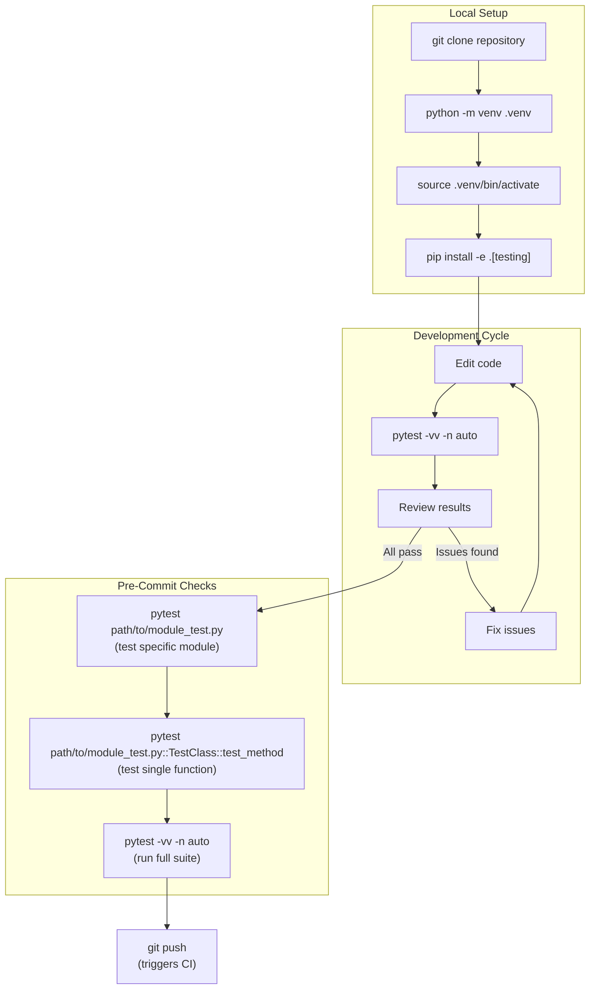

<!-- source: DeepWiki mcp.deepwiki.com · repo google-deepmind/fusion_surrogates · page 6.2 CI/CD Pipeline · fetched 2026-10-26 -->

# CI/CD Pipeline

<details>
<summary>Relevant source files</summary>

The following files were used as context for generating this wiki page:

- [.github/workflows/pytest.yml](.github/workflows/pytest.yml)
- [fusion_surrogates/qlknn/models/qlknn_7_11_test.py](fusion_surrogates/qlknn/models/qlknn_7_11_test.py)
- [pyproject.toml](pyproject.toml)

</details>


## Purpose and Scope

This document describes the Continuous Integration and Continuous Deployment (CI/CD) infrastructure for the `fusion_surrogates` library. It covers the GitHub Actions workflow configuration, test execution strategy, dependency management, and quality assurance processes that run automatically on every code change.

For information about the testing framework itself and writing new tests, see [Testing Framework](#6.1). For guidance on contributing new models, see [Contributing New Models](#6.3).

---

## Overview

The CI/CD pipeline ensures code quality and correctness through automated testing on every push to the repository. The system uses GitHub Actions to provision a fresh Ubuntu environment, install dependencies, and execute the test suite in parallel.

**Key characteristics:**
- **Trigger**: Automatic on every push, manual dispatch available
- **Environment**: Ubuntu latest with Python 3.11
- **Timeout**: 30 minutes maximum execution time
- **Concurrency**: Automatically cancels in-progress runs when new commits arrive
- **Parallelization**: Tests run in parallel using `pytest-xdist`

Sources: [.github/workflows/pytest.yml:1-31]()

---

## GitHub Actions Workflow Structure

The CI/CD pipeline is defined in a single workflow file that orchestrates all testing activities.



**Diagram: GitHub Actions Workflow Execution Flow**

The workflow configuration is minimal but effective:

| Configuration | Value | Purpose |
|--------------|-------|---------|
| `name` | "Unittests" | Display name in GitHub UI |
| `on` | `[push, workflow_dispatch]` | Trigger conditions |
| `runs-on` | `ubuntu-latest` | Execution environment |
| `timeout-minutes` | 30 | Prevent runaway jobs |
| `concurrency.group` | `${{ github.workflow }}-${{ github.ref }}` | Unique identifier per branch |
| `concurrency.cancel-in-progress` | `true` | Cancel outdated runs |

Sources: [.github/workflows/pytest.yml:1-31]()

---

## Dependency Management

The pipeline installs the library in editable mode with all testing dependencies. The dependency configuration is centralized in `pyproject.toml`.



**Diagram: Dependency Installation Process**

### Core Dependencies

Installed with every build:

| Package | Version | Purpose |
|---------|---------|---------|
| `jax` | ≥0.4.31 | Numerical computation engine |
| `flax` | ≥0.7.5 | Neural network framework |
| `numpy` | >2 | Array operations |
| `absl-py` | ≥2.0.0 | Testing utilities |
| `immutabledict` | (any) | Immutable dictionary structures |

### Testing Dependencies

Installed only in CI and development:

| Package | Purpose |
|---------|---------|
| `pytest` | Test framework |
| `pytest-xdist` | Parallel test execution |
| `chex` | JAX testing utilities |
| `jaxonnxruntime` | ONNX runtime for JAX |
| `onnx` | ONNX model validation |
| `pylint` | Static code analysis |
| `pyink` | Code formatting |
| `pyyaml` | Configuration file parsing |
| `torch` | PyTorch checkpoint loading |

**Note**: PyTorch 2.7.1 or higher is required for NumPy 2.x compatibility when loading TGLFNN models.

Sources: [pyproject.toml:21-45](), [.github/workflows/pytest.yml:24-26]()

---

## Test Execution Strategy

Tests run in parallel using `pytest` with the `pytest-xdist` plugin for maximum efficiency.



**Diagram: Parallel Test Execution with pytest-xdist**

### Command-Line Flags

The pytest invocation uses specific flags for CI optimization:

```bash
pytest -vv -n auto
```

| Flag | Effect |
|------|--------|
| `-vv` | Very verbose output - shows test names and detailed failure information |
| `-n auto` | Automatically detect number of CPU cores and spawn that many worker processes |

### Test File Discovery

pytest automatically discovers test files matching these patterns:
- Files named `*_test.py` (e.g., `qlknn_7_11_test.py`)
- Test classes named `Test*` or `*Test`
- Test functions named `test_*`

Example test file structure:

```python
# fusion_surrogates/qlknn/models/qlknn_7_11_test.py
class Qlknn711Test(parameterized.TestCase):
    def test_nan(self):
        # Test implementation
    
    @parameterized.parameters(1, 10, 100)
    def test_shape(self, batch_size):
        # Parameterized test implementation
```

Sources: [.github/workflows/pytest.yml:29-30](), [fusion_surrogates/qlknn/models/qlknn_7_11_test.py:46-90]()

---

## Test Coverage

The test suite validates multiple aspects of the codebase:

```mermaid
graph TB
    subgraph "Test Categories"
        UNIT["Unit Tests"]
        MODEL["Model Tests"]
        INTEGRATION["Integration Tests"]
    end
    
    subgraph "Unit Test Areas"
        U1["Network architectures:<br/>MLP, GaussianMLP, CGM"]
        U2["Transform functions:<br/>normalize/unnormalize"]
        U3["Configuration parsing"]
    end
    
    subgraph "Model Test Areas"
        M1["Numerical accuracy:<br/>compare to reference data"]
        M2["Shape validation:<br/>input/output dimensions"]
        M3["NaN detection"]
        M4["ONNX export compatibility"]
        M5["Registry lookups"]
    end
    
    subgraph "Integration Test Areas"
        I1["Model loading:<br/>from disk/registry"]
        I2["End-to-end prediction"]
        I3["JIT compilation"]
        I4["Batch processing"]
    end
    
    UNIT --> U1
    UNIT --> U2
    UNIT --> U3
    
    MODEL --> M1
    MODEL --> M2
    MODEL --> M3
    MODEL --> M4
    MODEL --> M5
    
    INTEGRATION --> I1
    INTEGRATION --> I2
    INTEGRATION --> I3
    INTEGRATION --> I4
```



**Diagram: Test Coverage Categories**

### Example: QLKNN Numerical Tests

The QLKNN test suite demonstrates comprehensive validation:

```python
# Test for NaN values in model parameters
def test_nan(self):
    model = qlknn_model.QLKNNModel.load_default_model()
    self.assertFalse(model.has_nan())

# Parameterized shape tests
@parameterized.parameters(1, 10, 100)
def test_shape(self, batch_size):
    model = qlknn_model.QLKNNModel.load_default_model()
    inputs = np.empty((1, batch_size, model.num_inputs))
    outputs = model.predict_targets(inputs)
    self.assertEqual(outputs.shape, (1, batch_size, model.num_targets))

# Numerical accuracy tests (10 decimal places)
@parameterized.parameters(*_get_test_inputs_and_targets())
def test_numerical_numpy(self, inputs, targets):
    model = qlknn_model.QLKNNModel.load_default_model()
    preds = model.predict_targets(inputs)
    testing.assert_array_almost_equal(preds, targets, decimal=10)

# JIT compilation tests
@parameterized.parameters(*_get_test_inputs_and_targets())
def test_numerical_jitted(self, inputs, targets):
    model = qlknn_model.QLKNNModel.load_default_model()
    inputs = jnp.array(inputs, dtype=jnp.float64)
    preds = jax.jit(model.predict_targets)(inputs)
    testing.assert_array_almost_equal(preds, targets, decimal=10)

# Registry validation tests
@parameterized.parameters(registry.MODELS.keys())
def test_registry(self, model_name):
    model = qlknn_model.QLKNNModel.load_model_from_name(model_name)
    self.assertEqual(model.name, model_name)
    self.assertEqual(model.path, registry.MODELS[model_name])
```

Sources: [fusion_surrogates/qlknn/models/qlknn_7_11_test.py:46-90]()

---

## Quality Assurance Measures

The CI/CD pipeline implements several quality assurance mechanisms:

### 1. Concurrency Control

Prevents resource waste by canceling outdated test runs:

```yaml
concurrency:
  group: ${{ github.workflow }}-${{ github.ref }}
  cancel-in-progress: true
```

**How it works:**
- Each branch/PR has a unique concurrency group
- New commits cancel in-progress runs for the same branch
- Saves CI minutes and provides faster feedback

### 2. Timeout Protection

Prevents runaway jobs from consuming resources:

```yaml
timeout-minutes: 30
```

**Rationale:**
- Normal test suite completes in under 5 minutes
- 30-minute timeout catches infinite loops or hangs
- Automatically fails and notifies on timeout

### 3. Dependency Verification

Logs all installed packages for reproducibility:

```yaml
- run: pip freeze
```

**Output example:**
```
absl-py==2.1.0
chex==0.1.85
flax==0.7.5
jax==0.4.31
numpy==2.0.0
pytest==8.0.0
pytest-xdist==3.5.0
...
```

This enables:
- Debugging dependency-related test failures
- Reproducing CI environment locally
- Tracking dependency version changes over time

### 4. Verbose Test Output

Uses `-vv` flag for detailed test information:

```
fusion_surrogates/qlknn/models/qlknn_7_11_test.py::Qlknn711Test::test_nan PASSED
fusion_surrogates/qlknn/models/qlknn_7_11_test.py::Qlknn711Test::test_shape[1] PASSED
fusion_surrogates/qlknn/models/qlknn_7_11_test.py::Qlknn711Test::test_shape[10] PASSED
...
```

Benefits:
- Quick identification of which specific test failed
- Shows exact parameter combinations for parameterized tests
- Provides stack traces for debugging

Sources: [.github/workflows/pytest.yml:9-14](), [.github/workflows/pytest.yml:24-30]()

---

## Local Development Workflow

Developers can replicate the CI environment locally for testing before pushing code.



**Diagram: Local Development and Testing Workflow**

### Installation Commands

```bash
# Clone repository
git clone https://github.com/google-deepmind/fusion_surrogates.git
cd fusion_surrogates

# Create and activate virtual environment
python -m venv .venv
source .venv/bin/activate  # On Windows: .venv\Scripts\activate

# Install in editable mode with testing dependencies
pip install -e .[testing]

# Verify installation
python -c "import fusion_surrogates; print(fusion_surrogates.__version__)"
```

### Running Tests Locally

```bash
# Run all tests (same as CI)
pytest -vv -n auto

# Run specific module tests
pytest fusion_surrogates/qlknn/models/qlknn_7_11_test.py

# Run specific test class
pytest fusion_surrogates/qlknn/models/qlknn_7_11_test.py::Qlknn711Test

# Run specific test function
pytest fusion_surrogates/qlknn/models/qlknn_7_11_test.py::Qlknn711Test::test_shape

# Run with specific parameter
pytest fusion_surrogates/qlknn/models/qlknn_7_11_test.py::Qlknn711Test::test_shape[10]

# Run without parallelization (for debugging)
pytest -vv

# Run with even more verbosity
pytest -vvv

# Stop at first failure
pytest -x
```

### Test Data Management

Some tests require reference data files:

```python
# Loading test data
TEST_DATA_FILENAME = "qlknn_7_11_test_data.npz"

def _get_test_inputs_and_targets():
    with open(
        os.path.join(os.path.dirname(__file__), TEST_DATA_FILENAME), "rb"
    ) as f:
        test_data = np.load(f)
        inputs = test_data["inputs"]
        outputs = test_data["outputs"]
    return zip(inputs, outputs)
```

Test data files are located alongside test files and committed to the repository.

Sources: [pyproject.toml:30-41](), [fusion_surrogates/qlknn/models/qlknn_7_11_test.py:32-43]()

---

## Configuration Files

The CI/CD system relies on these configuration files:

### Build Configuration: `pyproject.toml`

| Section | Purpose |
|---------|---------|
| `[build-system]` | Specifies build tools: setuptools, setuptools-scm, wheel |
| `[project]` | Package metadata, version, dependencies |
| `[project.optional-dependencies]` | Optional dependency groups (testing, tglfnnukaea) |
| `[tool.setuptools.packages.find]` | Package discovery pattern |

Key settings:

```toml
[project]
name = "fusion_surrogates"
version = "0.4.2"
requires-python = ">=3.11"

[project.optional-dependencies]
testing = [
    "pytest",
    "pytest-xdist",  # Enables -n auto flag
    "chex",          # JAX testing utilities
    "onnx",          # ONNX export tests
    # ... more dependencies
]
```

### Workflow Configuration: `.github/workflows/pytest.yml`

Complete workflow specification:

```yaml
name: Unittests
on: [push, workflow_dispatch]

jobs:
  pytest-job:
    runs-on: ubuntu-latest
    timeout-minutes: 30
    
    concurrency:
      group: ${{ github.workflow }}-${{ github.ref }}
      cancel-in-progress: true
    
    steps:
      - uses: actions/checkout@v4
      - uses: actions/setup-python@v5
        with:
          python-version: "3.11"
      - run: pip install -e .[testing]
      - run: pytest -vv -n auto
```

Sources: [pyproject.toml:1-49](), [.github/workflows/pytest.yml:1-31]()

---

## Monitoring and Debugging

### Viewing CI Results

CI results appear in multiple locations:

1. **Commit status**: Green checkmark or red X next to commit
2. **Pull request checks**: Required status check before merging
3. **Actions tab**: Full workflow execution logs and history

### Reading Test Failures

Example failure output:

```
FAILED fusion_surrogates/qlknn/models/qlknn_7_11_test.py::Qlknn711Test::test_numerical_numpy[0] - AssertionError: 
Arrays are not almost equal to 10 decimals

Mismatched elements: 1 / 8 (12.5%)
Max absolute difference: 1.234e-09
Max relative difference: 5.678e-08
 x: array([1.23456789, 2.34567890, ...])
 y: array([1.23456790, 2.34567890, ...])
```

This indicates:
- **Test name**: `test_numerical_numpy` with parameter `[0]`
- **Assertion type**: Numerical comparison
- **Precision**: 10 decimal places
- **Actual values**: Shows differing array elements

### Common Failure Scenarios

| Scenario | Cause | Solution |
|----------|-------|----------|
| `ModuleNotFoundError` | Missing dependency | Add to `pyproject.toml` dependencies |
| `FileNotFoundError` | Missing test data | Commit test data files to repository |
| Timeout | Infinite loop or slow test | Profile code, add timeout decorators |
| Numerical mismatch | Precision issue or algorithm change | Update reference data or tolerance |
| Shape mismatch | API change | Update test expectations |

Sources: [.github/workflows/pytest.yml:1-31](), [fusion_surrogates/qlknn/models/qlknn_7_11_test.py:60-67]()

---

## Best Practices

### For Test Authors

1. **Use parameterized tests** for multiple input scenarios:
   ```python
   @parameterized.parameters(1, 10, 100)
   def test_shape(self, batch_size):
       # Test runs three times with different batch_size values
   ```

2. **Enable JAX double precision** for numerical tests:
   ```python
   jax.config.update("jax_enable_x64", True)
   ```

3. **Store reference data** in committed `.npz` files:
   ```python
   test_data = np.load("test_data.npz")
   inputs = test_data["inputs"]
   outputs = test_data["outputs"]
   ```

4. **Test both NumPy and JIT execution paths**:
   ```python
   def test_numerical_numpy(self, inputs, targets):
       preds = model.predict_targets(inputs)
       testing.assert_array_almost_equal(preds, targets)
   
   def test_numerical_jitted(self, inputs, targets):
       preds = jax.jit(model.predict_targets)(inputs)
       testing.assert_array_almost_equal(preds, targets)
   ```

### For CI Maintenance

1. **Pin Python version** for reproducibility: `python-version: "3.11"`
2. **Use version-pinned actions**: `actions/checkout@v4` (not `@latest`)
3. **Log dependency versions**: `pip freeze` for debugging
4. **Set reasonable timeouts**: Balance between catching hangs and allowing slow tests
5. **Enable concurrency control**: Save CI minutes and get faster feedback

Sources: [fusion_surrogates/qlknn/models/qlknn_7_11_test.py:29-78](), [.github/workflows/pytest.yml:20-30]()

---

## Summary

The CI/CD pipeline provides automated quality assurance through:

| Feature | Implementation | Benefit |
|---------|---------------|---------|
| **Automatic triggering** | GitHub Actions on every push | Immediate feedback on code changes |
| **Parallel execution** | `pytest -n auto` | Fast test suite completion (~5 minutes) |
| **Comprehensive testing** | Unit, model, and integration tests | High confidence in correctness |
| **Dependency isolation** | Fresh environment per run | Reproducible results |
| **Concurrency control** | Cancel in-progress runs | Resource efficiency |
| **Timeout protection** | 30-minute limit | Prevents runaway jobs |
| **Local replication** | `pip install -e .[testing]` | Easy local development |

The pipeline enforces code quality standards while minimizing friction for developers. All tests must pass before code can be merged, ensuring the `main` branch remains stable for downstream consumers like TORAX.

Sources: [.github/workflows/pytest.yml:1-31](), [pyproject.toml:1-49]()

---

