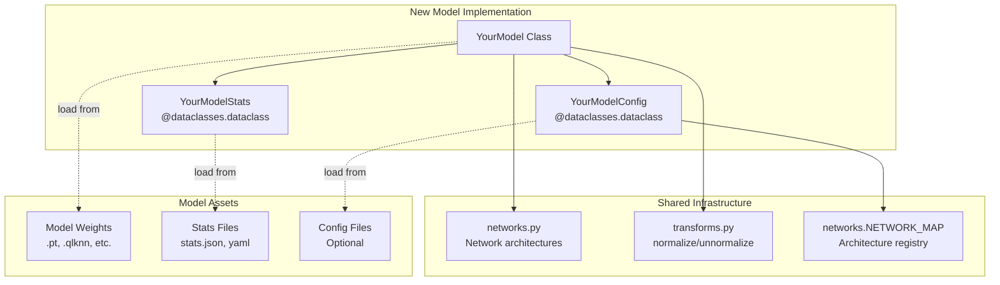
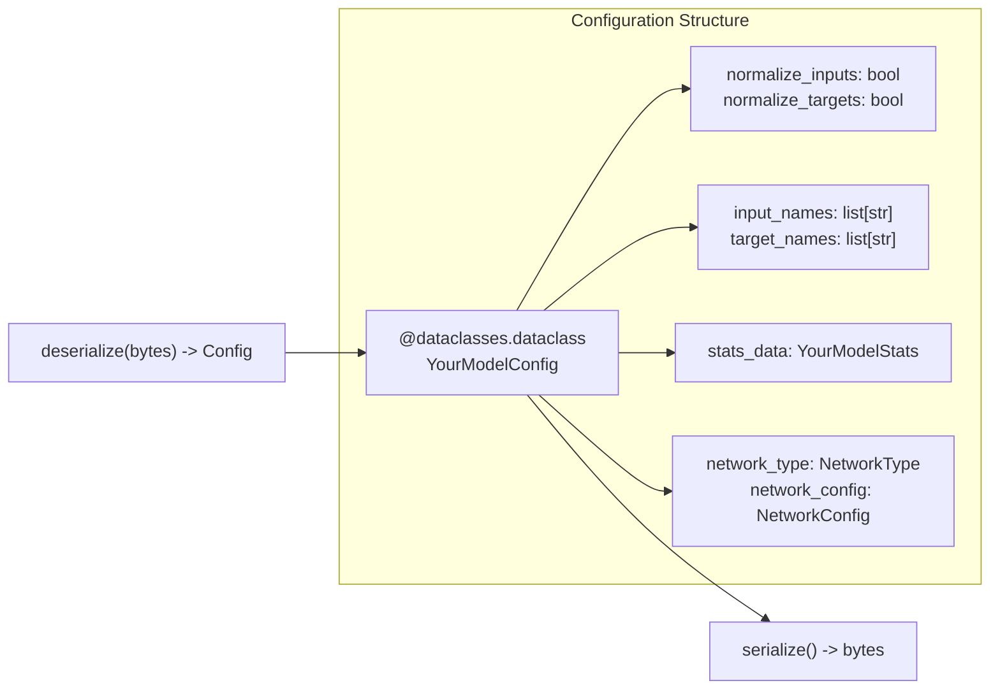
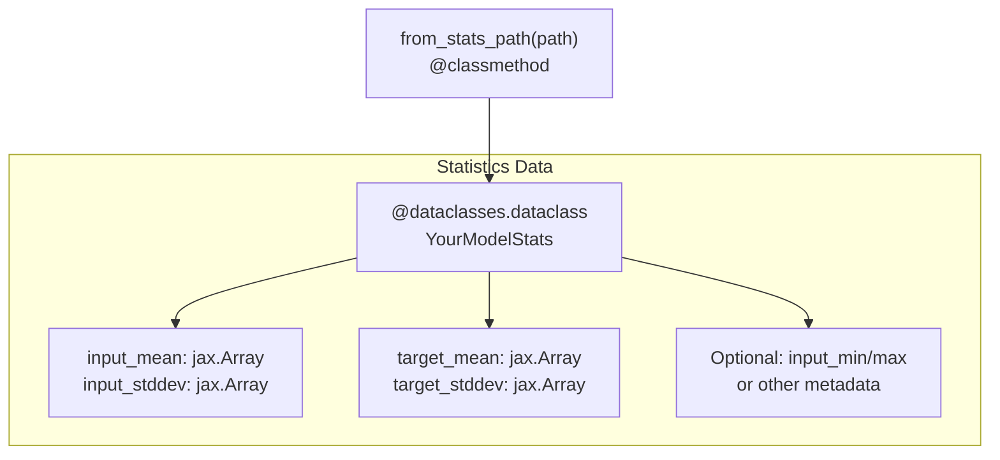
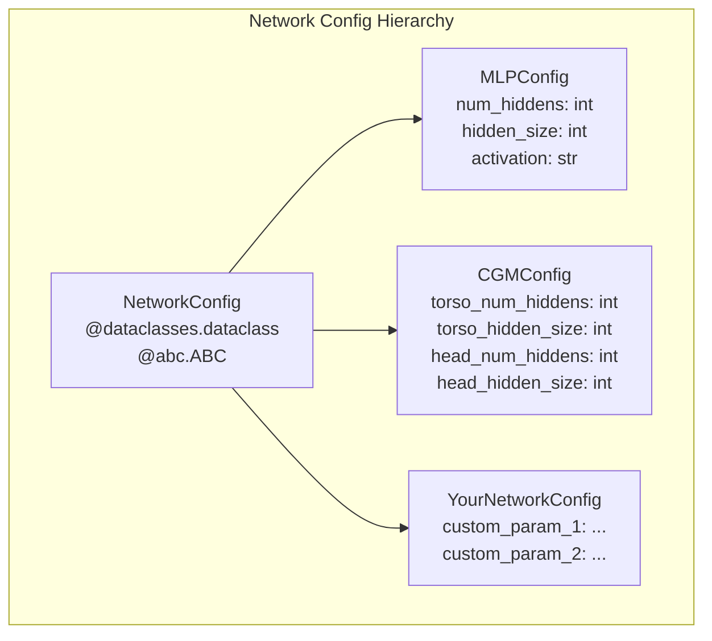
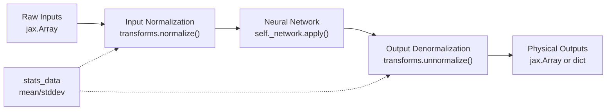
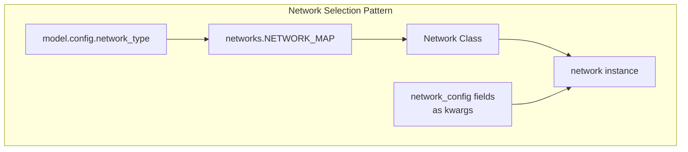
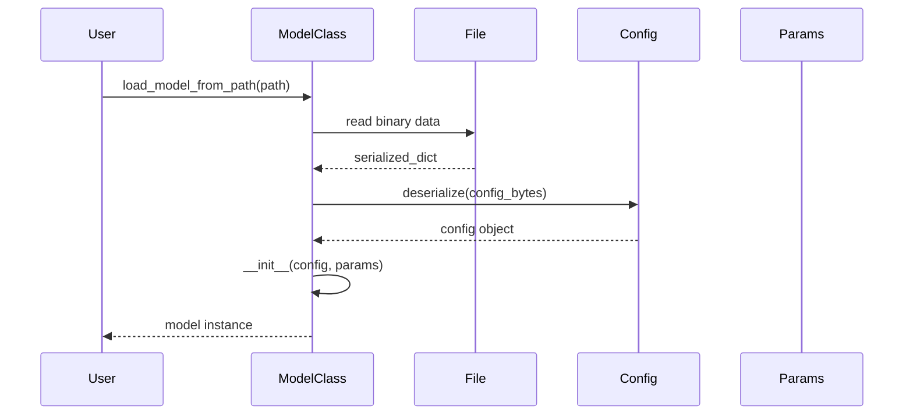
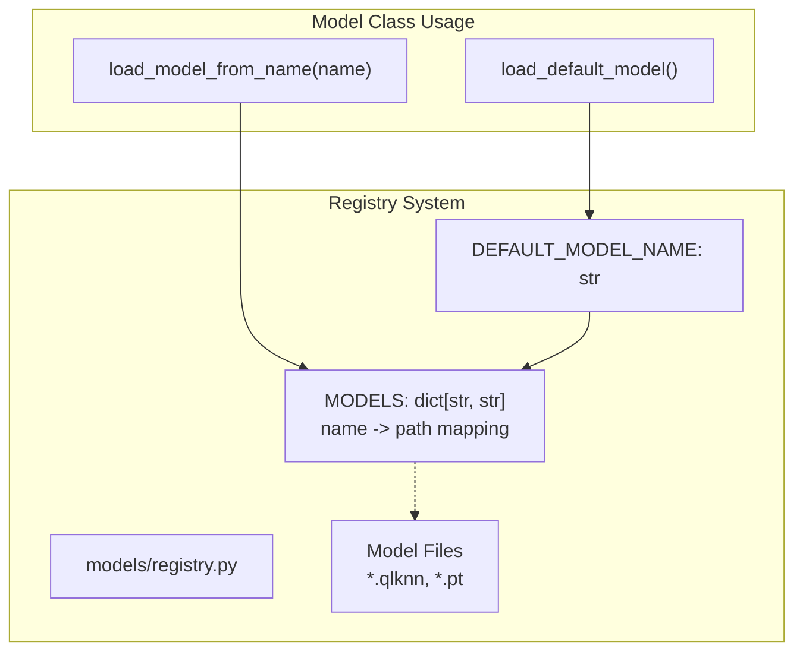
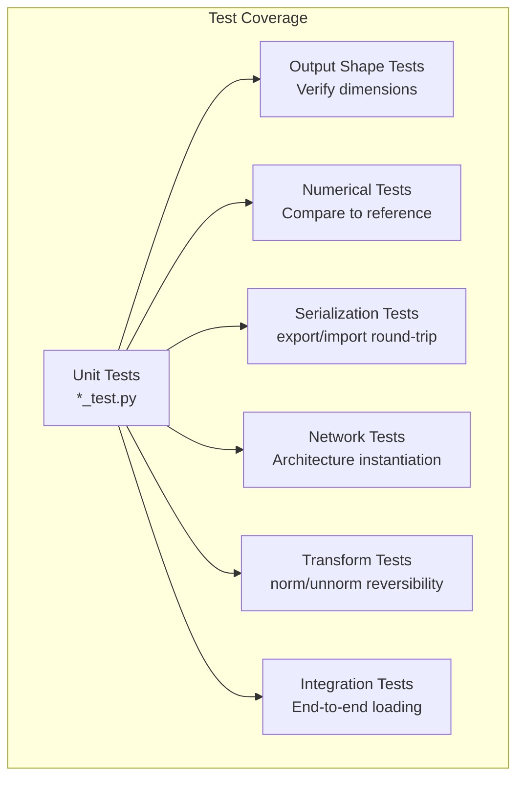

<!-- source: DeepWiki mcp.deepwiki.com · repo google-deepmind/fusion_surrogates · page 6.3 Contributing New Models · fetched 2026-10-26 -->

# Contributing New Models

<details>
<summary>Relevant source files</summary>

The following files were used as context for generating this wiki page:

- [.github/workflows/pytest.yml](.github/workflows/pytest.yml)
- [fusion_surrogates/common/networks.py](fusion_surrogates/common/networks.py)
- [fusion_surrogates/common/transforms.py](fusion_surrogates/common/transforms.py)
- [fusion_surrogates/qlknn/qlknn_model.py](fusion_surrogates/qlknn/qlknn_model.py)
- [fusion_surrogates/qlknn/qlknn_model_test.py](fusion_surrogates/qlknn/qlknn_model_test.py)
- [pyproject.toml](pyproject.toml)

</details>


## Purpose and Scope

This guide provides technical specifications for adding new surrogate models to the `fusion_surrogates` library. It covers the required components, architectural patterns, integration points, and testing requirements for contributing models that are compatible with the existing infrastructure.

For information about the existing model systems, see [QLKNN Model System](#3) and [TGLFNN-UKAEA Model System](#4). For information about testing your new model, see [Testing Framework](#6.1).

---

## Model Architecture Pattern

All surrogate models in this library follow a consistent architectural pattern with three core components: a model class, a configuration dataclass, and a statistics dataclass for normalization.

### Core Components



**Sources:** [fusion_surrogates/qlknn/qlknn_model.py:166-419](), [fusion_surrogates/common/networks.py:1-301](), [fusion_surrogates/common/transforms.py:1-33]()

### Model Class Structure

Your model class should implement the following key methods and properties:

| Method/Property | Purpose | Required |
|----------------|---------|----------|
| `__init__(config, params, metadata)` | Initialize model with configuration and parameters | Yes |
| `init_params(batch_dims, init_rng)` | Initialize network parameters with random values | Yes |
| `predict_with_params(params, inputs)` | Raw prediction (may return normalized outputs) | Yes |
| `predict_targets(inputs)` | Prediction with denormalization applied | Yes |
| `predict(inputs)` | High-level prediction returning physical quantities | Recommended |
| `load_model_from_path(path)` | Class method to load model from file | Yes |
| `export_model(path)` | Save model to file | Recommended |
| `config`, `params`, `num_inputs`, `num_targets` | Properties for model introspection | Yes |

**Sources:** [fusion_surrogates/qlknn/qlknn_model.py:166-419]()

---

## Required Components

### 1. Configuration Dataclass

The configuration dataclass stores all model hyperparameters and metadata needed for model construction and inference.



**Example configuration fields:**
- `normalize_inputs: bool` - Whether to normalize inputs before prediction
- `normalize_targets: bool` - Whether targets were normalized during training
- `input_names: list[str]` - Names of input features
- `target_names: list[str]` - Names of output predictions
- `stats_data: YourModelStats | None` - Normalization statistics
- `network_type: networks.NetworkType` - Type of neural network architecture
- `network_config: NetworkConfig` - Architecture-specific hyperparameters

**Sources:** [fusion_surrogates/qlknn/qlknn_model.py:109-139]()

### 2. Statistics Dataclass

The statistics dataclass stores normalization parameters for data preprocessing and postprocessing.



**Required statistics fields:**
- `input_mean: jax.Array` - Mean values for each input feature
- `input_stddev: jax.Array` - Standard deviation for each input feature
- `target_mean: jax.Array` - Mean values for each target output
- `target_stddev: jax.Array` - Standard deviation for each target output

**Optional fields:**
- `input_min: jax.Array` - Minimum values for input bounds checking
- `input_max: jax.Array` - Maximum values for input bounds checking

**Sources:** [fusion_surrogates/qlknn/qlknn_model.py:46-72]()

### 3. Network Configuration

Network-specific configuration dataclasses define architecture hyperparameters.



**Standard network configs:**
- `MLPConfig` - For standard feedforward networks [fusion_surrogates/qlknn/qlknn_model.py:80-86]()
- `CGMConfig` - For Critical Gradient Model networks [fusion_surrogates/qlknn/qlknn_model.py:89-97]()

**Sources:** [fusion_surrogates/qlknn/qlknn_model.py:74-106]()

---

## Prediction Pipeline Implementation

### Standard Prediction Flow

All models should implement a three-stage prediction pipeline:



### Implementation Template

```python
def predict_with_params(self, params: optax.Params, inputs: jax.Array) -> jax.Array:
    """Raw prediction with normalization if configured."""
    if self._config.normalize_inputs and self._config.stats_data is not None:
        inputs = transforms.normalize(
            inputs,
            mean=self._config.stats_data.input_mean,
            stddev=self._config.stats_data.input_stddev,
        )
    return self._network.apply(params, inputs)

def predict_targets(self, inputs: jax.Array) -> jax.Array:
    """Prediction with denormalization applied."""
    outputs = self.predict_with_params(self._params, inputs)
    if self._config.normalize_targets and self._config.stats_data is not None:
        outputs = transforms.unnormalize(
            outputs,
            mean=self._config.stats_data.target_mean,
            stddev=self._config.stats_data.target_stddev,
        )
    return outputs
```

**Sources:** [fusion_surrogates/qlknn/qlknn_model.py:252-296](), [fusion_surrogates/common/transforms.py:21-33]()

---

## Network Architecture Selection

### Using Existing Architectures

The library provides several pre-built network architectures accessible via `networks.NETWORK_MAP`:

| NetworkType | Class | Use Case |
|------------|-------|----------|
| `NetworkType.MLP` | `networks.MLP` | Standard feedforward network |
| `NetworkType.GAUSSIAN_MLP` | `networks.GaussianMLP` | Network with uncertainty estimation (mean + variance) |
| `NetworkType.GAUSSIAN_MLP_ENSEMBLE` | `networks.GaussianMLPEnsemble` | Ensemble for robust uncertainty quantification |
| `NetworkType.DISJOINT_MLPS` | `networks.DisjointMLPs` | Separate network per output target |
| `NetworkType.MODE_MLPS` | `networks.ModeMLPs` | Mode-specific networks (ITG/TEM/ETG) |
| `NetworkType.CGM` | `networks.CGMNets` | Physics-informed Critical Gradient Model |



### Building the Network

```python
def _build_network(self) -> None:
    """Builds the neural network from config."""
    network_kwargs = dataclasses.asdict(self._config.network_config)
    
    # Add model-specific kwargs if needed
    if self._config.network_type == networks.NetworkType.MLP:
        network_kwargs['num_targets'] = self.num_targets
    
    self._network = networks.NETWORK_MAP[self._config.network_type](
        **network_kwargs
    )
```

**Sources:** [fusion_surrogates/qlknn/qlknn_model.py:341-358](), [fusion_surrogates/common/networks.py:291-300]()

### Creating Custom Architectures

To add a new network architecture:

1. **Define the network class** as a `flax.linen.nn.Module`:

```python
class YourCustomNetwork(nn.Module):
    """Custom network architecture."""
    
    param1: int
    param2: float
    
    @nn.compact
    def __call__(self, x: jax.Array) -> jax.Array:
        # Implement forward pass
        x = nn.Dense(features=128)(x)
        x = nn.relu(x)
        return nn.Dense(features=output_size)(x)
```

2. **Add to `networks.py`** - Register in `NetworkType` enum and `NETWORK_MAP`:

```python
class NetworkType(enum.Enum):
    # ... existing types ...
    YOUR_CUSTOM = 'your_custom'

NETWORK_MAP = immutabledict.immutabledict({
    # ... existing mappings ...
    NetworkType.YOUR_CUSTOM: YourCustomNetwork,
})
```

3. **Create a config dataclass**:

```python
@dataclasses.dataclass
class YourCustomConfig(NetworkConfig):
    param1: int
    param2: float
```

**Sources:** [fusion_surrogates/common/networks.py:36-301]()

---

## Model Loading and Serialization

### Loading Pattern



### Implementation Example

```python
@classmethod
def load_model_from_path(
    cls,
    input_path: str,
    model_name: str | None = None,
) -> 'YourModel':
    """Loads a model from a file."""
    logging.info('Loading YourModel from %s', input_path)
    with open(input_path, 'rb') as f:
        import_dict = serialization.msgpack_restore(f.read())
    
    return cls(
        config=YourModelConfig.deserialize(import_dict['config']),
        params=import_dict['params'],
        metadata=YourModelMetadata(
            path=input_path,
            name=model_name or '',
            version=import_dict['version'],
        ),
    )

def export_model(self, output_path: str, version: str | None = None) -> None:
    """Exports model to a file."""
    export_dict = {
        'version': version or 'v1',
        'config': self._config.serialize(),
        'params': self._params,
    }
    with open(output_path, 'wb') as f:
        f.write(serialization.msgpack_serialize(export_dict))
```

**Sources:** [fusion_surrogates/qlknn/qlknn_model.py:359-419]()

---

## Model Registration (Optional)

For models with multiple variants, implement a registry system:

### Registry Structure



### Implementation

Create `fusion_surrogates/your_model/models/registry.py`:

```python
"""Registry for YourModel variants."""

import importlib.resources as importlib_resources

MODELS = {
    'your_model_v1': str(
        importlib_resources.files('fusion_surrogates.your_model.models')
        / 'your_model_v1.pkl'
    ),
    'your_model_v2': str(
        importlib_resources.files('fusion_surrogates.your_model.models')
        / 'your_model_v2.pkl'
    ),
}

DEFAULT_MODEL_NAME = 'your_model_v1'
```

Add loading methods to your model class:

```python
@classmethod
def load_model_from_name(cls, model_name: str) -> 'YourModel':
    """Loads a model by name from the registry."""
    from fusion_surrogates.your_model.models import registry
    model_path = registry.MODELS.get(model_name)
    if model_path is None:
        raise ValueError(f'Model {model_name} not found in registry.')
    return cls.load_model_from_path(model_path, model_name)

@classmethod
def load_default_model(cls) -> 'YourModel':
    """Loads the default model."""
    from fusion_surrogates.your_model.models import registry
    return cls.load_model_from_name(registry.DEFAULT_MODEL_NAME)
```

**Sources:** [fusion_surrogates/qlknn/qlknn_model.py:371-407]()

---

## Testing Requirements

### Required Tests



### Test Template

Create `fusion_surrogates/your_model/your_model_test.py`:

```python
from absl.testing import absltest
import jax
import jax.numpy as jnp
from numpy import testing

class YourModelTest(absltest.TestCase):
    
    def test_predict_targets_output_shape(self):
        """Tests model output shape."""
        model = # ... initialize model
        batch_dims = (1, 10)
        inputs = jnp.empty(batch_dims + (model.num_inputs,))
        outputs = model.predict_targets(inputs)
        self.assertEqual(
            outputs.shape,
            batch_dims + (model.num_targets,)
        )
    
    def test_model_export_import(self):
        """Tests serialization round-trip."""
        model = # ... initialize model
        with tempfile.NamedTemporaryFile() as f:
            model.export_model(f.name, 'test_version')
            loaded_model = YourModel.load_model_from_path(f.name)
        
        inputs = jnp.ones((1, 10, model.num_inputs))
        testing.assert_array_equal(
            model.predict_targets(inputs),
            loaded_model.predict_targets(inputs),
        )
    
    def test_numerical_accuracy(self):
        """Tests predictions against reference data."""
        model = # ... load trained model
        test_inputs = # ... load test data
        expected_outputs = # ... load expected outputs
        
        actual_outputs = model.predict_targets(test_inputs)
        testing.assert_allclose(
            actual_outputs,
            expected_outputs,
            rtol=1e-5,
            atol=1e-8,
        )

if __name__ == '__main__':
    absltest.main()
```

**Test execution:**
```bash
# Run all tests
pytest -vv -n auto

# Run only your model's tests
pytest -vv fusion_surrogates/your_model/
```

**Sources:** [fusion_surrogates/qlknn/qlknn_model_test.py:27-163](), [.github/workflows/pytest.yml:1-31]()

---

## File Organization

### Directory Structure

```
fusion_surrogates/
├── your_model/
│   ├── __init__.py                 # Export public API
│   ├── your_model.py               # Main model class
│   ├── your_model_test.py          # Unit tests
│   ├── your_model_test_utils.py    # Test utilities (optional)
│   └── models/
│       ├── __init__.py
│       ├── registry.py             # Model registry (optional)
│       ├── model_v1.pkl            # Serialized models
│       └── model_v2.pkl
├── common/
│   ├── networks.py                 # Shared architectures
│   └── transforms.py               # Shared utilities
└── pyproject.toml                  # Dependencies
```

### Package Exports

In `fusion_surrogates/your_model/__init__.py`:

```python
"""Your model public API."""

from fusion_surrogates.your_model.your_model import (
    YourModel,
    YourModelConfig,
    YourModelStats,
)

__all__ = [
    'YourModel',
    'YourModelConfig', 
    'YourModelStats',
]
```

**Sources:** [pyproject.toml:47-49]()

---

## Dependencies and Build Configuration

### Adding Model-Specific Dependencies

If your model requires additional dependencies (e.g., PyTorch for loading checkpoints), add an optional dependency group in `pyproject.toml`:

```toml
[project.optional-dependencies]
your_model = [
    "torch>=2.7.1",
    "pyyaml",
    # other dependencies
]
```

Users can install with:
```bash
pip install fusion_surrogates[your_model]
```

**Sources:** [pyproject.toml:42-46]()

### CI Integration

The GitHub Actions workflow automatically tests all models. Your tests will be executed if:
1. Test files follow the `*_test.py` naming convention
2. Tests use pytest-compatible assertions
3. Tests are placed in the `fusion_surrogates/` directory

The CI runs with:
- Python 3.11
- Parallel test execution (`pytest -n auto`)
- 30-minute timeout
- Automatic cancellation of outdated runs

**Sources:** [.github/workflows/pytest.yml:1-31]()

---

## Integration Checklist

Before submitting a new model, ensure:

### Model Implementation
- [ ] Model class with `__init__`, `predict_with_params`, `predict_targets`
- [ ] Configuration dataclass with serialization methods
- [ ] Statistics dataclass with `from_stats_path` classmethod
- [ ] Network architecture selected or implemented
- [ ] Loading methods: `load_model_from_path` (and optionally `load_model_from_name`)
- [ ] Export method: `export_model`

### Data and Assets
- [ ] Normalization statistics computed and saved
- [ ] Model weights trained and saved
- [ ] Configuration files created (if applicable)
- [ ] Files placed in appropriate `models/` directory

### Testing
- [ ] Unit tests for output shapes
- [ ] Serialization round-trip tests
- [ ] Numerical accuracy tests against reference data
- [ ] Network instantiation tests
- [ ] All tests pass locally with `pytest -vv -n auto`

### Documentation
- [ ] Docstrings for all public methods and classes
- [ ] Module-level docstring explaining the model
- [ ] Example usage in docstring or separate guide
- [ ] README update with model description

### Integration
- [ ] Package exports in `__init__.py`
- [ ] Dependencies added to `pyproject.toml` (if needed)
- [ ] Registry entry created (if applicable)
- [ ] CI tests pass on GitHub Actions

**Sources:** [fusion_surrogates/qlknn/qlknn_model.py:166-419](), [fusion_surrogates/qlknn/qlknn_model_test.py:27-163](), [pyproject.toml:1-49]()