# Page: Overview

# Overview

<details>
<summary>Relevant source files</summary>

The following files were used as context for generating this wiki page:

- [.github/workflows/pytest.yml](.github/workflows/pytest.yml)
- [README.md](README.md)
- [pyproject.toml](pyproject.toml)

</details>


## Purpose and Scope

This document provides a high-level introduction to the `fusion_surrogates` library, which implements fast neural network surrogate models for simulating turbulent transport in tokamak fusion reactors. The library includes two primary model families: QLKNN (QuaLiKiz Neural Network) and TGLFNN-UKAEA (TGLF Neural Network from UK Atomic Energy Authority).

For installation instructions, see [Installation and Setup](#2). For detailed documentation of individual model systems, see [QLKNN Model System](#3) and [TGLFNN-UKAEA Model System](#4).

**Sources**: [README.md:1-9](), [pyproject.toml:8-10]()

## What are Fusion Surrogates?

Fusion surrogates are neural network models that approximate expensive physics simulations used in tokamak fusion research. Traditional gyrokinetic codes like QuaLiKiz and TGLF can take minutes to hours to compute turbulent transport properties at a single spatial location. Surrogates reduce this computational time to milliseconds, enabling real-time plasma simulation and control.

The `fusion_surrogates` library provides:

| Component | Description |
|-----------|-------------|
| **Pre-trained models** | Neural network weights trained on large physics datasets |
| **Inference code** | JAX-based implementations for fast evaluation |
| **Normalization statistics** | Pre-computed statistics for input/output scaling |
| **Model registry** | Name-based lookup system for model variants |
| **ONNX export** | Cross-platform deployment capabilities (QLKNN only) |

The library is designed as the transport model backend for [TORAX](https://github.com/google-deepmind/torax), a JAX-based tokamak simulator, but can be integrated into other fusion simulation frameworks.

**Sources**: [README.md:3-8](), [pyproject.toml:10]()

## Library Architecture

The following diagram shows the physical file structure and key code entities in the repository:

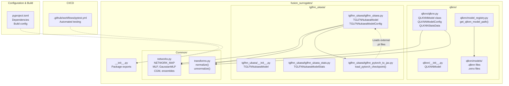

**Key code entities**:

- **`QLKNNModel`** ([fusion_surrogates/qlknn/qlknn.py]()): Primary class for QLKNN inference
- **`TGLFNNukaeaModel`** ([fusion_surrogates/tglfnn_ukaea/tglfnn_ukaea.py]()): Primary class for TGLFNN-UKAEA inference
- **`NETWORK_MAP`** ([fusion_surrogates/networks.py]()): Registry mapping architecture names to implementations
- **`normalize()`/`unnormalize()`** ([fusion_surrogates/transforms.py]()): Data scaling utilities
- **`get_qlknn_model_path()`** ([fusion_surrogates/qlknn/model_registry.py]()): Model name resolver

**Sources**: Repository structure, [pyproject.toml:47-48](), [README.md:1-44]()

## Model Systems Overview

### QLKNN: QuaLiKiz Neural Network Surrogate

QLKNN approximates the [QuaLiKiz](https://gitlab.com/qualikiz-group/QuaLiKiz) quasilinear gyrokinetic code. The currently available model, `qlknn_7_11_v1`, combines two training datasets:

| Dataset | Region | Citation |
|---------|--------|----------|
| **QLKNN11D** | Core plasma | [Zenodo 8017522](https://zenodo.org/record/8017522) |
| **QLKNN7D-edge** | Edge plasma | [Zenodo 8106431](https://zenodo.org/record/8106431) |

**Model characteristics**:
- **10 input parameters**: Normalized gradients (R/L_Te, R/L_Ti, R/L_ne, R/L_ni), safety factor (q), magnetic shear (ŝ), inverse aspect ratio (r/R_maj), temperature ratio (T_i/T_e), collisionality (log(ν*)), density ratio (n_i/n_e)
- **8 output predictions per mode**: Heat and particle fluxes for ITG, TEM, ETG modes plus maximum growth rate
- **Bundled weights**: Model files packaged with library in [fusion_surrogates/qlknn/models/]()
- **ONNX support**: Can export to ONNX format for deployment

Based on the QLKNN10D model by [Van de Plassche et al. PoP 2020](https://doi.org/10.1063/1.5134126).

For detailed specifications, see [QLKNN Model System](#3).

**Sources**: [README.md:10-44]()

### TGLFNN-UKAEA: TGLF Neural Network Surrogate

TGLFNN-UKAEA approximates the TGLF (TGYRO Linear) gyrokinetic code. It uses a Gaussian ensemble architecture to provide uncertainty estimates alongside predictions.

**Model characteristics**:
- **13-14 input parameters** (machine-dependent): Includes RLNS, RLTS (normalized gradients), geometric factors, and machine-specific parameters
- **3 output predictions**: Gyro-Bohm normalized fluxes (efe_gb, efi_gb, pfi_gb) with variance estimates
- **Multiple variants**: Separate models for multi-machine applications and STEP (Spherical Tokamak for Energy Production)
- **External weights**: Model files hosted on [ukaea/tglfnn-ukaea GitHub repository](https://github.com/ukaea/tglfnn-ukaea)
- **Ensemble predictions**: Multiple neural networks vote to quantify uncertainty

For detailed specifications, see [TGLFNN-UKAEA Model System](#4).

**Sources**: High-level architecture diagrams, [pyproject.toml:42-45]()

## Technology Stack

The library is built on the following core dependencies:

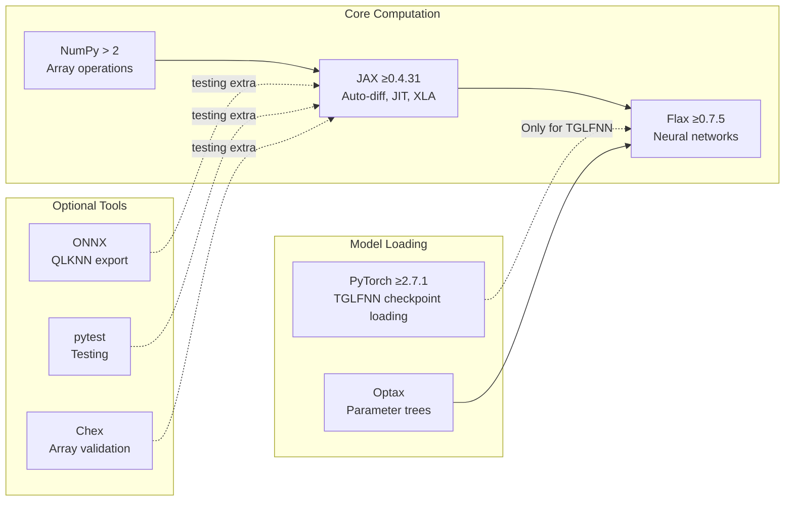

### Dependency Table

| Package | Version | Purpose | Optional |
|---------|---------|---------|----------|
| `jax` | ≥0.4.31 | Core numerical computation, automatic differentiation | No |
| `flax` | ≥0.7.5 | Neural network implementations | No |
| `numpy` | > 2 | Array operations, modern array protocol | No |
| `torch` | ≥2.7.1 | TGLFNN PyTorch checkpoint loading | Yes (tglfnnukaea extra) |
| `onnx` | — | QLKNN ONNX export | Yes (testing extra) |
| `pytest` | — | Unit testing framework | Yes (testing extra) |
| `chex` | — | JAX array assertions | Yes (testing extra) |

**Python requirement**: ≥3.11

**Sources**: [pyproject.toml:13](), [pyproject.toml:21-45]()

## Integration with Simulators

The following diagram shows how `fusion_surrogates` integrates into the tokamak simulation ecosystem:

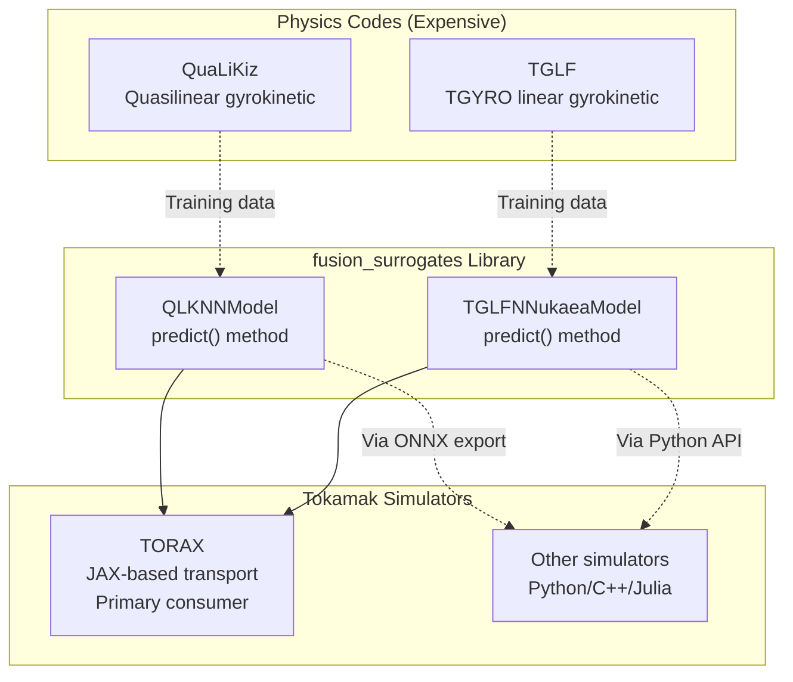

**Integration points**:

1. **TORAX integration**: As a JAX-native library, `fusion_surrogates` integrates seamlessly with TORAX's transport solvers. Both QLKNN and TGLFNN models can be used interchangeably via a common interface.

2. **Direct Python API**: Import models using:
   ```python
   from fusion_surrogates.qlknn import QLKNNModel
   from fusion_surrogates.tglfnn_ukaea import TGLFNNukaeaModel
   ```

3. **ONNX deployment**: QLKNN models can be exported to ONNX format for use in non-Python environments (C++, Julia, etc.). See [QLKNN Model Registry and ONNX Export](#3.4).

4. **PyTorch bridge**: TGLFNN models are trained in PyTorch but converted to JAX at load time via [`load_pytorch_checkpoint()`]([fusion_surrogates/tglfnn_ukaea/tglfnn_pytorch_to_jax.py]()). See [PyTorch to JAX Model Conversion](#4.4).

**Sources**: [README.md:6-8](), architecture diagrams

## Package Structure

```
fusion_surrogates/
├── __init__.py                    # Package exports
├── qlknn/                          # QLKNN model system
│   ├── __init__.py
│   ├── qlknn.py                   # QLKNNModel, QLKNNModelConfig
│   ├── model_registry.py          # Model path lookup
│   ├── models/                    # Pre-trained weights (.qlknn, .onnx)
│   └── qlknn_test.py              # Unit tests
├── tglfnn_ukaea/                   # TGLFNN-UKAEA model system
│   ├── __init__.py
│   ├── tglfnn_ukaea.py            # TGLFNNukaeaModel, Config
│   ├── tglfnn_ukaea_stats.py     # Normalization statistics
│   ├── tglfnn_pytorch_to_jax.py  # PyTorch→JAX conversion
│   └── tglfnn_ukaea_test.py      # Unit tests
├── networks.py                     # Neural network architectures
├── networks_test.py                # Network unit tests
├── transforms.py                   # normalize/unnormalize utilities
└── transforms_test.py              # Transform unit tests
```

**Key module purposes**:

| Module | Classes/Functions | Purpose |
|--------|-------------------|---------|
| `qlknn.qlknn` | `QLKNNModel`, `QLKNNModelConfig`, `QLKNNStatsData` | QLKNN inference engine and configuration |
| `qlknn.model_registry` | `get_qlknn_model_path()` | Maps model names to file paths |
| `tglfnn_ukaea.tglfnn_ukaea` | `TGLFNNukaeaModel`, `TGLFNNukaeaModelConfig` | TGLFNN inference engine |
| `tglfnn_ukaea.tglfnn_ukaea_stats` | `TGLFNNukaeaModelStats` | TGLFNN normalization statistics |
| `tglfnn_ukaea.tglfnn_pytorch_to_jax` | `load_pytorch_checkpoint()` | Converts PyTorch to JAX parameters |
| `networks` | `MLP`, `GaussianMLP`, `CGM`, `NETWORK_MAP` | Neural network architecture implementations |
| `transforms` | `normalize()`, `unnormalize()` | Data scaling utilities |

**Sources**: [pyproject.toml:47-48](), repository structure

## Development and Testing

The library includes comprehensive testing infrastructure:

- **Unit tests**: All modules have corresponding `*_test.py` files
- **CI/CD**: GitHub Actions workflow runs `pytest` on every push ([.github/workflows/pytest.yml]())
- **Parallel execution**: Tests run in parallel via `pytest -n auto`
- **Python 3.11**: All tests run on Python 3.11 in Ubuntu environment

For contributors, see [Development Guide](#6) for testing procedures, code style, and how to add new models.

**Sources**: [.github/workflows/pytest.yml:1-31](), [README.md:79-84]()

## Next Steps

- **Installation**: See [Installation and Setup](#2) for dependency management and installation procedures
- **QLKNN usage**: See [Using QLKNN Models](#3.3) for practical examples
- **TGLFNN usage**: See [Using TGLFNN Models](#4.3) for practical examples  
- **Common utilities**: See [Common Infrastructure](#5) for shared components like network architectures and transforms
- **Contributing**: See [Development Guide](#6) for guidelines on extending the library

---

# Page: Installation and Setup

# Installation and Setup

<details>
<summary>Relevant source files</summary>

The following files were used as context for generating this wiki page:

- [.github/workflows/pytest.yml](.github/workflows/pytest.yml)
- [README.md](README.md)
- [pyproject.toml](pyproject.toml)

</details>


This page provides instructions for installing the `fusion_surrogates` library, managing its dependencies, and verifying a successful installation. For information about using specific surrogate models after installation, see [QLKNN Model System](#3) and [TGLFNN-UKAEA Model System](#4).

## Prerequisites

The `fusion_surrogates` library has the following system requirements:

| Requirement | Specification |
|------------|---------------|
| Python Version | ≥ 3.11 |
| Operating System | Linux, macOS (tested on Ubuntu in CI) |
| Package Manager | pip |

The library is tested in continuous integration on Ubuntu with Python 3.11 [.github/workflows/pytest.yml:22]().

**Sources:** [pyproject.toml:13](), [.github/workflows/pytest.yml:20-22]()

## Core Dependencies

The library requires the following core dependencies, which are automatically installed:

| Package | Version | Purpose |
|---------|---------|---------|
| `jax` | ≥ 0.4.31 | Numerical computation backend, automatic differentiation, JIT compilation |
| `flax` | ≥ 0.7.5 | Neural network framework built on JAX |
| `numpy` | > 2 | Array operations and data structures |
| `absl-py` | ≥ 2.0.0 | Command-line flags and logging utilities |
| `immutabledict` | (any) | Immutable dictionary data structures |
| `setuptools` | (any) | Python packaging (for Python ≥ 3.11) |

**Sources:** [pyproject.toml:21-28]()

## Installation Methods

### Virtual Environment Setup (Recommended)

It is strongly recommended to use a virtual environment to isolate `fusion_surrogates` dependencies from other Python projects.

**Creating and activating a virtual environment:**

```bash
# Install virtualenv if not already available
pip install --upgrade pip
pip install virtualenv

# Create virtual environment
python3 -m venv .venv

# Activate virtual environment
source .venv/bin/activate
```

**Deactivating the virtual environment when finished:**

```bash
deactivate
```

**Sources:** [README.md:47-69]()

### Stable Release Installation

To install the latest stable release from PyPI:

```bash
pip install fusion_surrogates
```

This installs only the core dependencies required for QLKNN model inference. The installed package includes QLKNN model weights bundled within the distribution.

**Sources:** [README.md:72-77]()

### Development Installation

For development work or running unit tests, install with the `testing` optional dependency group:

```bash
pip install -e .[testing]
```

The `-e` flag installs the package in "editable" mode, allowing changes to the source code to be immediately reflected without reinstalling.

**Sources:** [README.md:79-84](), [.github/workflows/pytest.yml:25]()

## Optional Dependency Groups

The library defines two optional dependency groups in [pyproject.toml:30-45]():

### Testing Dependencies

The `testing` group includes dependencies for running unit tests and development tools:

| Package | Purpose |
|---------|---------|
| `chex` | JAX testing utilities |
| `jaxonnxruntime` | ONNX runtime for JAX |
| `onnx` | ONNX format support |
| `pytest` | Testing framework |
| `pytest-xdist` | Parallel test execution |
| `pylint` | Code linting |
| `pyink` | Code formatting |
| `pyyaml` | YAML file parsing |
| `torch` | PyTorch (≥ 2.7.1 for NumPy 2 compatibility) |

**Installation:**
```bash
pip install fusion_surrogates[testing]
```

### TGLFNN-UKAEA Dependencies

The `tglfnnukaea` group includes dependencies for using TGLFNN-UKAEA models:

| Package | Purpose |
|---------|---------|
| `torch` | PyTorch (≥ 2.7.1) for loading `.pt` checkpoint files |
| `pyyaml` | YAML configuration file parsing |

**Installation:**
```bash
pip install fusion_surrogates[tglfnnukaea]
```

This group is required only if you intend to use TGLFNN models. QLKNN models do not require PyTorch.

**Sources:** [pyproject.toml:30-45]()

## Installation Workflow

The following diagram illustrates the complete installation process and how different installation options relate to dependency groups:

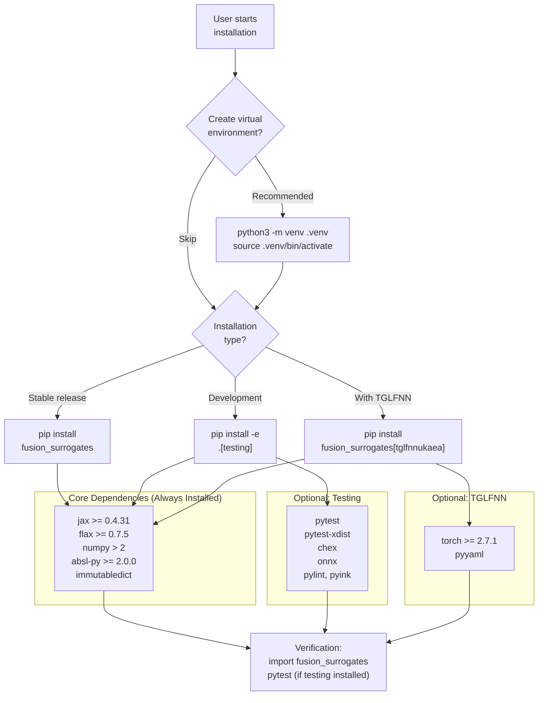

**Sources:** [pyproject.toml:1-49](), [README.md:45-84]()

## Dependency Architecture

This diagram maps the relationship between package components and their dependencies:

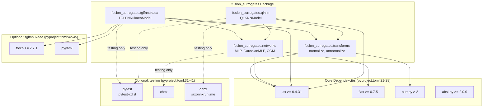

**Sources:** [pyproject.toml:21-45]()

## Verification

### Basic Import Test

After installation, verify that the library is correctly installed by importing the main module:

```python
import fusion_surrogates
print(f"fusion_surrogates version: {fusion_surrogates.__version__}")
```

Test loading a QLKNN model (requires no additional dependencies):

```python
from fusion_surrogates.qlknn import QLKNNModel

model = QLKNNModel.from_name("qlknn_7_11_v1")
print(f"Model loaded: {model.model_config.base_model_dir}")
```

**Sources:** [README.md:72-77]()

### Running Unit Tests

If the `testing` dependency group is installed, run the unit test suite to verify all functionality:

```bash
# Run all tests with verbose output
pytest -vv -n auto
```

The `-n auto` flag enables parallel test execution using `pytest-xdist`, automatically detecting the number of CPU cores available.

To run tests from the installed package location:

```bash
pytest .venv/lib/python*/site-packages/fusion_surrogates
```

The CI pipeline runs the same test command to validate each commit [.github/workflows/pytest.yml:30]().

**Sources:** [README.md:79-84](), [.github/workflows/pytest.yml:28-30]()

### Expected Test Output

A successful test run should show output similar to:

```
============================= test session starts ==============================
platform linux -- Python 3.11.x, pytest-x.x.x, pluggy-x.x.x
plugins: xdist-x.x.x, forked-x.x.x
gw0 [XX] / gw1 [XX] / gw2 [XX] / gw3 [XX]
....................                                                     [100%]
============================== XX passed in X.XXs ===============================
```

## Build System Configuration

The library uses `setuptools` with `setuptools-scm` for version management [pyproject.toml:1-6](). The build system configuration specifies:

| Configuration | Value |
|---------------|-------|
| Build backend | `setuptools.build_meta` |
| Build requirements | `setuptools>=64`, `setuptools-scm>=8`, `wheel` |
| Version | `0.4.2` (defined in [pyproject.toml:11]()) |
| Package discovery | Includes all `fusion_surrogates*` packages [pyproject.toml:47-48]() |

**Sources:** [pyproject.toml:1-11](), [pyproject.toml:47-48]()

## Troubleshooting

### NumPy Version Conflicts

The library requires `numpy > 2` [pyproject.toml:25](). If you encounter version conflicts, ensure that all dependencies are compatible with NumPy 2.x. PyTorch version 2.7.1 or higher is specifically required for NumPy 2 compatibility [pyproject.toml:40]().

### JAX Installation Issues

JAX installation may require platform-specific configuration. Refer to the [JAX installation documentation](https://github.com/google/jax#installation) for GPU/TPU support or platform-specific instructions.

### TGLFNN Model Loading

TGLFNN models require external assets from the `ukaea/tglfnn-ukaea` GitHub repository. If you encounter issues loading TGLFNN models:

1. Verify that the `tglfnnukaea` optional dependencies are installed
2. Ensure PyTorch (≥ 2.7.1) and PyYAML are available
3. Check network connectivity for downloading external model files

See [Using TGLFNN Models](#4.3) for detailed information about TGLFNN asset management.

### Python Version

The library requires Python 3.11 or higher [pyproject.toml:13](). If you encounter syntax errors or import failures, verify your Python version:

```bash
python --version
```

**Sources:** [pyproject.toml:13](), [pyproject.toml:25](), [pyproject.toml:40]()

## Continuous Integration Environment

The GitHub Actions CI pipeline provides a reference configuration for installation and testing [.github/workflows/pytest.yml:1-31]():

| Step | Command |
|------|---------|
| Setup Python | `actions/setup-python@v5` with Python 3.11 |
| Install package | `pip install -e .[testing]` |
| Verify installation | `pip freeze` |
| Run tests | `pytest -vv -n auto` |

The CI environment includes:
- **Timeout:** 30 minutes [.github/workflows/pytest.yml:9]()
- **Concurrency control:** Cancels in-progress runs for the same branch [.github/workflows/pytest.yml:11-13]()
- **Triggers:** Runs on every push and manual workflow dispatch [.github/workflows/pytest.yml:4]()

**Sources:** [.github/workflows/pytest.yml:1-31]()

---

# Page: QLKNN Model System

# QLKNN Model System

<details>
<summary>Relevant source files</summary>

The following files were used as context for generating this wiki page:

- [README.md](README.md)
- [fusion_surrogates/common/transforms.py](fusion_surrogates/common/transforms.py)
- [fusion_surrogates/qlknn/qlknn_model.py](fusion_surrogates/qlknn/qlknn_model.py)
- [fusion_surrogates/qlknn/qlknn_model_test.py](fusion_surrogates/qlknn/qlknn_model_test.py)

</details>


## Purpose and Scope

The QLKNN Model System provides neural network surrogate models of QuaLiKiz, a quasilinear gyrokinetic code for turbulent transport in tokamak plasmas. This system enables fast approximations of turbulent transport predictions that would otherwise require expensive physics simulations.

This document covers the QLKNN model implementation, including class structures, prediction pipelines, configuration management, and model loading mechanisms. For details on the neural network architectures used by QLKNN models, see [Network Architectures](#5.1). For data transformation utilities, see [Data Transformation Utilities](#5.2).

**Sources:** [README.md:10-44](), [fusion_surrogates/qlknn/qlknn_model.py:15-20]()

---

## Core Components

The QLKNN system consists of three primary classes that work together to provide model inference:

| Class | Purpose | Key Attributes |
|-------|---------|---------------|
| `QLKNNModel` | Main inference engine | `_config`, `_params`, `_network`, `_metadata` |
| `QLKNNModelConfig` | Model configuration and architecture definition | `input_names`, `target_names`, `stats_data`, `flux_map`, `network_type`, `network_config` |
| `QLKNNStatsData` | Normalization statistics | `input_mean`, `input_stddev`, `target_mean`, `target_stddev`, `input_min`, `input_max` |

### QLKNNModel

The `QLKNNModel` class ([fusion_surrogates/qlknn/qlknn_model.py:166-419]()) is the primary interface for loading and running QLKNN models. It encapsulates the neural network, parameters, configuration, and metadata.

**Key methods:**
- `predict_with_params(params, inputs)`: Raw prediction with custom parameters (used during training)
- `predict_targets(inputs)`: Unnormalized target predictions
- `predict(inputs)`: Physical flux predictions (dictionary output)
- `get_flux_from_targets(targets, flux_name)`: Convert targets to specific flux
- `load_model_from_name(model_name)`: Load from registry
- `load_model_from_path(input_path)`: Load from file path
- `load_default_model()`: Load default registered model

### QLKNNModelConfig

The `QLKNNModelConfig` dataclass ([fusion_surrogates/qlknn/qlknn_model.py:109-139]()) defines the complete model architecture and processing configuration:

```python
@dataclasses.dataclass
class QLKNNModelConfig:
  normalize_inputs: bool
  normalize_targets: bool
  input_names: list[str]
  target_names: list[str]
  stats_data: QLKNNStatsData | None
  flux_map: dict[str, Any]
  network_type: networks.NetworkType
  network_config: NetworkConfig
```

The configuration includes serialization methods (`serialize()`, `deserialize()`) for model persistence.

### QLKNNStatsData

The `QLKNNStatsData` dataclass ([fusion_surrogates/qlknn/qlknn_model.py:46-72]()) stores normalization statistics computed from training data:

- Input statistics: `input_mean`, `input_stddev`, `input_min`, `input_max`
- Target statistics: `target_mean`, `target_stddev`

These statistics are loaded from JSON files using the `from_stats_path` class method.

**Sources:** [fusion_surrogates/qlknn/qlknn_model.py:46-419]()

---

## Architecture Overview

The following diagram shows the class structure and relationships within the QLKNN system:

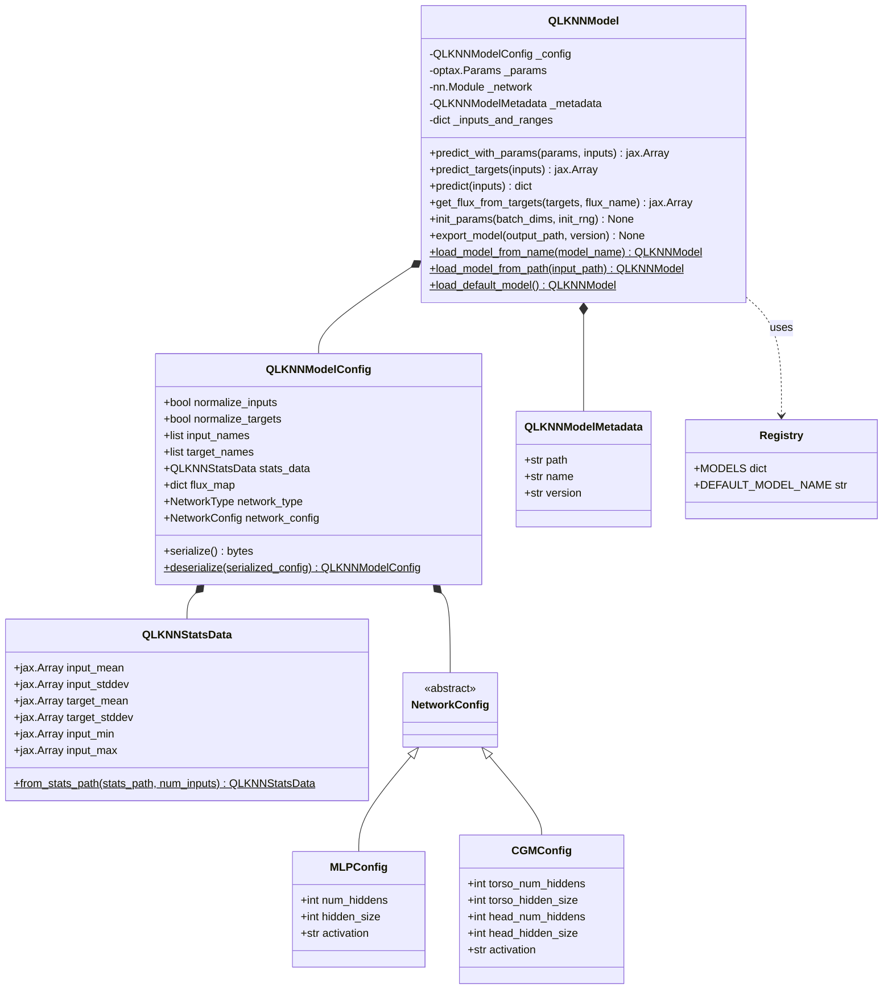

**Sources:** [fusion_surrogates/qlknn/qlknn_model.py:46-419]()

---

## Prediction Pipeline

The QLKNN prediction pipeline transforms raw plasma parameters into physical flux predictions through four stages:

```mermaid
flowchart LR
    subgraph Input["Input Stage"]
        RawInputs["Raw Plasma<br/>Parameters<br/>(10 features)"]
    end
    
    subgraph Normalization["normalize() Stage"]
        CheckNorm{"normalize_inputs<br/>enabled?"}
        NormInputs["transforms.normalize()<br/>using stats_data"]
        NormalizedInputs["Normalized<br/>Inputs"]
    end
    
    subgraph Network["Network Inference"]
        NetworkApply["_network.apply()<br/>(params, inputs)"]
        RawTargets["Raw Target<br/>Predictions<br/>(N targets)"]
    end
    
    subgraph Denormalization["unnormalize() Stage"]
        CheckDenorm{"normalize_targets<br/>enabled?"}
        DenormTargets["transforms.unnormalize()<br/>using stats_data"]
        PhysicalTargets["Physical<br/>Targets"]
    end
    
    subgraph FluxCalc["Flux Calculation"]
        FluxMap["flux_map<br/>configuration"]
        GetFlux["get_flux_from_targets()<br/>for each flux"]
        ClipNeg["clip(0)<br/>leading flux"]
        Multiply["multiply<br/>by denominator"]
        FinalFluxes["dict of<br/>Physical Fluxes"]
    end
    
    RawInputs --> CheckNorm
    CheckNorm -->|Yes| NormInputs
    CheckNorm -->|No| NormalizedInputs
    NormInputs --> NormalizedInputs
    NormalizedInputs --> NetworkApply
    NetworkApply --> RawTargets
    RawTargets --> CheckDenorm
    CheckDenorm -->|Yes| DenormTargets
    CheckDenorm -->|No| PhysicalTargets
    DenormTargets --> PhysicalTargets
    PhysicalTargets --> FluxMap
    FluxMap --> GetFlux
    GetFlux --> ClipNeg
    ClipNeg --> Multiply
    Multiply --> FinalFluxes
```

### Method Call Flow

The prediction pipeline is exposed through three public methods:

1. **`predict_with_params(params, inputs)`** ([fusion_surrogates/qlknn/qlknn_model.py:252-273]())
   - Applies input normalization if configured
   - Calls `_network.apply(params, inputs)`
   - Returns raw (possibly normalized) targets
   - Used during training when parameters are changing

2. **`predict_targets(inputs)`** ([fusion_surrogates/qlknn/qlknn_model.py:275-296]())
   - Calls `predict_with_params` with stored parameters
   - Applies target unnormalization if configured
   - Returns physical target values
   - Used for direct target predictions

3. **`predict(inputs)`** ([fusion_surrogates/qlknn/qlknn_model.py:324-339]())
   - Calls `predict_targets(inputs)`
   - Iterates through `flux_map` to compute each flux
   - Calls `get_flux_from_targets()` for each flux name
   - Returns dictionary of flux name → flux array

### Flux Calculation Details

The `get_flux_from_targets()` method ([fusion_surrogates/qlknn/qlknn_model.py:298-322]()) computes physical fluxes from targets:

1. Extracts the target index from `flux_map[flux_name]['target']`
2. If denominator exists (`flux_map[flux_name]['denominator']`):
   - Multiplies target by denominator (with denominator clipped to 0)
3. If no denominator:
   - Uses target directly (clipped to 0)
4. Returns flux as `(batch_size, 1)` array

**Sources:** [fusion_surrogates/qlknn/qlknn_model.py:252-339](), [fusion_surrogates/common/transforms.py:21-32]()

---

## Model Configuration and Statistics

### Configuration Structure

The `QLKNNModelConfig` contains all information needed to reconstruct a model:

**Boolean flags:**
- `normalize_inputs`: Whether to normalize inputs before network inference
- `normalize_targets`: Whether targets were normalized during training

**Data schema:**
- `input_names`: List of input parameter names (e.g., `['Ate', 'Ati', 'An', ...]`)
- `target_names`: List of target prediction names

**Statistics:**
- `stats_data`: `QLKNNStatsData` instance with normalization parameters

**Flux mapping:**
- `flux_map`: Dictionary mapping flux names to target/denominator pairs
  ```python
  {
    'flux_name': {
      'target': 'target_name',
      'denominator': 'denominator_name' | None
    }
  }
  ```

**Network architecture:**
- `network_type`: `networks.NetworkType` enum value
- `network_config`: Architecture-specific configuration (MLPConfig or CGMConfig)

### Statistics Data Loading

Statistics are loaded from JSON files using `QLKNNStatsData.from_stats_path()` ([fusion_surrogates/qlknn/qlknn_model.py:57-71]()):

```python
with open(stats_path, 'r') as f:
    data_stats = json.load(f)
return cls(
    input_mean=jnp.array(data_stats['mean'][:num_inputs]),
    input_stddev=jnp.array(data_stats['stddev'][:num_inputs]),
    target_mean=jnp.array(data_stats['mean'][num_inputs:]),
    target_stddev=jnp.array(data_stats['stddev'][num_inputs:]),
    input_min=jnp.array(data_stats['min'][:num_inputs]),
    input_max=jnp.array(data_stats['max'][:num_inputs]),
)
```

The JSON file contains concatenated input and target statistics, which are split based on `num_inputs`.

**Sources:** [fusion_surrogates/qlknn/qlknn_model.py:109-139](), [fusion_surrogates/qlknn/qlknn_model.py:46-72]()

---

## Model Loading and Registry

QLKNN models can be loaded through three mechanisms:

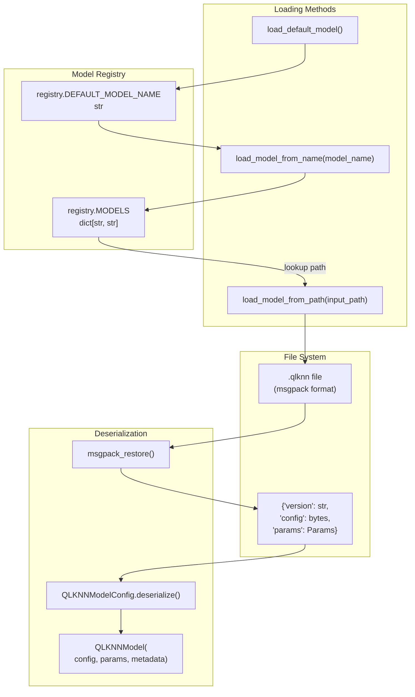

### Loading by Name

The `load_model_from_name()` class method ([fusion_surrogates/qlknn/qlknn_model.py:370-379]()) looks up the model path in the registry:

```python
model_path = registry.MODELS.get(model_name)
if model_path is None:
    raise ValueError(f'Model {model_name} not found in registry.')
return cls.load_model_from_path(model_path, model_name)
```

The registry is defined in `fusion_surrogates/qlknn/models/registry.py`.

### Loading by Path

The `load_model_from_path()` class method ([fusion_surrogates/qlknn/qlknn_model.py:381-401]()) deserializes a `.qlknn` file:

1. Opens the file and reads bytes
2. Calls `serialization.msgpack_restore()` to get dictionary
3. Deserializes config using `QLKNNModelConfig.deserialize()`
4. Creates `QLKNNModelMetadata` with path, name, version
5. Returns new `QLKNNModel` instance

### Loading Default Model

The `load_default_model()` class method ([fusion_surrogates/qlknn/qlknn_model.py:403-406]()) loads the default registered model:

```python
return cls.load_model_from_name(registry.DEFAULT_MODEL_NAME)
```

Currently, the default model is `'qlknn_7_11_v1'` which combines QLKNN11D and QLKNN7D-edge datasets.

**Sources:** [fusion_surrogates/qlknn/qlknn_model.py:370-406](), [fusion_surrogates/qlknn/qlknn_model_test.py:156-162]()

---

## Network Architectures

QLKNN models support multiple neural network architectures through the `networks` module. The architecture is specified in the model configuration.

### Supported Network Types

| Network Type | Config Class | Network Class | Purpose |
|--------------|--------------|---------------|---------|
| `MLP` | `MLPConfig` | `networks.MLP` | Standard multi-layer perceptron |
| `DISJOINT_MLPS` | `MLPConfig` | `networks.DisjointMLPs` | Separate MLPs for each output |
| `MODE_MLPS` | `MLPConfig` | `networks.ModeMLPs` | Separate MLPs per transport mode |
| `CGM` | `CGMConfig` | `networks.CGMNets` | Critical Gradient Model (physics-informed) |

### Network Configuration Classes

**MLPConfig** ([fusion_surrogates/qlknn/qlknn_model.py:79-86]()):
```python
@dataclasses.dataclass
class MLPConfig(NetworkConfig):
  num_hiddens: int       # Number of hidden layers
  hidden_size: int       # Neurons per hidden layer
  activation: str        # Activation function ('relu', 'tanh', etc.)
```

**CGMConfig** ([fusion_surrogates/qlknn/qlknn_model.py:88-97]()):
```python
@dataclasses.dataclass
class CGMConfig(NetworkConfig):
  torso_num_hiddens: int     # Hidden layers in shared torso
  torso_hidden_size: int     # Neurons per torso layer
  head_num_hiddens: int      # Hidden layers in output heads
  head_hidden_size: int      # Neurons per head layer
  activation: str            # Activation function
```

### Network Building Process

The `_build_network()` method ([fusion_surrogates/qlknn/qlknn_model.py:341-357]()) constructs the network based on configuration:

1. Extracts network configuration as dictionary
2. Adds architecture-specific parameters:
   - For MLP-based: `num_targets` parameter
   - For CGM: `driving_gradient_index_map` with gradient indices
3. Looks up network class in `networks.NETWORK_MAP`
4. Instantiates network with configuration

**Example for CGM:**
```python
network_kwargs['driving_gradient_index_map'] = {
    'Ate': self._config.input_names.index('Ate'),
    'Ati': self._config.input_names.index('Ati'),
}
self._network = networks.NETWORK_MAP[self._config.network_type](
    **network_kwargs
)
```

For detailed information on each network architecture implementation, see [Network Architectures](#5.1).

**Sources:** [fusion_surrogates/qlknn/qlknn_model.py:74-107](), [fusion_surrogates/qlknn/qlknn_model.py:341-357](), [fusion_surrogates/qlknn/qlknn_model_test.py:105-154]()

---

## Flux Calculation System

The flux calculation system transforms target predictions into physical turbulent transport fluxes using the `flux_map` configuration.

### Flux Map Structure

The `flux_map` in `QLKNNModelConfig` defines how to compute each flux:

```python
flux_map = {
    'efe_ITG': {
        'target': 'efeITG_GB',      # Leading flux target
        'denominator': None          # No denominator (leading flux)
    },
    'efi_ITG': {
        'target': 'efiITG_ratio',   # Secondary flux ratio
        'denominator': 'efeITG_GB'  # Multiply by leading flux
    },
    'pfe_ITG': {
        'target': 'pfeITG_ratio',
        'denominator': 'efeITG_GB'
    }
}
```

### Flux Computation Algorithm

The `get_flux_from_targets()` method implements this logic:

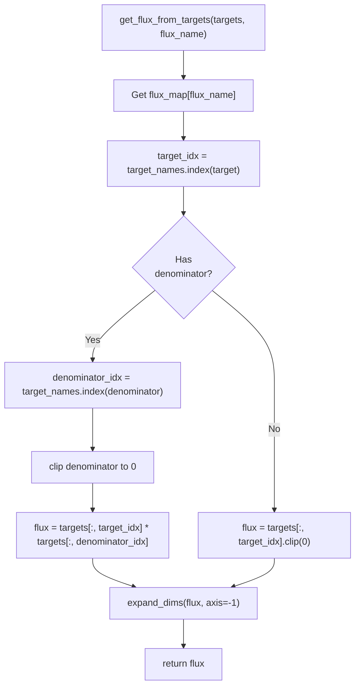

### Leading vs Secondary Fluxes

**Leading fluxes** are direct predictions from the network:
- No denominator in `flux_map`
- Clipped to 0 to ensure physicality
- Example: `efeITG_GB` (electron heat flux for ITG mode)

**Secondary fluxes** are ratios multiplied by leading fluxes:
- Have denominator in `flux_map`
- Computed as: `ratio × leading_flux`
- Leading flux is clipped before multiplication
- Example: `efiITG_ratio × efeITG_GB` = ion heat flux for ITG

This approach ensures:
- All fluxes in a mode are consistent
- Physical constraint of non-negative leading flux
- Efficient encoding of mode structure

**Sources:** [fusion_surrogates/qlknn/qlknn_model.py:298-339](), [fusion_surrogates/qlknn/qlknn_model_test.py:54-103]()

---

## Model Serialization and Export

### Export Format

QLKNN models are serialized to `.qlknn` files using msgpack format. The `export_model()` method ([fusion_surrogates/qlknn/qlknn_model.py:359-368]()) creates a dictionary:

```python
export_dict = {
    'version': version,           # Version string (default: '11D')
    'config': config.serialize(), # Serialized QLKNNModelConfig (bytes)
    'params': params,             # Model parameters (pytree)
}
```

### Configuration Serialization

The `QLKNNModelConfig.serialize()` method ([fusion_surrogates/qlknn/qlknn_model.py:135-138]()) converts the config to bytes:

1. Converts dataclass to dictionary using `dataclasses.asdict()`
2. Converts `network_type` enum to its string value
3. Serializes to msgpack bytes using `serialization.msgpack_serialize()`

### Configuration Deserialization

The `QLKNNModelConfig.deserialize()` class method ([fusion_surrogates/qlknn/qlknn_model.py:122-133]()) reconstructs the config:

1. Restores msgpack to dictionary
2. Reconstructs `QLKNNStatsData` if present
3. Converts network type string back to `networks.NetworkType` enum
4. Looks up appropriate `NetworkConfig` subclass from `NETWORK_CONFIG_MAP`
5. Instantiates the network config
6. Returns new `QLKNNModelConfig` instance

### Parameter Management

Model parameters are stored as Optax parameter pytrees. The model provides:

- **Property access:** `model.params` to get parameters ([fusion_surrogates/qlknn/qlknn_model.py:207-211]())
- **Setter:** `model.params = new_params` to update parameters ([fusion_surrogates/qlknn/qlknn_model.py:213-215]())
- **Initialization:** `model.init_params(batch_dims, rng)` for new models ([fusion_surrogates/qlknn/qlknn_model.py:183-189]())
- **Counting:** `model.num_params()` returns total parameter count ([fusion_surrogates/qlknn/qlknn_model.py:243-245]())
- **Validation:** `model.has_nan()` checks for NaN values ([fusion_surrogates/qlknn/qlknn_model.py:247-250]())

**Sources:** [fusion_surrogates/qlknn/qlknn_model.py:122-139](), [fusion_surrogates/qlknn/qlknn_model.py:359-368](), [fusion_surrogates/qlknn/qlknn_model_test.py:40-52]()

---

## Model Metadata

The `QLKNNModelMetadata` dataclass ([fusion_surrogates/qlknn/qlknn_model.py:141-148]()) tracks optional model identification information:

```python
@dataclasses.dataclass
class QLKNNModelMetadata:
  path: str = ''      # File path where model was loaded from
  name: str = ''      # Registry name (e.g., 'qlknn_7_11_v1')
  version: str = ''   # Model version (e.g., '11D')
```

This metadata is accessible through model properties:
- `model.path` ([fusion_surrogates/qlknn/qlknn_model.py:192-193]())
- `model.name` ([fusion_surrogates/qlknn/qlknn_model.py:195-197]())
- `model.version` ([fusion_surrogates/qlknn/qlknn_model.py:199-201]())

The metadata is automatically populated when loading models:
- `load_model_from_path()` sets path, name, and version
- `load_model_from_name()` sets path and name from registry

**Sources:** [fusion_surrogates/qlknn/qlknn_model.py:141-201]()

---

# Page: QLKNN Overview and Architecture

# QLKNN Overview and Architecture

<details>
<summary>Relevant source files</summary>

The following files were used as context for generating this wiki page:

- [README.md](README.md)
- [fusion_surrogates/common/transforms.py](fusion_surrogates/common/transforms.py)
- [fusion_surrogates/qlknn/models/README.md](fusion_surrogates/qlknn/models/README.md)
- [fusion_surrogates/qlknn/qlknn_model.py](fusion_surrogates/qlknn/qlknn_model.py)
- [fusion_surrogates/qlknn/qlknn_model_test.py](fusion_surrogates/qlknn/qlknn_model_test.py)

</details>


## Purpose and Scope

This document provides an architectural overview of the QLKNN (QuaLiKiz Neural Network) surrogate model system within the `fusion_surrogates` library. It explains the purpose of QLKNN models, their training datasets, available neural network architectures, and the core components that enable inference.

For practical usage instructions and code examples, see [Using QLKNN Models](#3.3). For detailed specifications of input parameters and output predictions, see [QLKNN Input and Output Specifications](#3.2). For information on model storage and cross-platform deployment, see [QLKNN Model Registry and ONNX Export](#3.4).

**Sources:** [README.md:1-105](), [fusion_surrogates/qlknn/qlknn_model.py:15-20]()

---

## What is QLKNN?

QLKNN is a neural network surrogate model that replaces [QuaLiKiz](https://gitlab.com/qualikiz-group/QuaLiKiz), a quasilinear gyrokinetic code used to compute turbulent transport in tokamak plasmas. The surrogate model provides orders-of-magnitude speedup compared to running the full QuaLiKiz simulation, enabling real-time transport predictions for plasma simulation codes like [TORAX](https://github.com/google-deepmind/torax).

The QLKNN model predicts turbulent heat and particle fluxes for three distinct transport modes:
- **ITG** (Ion Temperature Gradient mode)
- **TEM** (Trapped Electron Mode)
- **ETG** (Electron Temperature Gradient mode)

The current default model, `qlknn_7_11_v1`, is based on the original QLKNN10D model described in [Van de Plassche et al., Physics of Plasmas 2020](https://doi.org/10.1063/1.5134126), with improvements from combining multiple training datasets.

**Sources:** [README.md:10-44](), [fusion_surrogates/qlknn/qlknn_model.py:15-20]()

---

## Training Datasets

### Dataset Overview

The `qlknn_7_11_v1` model was trained on a combination of two complementary datasets to provide coverage across different plasma regions:

| Dataset | Purpose | Input Space Coverage |
|---------|---------|---------------------|
| **QLKNN11D** | Core plasma region | Standard gradients, lower inverse aspect ratios |
| **QLKNN7D-edge** | Edge plasma region | Extreme gradients, fixed at plasma edge |

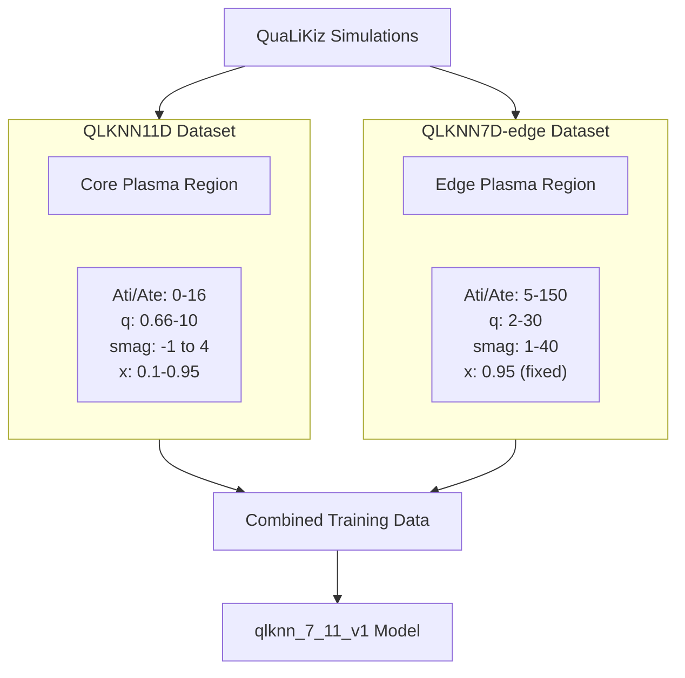
**Diagram: QLKNN Training Data Provenance**

Both datasets are publicly available on Zenodo:
- QLKNN11D: https://zenodo.org/record/8017522
- QLKNN7D-edge: https://zenodo.org/record/8106431

**Sources:** [README.md:15-22](), [fusion_surrogates/qlknn/models/README.md:1-59]()

### Data Filtering Criteria

Training data undergoes extensive filtering to ensure quality and physical validity. The filtering process is described in [Van de Plassche et al. 2020](https://pubs.aip.org/aip/pop/article-abstract/27/2/022310/1062590). Datapoints are rejected if:

- QuaLiKiz convergence was not achieved
- Total heat flux is negative (unphysical)
- Particle flux consistency error > 50% (diffusion vs. convection)
- Mode contribution error > 50% (ITG + TEM vs. total flux)
- Ambipolarity violation > 50%
- Transport coefficient < 10⁻⁴ GyroBohm units when non-zero
- Outliers in unfiltered dataset (lower/upper 2-percentile)

**Sources:** [fusion_surrogates/qlknn/models/README.md:10-22]()

---

## Core Architecture Components

### Component Hierarchy

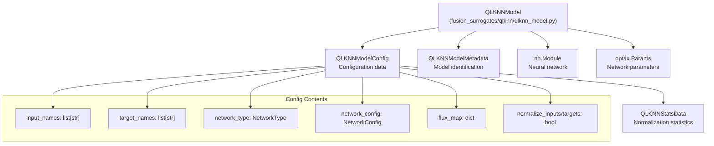
**Diagram: QLKNN Core Components and Relationships**

**Sources:** [fusion_surrogates/qlknn/qlknn_model.py:46-148]()

### QLKNNModel Class

The `QLKNNModel` class [fusion_surrogates/qlknn/qlknn_model.py:166-419]() is the primary interface for QLKNN inference. It encapsulates:

| Component | Type | Purpose |
|-----------|------|---------|
| `_config` | `QLKNNModelConfig` | Model architecture and data processing configuration |
| `_params` | `optax.Params` | Trained neural network weights |
| `_network` | `nn.Module` | Flax neural network module |
| `_metadata` | `QLKNNModelMetadata` | Model identification (path, name, version) |
| `_inputs_and_ranges` | `dict[str, dict[str, float]]` | Valid input parameter ranges |

**Key methods:**

- `init_params()` [fusion_surrogates/qlknn/qlknn_model.py:183-189](): Initialize random parameters (for training)
- `predict_with_params()` [fusion_surrogates/qlknn/qlknn_model.py:252-273](): Raw network prediction (normalized if configured)
- `predict_targets()` [fusion_surrogates/qlknn/qlknn_model.py:275-296](): Predict unnormalized targets
- `predict()` [fusion_surrogates/qlknn/qlknn_model.py:324-339](): Predict physical fluxes from targets
- `load_model_from_name()` [fusion_surrogates/qlknn/qlknn_model.py:370-379](): Load from registry
- `load_model_from_path()` [fusion_surrogates/qlknn/qlknn_model.py:381-401](): Load from file path
- `load_default_model()` [fusion_surrogates/qlknn/qlknn_model.py:403-406](): Load default QLKNN model

**Sources:** [fusion_surrogates/qlknn/qlknn_model.py:166-419]()

### QLKNNModelConfig

The `QLKNNModelConfig` dataclass [fusion_surrogates/qlknn/qlknn_model.py:109-138]() defines all configuration needed to construct and use a QLKNN model:

```python
@dataclasses.dataclass
class QLKNNModelConfig:
  normalize_inputs: bool          # Apply input normalization
  normalize_targets: bool         # Apply target normalization
  input_names: list[str]          # Names of input features
  target_names: list[str]         # Names of network outputs
  stats_data: QLKNNStatsData      # Normalization statistics
  flux_map: dict[str, Any]        # Target → flux conversion
  network_type: NetworkType       # Network architecture enum
  network_config: NetworkConfig   # Architecture-specific config
```

The `flux_map` dictionary specifies how to compute physical fluxes from network target predictions. Each flux has a `target` (the primary prediction) and optional `denominator` (another target to multiply by). See [QLKNN Input and Output Specifications](#3.2) for details.

**Sources:** [fusion_surrogates/qlknn/qlknn_model.py:109-138]()

### QLKNNStatsData

The `QLKNNStatsData` dataclass [fusion_surrogates/qlknn/qlknn_model.py:46-71]() stores normalization statistics computed from the training data:

| Field | Shape | Purpose |
|-------|-------|---------|
| `input_mean` | `(num_inputs,)` | Mean of each input feature |
| `input_stddev` | `(num_inputs,)` | Standard deviation of each input |
| `target_mean` | `(num_targets,)` | Mean of each target output |
| `target_stddev` | `(num_targets,)` | Standard deviation of each target |
| `input_min` | `(num_inputs,)` | Minimum valid input value |
| `input_max` | `(num_inputs,)` | Maximum valid input value |

These statistics are loaded from JSON files and used by the `transforms.normalize()` and `transforms.unnormalize()` functions [fusion_surrogates/common/transforms.py:21-32]() to standardize data to zero mean and unit variance.

**Sources:** [fusion_surrogates/qlknn/qlknn_model.py:46-71](), [fusion_surrogates/common/transforms.py:1-33]()

---

## Network Architecture Options

QLKNN supports multiple neural network architectures through the `NetworkType` enum and `NETWORK_MAP` registry [fusion_surrogates/common/networks.py]() (see [Network Architectures](#5.1) for implementation details). Each architecture has associated configuration classes:

### Available Architectures

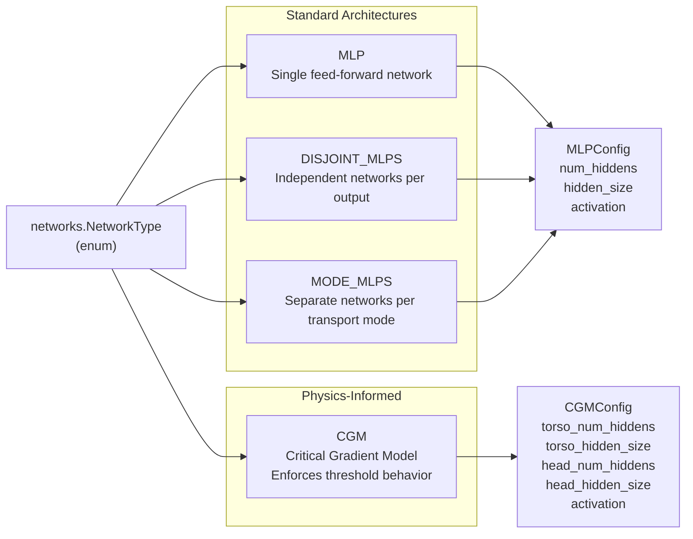
**Diagram: QLKNN Network Architecture Options**

**Sources:** [fusion_surrogates/qlknn/qlknn_model.py:74-106](), [fusion_surrogates/qlknn/qlknn_model_test.py:105-155]()

### MLPConfig

Standard multi-layer perceptron configuration [fusion_surrogates/qlknn/qlknn_model.py:79-85]():

| Field | Type | Description |
|-------|------|-------------|
| `num_hiddens` | `int` | Number of hidden layers |
| `hidden_size` | `int` | Neurons per hidden layer |
| `activation` | `str` | Activation function ('relu', 'tanh', 'sigmoid') |

Used by: `MLP`, `DisjointMLPs`, `ModeMLPs` architectures.

**Sources:** [fusion_surrogates/qlknn/qlknn_model.py:79-85]()

### CGMConfig

Critical Gradient Model configuration [fusion_surrogates/qlknn/qlknn_model.py:88-96]():

| Field | Type | Description |
|-------|------|-------------|
| `torso_num_hiddens` | `int` | Hidden layers in shared torso |
| `torso_hidden_size` | `int` | Neurons per torso layer |
| `head_num_hiddens` | `int` | Hidden layers in output heads |
| `head_hidden_size` | `int` | Neurons per head layer |
| `activation` | `str` | Activation function |

The CGM architecture enforces physics-informed constraints where transport vanishes below critical gradient thresholds. It uses a shared "torso" network and separate "head" networks per output, with special handling for temperature gradients (`Ate`, `Ati`).

**Sources:** [fusion_surrogates/qlknn/qlknn_model.py:88-96](), [fusion_surrogates/qlknn/qlknn_model.py:350-357]()

### Network Construction

The `_build_network()` method [fusion_surrogates/qlknn/qlknn_model.py:341-357]() constructs the appropriate network based on configuration:

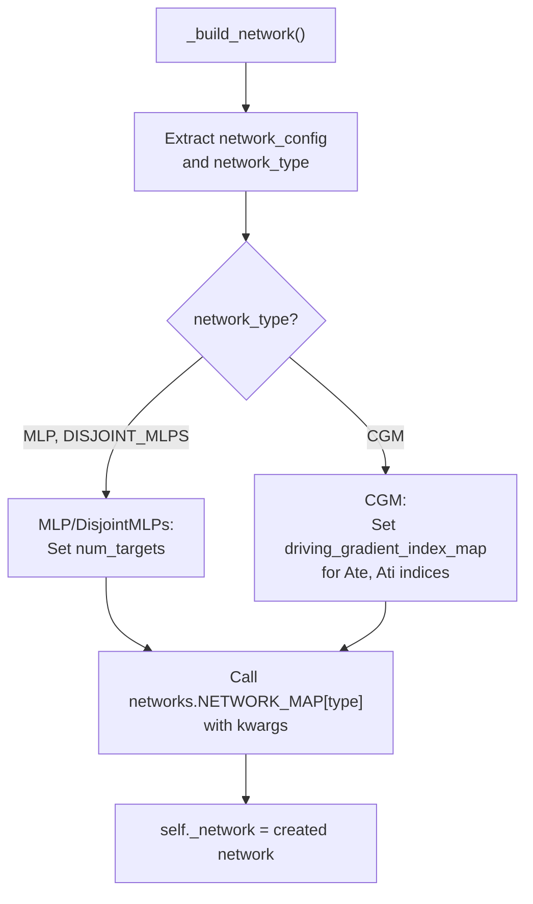
**Diagram: Network Construction Flow in _build_network()**

**Sources:** [fusion_surrogates/qlknn/qlknn_model.py:341-357]()

---

## Prediction Pipeline Architecture

The QLKNN prediction pipeline transforms raw plasma parameters into physical flux predictions through a series of well-defined stages:

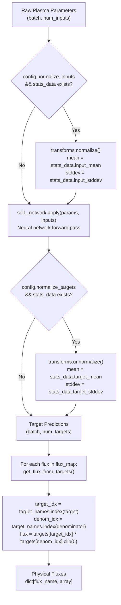
**Diagram: Complete QLKNN Prediction Pipeline**

**Sources:** [fusion_surrogates/qlknn/qlknn_model.py:252-339]()

### Pipeline Stages

#### Stage 1: Input Normalization

`predict_with_params()` [fusion_surrogates/qlknn/qlknn_model.py:267-272]() optionally normalizes inputs:

```python
if self._config.normalize_inputs and self._config.stats_data is not None:
    inputs = transforms.normalize(
        inputs,
        mean=self._config.stats_data.input_mean,
        stddev=self._config.stats_data.input_stddev,
    )
```

The normalization formula [fusion_surrogates/common/transforms.py:21-25]() is: `(data - mean) / stddev`

#### Stage 2: Network Inference

The normalized (or raw) inputs are passed through the neural network:
```python
return self._network.apply(params, inputs)
```

This calls the Flax `nn.Module` forward pass with the trained parameters.

#### Stage 3: Target Denormalization

`predict_targets()` [fusion_surrogates/qlknn/qlknn_model.py:290-295]() converts normalized outputs back to physical units:

```python
if self._config.normalize_targets and self._config.stats_data is not None:
    outputs = transforms.unnormalize(
        outputs,
        mean=self._config.stats_data.target_mean,
        stddev=self._config.stats_data.target_stddev,
    )
```

The unnormalization formula [fusion_surrogates/common/transforms.py:28-32]() is: `data * stddev + mean`

#### Stage 4: Flux Calculation

`predict()` [fusion_surrogates/qlknn/qlknn_model.py:324-339]() computes physical fluxes from targets using the `flux_map` configuration. The `get_flux_from_targets()` method [fusion_surrogates/qlknn/qlknn_model.py:298-322]() implements the conversion:

1. Extract `target` index from `target_names`
2. Extract `denominator` index if specified
3. Compute: `flux = target * denominator.clip(0)` or `flux = target.clip(0)`

The `.clip(0)` operation ensures negative fluxes are set to zero (unphysical).

**Sources:** [fusion_surrogates/qlknn/qlknn_model.py:252-339](), [fusion_surrogates/common/transforms.py:21-32]()

---

## Model Versioning and Format

### Version Identifier

The current QLKNN version is defined as a constant [fusion_surrogates/qlknn/qlknn_model.py:43]():
```python
VERSION: Final[str] = '11D'
```

This identifier (stored in `QLKNNModelMetadata.version`) indicates that the model is trained on the QLKNN11D dataset (plus QLKNN7D-edge).

### Serialization Format

QLKNN models are serialized using `flax.serialization.msgpack_serialize()` [fusion_surrogates/qlknn/qlknn_model.py:359-368](). The format stores:

```python
export_dict = {
    'version': version,           # Version string
    'config': config.serialize(), # Serialized QLKNNModelConfig
    'params': params,             # Neural network parameters
}
```

Models are saved with the `.qlknn` extension and can be loaded using `QLKNNModel.load_model_from_path()`.

**Sources:** [fusion_surrogates/qlknn/qlknn_model.py:43](), [fusion_surrogates/qlknn/qlknn_model.py:359-401]()

---

## Summary

The QLKNN system provides a complete architecture for surrogate modeling of tokamak turbulent transport:

| Component | Purpose | Key Files |
|-----------|---------|-----------|
| **Training Data** | QLKNN11D + QLKNN7D-edge datasets | [fusion_surrogates/qlknn/models/README.md]() |
| **Model Class** | Inference interface and lifecycle | [fusion_surrogates/qlknn/qlknn_model.py:166-419]() |
| **Configuration** | Architecture and processing settings | [fusion_surrogates/qlknn/qlknn_model.py:109-138]() |
| **Statistics** | Normalization parameters | [fusion_surrogates/qlknn/qlknn_model.py:46-71]() |
| **Networks** | Multiple architecture options | [fusion_surrogates/common/networks.py]() |
| **Transforms** | Data normalization utilities | [fusion_surrogates/common/transforms.py]() |

The architecture separates concerns cleanly: configuration defines the model structure, statistics enable data preprocessing, and the network provides the learned mapping. This modular design allows for flexible experimentation with different architectures while maintaining a consistent inference interface.

For next steps:
- Learn about input/output specifications: [QLKNN Input and Output Specifications](#3.2)
- Get started with practical usage: [Using QLKNN Models](#3.3)
- Explore model storage and deployment: [QLKNN Model Registry and ONNX Export](#3.4)

**Sources:** [fusion_surrogates/qlknn/qlknn_model.py:1-419](), [README.md:1-105]()

---

# Page: QLKNN Input and Output Specifications

# QLKNN Input and Output Specifications

<details>
<summary>Relevant source files</summary>

The following files were used as context for generating this wiki page:

- [README.md](README.md)
- [fusion_surrogates/common/transforms.py](fusion_surrogates/common/transforms.py)
- [fusion_surrogates/qlknn/models/README.md](fusion_surrogates/qlknn/models/README.md)
- [fusion_surrogates/qlknn/qlknn_model.py](fusion_surrogates/qlknn/qlknn_model.py)
- [fusion_surrogates/qlknn/qlknn_model_test.py](fusion_surrogates/qlknn/qlknn_model_test.py)

</details>


This page documents the input parameters, target predictions, and physical flux outputs produced by QLKNN models. It covers the 10 input features, 8 target predictions, filtering criteria applied to training data, and the transformation from targets to physical fluxes.

For information about QLKNN model architecture and network types, see [QLKNN Overview and Architecture](#3.1). For practical usage examples, see [Using QLKNN Models](#3.3).

## Input Parameters

QLKNN models accept 10 normalized plasma parameters as input. These inputs characterize the local plasma conditions and geometry at a specific radial location in the tokamak.

### Input Feature Definitions

The input features are stored in the `input_names` list within `QLKNNModelConfig` [fusion_surrogates/qlknn/qlknn_model.py:115]().

| Input Name | Symbol | Physical Meaning | Stored in Code |
|------------|--------|------------------|----------------|
| `Ate` | $$R/L_{Te}$$ | Normalized logarithmic electron temperature gradient | `config.input_names[0]` |
| `Ati` | $$R/L_{Ti}$$ | Normalized logarithmic ion temperature gradient | `config.input_names[1]` |
| `Ane` | $$R/L_{ne}$$ | Normalized logarithmic electron density gradient | `config.input_names[2]` |
| `Ani` | $$R/L_{ni}$$ | Normalized logarithmic ion density gradient | `config.input_names[3]` |
| `q` | $$q$$ | Safety factor (magnetic field line pitch) | `config.input_names[4]` |
| `smag` | $$\hat{s}$$ | Magnetic shear | `config.input_names[5]` |
| `x` | $$r/R_{maj}$$ | Local inverse aspect ratio | `config.input_names[6]` |
| `Ti_Te` | $$T_i/T_e$$ | Ion-electron temperature ratio | `config.input_names[7]` |
| `LogNuStar` | $$\log(\nu^*)$$ | Logarithmic normalized collisionality | `config.input_names[8]` |
| `normni` | $$n_i/n_e$$ | Normalized ion-electron density ratio | `config.input_names[9]` |

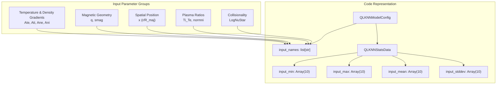

**Diagram: QLKNN Input Parameter Organization**

Sources: [README.md:23-33](), [fusion_surrogates/qlknn/qlknn_model.py:46-71](), [fusion_surrogates/qlknn/qlknn_model.py:110-120]()

### Input Ranges by Dataset

QLKNN_7_11 was trained on two combined datasets with different input ranges. The `QLKNNStatsData.input_min` and `QLKNNStatsData.input_max` arrays store the valid ranges [fusion_surrogates/qlknn/qlknn_model.py:54-55]().

**QLKNN11D Dataset (Core Plasma Region)**

| Input | Minimum | Maximum | Notes |
|-------|---------|---------|-------|
| `Ati` | ~0.0 | 16.0 | Core region typically has moderate gradients |
| `Ate` | ~0.0 | 16.0 | |
| `Ane` | -5.0 | 5.0 | Negative values represent density peaking |
| `Ani` | -15.0 | 15.0 | |
| `q` | 0.66 | 10.0 | Safety factor range for core |
| `smag` | -1.0 | 4.0 | Can be negative in some configurations |
| `x` | 0.1 | 0.95 | Core to edge, excluding separatrix |
| `Ti_Te` | 0.25 | 2.5 | Ion temperature typically comparable to electron |
| `LogNuStar` | -5.0 | -0.0003 | Low collisionality in core |
| `normni` | 0.7 | 1.0 | Near quasi-neutrality |

**QLKNN7D-edge Dataset (Edge Plasma Region)**

| Input | Minimum | Maximum | Notes |
|-------|---------|---------|-------|
| `Ati` | 5.0 | 150.0 | Edge has much steeper gradients |
| `Ate` | 5.0 | 150.0 | |
| `Ane` | 2.0 | 110.0 | Edge density gradients typically positive |
| `Ani` | 2.0 | 110.0 | |
| `q` | 2.0 | 30.0 | Higher safety factor at edge |
| `smag` | 1.0 | 40.0 | Higher magnetic shear at edge |
| `x` | 0.95 | 0.95 | Fixed at edge position |
| `Ti_Te` | 1.0 | 1.0 | Fixed at unity for edge dataset |
| `LogNuStar` | -1.0 | 0.48 | Higher collisionality at edge |
| `normni` | 0.5 | 1.0 | |

Sources: [fusion_surrogates/qlknn/models/README.md:24-59]()

### Input Normalization

Input features are normalized during prediction using the `transforms.normalize()` function [fusion_surrogates/common/transforms.py:21-25]():

```
normalized_input = (raw_input - input_mean) / input_stddev
```

This normalization is controlled by the `normalize_inputs` flag in `QLKNNModelConfig` and applied in the `predict_with_params()` method [fusion_surrogates/qlknn/qlknn_model.py:267-272]().

Sources: [fusion_surrogates/qlknn/qlknn_model.py:252-273](), [fusion_surrogates/common/transforms.py:21-25]()

## Target Predictions

QLKNN models output 8 target predictions representing transport characteristics. These targets are the direct output of the neural network before any post-processing.

### Target Definitions

The targets are stored in the `target_names` list within `QLKNNModelConfig` [fusion_surrogates/qlknn/qlknn_model.py:116]().

| Target Index | Target Name | Physical Meaning | Transport Mode |
|--------------|-------------|------------------|----------------|
| 0 | `efiITG` | Ion heat flux (leading flux for ITG) | ITG |
| 1 | `efeITG` / `efiITG` | Electron-to-ion heat flux ratio | ITG |
| 2 | `pfeITG` / `efiITG` | Electron particle-to-ion heat flux ratio | ITG |
| 3 | `efeTEM` | Electron heat flux (leading flux for TEM) | TEM |
| 4 | `efiTEM` / `efeTEM` | Ion-to-electron heat flux ratio | TEM |
| 5 | `pfeTEM` / `efeTEM` | Electron particle-to-electron heat flux ratio | TEM |
| 6 | `efeETG` | Electron heat flux (ETG mode) | ETG |
| 7 | `gamma_max` | Maximum growth rate on ion scales | All modes |

The model outputs the **leading flux** for each mode directly, and **ratios** of secondary fluxes to the leading flux. This design improves numerical stability during training.

Sources: [README.md:35-41](), [fusion_surrogates/qlknn/models/README.md:61-75]()

### Target Value Ranges

Based on the combined QLKNN11D and QLKNN7D-edge datasets:

| Target | Minimum | Maximum | Units |
|--------|---------|---------|-------|
| `efiITG` | 0.286 | 442.27 | GB (GyroBohm) |
| `efeITG` / `efiITG` | 0.00192 | 446.69 | Dimensionless ratio |
| `pfeITG` / `efiITG` | -133.0 | 132.68 | Dimensionless ratio |
| `efeTEM` | 0.168 | 134.78 | GB (GyroBohm) |
| `efiTEM` / `efeTEM` | 0.000988 | 257.43 | Dimensionless ratio |
| `pfeTEM` / `efeTEM` | -89.0 | 88.95 | Dimensionless ratio |
| `efeETG` | 0.141 | 73.15 | GB (GyroBohm) |
| `gamma_max` | 0.0 | 0.46 | Normalized frequency |

Sources: [fusion_surrogates/qlknn/models/README.md:61-75]()

### Target Denormalization

Targets are denormalized after network inference using `transforms.unnormalize()` [fusion_surrogates/common/transforms.py:28-32]():

```
denormalized_target = normalized_target * target_stddev + target_mean
```

This happens in the `predict_targets()` method when `normalize_targets` is enabled [fusion_surrogates/qlknn/qlknn_model.py:290-295]().

Sources: [fusion_surrogates/qlknn/qlknn_model.py:275-296](), [fusion_surrogates/common/transforms.py:28-32]()

## Flux Outputs

Physical fluxes are computed from targets using the `flux_map` configuration, which defines how to combine target values to produce each flux.

### Flux Calculation Logic

The `flux_map` dictionary [fusion_surrogates/qlknn/qlknn_model.py:118]() maps flux names to:
- `target`: The name of the target to use
- `denominator`: The name of another target to multiply by (or `None`)

The `get_flux_from_targets()` method implements the flux calculation [fusion_surrogates/qlknn/qlknn_model.py:298-322]():

```python
if denominator_name is not None:
    flux = target * denominator.clip(0)  # Multiply ratio by leading flux
else:
    flux = target.clip(0)  # Leading flux, clipped to non-negative
```

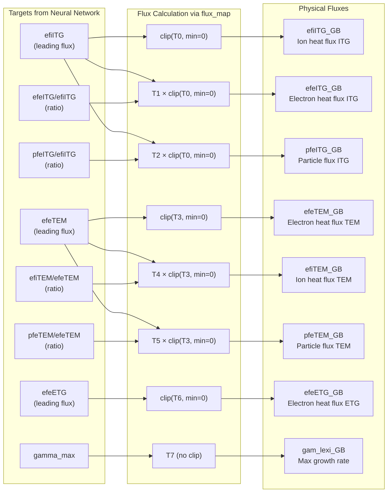

**Diagram: Target to Flux Transformation Pipeline**

Sources: [fusion_surrogates/qlknn/qlknn_model.py:298-339]()

### Flux Output Dictionary

The `predict()` method returns a dictionary mapping flux names to arrays [fusion_surrogates/qlknn/qlknn_model.py:324-339](). Each flux is a JAX array with shape `(batch_size, 1)`.

**Example Flux Map Structure:**

```python
flux_map = {
    'efiITG_GB': {
        'target': 'efiITG',
        'denominator': None  # Leading flux, no denominator
    },
    'efeITG_GB': {
        'target': 'efeITG/efiITG',
        'denominator': 'efiITG'  # Multiply ratio by leading flux
    },
    'pfeITG_GB': {
        'target': 'pfeITG/efiITG',
        'denominator': 'efiITG'
    },
    # ... similar for TEM and ETG modes
}
```

### Flux Types by Transport Mode

**Ion Temperature Gradient (ITG) Mode:**
- `efiITG_GB`: Ion heat flux (primary instability driver)
- `efeITG_GB`: Electron heat flux (secondary)
- `pfeITG_GB`: Particle flux

**Trapped Electron Mode (TEM):**
- `efeTEM_GB`: Electron heat flux (primary instability driver)
- `efiTEM_GB`: Ion heat flux (secondary)
- `pfeTEM_GB`: Particle flux

**Electron Temperature Gradient (ETG) Mode:**
- `efeETG_GB`: Electron heat flux (operates on electron scales)

**Growth Rate:**
- `gam_lexi_GB`: Maximum linear growth rate on ion gyroradius scales

Sources: [README.md:35-41](), [fusion_surrogates/qlknn/qlknn_model.py:298-339]()

## Data Filtering Criteria

The training datasets were filtered to ensure physical consistency and numerical reliability. These filters are applied during dataset preparation, not during inference.

### Filtering Rules

Data points were **rejected** if they met any of these criteria:

1. **Convergence failure**: QuaLiKiz simulation did not converge
2. **Negative total heat flux**: Total heat flux < 0 (non-physical)
3. **Particle flux inconsistency**: Difference between total particle flux and flux derived from diffusion/convection coefficients > 50%
4. **Mode contribution inconsistency**: Difference between sum of ITG+TEM mode contributions and self-consistent total flux > 50%
5. **Ambipolarity violation**: Ambipolarity violated by > 50%
6. **Small transport coefficients**: Non-zero transport coefficient < 10⁻⁴ GB (numerical noise)
7. **Outliers**: Data points in lower or upper 2-percentile of unfiltered dataset

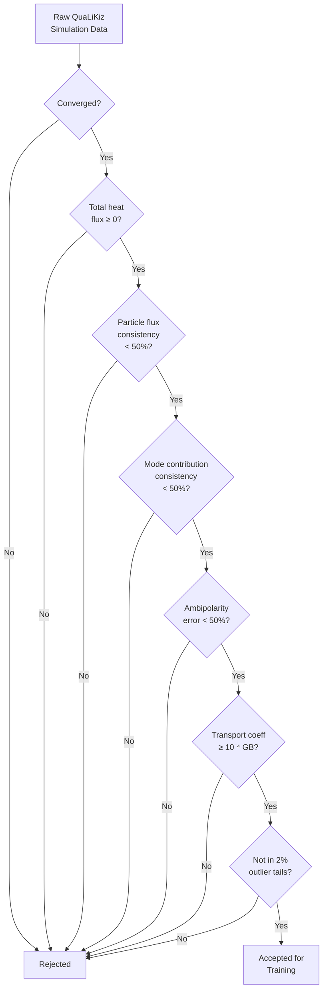

**Diagram: Data Filtering Decision Tree**

These filtering criteria ensure that the model learns from physically consistent, numerically stable data points. The filters are based on the methodology described in [Van de Plassche et al. PoP 2020](https://doi.org/10.1063/1.5134126).

Sources: [fusion_surrogates/qlknn/models/README.md:10-22]()

## Input Validation and Ranges

### Accessing Input Ranges

The `inputs_and_ranges` property provides a mapping from input names to their valid ranges [fusion_surrogates/qlknn/qlknn_model.py:240-241]():

```python
model = QLKNNModel.load_default_model()
ranges = model.inputs_and_ranges
# Returns: {'Ate': {'min': ..., 'max': ...}, ...}
```

This mapping is constructed from `QLKNNStatsData.input_min` and `QLKNNStatsData.input_max` in the `_inputs_and_ranges_from_config()` function [fusion_surrogates/qlknn/qlknn_model.py:150-163]().

### Statistical Normalization Parameters

The `QLKNNStatsData` dataclass stores normalization statistics [fusion_surrogates/qlknn/qlknn_model.py:46-71]():

| Attribute | Shape | Purpose |
|-----------|-------|---------|
| `input_mean` | `(10,)` | Mean values for input normalization |
| `input_stddev` | `(10,)` | Standard deviation for input normalization |
| `target_mean` | `(8,)` | Mean values for target denormalization |
| `target_stddev` | `(8,)` | Standard deviation for target denormalization |
| `input_min` | `(10,)` | Minimum valid input values |
| `input_max` | `(10,)` | Maximum valid input values |

These statistics are loaded from JSON files using `QLKNNStatsData.from_stats_path()` [fusion_surrogates/qlknn/qlknn_model.py:57-71]().

Sources: [fusion_surrogates/qlknn/qlknn_model.py:46-71](), [fusion_surrogates/qlknn/qlknn_model.py:150-163]()

## Code Mapping: Inputs to Outputs

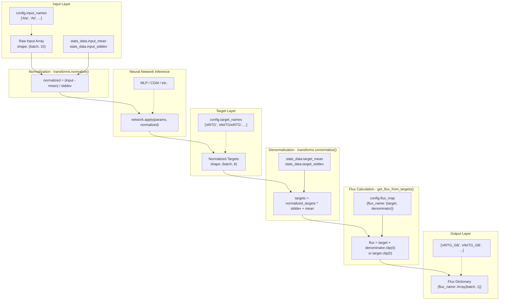

**Diagram: Complete Data Flow from Inputs to Flux Outputs**

### Key Methods

| Method | Location | Purpose |
|--------|----------|---------|
| `normalize()` | [fusion_surrogates/common/transforms.py:21-25]() | Normalize inputs to mean=0, std=1 |
| `unnormalize()` | [fusion_surrogates/common/transforms.py:28-32]() | Restore original scale to targets |
| `predict_with_params()` | [fusion_surrogates/qlknn/qlknn_model.py:252-273]() | Raw network inference |
| `predict_targets()` | [fusion_surrogates/qlknn/qlknn_model.py:275-296]() | Denormalized target predictions |
| `get_flux_from_targets()` | [fusion_surrogates/qlknn/qlknn_model.py:298-322]() | Convert single target to flux |
| `predict()` | [fusion_surrogates/qlknn/qlknn_model.py:324-339]() | Complete pipeline returning all fluxes |

Sources: [fusion_surrogates/qlknn/qlknn_model.py:252-339](), [fusion_surrogates/common/transforms.py:21-32]()

## Summary

QLKNN models transform 10 plasma input parameters into 8 physics-informed flux predictions across three transport modes (ITG, TEM, ETG). The architecture separates:

1. **Inputs**: Normalized gradients, magnetic geometry, and plasma ratios
2. **Targets**: Neural network outputs (leading fluxes and ratios)
3. **Fluxes**: Physical quantities computed from targets using `flux_map`

This design ensures numerical stability during training while providing physically interpretable outputs for tokamak transport simulation. Input validation is performed through stored min/max ranges, and normalization/denormalization maintain consistency with training data statistics.

Sources: [fusion_surrogates/qlknn/qlknn_model.py:1-419](), [README.md:10-44](), [fusion_surrogates/qlknn/models/README.md:1-76]()

---

# Page: Using QLKNN Models

# Using QLKNN Models

<details>
<summary>Relevant source files</summary>

The following files were used as context for generating this wiki page:

- [fusion_surrogates/common/transforms.py](fusion_surrogates/common/transforms.py)
- [fusion_surrogates/qlknn/models/qlknn_7_11_test.py](fusion_surrogates/qlknn/models/qlknn_7_11_test.py)
- [fusion_surrogates/qlknn/models/registry.py](fusion_surrogates/qlknn/models/registry.py)
- [fusion_surrogates/qlknn/qlknn_model.py](fusion_surrogates/qlknn/qlknn_model.py)
- [fusion_surrogates/qlknn/qlknn_model_test.py](fusion_surrogates/qlknn/qlknn_model_test.py)

</details>


This page provides a practical guide to loading QLKNN models and making predictions. For information about QLKNN model architecture and training datasets, see [QLKNN Overview and Architecture](#3.1). For details on input/output parameters and physical quantities, see [QLKNN Input and Output Specifications](#3.2). For model registry internals and ONNX export, see [QLKNN Model Registry and ONNX Export](#3.4).

## Loading Models

The `QLKNNModel` class provides three methods for loading pre-trained models. All loading methods return a fully-initialized `QLKNNModel` instance with parameters ready for inference.

### Loading the Default Model

The simplest approach is to load the default model using the class method `load_default_model()`:

```python
model = qlknn_model.QLKNNModel.load_default_model()
```

This loads the model specified by `DEFAULT_MODEL_NAME` in the registry (currently `'qlknn_7_11_v1'`).

Sources: [fusion_surrogates/qlknn/qlknn_model.py:404-406](), [fusion_surrogates/qlknn/models/registry.py:19]()

### Loading by Model Name

To load a specific model from the registry by name:

```python
model = qlknn_model.QLKNNModel.load_model_from_name('qlknn_7_11_v1')
```

This method looks up the model path in the `MODELS` registry and loads the corresponding `.qlknn` file.

Sources: [fusion_surrogates/qlknn/qlknn_model.py:370-379](), [fusion_surrogates/qlknn/models/registry.py:21-23]()

### Loading from File Path

To load a model from an arbitrary file path:

```python
model = qlknn_model.QLKNNModel.load_model_from_path('/path/to/model.qlknn', model_name='custom_model')
```

The `model_name` parameter is optional and used only for metadata tracking.

Sources: [fusion_surrogates/qlknn/qlknn_model.py:381-401]()

### Model Loading Process

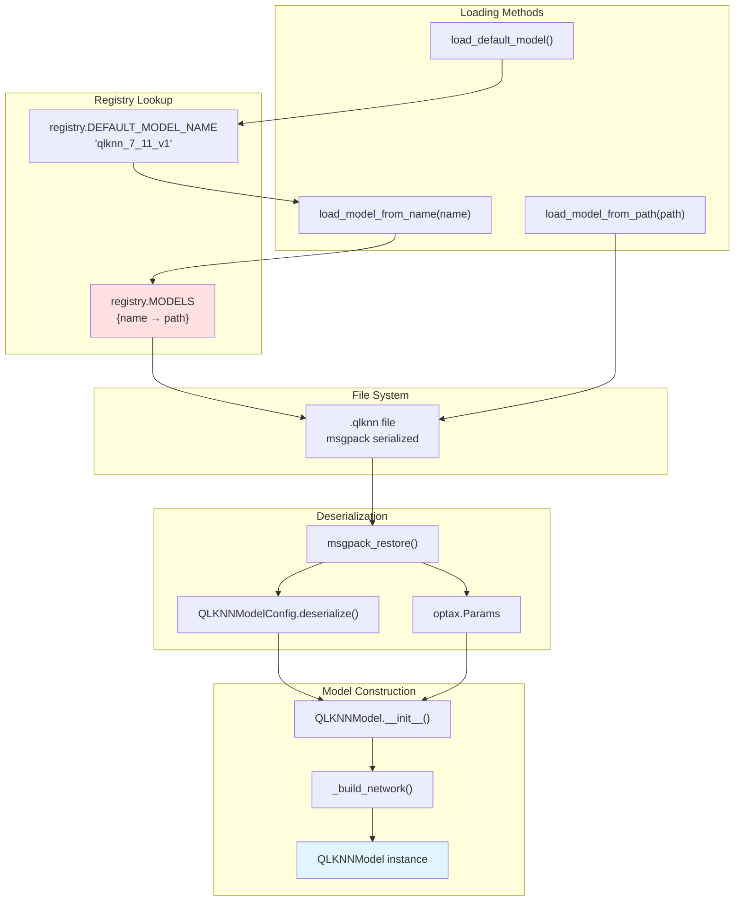

**Diagram: QLKNN Model Loading Flow**

The loading process deserializes a `.qlknn` file containing the model configuration and trained parameters, then constructs a `QLKNNModel` instance with the appropriate network architecture.

Sources: [fusion_surrogates/qlknn/qlknn_model.py:370-406](), [fusion_surrogates/qlknn/models/registry.py:19-27]()

## Model Properties and Metadata

After loading, the model exposes several useful properties:

| Property | Type | Description |
|----------|------|-------------|
| `model.name` | `str` | Model name from registry or loading call |
| `model.version` | `str` | Model version (e.g., `'11D'`) |
| `model.path` | `str` | File path the model was loaded from |
| `model.num_inputs` | `int` | Number of input features |
| `model.num_targets` | `int` | Number of target predictions |
| `model.params` | `optax.Params` | Neural network parameters |
| `model.config` | `QLKNNModelConfig` | Full model configuration |
| `model.inputs_and_ranges` | `dict` | Input names with min/max ranges |

Sources: [fusion_surrogates/qlknn/qlknn_model.py:191-241]()

## Making Predictions

The `QLKNNModel` class provides three prediction methods depending on your use case.

### Input Format Requirements

All prediction methods expect inputs as JAX arrays with the following shape constraints:

```python
# Shape: (num_devices, batch_size, num_inputs)
# For single device:
inputs = jnp.array([[...]])  # Shape: (1, batch_size, 10)
```

The first dimension represents the number of devices for parallel computation (typically 1 for single-device inference). The model automatically handles normalization if enabled in the configuration.

Sources: [fusion_surrogates/qlknn/qlknn_model_test.py:30-38]()

### Prediction Methods

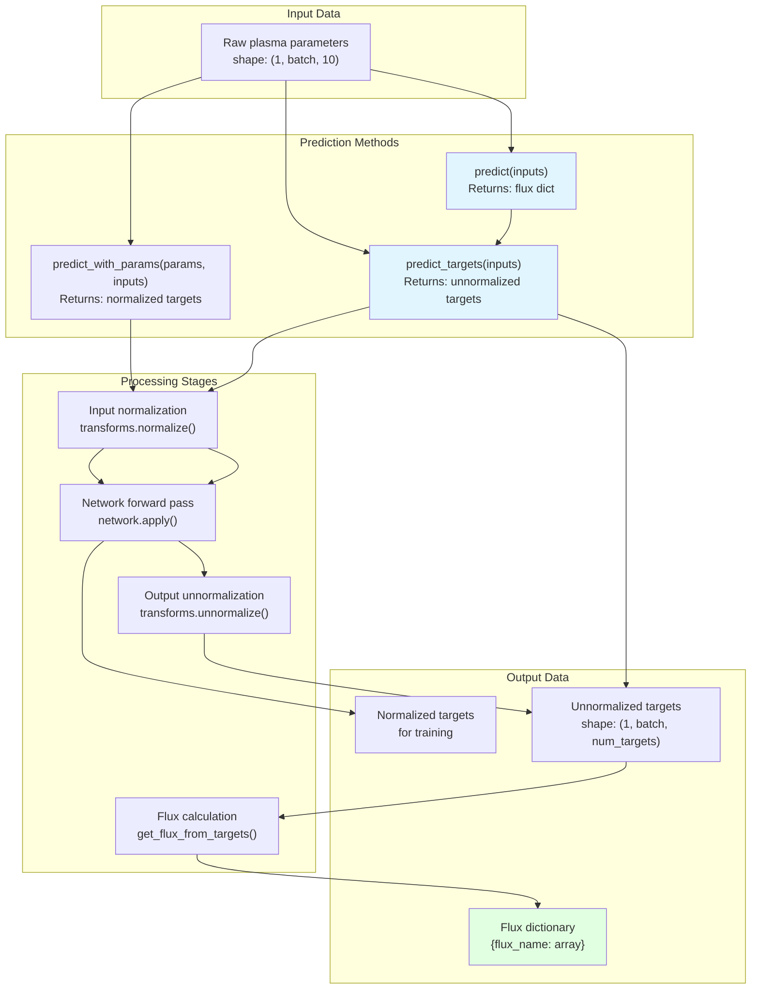

**Diagram: Prediction Method Hierarchy**

Sources: [fusion_surrogates/qlknn/qlknn_model.py:252-339]()

### predict_with_params()

This method is used during training when parameters are changing:

```python
outputs = model.predict_with_params(params, inputs)
# Returns normalized targets if normalization is enabled
```

The method performs input normalization (if configured) and returns raw network outputs. This is useful for computing gradients during training since it can be JIT-compiled with varying parameters.

Sources: [fusion_surrogates/qlknn/qlknn_model.py:252-273]()

### predict_targets()

This method predicts unnormalized target quantities at inference time:

```python
targets = model.predict_targets(inputs)
# Returns shape: (1, batch_size, num_targets)
```

The method automatically handles both input normalization and output unnormalization based on the model configuration. Use this when you need the raw target predictions before flux calculation.

Sources: [fusion_surrogates/qlknn/qlknn_model.py:275-296]()

### predict()

The primary prediction method returns a dictionary of physical fluxes:

```python
fluxes = model.predict(inputs)
# Returns: {'ITG_efe': array(...), 'ITG_efi': array(...), ...}
```

This is the recommended method for inference. It internally calls `predict_targets()` and applies the flux calculation logic defined in the model's `flux_map` configuration.

Sources: [fusion_surrogates/qlknn/qlknn_model.py:324-339]()

## Understanding Predictions

### Targets vs Fluxes

The model outputs are organized in a two-level hierarchy:

**Targets**: Raw neural network predictions representing intermediate quantities. These are the direct outputs from the network, stored as an array with shape `(batch_size, num_targets)`.

**Fluxes**: Physical turbulent transport fluxes computed from targets according to the `flux_map` configuration. Each flux is calculated by combining one or more targets with specific mathematical operations.

Sources: [fusion_surrogates/qlknn/qlknn_model.py:298-322]()

### Flux Calculation from Targets

The `get_flux_from_targets()` method implements the flux calculation logic:

```mermaid
flowchart TB
    subgraph "Input"
        TARGETS["targets array<br/>shape: (batch, num_targets)"]
        FLUX_NAME["flux_name: str"]
    end
    
    subgraph "Flux Map Lookup"
        FLUX_MAP["config.flux_map[flux_name]"]
        TARGET_NAME["'target': target_name"]
        DENOM_NAME["'denominator': denom_name or None"]
    end
    
    subgraph "Index Resolution"
        TARGET_IDX["target_idx = config.target_names.index(target_name)"]
        DENOM_IDX["denom_idx = config.target_names.index(denom_name)"]
    end
    
    subgraph "Calculation Logic"
        CHECK_DENOM{"Has<br/>denominator?"}
        CALC_WITH_DENOM["flux = targets[:, target_idx] *<br/>targets[:, denom_idx].clip(0)"]
        CALC_NO_DENOM["flux = targets[:, target_idx].clip(0)"]
    end
    
    subgraph "Output"
        FLUX_ARRAY["flux array<br/>shape: (batch, 1)"]
    end
    
    FLUX_NAME --> FLUX_MAP
    FLUX_MAP --> TARGET_NAME
    FLUX_MAP --> DENOM_NAME
    
    TARGET_NAME --> TARGET_IDX
    DENOM_NAME --> DENOM_IDX
    
    TARGETS --> CHECK_DENOM
    TARGET_IDX --> CHECK_DENOM
    DENOM_IDX --> CHECK_DENOM
    
    CHECK_DENOM -->|Yes| CALC_WITH_DENOM
    CHECK_DENOM -->|No| CALC_NO_DENOM
    
    CALC_WITH_DENOM --> FLUX_ARRAY
    CALC_NO_DENOM --> FLUX_ARRAY
    
    style FLUX_ARRAY fill:#e1ffe1
```

**Diagram: Flux Calculation Logic**

Key operations:
- **Clipping**: Denominators (typically leading fluxes) are clipped to 0 to prevent negative values
- **Multiplication**: If a denominator is specified, the target is multiplied by the clipped denominator
- **Reshaping**: Output is reshaped to `(batch, 1)` for consistency

Sources: [fusion_surrogates/qlknn/qlknn_model.py:298-322]()

## Complete Prediction Pipeline

```mermaid
flowchart TB
    subgraph "Input Preparation"
        RAW["Raw plasma parameters<br/>Ate, Ati, An, q, smag, x, Ti_Te, Te, ne, Zeff"]
        BATCH["Shape to (1, batch, 10)"]
    end
    
    subgraph "Stage 1: Input Normalization"
        NORM_CHECK{"normalize_inputs<br/>enabled?"}
        NORM_IN["transforms.normalize()<br/>mean, stddev from stats_data"]
        NORM_INPUTS["Normalized inputs<br/>mean=0, std=1"]
    end
    
    subgraph "Stage 2: Network Inference"
        NETWORK_APPLY["network.apply(params, inputs)"]
        RAW_OUT["Raw network outputs<br/>(normalized if targets normalized)"]
    end
    
    subgraph "Stage 3: Target Denormalization"
        DENORM_CHECK{"normalize_targets<br/>enabled?"}
        DENORM_OUT["transforms.unnormalize()<br/>mean, stddev from stats_data"]
        TARGETS["Unnormalized targets<br/>Physical units"]
    end
    
    subgraph "Stage 4: Flux Calculation"
        FLUX_LOOP["For each flux_name in flux_map"]
        GET_FLUX["get_flux_from_targets()"]
        CLIP["Clip denominators to 0"]
        MULTIPLY["Multiply target * denominator"]
    end
    
    subgraph "Output"
        FLUX_DICT["Flux dictionary<br/>{mode_quantity: array}"]
    end
    
    RAW --> BATCH
    BATCH --> NORM_CHECK
    
    NORM_CHECK -->|Yes| NORM_IN
    NORM_CHECK -->|No| NETWORK_APPLY
    NORM_IN --> NORM_INPUTS
    NORM_INPUTS --> NETWORK_APPLY
    
    NETWORK_APPLY --> RAW_OUT
    RAW_OUT --> DENORM_CHECK
    
    DENORM_CHECK -->|Yes| DENORM_OUT
    DENORM_CHECK -->|No| TARGETS
    DENORM_OUT --> TARGETS
    
    TARGETS --> FLUX_LOOP
    FLUX_LOOP --> GET_FLUX
    GET_FLUX --> CLIP
    CLIP --> MULTIPLY
    MULTIPLY --> FLUX_DICT
    
    style FLUX_DICT fill:#e1ffe1
    style TARGETS fill:#e1f5ff
```

**Diagram: Complete QLKNN Prediction Pipeline**

Sources: [fusion_surrogates/qlknn/qlknn_model.py:252-339](), [fusion_surrogates/common/transforms.py:21-32]()

## Common Usage Patterns

### Basic Inference

```python
# Load model
model = qlknn_model.QLKNNModel.load_default_model()

# Prepare inputs with shape (1, batch_size, 10)
inputs = jnp.array([[[Ate, Ati, An, q, smag, x, Ti_Te, Te, ne, Zeff], ...]])

# Get flux predictions
fluxes = model.predict(inputs)
# Returns: {'ITG_efe': array(...), 'ITG_efi': array(...), ...}
```

Sources: [fusion_surrogates/qlknn/models/qlknn_7_11_test.py:54-58]()

### JIT Compilation

For performance-critical applications, JIT-compile the prediction function:

```python
jitted_predict = jax.jit(model.predict_targets)
targets = jitted_predict(inputs)
```

The model supports JAX transformations including `jax.jit`, `jax.vmap`, and `jax.grad`.

Sources: [fusion_surrogates/qlknn/models/qlknn_7_11_test.py:70-77]()

### Accessing Individual Fluxes

After calling `predict()`, access specific fluxes by name:

```python
fluxes = model.predict(inputs)
itg_electron_flux = fluxes['ITG_efe']  # Shape: (batch_size, 1)
```

The available flux names depend on the model's `flux_map` configuration. See [QLKNN Input and Output Specifications](#3.2) for details on flux names and physical meanings.

Sources: [fusion_surrogates/qlknn/qlknn_model.py:324-339]()

### Getting Targets Without Flux Calculation

To access intermediate target predictions:

```python
targets = model.predict_targets(inputs)
# Shape: (1, batch_size, num_targets)

# Manually compute a specific flux
flux = model.get_flux_from_targets(targets, 'ITG_efe')
```

This is useful for debugging or when implementing custom flux calculations.

Sources: [fusion_surrogates/qlknn/qlknn_model_test.py:79-103]()

### Batch Processing

The model efficiently handles batched inputs:

```python
# Single sample
inputs_single = jnp.array([[[Ate, Ati, ...]]])  # Shape: (1, 1, 10)

# Multiple samples
inputs_batch = jnp.array([[[...], [...], [...]]])  # Shape: (1, 100, 10)

# Both work with the same API
fluxes_single = model.predict(inputs_single)
fluxes_batch = model.predict(inputs_batch)
```

Sources: [fusion_surrogates/qlknn/models/qlknn_7_11_test.py:52-57]()

## Model Validation

### Checking for Invalid Parameters

Verify that loaded parameters are valid:

```python
model = qlknn_model.QLKNNModel.load_default_model()
if model.has_nan():
    raise ValueError("Model contains NaN parameters")
```

Sources: [fusion_surrogates/qlknn/qlknn_model.py:247-250](), [fusion_surrogates/qlknn/models/qlknn_7_11_test.py:48-50]()

### Counting Model Parameters

Get the total number of trainable parameters:

```python
num_params = model.num_params()
print(f"Model has {num_params} parameters")
```

Sources: [fusion_surrogates/qlknn/qlknn_model.py:243-245]()

### Verifying Input Ranges

Check if inputs are within the model's training range:

```python
input_ranges = model.inputs_and_ranges
for name, ranges in input_ranges.items():
    min_val, max_val = ranges['min'], ranges['max']
    print(f"{name}: [{min_val}, {max_val}]")
```

The model may produce unreliable predictions for inputs outside these ranges.

Sources: [fusion_surrogates/qlknn/qlknn_model.py:150-163](), [fusion_surrogates/qlknn/qlknn_model.py:239-241]()

## Key Classes and Methods Summary

| Class/Method | Location | Purpose |
|--------------|----------|---------|
| `QLKNNModel` | [fusion_surrogates/qlknn/qlknn_model.py:166]() | Main model class |
| `load_default_model()` | [fusion_surrogates/qlknn/qlknn_model.py:404]() | Load default model from registry |
| `load_model_from_name()` | [fusion_surrogates/qlknn/qlknn_model.py:371]() | Load specific model by name |
| `load_model_from_path()` | [fusion_surrogates/qlknn/qlknn_model.py:382]() | Load model from file path |
| `predict()` | [fusion_surrogates/qlknn/qlknn_model.py:324]() | Predict physical fluxes (main API) |
| `predict_targets()` | [fusion_surrogates/qlknn/qlknn_model.py:275]() | Predict unnormalized targets |
| `predict_with_params()` | [fusion_surrogates/qlknn/qlknn_model.py:252]() | Predict with custom parameters (training) |
| `get_flux_from_targets()` | [fusion_surrogates/qlknn/qlknn_model.py:298]() | Convert targets to specific flux |
| `transforms.normalize()` | [fusion_surrogates/common/transforms.py:21]() | Normalize data using statistics |
| `transforms.unnormalize()` | [fusion_surrogates/common/transforms.py:28]() | Unnormalize data to physical units |

Sources: [fusion_surrogates/qlknn/qlknn_model.py:1-419](), [fusion_surrogates/common/transforms.py:1-33]()

---

# Page: QLKNN Model Registry and ONNX Export

# QLKNN Model Registry and ONNX Export

<details>
<summary>Relevant source files</summary>

The following files were used as context for generating this wiki page:

- [fusion_surrogates/common/transforms.py](fusion_surrogates/common/transforms.py)
- [fusion_surrogates/qlknn/models/qlknn_7_11.onnx](fusion_surrogates/qlknn/models/qlknn_7_11.onnx)
- [fusion_surrogates/qlknn/models/qlknn_7_11_onnx_test.py](fusion_surrogates/qlknn/models/qlknn_7_11_onnx_test.py)
- [fusion_surrogates/qlknn/models/registry.py](fusion_surrogates/qlknn/models/registry.py)
- [fusion_surrogates/qlknn/qlknn_model.py](fusion_surrogates/qlknn/qlknn_model.py)
- [fusion_surrogates/qlknn/qlknn_model_test.py](fusion_surrogates/qlknn/qlknn_model_test.py)

</details>


## Purpose and Scope

This page documents the model registry system for QLKNN models and the ONNX export functionality. The registry provides a centralized mapping from model names to file paths, enabling simple model loading by name rather than explicit path specification. The ONNX export capability allows QLKNN models to be deployed in environments that support the ONNX standard, extending beyond JAX-based runtimes.

For information about the QLKNN model architecture and prediction workflow, see [QLKNN Overview and Architecture](#3.1). For details on using QLKNN models for inference, see [Using QLKNN Models](#3.3).

## Model Registry System

The model registry is implemented in [`fusion_surrogates/qlknn/models/registry.py`](fusion_surrogates/qlknn/models/registry.py:1-28) and provides a centralized location for managing available QLKNN models.

### Registry Structure

The registry consists of two immutable dictionaries and a default model constant:

| Registry Component | Type | Purpose |
|-------------------|------|---------|
| `MODELS` | `immutabledict` | Maps model names to `.qlknn` file paths for JAX models |
| `ONNX_MODELS` | `immutabledict` | Maps model names to `.onnx` file paths for ONNX models |
| `DEFAULT_MODEL_NAME` | `str` | Specifies the default model name (`'qlknn_7_11_v1'`) |

The registries use relative paths constructed from the registry file's location:

```python
MODELS = immutabledict.immutabledict({
    'qlknn_7_11_v1': f'{pathlib.Path(__file__).parent}/qlknn_7_11.qlknn',
})

ONNX_MODELS = immutabledict.immutabledict({
    'qlknn_7_11_v1': f'{pathlib.Path(__file__).parent}/qlknn_7_11.onnx',
})
```

This design ensures that model files bundled with the package are automatically discovered relative to the registry module location.

**Diagram: Model Registry Structure**

```mermaid
graph TB
    subgraph "Registry Module"
        REGISTRY["registry.py"]
        DEFAULT["DEFAULT_MODEL_NAME<br/>'qlknn_7_11_v1'"]
        MODELS_DICT["MODELS<br/>immutabledict"]
        ONNX_DICT["ONNX_MODELS<br/>immutabledict"]
    end
    
    subgraph "Model Files"
        QLKNN_FILE["qlknn_7_11.qlknn<br/>JAX model weights"]
        ONNX_FILE["qlknn_7_11.onnx<br/>ONNX format"]
    end
    
    subgraph "QLKNNModel Class"
        LOAD_NAME["load_model_from_name()"]
        LOAD_DEFAULT["load_default_model()"]
        LOAD_PATH["load_model_from_path()"]
    end
    
    MODELS_DICT -->|"maps name to path"| QLKNN_FILE
    ONNX_DICT -->|"maps name to path"| ONNX_FILE
    DEFAULT -->|"references"| MODELS_DICT
    
    LOAD_NAME -->|"queries"| MODELS_DICT
    LOAD_NAME -->|"calls"| LOAD_PATH
    LOAD_DEFAULT -->|"uses"| DEFAULT
    LOAD_DEFAULT -->|"calls"| LOAD_NAME
    LOAD_PATH -->|"reads"| QLKNN_FILE
```

Sources: [fusion_surrogates/qlknn/models/registry.py:15-28](fusion_surrogates/qlknn/models/registry.py:15-28), [fusion_surrogates/qlknn/qlknn_model.py:371-407](fusion_surrogates/qlknn/qlknn_model.py:371-407)

### Model Name Resolution

The `QLKNNModel` class provides three methods for loading models:

1. **Load by name from registry**: [`load_model_from_name(model_name)`](fusion_surrogates/qlknn/qlknn_model.py:371-379)
   - Looks up the model name in `registry.MODELS`
   - Raises `ValueError` if the model name is not found
   - Passes the resolved path to `load_model_from_path()`

2. **Load by explicit path**: [`load_model_from_path(input_path, model_name=None)`](fusion_surrogates/qlknn/qlknn_model.py:382-401)
   - Loads a model from any file path
   - Does not require the model to be registered
   - Optionally accepts a model name for metadata purposes

3. **Load default model**: [`load_default_model()`](fusion_surrogates/qlknn/qlknn_model.py:404-406)
   - Loads the model specified by `registry.DEFAULT_MODEL_NAME`
   - Convenience method for the most common use case

**Diagram: Model Loading Flow**

```mermaid
flowchart TB
    USER["User Code"]
    
    subgraph "Loading Methods"
        LOAD_DEFAULT["QLKNNModel.load_default_model()"]
        LOAD_NAME["QLKNNModel.load_model_from_name(name)"]
        LOAD_PATH["QLKNNModel.load_model_from_path(path)"]
    end
    
    subgraph "Registry Lookup"
        GET_DEFAULT["registry.DEFAULT_MODEL_NAME"]
        GET_PATH["registry.MODELS.get(name)"]
        CHECK_EXISTS{"Model<br/>exists?"}
    end
    
    subgraph "File Loading"
        OPEN_FILE["open(path, 'rb')"]
        MSGPACK["msgpack_restore()"]
        DESERIALIZE["QLKNNModelConfig.deserialize()"]
    end
    
    subgraph "Model Construction"
        CREATE_MODEL["QLKNNModel(config, params, metadata)"]
        RETURN["Return QLKNNModel instance"]
    end
    
    USER -->|"calls"| LOAD_DEFAULT
    USER -->|"calls"| LOAD_NAME
    USER -->|"calls"| LOAD_PATH
    
    LOAD_DEFAULT -->|"reads"| GET_DEFAULT
    GET_DEFAULT -->|"passes name"| LOAD_NAME
    
    LOAD_NAME -->|"queries"| GET_PATH
    GET_PATH --> CHECK_EXISTS
    CHECK_EXISTS -->|"Yes"| LOAD_PATH
    CHECK_EXISTS -->|"No"| ERROR["ValueError: Model not found"]
    
    LOAD_PATH --> OPEN_FILE
    OPEN_FILE --> MSGPACK
    MSGPACK --> DESERIALIZE
    DESERIALIZE --> CREATE_MODEL
    CREATE_MODEL --> RETURN
    RETURN --> USER
```

Sources: [fusion_surrogates/qlknn/qlknn_model.py:371-407](fusion_surrogates/qlknn/qlknn_model.py:371-407), [fusion_surrogates/qlknn/models/registry.py:19-27](fusion_surrogates/qlknn/models/registry.py:19-27)

### Example Usage

```python
# Load by name from registry
model = QLKNNModel.load_model_from_name('qlknn_7_11_v1')

# Load default model
model = QLKNNModel.load_default_model()

# Load from custom path
model = QLKNNModel.load_model_from_path('/path/to/custom_model.qlknn')
```

Sources: [fusion_surrogates/qlknn/qlknn_model_test.py:156-162](fusion_surrogates/qlknn/qlknn_model_test.py:156-162)

## QLKNN File Format

QLKNN models are saved in a custom binary format with the `.qlknn` extension. This format uses MessagePack serialization for efficient storage and loading.

### File Structure

The `.qlknn` file contains a dictionary with three keys:

| Key | Type | Description |
|-----|------|-------------|
| `version` | `str` | Model version identifier (e.g., `'11D'`) |
| `config` | `bytes` | Serialized `QLKNNModelConfig` object |
| `params` | `optax.Params` | Model parameters (neural network weights) |

**Diagram: QLKNN File Format Structure**

```mermaid
graph TB
    subgraph "QLKNN File (.qlknn)"
        FILE["qlknn_7_11.qlknn<br/>MessagePack binary"]
        
        subgraph "Top-Level Dictionary"
            VERSION["'version': str<br/>e.g., '11D'"]
            CONFIG_BYTES["'config': bytes<br/>Serialized config"]
            PARAMS["'params': optax.Params<br/>Model weights"]
        end
    end
    
    subgraph "Config Contents (after deserialization)"
        CONFIG_OBJ["QLKNNModelConfig"]
        
        subgraph "Configuration Fields"
            NORM_IN["normalize_inputs: bool"]
            NORM_OUT["normalize_targets: bool"]
            INPUT_NAMES["input_names: list[str]"]
            TARGET_NAMES["target_names: list[str]"]
            STATS["stats_data: QLKNNStatsData"]
            FLUX["flux_map: dict"]
            NET_TYPE["network_type: NetworkType"]
            NET_CONFIG["network_config: NetworkConfig"]
        end
    end
    
    subgraph "Stats Data"
        INPUT_MEAN["input_mean: jax.Array"]
        INPUT_STD["input_stddev: jax.Array"]
        TARGET_MEAN["target_mean: jax.Array"]
        TARGET_STD["target_stddev: jax.Array"]
        INPUT_MIN["input_min: jax.Array"]
        INPUT_MAX["input_max: jax.Array"]
    end
    
    FILE --> VERSION
    FILE --> CONFIG_BYTES
    FILE --> PARAMS
    
    CONFIG_BYTES -.->|"deserialize"| CONFIG_OBJ
    CONFIG_OBJ --> NORM_IN
    CONFIG_OBJ --> NORM_OUT
    CONFIG_OBJ --> INPUT_NAMES
    CONFIG_OBJ --> TARGET_NAMES
    CONFIG_OBJ --> STATS
    CONFIG_OBJ --> FLUX
    CONFIG_OBJ --> NET_TYPE
    CONFIG_OBJ --> NET_CONFIG
    
    STATS --> INPUT_MEAN
    STATS --> INPUT_STD
    STATS --> TARGET_MEAN
    STATS --> TARGET_STD
    STATS --> INPUT_MIN
    STATS --> INPUT_MAX
```

Sources: [fusion_surrogates/qlknn/qlknn_model.py:359-368](fusion_surrogates/qlknn/qlknn_model.py:359-368), [fusion_surrogates/qlknn/qlknn_model.py:122-138](fusion_surrogates/qlknn/qlknn_model.py:122-138), [fusion_surrogates/qlknn/qlknn_model.py:46-71](fusion_surrogates/qlknn/qlknn_model.py:46-71)

### Serialization and Deserialization

The `QLKNNModelConfig` class provides methods for serialization and deserialization:

**Serialization** ([`QLKNNModelConfig.serialize()`](fusion_surrogates/qlknn/qlknn_model.py:135-138)):
- Converts the config to a dictionary using `dataclasses.asdict()`
- Converts `network_type` enum to its string value
- Uses `serialization.msgpack_serialize()` from Flax

**Deserialization** ([`QLKNNModelConfig.deserialize(serialized_config)`](fusion_surrogates/qlknn/qlknn_model.py:122-133)):
- Uses `serialization.msgpack_restore()` to convert bytes to dictionary
- Reconstructs `QLKNNStatsData` object from nested dictionary
- Converts `network_type` string back to enum
- Instantiates appropriate `NetworkConfig` subclass based on network type

### Exporting Models

The [`export_model(output_path, version=None)`](fusion_surrogates/qlknn/qlknn_model.py:359-368) method saves a model to disk:

```python
def export_model(self, output_path: str, version: str | None = None) -> None:
    if version is None:
        version = VERSION  # defaults to '11D'
    export_dict = {
        'version': version,
        'config': self._config.serialize(),
        'params': self._params,
    }
    with open(output_path, 'wb') as f:
        f.write(serialization.msgpack_serialize(export_dict))
```

Sources: [fusion_surrogates/qlknn/qlknn_model.py:359-368](fusion_surrogates/qlknn/qlknn_model.py:359-368), [fusion_surrogates/qlknn/qlknn_model.py:122-138](fusion_surrogates/qlknn/qlknn_model.py:122-138)

### Round-Trip Compatibility

The export and import process preserves model fidelity. The test suite verifies this:

```python
# Export model
orig_model.export_model(f.name, 'my_version')

# Import model
imported_model = QLKNNModel.load_model_from_path(f.name)

# Verify predictions match
orig_outputs = orig_model.predict_targets(inputs)
imported_outputs = imported_model.predict_targets(inputs)
# Arrays are equal
```

Sources: [fusion_surrogates/qlknn/qlknn_model_test.py:40-52](fusion_surrogates/qlknn/qlknn_model_test.py:40-52)

## ONNX Export and Cross-Platform Deployment

ONNX (Open Neural Network Exchange) is an open format for representing neural networks. QLKNN provides ONNX versions of models in the registry, enabling deployment in non-JAX environments.

### ONNX Model Registry

The `ONNX_MODELS` dictionary in [`registry.py`](fusion_surrogates/qlknn/models/registry.py:25-27) maps model names to ONNX file paths:

```python
ONNX_MODELS = immutabledict.immutabledict({
    'qlknn_7_11_v1': f'{pathlib.Path(__file__).parent}/qlknn_7_11.onnx',
})
```

These ONNX files are stored alongside the `.qlknn` files in the `fusion_surrogates/qlknn/models/` directory.

### ONNX Model Structure

The ONNX graph contains:
- **Inputs**: A single tensor of shape `(batch_size, num_inputs)` matching the JAX model
- **Outputs**: Multiple named tensors, one for each flux prediction
- **Operations**: The complete neural network computation graph

The output names in the ONNX graph match the flux names in `config.flux_map`, enabling dictionary-based output access consistent with the JAX interface.

**Diagram: ONNX Compatibility Testing Flow**

```mermaid
flowchart TB
    subgraph "Test Setup"
        LOAD_ONNX["Load ONNX model<br/>onnx.load(ONNX_MODELS['qlknn_7_11_v1'])"]
        LOAD_JAX["Load JAX model<br/>QLKNNModel.load_model_from_name('qlknn_7_11_v1')"]
        GEN_INPUT["Generate test input<br/>np.random.randn(batch_size, num_inputs)"]
    end
    
    subgraph "ONNX Inference"
        PREPARE["Prepare ONNX runtime<br/>backend.prepare(onnx_model)"]
        RUN_ONNX["Run ONNX model<br/>jax_model_from_onnx.run([test_input])"]
        EXTRACT_NAMES["Extract output names<br/>from onnx_model.graph.output"]
        BUILD_DICT["Build flux dictionary<br/>zip(output_names, onnx_flat_output)"]
    end
    
    subgraph "JAX Inference"
        RUN_JAX["Run JAX model<br/>jax_model.predict(test_input)"]
        JAX_DICT["Get flux dictionary<br/>{flux_name: array}"]
    end
    
    subgraph "Verification"
        CHECK_KEYS["Verify keys match<br/>onnx_dict.keys() == jax_dict.keys()"]
        CHECK_VALUES["Verify values close<br/>chex.assert_trees_all_close(atol=1e-06)"]
        PASS["Test passes"]
    end
    
    LOAD_ONNX --> PREPARE
    LOAD_JAX --> RUN_JAX
    GEN_INPUT --> RUN_ONNX
    GEN_INPUT --> RUN_JAX
    
    PREPARE --> RUN_ONNX
    RUN_ONNX --> EXTRACT_NAMES
    EXTRACT_NAMES --> BUILD_DICT
    RUN_JAX --> JAX_DICT
    
    BUILD_DICT --> CHECK_KEYS
    JAX_DICT --> CHECK_KEYS
    CHECK_KEYS --> CHECK_VALUES
    BUILD_DICT --> CHECK_VALUES
    JAX_DICT --> CHECK_VALUES
    CHECK_VALUES --> PASS
```

Sources: [fusion_surrogates/qlknn/models/qlknn_7_11_onnx_test.py:28-60](fusion_surrogates/qlknn/models/qlknn_7_11_onnx_test.py:28-60)

### Using ONNX Models

ONNX models can be loaded and executed using various runtimes. The test suite demonstrates usage with `jaxonnxruntime`:

```python
import onnx
from jaxonnxruntime import backend

# Load ONNX model
with open(registry.ONNX_MODELS["qlknn_7_11_v1"], "rb") as f:
    onnx_model = onnx.load(f.name)

# Prepare JAX-based ONNX runtime
jax_model_from_onnx = backend.prepare(onnx_model)

# Run inference
test_input = np.random.randn(batch_size, num_inputs).astype(np.float32)
onnx_flat_output = jax_model_from_onnx.run([test_input])

# Extract output names and build dictionary
output_names = [node.name for node in onnx_model.graph.output]
onnx_dict_output = dict(zip(output_names, onnx_flat_output))
```

Sources: [fusion_surrogates/qlknn/models/qlknn_7_11_onnx_test.py:28-60](fusion_surrogates/qlknn/models/qlknn_7_11_onnx_test.py:28-60)

### Compatibility Guarantees

The ONNX test suite ([`qlknn_7_11_onnx_test.py`](fusion_surrogates/qlknn/models/qlknn_7_11_onnx_test.py)) verifies:

1. **Output name consistency**: ONNX output names match JAX flux names
2. **Numerical accuracy**: ONNX predictions match JAX predictions within tolerance (atol=1e-06)
3. **Shape compatibility**: ONNX models accept the same input shapes as JAX models

This ensures that ONNX models can be used as drop-in replacements for JAX models in production environments where ONNX is preferred or required.

### Deployment Scenarios

ONNX models enable deployment in:

| Environment | Runtime | Use Case |
|-------------|---------|----------|
| C++ applications | ONNX Runtime | Integration with legacy fusion codes |
| Python (non-JAX) | ONNX Runtime | Environments without JAX dependencies |
| Web browsers | ONNX.js | Browser-based plasma simulation tools |
| Mobile devices | ONNX Runtime Mobile | Edge computing scenarios |
| Hardware accelerators | Specialized ONNX backends | Optimized inference on specific hardware |

The ONNX format provides portability across these diverse deployment targets while maintaining numerical consistency with the reference JAX implementation.

Sources: [fusion_surrogates/qlknn/models/qlknn_7_11_onnx_test.py:1-64](fusion_surrogates/qlknn/models/qlknn_7_11_onnx_test.py:1-64), [fusion_surrogates/qlknn/models/registry.py:25-27](fusion_surrogates/qlknn/models/registry.py:25-27)

## Summary

The QLKNN model registry and ONNX export system provide:

1. **Centralized model management**: The registry maps model names to file paths, simplifying model loading
2. **Flexible loading options**: Load by name, by path, or load the default model
3. **Custom serialization format**: The `.qlknn` format efficiently stores model configuration and weights
4. **Cross-platform deployment**: ONNX exports enable deployment beyond JAX environments
5. **Verified compatibility**: Test suite ensures ONNX models produce identical outputs to JAX models

This infrastructure enables both convenient development workflows (using the registry) and flexible production deployments (using ONNX).

---

# Page: TGLFNN-UKAEA Model System

# TGLFNN-UKAEA Model System

<details>
<summary>Relevant source files</summary>

The following files were used as context for generating this wiki page:

- [fusion_surrogates/tglfnn_ukaea/README.md](fusion_surrogates/tglfnn_ukaea/README.md)
- [fusion_surrogates/tglfnn_ukaea/__init__.py](fusion_surrogates/tglfnn_ukaea/__init__.py)
- [fusion_surrogates/tglfnn_ukaea/tglfnn_ukaea_config.py](fusion_surrogates/tglfnn_ukaea/tglfnn_ukaea_config.py)
- [fusion_surrogates/tglfnn_ukaea/tglfnn_ukaea_model.py](fusion_surrogates/tglfnn_ukaea/tglfnn_ukaea_model.py)

</details>


## Purpose and Scope

This document provides a comprehensive overview of the TGLFNN-UKAEA (TGLF Neural Network - UK Atomic Energy Authority) surrogate model system. TGLFNN-UKAEA is a neural network surrogate for the TGLF (Trapped Gyro-Landau Fluid) gyrokinetic turbulent transport code, providing fast predictions of electron and ion energy fluxes in tokamak plasmas.

The TGLFNN-UKAEA system differs from QLKNN (see [QLKNN Model System](#3)) in its use of **Gaussian ensemble predictions** for uncertainty quantification, its **external asset management** via GitHub, and its specialized configurations for different experimental machines.

For detailed information on specific aspects:
- Architecture details and GaussianMLP ensembles: see [TGLFNN Overview and Architecture](#4.1)
- Machine-specific configurations and input parameters: see [TGLFNN Machine Types and Configuration](#4.2)
- Practical usage instructions: see [Using TGLFNN Models](#4.3)
- PyTorch checkpoint loading: see [PyTorch to JAX Model Conversion](#4.4)

## System Overview

The TGLFNN-UKAEA system provides machine learning surrogates trained on TGLF simulation data to predict gyro-Bohm normalized fluxes. Unlike QLKNN which bundles model files with the library, TGLFNN-UKAEA stores its model weights, configurations, and normalization statistics in an external GitHub repository at [ukaea/tglfnn-ukaea](https://github.com/ukaea/tglfnn-ukaea).

### Key Characteristics

| Characteristic | Description |
|----------------|-------------|
| **Physics Code** | TGLF (Trapped Gyro-Landau Fluid) |
| **Output Quantities** | `efe_gb`, `efi_gb`, `pfi_gb` (gyro-Bohm normalized fluxes) |
| **Architecture** | `GaussianMLPEnsemble` with mean and variance outputs |
| **Machine Types** | `STEP` (spherical tokamak), `MULTIMACHINE` (general) |
| **Input Count** | 13-15 parameters (machine-dependent) |
| **Output Count** | 3 flux predictions, each with mean and variance |
| **Asset Storage** | External GitHub repository |
| **Checkpoint Format** | PyTorch `.pt` files converted to JAX at runtime |

Sources: [fusion_surrogates/tglfnn_ukaea/README.md:1-8](), [fusion_surrogates/tglfnn_ukaea/tglfnn_ukaea_config.py:37-38]()

## Core Components

The TGLFNN-UKAEA system consists of three primary Python classes that work together to provide surrogate model predictions:

```mermaid
graph TB
    subgraph "Core Classes"
        Model["TGLFNNukaeaModel<br/>(tglfnn_ukaea_model.py)"]
        Config["TGLFNNukaeaModelConfig<br/>(tglfnn_ukaea_config.py:87-116)"]
        Stats["TGLFNNukaeaModelStats<br/>(tglfnn_ukaea_config.py:118-141)"]
    end
    
    subgraph "Network Architecture"
        Ensemble["GaussianMLPEnsemble<br/>(networks.py)"]
    end
    
    subgraph "External Assets"
        ConfigYAML["config.yaml<br/>GitHub: ukaea/tglfnn-ukaea"]
        StatsJSON["stats.json<br/>GitHub: ukaea/tglfnn-ukaea"]
        Checkpoints["*.pt checkpoints<br/>efe_gb, efi_gb, pfi_gb"]
    end
    
    subgraph "Conversion Layer"
        PyTorchConvert["params_from_pt_file()<br/>(tglfnn_ukaea_config.py:166-174)"]
        StateDictConvert["params_from_pytorch_state_dict()<br/>(tglfnn_ukaea_config.py:143-163)"]
    end
    
    ConfigYAML --> Config
    StatsJSON --> Stats
    Config --> Model
    Stats --> Model
    Model --> Ensemble
    
    Checkpoints --> PyTorchConvert
    PyTorchConvert --> StateDictConvert
    StateDictConvert --> Model
```

### Component Responsibilities

| Component | File | Responsibility |
|-----------|------|----------------|
| `TGLFNNukaeaModel` | [tglfnn_ukaea_model.py:31-109]() | Main inference engine, manages predictions |
| `TGLFNNukaeaModelConfig` | [tglfnn_ukaea_config.py:86-116]() | Stores architecture parameters (`n_ensemble`, `num_hiddens`, `hidden_size`) |
| `TGLFNNukaeaModelStats` | [tglfnn_ukaea_config.py:118-141]() | Stores normalization statistics (mean/std for inputs and outputs) |
| `GaussianMLPEnsemble` | networks.py | Neural network architecture with uncertainty quantification |
| `params_from_pt_file` | [tglfnn_ukaea_config.py:166-174]() | Loads PyTorch checkpoints and converts to JAX parameters |

Sources: [fusion_surrogates/tglfnn_ukaea/tglfnn_ukaea_model.py:31-109](), [fusion_surrogates/tglfnn_ukaea/tglfnn_ukaea_config.py:86-141]()

## Machine Configurations

TGLFNN-UKAEA provides two distinct machine configurations, each trained on different experimental datasets and requiring different input parameters. The `Machine` enum defines these configurations:

```mermaid
graph LR
    subgraph "Machine Enum"
        MachineEnum["Machine<br/>(tglfnn_ukaea_config.py:41-43)"]
    end
    
    subgraph "STEP Configuration"
        STEP["Machine.STEP<br/>'step'"]
        STEP_Inputs["15 Input Parameters<br/>Includes S_KAPPA_LOC,<br/>S_DELTA_LOC, BETAE"]
        STEP_Target["Spherical Tokamak<br/>STEP device"]
    end
    
    subgraph "MULTIMACHINE Configuration"
        MULTI["Machine.MULTIMACHINE<br/>'multimachine'"]
        MULTI_Inputs["13 Input Parameters<br/>Includes VEXB_SHEAR<br/>Excludes shaping derivatives"]
        MULTI_Target["General Purpose<br/>Multiple devices"]
    end
    
    MachineEnum --> STEP
    MachineEnum --> MULTI
    STEP --> STEP_Inputs
    STEP --> STEP_Target
    MULTI --> MULTI_Inputs
    MULTI --> MULTI_Target
```

### Input Parameter Comparison

| Parameter | STEP | MULTIMACHINE | Description |
|-----------|------|--------------|-------------|
| `RLNS_1` | ✓ | ✓ | Density gradient scale length |
| `RLTS_1` | ✓ | ✓ | Electron temperature gradient scale length |
| `RLTS_2` | ✓ | ✓ | Ion temperature gradient scale length |
| `TAUS_2` | ✓ | ✓ | Ion-to-electron temperature ratio |
| `RMIN_LOC` | ✓ | ✓ | Local minor radius |
| `DRMAJDX_LOC` | ✓ | ✓ | Radial derivative of major radius |
| `Q_LOC` | ✓ | ✓ | Safety factor |
| `SHAT` | ✓ | ✓ | Magnetic shear |
| `XNUE` | ✓ | ✓ | Electron collision frequency |
| `KAPPA_LOC` | ✓ | ✓ | Elongation |
| `S_KAPPA_LOC` | ✓ | ✗ | Shear in elongation |
| `DELTA_LOC` | ✓ | ✓ | Triangularity |
| `S_DELTA_LOC` | ✓ | ✗ | Shear in triangularity |
| `BETAE` | ✓ | ✗ | Electron beta |
| `ZEFF` | ✓ | ✓ | Effective ion charge |
| `VEXB_SHEAR` | ✗ | ✓ | E×B shearing rate |

The input labels are defined in `INPUT_LABELS_DICT` at [tglfnn_ukaea_config.py:46-83]().

### Output Parameters (All Configurations)

All machine configurations predict the same three output quantities, defined in [tglfnn_ukaea_config.py:37-38]():

| Output Label | Description |
|--------------|-------------|
| `efe_gb` | Electron energy flux (gyro-Bohm normalized) |
| `efi_gb` | Ion energy flux (gyro-Bohm normalized) |
| `pfi_gb` | Ion particle flux (gyro-Bohm normalized) |

Each output includes both a **mean prediction** and a **variance estimate** for uncertainty quantification.

Sources: [fusion_surrogates/tglfnn_ukaea/tglfnn_ukaea_config.py:41-83]()

## Model Architecture

TGLFNN-UKAEA uses a `GaussianMLPEnsemble` architecture, which consists of multiple Gaussian Multi-Layer Perceptrons that provide both mean predictions and variance estimates:

```mermaid
graph TB
    subgraph "Ensemble Structure"
        Input["Input Vector<br/>(13-15 features)"]
        
        subgraph "Ensemble Members"
            Model0["GaussianMLP_0"]
            Model1["GaussianMLP_1"]
            ModelN["GaussianMLP_n-1"]
        end
        
        subgraph "Individual Model Structure"
            Dense0["Dense_0<br/>(hidden_size)"]
            ReLU0["ReLU"]
            Dense1["Dense_1<br/>(hidden_size)"]
            ReLU1["ReLU"]
            DenseN["Dense_n<br/>(hidden_size)"]
            Output2D["Output: 2D<br/>[mean, variance]"]
        end
        
        Aggregate["Aggregate<br/>ensemble outputs"]
        Final["Final Prediction<br/>mean + variance"]
    end
    
    Input --> Model0
    Input --> Model1
    Input --> ModelN
    
    Model0 --> Aggregate
    Model1 --> Aggregate
    ModelN --> Aggregate
    
    Aggregate --> Final
    
    Dense0 --> ReLU0
    ReLU0 --> Dense1
    Dense1 --> ReLU1
    ReLU1 --> DenseN
    DenseN --> Output2D
```

### Architecture Parameters

The configuration parameters defined in `TGLFNNukaeaModelConfig` [tglfnn_ukaea_config.py:86-116]() control the ensemble structure:

| Parameter | Type | Description |
|-----------|------|-------------|
| `n_ensemble` | `int` | Number of ensemble members |
| `num_hiddens` | `int` | Number of hidden layers per model |
| `hidden_size` | `int` | Width of each hidden layer |
| `dropout` | `float` | Dropout rate (used during training, not inference) |
| `activation` | `str` | Activation function (hardcoded to `"relu"` in [tglfnn_ukaea_model.py:50]()) |

The `GaussianMLPEnsemble` network is instantiated at [tglfnn_ukaea_model.py:45-51]() and applies the network for each output label separately.

### Output Structure

Each flux prediction returns a 2D output where:
- Index `0` (`MEAN_OUTPUT_IDX`): Mean prediction
- Index `1` (`VAR_OUTPUT_IDX`): Variance estimate

These indices are defined at [tglfnn_ukaea_config.py:34-35]().

Sources: [fusion_surrogates/tglfnn_ukaea/tglfnn_ukaea_model.py:45-51](), [fusion_surrogates/tglfnn_ukaea/tglfnn_ukaea_config.py:86-116]()

## External Asset Management

Unlike QLKNN which bundles model files with the Python package, TGLFNN-UKAEA stores all model assets externally on GitHub. This design decision allows for independent versioning of models and code.

```mermaid
graph TB
    subgraph "External Repository"
        Repo["ukaea/tglfnn-ukaea<br/>GitHub Repository"]
        
        subgraph "Asset Structure"
            ConfigFiles["config.yaml files<br/>(per machine type)"]
            StatsFiles["stats.json files<br/>(normalization data)"]
            Checkpoints["PyTorch Checkpoints<br/>(*.pt files)"]
        end
    end
    
    subgraph "Loading Process"
        LoadConfig["TGLFNNukaeaModelConfig.load()<br/>(tglfnn_ukaea_config.py:104-115)"]
        LoadStats["TGLFNNukaeaModelStats.load()<br/>(tglfnn_ukaea_config.py:127-140)"]
        LoadParams["TGLFNNukaeaModel.load_params()<br/>(tglfnn_ukaea_model.py:53-66)"]
    end
    
    subgraph "Runtime Objects"
        ConfigObj["TGLFNNukaeaModelConfig"]
        StatsObj["TGLFNNukaeaModelStats"]
        ParamsObj["JAX Parameters<br/>(optax.Params)"]
    end
    
    Repo --> ConfigFiles
    Repo --> StatsFiles
    Repo --> Checkpoints
    
    ConfigFiles --> LoadConfig
    StatsFiles --> LoadStats
    Checkpoints --> LoadParams
    
    LoadConfig --> ConfigObj
    LoadStats --> StatsObj
    LoadParams --> ParamsObj
```

### Asset File Types

| File Type | Purpose | Loader Method |
|-----------|---------|---------------|
| `config.yaml` | Architecture configuration (`num_estimators`, `model_size`, `hidden_size`, `dropout`) | `TGLFNNukaeaModelConfig.load()` [tglfnn_ukaea_config.py:104-115]() |
| `stats.json` | Input/output normalization statistics (mean and std for each parameter) | `TGLFNNukaeaModelStats.load()` [tglfnn_ukaea_config.py:127-140]() |
| `efe_gb.pt` | PyTorch checkpoint for electron energy flux prediction | `TGLFNNukaeaModel.load_params()` [tglfnn_ukaea_model.py:53-66]() |
| `efi_gb.pt` | PyTorch checkpoint for ion energy flux prediction | `TGLFNNukaeaModel.load_params()` [tglfnn_ukaea_model.py:53-66]() |
| `pfi_gb.pt` | PyTorch checkpoint for ion particle flux prediction | `TGLFNNukaeaModel.load_params()` [tglfnn_ukaea_model.py:53-66]() |

### Repository Structure

The external repository follows this structure:
```
ukaea/tglfnn-ukaea/
├── step/
│   ├── config.yaml
│   ├── stats.json
│   ├── efe_gb.pt
│   ├── efi_gb.pt
│   └── pfi_gb.pt
└── multimachine/
    ├── config.yaml
    ├── stats.json
    ├── efe_gb.pt
    ├── efi_gb.pt
    └── pfi_gb.pt
```

Users must clone or download assets from this repository before using TGLFNN-UKAEA models.

Sources: [fusion_surrogates/tglfnn_ukaea/README.md:7-8](), [fusion_surrogates/tglfnn_ukaea/tglfnn_ukaea_model.py:53-66]()

## Prediction Workflow

The TGLFNN-UKAEA prediction workflow consists of several steps that transform raw plasma parameters into normalized flux predictions with uncertainty estimates:

```mermaid
flowchart TB
    subgraph "Input Processing"
        RawInput["Raw Input Array<br/>(13-15 features)"]
        Normalize["transforms.normalize()<br/>Apply input_mean, input_std"]
        NormInput["Normalized Input"]
    end
    
    subgraph "Model Inference (Per Output Label)"
        Network["GaussianMLPEnsemble.apply()<br/>(tglfnn_ukaea_model.py:94-96)"]
        RawPred["Raw Prediction<br/>[mean_norm, variance]"]
    end
    
    subgraph "Output Processing"
        ExtractMean["Extract mean<br/>index MEAN_OUTPUT_IDX=0"]
        ExtractVar["Extract variance<br/>index VAR_OUTPUT_IDX=1"]
        Unnormalize["transforms.unnormalize()<br/>Apply output_mean, output_std"]
        Stack["Stack<br/>[mean_physical, variance]"]
    end
    
    subgraph "Final Results"
        Results["Mapping[OutputLabel, Array]<br/>{'efe_gb': [...], 'efi_gb': [...], 'pfi_gb': [...]}"]
    end
    
    RawInput --> Normalize
    Normalize --> NormInput
    NormInput --> Network
    
    Network --> RawPred
    RawPred --> ExtractMean
    RawPred --> ExtractVar
    
    ExtractMean --> Unnormalize
    Unnormalize --> Stack
    ExtractVar --> Stack
    
    Stack --> Results
```

### Workflow Steps

1. **Input Normalization** [tglfnn_ukaea_model.py:85-89]()
   - Raw inputs are normalized using `transforms.normalize()` with `input_mean` and `input_std` from `TGLFNNukaeaModelStats`
   - Transforms inputs to zero mean and unit standard deviation

2. **Network Application** [tglfnn_ukaea_model.py:93-96]()
   - For each output label (`efe_gb`, `efi_gb`, `pfi_gb`), the `GaussianMLPEnsemble.apply()` method is called
   - Uses the corresponding parameters from `self._params[label]`
   - `deterministic=True` disables dropout during inference

3. **Output Extraction** [tglfnn_ukaea_model.py:98-104]()
   - Mean prediction extracted at `MEAN_OUTPUT_IDX` (index 0)
   - Variance prediction extracted at `VAR_OUTPUT_IDX` (index 1)

4. **Mean Denormalization** [tglfnn_ukaea_model.py:98-102]()
   - Only the mean prediction is denormalized using `transforms.unnormalize()` with `output_mean[i]` and `output_std[i]`
   - Variance remains in normalized space

5. **Result Assembly** [tglfnn_ukaea_model.py:104-107]()
   - Mean and variance are stacked into a single array
   - Results are stored in a dictionary mapping output labels to predictions

### Key Implementation Details

| Aspect | Implementation |
|--------|----------------|
| **Normalization** | Uses shared `transforms.normalize()` function |
| **Denormalization** | Uses shared `transforms.unnormalize()` function |
| **Per-label Inference** | Separate network parameters for each of the 3 output fluxes |
| **Variance Handling** | Variance is NOT denormalized, stays in normalized space |
| **Deterministic Mode** | `deterministic=True` flag disables dropout |

Sources: [fusion_surrogates/tglfnn_ukaea/tglfnn_ukaea_model.py:68-109]()

## PyTorch to JAX Conversion

TGLFNN-UKAEA models are trained in PyTorch but deployed in JAX. The conversion process is handled by two functions that translate PyTorch state dictionaries into JAX parameter structures:

```mermaid
flowchart TB
    subgraph "PyTorch Assets"
        PTFile["*.pt file<br/>(PyTorch checkpoint)"]
        PTDict["PyTorch State Dict<br/>models.i.model.j.weight/bias"]
    end
    
    subgraph "Conversion Functions"
        LoadPT["params_from_pt_file()<br/>(tglfnn_ukaea_config.py:166-174)"]
        ConvertDict["params_from_pytorch_state_dict()<br/>(tglfnn_ukaea_config.py:143-163)"]
    end
    
    subgraph "JAX Parameter Structure"
        JAXParams["optax.Params"]
        
        subgraph "Hierarchy"
            Root["{'params': {...}}"]
            Ensemble["'GaussianMLP_i': {...}"]
            Layer["'Dense_j': {<br/>'kernel': array,<br/>'bias': array<br/>}"]
        end
    end
    
    PTFile --> LoadPT
    LoadPT --> PTDict
    PTDict --> ConvertDict
    
    ConvertDict --> JAXParams
    JAXParams --> Root
    Root --> Ensemble
    Ensemble --> Layer
```

### Conversion Process

The conversion happens in two stages:

#### Stage 1: File Loading [tglfnn_ukaea_config.py:166-174]()

`params_from_pt_file(checkpoint_path, config, map_location="cpu")`:
- Opens the `.pt` file
- Uses `torch.load()` to read the checkpoint
- Passes the state dictionary to the conversion function

#### Stage 2: Parameter Translation [tglfnn_ukaea_config.py:143-163]()

`params_from_pytorch_state_dict(pytorch_state_dict, config)`:
- Iterates over `n_ensemble` models
- For each ensemble member `i`:
  - Iterates over `num_hiddens` layers
  - For each layer `j`:
    - Extracts weights from `models.{i}.model.{j*3}.weight`
    - Extracts biases from `models.{i}.model.{j*3}.bias`
    - **Transposes weight matrix** (`.T`) to convert from PyTorch to JAX convention
    - Stores as `kernel` and `bias` in JAX format

### Parameter Structure Mapping

| PyTorch Key | JAX Key | Transformation |
|-------------|---------|----------------|
| `models.{i}.model.{j*3}.weight` | `params/GaussianMLP_{i}/Dense_{j}/kernel` | Transpose (`.T`) |
| `models.{i}.model.{j*3}.bias` | `params/GaussianMLP_{i}/Dense_{j}/bias` | Transpose (`.T`) |

The multiplication by `3` in the PyTorch key (`j*3`) accounts for the fact that PyTorch models may include additional layers (e.g., activations, dropout) between dense layers that are not explicitly represented in the JAX parameter structure.

### Usage Example

```python
# Load a checkpoint for a specific output
params = tglfnn_ukaea_config.params_from_pt_file(
    checkpoint_path="path/to/efe_gb.pt",
    config=config,
    map_location="cpu"
)
# Returns: {'params': {'GaussianMLP_0': {...}, 'GaussianMLP_1': {...}, ...}}
```

The `load_params()` method [tglfnn_ukaea_model.py:53-66]() uses this function internally to load all three output checkpoints (`efe_gb.pt`, `efi_gb.pt`, `pfi_gb.pt`).

Sources: [fusion_surrogates/tglfnn_ukaea/tglfnn_ukaea_config.py:143-174]()

## Summary

The TGLFNN-UKAEA model system provides fast, uncertainty-aware predictions of turbulent transport fluxes for tokamak simulations. Key features include:

- **Two machine configurations**: `STEP` for spherical tokamaks, `MULTIMACHINE` for general-purpose applications
- **Gaussian ensemble architecture**: Provides both mean predictions and uncertainty estimates
- **External asset management**: Model files hosted on GitHub for independent versioning
- **PyTorch-to-JAX conversion**: Seamless loading of PyTorch-trained models into JAX runtime
- **Three output fluxes**: Electron energy, ion energy, and ion particle fluxes in gyro-Bohm normalization

For implementation details, see:
- [TGLFNN Overview and Architecture](#4.1) for architectural deep dive
- [TGLFNN Machine Types and Configuration](#4.2) for configuration details
- [Using TGLFNN Models](#4.3) for practical usage examples
- [PyTorch to JAX Model Conversion](#4.4) for conversion mechanics

Sources: [fusion_surrogates/tglfnn_ukaea/tglfnn_ukaea_model.py:1-109](), [fusion_surrogates/tglfnn_ukaea/tglfnn_ukaea_config.py:1-175](), [fusion_surrogates/tglfnn_ukaea/README.md:1-8]()

---

# Page: TGLFNN Overview and Architecture

# TGLFNN Overview and Architecture

<details>
<summary>Relevant source files</summary>

The following files were used as context for generating this wiki page:

- [fusion_surrogates/tglfnn_ukaea/README.md](fusion_surrogates/tglfnn_ukaea/README.md)
- [fusion_surrogates/tglfnn_ukaea/__init__.py](fusion_surrogates/tglfnn_ukaea/__init__.py)
- [fusion_surrogates/tglfnn_ukaea/tglfnn_ukaea_config.py](fusion_surrogates/tglfnn_ukaea/tglfnn_ukaea_config.py)
- [fusion_surrogates/tglfnn_ukaea/tglfnn_ukaea_model.py](fusion_surrogates/tglfnn_ukaea/tglfnn_ukaea_model.py)
- [fusion_surrogates/tglfnn_ukaea/tglfnn_ukaea_model_test.py](fusion_surrogates/tglfnn_ukaea/tglfnn_ukaea_model_test.py)

</details>


## Purpose and Scope

This document describes the TGLFNN-UKAEA surrogate model architecture, its neural network design based on Gaussian MLP ensembles, and how it relates to the UKAEA TGLF (Trapped Gyro-Landau Fluid) physics code. This page covers the conceptual design and implementation structure. For configuration details and machine-specific variants, see [TGLFNN Machine Types and Configuration](#4.2). For practical usage instructions, see [Using TGLFNN Models](#4.3). For PyTorch checkpoint loading mechanics, see [PyTorch to JAX Model Conversion](#4.4).

---

## What is TGLFNN-UKAEA

TGLFNN-UKAEA is a neural network surrogate for the TGLF (Trapped Gyro-Landau Fluid) turbulent transport model developed by the UK Atomic Energy Authority (UKAEA). TGLF is a quasi-linear gyrokinetic transport model that calculates particle and energy fluxes in tokamak plasmas. The neural network surrogate replicates TGLF predictions at a fraction of the computational cost, enabling its use in real-time plasma control and fast transport simulations.

Unlike QLKNN (see [QLKNN Overview and Architecture](#3.1)), which predicts mode-specific fluxes from the QuaLiKiz code, TGLFNN predicts gyro-Bohm normalized fluxes directly:

| Output Label | Physical Quantity |
|-------------|-------------------|
| `efe_gb` | Electron heat flux (gyro-Bohm normalized) |
| `efi_gb` | Ion heat flux (gyro-Bohm normalized) |
| `pfi_gb` | Ion particle flux (gyro-Bohm normalized) |

The TGLFNN implementation is JAX-based but loads weights from PyTorch checkpoints stored in the external repository [ukaea/tglfnn-ukaea](https://github.com/ukaea/tglfnn-ukaea).

**Sources:** [fusion_surrogates/tglfnn_ukaea/README.md:1-8](), [fusion_surrogates/tglfnn_ukaea/tglfnn_ukaea_config.py:37-38]()

---

## Model Architecture Overview

```mermaid
graph TB
    subgraph "TGLFNNukaeaModel Class"
        MODEL[TGLFNNukaeaModel]
        CONFIG[_config: TGLFNNukaeaModelConfig]
        STATS[_stats: TGLFNNukaeaModelStats]
        PARAMS[_params: Mapping<br/>OutputLabel → optax.Params]
        NETWORK[_network: GaussianMLPEnsemble]
        
        MODEL --> CONFIG
        MODEL --> STATS
        MODEL --> PARAMS
        MODEL --> NETWORK
    end
    
    subgraph "Configuration"
        CONFIG_CLASS[TGLFNNukaeaModelConfig]
        N_ENSEMBLE["n_ensemble: int"]
        NUM_HIDDENS["num_hiddens: int"]
        HIDDEN_SIZE["hidden_size: int"]
        DROPOUT["dropout: float"]
        MACHINE["machine: Machine"]
        
        CONFIG_CLASS --> N_ENSEMBLE
        CONFIG_CLASS --> NUM_HIDDENS
        CONFIG_CLASS --> HIDDEN_SIZE
        CONFIG_CLASS --> DROPOUT
        CONFIG_CLASS --> MACHINE
    end
    
    subgraph "Normalization Statistics"
        STATS_CLASS[TGLFNNukaeaModelStats]
        INPUT_MEAN["input_mean: jax.Array"]
        INPUT_STD["input_std: jax.Array"]
        OUTPUT_MEAN["output_mean: jax.Array"]
        OUTPUT_STD["output_std: jax.Array"]
        
        STATS_CLASS --> INPUT_MEAN
        STATS_CLASS --> INPUT_STD
        STATS_CLASS --> OUTPUT_MEAN
        STATS_CLASS --> OUTPUT_STD
    end
    
    subgraph "Parameters"
        PARAMS_DICT["params dictionary"]
        EFE_GB["'efe_gb' → optax.Params"]
        EFI_GB["'efi_gb' → optax.Params"]
        PFI_GB["'pfi_gb' → optax.Params"]
        
        PARAMS_DICT --> EFE_GB
        PARAMS_DICT --> EFI_GB
        PARAMS_DICT --> PFI_GB
    end
    
    CONFIG -.->|instantiates| CONFIG_CLASS
    STATS -.->|instantiates| STATS_CLASS
    PARAMS -.->|structure| PARAMS_DICT
```

**TGLFNN Model Component Architecture**

The `TGLFNNukaeaModel` class orchestrates four main components:

1. **Configuration** (`TGLFNNukaeaModelConfig`): Defines the ensemble size, layer count, hidden dimensions, and target machine type
2. **Statistics** (`TGLFNNukaeaModelStats`): Stores normalization parameters for inputs and outputs
3. **Parameters** (mapping): Separate neural network weights for each output label (`efe_gb`, `efi_gb`, `pfi_gb`)
4. **Network** (`GaussianMLPEnsemble`): The shared network architecture applied to all outputs

**Sources:** [fusion_surrogates/tglfnn_ukaea/tglfnn_ukaea_model.py:31-51](), [fusion_surrogates/tglfnn_ukaea/tglfnn_ukaea_config.py:86-115]()

---

## GaussianMLPEnsemble Architecture

The neural network architecture is a `GaussianMLPEnsemble`, which consists of multiple `GaussianMLP` models that each predict both a mean and variance. This ensemble approach enables uncertainty quantification.

```mermaid
graph TB
    subgraph "GaussianMLPEnsemble"
        ENSEMBLE[GaussianMLPEnsemble]
        
        subgraph "Model 0"
            GML0[GaussianMLP_0]
            DENSE0_0[Dense_0]
            DENSE0_1[Dense_1]
            DENSE0_N[Dense_N]
            
            GML0 --> DENSE0_0
            DENSE0_0 --> DENSE0_1
            DENSE0_1 -.-> DENSE0_N
        end
        
        subgraph "Model 1"
            GML1[GaussianMLP_1]
            DENSE1_0[Dense_0]
            DENSE1_1[Dense_1]
            DENSE1_N[Dense_N]
            
            GML1 --> DENSE1_0
            DENSE1_0 --> DENSE1_1
            DENSE1_1 -.-> DENSE1_N
        end
        
        subgraph "Model n_ensemble-1"
            GMLN[GaussianMLP_n-1]
            DENSEN_0[Dense_0]
            DENSEN_1[Dense_1]
            DENSEN_N[Dense_N]
            
            GMLN --> DENSEN_0
            DENSEN_0 --> DENSEN_1
            DENSEN_1 -.-> DENSEN_N
        end
        
        ENSEMBLE --> GML0
        ENSEMBLE --> GML1
        ENSEMBLE -.-> GMLN
    end
    
    INPUT[Normalized Inputs]
    OUTPUT0[Output 0:<br/>mean + variance]
    OUTPUT1[Output 1:<br/>mean + variance]
    OUTPUTN[Output n-1:<br/>mean + variance]
    AGGREGATE[Aggregated:<br/>ensemble mean + variance]
    
    INPUT --> GML0
    INPUT --> GML1
    INPUT --> GMLN
    
    GML0 --> OUTPUT0
    GML1 --> OUTPUT1
    GMLN --> OUTPUTN
    
    OUTPUT0 --> AGGREGATE
    OUTPUT1 --> AGGREGATE
    OUTPUTN --> AGGREGATE
```

**GaussianMLPEnsemble Structure**

### Network Configuration

Each `GaussianMLPEnsemble` is configured with:

| Parameter | Description | Typical Value |
|-----------|-------------|---------------|
| `n_ensemble` | Number of independent models | Loaded from config |
| `num_hiddens` | Number of hidden layers per model | Loaded from config |
| `hidden_size` | Neurons per hidden layer | Loaded from config |
| `dropout` | Dropout rate (training only) | Loaded from config |
| `activation` | Activation function | `"relu"` |

### Output Structure

Each individual `GaussianMLP` model produces two outputs:
- **Index 0** (`MEAN_OUTPUT_IDX`): Mean prediction
- **Index 1** (`VAR_OUTPUT_IDX`): Variance (uncertainty) estimate

The ensemble aggregates these individual predictions to provide a final mean and uncertainty estimate.

**Sources:** [fusion_surrogates/tglfnn_ukaea/tglfnn_ukaea_model.py:45-51](), [fusion_surrogates/tglfnn_ukaea/tglfnn_ukaea_config.py:34-35](), [fusion_surrogates/common/networks.py]() (referenced in imports)

---

## Parameter Structure and Loading

TGLFNN maintains separate neural network parameters for each output label. The parameters are loaded from PyTorch checkpoint files (`.pt`) and converted to JAX format.

```mermaid
graph LR
    subgraph "External Files"
        PT_EFE["regressor_efe_gb.pt<br/>(PyTorch checkpoint)"]
        PT_EFI["regressor_efi_gb.pt<br/>(PyTorch checkpoint)"]
        PT_PFI["regressor_pfi_gb.pt<br/>(PyTorch checkpoint)"]
    end
    
    subgraph "Parameter Conversion"
        CONVERT[params_from_pt_file]
        DICT_CONV[params_from_pytorch_state_dict]
    end
    
    subgraph "Model Parameters"
        PARAMS_DICT["_params: dict"]
        
        subgraph "efe_gb parameters"
            EFE_PARAMS["optax.Params"]
            EFE_ENS0["GaussianMLP_0"]
            EFE_ENS1["GaussianMLP_1"]
            
            EFE_PARAMS --> EFE_ENS0
            EFE_PARAMS --> EFE_ENS1
        end
        
        subgraph "efi_gb parameters"
            EFI_PARAMS["optax.Params"]
            EFI_ENS0["GaussianMLP_0"]
            EFI_ENS1["GaussianMLP_1"]
            
            EFI_PARAMS --> EFI_ENS0
            EFI_PARAMS --> EFI_ENS1
        end
        
        subgraph "pfi_gb parameters"
            PFI_PARAMS["optax.Params"]
            PFI_ENS0["GaussianMLP_0"]
            PFI_ENS1["GaussianMLP_1"]
            
            PFI_PARAMS --> PFI_ENS0
            PFI_PARAMS --> PFI_ENS1
        end
        
        PARAMS_DICT --> EFE_PARAMS
        PARAMS_DICT --> EFI_PARAMS
        PARAMS_DICT --> PFI_PARAMS
    end
    
    PT_EFE --> CONVERT
    PT_EFI --> CONVERT
    PT_PFI --> CONVERT
    
    CONVERT --> DICT_CONV
    DICT_CONV --> EFE_PARAMS
    DICT_CONV --> EFI_PARAMS
    DICT_CONV --> PFI_PARAMS
```

**Parameter Loading and Conversion Pipeline**

The `load_params` method takes three PyTorch checkpoint paths and converts each to JAX parameters:

1. Calls `params_from_pt_file` for each checkpoint
2. `params_from_pt_file` loads the PyTorch state dict using `torch.load`
3. `params_from_pytorch_state_dict` transforms the structure:
   - PyTorch: `models.{i}.model.{j*3}.weight` and `bias`
   - JAX: `params/GaussianMLP_{i}/Dense_{j}/kernel` and `bias`
4. Weight matrices are transposed (PyTorch uses `[out, in]`, JAX uses `[in, out]`)

**Sources:** [fusion_surrogates/tglfnn_ukaea/tglfnn_ukaea_model.py:53-66](), [fusion_surrogates/tglfnn_ukaea/tglfnn_ukaea_config.py:143-174]()

---

## Prediction Pipeline

```mermaid
flowchart TB
    INPUT["Raw Input Array<br/>shape: (..., n_features)"]
    
    subgraph "Input Normalization"
        NORM_IN[transforms.normalize]
        MEAN_IN["input_mean<br/>(from stats)"]
        STD_IN["input_std<br/>(from stats)"]
    end
    
    NORMED["Normalized Inputs"]
    
    subgraph "Network Inference (per output label)"
        APPLY["network.apply(params[label], inputs)"]
        
        subgraph "Output Processing"
            EXTRACT_MEAN["Extract mean<br/>index MEAN_OUTPUT_IDX"]
            EXTRACT_VAR["Extract variance<br/>index VAR_OUTPUT_IDX"]
        end
    end
    
    PRED_MEAN["Normalized Mean"]
    PRED_VAR["Variance<br/>(kept normalized)"]
    
    subgraph "Output Denormalization"
        DENORM[transforms.unnormalize]
        MEAN_OUT["output_mean[i]<br/>(from stats)"]
        STD_OUT["output_std[i]<br/>(from stats)"]
    end
    
    FINAL_MEAN["Denormalized Mean"]
    
    STACK["jnp.stack([mean, var], axis=-1)"]
    
    OUTPUT["predictions[label]<br/>shape: (..., 2)<br/>[mean, variance]"]
    
    INPUT --> NORM_IN
    MEAN_IN -.->|parameter| NORM_IN
    STD_IN -.->|parameter| NORM_IN
    NORM_IN --> NORMED
    
    NORMED --> APPLY
    APPLY --> EXTRACT_MEAN
    APPLY --> EXTRACT_VAR
    
    EXTRACT_MEAN --> PRED_MEAN
    EXTRACT_VAR --> PRED_VAR
    
    PRED_MEAN --> DENORM
    MEAN_OUT -.->|parameter| DENORM
    STD_OUT -.->|parameter| DENORM
    
    DENORM --> FINAL_MEAN
    
    FINAL_MEAN --> STACK
    PRED_VAR --> STACK
    
    STACK --> OUTPUT
```

**TGLFNN Prediction Data Flow**

The `predict` method implements the following steps:

1. **Input Normalization**: Scale raw inputs using `input_mean` and `input_std` from `TGLFNNukaeaModelStats`
2. **Network Application**: For each output label (`efe_gb`, `efi_gb`, `pfi_gb`):
   - Apply the `GaussianMLPEnsemble` with corresponding parameters
   - Extract mean and variance from the network output
3. **Output Denormalization**: Scale only the mean predictions using `output_mean[i]` and `output_std[i]`
4. **Result Stacking**: Stack denormalized mean and (normalized) variance into final output

Note that variance remains in normalized space and is not denormalized, as it represents uncertainty in the normalized prediction space.

**Sources:** [fusion_surrogates/tglfnn_ukaea/tglfnn_ukaea_model.py:68-108]()

---

## Machine Type Configuration

The `Machine` enum defines two variants of TGLFNN:

```mermaid
graph TB
    MACHINE[Machine Enum]
    
    STEP["Machine.STEP<br/>(Spherical Tokamak)"]
    MULTI["Machine.MULTIMACHINE<br/>(General Purpose)"]
    
    MACHINE --> STEP
    MACHINE --> MULTI
    
    subgraph "STEP Configuration"
        STEP_INPUTS["15 input features"]
        STEP_FEATURES["Includes:<br/>S_KAPPA_LOC, S_DELTA_LOC,<br/>BETAE, ZEFF"]
    end
    
    subgraph "Multi-Machine Configuration"
        MULTI_INPUTS["13 input features"]
        MULTI_FEATURES["Includes:<br/>VEXB_SHEAR<br/>(ExB shear)"]
    end
    
    STEP --> STEP_INPUTS
    STEP_INPUTS --> STEP_FEATURES
    
    MULTI --> MULTI_INPUTS
    MULTI_INPUTS --> MULTI_FEATURES
```

**Machine Type Variants**

The `Machine` enum determines which input features are expected:

- **`Machine.STEP`**: 15 inputs including geometric shaping derivatives (`S_KAPPA_LOC`, `S_DELTA_LOC`) and electromagnetic parameters (`BETAE`)
- **`Machine.MULTIMACHINE`**: 13 inputs with `VEXB_SHEAR` (ExB velocity shear) instead of geometric derivatives

Both configurations predict the same three output labels: `efe_gb`, `efi_gb`, `pfi_gb`.

**Sources:** [fusion_surrogates/tglfnn_ukaea/tglfnn_ukaea_config.py:41-83]()

---

## Relationship to UKAEA TGLF

TGLFNN-UKAEA is a surrogate that approximates the behavior of the TGLF (Trapped Gyro-Landau Fluid) physics code developed by UKAEA. The relationship is:

| Aspect | TGLF (Original Code) | TGLFNN-UKAEA (Surrogate) |
|--------|---------------------|--------------------------|
| **Purpose** | Quasi-linear gyrokinetic transport calculation | Fast neural network approximation |
| **Speed** | Computationally expensive (~seconds per evaluation) | Fast inference (~milliseconds) |
| **Outputs** | Detailed turbulent transport quantities | Gyro-Bohm normalized fluxes |
| **Training** | N/A | Trained on TGLF simulation database |
| **Uncertainty** | Deterministic | Provides uncertainty estimates via ensemble |

The neural network was trained on a database of TGLF simulations covering diverse plasma conditions. The ensemble architecture allows TGLFNN to provide uncertainty estimates alongside predictions, indicating when the surrogate may be less reliable (e.g., far from training data).

Model weights and configuration files are maintained in the separate repository [ukaea/tglfnn-ukaea](https://github.com/ukaea/tglfnn-ukaea), not bundled with this library.

**Sources:** [fusion_surrogates/tglfnn_ukaea/README.md:1-8]()

---

## Class Hierarchy Summary

```mermaid
classDiagram
    class TGLFNNukaeaModel {
        -_config: TGLFNNukaeaModelConfig
        -_stats: TGLFNNukaeaModelStats
        -_params: Mapping[OutputLabel, optax.Params]
        -_network: GaussianMLPEnsemble
        +__init__(config, stats, params)
        +load_params(efe_gb_pt, efi_gb_pt, pfi_gb_pt)
        +predict(inputs) Mapping[OutputLabel, Array]
    }
    
    class TGLFNNukaeaModelConfig {
        +n_ensemble: int
        +num_hiddens: int
        +dropout: float
        +hidden_size: int
        +machine: Machine
        +input_labels() tuple[str]
        +output_labels() tuple[str]
        +load(machine, config_path)$ TGLFNNukaeaModelConfig
    }
    
    class TGLFNNukaeaModelStats {
        +input_mean: Array
        +input_std: Array
        +output_mean: Array
        +output_std: Array
        +load(machine, stats_path)$ TGLFNNukaeaModelStats
    }
    
    class Machine {
        <<enumeration>>
        STEP
        MULTIMACHINE
    }
    
    class GaussianMLPEnsemble {
        +n_ensemble: int
        +num_hiddens: int
        +hidden_size: int
        +dropout: float
        +activation: str
        +apply(params, inputs, deterministic) Array
    }
    
    TGLFNNukaeaModel --> TGLFNNukaeaModelConfig
    TGLFNNukaeaModel --> TGLFNNukaeaModelStats
    TGLFNNukaeaModel --> GaussianMLPEnsemble
    TGLFNNukaeaModelConfig --> Machine
```

**TGLFNN Class Relationships**

**Sources:** [fusion_surrogates/tglfnn_ukaea/tglfnn_ukaea_model.py:31-108](), [fusion_surrogates/tglfnn_ukaea/tglfnn_ukaea_config.py:41-140]()

---

# Page: TGLFNN Machine Types and Configuration

# TGLFNN Machine Types and Configuration

<details>
<summary>Relevant source files</summary>

The following files were used as context for generating this wiki page:

- [fusion_surrogates/tglfnn_ukaea/README.md](fusion_surrogates/tglfnn_ukaea/README.md)
- [fusion_surrogates/tglfnn_ukaea/__init__.py](fusion_surrogates/tglfnn_ukaea/__init__.py)
- [fusion_surrogates/tglfnn_ukaea/test_data/config.yaml](fusion_surrogates/tglfnn_ukaea/test_data/config.yaml)
- [fusion_surrogates/tglfnn_ukaea/test_data/dummy_torch_checkpoint.pt](fusion_surrogates/tglfnn_ukaea/test_data/dummy_torch_checkpoint.pt)
- [fusion_surrogates/tglfnn_ukaea/test_data/stats.json](fusion_surrogates/tglfnn_ukaea/test_data/stats.json)
- [fusion_surrogates/tglfnn_ukaea/tglfnn_ukaea_config.py](fusion_surrogates/tglfnn_ukaea/tglfnn_ukaea_config.py)
- [fusion_surrogates/tglfnn_ukaea/tglfnn_ukaea_model.py](fusion_surrogates/tglfnn_ukaea/tglfnn_ukaea_model.py)

</details>


## Purpose and Scope

This page documents the machine-specific configuration system for TGLFNN-UKAEA surrogate models. TGLFNN supports two distinct machine types with different input parameter sets tailored to specific tokamak geometries and experimental scenarios. This document details the configuration classes, input/output specifications, and normalization statistics for each machine type.

For practical usage of TGLFNN models with these configurations, see [Using TGLFNN Models](#4.3). For information about the underlying neural network architecture, see [TGLFNN Overview and Architecture](#4.1).

---

## Machine Type Enumeration

The TGLFNN system defines two machine types through the `Machine` enum:

| Machine Type | Enum Value | Description | Input Count |
|--------------|------------|-------------|-------------|
| STEP | `Machine.STEP` | Spherical tokamak configuration optimized for STEP reactor | 15 parameters |
| MULTIMACHINE | `Machine.MULTIMACHINE` | General-purpose configuration trained on multiple tokamak devices | 13 parameters |

The `Machine` enum is defined in [fusion_surrogates/tglfnn_ukaea/tglfnn_ukaea_config.py:41-43]() and serves as the discriminator for selecting the appropriate input parameter set and configuration.

```mermaid
graph TB
    Machine["Machine enum<br/>(tglfnn_ukaea_config.py:41-43)"]
    STEP["Machine.STEP<br/>'step'<br/>15 inputs"]
    MULTI["Machine.MULTIMACHINE<br/>'multimachine'<br/>13 inputs"]
    
    INPUT_DICT["INPUT_LABELS_DICT<br/>(tglfnn_ukaea_config.py:46-83)"]
    
    STEP_LABELS["STEP Input Labels<br/>tuple[str, ...]"]
    MULTI_LABELS["MULTIMACHINE Input Labels<br/>tuple[str, ...]"]
    
    Machine --> STEP
    Machine --> MULTI
    
    INPUT_DICT --> STEP
    INPUT_DICT --> MULTI
    
    STEP --> STEP_LABELS
    MULTI --> MULTI_LABELS
    
    STEP_LABELS --> STEP_SPECIFIC["+ S_KAPPA_LOC<br/>+ S_DELTA_LOC<br/>+ BETAE"]
    MULTI_LABELS --> MULTI_SPECIFIC["+ VEXB_SHEAR"]
```

**Sources:** [fusion_surrogates/tglfnn_ukaea/tglfnn_ukaea_config.py:41-83]()

---

## Input Parameter Specifications

Each machine type requires a distinct set of input parameters defined in `INPUT_LABELS_DICT` at [fusion_surrogates/tglfnn_ukaea/tglfnn_ukaea_config.py:46-83]().

### Common Input Parameters

The following 12 parameters are shared by both machine types:

| Parameter | Physical Meaning | Position |
|-----------|------------------|----------|
| `RLNS_1` | Normalized density gradient for species 1 | 0 |
| `RLTS_1` | Normalized temperature gradient for species 1 | 1 |
| `RLTS_2` | Normalized temperature gradient for species 2 | 2 |
| `TAUS_2` | Temperature ratio for species 2 | 3 |
| `RMIN_LOC` | Local minor radius | 4 |
| `DRMAJDX_LOC` | Derivative of major radius | 5 |
| `Q_LOC` | Local safety factor | 6 |
| `SHAT` | Magnetic shear (based on `Q_PRIME_LOC`) | 7 |
| `XNUE` | Electron collisionality | 8 |
| `KAPPA_LOC` | Local elongation | 9 |
| `DELTA_LOC` | Local triangularity | 10 |
| `ZEFF` | Effective ionic charge | 11 |

### STEP-Specific Parameters

The STEP configuration includes three additional shape-related parameters at positions 10-12 (after `KAPPA_LOC`):

| Parameter | Physical Meaning | Position |
|-----------|------------------|----------|
| `S_KAPPA_LOC` | Shear in elongation | 11 |
| `S_DELTA_LOC` | Shear in triangularity | 12 |
| `BETAE` | Electron beta | 13 |
| `ZEFF` | Effective ionic charge | 14 |

### MULTIMACHINE-Specific Parameters

The MULTIMACHINE configuration includes:

| Parameter | Physical Meaning | Position |
|-----------|------------------|----------|
| `VEXB_SHEAR` | ExB velocity shear | 12 |

```mermaid
graph LR
    subgraph "Common Parameters (12)"
        COMMON["RLNS_1, RLTS_1, RLTS_2, TAUS_2<br/>RMIN_LOC, DRMAJDX_LOC, Q_LOC, SHAT<br/>XNUE, KAPPA_LOC, DELTA_LOC, ZEFF"]
    end
    
    subgraph "STEP Extensions (3)"
        STEP_EXT["S_KAPPA_LOC<br/>S_DELTA_LOC<br/>BETAE"]
    end
    
    subgraph "MULTIMACHINE Extensions (1)"
        MULTI_EXT["VEXB_SHEAR"]
    end
    
    COMMON --> STEP_TOTAL["STEP Total: 15 inputs"]
    STEP_EXT --> STEP_TOTAL
    
    COMMON --> MULTI_TOTAL["MULTIMACHINE Total: 13 inputs"]
    MULTI_EXT --> MULTI_TOTAL
```

**Note:** The STEP configuration emphasizes spherical tokamak geometry with detailed shape parameters (`S_KAPPA_LOC`, `S_DELTA_LOC`) and plasma pressure effects (`BETAE`), while the MULTIMACHINE configuration includes ExB shear stabilization effects (`VEXB_SHEAR`).

**Sources:** [fusion_surrogates/tglfnn_ukaea/tglfnn_ukaea_config.py:46-83]()

---

## Output Labels

All machine types produce three output labels representing gyro-Bohm normalized fluxes:

| Output Label | Physical Quantity | Index |
|--------------|-------------------|-------|
| `efe_gb` | Electron energy flux (gyro-Bohm normalized) | 0 |
| `efi_gb` | Ion energy flux (gyro-Bohm normalized) | 1 |
| `pfi_gb` | Ion particle flux (gyro-Bohm normalized) | 2 |

These labels are defined as `OUTPUT_LABELS` at [fusion_surrogates/tglfnn_ukaea/tglfnn_ukaea_config.py:37-38]().

Each output consists of two values:
- **Mean prediction** (index 0): The expected value of the flux
- **Variance prediction** (index 1): The uncertainty estimate

The indices are defined as constants:
- `MEAN_OUTPUT_IDX = 0` [fusion_surrogates/tglfnn_ukaea/tglfnn_ukaea_config.py:34]()
- `VAR_OUTPUT_IDX = 1` [fusion_surrogates/tglfnn_ukaea/tglfnn_ukaea_config.py:35]()

**Sources:** [fusion_surrogates/tglfnn_ukaea/tglfnn_ukaea_config.py:34-38]()

---

## TGLFNNukaeaModelConfig Class

The `TGLFNNukaeaModelConfig` dataclass [fusion_surrogates/tglfnn_ukaea/tglfnn_ukaea_config.py:86-116]() encapsulates the neural network architecture parameters for a specific machine type.

### Configuration Fields

| Field | Type | Description |
|-------|------|-------------|
| `n_ensemble` | `int` | Number of ensemble models (typically for uncertainty quantification) |
| `num_hiddens` | `int` | Number of hidden layers per network |
| `dropout` | `float` | Dropout rate during training |
| `hidden_size` | `int` | Number of neurons per hidden layer |
| `machine` | `Machine` | Machine type enum (STEP or MULTIMACHINE) |

### Properties

The configuration provides two convenience properties:

**`input_labels`** [fusion_surrogates/tglfnn_ukaea/tglfnn_ukaea_config.py:96-98]()
```python
@property
def input_labels(self) -> tuple[str, ...]:
    return INPUT_LABELS_DICT[self.machine]
```
Returns the machine-specific input parameter names as a tuple.

**`output_labels`** [fusion_surrogates/tglfnn_ukaea/tglfnn_ukaea_config.py:100-102]()
```python
@property
def output_labels(self) -> tuple[str, ...]:
    return OUTPUT_LABELS
```
Returns the output flux labels (same for all machine types).

### Loading from YAML

The `load` class method [fusion_surrogates/tglfnn_ukaea/tglfnn_ukaea_config.py:104-115]() creates a configuration from a YAML file:

```python
@classmethod
def load(cls, machine: Machine, config_path: str):
    with open(config_path, "r") as f:
        config = yaml.safe_load(f)
    
    return cls(
        n_ensemble=config["num_estimators"],
        num_hiddens=config["model_size"],
        dropout=config["dropout"],
        hidden_size=config["hidden_size"],
        machine=machine,
    )
```

**YAML Structure:**
```yaml
num_estimators: 2      # Maps to n_ensemble
model_size: 3          # Maps to num_hiddens
dropout: 0.1           # Maps to dropout
hidden_size: 5         # Maps to hidden_size
```

**Sources:** [fusion_surrogates/tglfnn_ukaea/tglfnn_ukaea_config.py:86-116](), [fusion_surrogates/tglfnn_ukaea/test_data/config.yaml:1-5]()

---

## TGLFNNukaeaModelStats Class

The `TGLFNNukaeaModelStats` dataclass [fusion_surrogates/tglfnn_ukaea/tglfnn_ukaea_config.py:118-141]() stores normalization statistics for input and output parameters.

### Statistics Fields

| Field | Type | Description |
|-------|------|-------------|
| `input_mean` | `jax.Array` | Mean values for each input parameter |
| `input_std` | `jax.Array` | Standard deviations for each input parameter |
| `output_mean` | `jax.Array` | Mean values for each output flux |
| `output_std` | `jax.Array` | Standard deviations for each output flux |

### Loading from JSON

The `load` class method [fusion_surrogates/tglfnn_ukaea/tglfnn_ukaea_config.py:127-140]() creates statistics from a JSON file:

```python
@classmethod
def load(cls, machine: Machine, stats_path: str):
    with open(stats_path, "r") as f:
        stats = json.load(f)
    
    input_labels = INPUT_LABELS_DICT[machine]
    return cls(
        input_mean=jnp.array([stats[label]["mean"] for label in input_labels]),
        input_std=jnp.array([stats[label]["std"] for label in input_labels]),
        output_mean=jnp.array([stats[label]["mean"] for label in OUTPUT_LABELS]),
        output_std=jnp.array([stats[label]["std"] for label in OUTPUT_LABELS]),
    )
```

The method extracts machine-specific input statistics based on the provided `Machine` type, ensuring the correct parameters are loaded for STEP or MULTIMACHINE configurations.

**JSON Structure:**
```json
{
    "RLNS_1": {"mean": 0.0, "std": 1.0},
    "RLTS_1": {"mean": 0.0, "std": 1.0},
    ...
    "VEXB_SHEAR": {"mean": 0.0, "std": 1.0},
    "efe_gb": {"mean": 0.0, "std": 1.0},
    "efi_gb": {"mean": 0.0, "std": 1.0},
    "pfi_gb": {"mean": 0.0, "std": 1.0}
}
```

**Sources:** [fusion_surrogates/tglfnn_ukaea/tglfnn_ukaea_config.py:118-141](), [fusion_surrogates/tglfnn_ukaea/test_data/stats.json:1-66]()

---

## Configuration Loading and Usage Flow

The following diagram illustrates how configuration files are loaded and used by the TGLFNN model:

```mermaid
graph TB
    subgraph "Configuration Files"
        YAML["config.yaml<br/>num_estimators, model_size<br/>dropout, hidden_size"]
        JSON["stats.json<br/>parameter means/stds"]
    end
    
    subgraph "Config Classes"
        CONFIG_LOAD["TGLFNNukaeaModelConfig.load()<br/>(tglfnn_ukaea_config.py:104-115)"]
        STATS_LOAD["TGLFNNukaeaModelStats.load()<br/>(tglfnn_ukaea_config.py:127-140)"]
        
        CONFIG_OBJ["TGLFNNukaeaModelConfig<br/>n_ensemble, num_hiddens<br/>hidden_size, dropout, machine"]
        STATS_OBJ["TGLFNNukaeaModelStats<br/>input_mean, input_std<br/>output_mean, output_std"]
    end
    
    subgraph "Model Instantiation"
        MACHINE["Machine enum<br/>STEP or MULTIMACHINE"]
        MODEL_INIT["TGLFNNukaeaModel.__init__()<br/>(tglfnn_ukaea_model.py:34-51)"]
        MODEL["TGLFNNukaeaModel<br/>with config and stats"]
    end
    
    YAML --> CONFIG_LOAD
    MACHINE --> CONFIG_LOAD
    CONFIG_LOAD --> CONFIG_OBJ
    
    JSON --> STATS_LOAD
    MACHINE --> STATS_LOAD
    STATS_LOAD --> STATS_OBJ
    
    CONFIG_OBJ --> MODEL_INIT
    STATS_OBJ --> MODEL_INIT
    MODEL_INIT --> MODEL
    
    CONFIG_OBJ -.->|"input_labels property"| INPUT_LABELS["Machine-specific<br/>input parameters"]
    CONFIG_OBJ -.->|"output_labels property"| OUTPUT_LABELS_NODE["efe_gb, efi_gb, pfi_gb"]
```

**Usage Example:**

```python
from fusion_surrogates.tglfnn_ukaea import tglfnn_ukaea_config, tglfnn_ukaea_model

# Specify machine type
machine = tglfnn_ukaea_config.Machine.STEP

# Load configuration from YAML
config = tglfnn_ukaea_config.TGLFNNukaeaModelConfig.load(
    machine=machine,
    config_path="path/to/config.yaml"
)

# Load normalization statistics from JSON
stats = tglfnn_ukaea_config.TGLFNNukaeaModelStats.load(
    machine=machine,
    stats_path="path/to/stats.json"
)

# Instantiate model
model = tglfnn_ukaea_model.TGLFNNukaeaModel(
    config=config,
    stats=stats
)

# Access machine-specific input labels
print(config.input_labels)  # Returns 15 labels for STEP or 13 for MULTIMACHINE
```

**Sources:** [fusion_surrogates/tglfnn_ukaea/tglfnn_ukaea_config.py:86-141](), [fusion_surrogates/tglfnn_ukaea/tglfnn_ukaea_model.py:31-51]()

---

## Machine Type Selection Criteria

When choosing between STEP and MULTIMACHINE configurations, consider:

| Criterion | STEP | MULTIMACHINE |
|-----------|------|--------------|
| **Tokamak geometry** | Spherical tokamaks (high aspect ratio) | Conventional tokamaks |
| **Shape parameters** | Requires detailed shear terms (`S_KAPPA_LOC`, `S_DELTA_LOC`) | Simplified shape description |
| **Beta effects** | Includes `BETAE` for high-beta scenarios | Beta effects implicit in training data |
| **ExB shear** | Not explicitly modeled | Includes `VEXB_SHEAR` parameter |
| **Primary use case** | STEP reactor design studies | Multi-device validation, general tokamak simulations |

```mermaid
graph TB
    DECISION{"Select Machine Type"}
    
    GEOM{"Tokamak<br/>Geometry?"}
    STEP_OUT["Machine.STEP<br/>15 inputs<br/>+ shape shear terms<br/>+ BETAE"]
    MULTI_OUT["Machine.MULTIMACHINE<br/>13 inputs<br/>+ VEXB_SHEAR"]
    
    DECISION --> GEOM
    GEOM -->|"Spherical<br/>(STEP-like)"| STEP_OUT
    GEOM -->|"Conventional"| MULTI_OUT
    
    STEP_OUT --> STEP_CONFIG["Load STEP config/stats"]
    MULTI_OUT --> MULTI_CONFIG["Load MULTIMACHINE config/stats"]
    
    STEP_CONFIG --> MODEL_CREATE["Create TGLFNNukaeaModel"]
    MULTI_CONFIG --> MODEL_CREATE
```

**Sources:** [fusion_surrogates/tglfnn_ukaea/tglfnn_ukaea_config.py:46-83](), [fusion_surrogates/tglfnn_ukaea/README.md:1-8]()

---

## Configuration File Format Reference

### YAML Configuration Format

The YAML configuration file must contain the following keys:

| Key | Type | Description | Example |
|-----|------|-------------|---------|
| `num_estimators` | integer | Number of ensemble models | `2` |
| `model_size` | integer | Number of hidden layers | `3` |
| `dropout` | float | Dropout rate | `0.1` |
| `hidden_size` | integer | Neurons per hidden layer | `5` |

**Example:**
```yaml
num_estimators: 2
model_size: 3
dropout: 0.1
hidden_size: 5
```

### JSON Statistics Format

The JSON statistics file must contain entries for:
1. All input parameters for the relevant machine type (from `INPUT_LABELS_DICT`)
2. All three output labels (`efe_gb`, `efi_gb`, `pfi_gb`)

Each entry must have `"mean"` and `"std"` fields:

```json
{
    "PARAMETER_NAME": {
        "mean": <float>,
        "std": <float>
    }
}
```

**Note:** The statistics file can contain entries for all possible parameters. The `TGLFNNukaeaModelStats.load()` method will extract only the relevant parameters for the specified machine type.

**Sources:** [fusion_surrogates/tglfnn_ukaea/test_data/config.yaml:1-5](), [fusion_surrogates/tglfnn_ukaea/test_data/stats.json:1-66](), [fusion_surrogates/tglfnn_ukaea/tglfnn_ukaea_config.py:127-140]()

---

# Page: Using TGLFNN Models

# Using TGLFNN Models

<details>
<summary>Relevant source files</summary>

The following files were used as context for generating this wiki page:

- [fusion_surrogates/tglfnn_ukaea/README.md](fusion_surrogates/tglfnn_ukaea/README.md)
- [fusion_surrogates/tglfnn_ukaea/__init__.py](fusion_surrogates/tglfnn_ukaea/__init__.py)
- [fusion_surrogates/tglfnn_ukaea/tglfnn_ukaea_config.py](fusion_surrogates/tglfnn_ukaea/tglfnn_ukaea_config.py)
- [fusion_surrogates/tglfnn_ukaea/tglfnn_ukaea_model.py](fusion_surrogates/tglfnn_ukaea/tglfnn_ukaea_model.py)
- [fusion_surrogates/tglfnn_ukaea/tglfnn_ukaea_model_test.py](fusion_surrogates/tglfnn_ukaea/tglfnn_ukaea_model_test.py)

</details>


## Purpose and Scope

This document provides a practical guide for loading and using TGLFNN-UKAEA surrogate models to predict gyro-Bohm normalized turbulent transport fluxes. It covers the complete workflow from loading external model assets to making predictions with uncertainty estimates.

For architectural details about the TGLFNN model structure and GaussianMLP ensembles, see [TGLFNN Overview and Architecture](#4.1). For configuration details about machine types and input parameters, see [TGLFNN Machine Types and Configuration](#4.2). For details about the PyTorch to JAX conversion process, see [PyTorch to JAX Model Conversion](#4.4).

## Model Initialization Workflow

The TGLFNN model initialization follows a three-stage process: loading configuration, loading normalization statistics, and loading model parameters from PyTorch checkpoints.

```mermaid
flowchart TB
    subgraph "Stage 1: Load Configuration"
        CONFIG_FILE["config.yaml<br/>(external asset)"]
        MACHINE_TYPE["Machine enum<br/>STEP or MULTIMACHINE"]
        CONFIG_LOAD["TGLFNNukaeaModelConfig.load()"]
        CONFIG_OBJ["TGLFNNukaeaModelConfig<br/>n_ensemble, num_hiddens, etc."]
        
        CONFIG_FILE --> CONFIG_LOAD
        MACHINE_TYPE --> CONFIG_LOAD
        CONFIG_LOAD --> CONFIG_OBJ
    end
    
    subgraph "Stage 2: Load Statistics"
        STATS_FILE["stats.json<br/>(external asset)"]
        STATS_LOAD["TGLFNNukaeaModelStats.load()"]
        STATS_OBJ["TGLFNNukaeaModelStats<br/>input_mean, input_std, etc."]
        
        STATS_FILE --> STATS_LOAD
        MACHINE_TYPE --> STATS_LOAD
        STATS_LOAD --> STATS_OBJ
    end
    
    subgraph "Stage 3: Create Model"
        MODEL_INIT["TGLFNNukaeaModel.__init__()"]
        MODEL_OBJ["TGLFNNukaeaModel instance<br/>_params = None"]
        
        CONFIG_OBJ --> MODEL_INIT
        STATS_OBJ --> MODEL_INIT
        MODEL_INIT --> MODEL_OBJ
    end
    
    subgraph "Stage 4: Load Parameters"
        PT_FILES["PyTorch checkpoints<br/>regressor_efe_gb.pt<br/>regressor_efi_gb.pt<br/>regressor_pfi_gb.pt"]
        LOAD_PARAMS["TGLFNNukaeaModel.load_params()"]
        PARAMS_OBJ["_params dict<br/>efe_gb, efi_gb, pfi_gb"]
        
        MODEL_OBJ --> LOAD_PARAMS
        PT_FILES --> LOAD_PARAMS
        LOAD_PARAMS --> PARAMS_OBJ
        PARAMS_OBJ --> MODEL_OBJ
    end
    
    MODEL_OBJ --> READY["Model ready for predictions"]
    
    style CONFIG_FILE fill:#f9f9f9
    style STATS_FILE fill:#f9f9f9
    style PT_FILES fill:#f9f9f9
    style READY fill:#e8f5e9
```

**Sources:** [fusion_surrogates/tglfnn_ukaea/tglfnn_ukaea_model.py:31-51](), [fusion_surrogates/tglfnn_ukaea/tglfnn_ukaea_config.py:86-115](), [fusion_surrogates/tglfnn_ukaea/tglfnn_ukaea_config.py:118-140](), [fusion_surrogates/tglfnn_ukaea/tglfnn_ukaea_model_test.py:35-56]()

## Loading External Assets

TGLFNN models require three types of external assets stored in the [ukaea/tglfnn-ukaea](https://github.com/ukaea/tglfnn-ukaea) GitHub repository. These assets are not bundled with the `fusion_surrogates` package and must be downloaded separately.

### Asset Types and Structure

| Asset Type | File Format | Purpose | Example Path |
|------------|-------------|---------|--------------|
| Configuration | `config.yaml` | Network architecture parameters (n_ensemble, hidden_size, etc.) | `MultiMachineHyper_1Aug25/config.yaml` |
| Statistics | `stats.json` | Input/output normalization parameters (mean, std) | `MultiMachineHyper_1Aug25/stats.json` |
| Model Weights | `.pt` files | PyTorch state dictionaries for each output label | `MultiMachineHyper_1Aug25/regressor_efe_gb.pt` |

**Sources:** [fusion_surrogates/tglfnn_ukaea/README.md:1-8](), [fusion_surrogates/tglfnn_ukaea/tglfnn_ukaea_model_test.py:77-95]()

### Loading Configuration and Statistics

The `TGLFNNukaeaModelConfig` and `TGLFNNukaeaModelStats` classes provide `load()` class methods that parse YAML and JSON files respectively:

```python
# Load configuration
config = tglfnn_ukaea_config.TGLFNNukaeaModelConfig.load(
    machine=tglfnn_ukaea_config.Machine.MULTIMACHINE,
    config_path="path/to/config.yaml"
)

# Load normalization statistics
stats = tglfnn_ukaea_config.TGLFNNukaeaModelStats.load(
    machine=tglfnn_ukaea_config.Machine.MULTIMACHINE,
    stats_path="path/to/stats.json"
)
```

The `Machine` enum determines which input labels are expected (13 for STEP, 14 for MULTIMACHINE). See [TGLFNN Machine Types and Configuration](#4.2) for details about the differences.

**Sources:** [fusion_surrogates/tglfnn_ukaea/tglfnn_ukaea_config.py:104-115](), [fusion_surrogates/tglfnn_ukaea/tglfnn_ukaea_config.py:127-140](), [fusion_surrogates/tglfnn_ukaea/tglfnn_ukaea_model_test.py:38-46]()

### Loading Model Parameters

After creating a `TGLFNNukaeaModel` instance, use the `load_params()` method to load PyTorch checkpoints for all three output labels:

```python
model = tglfnn_ukaea_model.TGLFNNukaeaModel(
    config=config,
    stats=stats
)

model.load_params(
    efe_gb_pt="path/to/regressor_efe_gb.pt",
    efi_gb_pt="path/to/regressor_efi_gb.pt",
    pfi_gb_pt="path/to/regressor_pfi_gb.pt"
)
```

The `load_params()` method internally calls `params_from_pt_file()` which:
1. Loads the PyTorch state dictionary using `torch.load()`
2. Converts PyTorch tensors to JAX arrays
3. Transposes weight matrices (PyTorch uses row-major, JAX uses column-major)
4. Organizes parameters into the structure expected by `GaussianMLPEnsemble`

**Sources:** [fusion_surrogates/tglfnn_ukaea/tglfnn_ukaea_model.py:53-66](), [fusion_surrogates/tglfnn_ukaea/tglfnn_ukaea_config.py:166-174](), [fusion_surrogates/tglfnn_ukaea/tglfnn_ukaea_config.py:143-163]()

## Prediction Pipeline

The `predict()` method performs inference with automatic normalization and denormalization:

```mermaid
flowchart LR
    subgraph "Input Processing"
        RAW_INPUT["Raw inputs<br/>jax.Array<br/>shape: (..., n_features)"]
        NORMALIZE["transforms.normalize()<br/>input_mean, input_std"]
        NORM_INPUT["Normalized inputs<br/>mean=0, std=1"]
        
        RAW_INPUT --> NORMALIZE
        NORMALIZE --> NORM_INPUT
    end
    
    subgraph "Network Application (per output label)"
        NETWORK["GaussianMLPEnsemble.apply()<br/>_params[label]"]
        RAW_OUTPUT["Raw predictions<br/>(..., 2)<br/>[mean, variance]"]
        
        NORM_INPUT --> NETWORK
        NETWORK --> RAW_OUTPUT
    end
    
    subgraph "Output Processing"
        SPLIT["Split mean and variance"]
        DENORM_MEAN["transforms.unnormalize()<br/>output_mean, output_std"]
        KEEP_VAR["Keep variance normalized"]
        STACK["jnp.stack([mean, var], axis=-1)"]
        FINAL_OUTPUT["Final predictions<br/>(..., 2)<br/>[denormalized mean, normalized variance]"]
        
        RAW_OUTPUT --> SPLIT
        SPLIT -->|"[..., 0]"| DENORM_MEAN
        SPLIT -->|"[..., 1]"| KEEP_VAR
        DENORM_MEAN --> STACK
        KEEP_VAR --> STACK
        STACK --> FINAL_OUTPUT
    end
    
    subgraph "Output Dictionary"
        RESULT["predictions dict<br/>efe_gb: Array(..., 2)<br/>efi_gb: Array(..., 2)<br/>pfi_gb: Array(..., 2)"]
        
        FINAL_OUTPUT --> RESULT
    end
```

**Sources:** [fusion_surrogates/tglfnn_ukaea/tglfnn_ukaea_model.py:68-108]()

### Key Implementation Details

The `predict()` method at [fusion_surrogates/tglfnn_ukaea/tglfnn_ukaea_model.py:68-108]() implements several important behaviors:

1. **Input normalization** uses `transforms.normalize()` with statistics from `TGLFNNukaeaModelStats.input_mean` and `input_std`
2. **Per-label prediction**: Each output label (efe_gb, efi_gb, pfi_gb) has its own set of parameters and is predicted independently
3. **Asymmetric denormalization**: Mean predictions are denormalized back to physical units, but variance predictions remain in normalized space
4. **Ensemble averaging**: The `GaussianMLPEnsemble` network automatically averages predictions across ensemble members

**Sources:** [fusion_surrogates/tglfnn_ukaea/tglfnn_ukaea_model.py:85-89](), [fusion_surrogates/tglfnn_ukaea/tglfnn_ukaea_model.py:93-96](), [fusion_surrogates/tglfnn_ukaea/tglfnn_ukaea_model.py:98-106]()

## Understanding Output Format

The `predict()` method returns a dictionary mapping output labels to JAX arrays containing both mean predictions and uncertainty estimates.

### Output Structure

```python
predictions = model.predict(inputs)
# predictions: Mapping[OutputLabel, jax.Array]
# {
#   "efe_gb": Array(shape=(..., 2)),
#   "efi_gb": Array(shape=(..., 2)),
#   "pfi_gb": Array(shape=(..., 2))
# }
```

| Output Label | Description | Units | Index 0 | Index 1 |
|--------------|-------------|-------|---------|---------|
| `efe_gb` | Electron energy flux | Gyro-Bohm normalized | Denormalized mean | Normalized variance |
| `efi_gb` | Electron particle flux | Gyro-Bohm normalized | Denormalized mean | Normalized variance |
| `pfi_gb` | Ion particle flux | Gyro-Bohm normalized | Denormalized mean | Normalized variance |

**Sources:** [fusion_surrogates/tglfnn_ukaea/tglfnn_ukaea_config.py:37-38](), [fusion_surrogates/tglfnn_ukaea/tglfnn_ukaea_model.py:93-106]()

### Extracting Predictions

```python
# Get mean prediction for electron energy flux
efe_gb_mean = predictions["efe_gb"][..., 0]

# Get variance (uncertainty) for electron energy flux
efe_gb_variance = predictions["efe_gb"][..., 1]

# Standard deviation can be computed from variance
efe_gb_std = jnp.sqrt(efe_gb_variance)
```

The constants `MEAN_OUTPUT_IDX = 0` and `VAR_OUTPUT_IDX = 1` are defined in [fusion_surrogates/tglfnn_ukaea/tglfnn_ukaea_config.py:34-35]().

**Sources:** [fusion_surrogates/tglfnn_ukaea/tglfnn_ukaea_config.py:34-35](), [fusion_surrogates/tglfnn_ukaea/tglfnn_ukaea_model.py:99-104]()

## Batch Processing

The `predict()` method supports arbitrary batch dimensions through standard JAX broadcasting. The final two dimensions are reserved for data points and features.

### Supported Input Shapes

| Input Shape | Description | Output Shape | Example Use Case |
|-------------|-------------|--------------|------------------|
| `(n_points, n_features)` | Single batch | `(n_points, 2)` | Predict at multiple radial locations for single time step |
| `(n_times, n_points, n_features)` | Time-batched | `(n_times, n_points, 2)` | Predict evolution over time |
| `(n_scenarios, n_times, n_points, n_features)` | Scenario-batched | `(n_scenarios, n_times, n_points, 2)` | Compare multiple experimental scenarios |

**Sources:** [fusion_surrogates/tglfnn_ukaea/tglfnn_ukaea_model_test.py:97-117]()

### Shape Validation Tests

The test suite at [fusion_surrogates/tglfnn_ukaea/tglfnn_ukaea_model_test.py:119-142]() validates correct shape handling for:
- Batched inputs: `(5, 10, 13)` → `(5, 10, 2)`
- Non-batched inputs: `(10, 13)` → `(10, 2)`
- Single batch dimension: `(1, 3, 13)` → `(1, 3, 2)`
- Single data dimension: `(3, 1, 13)` → `(3, 1, 2)`

**Sources:** [fusion_surrogates/tglfnn_ukaea/tglfnn_ukaea_model_test.py:97-142]()

## Complete Usage Example

This example demonstrates the full workflow for loading and using a TGLFNN multi-machine model:

```python
import pathlib
from fusion_surrogates.tglfnn_ukaea import tglfnn_ukaea_config
from fusion_surrogates.tglfnn_ukaea import tglfnn_ukaea_model
import jax.numpy as jnp

# Define paths to external assets
weights_dir = pathlib.Path("/path/to/tglfnn-ukaea/MultiMachineHyper_1Aug25")

# Load configuration and statistics
config = tglfnn_ukaea_config.TGLFNNukaeaModelConfig.load(
    machine=tglfnn_ukaea_config.Machine.MULTIMACHINE,
    config_path=weights_dir / "config.yaml"
)

stats = tglfnn_ukaea_config.TGLFNNukaeaModelStats.load(
    machine=tglfnn_ukaea_config.Machine.MULTIMACHINE,
    stats_path=weights_dir / "stats.json"
)

# Create model instance
model = tglfnn_ukaea_model.TGLFNNukaeaModel(
    config=config,
    stats=stats
)

# Load PyTorch checkpoints
model.load_params(
    efe_gb_pt=weights_dir / "regressor_efe_gb.pt",
    efi_gb_pt=weights_dir / "regressor_efi_gb.pt",
    pfi_gb_pt=weights_dir / "regressor_pfi_gb.pt"
)

# Prepare input data
# Multi-machine expects 14 features (see page 4.2)
inputs = jnp.ones((10, 14))  # 10 radial points

# Make predictions
predictions = model.predict(inputs)

# Extract results
efe_gb_mean = predictions["efe_gb"][..., 0]
efe_gb_variance = predictions["efe_gb"][..., 1]
efi_gb_mean = predictions["efi_gb"][..., 0]
pfi_gb_mean = predictions["pfi_gb"][..., 0]

print(f"Electron energy flux shape: {efe_gb_mean.shape}")  # (10,)
print(f"Uncertainty shape: {efe_gb_variance.shape}")  # (10,)
```

**Sources:** [fusion_surrogates/tglfnn_ukaea/tglfnn_ukaea_model_test.py:77-95](), [fusion_surrogates/tglfnn_ukaea/tglfnn_ukaea_model.py:31-108]()

### Environment Variable for Tests

The test suite uses the `TGLFNN_UKAEA_DIR` environment variable to locate external assets. Tests that require full model weights are skipped unless this variable is set:

```python
# Set before running tests
export TGLFNN_UKAEA_DIR=/path/to/tglfnn-ukaea
pytest fusion_surrogates/tglfnn_ukaea/tglfnn_ukaea_model_test.py
```

**Sources:** [fusion_surrogates/tglfnn_ukaea/tglfnn_ukaea_model_test.py:73-95]()

---

# Page: PyTorch to JAX Model Conversion

# PyTorch to JAX Model Conversion

<details>
<summary>Relevant source files</summary>

The following files were used as context for generating this wiki page:

- [fusion_surrogates/tglfnn_ukaea/test_data/config.yaml](fusion_surrogates/tglfnn_ukaea/test_data/config.yaml)
- [fusion_surrogates/tglfnn_ukaea/test_data/dummy_torch_checkpoint.pt](fusion_surrogates/tglfnn_ukaea/test_data/dummy_torch_checkpoint.pt)
- [fusion_surrogates/tglfnn_ukaea/test_data/make_dummy_torch_checkpoint.py](fusion_surrogates/tglfnn_ukaea/test_data/make_dummy_torch_checkpoint.py)
- [fusion_surrogates/tglfnn_ukaea/test_data/stats.json](fusion_surrogates/tglfnn_ukaea/test_data/stats.json)
- [fusion_surrogates/tglfnn_ukaea/tglfnn_ukaea_config.py](fusion_surrogates/tglfnn_ukaea/tglfnn_ukaea_config.py)
- [fusion_surrogates/tglfnn_ukaea/tglfnn_ukaea_model.py](fusion_surrogates/tglfnn_ukaea/tglfnn_ukaea_model.py)

</details>


## Purpose and Scope

This document explains the conversion process that loads TGLFNN-UKAEA model weights from PyTorch checkpoint files (`.pt` format) and transforms them into JAX/Flax-compatible parameters. The conversion is implemented in the `tglfnn_ukaea_config` module and is automatically invoked when loading TGLFNN models.

For information about using TGLFNN models after conversion, see [Using TGLFNN Models](#4.3). For details on the neural network architectures that receive these converted parameters, see [Network Architectures](#5.1).

## Conversion Necessity

TGLFNN-UKAEA models are trained using PyTorch in the external [ukaea/tglfnn-ukaea](https://github.com/ukaea/tglfnn-ukaea) repository but must execute in JAX for integration with fusion simulation codes. The conversion bridges these two frameworks by extracting trained weights from PyTorch checkpoints and restructuring them into the JAX parameter format expected by Flax neural network modules.

**Key Framework Differences:**

| Aspect | PyTorch | JAX/Flax |
|--------|---------|----------|
| Parameter Storage | Single flat `state_dict` with string keys | Nested dictionary hierarchy |
| Array Format | `torch.Tensor` | `jax.Array` (via `jnp.array`) |
| Weight Layout | `(out_features, in_features)` | `(in_features, out_features)` (transposed) |
| Parameter Namespace | `models.{i}.model.{j*3}.{weight/bias}` | `GaussianMLP_{i}/Dense_{j}/{kernel/bias}` |

Sources: [fusion_surrogates/tglfnn_ukaea/tglfnn_ukaea_config.py:143-174]()

## PyTorch State Dictionary Structure

PyTorch checkpoints store model weights in a flat dictionary called a `state_dict`, where keys follow a naming convention that encodes the model hierarchy. TGLFNN checkpoints contain multiple ensemble members, each with multiple layers.

**State Dict Key Format:**
```
models.{ensemble_index}.model.{layer_index}.{parameter_type}
```

Where:
- `ensemble_index`: Integer identifying ensemble member (0 to `n_ensemble-1`)
- `layer_index`: Integer `j*3` where `j` is the hidden layer number (0, 3, 6, ...)
- `parameter_type`: Either `weight` or `bias`

**Example Checkpoint Structure:**

```mermaid
graph TD
    subgraph "PyTorch Checkpoint (.pt file)"
        STATEDICT["state_dict<br/>(Python dict)"]
        
        subgraph "Ensemble Member 0"
            M0L0W["models.0.model.0.weight<br/>(hidden_size, input_dim)"]
            M0L0B["models.0.model.0.bias<br/>(hidden_size,)"]
            M0L3W["models.0.model.3.weight<br/>(hidden_size, hidden_size)"]
            M0L3B["models.0.model.3.bias<br/>(hidden_size,)"]
            M0L6W["models.0.model.6.weight<br/>(output_dim, hidden_size)"]
            M0L6B["models.0.model.6.bias<br/>(output_dim,)"]
        end
        
        subgraph "Ensemble Member 1"
            M1L0W["models.1.model.0.weight<br/>(hidden_size, input_dim)"]
            M1L0B["models.1.model.0.bias<br/>(hidden_size,)"]
            M1L3W["models.1.model.3.weight<br/>(hidden_size, hidden_size)"]
            M1L3B["models.1.model.3.bias<br/>(hidden_size,)"]
            M1L6W["models.1.model.6.weight<br/>(output_dim, hidden_size)"]
            M1L6B["models.1.model.6.bias<br/>(output_dim,)"]
        end
    end
    
    STATEDICT --> M0L0W
    STATEDICT --> M0L0B
    STATEDICT --> M0L3W
    STATEDICT --> M0L3B
    STATEDICT --> M0L6W
    STATEDICT --> M0L6B
    STATEDICT --> M1L0W
    STATEDICT --> M1L0B
    STATEDICT --> M1L3W
    STATEDICT --> M1L3B
    STATEDICT --> M1L6W
    STATEDICT --> M1L6B
```

**PyTorch Layer Indexing**: Layers are indexed at intervals of 3 because the original PyTorch model alternates `Linear`, `ReLU`, and `Dropout` modules. Only `Linear` layers have trainable parameters.

Sources: [fusion_surrogates/tglfnn_ukaea/test_data/make_dummy_torch_checkpoint.py:21-44]()

## Conversion Process Flow

The conversion transforms PyTorch `state_dict` entries into JAX parameters through a two-stage process: checkpoint loading and parameter restructuring.

**Conversion Pipeline:**

```mermaid
flowchart TB
    PT_FILE[".pt Checkpoint File"]
    TORCH_LOAD["torch.load()<br/>map_location='cpu'"]
    STATE_DICT["PyTorch state_dict<br/>(dict[str, torch.Tensor])"]
    
    EXTRACT["params_from_pytorch_state_dict()"]
    
    subgraph "For each ensemble member i"
        subgraph "For each hidden layer j"
            GET_WEIGHT["Extract models.{i}.model.{j*3}.weight"]
            GET_BIAS["Extract models.{i}.model.{j*3}.bias"]
            TRANSPOSE["Transpose weight:<br/>.T operation"]
            CONVERT_W["Convert to JAX:<br/>jnp.array(weight)"]
            CONVERT_B["Convert to JAX:<br/>jnp.array(bias)"]
            BUILD_LAYER["Build layer dict:<br/>{'kernel': kernel, 'bias': bias}"]
        end
        BUILD_MODEL["Build model dict:<br/>{'Dense_0': ..., 'Dense_1': ...}"]
    end
    
    BUILD_ENSEMBLE["Build ensemble params:<br/>{'GaussianMLP_0': ..., 'GaussianMLP_1': ...}"]
    WRAP["Wrap in 'params' dict"]
    OPTAX_PARAMS["optax.Params<br/>(JAX-compatible parameters)"]
    
    PT_FILE --> TORCH_LOAD
    TORCH_LOAD --> STATE_DICT
    STATE_DICT --> EXTRACT
    
    EXTRACT --> GET_WEIGHT
    EXTRACT --> GET_BIAS
    GET_WEIGHT --> TRANSPOSE
    TRANSPOSE --> CONVERT_W
    GET_BIAS --> CONVERT_B
    CONVERT_W --> BUILD_LAYER
    CONVERT_B --> BUILD_LAYER
    BUILD_LAYER --> BUILD_MODEL
    BUILD_MODEL --> BUILD_ENSEMBLE
    BUILD_ENSEMBLE --> WRAP
    WRAP --> OPTAX_PARAMS
```

**Core Conversion Functions:**

| Function | Purpose | Inputs | Outputs |
|----------|---------|--------|---------|
| `params_from_pt_file` | Load checkpoint and convert | Checkpoint path, config | `optax.Params` |
| `params_from_pytorch_state_dict` | Convert state dict to JAX params | PyTorch state dict, config | `optax.Params` |
| `torch.load` | Deserialize checkpoint | File path, device location | `state_dict` |

Sources: [fusion_surrogates/tglfnn_ukaea/tglfnn_ukaea_config.py:143-174]()

## Parameter Mapping and Restructuring

The conversion performs three critical transformations: namespace remapping, array conversion, and weight transposition.

**Namespace Transformation:**

```mermaid
graph LR
    subgraph "PyTorch Namespace"
        PT1["models.0.model.0.weight"]
        PT2["models.0.model.0.bias"]
        PT3["models.0.model.3.weight"]
        PT4["models.0.model.3.bias"]
    end
    
    subgraph "JAX/Flax Namespace"
        JAX1["params<br/>GaussianMLP_0<br/>Dense_0<br/>kernel"]
        JAX2["params<br/>GaussianMLP_0<br/>Dense_0<br/>bias"]
        JAX3["params<br/>GaussianMLP_0<br/>Dense_1<br/>kernel"]
        JAX4["params<br/>GaussianMLP_0<br/>Dense_1<br/>bias"]
    end
    
    PT1 --> JAX1
    PT2 --> JAX2
    PT3 --> JAX3
    PT4 --> JAX4
```

**Detailed Mapping Logic:**

The conversion iterates over ensemble members and hidden layers, applying the following transformations:

**PyTorch Key Pattern:**
```
models.{i}.model.{j * 3}.weight
```

**JAX Parameter Path:**
```python
params["GaussianMLP_{i}"]["Dense_{j}"]["kernel"]
```

**Weight Transposition:**

PyTorch and JAX use different matrix multiplication conventions:
- **PyTorch**: `output = input @ weight.T` → weight shape `(out_features, in_features)`
- **JAX**: `output = input @ kernel` → kernel shape `(in_features, out_features)`

The conversion applies `.T` (transpose) to weight matrices to account for this difference.

**Implementation Details:**

```python
# From tglfnn_ukaea_config.py:153-160
layer_dict = {
    "kernel": (
        jnp.array(pytorch_state_dict[f"models.{i}.model.{j * 3}.weight"]).T
    ),
    "bias": (
        jnp.array(pytorch_state_dict[f"models.{i}.model.{j * 3}.bias"]).T
    ),
}
```

**Parameter Hierarchy Table:**

| Level | PyTorch | JAX/Flax | Purpose |
|-------|---------|----------|---------|
| Root | `state_dict` | `{"params": {...}}` | Top-level container |
| Ensemble | `models.{i}` | `GaussianMLP_{i}` | Individual ensemble member |
| Layer | `model.{j*3}` | `Dense_{j}` | Hidden layer within member |
| Weight | `weight` | `kernel` | Linear transformation matrix |
| Bias | `bias` | `bias` | Additive bias vector |

Sources: [fusion_surrogates/tglfnn_ukaea/tglfnn_ukaea_config.py:143-163]()

## Integration with TGLFNNukaeaModel

The converted parameters are consumed by `TGLFNNukaeaModel` through its `load_params` method, which loads separate checkpoints for each output label.

**Model Loading Workflow:**

```mermaid
flowchart TB
    MODEL["TGLFNNukaeaModel instance"]
    
    EFE_PT["efe_gb.pt checkpoint"]
    EFI_PT["efi_gb.pt checkpoint"]
    PFI_PT["pfi_gb.pt checkpoint"]
    
    LOAD_PARAMS["load_params() method"]
    
    CONVERT_EFE["params_from_pt_file()<br/>for efe_gb"]
    CONVERT_EFI["params_from_pt_file()<br/>for efi_gb"]
    CONVERT_PFI["params_from_pt_file()<br/>for pfi_gb"]
    
    PARAMS_DICT["self._params dict"]
    EFE_PARAMS["'efe_gb': optax.Params"]
    EFI_PARAMS["'efi_gb': optax.Params"]
    PFI_PARAMS["'pfi_gb': optax.Params"]
    
    NETWORK["GaussianMLPEnsemble.apply()"]
    
    MODEL --> LOAD_PARAMS
    EFE_PT --> CONVERT_EFE
    EFI_PT --> CONVERT_EFI
    PFI_PT --> CONVERT_PFI
    
    LOAD_PARAMS --> CONVERT_EFE
    LOAD_PARAMS --> CONVERT_EFI
    LOAD_PARAMS --> CONVERT_PFI
    
    CONVERT_EFE --> EFE_PARAMS
    CONVERT_EFI --> EFI_PARAMS
    CONVERT_PFI --> PFI_PARAMS
    
    EFE_PARAMS --> PARAMS_DICT
    EFI_PARAMS --> PARAMS_DICT
    PFI_PARAMS --> PARAMS_DICT
    
    PARAMS_DICT --> NETWORK
```

**Implementation in TGLFNNukaeaModel:**

The `load_params` method [fusion_surrogates/tglfnn_ukaea/tglfnn_ukaea_model.py:53-66]() calls `params_from_pt_file` three times, once for each output quantity (electron heat flux, ion heat flux, particle flux), storing the results in a dictionary keyed by output label.

**Parameter Usage During Prediction:**

During inference, the `predict` method [fusion_surrogates/tglfnn_ukaea/tglfnn_ukaea_model.py:93-96]() retrieves the appropriate parameter set for each output label and passes it to the `GaussianMLPEnsemble` network's `apply` method:

```python
# From tglfnn_ukaea_model.py:94-95
prediction = self._network.apply(
    self._params[label], inputs, deterministic=True
)
```

The converted JAX parameters seamlessly integrate with Flax's `linen.nn.Module` interface, enabling JIT-compiled execution and automatic differentiation.

Sources: [fusion_surrogates/tglfnn_ukaea/tglfnn_ukaea_model.py:53-66](), [fusion_surrogates/tglfnn_ukaea/tglfnn_ukaea_model.py:93-96]()

## Configuration-Driven Conversion

The conversion process depends on `TGLFNNukaeaModelConfig` to determine checkpoint structure, as ensemble size and layer count vary between models.

**Configuration Parameters Used in Conversion:**

| Config Attribute | Purpose in Conversion | Example Value |
|------------------|----------------------|---------------|
| `n_ensemble` | Number of `GaussianMLP_{i}` members to extract | 2 |
| `num_hiddens` | Number of `Dense_{j}` layers per member | 3 |
| `hidden_size` | Validates parameter shapes | 5 |
| `machine` | Determines input dimensionality | `Machine.STEP` or `Machine.MULTIMACHINE` |

**Iteration Logic:**

The conversion uses nested loops [fusion_surrogates/tglfnn_ukaea/tglfnn_ukaea_config.py:148-162]():

```python
for i in range(config.n_ensemble):  # Outer loop: ensemble members
    model_dict = {}
    for j in range(config.num_hiddens):  # Inner loop: hidden layers
        layer_dict = {...}  # Extract and convert parameters
        model_dict[f"Dense_{j}"] = layer_dict
    params[f"GaussianMLP_{i}"] = model_dict
```

This structure ensures the converted parameters match the expected hierarchy of the `GaussianMLPEnsemble` network architecture.

Sources: [fusion_surrogates/tglfnn_ukaea/tglfnn_ukaea_config.py:87-115](), [fusion_surrogates/tglfnn_ukaea/tglfnn_ukaea_config.py:148-162]()

## Complete Conversion Example

The following diagram traces a single weight parameter through the entire conversion pipeline:

```mermaid
flowchart TB
    subgraph "PyTorch Checkpoint"
        PT_KEY["Key: 'models.0.model.0.weight'"]
        PT_TENSOR["torch.Tensor<br/>shape: (5, 13)<br/>dtype: float32"]
    end
    
    subgraph "Conversion Steps"
        LOOKUP["pytorch_state_dict[key]"]
        NUMPY_CONVERT["jnp.array(tensor)"]
        TRANSPOSE[".T operation"]
        JAX_ARRAY["jax.Array<br/>shape: (13, 5)<br/>dtype: float32"]
    end
    
    subgraph "JAX Parameter Structure"
        ROOT["params dict"]
        ENSEMBLE["'GaussianMLP_0' dict"]
        LAYER["'Dense_0' dict"]
        KERNEL["'kernel' array"]
    end
    
    subgraph "Network Application"
        APPLY["network.apply(params, inputs)"]
        MATMUL["inputs @ kernel"]
        OUTPUT["layer output"]
    end
    
    PT_KEY --> LOOKUP
    PT_TENSOR --> LOOKUP
    LOOKUP --> NUMPY_CONVERT
    NUMPY_CONVERT --> TRANSPOSE
    TRANSPOSE --> JAX_ARRAY
    
    JAX_ARRAY --> KERNEL
    KERNEL --> LAYER
    LAYER --> ENSEMBLE
    ENSEMBLE --> ROOT
    
    ROOT --> APPLY
    KERNEL --> MATMUL
    APPLY --> MATMUL
    MATMUL --> OUTPUT
```

**Numerical Example:**

Given a STEP configuration with:
- `n_ensemble = 2`
- `num_hiddens = 3`
- `hidden_size = 5`
- Input dimension = 13

The PyTorch checkpoint contains `2 × 3 × 2 = 12` parameter arrays (weight + bias for each layer). The conversion produces a nested dictionary with structure:

```
params
├── GaussianMLP_0
│   ├── Dense_0: {kernel: (13, 5), bias: (5,)}
│   ├── Dense_1: {kernel: (5, 5), bias: (5,)}
│   └── Dense_2: {kernel: (5, 2), bias: (2,)}
└── GaussianMLP_1
    ├── Dense_0: {kernel: (13, 5), bias: (5,)}
    ├── Dense_1: {kernel: (5, 5), bias: (5,)}
    └── Dense_2: {kernel: (5, 2), bias: (2,)}
```

Sources: [fusion_surrogates/tglfnn_ukaea/test_data/make_dummy_torch_checkpoint.py:21-44](), [fusion_surrogates/tglfnn_ukaea/test_data/config.yaml:1-4]()

---

# Page: Common Infrastructure

# Common Infrastructure

<details>
<summary>Relevant source files</summary>

The following files were used as context for generating this wiki page:

- [fusion_surrogates/common/networks.py](fusion_surrogates/common/networks.py)
- [fusion_surrogates/common/transforms.py](fusion_surrogates/common/transforms.py)
- [fusion_surrogates/qlknn/qlknn_model.py](fusion_surrogates/qlknn/qlknn_model.py)
- [fusion_surrogates/qlknn/qlknn_model_test.py](fusion_surrogates/qlknn/qlknn_model_test.py)

</details>


## Purpose and Scope

The common infrastructure provides shared components used by both the QLKNN and TGLFNN-UKAEA model systems. This includes neural network architectures, data transformation utilities, and supporting functionality that enables consistent implementation patterns across different surrogate models.

This document covers the architectural design and integration patterns of the shared infrastructure. For detailed information on specific components:
- Network architecture implementations: see [Network Architectures](#5.1)
- Data normalization and transformation: see [Data Transformation Utilities](#5.2)

**Sources:** [fusion_surrogates/common/networks.py:1-301](), [fusion_surrogates/common/transforms.py:1-33](), [fusion_surrogates/qlknn/qlknn_model.py:31-32]()

## Architectural Overview

The common infrastructure follows a modular design where both QLKNN and TGLFNN systems depend on the same underlying components for core functionality. This ensures consistency and reduces code duplication.

```mermaid
graph TB
    subgraph CommonInfra["fusion_surrogates/common/"]
        Networks["networks.py<br/>Network architectures"]
        Transforms["transforms.py<br/>Data transformations"]
        NetworkMap["NETWORK_MAP<br/>NetworkType → nn.Module"]
        ActivationFns["_ACTIVATION_FNS<br/>Activation function registry"]
    end
    
    subgraph QLKNN["QLKNN System"]
        QLKNNModel["QLKNNModel"]
        QLKNNConfig["QLKNNModelConfig"]
        QLKNNStats["QLKNNStatsData"]
    end
    
    subgraph TGLFNN["TGLFNN System"]
        TGLFNNModel["TGLFNNukaeaModel"]
        TGLFNNConfig["TGLFNNukaeaModelConfig"]
        TGLFNNStats["TGLFNNukaeaModelStats"]
    end
    
    QLKNNModel -->|"imports"| Networks
    QLKNNModel -->|"imports"| Transforms
    TGLFNNModel -->|"imports"| Networks
    TGLFNNModel -->|"imports"| Transforms
    
    QLKNNConfig -->|"references"| NetworkMap
    QLKNNModel -->|"normalizes inputs via"| Transforms
    QLKNNModel -->|"unnormalizes outputs via"| Transforms
    
    TGLFNNModel -->|"normalizes inputs via"| Transforms
    TGLFNNModel -->|"unnormalizes outputs via"| Transforms
    
    Networks -->|"uses"| ActivationFns
    
    style CommonInfra fill:#f0f0f0
    style Networks fill:#e1ffe1
    style Transforms fill:#e1ffe1
```

**Diagram: Common Infrastructure Module Dependencies**

This diagram shows how both model systems import and utilize shared components from the `common` package.

**Sources:** [fusion_surrogates/qlknn/qlknn_model.py:31-32](), [fusion_surrogates/common/networks.py:1-301](), [fusion_surrogates/common/transforms.py:1-33]()

## Component Inventory

The common infrastructure consists of two primary modules:

### Network Architectures Module

**Location:** `fusion_surrogates/common/networks.py`

Provides neural network architecture implementations built on Flax/JAX. Available architectures include:

| Architecture | Class Name | Primary Use Case |
|--------------|------------|------------------|
| Basic MLP | `MLP` | Standard feedforward networks |
| Gaussian MLP | `GaussianMLP` | Predictions with uncertainty via mean and variance |
| Gaussian Ensemble | `GaussianMLPEnsemble` | Multiple GaussianMLPs for ensemble predictions |
| Disjoint MLPs | `DisjointMLPs` | Independent networks for each output target |
| Mode MLPs | `ModeMLPs` | Separate networks for ITG/TEM/ETG modes |
| CGM Networks | `CGMNets` | Physics-informed Critical Gradient Model architecture |

The module provides the `NETWORK_MAP` registry ([fusion_surrogates/common/networks.py:291-300]()) that maps `NetworkType` enum values to their corresponding `nn.Module` classes.

**Sources:** [fusion_surrogates/common/networks.py:36-301]()

### Data Transformation Module

**Location:** `fusion_surrogates/common/transforms.py`

Provides two core functions for standardizing data:

- **`normalize(data, mean, stddev)`** ([fusion_surrogates/common/transforms.py:21-25]()): Transforms data to have mean 0 and standard deviation 1
- **`unnormalize(data, mean, stddev)`** ([fusion_surrogates/common/transforms.py:28-32]()): Reverses normalization to restore original scale

Both functions handle edge cases where `stddev == 0` to prevent division by zero.

**Sources:** [fusion_surrogates/common/transforms.py:15-33]()

## Integration Patterns

### QLKNN Integration

The QLKNN system demonstrates flexible integration with common infrastructure through its configuration-driven architecture:

```mermaid
flowchart TB
    Config["QLKNNModelConfig"]
    NetworkType["network_type:<br/>NetworkType enum"]
    NetworkConfig["network_config:<br/>MLPConfig or CGMConfig"]
    BuildNet["_build_network()"]
    NetworkMap["NETWORK_MAP"]
    Network["self._network:<br/>nn.Module instance"]
    
    StatsData["QLKNNStatsData"]
    InputNorm["Input Normalization"]
    OutputDenorm["Output Denormalization"]
    TransformsNorm["transforms.normalize()"]
    TransformsUnnorm["transforms.unnormalize()"]
    
    Config --> NetworkType
    Config --> NetworkConfig
    Config --> StatsData
    
    NetworkType --> BuildNet
    NetworkConfig --> BuildNet
    BuildNet --> NetworkMap
    NetworkMap --> Network
    
    StatsData --> InputNorm
    StatsData --> OutputDenorm
    InputNorm --> TransformsNorm
    OutputDenorm --> TransformsUnnorm
```

**Diagram: QLKNN Integration with Common Infrastructure**

The QLKNN model construction process ([fusion_surrogates/qlknn/qlknn_model.py:341-357]()) uses `NETWORK_MAP` to instantiate the appropriate network architecture based on configuration. Data transformations are applied in prediction methods:

- Input normalization: [fusion_surrogates/qlknn/qlknn_model.py:267-272]()
- Output denormalization: [fusion_surrogates/qlknn/qlknn_model.py:290-295]()

**Sources:** [fusion_surrogates/qlknn/qlknn_model.py:166-357]()

### TGLFNN Integration

The TGLFNN system uses common infrastructure similarly but with a fixed architecture choice:

| Aspect | QLKNN | TGLFNN |
|--------|-------|--------|
| Network selection | Configurable via `NetworkType` | Fixed to `GaussianMLPEnsemble` |
| Normalization | Optional per configuration | Always enabled |
| Output format | Unnormalized physical fluxes | Mean + variance in normalized space |
| Activation functions | Configurable | Fixed to specific activation |

Both systems use identical transformation functions but apply them differently based on their prediction requirements.

**Sources:** [fusion_surrogates/qlknn/qlknn_model.py:267-295](), [fusion_surrogates/common/transforms.py:21-32]()

## Design Principles

### JAX-First Architecture

All components are built using JAX/Flax to ensure:
- **JIT compilation compatibility**: All operations support `jax.jit` for performance
- **Automatic differentiation**: Networks support gradient computation
- **Device agnostic**: Code runs on CPU, GPU, or TPU without modification

**Sources:** [fusion_surrogates/common/networks.py:23-24](), [fusion_surrogates/common/transforms.py:17-18]()

### Immutable Registries

The module uses `immutabledict` for registries ([fusion_surrogates/common/networks.py:27-33](), [fusion_surrogates/common/networks.py:291-300]()), preventing accidental modification and ensuring thread-safety.

### Zero-Division Safety

Transformation functions explicitly handle edge cases where standard deviation is zero:

```python
# From transforms.normalize
return (data - mean) / jnp.where(stddev == 0, 1, stddev)
```

This prevents NaN propagation when features have no variance.

**Sources:** [fusion_surrogates/common/transforms.py:25](), [fusion_surrogates/common/transforms.py:32]()

## Code Entity Reference

```mermaid
graph LR
    subgraph NetworksModule["networks.py entities"]
        NT["NetworkType<br/>(enum)"]
        NM["NETWORK_MAP<br/>(dict)"]
        MLP["MLP<br/>(nn.Module)"]
        GMLP["GaussianMLP<br/>(nn.Module)"]
        GMLPE["GaussianMLPEnsemble<br/>(nn.Module)"]
        DMLP["DisjointMLPs<br/>(nn.Module)"]
        MMLP["ModeMLPs<br/>(nn.Module)"]
        CGM["CGMNets<br/>(nn.Module)"]
        AF["_ACTIVATION_FNS<br/>(dict)"]
    end
    
    subgraph TransformsModule["transforms.py entities"]
        NORM["normalize()<br/>(function)"]
        UNNORM["unnormalize()<br/>(function)"]
    end
    
    NT -->|"keys"| NM
    NM -->|"values"| MLP
    NM -->|"values"| GMLP
    NM -->|"values"| GMLPE
    NM -->|"values"| DMLP
    NM -->|"values"| MMLP
    NM -->|"values"| CGM
    
    MLP -->|"uses"| AF
    GMLP -->|"uses"| AF
    CGM -->|"uses"| AF
```

**Diagram: Code Entities in Common Infrastructure**

This diagram maps natural language concepts to actual code symbols that can be searched in the codebase.

| Entity | Type | Location | Line Range |
|--------|------|----------|------------|
| `NetworkType` | Enum | networks.py | 282-289 |
| `NETWORK_MAP` | Dict | networks.py | 291-300 |
| `MLP` | Class | networks.py | 36-51 |
| `GaussianMLP` | Class | networks.py | 53-77 |
| `GaussianMLPEnsemble` | Class | networks.py | 79-110 |
| `DisjointMLPs` | Class | networks.py | 112-134 |
| `ModeMLPs` | Class | networks.py | 136-163 |
| `CGMNets` | Class | networks.py | 233-280 |
| `_ACTIVATION_FNS` | Dict | networks.py | 27-33 |
| `normalize` | Function | transforms.py | 21-25 |
| `unnormalize` | Function | transforms.py | 28-32 |

**Sources:** [fusion_surrogates/common/networks.py:27-300](), [fusion_surrogates/common/transforms.py:21-32]()

## Usage Examples

### Network Instantiation Pattern

Both model systems follow a common pattern for network instantiation:

1. Store `NetworkType` enum value in configuration
2. Store architecture-specific parameters in network config
3. Call `NETWORK_MAP[network_type](**network_config)` to instantiate

Example from QLKNN ([fusion_surrogates/qlknn/qlknn_model.py:355-357]()):
```python
self._network = networks.NETWORK_MAP[self._config.network_type](
    **network_kwargs
)
```

**Sources:** [fusion_surrogates/qlknn/qlknn_model.py:341-357]()

### Data Transformation Pattern

The standard pattern for using transformations:

1. Load normalization statistics (mean and stddev)
2. Apply `transforms.normalize()` to inputs before network inference
3. Apply `transforms.unnormalize()` to outputs after network inference

Example from QLKNN prediction ([fusion_surrogates/qlknn/qlknn_model.py:267-272](), [fusion_surrogates/qlknn/qlknn_model.py:290-295]()):
```python
# Input normalization
inputs = transforms.normalize(
    inputs,
    mean=self._config.stats_data.input_mean,
    stddev=self._config.stats_data.input_stddev,
)

# Output denormalization
outputs = transforms.unnormalize(
    outputs,
    mean=self._config.stats_data.target_mean,
    stddev=self._config.stats_data.target_stddev,
)
```

**Sources:** [fusion_surrogates/qlknn/qlknn_model.py:252-296](), [fusion_surrogates/common/transforms.py:21-32]()

## Extension Points

The common infrastructure is designed for extensibility:

### Adding New Architectures

To add a new network architecture:

1. Implement a new `nn.Module` class in `networks.py`
2. Add a new `NetworkType` enum value
3. Register the class in `NETWORK_MAP`
4. Create corresponding configuration dataclass if needed

**Sources:** [fusion_surrogates/common/networks.py:282-300]()

### Supporting New Activation Functions

To support additional activation functions, add entries to `_ACTIVATION_FNS` dictionary ([fusion_surrogates/common/networks.py:27-33]()). All network classes that use activations will automatically support the new function.

**Sources:** [fusion_surrogates/common/networks.py:27-33](), [fusion_surrogates/common/networks.py:47]()

---

# Page: Network Architectures

# Network Architectures

<details>
<summary>Relevant source files</summary>

The following files were used as context for generating this wiki page:

- [fusion_surrogates/common/networks.py](fusion_surrogates/common/networks.py)
- [fusion_surrogates/common/networks_test.py](fusion_surrogates/common/networks_test.py)
- [fusion_surrogates/common/transforms.py](fusion_surrogates/common/transforms.py)
- [fusion_surrogates/qlknn/qlknn_model.py](fusion_surrogates/qlknn/qlknn_model.py)
- [fusion_surrogates/qlknn/qlknn_model_test.py](fusion_surrogates/qlknn/qlknn_model_test.py)

</details>


## Purpose and Scope

This document describes the neural network architectures available in the `fusion_surrogates` library. These architectures are shared infrastructure used by both QLKNN and TGLFNN model systems for making predictions about turbulent transport in fusion plasmas. All network implementations are built using JAX/Flax and are located in [fusion_surrogates/common/networks.py]().

For information about how these networks are used in specific models, see [QLKNN Model System](#3) and [TGLFNN Model System](#4). For data preprocessing and postprocessing utilities, see [Data Transformation Utilities](#5.2).

**Sources:** [fusion_surrogates/common/networks.py:1-301]()

## Architecture Overview

The library provides six network architectures, each designed for specific use cases in surrogate modeling:

| Architecture | Use Case | Output Type | Used By |
|-------------|----------|-------------|---------|
| `MLP` | Standard feedforward network | Deterministic predictions | QLKNN |
| `GaussianMLP` | Single network with uncertainty | Mean + variance | TGLFNN |
| `GaussianMLPEnsemble` | Multiple networks voting | Mean + variance | TGLFNN |
| `DisjointMLPs` | Independent network per target | Deterministic predictions | QLKNN (optional) |
| `ModeMLPs` | Mode-specific networks (ITG/TEM/ETG) | Deterministic predictions | QLKNN (optional) |
| `CGMNets` | Physics-informed networks | Deterministic predictions | QLKNN (optional) |

All architectures are registered in the `NETWORK_MAP` dictionary and identified by the `NetworkType` enum.

**Sources:** [fusion_surrogates/common/networks.py:282-301](), [fusion_surrogates/qlknn/qlknn_model.py:99-106]()

## Network Type Registry

```mermaid
graph TB
    subgraph "NetworkType Enum"
        E_MLP["NetworkType.MLP"]
        E_GAUSSIAN["NetworkType.GAUSSIAN_MLP"]
        E_ENSEMBLE["NetworkType.GAUSSIAN_MLP_ENSEMBLE"]
        E_DISJOINT["NetworkType.DISJOINT_MLPS"]
        E_MODE["NetworkType.MODE_MLPS"]
        E_CGM["NetworkType.CGM"]
    end
    
    subgraph "NETWORK_MAP Registry"
        MAP["immutabledict.immutabledict"]
    end
    
    subgraph "Network Classes"
        C_MLP["MLP"]
        C_GAUSSIAN["GaussianMLP"]
        C_ENSEMBLE["GaussianMLPEnsemble"]
        C_DISJOINT["DisjointMLPs"]
        C_MODE["ModeMLPs"]
        C_CGM["CGMNets"]
    end
    
    E_MLP -->|"maps to"| MAP
    E_GAUSSIAN -->|"maps to"| MAP
    E_ENSEMBLE -->|"maps to"| MAP
    E_DISJOINT -->|"maps to"| MAP
    E_MODE -->|"maps to"| MAP
    E_CGM -->|"maps to"| MAP
    
    MAP -->|"MLP"| C_MLP
    MAP -->|"GAUSSIAN_MLP"| C_GAUSSIAN
    MAP -->|"GAUSSIAN_MLP_ENSEMBLE"| C_ENSEMBLE
    MAP -->|"DISJOINT_MLPS"| C_DISJOINT
    MAP -->|"MODE_MLPS"| C_MODE
    MAP -->|"CGM"| C_CGM
```

**Diagram: Network Type Registry Mapping**

The `NetworkType` enum provides string-based identifiers for each architecture, while the `NETWORK_MAP` dictionary maps these identifiers to the corresponding Flax module classes. This registry pattern enables dynamic network selection during model construction.

**Sources:** [fusion_surrogates/common/networks.py:282-301]()

## MLP - Multi-Layer Perceptron

The `MLP` class implements a standard fully-connected feedforward network. It is the simplest and most commonly used architecture.

### Configuration Parameters

- `num_hiddens`: Number of hidden layers
- `hidden_size`: Number of units per hidden layer
- `num_targets`: Number of output units (can be `None` for intermediate representations)
- `activation`: Activation function name (`'relu'`, `'tanh'`, or `'sigmoid'`)

### Architecture Diagram

```mermaid
graph LR
    INPUT["Input<br/>x: jax.Array"] --> H1["Dense(hidden_size)<br/>+ activation"]
    H1 --> H2["Dense(hidden_size)<br/>+ activation"]
    H2 --> DOTS["... num_hiddens layers ..."]
    DOTS --> OUTPUT["Dense(num_targets)<br/>(optional)"]
    OUTPUT --> RESULT["Output<br/>jax.Array"]
```

**Diagram: MLP Forward Pass**

### Implementation Details

The MLP applies a sequence of dense layers with activation functions. The final output layer is only added if `num_targets` is specified.

```python
# Pseudo-code representation of MLP.__call__
for _ in range(num_hiddens):
    x = activation(Dense(hidden_size)(x))
if num_targets is not None:
    x = Dense(num_targets)(x)
return x
```

**Sources:** [fusion_surrogates/common/networks.py:36-51](), [fusion_surrogates/common/networks.py:27-33]()

## GaussianMLP - Gaussian Multi-Layer Perceptron

The `GaussianMLP` class extends the standard MLP to output both a mean prediction and an uncertainty estimate (variance). It uses dropout for regularization during training.

### Configuration Parameters

- `num_hiddens`: Number of hidden layers
- `hidden_size`: Number of units per hidden layer
- `dropout`: Dropout rate for regularization (typically 0.1-0.3)
- `activation`: Activation function name

### Output Format

The network always outputs a 2-element array in the last dimension:
- `output[..., 0]`: Mean prediction
- `output[..., 1]`: Variance (uncertainty estimate)

### Architecture Diagram

```mermaid
graph LR
    INPUT["Input<br/>x"] --> H1["Dense(hidden_size)"]
    H1 --> D1["Dropout(rate)"]
    D1 --> A1["activation"]
    A1 --> DOTS["... num_hiddens-1 layers ..."]
    DOTS --> FINAL["Dense(2)<br/>output layer"]
    FINAL --> SPLIT["Split outputs"]
    SPLIT --> MEAN["mean = output[..., 0]"]
    SPLIT --> VAR_RAW["var_raw = output[..., 1]"]
    VAR_RAW --> VAR["var = softplus(var_raw)"]
    MEAN --> STACK["stack([mean, var])"]
    VAR --> STACK
    STACK --> OUTPUT["Output<br/>[mean, variance]"]
```

**Diagram: GaussianMLP Forward Pass with Uncertainty**

The variance output is passed through `nn.softplus` to ensure it remains positive, as required for a valid variance estimate.

**Sources:** [fusion_surrogates/common/networks.py:53-77]()

## GaussianMLPEnsemble - Ensemble of Gaussian MLPs

The `GaussianMLPEnsemble` class creates multiple independent `GaussianMLP` networks that vote to produce a final prediction. This provides both aleatoric uncertainty (from individual network variances) and epistemic uncertainty (from disagreement between networks).

### Configuration Parameters

- `n_ensemble`: Number of independent networks in the ensemble
- `num_hiddens`: Number of hidden layers per network
- `hidden_size`: Number of units per hidden layer
- `dropout`: Dropout rate for each network
- `activation`: Activation function name

### Ensemble Voting Process

```mermaid
graph TB
    INPUT["Input x"] --> NET1["GaussianMLP #1"]
    INPUT --> NET2["GaussianMLP #2"]
    INPUT --> NETN["GaussianMLP #n"]
    
    NET1 --> OUT1["[mean_1, var_1]"]
    NET2 --> OUT2["[mean_2, var_2]"]
    NETN --> OUTN["[mean_n, var_n]"]
    
    OUT1 --> STACK["Stack along axis=0"]
    OUT2 --> STACK
    OUTN --> STACK
    
    STACK --> MEAN_AGG["mean = mean(means)"]
    STACK --> ALEATORIC["aleatoric = mean(vars)"]
    STACK --> EPISTEMIC["epistemic = var(means)"]
    
    MEAN_AGG --> FINAL["Final Output"]
    ALEATORIC --> SUM["total_var =<br/>aleatoric + epistemic"]
    EPISTEMIC --> SUM
    SUM --> FINAL
    FINAL --> RESULT["[mean, total_variance]"]
```

**Diagram: Ensemble Aggregation Strategy**

The final variance combines:
- **Aleatoric uncertainty**: Average of individual network variances (inherent data noise)
- **Epistemic uncertainty**: Variance of network means (model uncertainty)

**Sources:** [fusion_surrogates/common/networks.py:79-110]()

## DisjointMLPs - Independent Networks per Target

The `DisjointMLPs` class creates completely separate MLP networks for each output target. This architecture is useful when different outputs have minimal correlation or when you want to ensure no information leakage between targets.

### Configuration Parameters

- `num_hiddens`: Number of hidden layers per MLP
- `hidden_size`: Number of units per hidden layer
- `num_targets`: Number of separate networks to create
- `activation`: Activation function name

### Architecture Diagram

```mermaid
graph TB
    INPUT["Shared Input x"] --> MLP1["MLP #1<br/>for target 0"]
    INPUT --> MLP2["MLP #2<br/>for target 1"]
    INPUT --> MLPN["MLP #N<br/>for target N-1"]
    
    MLP1 --> OUT1["output[:, 0]"]
    MLP2 --> OUT2["output[:, 1]"]
    MLPN --> OUTN["output[:, N-1]"]
    
    OUT1 --> CONCAT["concatenate(axis=-1)"]
    OUT2 --> CONCAT
    OUTN --> CONCAT
    
    CONCAT --> RESULT["Final Output<br/>shape: (..., num_targets)"]
```

**Diagram: DisjointMLPs Architecture**

Each MLP processes the same input independently and produces a single output value. The results are concatenated to form the final output tensor.

**Sources:** [fusion_surrogates/common/networks.py:112-134]()

## ModeMLPs - Mode-Specific Networks for QLKNN

The `ModeMLPs` class is specifically designed for QLKNN models. It creates separate MLPs for different plasma turbulence modes (ITG, TEM, ETG) and an additional network for `gamma_max`.

### Output Structure

The network produces exactly 8 outputs:
- **ITG mode**: 3 outputs (`efeITG`, `efiITG`, `pfeITG`)
- **TEM mode**: 3 outputs (`efeTEM`, `efiTEM`, `pfeTEM`)
- **ETG mode**: 1 output (`efeETG`)
- **Gamma max**: 1 output (maximum linear growth rate)

### Architecture Diagram

```mermaid
graph TB
    INPUT["Shared Input x<br/>(10 features)"] --> ITG_NET["ITG MLP<br/>3 outputs"]
    INPUT --> TEM_NET["TEM MLP<br/>3 outputs"]
    INPUT --> ETG_NET["ETG MLP<br/>1 output"]
    INPUT --> GAMMA_NET["Gamma Max MLP<br/>1 output"]
    
    ITG_NET --> ITG_OUT["ITG outputs<br/>[efe, efi, pfe]"]
    TEM_NET --> TEM_OUT["TEM outputs<br/>[efe, efi, pfe]"]
    ETG_NET --> ETG_OUT["ETG output<br/>[efe]"]
    GAMMA_NET --> GAMMA_OUT["Gamma max<br/>[value]"]
    
    ITG_OUT --> CONCAT["concatenate(axis=-1)"]
    TEM_OUT --> CONCAT
    ETG_OUT --> CONCAT
    GAMMA_OUT --> CONCAT
    
    CONCAT --> FINAL["Final Output<br/>8 values total"]
```

**Diagram: ModeMLPs Output Structure**

Each mode-specific network uses the same hyperparameters (`num_hiddens`, `hidden_size`, `activation`) but has different output dimensions.

**Sources:** [fusion_surrogates/common/networks.py:136-163]()

## CGMNets - Critical Gradient Model Networks

The `CGMNets` class implements a physics-informed architecture based on the Critical Gradient Model. This design encodes known physics constraints from plasma turbulence theory directly into the network structure.

### Key Concepts

The Critical Gradient Model posits that turbulent transport fluxes follow power-law relationships with respect to their driving gradients:

```
flux ∝ (gradient - critical_gradient)^exponent
```

This architecture enforces this constraint by construction, ensuring physically meaningful predictions.

### Configuration Parameters

- `torso_num_hiddens`: Number of hidden layers in shared torso
- `torso_hidden_size`: Units per layer in torso
- `head_num_hiddens`: Number of hidden layers per head
- `head_hidden_size`: Units per layer per head
- `activation`: Activation function name
- `driving_gradient_index_map`: Maps gradient names (`'Ate'`, `'Ati'`) to input indices

### Architecture Components

```mermaid
graph TB
    subgraph "Input Processing"
        INPUT["Input x"] --> SPLIT["Split inputs"]
        SPLIT --> XG["xg: all inputs<br/>except driving gradient"]
        SPLIT --> XS["xs: driving gradient<br/>for this mode"]
    end
    
    subgraph "Shared Torso"
        XG --> TORSO["MLP Torso<br/>(torso_num_hiddens,<br/>torso_hidden_size)"]
    end
    
    subgraph "Mode-Specific Heads"
        TORSO --> C1["c1_head<br/>(critical gradient)"]
        TORSO --> C2E["c2e_head<br/>(electron exponent)"]
        TORSO --> C3E["c3e_head<br/>(electron coefficient)"]
        
        TORSO --> C2I["c2i_head<br/>(ion exponent)"]
        TORSO --> C3I["c3i_head<br/>(ion coefficient)"]
        
        XS --> FD_INPUT["concat([xs, torso])"]
        TORSO --> FD_INPUT
        FD_INPUT --> FD["fd_head<br/>(particle flux factor)"]
    end
    
    subgraph "Physics-Constrained Outputs"
        XS --> EFE_CALC["efe = c3e *<br/>relu(xs - c1)^(relu(c2e) + 1)"]
        C1 --> EFE_CALC
        C2E --> EFE_CALC
        C3E --> EFE_CALC
        
        XS --> EFI_CALC["efi = c3i *<br/>relu(xs - c1)^(relu(c2i) + 1)"]
        C1 --> EFI_CALC
        C2I --> EFI_CALC
        C3I --> EFI_CALC
        
        XS --> PFE_CALC["pfe = fd *<br/>relu(xs - c1)"]
        C1 --> PFE_CALC
        FD --> PFE_CALC
    end
```

**Diagram: CGM Network Module Structure for a Single Mode**

### Complete CGMNets Architecture

```mermaid
graph TB
    INPUT["Input x<br/>(10 features)"] --> ITG_CGM["_CGMNetModule<br/>mode=ITG<br/>driving_gradient=Ati"]
    INPUT --> TEM_CGM["_CGMNetModule<br/>mode=TEM<br/>driving_gradient=Ate"]
    INPUT --> ETG_CGM["_CGMNetModule<br/>mode=ETG<br/>driving_gradient=Ate"]
    INPUT --> GAMMA_MLP["Gamma Max MLP<br/>(torso config)"]
    
    ITG_CGM --> ITG_OUT["[efeITG, efiITG, pfeITG]<br/>3 outputs"]
    TEM_CGM --> TEM_OUT["[efeTEM, efiTEM, pfeTEM]<br/>3 outputs"]
    ETG_CGM --> ETG_OUT["[efeETG]<br/>1 output"]
    GAMMA_MLP --> GAMMA_OUT["[gamma_max]<br/>1 output"]
    
    ITG_OUT --> CONCAT["concatenate(axis=-1)"]
    TEM_OUT --> CONCAT
    ETG_OUT --> CONCAT
    GAMMA_OUT --> CONCAT
    
    CONCAT --> FINAL["Final Output<br/>8 values total"]
```

**Diagram: Complete CGMNets Architecture**

### Physics Constraints

The architecture enforces several physical constraints:

1. **Flux vanishes below critical gradient**: The `relu(xs - c1)` term ensures zero flux when the driving gradient is below the critical threshold.
2. **Positive exponents**: `relu(c2e) + 1` and `relu(c2i) + 1` ensure exponents are at least 1.
3. **Power-law scaling**: The `^(exponent)` operation captures the known power-law relationship.
4. **Mode-specific driving gradients**: ITG mode is driven by `Ati` (ion temperature gradient), while TEM and ETG are driven by `Ate` (electron temperature gradient).

**Sources:** [fusion_surrogates/common/networks.py:165-280](), [fusion_surrogates/common/networks.py:228-230]()

## Activation Functions

All network architectures support three activation functions, registered in the `_ACTIVATION_FNS` dictionary:

| Name | Function | Typical Use |
|------|----------|------------|
| `'relu'` | `nn.relu` | Default choice, good gradient flow |
| `'tanh'` | `nn.tanh` | Bounded outputs, smooth gradients |
| `'sigmoid'` | `nn.sigmoid` | Output range [0, 1], rarely used |

The activation function is specified as a string parameter when constructing the network.

**Sources:** [fusion_surrogates/common/networks.py:27-33]()

## Network Selection in Models

### QLKNN Model Network Selection

QLKNN models specify their network architecture through the `QLKNNModelConfig` class:

```mermaid
graph LR
    CONFIG["QLKNNModelConfig"] --> NET_TYPE["network_type:<br/>NetworkType enum"]
    CONFIG --> NET_CONFIG["network_config:<br/>MLPConfig or CGMConfig"]
    
    NET_TYPE --> BUILD["_build_network()"]
    NET_CONFIG --> BUILD
    
    BUILD --> MAP_LOOKUP["NETWORK_MAP[network_type]"]
    MAP_LOOKUP --> INSTANCE["Network instance"]
    NET_CONFIG --> INSTANCE
```

**Diagram: QLKNN Network Construction Process**

The `_build_network()` method constructs the network by:
1. Looking up the network class in `NETWORK_MAP` using `network_type`
2. Unpacking the `network_config` dataclass into keyword arguments
3. Adding model-specific parameters (e.g., `num_targets`, `driving_gradient_index_map`)
4. Instantiating the network class

**Sources:** [fusion_surrogates/qlknn/qlknn_model.py:341-358](), [fusion_surrogates/qlknn/qlknn_model.py:74-106]()

### TGLFNN Model Network Usage

TGLFNN models exclusively use `GaussianMLPEnsemble` networks. The ensemble configuration is loaded from external PyTorch checkpoints and converted to JAX/Flax format. See [PyTorch to JAX Model Conversion](#4.4) for details.

**Sources:** Referenced in high-level diagrams

## Testing Network Architectures

The [fusion_surrogates/common/networks_test.py]() file provides comprehensive tests for all network architectures. Each test verifies:

1. **Input/output shape consistency**: Networks produce expected output dimensions
2. **Parameter initialization**: Networks can be initialized with random weights
3. **Forward pass execution**: Networks process batched inputs correctly

Example test pattern:

```python
# Test structure from networks_test.py
network = NETWORK_MAP[NetworkType.MLP](
    num_hiddens=2,
    hidden_size=7,
    num_targets=5,
    activation='relu'
)
params = network.init(key, jnp.zeros((batch_size, num_inputs)))
outputs = network.apply(params, inputs)
# Verify: outputs.shape == (batch_size, num_targets)
```

**Sources:** [fusion_surrogates/common/networks_test.py:22-128]()

## Summary Table

| Architecture | Base Class | Outputs | Key Feature | Primary User |
|-------------|-----------|---------|-------------|-------------|
| `MLP` | `nn.Module` | Variable | Standard feedforward | QLKNN |
| `GaussianMLP` | `nn.Module` | 2 (mean, var) | Uncertainty from dropout | TGLFNN |
| `GaussianMLPEnsemble` | `nn.Module` | 2 (mean, var) | Ensemble uncertainty | TGLFNN |
| `DisjointMLPs` | `nn.Module` | `num_targets` | Independent per target | QLKNN (optional) |
| `ModeMLPs` | `nn.Module` | 8 (fixed) | Mode-specific networks | QLKNN (optional) |
| `CGMNets` | `nn.Module` | 8 (fixed) | Physics-informed | QLKNN (optional) |

**Sources:** [fusion_surrogates/common/networks.py:1-301]()

---

# Page: Data Transformation Utilities

# Data Transformation Utilities

<details>
<summary>Relevant source files</summary>

The following files were used as context for generating this wiki page:

- [fusion_surrogates/common/transforms.py](fusion_surrogates/common/transforms.py)
- [fusion_surrogates/common/transforms_test.py](fusion_surrogates/common/transforms_test.py)
- [fusion_surrogates/qlknn/qlknn_model.py](fusion_surrogates/qlknn/qlknn_model.py)
- [fusion_surrogates/qlknn/qlknn_model_test.py](fusion_surrogates/qlknn/qlknn_model_test.py)

</details>


## Purpose and Scope

This page documents the data transformation utilities provided by the `fusion_surrogates.common.transforms` module. These utilities handle normalization and unnormalization of input and output data for neural network surrogate models. Both QLKNN and TGLFNN-UKAEA model systems rely on these functions to scale plasma parameters to standardized distributions suitable for neural network training and inference.

For information about the neural network architectures that consume normalized data, see [Network Architectures](#5.1). For details on how specific model systems use these transforms, see [QLKNN Model System](#3) and [TGLFNN-UKAEA Model System](#4).

## Core Functions

The `transforms` module provides two fundamental functions for data scaling operations:

| Function | Purpose | Input Parameters | Return Type |
|----------|---------|------------------|-------------|
| `normalize()` | Scale data to mean=0, stddev=1 | `data`, `mean`, `stddev` | `jax.Array` |
| `unnormalize()` | Reverse normalization to original scale | `data`, `mean`, `stddev` | `jax.Array` |

### normalize()

The `normalize()` function transforms data to a standardized distribution with zero mean and unit standard deviation:

```
normalized_data = (data - mean) / stddev
```

**Function signature:** [fusion_surrogates/common/transforms.py:21-25]()

```python
def normalize(
    data: jax.Array, *, mean: jax.Array, stddev: jax.Array
) -> jax.Array
```

**Key features:**
- Keyword-only parameters for `mean` and `stddev` to prevent parameter confusion
- Handles zero standard deviation gracefully (see [Special Cases](#special-cases))
- Operates element-wise on JAX arrays
- Supports broadcasting across batch dimensions

### unnormalize()

The `unnormalize()` function reverses the normalization operation to restore data to its original scale:

```
original_data = normalized_data * stddev + mean
```

**Function signature:** [fusion_surrogates/common/transforms.py:28-32]()

```python
def unnormalize(
    data: jax.Array, *, mean: jax.Array, stddev: jax.Array
) -> jax.Array
```

**Key features:**
- Exact inverse of `normalize()` when using same statistics
- Preserves data precision through JAX array operations
- Handles zero standard deviation consistently with `normalize()`

**Sources:** [fusion_surrogates/common/transforms.py:15-33]()

## Implementation Details

### Zero Standard Deviation Handling

Both transformation functions implement special logic to handle features with zero standard deviation, which would otherwise cause division by zero or multiplication by infinity:

```mermaid
flowchart TB
    Input["Input: data, mean, stddev"]
    CheckZero{"stddev == 0?"}
    UseOne["Use 1 instead of stddev"]
    UseStddev["Use actual stddev"]
    Normalize["Apply: (data - mean) / effective_stddev"]
    Output["Return: transformed data"]
    
    Input --> CheckZero
    CheckZero -->|"Yes"| UseOne
    CheckZero -->|"No"| UseStddev
    UseOne --> Normalize
    UseStddev --> Normalize
    Normalize --> Output
```

**Diagram: Zero Standard Deviation Handling Logic**

The implementation uses `jnp.where(stddev == 0, 1, stddev)` to replace zero standard deviations with ones:

- **In normalize():** When `stddev == 0`, division by 1 preserves the centering operation: `(data - mean) / 1 = (data - mean)`
- **In unnormalize():** When `stddev == 0`, multiplication by 1 preserves the shift operation: `data * 1 + mean = data + mean`

This ensures that features with no variation are still properly centered but not scaled, maintaining numerical stability.

**Sources:** [fusion_surrogates/common/transforms.py:25](), [fusion_surrogates/common/transforms.py:32]()

### JAX Array Operations

The transforms module is built on JAX's array operations (`jax.numpy`), providing several benefits:

| Feature | Benefit | Code Reference |
|---------|---------|----------------|
| Automatic differentiation | Enables gradient-based optimization during training | Implicit in JAX |
| JIT compilation | Accelerates repeated transform operations | Implicit in JAX |
| Hardware acceleration | Runs on GPU/TPU when available | Implicit in JAX |
| Broadcasting | Handles batch dimensions automatically | [transforms.py:25, 32]() |

The functions accept and return `jax.Array` types, ensuring compatibility with the rest of the JAX-based model infrastructure.

**Sources:** [fusion_surrogates/common/transforms.py:17-18]()

## Integration with Model Systems

Both surrogate model systems use the transform utilities as part of their prediction pipelines:

```mermaid
flowchart TB
    subgraph QLKNN["QLKNN Model System"]
        Q_Raw["Raw Input\n10 parameters"]
        Q_InputStats["QLKNNStatsData\ninput_mean, input_stddev"]
        Q_Norm["transforms.normalize()"]
        Q_Net["Neural Network"]
        Q_RawOut["Normalized Targets"]
        Q_TargetStats["QLKNNStatsData\ntarget_mean, target_stddev"]
        Q_Unnorm["transforms.unnormalize()"]
        Q_Out["Physical Targets"]
        
        Q_Raw --> Q_Norm
        Q_InputStats --> Q_Norm
        Q_Norm --> Q_Net
        Q_Net --> Q_RawOut
        Q_RawOut --> Q_Unnorm
        Q_TargetStats --> Q_Unnorm
        Q_Unnorm --> Q_Out
    end
    
    subgraph TGLFNN["TGLFNN Model System"]
        T_Raw["Raw Input\n13-14 parameters"]
        T_InputStats["TGLFNNukaeaModelStats\ninput_mean, input_std"]
        T_Norm["transforms.normalize()"]
        T_Net["Gaussian Ensemble"]
        T_RawOut["Normalized Outputs"]
        T_OutputStats["TGLFNNukaeaModelStats\noutput_mean, output_std"]
        T_Unnorm["transforms.unnormalize()"]
        T_Out["Physical Fluxes"]
        
        T_Raw --> T_Norm
        T_InputStats --> T_Norm
        T_Norm --> T_Net
        T_Net --> T_RawOut
        T_RawOut --> T_Unnorm
        T_OutputStats --> T_Unnorm
        T_Unnorm --> T_Out
    end
```

**Diagram: Transform Integration in Model Prediction Pipelines**

### QLKNN Usage

The `QLKNNModel` class uses transforms in two locations during prediction:

**Input normalization** [fusion_surrogates/qlknn/qlknn_model.py:267-272]():
```python
if self._config.normalize_inputs and self._config.stats_data is not None:
    inputs = transforms.normalize(
        inputs,
        mean=self._config.stats_data.input_mean,
        stddev=self._config.stats_data.input_stddev,
    )
```

**Output unnormalization** [fusion_surrogates/qlknn/qlknn_model.py:290-295]():
```python
if self._config.normalize_targets and self._config.stats_data is not None:
    outputs = transforms.unnormalize(
        outputs,
        mean=self._config.stats_data.target_mean,
        stddev=self._config.stats_data.target_stddev,
    )
```

The `QLKNNStatsData` dataclass stores the normalization statistics:

| Field | Type | Description | Source |
|-------|------|-------------|--------|
| `input_mean` | `jax.Array` | Mean of input features | Training data |
| `input_stddev` | `jax.Array` | Standard deviation of inputs | Training data |
| `target_mean` | `jax.Array` | Mean of target outputs | Training data |
| `target_stddev` | `jax.Array` | Standard deviation of targets | Training data |
| `input_min` | `jax.Array` | Minimum input values | Training data |
| `input_max` | `jax.Array` | Maximum input values | Training data |

Statistics are loaded from JSON files via `QLKNNStatsData.from_stats_path()` [fusion_surrogates/qlknn/qlknn_model.py:57-71]().

### TGLFNN Usage

The TGLFNN-UKAEA model system follows a similar pattern, using `TGLFNNukaeaModelStats` to store normalization parameters. Based on the system architecture diagrams, TGLFNN applies:

1. **Input normalization** using `input_mean` and `input_std` statistics
2. **Output unnormalization** for mean predictions using `output_mean` and `output_std`
3. **Variance preservation** in normalized space (variance is not unnormalized)

This asymmetric treatment allows uncertainty quantification to remain in standardized units while predictions are returned in physical units.

**Sources:** [fusion_surrogates/qlknn/qlknn_model.py:31-32](), [fusion_surrogates/qlknn/qlknn_model.py:46-71](), [fusion_surrogates/qlknn/qlknn_model.py:267-295]()

## Data Flow Example

The following diagram shows a complete data transformation cycle:

```mermaid
flowchart LR
    subgraph Training["Training Phase"]
        T_Data["Training Dataset"]
        T_Compute["Compute Statistics\nmean, stddev"]
        T_Store["Store to JSON/Config"]
        
        T_Data --> T_Compute
        T_Compute --> T_Store
    end
    
    subgraph Inference["Inference Phase"]
        I_Load["Load Statistics"]
        I_Raw["Raw Plasma Data\nT_e=2.5 keV\n∇T_e=4.2 keV/m\n..."]
        I_Norm["transforms.normalize()\nmean=2.0, std=1.0"]
        I_Scaled["Scaled Input\nT_e_norm=0.5\n∇T_e_norm=..."]
        I_Model["Neural Network"]
        I_NormOut["Normalized Output\nflux_norm=1.8"]
        I_Unnorm["transforms.unnormalize()\nmean=3.0, std=2.0"]
        I_Physical["Physical Output\nflux=6.6 MW/m²"]
        
        I_Load --> I_Norm
        I_Raw --> I_Norm
        I_Norm --> I_Scaled
        I_Scaled --> I_Model
        I_Model --> I_NormOut
        I_NormOut --> I_Unnorm
        I_Load --> I_Unnorm
        I_Unnorm --> I_Physical
    end
    
    T_Store -.->|"Deployed with model"| I_Load
```

**Diagram: End-to-End Data Transformation Flow**

**Sources:** [fusion_surrogates/qlknn/qlknn_model.py:57-71](), [fusion_surrogates/qlknn/qlknn_model.py:252-296]()

## Testing and Validation

The `transforms_test.py` module provides comprehensive validation of transformation correctness:

### Normalization Test

Verifies that `normalize()` produces zero-mean, unit-variance output [fusion_surrogates/common/transforms_test.py:26-41]():

**Test approach:**
1. Generate random data with shape `(1, 10, 20)` (devices, batch, features)
2. Compute empirical mean and standard deviation
3. Apply `normalize()` with computed statistics
4. Assert normalized data has mean ≈ 0 and std ≈ 1

```python
normalized_data = transforms.normalize(
    data, mean=data_mean, stddev=data_std
)
testing.assert_array_almost_equal(
    normalized_data.mean(axis=(0, 1)), jnp.zeros(num_features)
)
testing.assert_array_almost_equal(
    normalized_data.std(axis=(0, 1)), jnp.ones(num_features)
)
```

### Reversibility Test

Validates that `unnormalize()` exactly inverts `normalize()` [fusion_surrogates/common/transforms_test.py:43-54]():

**Test approach:**
1. Generate random data with shape `(2, 25, 5)`
2. Compute statistics and normalize
3. Apply `unnormalize()` with same statistics
4. Assert recovered data equals original data (within numerical precision)

```python
normalized_data = transforms.normalize(
    data, mean=data_mean, stddev=data_std
)
unnormalized_data = transforms.unnormalize(
    normalized_data, mean=data_mean, stddev=data_std
)
testing.assert_array_almost_equal(unnormalized_data, data)
```

### Test Configuration

Tests run with:
- **Framework:** `absltest` and `parameterized`
- **Numerical validation:** `numpy.testing` assertions
- **Random seeds:** Fixed keys for reproducibility
- **Array library:** JAX arrays throughout

**Sources:** [fusion_surrogates/common/transforms_test.py:15-59]()

## Function Reference

### normalize()

**Location:** [fusion_surrogates/common/transforms.py:21-25]()

**Signature:**
```python
def normalize(
    data: jax.Array, *, mean: jax.Array, stddev: jax.Array
) -> jax.Array
```

**Parameters:**
- `data`: Input array to normalize (any shape)
- `mean`: Mean values for each feature (keyword-only)
- `stddev`: Standard deviation for each feature (keyword-only)

**Returns:**
- Normalized array with same shape as input

**Formula:**
```
output[i] = (data[i] - mean[i]) / stddev[i]  if stddev[i] != 0
output[i] = (data[i] - mean[i])              if stddev[i] == 0
```

### unnormalize()

**Location:** [fusion_surrogates/common/transforms.py:28-32]()

**Signature:**
```python
def unnormalize(
    data: jax.Array, *, mean: jax.Array, stddev: jax.Array
) -> jax.Array
```

**Parameters:**
- `data`: Normalized array to restore (any shape)
- `mean`: Mean values used during normalization (keyword-only)
- `stddev`: Standard deviation used during normalization (keyword-only)

**Returns:**
- Unnormalized array with same shape as input

**Formula:**
```
output[i] = data[i] * stddev[i] + mean[i]  if stddev[i] != 0
output[i] = data[i] + mean[i]               if stddev[i] == 0
```

**Sources:** [fusion_surrogates/common/transforms.py:21-32]()

## Common Patterns and Best Practices

### Pattern 1: Conditional Normalization

Many model configurations support optional normalization via boolean flags:

```python
# Example from QLKNNModel.predict_with_params()
if self._config.normalize_inputs and self._config.stats_data is not None:
    inputs = transforms.normalize(
        inputs,
        mean=self._config.stats_data.input_mean,
        stddev=self._config.stats_data.input_stddev,
    )
```

This pattern allows models to:
- Support both normalized and unnormalized workflows
- Handle missing statistics gracefully
- Enable/disable normalization per configuration

### Pattern 2: Statistics from Training Data

Statistics should always be computed from training data and stored with the model:

```python
# Compute statistics during training
data_mean = training_data.mean(axis=0)
data_std = training_data.std(axis=0)

# Store in model configuration
config = QLKNNStatsData(
    input_mean=data_mean,
    input_stddev=data_std,
    ...
)

# Apply during inference using same statistics
normalized = transforms.normalize(
    inference_data,
    mean=config.input_mean,
    stddev=config.input_stddev
)
```

**Never compute statistics from inference data** as this would violate the data distribution assumptions the model was trained on.

### Pattern 3: Separate Input/Output Statistics

Models maintain separate normalization statistics for inputs and outputs:

```python
# QLKNNStatsData stores both
stats = QLKNNStatsData(
    input_mean=...,
    input_stddev=...,
    target_mean=...,
    target_stddev=...,
)

# Applied independently
normalized_input = transforms.normalize(data, mean=stats.input_mean, ...)
original_output = transforms.unnormalize(prediction, mean=stats.target_mean, ...)
```

This allows different features to have appropriate scaling without coupling input and output transformations.

**Sources:** [fusion_surrogates/qlknn/qlknn_model.py:46-71](), [fusion_surrogates/qlknn/qlknn_model.py:267-295]()

## Performance Considerations

### JIT Compilation

Transform functions are JAX-compatible and benefit from JIT compilation when used within larger jitted functions:

```python
@jax.jit
def predict_normalized(params, inputs, stats):
    normalized_inputs = transforms.normalize(
        inputs,
        mean=stats.input_mean,
        stddev=stats.input_stddev
    )
    return network.apply(params, normalized_inputs)
```

The transforms compile to efficient XLA operations with zero Python overhead.

### Broadcasting

Statistics arrays broadcast automatically across batch dimensions:

```python
# Statistics: shape (num_features,)
# Data: shape (batch, num_features) or (devices, batch, num_features)
# Result: normalized data with same shape as input
normalized = transforms.normalize(data, mean=mean, stddev=stddev)
```

This eliminates the need for manual shape manipulation and reduces memory usage.

### Memory Efficiency

Transform operations are element-wise and do not require additional memory allocation beyond the output array. JAX's buffer donation can further optimize memory usage in end-to-end pipelines.

**Sources:** [fusion_surrogates/common/transforms.py:17-18](), [fusion_surrogates/qlknn/qlknn_model.py:252-273]()

---

# Page: Development Guide

# Development Guide

<details>
<summary>Relevant source files</summary>

The following files were used as context for generating this wiki page:

- [.github/workflows/pytest.yml](.github/workflows/pytest.yml)
- [fusion_surrogates/common/transforms_test.py](fusion_surrogates/common/transforms_test.py)
- [pyproject.toml](pyproject.toml)

</details>


## Purpose and Scope

This document provides guidance for developers contributing to the `fusion_surrogates` library. It covers development environment setup, build system configuration, code organization, and the overall contribution workflow. For detailed information on specific topics:

- Testing framework and writing tests: see [Testing Framework](#6.1)
- GitHub Actions CI/CD pipeline: see [CI/CD Pipeline](#6.2)
- Adding new surrogate models: see [Contributing New Models](#6.3)

This page focuses on the foundational development infrastructure shared across all contributions.

## Development Environment Setup

### Installation for Development

Install the library in editable mode with all development dependencies:

```bash
git clone https://github.com/google-deepmind/fusion_surrogates.git
cd fusion_surrogates
pip install -e .[testing]
```

The `-e` flag creates an editable installation where changes to source code are immediately reflected without reinstalling.

### Dependency Groups

The library defines several dependency groups in `pyproject.toml`:

| Dependency Group | Purpose | Key Packages |
|-----------------|---------|--------------|
| **Core** | Required for all functionality | `jax>=0.4.31`, `flax>=0.7.5`, `numpy>2`, `absl-py>=2.0.0`, `immutabledict` |
| **testing** | Development and testing | `pytest`, `pytest-xdist`, `chex`, `onnx`, `jaxonnxruntime`, `pylint>=2.6.0`, `pyink`, `pyyaml`, `torch>=2.7.1` |
| **tglfnnukaea** | TGLFNN model support | `torch>=2.7.1`, `pyyaml` |

The `testing` group includes all dependencies needed for local development, while `tglfnnukaea` contains only the runtime requirements for TGLFNN models.

**Sources:** [pyproject.toml:1-49]()

### Diagram: Development Environment Setup Flow

```mermaid
flowchart TB
    START["Clone Repository"]
    INSTALL["pip install -e .[testing]"]
    VERIFY["Run pytest -vv"]
    
    subgraph "Installed Components"
        CORE["Core Dependencies<br/>jax, flax, numpy, absl-py"]
        TEST["Testing Dependencies<br/>pytest, chex, pylint"]
        OPTIONAL["Optional Dependencies<br/>torch, pyyaml, onnx"]
        PACKAGE["fusion_surrogates Package<br/>Editable mode"]
    end
    
    subgraph "Verification"
        RUN_TESTS["Execute test suite"]
        CHECK_LINT["Run code quality checks"]
    end
    
    START --> INSTALL
    INSTALL --> CORE
    INSTALL --> TEST
    INSTALL --> OPTIONAL
    INSTALL --> PACKAGE
    PACKAGE --> VERIFY
    VERIFY --> RUN_TESTS
    VERIFY --> CHECK_LINT
```

**Sources:** [pyproject.toml:21-45](), [.github/workflows/pytest.yml:19-30]()

## Build System

### Build Configuration

The library uses `setuptools` with `setuptools-scm` for version management. The build system is configured in `pyproject.toml`:

**Build Backend:** `setuptools.build_meta` with `setuptools>=64`, `setuptools-scm>=8`, and `wheel` as build requirements.

**Version Management:** The version is statically defined as `"0.4.2"` in the `[project]` section.

**Package Discovery:** Configured via `[tool.setuptools.packages.find]` to include all packages matching the pattern `fusion_surrogates*`.

### Python Version Requirement

The library requires **Python ≥ 3.11**. This is enforced at installation time via the `requires-python` field.

### Package Structure

```
fusion_surrogates/
├── qlknn/              # QLKNN model system
├── tglfnn_ukaea/       # TGLFNN-UKAEA model system
├── common/             # Shared infrastructure (networks, transforms)
└── *_test.py files     # Unit tests co-located with modules
```

**Sources:** [pyproject.toml:1-49]()

### Diagram: Build System Architecture

```mermaid
graph TB
    subgraph "Build Configuration"
        PYPROJECT["pyproject.toml"]
        VERSION["version = '0.4.2'"]
        DEPS["dependencies[]"]
        OPTIONAL["optional-dependencies<br/>testing, tglfnnukaea"]
    end
    
    subgraph "Build Process"
        SETUPTOOLS["setuptools build backend"]
        WHEEL["Build wheel distribution"]
        EDITABLE["Editable install<br/>pip install -e ."]
    end
    
    subgraph "Package Structure"
        INIT["fusion_surrogates/__init__.py"]
        QLKNN["fusion_surrogates/qlknn/"]
        TGLFNN["fusion_surrogates/tglfnn_ukaea/"]
        COMMON["fusion_surrogates/common/"]
        TESTS["*_test.py files"]
    end
    
    PYPROJECT --> VERSION
    PYPROJECT --> DEPS
    PYPROJECT --> OPTIONAL
    
    PYPROJECT --> SETUPTOOLS
    SETUPTOOLS --> WHEEL
    SETUPTOOLS --> EDITABLE
    
    EDITABLE --> INIT
    INIT --> QLKNN
    INIT --> TGLFNN
    INIT --> COMMON
    EDITABLE --> TESTS
```

**Sources:** [pyproject.toml:1-49]()

## Code Organization

### Module Structure

The codebase is organized into three primary modules:

| Module | Purpose | Key Components |
|--------|---------|----------------|
| `fusion_surrogates.qlknn` | QLKNN surrogate models | `QLKNNModel`, `QLKNNModelConfig`, `QLKNNStatsData`, model registry, ONNX export |
| `fusion_surrogates.tglfnn_ukaea` | TGLFNN-UKAEA surrogate models | `TGLFNNukaeaModel`, `TGLFNNukaeaModelConfig`, `TGLFNNukaeaModelStats`, PyTorch-to-JAX conversion |
| `fusion_surrogates.common` | Shared infrastructure | `networks` module, `transforms` module, base classes |

### Test File Organization

Test files follow the naming convention `<module_name>_test.py` and are co-located with the modules they test. For example:

- `fusion_surrogates/common/transforms.py` → `fusion_surrogates/common/transforms_test.py`
- Module tests → `fusion_surrogates/qlknn/qlknn_test.py`

### Common Patterns

**Configuration Classes:** Both QLKNN and TGLFNN use dataclass-based configuration objects to define model architecture and hyperparameters. These configurations are immutable and serializable.

**Data Transformation:** All input/output normalization flows through the `transforms.normalize()` and `transforms.unnormalize()` functions in `fusion_surrogates.common.transforms`.

**Network Architectures:** Neural network definitions use Flax's `linen.nn.Module` API and are registered in `networks.NETWORK_MAP` for dynamic lookup.

**Sources:** Project structure analysis

### Diagram: Code Module Dependencies

```mermaid
graph TB
    subgraph "fusion_surrogates.qlknn"
        QLKNN_MODEL["QLKNNModel class"]
        QLKNN_CONFIG["QLKNNModelConfig dataclass"]
        QLKNN_STATS["QLKNNStatsData dataclass"]
        QLKNN_REGISTRY["MODEL_REGISTRY dict"]
        QLKNN_ONNX["onnx_export.py"]
    end
    
    subgraph "fusion_surrogates.tglfnn_ukaea"
        TGLFNN_MODEL["TGLFNNukaeaModel class"]
        TGLFNN_CONFIG["TGLFNNukaeaModelConfig dataclass"]
        TGLFNN_STATS["TGLFNNukaeaModelStats dataclass"]
        TGLFNN_CONVERT["torch_to_jax_conversion.py"]
    end
    
    subgraph "fusion_surrogates.common"
        NETWORKS["networks.py<br/>MLP, GaussianMLP, CGM, etc."]
        TRANSFORMS["transforms.py<br/>normalize(), unnormalize()"]
    end
    
    subgraph "External Dependencies"
        JAX["jax"]
        FLAX["flax"]
        NUMPY["numpy"]
        TORCH["torch"]
    end
    
    QLKNN_MODEL --> NETWORKS
    QLKNN_MODEL --> TRANSFORMS
    QLKNN_MODEL --> QLKNN_CONFIG
    QLKNN_MODEL --> QLKNN_STATS
    
    TGLFNN_MODEL --> NETWORKS
    TGLFNN_MODEL --> TRANSFORMS
    TGLFNN_MODEL --> TGLFNN_CONFIG
    TGLFNN_MODEL --> TGLFNN_STATS
    TGLFNN_CONVERT --> TORCH
    
    NETWORKS --> FLAX
    NETWORKS --> JAX
    TRANSFORMS --> NUMPY
    TRANSFORMS --> JAX
```

**Sources:** Project structure analysis, [pyproject.toml:21-28]()

## Testing Overview

The library uses `pytest` as its testing framework with the following features:

**Parallel Execution:** Tests run in parallel using `pytest-xdist` (invoked with `-n auto` flag) to maximize CPU utilization and reduce total test time.

**Test Categories:**
- **Unit tests:** Validate individual functions and classes (e.g., `transforms_test.py`)
- **Model tests:** Verify numerical accuracy of surrogate model predictions
- **Integration tests:** Test end-to-end workflows including model loading and inference

**Running Tests Locally:**
```bash
# Run all tests in parallel
pytest -vv -n auto

# Run specific test file
pytest -vv fusion_surrogates/common/transforms_test.py

# Run with verbose output
pytest -vvv -n auto
```

For detailed information on the testing framework, test organization, and writing new tests, see [Testing Framework](#6.1).

**Sources:** [.github/workflows/pytest.yml:29-30](), [fusion_surrogates/common/transforms_test.py:1-59]()

### Example Test Structure

Test files in the library follow a standard structure illustrated by `transforms_test.py`:

```python
# Standard imports
from absl.testing import absltest
from absl.testing import parameterized
from fusion_surrogates.common import transforms
import jax
import jax.numpy as jnp
from numpy import testing

# Test class inherits from parameterized.TestCase
class TransformsTest(parameterized.TestCase):
  """Tests for transforms."""
  
  def test_normalize(self):
    # Test implementation
    pass
    
  def test_unnormalize(self):
    # Test implementation
    pass

if __name__ == '__main__':
  absltest.main()
```

**Key characteristics:**
- Uses `absl.testing` framework for compatibility with Google's testing infrastructure
- Supports parameterized tests via `parameterized.TestCase`
- Uses `numpy.testing.assert_array_almost_equal()` for numerical comparisons
- Follows naming convention: `test_<function_name>()`

**Sources:** [fusion_surrogates/common/transforms_test.py:15-59]()

## CI/CD Overview

The library uses GitHub Actions for continuous integration. The CI pipeline:

1. **Triggers:** Runs on every push and supports manual workflow dispatch
2. **Environment:** Ubuntu latest with Python 3.11
3. **Timeout:** 30-minute maximum runtime
4. **Concurrency Control:** Cancels in-progress runs when new commits are pushed to the same branch
5. **Test Execution:** Runs `pytest -vv -n auto` for parallel test execution

The CI configuration is defined in `.github/workflows/pytest.yml`. For complete details on the CI/CD pipeline, test execution strategies, and quality assurance processes, see [CI/CD Pipeline](#6.2).

**Sources:** [.github/workflows/pytest.yml:1-31]()

### Diagram: Development and CI Workflow

```mermaid
flowchart TB
    DEV_START["Developer makes changes"]
    COMMIT["git commit"]
    PUSH["git push"]
    
    subgraph "Local Development"
        LOCAL_TEST["pytest -vv -n auto"]
        LOCAL_LINT["pylint / pyink checks"]
        LOCAL_VERIFY["Verify tests pass"]
    end
    
    subgraph "GitHub Actions CI"
        TRIGGER["Workflow triggered<br/>on: push"]
        SETUP["Setup Python 3.11<br/>Ubuntu latest"]
        INSTALL["pip install -e .[testing]"]
        CI_TEST["pytest -vv -n auto<br/>30 min timeout"]
        RESULT["CI Pass/Fail"]
    end
    
    subgraph "Concurrency Control"
        CANCEL["Cancel in-progress runs<br/>from same branch"]
    end
    
    DEV_START --> LOCAL_TEST
    LOCAL_TEST --> LOCAL_LINT
    LOCAL_LINT --> LOCAL_VERIFY
    LOCAL_VERIFY --> COMMIT
    COMMIT --> PUSH
    
    PUSH --> TRIGGER
    TRIGGER --> CANCEL
    TRIGGER --> SETUP
    SETUP --> INSTALL
    INSTALL --> CI_TEST
    CI_TEST --> RESULT
```

**Sources:** [.github/workflows/pytest.yml:1-31]()

## Contribution Workflow

### General Process

1. **Fork and clone** the repository
2. **Create a feature branch** for your changes
3. **Implement changes** following existing code patterns
4. **Write tests** for new functionality
5. **Run tests locally** to verify correctness
6. **Submit pull request** with clear description

### Code Quality Standards

**Testing Requirements:**
- All new code must have corresponding unit tests
- Tests must achieve reasonable coverage of edge cases
- Numerical tests should use appropriate tolerances with `numpy.testing.assert_array_almost_equal()`

**Style Guidelines:**
- Follow existing code patterns and conventions
- Use type hints for function signatures
- Include docstrings for public APIs
- Use `pylint` and `pyink` for code quality checks (included in `[testing]` dependencies)

### Adding New Features

When contributing new features:

**For new surrogate models:** Follow the patterns in existing model systems (QLKNN, TGLFNN). See [Contributing New Models](#6.3) for detailed guidance.

**For new network architectures:** Add to `fusion_surrogates/common/networks.py` and register in `NETWORK_MAP`.

**For new utilities:** Add to `fusion_surrogates/common/` if the functionality is model-agnostic.

**Sources:** [pyproject.toml:30-41](), project conventions

## Dependencies Management

### Core Dependencies Version Requirements

The library has specific version constraints to ensure compatibility:

| Package | Constraint | Reason |
|---------|-----------|--------|
| `jax` | `>=0.4.31` | Required for modern JAX features and bug fixes |
| `flax` | `>=0.7.5` | Neural network API compatibility |
| `numpy` | `>2` | NumPy 2.x required for modern array protocol |
| `torch` | `>=2.7.1` | NumPy 2.x compatibility for TGLFNN model loading |
| `absl-py` | `>=2.0.0` | Testing framework compatibility |

### Optional Dependency Installation

Install specific dependency groups as needed:

```bash
# Install only TGLFNN runtime dependencies
pip install fusion_surrogates[tglfnnukaea]

# Install all testing dependencies
pip install fusion_surrogates[testing]

# Install both
pip install fusion_surrogates[testing,tglfnnukaea]
```

**Sources:** [pyproject.toml:21-45]()

## Package Distribution

### Building Distribution Packages

Build wheel distributions for PyPI:

```bash
# Install build dependencies
pip install build

# Build wheel
python -m build

# Output: dist/fusion_surrogates-0.4.2-py3-none-any.whl
```

### Version Management

The current version (`0.4.2`) is statically defined in `pyproject.toml`. To update:

1. Modify the `version` field in `[project]` section
2. Commit the change
3. Tag the release: `git tag v0.4.2`
4. Push tags: `git push --tags`

**Sources:** [pyproject.toml:1-11]()

---

# Page: Testing Framework

# Testing Framework

<details>
<summary>Relevant source files</summary>

The following files were used as context for generating this wiki page:

- [.github/workflows/pytest.yml](.github/workflows/pytest.yml)
- [fusion_surrogates/common/transforms_test.py](fusion_surrogates/common/transforms_test.py)
- [fusion_surrogates/tglfnn_ukaea/tglfnn_ukaea_model_test.py](fusion_surrogates/tglfnn_ukaea/tglfnn_ukaea_model_test.py)
- [pyproject.toml](pyproject.toml)

</details>


## Purpose and Scope

This document describes the testing infrastructure for the `fusion_surrogates` library. It covers test organization, local test execution, CI/CD integration, and patterns for writing new tests. For information about the CI/CD pipeline configuration, see [CI/CD Pipeline](#6.2).

---

## Test Infrastructure Overview

The library uses **pytest** as its primary testing framework with several supporting tools for comprehensive validation. All test dependencies are defined in the `[project.optional-dependencies]` section under the `testing` group.

### Testing Dependencies

| Package | Version | Purpose |
|---------|---------|---------|
| `pytest` | Latest | Test framework and runner |
| `pytest-xdist` | Latest | Parallel test execution |
| `chex` | Latest | JAX testing utilities |
| `jaxonnxruntime` | Latest | ONNX runtime for JAX compatibility testing |
| `onnx` | Latest | ONNX model validation |
| `torch` | ≥2.7.1 | PyTorch checkpoint loading for TGLFNN tests |
| `pyyaml` | Latest | YAML configuration parsing |
| `pylint` | ≥2.6.0 | Code quality checking |
| `pyink` | Latest | Code formatting validation |

**Sources:** [pyproject.toml:30-41]()

---

## Test Suite Structure

The test suite is organized into test modules that mirror the source code structure. Each module ending in `_test.py` contains tests for its corresponding implementation module.

```mermaid
graph TB
    subgraph "Test Modules"
        TGLFNN_TEST["tglfnn_ukaea_model_test.py<br/>TGLFNNukaeaModelTest"]
        TRANSFORMS_TEST["transforms_test.py<br/>TransformsTest"]
        OTHER_TESTS["Other *_test.py<br/>modules"]
    end
    
    subgraph "Source Modules"
        TGLFNN_SRC["tglfnn_ukaea_model.py<br/>TGLFNNukaeaModel"]
        TRANSFORMS_SRC["transforms.py<br/>normalize/unnormalize"]
        OTHER_SRC["Other source<br/>modules"]
    end
    
    subgraph "Test Data Assets"
        YAML_CONFIG["config.yaml<br/>Model configuration"]
        JSON_STATS["stats.json<br/>Normalization stats"]
        PT_CHECKPOINT["dummy_torch_checkpoint.pt<br/>Minimal PyTorch weights"]
        NPZ_DATA["*.npz files<br/>Reference data"]
    end
    
    TGLFNN_TEST --> TGLFNN_SRC
    TRANSFORMS_TEST --> TRANSFORMS_SRC
    OTHER_TESTS --> OTHER_SRC
    
    TGLFNN_TEST --> YAML_CONFIG
    TGLFNN_TEST --> JSON_STATS
    TGLFNN_TEST --> PT_CHECKPOINT
    
    TRANSFORMS_TEST -.->|"generates<br/>synthetic data"| TRANSFORMS_TEST
```

**Test Organization Patterns:**

- **Test modules**: Located alongside source files with `_test.py` suffix
- **Test classes**: Inherit from `parameterized.TestCase` or `absltest.TestCase`
- **Test methods**: Prefixed with `test_` for automatic discovery
- **Test data**: Stored in `test_data/` subdirectories adjacent to test modules

**Sources:** [fusion_surrogates/tglfnn_ukaea/tglfnn_ukaea_model_test.py:1-147](), [fusion_surrogates/common/transforms_test.py:1-59]()

---

## Test Categories

### Unit Tests

Unit tests validate individual functions and classes in isolation. They typically use synthetic data and test specific behaviors.

**Example: Transform Reversibility Test**

```mermaid
graph LR
    INPUT["Random data<br/>jax.random.uniform"]
    NORMALIZE["transforms.normalize<br/>mean, stddev"]
    UNNORMALIZE["transforms.unnormalize<br/>mean, stddev"]
    VERIFY["Assert arrays<br/>almost equal"]
    
    INPUT --> NORMALIZE
    NORMALIZE --> UNNORMALIZE
    UNNORMALIZE --> VERIFY
```

The `TransformsTest` class validates that normalization and unnormalization are inverse operations:

- **`test_normalize`**: Verifies normalized data has mean=0, std=1
- **`test_unnormalize`**: Verifies `unnormalize(normalize(data))` recovers original data

**Sources:** [fusion_surrogates/common/transforms_test.py:26-54]()

### Model Tests

Model tests validate end-to-end model functionality including loading, parameter initialization, and prediction accuracy.

**Example: TGLFNN Model Test Structure**

| Test Method | Purpose | Validation |
|-------------|---------|------------|
| `test_dummy_load` | Config/stats/params loading | Checks parameter structure |
| `test_load_params_without_errors` | Full model loading | Uses real weights (conditional) |
| `test_predict_shape` | Prediction output shapes | Parameterized across input shapes |

**Sources:** [fusion_surrogates/tglfnn_ukaea/tglfnn_ukaea_model_test.py:35-143]()

### Parameterized Tests

The framework extensively uses `parameterized.TestCase` to run the same test logic across multiple scenarios.

**Example from TGLFNN Model Tests:**

```python
@parameterized.named_parameters(
    dict(testcase_name="batched_inputs", 
         input_shape=(5, 10, 13),
         expected_output_shape=(5, 10, 2)),
    dict(testcase_name="non_batched_inputs",
         input_shape=(10, 13),
         expected_output_shape=(10, 2)),
    # ... more cases
)
def test_predict_shape(self, input_shape, expected_output_shape):
```

This pattern tests shape handling for different tensor dimensions without code duplication.

**Sources:** [fusion_surrogates/tglfnn_ukaea/tglfnn_ukaea_model_test.py:97-143]()

---

## Test Data Management

### Test Fixture Directory Structure

```mermaid
graph TB
    subgraph "fusion_surrogates/tglfnn_ukaea/"
        TEST_FILE["tglfnn_ukaea_model_test.py"]
        TEST_DATA_DIR["test_data/"]
        
        CONFIG["config.yaml"]
        STATS["stats.json"]
        CHECKPOINT["dummy_torch_checkpoint.pt"]
    end
    
    TEST_FILE -->|"get_test_data_dir()"| TEST_DATA_DIR
    TEST_DATA_DIR --> CONFIG
    TEST_DATA_DIR --> STATS
    TEST_DATA_DIR --> CHECKPOINT
```

**Test Data Access Pattern:**

The `get_test_data_dir()` helper method provides path resolution:

```python
def get_test_data_dir(self):
    src_dir = pathlib.Path(os.path.dirname(__file__))
    path = src_dir.joinpath("test_data")
    assert path.is_dir(), f"Path {path} is not a directory."
    return path
```

This pattern ensures tests can locate fixtures regardless of working directory.

**Sources:** [fusion_surrogates/tglfnn_ukaea/tglfnn_ukaea_model_test.py:29-33]()

### Conditional Test Execution

Some tests require external assets that may not be available in all environments. These use `@absltest.skipUnless`:

```python
@absltest.skipUnless(
    os.getenv("TGLFNN_UKAEA_DIR", None) is not None,
    "TGLFNN_UKAEA_DIR not set",
)
def test_load_params_without_errors(self):
    weights_dir = pathlib.Path(os.getenv("TGLFNN_UKAEA_DIR")) / "MultiMachineHyper_1Aug25"
    # ... test using real weights
```

This allows comprehensive tests when full assets are available while maintaining CI pipeline compatibility with minimal fixtures.

**Sources:** [fusion_surrogates/tglfnn_ukaea/tglfnn_ukaea_model_test.py:73-95]()

---

## Running Tests Locally

### Basic Test Execution

Install testing dependencies:

```bash
pip install -e .[testing]
```

Run all tests:

```bash
pytest -vv
```

Run tests in parallel (recommended for faster execution):

```bash
pytest -vv -n auto
```

### Selective Test Execution

Run specific test module:

```bash
pytest fusion_surrogates/tglfnn_ukaea/tglfnn_ukaea_model_test.py -vv
```

Run specific test class:

```bash
pytest fusion_surrogates/tglfnn_ukaea/tglfnn_ukaea_model_test.py::TGLFNNukaeaModelTest -vv
```

Run specific test method:

```bash
pytest fusion_surrogates/tglfnn_ukaea/tglfnn_ukaea_model_test.py::TGLFNNukaeaModelTest::test_dummy_load -vv
```

### Test Output Flags

| Flag | Purpose |
|------|---------|
| `-vv` | Verbose output showing individual test names and results |
| `-n auto` | Parallel execution using all available CPU cores (requires `pytest-xdist`) |
| `-k EXPRESSION` | Run tests matching the given substring expression |
| `--tb=short` | Shorter traceback format for failures |

**Sources:** [.github/workflows/pytest.yml:28-30]()

---

## CI/CD Integration

### GitHub Actions Workflow

The test suite runs automatically on every push via GitHub Actions.

```mermaid
flowchart TB
    TRIGGER["Git Push Event<br/>or Manual Dispatch"]
    CHECKOUT["actions/checkout@v4<br/>Clone repository"]
    SETUP_PYTHON["actions/setup-python@v5<br/>Python 3.11"]
    INSTALL["pip install -e .[testing]<br/>Install dependencies"]
    RUN_TESTS["pytest -vv -n auto<br/>Execute tests in parallel"]
    SUCCESS["All tests pass<br/>✓"]
    FAILURE["Test failures<br/>✗"]
    
    TRIGGER --> CHECKOUT
    CHECKOUT --> SETUP_PYTHON
    SETUP_PYTHON --> INSTALL
    INSTALL --> RUN_TESTS
    RUN_TESTS --> SUCCESS
    RUN_TESTS --> FAILURE
```

**Workflow Configuration Details:**

| Setting | Value | Purpose |
|---------|-------|---------|
| **Runner** | `ubuntu-latest` | Consistent Linux environment |
| **Python** | `3.11` | Minimum required version |
| **Timeout** | 30 minutes | Prevents runaway test execution |
| **Concurrency** | Cancel in-progress runs | Saves resources when new commits arrive |

**Sources:** [.github/workflows/pytest.yml:1-31]()

### Concurrency Control

The workflow includes concurrency management to prevent resource waste:

```yaml
concurrency:
  group: ${{ github.workflow }}-${{ github.ref }}
  cancel-in-progress: true
```

This configuration ensures that:
- Only one test run executes per branch at a time
- New commits automatically cancel in-progress test runs for the same branch
- Multiple branches can run tests simultaneously

**Sources:** [.github/workflows/pytest.yml:11-13]()

---

## Writing New Tests

### Test Class Template

```python
from absl.testing import absltest
from absl.testing import parameterized
import jax.numpy as jnp

class MyComponentTest(parameterized.TestCase):
  
  def test_basic_functionality(self):
    """Test description."""
    # Arrange
    inputs = jnp.ones((10, 5))
    
    # Act
    result = my_function(inputs)
    
    # Assert
    self.assertEqual(result.shape, (10, 3))
```

### Key Testing Patterns

#### 1. JAX Random Number Generation

Use JAX's deterministic PRNG for reproducible tests:

```python
data = jax.random.uniform(jax.random.key(0), shape=data_shape)
```

**Sources:** [fusion_surrogates/common/transforms_test.py:30]()

#### 2. Array Comparison

Use NumPy testing utilities for floating-point comparisons:

```python
from numpy import testing

testing.assert_array_almost_equal(actual, expected)
```

**Sources:** [fusion_surrogates/common/transforms_test.py:36-40]()

#### 3. Parameterized Test Definitions

Use `@parameterized.named_parameters` for multiple test cases:

```python
@parameterized.named_parameters(
    dict(testcase_name="case1", param1=value1, param2=value2),
    dict(testcase_name="case2", param1=value3, param2=value4),
)
def test_with_parameters(self, param1, param2):
    # Test logic using param1 and param2
```

**Sources:** [fusion_surrogates/tglfnn_ukaea/tglfnn_ukaea_model_test.py:97-118]()

#### 4. Conditional Test Execution

Skip tests when required resources are unavailable:

```python
@absltest.skipUnless(
    os.getenv("REQUIRED_ENV_VAR", None) is not None,
    "REQUIRED_ENV_VAR not set",
)
def test_requiring_external_resources(self):
    # Test logic
```

**Sources:** [fusion_surrogates/tglfnn_ukaea/tglfnn_ukaea_model_test.py:73-76]()

---

## Test Execution Flow

```mermaid
flowchart TB
    START["pytest command"]
    DISCOVERY["Test Discovery<br/>Collect *_test.py files"]
    SETUP["Test Setup<br/>Load fixtures, initialize"]
    
    subgraph "Per-Test Execution"
        ARRANGE["Arrange<br/>Prepare inputs"]
        ACT["Act<br/>Execute function/method"]
        ASSERT["Assert<br/>Verify expectations"]
    end
    
    TEARDOWN["Test Teardown<br/>Cleanup resources"]
    REPORT["Test Report<br/>Pass/Fail summary"]
    
    START --> DISCOVERY
    DISCOVERY --> SETUP
    SETUP --> ARRANGE
    ARRANGE --> ACT
    ACT --> ASSERT
    ASSERT --> TEARDOWN
    TEARDOWN -->|"next test"| SETUP
    TEARDOWN -->|"all tests done"| REPORT
```

**Execution Phases:**

1. **Discovery**: pytest scans for files matching `*_test.py` and collects test methods
2. **Setup**: Test class initialization, fixture loading via helper methods
3. **Execution**: Each test method runs with its arrange-act-assert pattern
4. **Teardown**: Automatic cleanup (minimal in JAX-based tests due to functional style)
5. **Reporting**: Summary of passed/failed tests with tracebacks for failures

**Sources:** [.github/workflows/pytest.yml:28-30](), [fusion_surrogates/tglfnn_ukaea/tglfnn_ukaea_model_test.py:1-147]()

---

## Best Practices

### Test Independence

Each test should be fully independent:

- **No shared state**: Use fresh data in each test method
- **Deterministic inputs**: Use seeded random number generators
- **No test ordering dependencies**: Tests must pass in any execution order

### Test Naming Conventions

| Convention | Purpose | Example |
|------------|---------|---------|
| `*_test.py` | Module naming | `transforms_test.py` |
| `Test*` class suffix | Test class naming | `TransformsTest` |
| `test_*` method prefix | Test method naming | `test_normalize` |
| Named parameters | Descriptive test cases | `testcase_name="batched_inputs"` |

### Assertion Strategies

- **Shape validation**: Verify tensor dimensions match expectations
- **Numerical accuracy**: Use `assert_array_almost_equal` for floating-point comparisons
- **Structure validation**: Check dictionary keys, nested structure depth
- **Error conditions**: Use `self.assertRaises` for expected exceptions

**Sources:** [fusion_surrogates/common/transforms_test.py:23-58](), [fusion_surrogates/tglfnn_ukaea/tglfnn_ukaea_model_test.py:27-143]()

---

## Debugging Failed Tests

### Local Debugging Workflow

1. **Run specific failing test**:
   ```bash
   pytest path/to/test.py::TestClass::test_method -vv --tb=long
   ```

2. **Add print statements** or use `pdb`:
   ```python
   import pdb; pdb.set_trace()
   ```

3. **Examine JAX array values**:
   ```python
   print(f"Shape: {arr.shape}, Values: {arr}")
   ```

4. **Check for device issues**:
   ```python
   import jax
   print(f"Available devices: {jax.devices()}")
   ```

### Common Test Failure Patterns

| Symptom | Likely Cause | Solution |
|---------|--------------|----------|
| Shape mismatch | Incorrect broadcasting or reshape | Verify input dimensions |
| NaN in outputs | Division by zero or invalid operation | Check normalization statistics |
| Import errors | Missing optional dependency | Install with `pip install -e .[testing]` |
| File not found | Incorrect test data path | Verify `get_test_data_dir()` implementation |

**Sources:** [fusion_surrogates/tglfnn_ukaea/tglfnn_ukaea_model_test.py:29-33]()

---

# Page: CI/CD Pipeline

# CI/CD Pipeline

<details>
<summary>Relevant source files</summary>

The following files were used as context for generating this wiki page:

- [.github/workflows/pytest.yml](.github/workflows/pytest.yml)
- [fusion_surrogates/qlknn/models/qlknn_7_11_test.py](fusion_surrogates/qlknn/models/qlknn_7_11_test.py)
- [pyproject.toml](pyproject.toml)

</details>


## Purpose and Scope

This document describes the Continuous Integration and Continuous Deployment (CI/CD) infrastructure for the `fusion_surrogates` library. It covers the GitHub Actions workflow configuration, test execution strategy, dependency management, and quality assurance processes that run automatically on every code change.

For information about the testing framework itself and writing new tests, see [Testing Framework](#6.1). For guidance on contributing new models, see [Contributing New Models](#6.3).

---

## Overview

The CI/CD pipeline ensures code quality and correctness through automated testing on every push to the repository. The system uses GitHub Actions to provision a fresh Ubuntu environment, install dependencies, and execute the test suite in parallel.

**Key characteristics:**
- **Trigger**: Automatic on every push, manual dispatch available
- **Environment**: Ubuntu latest with Python 3.11
- **Timeout**: 30 minutes maximum execution time
- **Concurrency**: Automatically cancels in-progress runs when new commits arrive
- **Parallelization**: Tests run in parallel using `pytest-xdist`

Sources: [.github/workflows/pytest.yml:1-31]()

---

## GitHub Actions Workflow Structure

The CI/CD pipeline is defined in a single workflow file that orchestrates all testing activities.

```mermaid
flowchart TB
    subgraph "Trigger Events"
        PUSH["Push to repository"]
        MANUAL["workflow_dispatch<br/>(manual trigger)"]
    end
    
    subgraph "pytest-job"
        CHECKOUT["actions/checkout@v4<br/>Clone repository"]
        SETUP["actions/setup-python@v5<br/>Python 3.11"]
        VERSION["pip --version<br/>Verify pip"]
        INSTALL["pip install -e .[testing]<br/>Install with test deps"]
        FREEZE["pip freeze<br/>Log dependencies"]
        TEST["pytest -vv -n auto<br/>Run tests in parallel"]
    end
    
    subgraph "Concurrency Control"
        GROUP["Group: workflow + ref"]
        CANCEL["Cancel in-progress runs"]
    end
    
    PUSH --> GROUP
    MANUAL --> GROUP
    GROUP --> CANCEL
    CANCEL --> CHECKOUT
    
    CHECKOUT --> SETUP
    SETUP --> VERSION
    VERSION --> INSTALL
    INSTALL --> FREEZE
    FREEZE --> TEST
    
    TEST -->|Success| PASS["✓ Tests pass"]
    TEST -->|Failure| FAIL["✗ Tests fail"]
```

**Diagram: GitHub Actions Workflow Execution Flow**

The workflow configuration is minimal but effective:

| Configuration | Value | Purpose |
|--------------|-------|---------|
| `name` | "Unittests" | Display name in GitHub UI |
| `on` | `[push, workflow_dispatch]` | Trigger conditions |
| `runs-on` | `ubuntu-latest` | Execution environment |
| `timeout-minutes` | 30 | Prevent runaway jobs |
| `concurrency.group` | `${{ github.workflow }}-${{ github.ref }}` | Unique identifier per branch |
| `concurrency.cancel-in-progress` | `true` | Cancel outdated runs |

Sources: [.github/workflows/pytest.yml:1-31]()

---

## Dependency Management

The pipeline installs the library in editable mode with all testing dependencies. The dependency configuration is centralized in `pyproject.toml`.

```mermaid
graph TB
    subgraph "Installation Command"
        CMD["pip install -e .[testing]"]
    end
    
    subgraph "pyproject.toml"
        BASE["dependencies:<br/>jax>=0.4.31<br/>flax>=0.7.5<br/>numpy>2<br/>absl-py>=2.0.0<br/>immutabledict"]
        TEST["optional-dependencies.testing:<br/>chex<br/>jaxonnxruntime<br/>onnx<br/>pytest<br/>pytest-xdist<br/>pylint>=2.6.0<br/>pyink<br/>pyyaml<br/>torch>=2.7.1"]
        TGLF["optional-dependencies.tglfnnukaea:<br/>torch>=2.7.1<br/>pyyaml"]
    end
    
    subgraph "Installed Components"
        CORE["Core library<br/>fusion_surrogates"]
        DEPS["All dependencies"]
        TOOLS["Testing tools"]
    end
    
    CMD --> BASE
    CMD --> TEST
    BASE --> CORE
    BASE --> DEPS
    TEST --> TOOLS
```

**Diagram: Dependency Installation Process**

### Core Dependencies

Installed with every build:

| Package | Version | Purpose |
|---------|---------|---------|
| `jax` | ≥0.4.31 | Numerical computation engine |
| `flax` | ≥0.7.5 | Neural network framework |
| `numpy` | >2 | Array operations |
| `absl-py` | ≥2.0.0 | Testing utilities |
| `immutabledict` | (any) | Immutable dictionary structures |

### Testing Dependencies

Installed only in CI and development:

| Package | Purpose |
|---------|---------|
| `pytest` | Test framework |
| `pytest-xdist` | Parallel test execution |
| `chex` | JAX testing utilities |
| `jaxonnxruntime` | ONNX runtime for JAX |
| `onnx` | ONNX model validation |
| `pylint` | Static code analysis |
| `pyink` | Code formatting |
| `pyyaml` | Configuration file parsing |
| `torch` | PyTorch checkpoint loading |

**Note**: PyTorch 2.7.1 or higher is required for NumPy 2.x compatibility when loading TGLFNN models.

Sources: [pyproject.toml:21-45](), [.github/workflows/pytest.yml:24-26]()

---

## Test Execution Strategy

Tests run in parallel using `pytest` with the `pytest-xdist` plugin for maximum efficiency.

```mermaid
flowchart LR
    subgraph "pytest Command"
        CMD["pytest -vv -n auto"]
    end
    
    subgraph "Flags"
        VV["-vv<br/>Verbose output"]
        AUTO["-n auto<br/>Auto-detect CPU count"]
    end
    
    subgraph "Test Discovery"
        DISCOVER["Find all *_test.py files"]
    end
    
    subgraph "Parallel Execution"
        W1["Worker 1<br/>Test subset A"]
        W2["Worker 2<br/>Test subset B"]
        W3["Worker 3<br/>Test subset C"]
        WN["Worker N<br/>Test subset N"]
    end
    
    subgraph "Results"
        COLLECT["Collect results"]
        REPORT["Generate report"]
    end
    
    CMD --> VV
    CMD --> AUTO
    CMD --> DISCOVER
    
    DISCOVER --> W1
    DISCOVER --> W2
    DISCOVER --> W3
    DISCOVER --> WN
    
    W1 --> COLLECT
    W2 --> COLLECT
    W3 --> COLLECT
    WN --> COLLECT
    
    COLLECT --> REPORT
```

**Diagram: Parallel Test Execution with pytest-xdist**

### Command-Line Flags

The pytest invocation uses specific flags for CI optimization:

```bash
pytest -vv -n auto
```

| Flag | Effect |
|------|--------|
| `-vv` | Very verbose output - shows test names and detailed failure information |
| `-n auto` | Automatically detect number of CPU cores and spawn that many worker processes |

### Test File Discovery

pytest automatically discovers test files matching these patterns:
- Files named `*_test.py` (e.g., `qlknn_7_11_test.py`)
- Test classes named `Test*` or `*Test`
- Test functions named `test_*`

Example test file structure:

```python
# fusion_surrogates/qlknn/models/qlknn_7_11_test.py
class Qlknn711Test(parameterized.TestCase):
    def test_nan(self):
        # Test implementation
    
    @parameterized.parameters(1, 10, 100)
    def test_shape(self, batch_size):
        # Parameterized test implementation
```

Sources: [.github/workflows/pytest.yml:29-30](), [fusion_surrogates/qlknn/models/qlknn_7_11_test.py:46-90]()

---

## Test Coverage

The test suite validates multiple aspects of the codebase:

```mermaid
graph TB
    subgraph "Test Categories"
        UNIT["Unit Tests"]
        MODEL["Model Tests"]
        INTEGRATION["Integration Tests"]
    end
    
    subgraph "Unit Test Areas"
        U1["Network architectures:<br/>MLP, GaussianMLP, CGM"]
        U2["Transform functions:<br/>normalize/unnormalize"]
        U3["Configuration parsing"]
    end
    
    subgraph "Model Test Areas"
        M1["Numerical accuracy:<br/>compare to reference data"]
        M2["Shape validation:<br/>input/output dimensions"]
        M3["NaN detection"]
        M4["ONNX export compatibility"]
        M5["Registry lookups"]
    end
    
    subgraph "Integration Test Areas"
        I1["Model loading:<br/>from disk/registry"]
        I2["End-to-end prediction"]
        I3["JIT compilation"]
        I4["Batch processing"]
    end
    
    UNIT --> U1
    UNIT --> U2
    UNIT --> U3
    
    MODEL --> M1
    MODEL --> M2
    MODEL --> M3
    MODEL --> M4
    MODEL --> M5
    
    INTEGRATION --> I1
    INTEGRATION --> I2
    INTEGRATION --> I3
    INTEGRATION --> I4
```

**Diagram: Test Coverage Categories**

### Example: QLKNN Numerical Tests

The QLKNN test suite demonstrates comprehensive validation:

```python
# Test for NaN values in model parameters
def test_nan(self):
    model = qlknn_model.QLKNNModel.load_default_model()
    self.assertFalse(model.has_nan())

# Parameterized shape tests
@parameterized.parameters(1, 10, 100)
def test_shape(self, batch_size):
    model = qlknn_model.QLKNNModel.load_default_model()
    inputs = np.empty((1, batch_size, model.num_inputs))
    outputs = model.predict_targets(inputs)
    self.assertEqual(outputs.shape, (1, batch_size, model.num_targets))

# Numerical accuracy tests (10 decimal places)
@parameterized.parameters(*_get_test_inputs_and_targets())
def test_numerical_numpy(self, inputs, targets):
    model = qlknn_model.QLKNNModel.load_default_model()
    preds = model.predict_targets(inputs)
    testing.assert_array_almost_equal(preds, targets, decimal=10)

# JIT compilation tests
@parameterized.parameters(*_get_test_inputs_and_targets())
def test_numerical_jitted(self, inputs, targets):
    model = qlknn_model.QLKNNModel.load_default_model()
    inputs = jnp.array(inputs, dtype=jnp.float64)
    preds = jax.jit(model.predict_targets)(inputs)
    testing.assert_array_almost_equal(preds, targets, decimal=10)

# Registry validation tests
@parameterized.parameters(registry.MODELS.keys())
def test_registry(self, model_name):
    model = qlknn_model.QLKNNModel.load_model_from_name(model_name)
    self.assertEqual(model.name, model_name)
    self.assertEqual(model.path, registry.MODELS[model_name])
```

Sources: [fusion_surrogates/qlknn/models/qlknn_7_11_test.py:46-90]()

---

## Quality Assurance Measures

The CI/CD pipeline implements several quality assurance mechanisms:

### 1. Concurrency Control

Prevents resource waste by canceling outdated test runs:

```yaml
concurrency:
  group: ${{ github.workflow }}-${{ github.ref }}
  cancel-in-progress: true
```

**How it works:**
- Each branch/PR has a unique concurrency group
- New commits cancel in-progress runs for the same branch
- Saves CI minutes and provides faster feedback

### 2. Timeout Protection

Prevents runaway jobs from consuming resources:

```yaml
timeout-minutes: 30
```

**Rationale:**
- Normal test suite completes in under 5 minutes
- 30-minute timeout catches infinite loops or hangs
- Automatically fails and notifies on timeout

### 3. Dependency Verification

Logs all installed packages for reproducibility:

```yaml
- run: pip freeze
```

**Output example:**
```
absl-py==2.1.0
chex==0.1.85
flax==0.7.5
jax==0.4.31
numpy==2.0.0
pytest==8.0.0
pytest-xdist==3.5.0
...
```

This enables:
- Debugging dependency-related test failures
- Reproducing CI environment locally
- Tracking dependency version changes over time

### 4. Verbose Test Output

Uses `-vv` flag for detailed test information:

```
fusion_surrogates/qlknn/models/qlknn_7_11_test.py::Qlknn711Test::test_nan PASSED
fusion_surrogates/qlknn/models/qlknn_7_11_test.py::Qlknn711Test::test_shape[1] PASSED
fusion_surrogates/qlknn/models/qlknn_7_11_test.py::Qlknn711Test::test_shape[10] PASSED
...
```

Benefits:
- Quick identification of which specific test failed
- Shows exact parameter combinations for parameterized tests
- Provides stack traces for debugging

Sources: [.github/workflows/pytest.yml:9-14](), [.github/workflows/pytest.yml:24-30]()

---

## Local Development Workflow

Developers can replicate the CI environment locally for testing before pushing code.

```mermaid
flowchart TB
    subgraph "Local Setup"
        CLONE["git clone repository"]
        VENV["python -m venv .venv"]
        ACTIVATE["source .venv/bin/activate"]
        INSTALL["pip install -e .[testing]"]
    end
    
    subgraph "Development Cycle"
        EDIT["Edit code"]
        RUN["pytest -vv -n auto"]
        CHECK["Review results"]
        FIX["Fix issues"]
    end
    
    subgraph "Pre-Commit Checks"
        SUBSET["pytest path/to/module_test.py<br/>(test specific module)"]
        SINGLE["pytest path/to/module_test.py::TestClass::test_method<br/>(test single function)"]
        ALL["pytest -vv -n auto<br/>(run full suite)"]
    end
    
    CLONE --> VENV
    VENV --> ACTIVATE
    ACTIVATE --> INSTALL
    
    INSTALL --> EDIT
    EDIT --> RUN
    RUN --> CHECK
    CHECK -->|Issues found| FIX
    FIX --> EDIT
    CHECK -->|All pass| SUBSET
    
    SUBSET --> SINGLE
    SINGLE --> ALL
    ALL --> PUSH["git push<br/>(triggers CI)"]
```

**Diagram: Local Development and Testing Workflow**

### Installation Commands

```bash
# Clone repository
git clone https://github.com/google-deepmind/fusion_surrogates.git
cd fusion_surrogates

# Create and activate virtual environment
python -m venv .venv
source .venv/bin/activate  # On Windows: .venv\Scripts\activate

# Install in editable mode with testing dependencies
pip install -e .[testing]

# Verify installation
python -c "import fusion_surrogates; print(fusion_surrogates.__version__)"
```

### Running Tests Locally

```bash
# Run all tests (same as CI)
pytest -vv -n auto

# Run specific module tests
pytest fusion_surrogates/qlknn/models/qlknn_7_11_test.py

# Run specific test class
pytest fusion_surrogates/qlknn/models/qlknn_7_11_test.py::Qlknn711Test

# Run specific test function
pytest fusion_surrogates/qlknn/models/qlknn_7_11_test.py::Qlknn711Test::test_shape

# Run with specific parameter
pytest fusion_surrogates/qlknn/models/qlknn_7_11_test.py::Qlknn711Test::test_shape[10]

# Run without parallelization (for debugging)
pytest -vv

# Run with even more verbosity
pytest -vvv

# Stop at first failure
pytest -x
```

### Test Data Management

Some tests require reference data files:

```python
# Loading test data
TEST_DATA_FILENAME = "qlknn_7_11_test_data.npz"

def _get_test_inputs_and_targets():
    with open(
        os.path.join(os.path.dirname(__file__), TEST_DATA_FILENAME), "rb"
    ) as f:
        test_data = np.load(f)
        inputs = test_data["inputs"]
        outputs = test_data["outputs"]
    return zip(inputs, outputs)
```

Test data files are located alongside test files and committed to the repository.

Sources: [pyproject.toml:30-41](), [fusion_surrogates/qlknn/models/qlknn_7_11_test.py:32-43]()

---

## Configuration Files

The CI/CD system relies on these configuration files:

### Build Configuration: `pyproject.toml`

| Section | Purpose |
|---------|---------|
| `[build-system]` | Specifies build tools: setuptools, setuptools-scm, wheel |
| `[project]` | Package metadata, version, dependencies |
| `[project.optional-dependencies]` | Optional dependency groups (testing, tglfnnukaea) |
| `[tool.setuptools.packages.find]` | Package discovery pattern |

Key settings:

```toml
[project]
name = "fusion_surrogates"
version = "0.4.2"
requires-python = ">=3.11"

[project.optional-dependencies]
testing = [
    "pytest",
    "pytest-xdist",  # Enables -n auto flag
    "chex",          # JAX testing utilities
    "onnx",          # ONNX export tests
    # ... more dependencies
]
```

### Workflow Configuration: `.github/workflows/pytest.yml`

Complete workflow specification:

```yaml
name: Unittests
on: [push, workflow_dispatch]

jobs:
  pytest-job:
    runs-on: ubuntu-latest
    timeout-minutes: 30
    
    concurrency:
      group: ${{ github.workflow }}-${{ github.ref }}
      cancel-in-progress: true
    
    steps:
      - uses: actions/checkout@v4
      - uses: actions/setup-python@v5
        with:
          python-version: "3.11"
      - run: pip install -e .[testing]
      - run: pytest -vv -n auto
```

Sources: [pyproject.toml:1-49](), [.github/workflows/pytest.yml:1-31]()

---

## Monitoring and Debugging

### Viewing CI Results

CI results appear in multiple locations:

1. **Commit status**: Green checkmark or red X next to commit
2. **Pull request checks**: Required status check before merging
3. **Actions tab**: Full workflow execution logs and history

### Reading Test Failures

Example failure output:

```
FAILED fusion_surrogates/qlknn/models/qlknn_7_11_test.py::Qlknn711Test::test_numerical_numpy[0] - AssertionError: 
Arrays are not almost equal to 10 decimals

Mismatched elements: 1 / 8 (12.5%)
Max absolute difference: 1.234e-09
Max relative difference: 5.678e-08
 x: array([1.23456789, 2.34567890, ...])
 y: array([1.23456790, 2.34567890, ...])
```

This indicates:
- **Test name**: `test_numerical_numpy` with parameter `[0]`
- **Assertion type**: Numerical comparison
- **Precision**: 10 decimal places
- **Actual values**: Shows differing array elements

### Common Failure Scenarios

| Scenario | Cause | Solution |
|----------|-------|----------|
| `ModuleNotFoundError` | Missing dependency | Add to `pyproject.toml` dependencies |
| `FileNotFoundError` | Missing test data | Commit test data files to repository |
| Timeout | Infinite loop or slow test | Profile code, add timeout decorators |
| Numerical mismatch | Precision issue or algorithm change | Update reference data or tolerance |
| Shape mismatch | API change | Update test expectations |

Sources: [.github/workflows/pytest.yml:1-31](), [fusion_surrogates/qlknn/models/qlknn_7_11_test.py:60-67]()

---

## Best Practices

### For Test Authors

1. **Use parameterized tests** for multiple input scenarios:
   ```python
   @parameterized.parameters(1, 10, 100)
   def test_shape(self, batch_size):
       # Test runs three times with different batch_size values
   ```

2. **Enable JAX double precision** for numerical tests:
   ```python
   jax.config.update("jax_enable_x64", True)
   ```

3. **Store reference data** in committed `.npz` files:
   ```python
   test_data = np.load("test_data.npz")
   inputs = test_data["inputs"]
   outputs = test_data["outputs"]
   ```

4. **Test both NumPy and JIT execution paths**:
   ```python
   def test_numerical_numpy(self, inputs, targets):
       preds = model.predict_targets(inputs)
       testing.assert_array_almost_equal(preds, targets)
   
   def test_numerical_jitted(self, inputs, targets):
       preds = jax.jit(model.predict_targets)(inputs)
       testing.assert_array_almost_equal(preds, targets)
   ```

### For CI Maintenance

1. **Pin Python version** for reproducibility: `python-version: "3.11"`
2. **Use version-pinned actions**: `actions/checkout@v4` (not `@latest`)
3. **Log dependency versions**: `pip freeze` for debugging
4. **Set reasonable timeouts**: Balance between catching hangs and allowing slow tests
5. **Enable concurrency control**: Save CI minutes and get faster feedback

Sources: [fusion_surrogates/qlknn/models/qlknn_7_11_test.py:29-78](), [.github/workflows/pytest.yml:20-30]()

---

## Summary

The CI/CD pipeline provides automated quality assurance through:

| Feature | Implementation | Benefit |
|---------|---------------|---------|
| **Automatic triggering** | GitHub Actions on every push | Immediate feedback on code changes |
| **Parallel execution** | `pytest -n auto` | Fast test suite completion (~5 minutes) |
| **Comprehensive testing** | Unit, model, and integration tests | High confidence in correctness |
| **Dependency isolation** | Fresh environment per run | Reproducible results |
| **Concurrency control** | Cancel in-progress runs | Resource efficiency |
| **Timeout protection** | 30-minute limit | Prevents runaway jobs |
| **Local replication** | `pip install -e .[testing]` | Easy local development |

The pipeline enforces code quality standards while minimizing friction for developers. All tests must pass before code can be merged, ensuring the `main` branch remains stable for downstream consumers like TORAX.

Sources: [.github/workflows/pytest.yml:1-31](), [pyproject.toml:1-49]()

---

# Page: Contributing New Models

# Contributing New Models

<details>
<summary>Relevant source files</summary>

The following files were used as context for generating this wiki page:

- [.github/workflows/pytest.yml](.github/workflows/pytest.yml)
- [fusion_surrogates/common/networks.py](fusion_surrogates/common/networks.py)
- [fusion_surrogates/common/transforms.py](fusion_surrogates/common/transforms.py)
- [fusion_surrogates/qlknn/qlknn_model.py](fusion_surrogates/qlknn/qlknn_model.py)
- [fusion_surrogates/qlknn/qlknn_model_test.py](fusion_surrogates/qlknn/qlknn_model_test.py)
- [pyproject.toml](pyproject.toml)

</details>


## Purpose and Scope

This guide provides technical specifications for adding new surrogate models to the `fusion_surrogates` library. It covers the required components, architectural patterns, integration points, and testing requirements for contributing models that are compatible with the existing infrastructure.

For information about the existing model systems, see [QLKNN Model System](#3) and [TGLFNN-UKAEA Model System](#4). For information about testing your new model, see [Testing Framework](#6.1).

---

## Model Architecture Pattern

All surrogate models in this library follow a consistent architectural pattern with three core components: a model class, a configuration dataclass, and a statistics dataclass for normalization.

### Core Components

```mermaid
graph TB
    subgraph "New Model Implementation"
        MODEL["YourModel Class"]
        CONFIG["YourModelConfig<br/>@dataclasses.dataclass"]
        STATS["YourModelStats<br/>@dataclasses.dataclass"]
    end
    
    subgraph "Shared Infrastructure"
        NETWORKS["networks.py<br/>Network architectures"]
        TRANSFORMS["transforms.py<br/>normalize/unnormalize"]
        NETWORK_MAP["networks.NETWORK_MAP<br/>Architecture registry"]
    end
    
    subgraph "Model Assets"
        WEIGHTS["Model Weights<br/>.pt, .qlknn, etc."]
        STATS_FILE["Stats Files<br/>stats.json, yaml"]
        CONFIG_FILE["Config Files<br/>Optional"]
    end
    
    MODEL --> CONFIG
    MODEL --> STATS
    MODEL --> NETWORKS
    MODEL --> TRANSFORMS
    CONFIG --> NETWORK_MAP
    
    MODEL -.->|"load from"| WEIGHTS
    STATS -.->|"load from"| STATS_FILE
    CONFIG -.->|"load from"| CONFIG_FILE
```

**Sources:** [fusion_surrogates/qlknn/qlknn_model.py:166-419](), [fusion_surrogates/common/networks.py:1-301](), [fusion_surrogates/common/transforms.py:1-33]()

### Model Class Structure

Your model class should implement the following key methods and properties:

| Method/Property | Purpose | Required |
|----------------|---------|----------|
| `__init__(config, params, metadata)` | Initialize model with configuration and parameters | Yes |
| `init_params(batch_dims, init_rng)` | Initialize network parameters with random values | Yes |
| `predict_with_params(params, inputs)` | Raw prediction (may return normalized outputs) | Yes |
| `predict_targets(inputs)` | Prediction with denormalization applied | Yes |
| `predict(inputs)` | High-level prediction returning physical quantities | Recommended |
| `load_model_from_path(path)` | Class method to load model from file | Yes |
| `export_model(path)` | Save model to file | Recommended |
| `config`, `params`, `num_inputs`, `num_targets` | Properties for model introspection | Yes |

**Sources:** [fusion_surrogates/qlknn/qlknn_model.py:166-419]()

---

## Required Components

### 1. Configuration Dataclass

The configuration dataclass stores all model hyperparameters and metadata needed for model construction and inference.

```mermaid
graph LR
    subgraph "Configuration Structure"
        CONFIG["@dataclasses.dataclass<br/>YourModelConfig"]
        
        NORM_FLAGS["normalize_inputs: bool<br/>normalize_targets: bool"]
        NAMES["input_names: list[str]<br/>target_names: list[str]"]
        STATS_REF["stats_data: YourModelStats"]
        NETWORK_INFO["network_type: NetworkType<br/>network_config: NetworkConfig"]
        
        CONFIG --> NORM_FLAGS
        CONFIG --> NAMES
        CONFIG --> STATS_REF
        CONFIG --> NETWORK_INFO
    end
    
    SERIALIZE["serialize() -> bytes"]
    DESERIALIZE["deserialize(bytes) -> Config"]
    
    CONFIG --> SERIALIZE
    DESERIALIZE --> CONFIG
```

**Example configuration fields:**
- `normalize_inputs: bool` - Whether to normalize inputs before prediction
- `normalize_targets: bool` - Whether targets were normalized during training
- `input_names: list[str]` - Names of input features
- `target_names: list[str]` - Names of output predictions
- `stats_data: YourModelStats | None` - Normalization statistics
- `network_type: networks.NetworkType` - Type of neural network architecture
- `network_config: NetworkConfig` - Architecture-specific hyperparameters

**Sources:** [fusion_surrogates/qlknn/qlknn_model.py:109-139]()

### 2. Statistics Dataclass

The statistics dataclass stores normalization parameters for data preprocessing and postprocessing.

```mermaid
graph TB
    subgraph "Statistics Data"
        STATS["@dataclasses.dataclass<br/>YourModelStats"]
        
        INPUT_STATS["input_mean: jax.Array<br/>input_stddev: jax.Array"]
        TARGET_STATS["target_mean: jax.Array<br/>target_stddev: jax.Array"]
        OPTIONAL["Optional: input_min/max<br/>or other metadata"]
    end
    
    LOAD["from_stats_path(path)<br/>@classmethod"]
    
    LOAD --> STATS
    STATS --> INPUT_STATS
    STATS --> TARGET_STATS
    STATS --> OPTIONAL
```

**Required statistics fields:**
- `input_mean: jax.Array` - Mean values for each input feature
- `input_stddev: jax.Array` - Standard deviation for each input feature
- `target_mean: jax.Array` - Mean values for each target output
- `target_stddev: jax.Array` - Standard deviation for each target output

**Optional fields:**
- `input_min: jax.Array` - Minimum values for input bounds checking
- `input_max: jax.Array` - Maximum values for input bounds checking

**Sources:** [fusion_surrogates/qlknn/qlknn_model.py:46-72]()

### 3. Network Configuration

Network-specific configuration dataclasses define architecture hyperparameters.

```mermaid
graph TB
    subgraph "Network Config Hierarchy"
        BASE["NetworkConfig<br/>@dataclasses.dataclass<br/>@abc.ABC"]
        
        MLP_CONFIG["MLPConfig<br/>num_hiddens: int<br/>hidden_size: int<br/>activation: str"]
        
        CGM_CONFIG["CGMConfig<br/>torso_num_hiddens: int<br/>torso_hidden_size: int<br/>head_num_hiddens: int<br/>head_hidden_size: int"]
        
        CUSTOM["YourNetworkConfig<br/>custom_param_1: ...<br/>custom_param_2: ..."]
    end
    
    BASE --> MLP_CONFIG
    BASE --> CGM_CONFIG
    BASE --> CUSTOM
```

**Standard network configs:**
- `MLPConfig` - For standard feedforward networks [fusion_surrogates/qlknn/qlknn_model.py:80-86]()
- `CGMConfig` - For Critical Gradient Model networks [fusion_surrogates/qlknn/qlknn_model.py:89-97]()

**Sources:** [fusion_surrogates/qlknn/qlknn_model.py:74-106]()

---

## Prediction Pipeline Implementation

### Standard Prediction Flow

All models should implement a three-stage prediction pipeline:

```mermaid
flowchart LR
    INPUT["Raw Inputs<br/>jax.Array"]
    
    NORM["Input Normalization<br/>transforms.normalize()"]
    
    NETWORK["Neural Network<br/>self._network.apply()"]
    
    DENORM["Output Denormalization<br/>transforms.unnormalize()"]
    
    OUTPUT["Physical Outputs<br/>jax.Array or dict"]
    
    INPUT --> NORM
    NORM --> NETWORK
    NETWORK --> DENORM
    DENORM --> OUTPUT
    
    STATS["stats_data<br/>mean/stddev"]
    
    STATS -.-> NORM
    STATS -.-> DENORM
```

### Implementation Template

```python
def predict_with_params(self, params: optax.Params, inputs: jax.Array) -> jax.Array:
    """Raw prediction with normalization if configured."""
    if self._config.normalize_inputs and self._config.stats_data is not None:
        inputs = transforms.normalize(
            inputs,
            mean=self._config.stats_data.input_mean,
            stddev=self._config.stats_data.input_stddev,
        )
    return self._network.apply(params, inputs)

def predict_targets(self, inputs: jax.Array) -> jax.Array:
    """Prediction with denormalization applied."""
    outputs = self.predict_with_params(self._params, inputs)
    if self._config.normalize_targets and self._config.stats_data is not None:
        outputs = transforms.unnormalize(
            outputs,
            mean=self._config.stats_data.target_mean,
            stddev=self._config.stats_data.target_stddev,
        )
    return outputs
```

**Sources:** [fusion_surrogates/qlknn/qlknn_model.py:252-296](), [fusion_surrogates/common/transforms.py:21-33]()

---

## Network Architecture Selection

### Using Existing Architectures

The library provides several pre-built network architectures accessible via `networks.NETWORK_MAP`:

| NetworkType | Class | Use Case |
|------------|-------|----------|
| `NetworkType.MLP` | `networks.MLP` | Standard feedforward network |
| `NetworkType.GAUSSIAN_MLP` | `networks.GaussianMLP` | Network with uncertainty estimation (mean + variance) |
| `NetworkType.GAUSSIAN_MLP_ENSEMBLE` | `networks.GaussianMLPEnsemble` | Ensemble for robust uncertainty quantification |
| `NetworkType.DISJOINT_MLPS` | `networks.DisjointMLPs` | Separate network per output target |
| `NetworkType.MODE_MLPS` | `networks.ModeMLPs` | Mode-specific networks (ITG/TEM/ETG) |
| `NetworkType.CGM` | `networks.CGMNets` | Physics-informed Critical Gradient Model |

```mermaid
graph TB
    subgraph "Network Selection Pattern"
        CONFIG["model.config.network_type"]
        
        NETWORK_MAP["networks.NETWORK_MAP"]
        
        CLASS["Network Class"]
        
        KWARGS["network_config fields<br/>as kwargs"]
        
        INSTANCE["network instance"]
    end
    
    CONFIG --> NETWORK_MAP
    NETWORK_MAP --> CLASS
    CLASS --> INSTANCE
    KWARGS --> INSTANCE
```

### Building the Network

```python
def _build_network(self) -> None:
    """Builds the neural network from config."""
    network_kwargs = dataclasses.asdict(self._config.network_config)
    
    # Add model-specific kwargs if needed
    if self._config.network_type == networks.NetworkType.MLP:
        network_kwargs['num_targets'] = self.num_targets
    
    self._network = networks.NETWORK_MAP[self._config.network_type](
        **network_kwargs
    )
```

**Sources:** [fusion_surrogates/qlknn/qlknn_model.py:341-358](), [fusion_surrogates/common/networks.py:291-300]()

### Creating Custom Architectures

To add a new network architecture:

1. **Define the network class** as a `flax.linen.nn.Module`:

```python
class YourCustomNetwork(nn.Module):
    """Custom network architecture."""
    
    param1: int
    param2: float
    
    @nn.compact
    def __call__(self, x: jax.Array) -> jax.Array:
        # Implement forward pass
        x = nn.Dense(features=128)(x)
        x = nn.relu(x)
        return nn.Dense(features=output_size)(x)
```

2. **Add to `networks.py`** - Register in `NetworkType` enum and `NETWORK_MAP`:

```python
class NetworkType(enum.Enum):
    # ... existing types ...
    YOUR_CUSTOM = 'your_custom'

NETWORK_MAP = immutabledict.immutabledict({
    # ... existing mappings ...
    NetworkType.YOUR_CUSTOM: YourCustomNetwork,
})
```

3. **Create a config dataclass**:

```python
@dataclasses.dataclass
class YourCustomConfig(NetworkConfig):
    param1: int
    param2: float
```

**Sources:** [fusion_surrogates/common/networks.py:36-301]()

---

## Model Loading and Serialization

### Loading Pattern

```mermaid
sequenceDiagram
    participant User
    participant ModelClass
    participant File
    participant Config
    participant Params
    
    User->>ModelClass: load_model_from_path(path)
    ModelClass->>File: read binary data
    File-->>ModelClass: serialized_dict
    ModelClass->>Config: deserialize(config_bytes)
    Config-->>ModelClass: config object
    ModelClass->>ModelClass: __init__(config, params)
    ModelClass-->>User: model instance
```

### Implementation Example

```python
@classmethod
def load_model_from_path(
    cls,
    input_path: str,
    model_name: str | None = None,
) -> 'YourModel':
    """Loads a model from a file."""
    logging.info('Loading YourModel from %s', input_path)
    with open(input_path, 'rb') as f:
        import_dict = serialization.msgpack_restore(f.read())
    
    return cls(
        config=YourModelConfig.deserialize(import_dict['config']),
        params=import_dict['params'],
        metadata=YourModelMetadata(
            path=input_path,
            name=model_name or '',
            version=import_dict['version'],
        ),
    )

def export_model(self, output_path: str, version: str | None = None) -> None:
    """Exports model to a file."""
    export_dict = {
        'version': version or 'v1',
        'config': self._config.serialize(),
        'params': self._params,
    }
    with open(output_path, 'wb') as f:
        f.write(serialization.msgpack_serialize(export_dict))
```

**Sources:** [fusion_surrogates/qlknn/qlknn_model.py:359-419]()

---

## Model Registration (Optional)

For models with multiple variants, implement a registry system:

### Registry Structure

```mermaid
graph TB
    subgraph "Registry System"
        REGISTRY["models/registry.py"]
        
        MODELS_DICT["MODELS: dict[str, str]<br/>name -> path mapping"]
        
        DEFAULT["DEFAULT_MODEL_NAME: str"]
        
        MODEL_FILES["Model Files<br/>*.qlknn, *.pt"]
    end
    
    subgraph "Model Class Usage"
        LOAD_NAME["load_model_from_name(name)"]
        LOAD_DEFAULT["load_default_model()"]
    end
    
    LOAD_NAME --> MODELS_DICT
    LOAD_DEFAULT --> DEFAULT
    MODELS_DICT -.-> MODEL_FILES
    DEFAULT --> MODELS_DICT
```

### Implementation

Create `fusion_surrogates/your_model/models/registry.py`:

```python
"""Registry for YourModel variants."""

import importlib.resources as importlib_resources

MODELS = {
    'your_model_v1': str(
        importlib_resources.files('fusion_surrogates.your_model.models')
        / 'your_model_v1.pkl'
    ),
    'your_model_v2': str(
        importlib_resources.files('fusion_surrogates.your_model.models')
        / 'your_model_v2.pkl'
    ),
}

DEFAULT_MODEL_NAME = 'your_model_v1'
```

Add loading methods to your model class:

```python
@classmethod
def load_model_from_name(cls, model_name: str) -> 'YourModel':
    """Loads a model by name from the registry."""
    from fusion_surrogates.your_model.models import registry
    model_path = registry.MODELS.get(model_name)
    if model_path is None:
        raise ValueError(f'Model {model_name} not found in registry.')
    return cls.load_model_from_path(model_path, model_name)

@classmethod
def load_default_model(cls) -> 'YourModel':
    """Loads the default model."""
    from fusion_surrogates.your_model.models import registry
    return cls.load_model_from_name(registry.DEFAULT_MODEL_NAME)
```

**Sources:** [fusion_surrogates/qlknn/qlknn_model.py:371-407]()

---

## Testing Requirements

### Required Tests

```mermaid
graph TB
    subgraph "Test Coverage"
        UNIT["Unit Tests<br/>*_test.py"]
        
        SHAPE["Output Shape Tests<br/>Verify dimensions"]
        NUMERICS["Numerical Tests<br/>Compare to reference"]
        SERIALIZATION["Serialization Tests<br/>export/import round-trip"]
        NETWORK["Network Tests<br/>Architecture instantiation"]
        TRANSFORMS["Transform Tests<br/>norm/unnorm reversibility"]
        INTEGRATION["Integration Tests<br/>End-to-end loading"]
    end
    
    UNIT --> SHAPE
    UNIT --> NUMERICS
    UNIT --> SERIALIZATION
    UNIT --> NETWORK
    UNIT --> TRANSFORMS
    UNIT --> INTEGRATION
```

### Test Template

Create `fusion_surrogates/your_model/your_model_test.py`:

```python
from absl.testing import absltest
import jax
import jax.numpy as jnp
from numpy import testing

class YourModelTest(absltest.TestCase):
    
    def test_predict_targets_output_shape(self):
        """Tests model output shape."""
        model = # ... initialize model
        batch_dims = (1, 10)
        inputs = jnp.empty(batch_dims + (model.num_inputs,))
        outputs = model.predict_targets(inputs)
        self.assertEqual(
            outputs.shape,
            batch_dims + (model.num_targets,)
        )
    
    def test_model_export_import(self):
        """Tests serialization round-trip."""
        model = # ... initialize model
        with tempfile.NamedTemporaryFile() as f:
            model.export_model(f.name, 'test_version')
            loaded_model = YourModel.load_model_from_path(f.name)
        
        inputs = jnp.ones((1, 10, model.num_inputs))
        testing.assert_array_equal(
            model.predict_targets(inputs),
            loaded_model.predict_targets(inputs),
        )
    
    def test_numerical_accuracy(self):
        """Tests predictions against reference data."""
        model = # ... load trained model
        test_inputs = # ... load test data
        expected_outputs = # ... load expected outputs
        
        actual_outputs = model.predict_targets(test_inputs)
        testing.assert_allclose(
            actual_outputs,
            expected_outputs,
            rtol=1e-5,
            atol=1e-8,
        )

if __name__ == '__main__':
    absltest.main()
```

**Test execution:**
```bash
# Run all tests
pytest -vv -n auto

# Run only your model's tests
pytest -vv fusion_surrogates/your_model/
```

**Sources:** [fusion_surrogates/qlknn/qlknn_model_test.py:27-163](), [.github/workflows/pytest.yml:1-31]()

---

## File Organization

### Directory Structure

```
fusion_surrogates/
├── your_model/
│   ├── __init__.py                 # Export public API
│   ├── your_model.py               # Main model class
│   ├── your_model_test.py          # Unit tests
│   ├── your_model_test_utils.py    # Test utilities (optional)
│   └── models/
│       ├── __init__.py
│       ├── registry.py             # Model registry (optional)
│       ├── model_v1.pkl            # Serialized models
│       └── model_v2.pkl
├── common/
│   ├── networks.py                 # Shared architectures
│   └── transforms.py               # Shared utilities
└── pyproject.toml                  # Dependencies
```

### Package Exports

In `fusion_surrogates/your_model/__init__.py`:

```python
"""Your model public API."""

from fusion_surrogates.your_model.your_model import (
    YourModel,
    YourModelConfig,
    YourModelStats,
)

__all__ = [
    'YourModel',
    'YourModelConfig', 
    'YourModelStats',
]
```

**Sources:** [pyproject.toml:47-49]()

---

## Dependencies and Build Configuration

### Adding Model-Specific Dependencies

If your model requires additional dependencies (e.g., PyTorch for loading checkpoints), add an optional dependency group in `pyproject.toml`:

```toml
[project.optional-dependencies]
your_model = [
    "torch>=2.7.1",
    "pyyaml",
    # other dependencies
]
```

Users can install with:
```bash
pip install fusion_surrogates[your_model]
```

**Sources:** [pyproject.toml:42-46]()

### CI Integration

The GitHub Actions workflow automatically tests all models. Your tests will be executed if:
1. Test files follow the `*_test.py` naming convention
2. Tests use pytest-compatible assertions
3. Tests are placed in the `fusion_surrogates/` directory

The CI runs with:
- Python 3.11
- Parallel test execution (`pytest -n auto`)
- 30-minute timeout
- Automatic cancellation of outdated runs

**Sources:** [.github/workflows/pytest.yml:1-31]()

---

## Integration Checklist

Before submitting a new model, ensure:

### Model Implementation
- [ ] Model class with `__init__`, `predict_with_params`, `predict_targets`
- [ ] Configuration dataclass with serialization methods
- [ ] Statistics dataclass with `from_stats_path` classmethod
- [ ] Network architecture selected or implemented
- [ ] Loading methods: `load_model_from_path` (and optionally `load_model_from_name`)
- [ ] Export method: `export_model`

### Data and Assets
- [ ] Normalization statistics computed and saved
- [ ] Model weights trained and saved
- [ ] Configuration files created (if applicable)
- [ ] Files placed in appropriate `models/` directory

### Testing
- [ ] Unit tests for output shapes
- [ ] Serialization round-trip tests
- [ ] Numerical accuracy tests against reference data
- [ ] Network instantiation tests
- [ ] All tests pass locally with `pytest -vv -n auto`

### Documentation
- [ ] Docstrings for all public methods and classes
- [ ] Module-level docstring explaining the model
- [ ] Example usage in docstring or separate guide
- [ ] README update with model description

### Integration
- [ ] Package exports in `__init__.py`
- [ ] Dependencies added to `pyproject.toml` (if needed)
- [ ] Registry entry created (if applicable)
- [ ] CI tests pass on GitHub Actions

**Sources:** [fusion_surrogates/qlknn/qlknn_model.py:166-419](), [fusion_surrogates/qlknn/qlknn_model_test.py:27-163](), [pyproject.toml:1-49]()