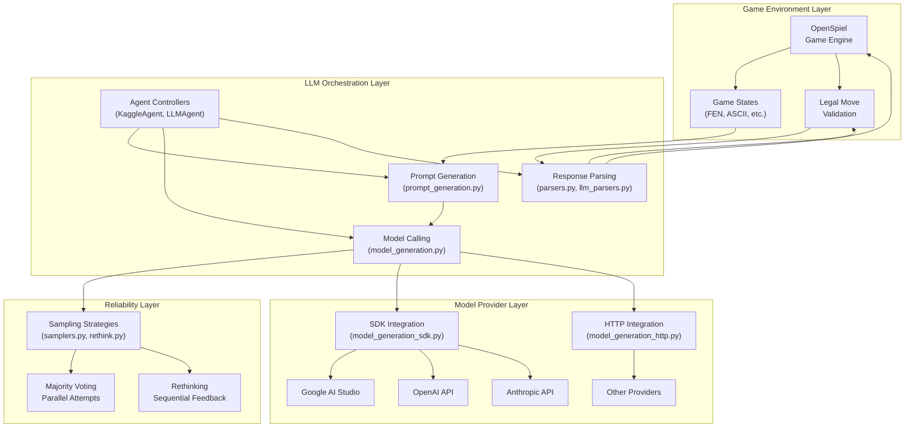
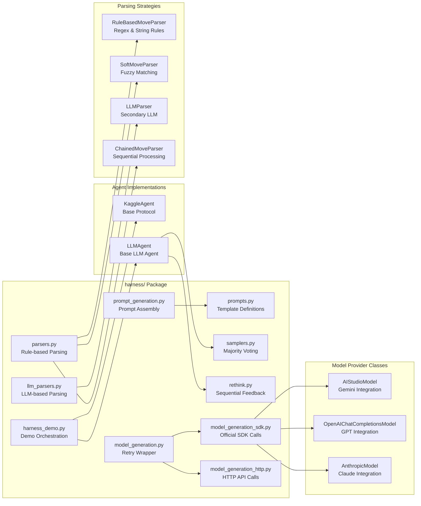
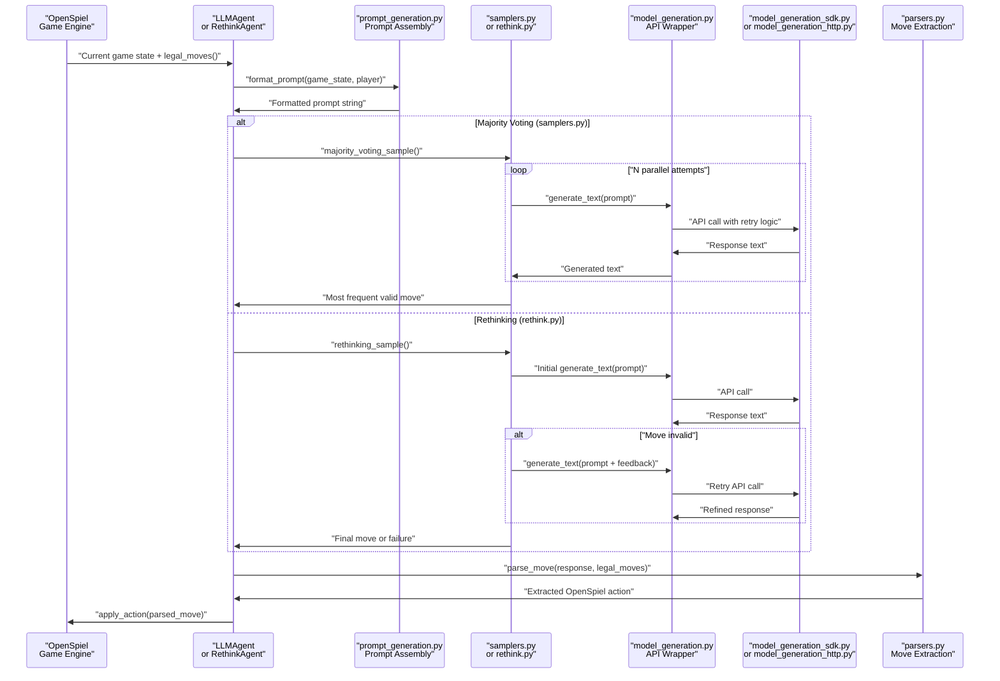

<!-- source: DeepWiki mcp.deepwiki.com · repo google-deepmind/game_arena · page 1 Overview · fetched 2026-10-26 -->

# Overview

Relevant source files

The following files were used as context for generating this wiki page:

- [README.md](README.md)
- [game_arena/__init__.py](game_arena/__init__.py)

## Purpose and Scope

Game Arena is a sophisticated orchestration platform developed by Google DeepMind that enables Large Language Models (LLMs) to compete in strategic games. This document provides a high-level architectural overview of the Game Arena harness system, which manages the complete pipeline from game state representation through LLM interaction to move execution.

The platform serves as the foundation for a Kaggle-hosted competition where LLMs play games against each other, with the harness handling all technical coordination between game environments, model providers, and move validation systems.

For detailed implementation guidance, see [Getting Started](#1.1). For an end-to-end trace of a single turn, see [End-to-End Move Pipeline](#1.2).

## System Architecture Overview

Game Arena orchestrates interactions between three primary domains: game environments, LLM providers, and reliability mechanisms. The architecture emphasizes robustness and extensibility to handle the inherent unpredictability of LLM responses.

### High-Level System Architecture

Sources: [README.md:1-151]()

## Core Components and Code Entities

The Game Arena harness is implemented through several key subsystems, each with specific responsibilities in the LLM-game orchestration pipeline.

### Component-to-Code Mapping

Sources: [README.md:41-151]()

## Game Turn Orchestration Flow

The complete flow from game state to executed move involves multiple coordination points and error handling mechanisms. For a detailed step-by-step examination of this pipeline, see [End-to-End Move Pipeline](#1.2).

### LLM Game Turn Sequence

Sources: [README.md:93-140]()

## Key Subsystems Summary

| Subsystem | Primary Files | Core Classes | Purpose |
|-----------|--------------|--------------|---------|
| **Game Environment** | OpenSpiel integration | `pyspiel.Game`, `pyspiel.State` | Game state management and move validation |
| **Agent Control** | Agent implementations | `KaggleAgent`, `LLMAgent` | Orchestrate complete turn sequence |
| **Prompt Generation** | [README.md]() | Template functions | Convert game state to LLM prompts |
| **Model Integration** | [README.md]() | `AIStudioModel`, `OpenAIChatCompletionsModel` | Interface with LLM providers |
| **Reliability Sampling** | [README.md]() | Sampling functions | Improve move validity through multiple attempts |
| **Response Parsing** | [README.md]() | `RuleBasedMoveParser`, `LLMParser` | Extract valid moves from LLM responses |
| **Retry Handling** | [README.md]() | Retry decorators | Handle API failures and timeouts |

Sources: [README.md:64-151]()

## Child Pages

- [Getting Started](#1.1) — Setup, installation, API keys, running the demos, and contribution guidelines
- [End-to-End Move Pipeline](#1.2) — Walk through a single turn: observation -> prompt -> model call -> parse -> sampler/rethin -> action submitted to OpenSpiel

---

