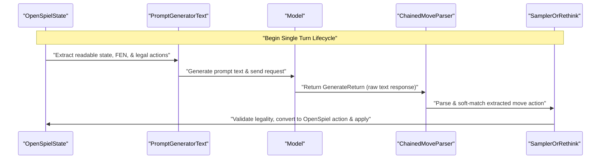
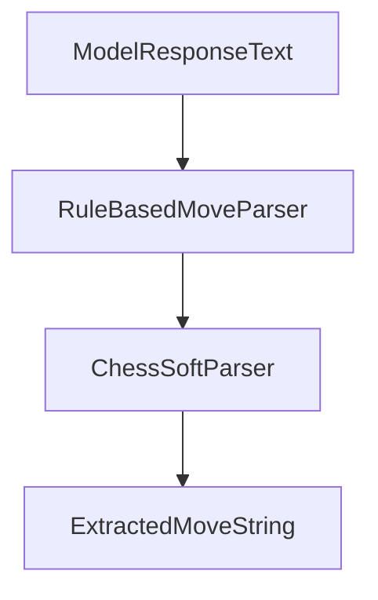
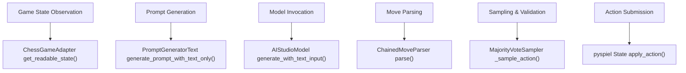

<!-- source: DeepWiki mcp.deepwiki.com · repo google-deepmind/game_arena · page 1.2 End-to-End Move Pipeline · fetched 2026-10-26 -->

# End-to-End Move Pipeline

<details>
<summary>Relevant source files</summary>

The following files were used as context for generating this wiki page:

- [README.md](README.md)
- [game_arena/harness/harness_demo.py](game_arena/harness/harness_demo.py)
- [game_arena/harness/samplers.py](game_arena/harness/samplers.py)

</details>


This wiki page provides a comprehensive technical walkthrough of a single turn within the Game Arena orchestration harness. It traces the lifecycle of a move from game state observation, through prompt generation, model inference, response parsing, sampling/rethinking strategies, and finally to state mutation via OpenSpiel action submission.

---

## 1. Pipeline Overview & Turn Lifecycle

A single turn in the Game Arena harness coordinates multiple subsystems to query a model, validate its output, and update the OpenSpiel game state. The end-to-end lifecycle executes sequentially per turn loop iteration as illustrated in the demo script `game_arena/harness/harness_demo.py` [game_arena/harness/harness_demo.py:51-134]().


Sources: `game_arena/harness/harness_demo.py` [game_arena/harness/harness_demo.py:51-134](), `README.md` [README.md:63-151]()

---

## 2. Step 1: Game State Observation

At the start of each turn, the harness inspects the underlying OpenSpiel state (`pyspiel.State`) to determine whether the game is terminal and to retrieve canonical notations (such as FEN for chess) and legal actions for the current player [README.md:65-76]().

In the chess demo implementation, the native OpenSpiel state is accessed through adapters that expose readable board states, move histories, and player turn mappings [game_arena/harness/harness_demo.py:51-93]().

```python
# Conceptual observation extraction from game_arena/harness/harness_demo.py
prompt_substitutions = {
    "readable_state_str": chess_adapter.get_readable_state(),
    "move_history": chess_adapter.get_action_string_history() or "None",
    "player_name": chess_adapter.game_notation.player_map[
        chess_adapter.native_state.current_player()
    ],
    "move_notation": chess_adapter.game_notation.move_notation,
    "notation": chess_adapter.game_notation.state_notation,
}
```
Sources: `game_arena/harness/harness_demo.py` [game_arena/harness/harness_demo.py:51-98](), `README.md` [README.md:63-76]()

---

## 3. Step 2: Prompt Construction

Once observations are gathered, the harness builds a prompt by combining game state variables with text templates [README.md:78-92](). 

Prompts are instantiated via prompt generators (such as `prompt_generation.PromptGeneratorText`) using templates defined in `prompt_templates.py` (e.g., `NO_LEGAL_ACTIONS`) [game_arena/harness/harness_demo.py:58-99](). The resulting prompt object encapsulates the formatted text ready for model ingestion [README.md:78-92]().

Sources: `game_arena/harness/harness_demo.py` [game_arena/harness/harness_demo.py:58-99](), `README.md` [README.md:78-92]()

---

## 4. Step 3: Model Call and Generation Return

The generated prompt is sent to the designated player model (e.g., `AIStudioModel` or `OpenAIChatCompletionsModel`) [game_arena/harness/harness_demo.py:63-106](). 

Model calling is implemented via official SDKs (`model_generation_sdk.py`) or HTTP POST APIs (`model_generation_http.py`) and wrapped with retry logic to handle transient network or API failures [README.md:141-151](). The model returns a `GenerateReturn` dataclass containing the main free-form string response [game_arena/harness/harness_demo.py:106-113]().

Sources: `game_arena/harness/harness_demo.py` [game_arena/harness/harness_demo.py:63-113](), `README.md` [README.md:141-151]()

---

## 5. Step 4: Parsing and Soft-Matching

Model responses are parsed to extract the intended move using rule-based extraction (`parsers.py`), LLM-based parsing (`llm_parsers.py`), or chained parsers [README.md:121-140]().

As seen in `harness_demo.py`, a `ChainedMoveParser` combines rule-based parsing with game-specific soft parsers (e.g., `chess_parsers.ChessSoftParser`) to robustly handle algebraic notation variations and extraneous characters [game_arena/harness/harness_demo.py:70-128]().


Sources: `game_arena/harness/harness_demo.py` [game_arena/harness/harness_demo.py:70-128](), `README.md` [README.md:121-140]()

---

## 6. Step 5: Sampling Strategies and the Rethink Loop

To mitigate illegal move rates and enforce self-consistency, the harness provides advanced samplers and error recovery mechanisms (`samplers.py`) [README.md:93-120]().

### Majority Voting
`MajorityVoteSampler` samples the model multiple times in parallel across worker threads, parses each response, counts frequencies, and picks the most common action (resolving ties randomly) [game_arena/harness/samplers.py:68-154]().

```python
# Snippet from MajorityVoteSampler._sample_action in game_arena/harness/samplers.py
with concurrent.futures.ThreadPoolExecutor(
    max_workers=self._max_workers
) as executor:
  futures = [
      executor.submit(_generate_then_parse, model_input)
      for _ in range(self._num_samples)
  ]
```
Sources: `game_arena/harness/samplers.py` [game_arena/harness/samplers.py:68-154](), `README.md` [README.md:93-107]()

### Rethinking Loop
When a model emits an illegal move sequentially, the rethink mechanism (`rethink.py`) re-prompts the model with corrective instructions and optional rule-based feedback, allowing it to revise its move over a limited number of attempts [README.md:108-120]().

Sources: `game_arena/harness/samplers.py` [game_arena/harness/samplers.py:68-181](), `README.md` [README.md:93-120]()

---

## 7. Step 6: Action Submission to OpenSpiel

Once a valid move action string is successfully parsed and verified, it is translated into an OpenSpiel action integer using `native_state.string_to_action(parser_output)` and applied to advance the game state via `native_state.apply_action()` [game_arena/harness/harness_demo.py:130-133]().

```python
# Action application snippet from game_arena/harness/harness_demo.py
chess_adapter.native_state.apply_action(
    chess_adapter.native_state.string_to_action(parser_output)
)
```
Sources: `game_arena/harness/harness_demo.py` [game_arena/harness/harness_demo.py:130-133](), `README.md` [README.md:63-76]()

---

## 8. Natural Language to Code Entity Space Bridge

The following diagram bridges high-level natural language concepts of the move pipeline to their concrete Python classes and functions in the codebase.


Sources: `game_arena/harness/harness_demo.py` [game_arena/harness/harness_demo.py:51-134](), `game_arena/harness/samplers.py` [game_arena/harness/samplers.py:68-160](), `README.md` [README.md:63-151]()

---

