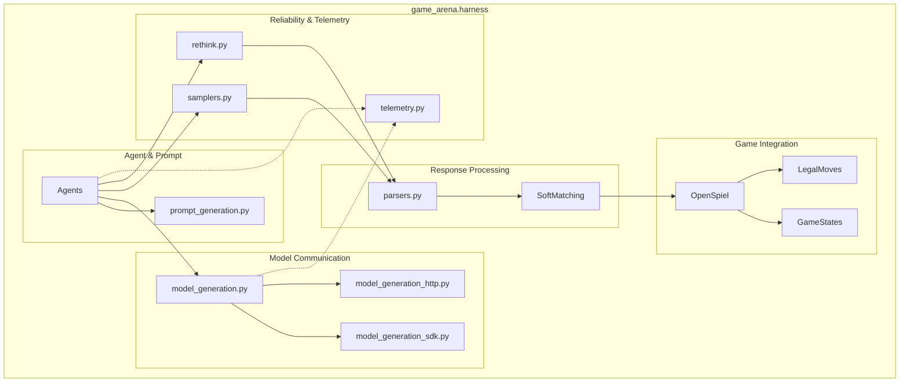

<!-- source: DeepWiki mcp.deepwiki.com · repo google-deepmind/game_arena · page 2 Core Architecture · fetched 2026-10-26 -->

# Core Architecture

Relevant source files

The following files were used as context for generating this wiki page:

- [README.md](README.md)
- [game_arena/harness/__init__.py](game_arena/harness/__init__.py)

This document provides a high-level overview of the Game Arena harness system's core architectural components and their interactions. The system orchestrates interactions between Large Language Models (LLMs) and game environments using OpenSpiel, managing everything from prompt generation to move parsing, reliability loops, and telemetry.

As a parent page, this section introduces the main subsystems. For deep technical details, see the child pages:
- [Agent System](#2.1)
- [Model Integration](#2.2)
- [Prompt Generation](#2.3)
- [Parsing System](#2.4)
- [Sampling Strategies](#2.5)
- [Telemetry](#2.6)

## High-Level Component Architecture

The following diagram illustrates the main architectural components and their relationships within the harness:

Sources: [README.md:63-151](), [game_arena/harness/__init__.py:1-14]()

## Subsystem Overview

The harness is modularly designed around several key subsystems that handle distinct phases of game orchestration:

### Agent System

Agents encapsulate the playing logic for specific games or general LLM strategies, managing turn execution and state interactions. For details, see [Agent System](#2.1).

Sources: [README.md:63-73]()

### Model Integration

Model calling abstracts underlying provider APIs using uniform protocols with built-in retry and timing decorators. For details, see [Model Integration](#2.2).

Sources: [README.md:143-151]()

### Prompt Generation

Prompts are constructed dynamically from game state representations, rule instructions, and templates. For details, see [Prompt Generation](#2.3).

Sources: [README.md:78-92]()

### Parsing System

Extracts structured moves from model responses using rule-based patterns, LLM fallback extractors, and soft-matching against legal moves. For details, see [Parsing System](#2.4).

Sources: [README.md:121-140]()

### Sampling Strategies

Handles reliability and error recovery through majority voting samplers and sequential rethink loops. For details, see [Sampling Strategies](#2.5).

Sources: [README.md:93-120]()

### Telemetry

Exposes unified logging protocols and exporters to track execution metrics and debugging data across harness components. For details, see [Telemetry](#2.6).

Sources: [README.md:63-151]()

---

