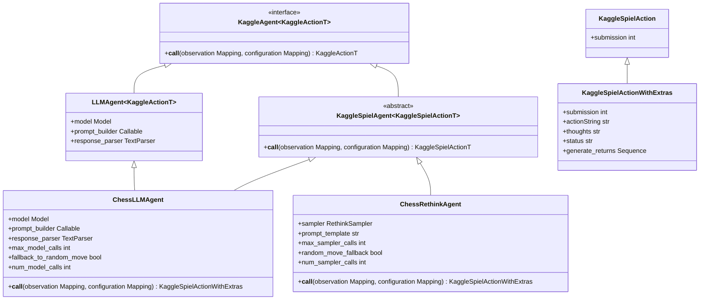
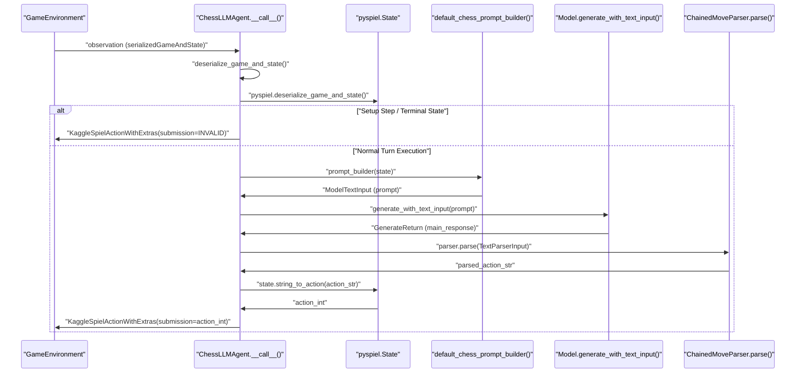

<!-- source: DeepWiki mcp.deepwiki.com · repo google-deepmind/game_arena · page 2.1 Agent System · fetched 2026-10-26 -->

# Agent System

<details>
<summary>Relevant source files</summary>

The following files were used as context for generating this wiki page:

- [game_arena/harness/harness_demo.py](game_arena/harness/harness_demo.py)
- [game_arena/harness/rethink.py](game_arena/harness/rethink.py)

</details>


The Agent System serves as the primary orchestration layer that coordinates LLM interactions with game environments in Game Arena. It manages the complete lifecycle of agent decision-making, translating game observations into valid game actions through LLM calls, response parsing, and sampling strategies.

This document covers the core agent protocols, base classes defined in agent/base modules, action `TypedDict` structures, and game-specific agent implementations (such as chess and poker agents). For details on underlying model providers, see [Model Integration](#2.2). For parsing logic, see [Parsing System](#2.4). For sampling and rethinking loops, see [Sampling Strategies](#2.5).

## Agent Architecture Overview

The agent system is structured around a hierarchical protocol and class architecture that separates game-agnostic agent definitions from specific game integrations.



Sources: [game_arena/harness/agent.py:67-154](), [game_arena/harness/agent.py:332-350]()

## Core Agent Types and Action TypedDicts

### Action TypedDicts

The harness defines typed action dictionaries to structure what agents return to the Kaggle evaluation harness:

| Action Type | Description | Key Fields |
|-------------|-------------|------------|
| `KaggleSpielAction` | Basic action container | `submission: int` |
| `KaggleSpielActionWithExtras` | Extended container with telemetry and reasoning | `submission: int`, `actionString: str | None`, `thoughts: str | None`, `status: str | None`, `generate_returns: Sequence[str]` |

Sources: [game_arena/harness/agent.py:79-92]()

### Protocol Interfaces

#### KaggleAgent Protocol
The foundational protocol defines how any agent accepts observations and configuration mappings:
```python
def __call__(
    observation: Mapping[str, Any],
    configuration: Mapping[str, Any],
    **kwargs,
) -> KaggleActionT
```
Sources: [game_arena/harness/agent.py:67-76]()

#### LLMAgent Class
The `LLMAgent` base class implements model-backed behavior using three core configurable attributes:
- `model: Model` — Handles calls to the model backend.
- `prompt_builder: Callable` — Transforms game state into text or multimodal prompts.
- `response_parser: TextParser` — Extracts raw game actions from model text outputs.

Sources: [game_arena/harness/agent.py:109-129]()

## Agent Decision Flow

The following sequence diagram maps natural language operations and game state transitions to precise code entities during a single agent turn execution.



Sources: [game_arena/harness/agent.py:180-276]()

## Game-Specific Agents

### Chess Agents

Chess agents manage standard FEN/SAN notation mappings and integrate rule-based parsing with soft move matching.

- **`ChessLLMAgent`**: Standard iterative LLM agent supporting `max_model_calls`, fallback to random moves (`fallback_to_random_move`), and tracking `num_model_calls`.
- **`ChessRethinkAgent`**: Integrates with `RethinkSampler` to automatically re-prompt models when illegal or unparsable moves are generated.

Sources: [game_arena/harness/agent.py:132-276](), [game_arena/harness/agent.py:332-492]()

### Poker Agents

Poker agents extend base agent abstractions to handle imperfect information games, incorporating hand history utilities and formatting observations that hide opponent private cards while exposing board states and betting rounds.

Sources: [game_arena/harness/rethink.py:100-132]()

## Error Handling and Fallback Mechanisms

Agents implement structured exception handling and status reporting to ensure robust tournament execution without crashing on malformed LLM outputs.

| Failure Condition | ChessLLMAgent Action | ChessRethinkAgent Action |
|-------------------|----------------------|--------------------------|
| Model API Exception | Returns `INVALID_ACTION` with error status | Returns error action with full traceback |
| Parsing Failure | Fallback to random move or invalid status | Triggers rethink loop or fallback move |
| Max Calls Exceeded | Forces random legal move | Forces random legal move |

Status strings populated in `KaggleSpielActionWithExtras.status` include:
- `"Setup step; model not called."`
- `"MAX MODEL CALLS (N=X) REACHED"`
- Exception message traces and `"OK"` for successful turns.

Sources: [game_arena/harness/agent.py:201-216](), [game_arena/harness/agent.py:377-395](), [game_arena/harness/agent.py:429-438]()

## Integration Points

- **OpenSpiel Integration**: Agents instantiate or restore `pyspiel.State` from `serializedGameAndState` provided in evaluation observations.
- **Model Integration**: Dispatches prompts using `generate_with_text_input` or `generate_with_image_text_input` returning `GenerateReturn` objects.
- **Parser Integration**: Feeds responses into `TextParserInput` processed by `ChainedMoveParser` and game-specific soft parsers.

Sources: [game_arena/harness/agent.py:188-199](), [game_arena/harness/agent.py:218-228](), [game_arena/harness/rethink.py:113-132]()

---

