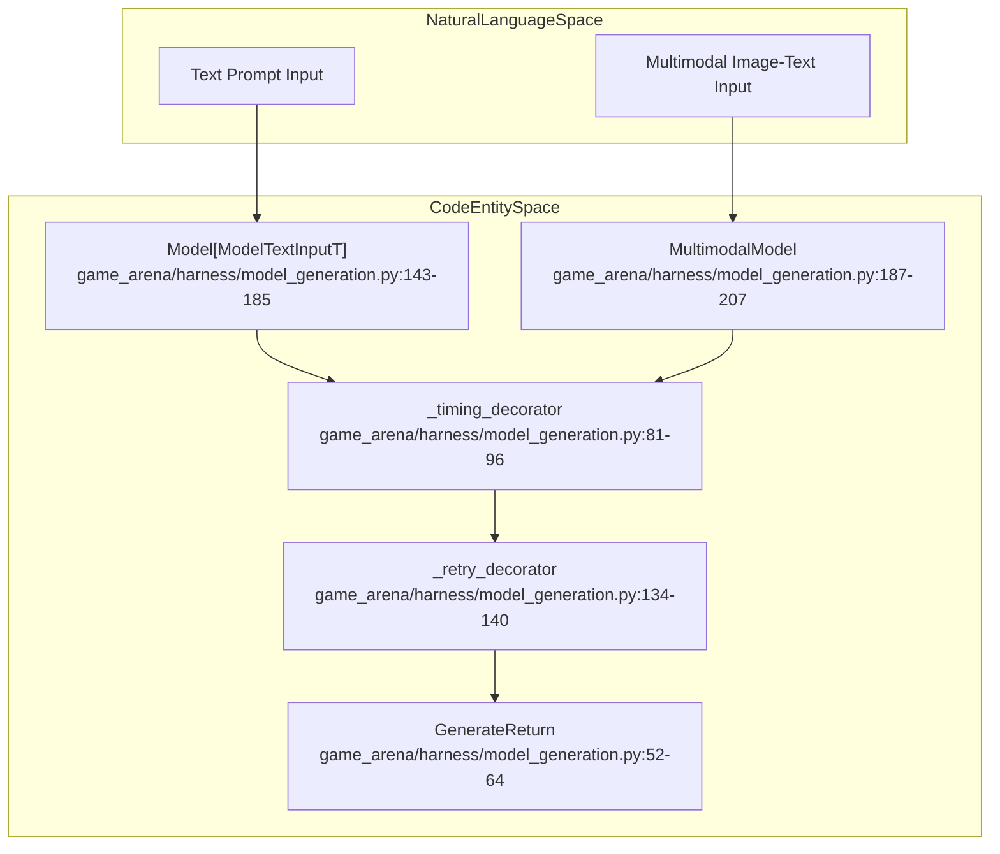
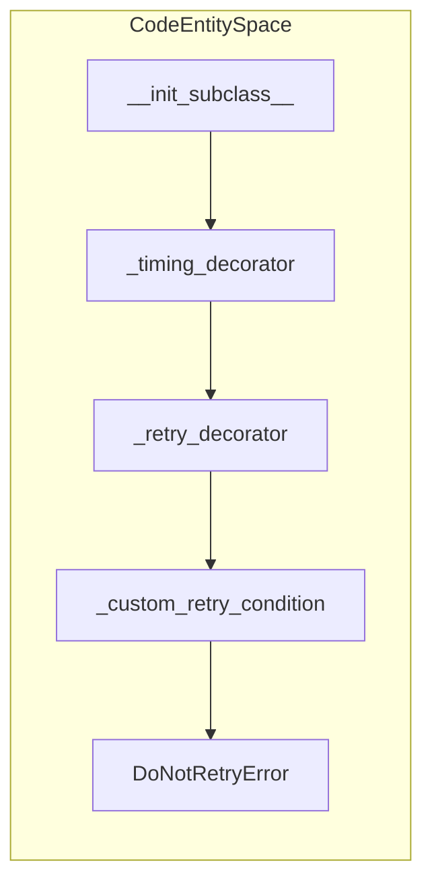
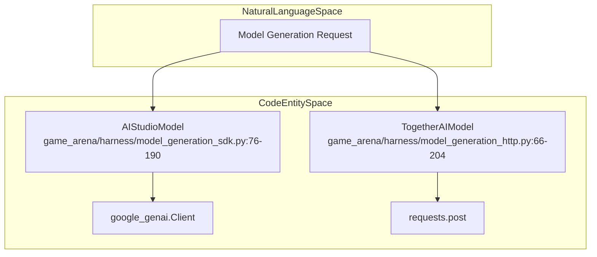

<!-- source: DeepWiki mcp.deepwiki.com · repo google-deepmind/game_arena · page 2.2 Model Integration · fetched 2026-10-26 -->

# Model Integration

Relevant source files

The following files were used as context for generating this wiki page:

- [game_arena/harness/model_generation.py](game_arena/harness/model_generation.py)
- [game_arena/harness/model_generation_http.py](game_arena/harness/model_generation_http.py)
- [game_arena/harness/model_generation_sdk.py](game_arena/harness/model_generation_sdk.py)

This page covers the core model abstraction layer in Game Arena, defining how large language models (LLMs) are interfaced, invoked, timed, retried, and implemented via official SDKs and HTTP APIs. For details on how prompts are constructed before reaching these models, see [Game State Rendering and Formatting](#3.3). For central model registration and configuration aliases, see [Model Registry](#6.1).

## Core Architecture and Protocols

The model integration subsystem is anchored by Python `Protocol` definitions and dataclasses located in `game_arena/harness/model_generation.py`. The `Model` protocol [game_arena/harness/model_generation.py:143-185]() provides text input generation, while the `MultimodalModel` protocol [game_arena/harness/model_generation.py:187-207]() extends it with image-text input support.

*Sources: [game_arena/harness/model_generation.py:37-207]()*

Input payloads are structured via `ModelTextInput` [game_arena/harness/model_generation.py:38-41]() and `ModelImageTextInput` [game_arena/harness/model_generation.py:43-49](), whereas outputs are uniformly encapsulated in `GenerateReturn` [game_arena/harness/model_generation.py:51-64](), tracking metrics such as `generation_tokens`, `prompt_tokens`, `reasoning_tokens`, and `duration_success_only_secs`.

## Instrumentation: Timing and Retry Decorators

Class-level `__init_subclass__` hooks in `Model` [game_arena/harness/model_generation.py:177-184]() and `MultimodalModel` [game_arena/harness/model_generation.py:197-206]() automatically wrap generation methods with execution timing and resilient retry logic.

*Sources: [game_arena/harness/model_generation.py:81-140](), [game_arena/harness/model_generation.py:177-206]()*

- **`_timing_decorator`**: Measures execution duration using `time.perf_counter()` [game_arena/harness/model_generation.py:81-96]() and injects `duration_success_only_secs` into `GenerateReturn`.
- **`_retry_decorator`**: Leverages `tenacity` with exponential backoff (`wait_random_exponential` between 1 and 60 seconds) up to a 60-minute delay limit [game_arena/harness/model_generation.py:134-140]().
- **`_custom_retry_condition`**: Suppresses retries when an exception inherits from `DoNotRetryError` [game_arena/harness/model_generation.py:99-132](), which includes `UnsupportedCapabilityError` [game_arena/harness/model_generation.py:113-115]().

*Sources: [game_arena/harness/model_generation.py:81-140]*

## SDK vs HTTP Implementations

Model integrations are split between official Python SDK implementations (`model_generation_sdk.py`) and raw HTTP REST wrappers (`model_generation_http.py`).

*Sources: [game_arena/harness/model_generation_sdk.py:76-190](), [game_arena/harness/model_generation_http.py:66-204]*

### SDK-Based Integrations (`AIStudioModel`)
The `AIStudioModel` class [game_arena/harness/model_generation_sdk.py:76-190]() initializes a `google_genai.Client` [game_arena/harness/model_generation_sdk.py:91]() to communicate with Gemini models via AI Studio. It maps parameters such as `temperature`, `top_p`, `top_k`, `max_output_tokens`, and `ThinkingConfig` into `GenerateContentConfig` [game_arena/harness/model_generation_sdk.py:105-120](), parsing candidate parts into text and internal reasoning thoughts.

*Sources: [game_arena/harness/model_generation_sdk.py:76-190]*

### HTTP-Based Integrations (`TogetherAIModel`)
The `TogetherAIModel` class [game_arena/harness/model_generation_http.py:66-204]() interfaces with providers via REST endpoints using `requests.post` or `aiohttp` for parallel attempts [game_arena/harness/model_generation_http.py:171-193](). It computes dynamic context window limits and maximum sampling lengths based on model registry rules [game_arena/harness/model_generation_http.py:114-142](), formats image payloads via `_create_image_text_content` [game_arena/harness/model_generation_http.py:33-63](), and handles Bearer token authorization from environment variables [game_arena/harness/model_generation_http.py:80-91]().

*Sources: [game_arena/harness/model_generation_http.py:33-204]*

---

