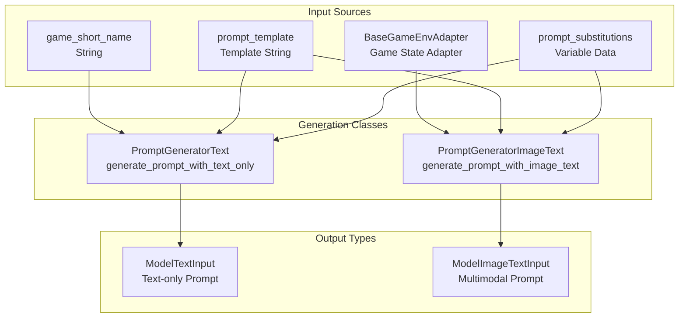
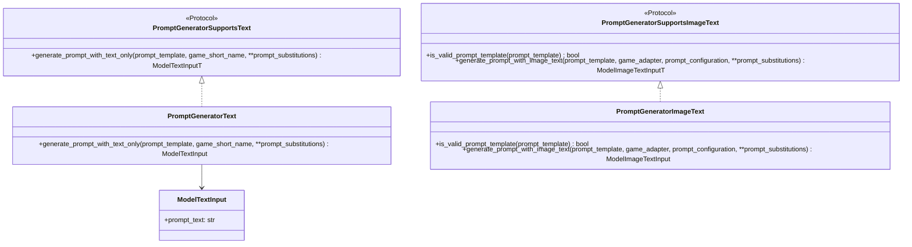

<!-- source: DeepWiki mcp.deepwiki.com · repo google-deepmind/game_arena · page 2.3 Prompt Generation · fetched 2026-10-26 -->

# Prompt Generation

<details>
<summary>Relevant source files</summary>

The following files were used as context for generating this wiki page:

- [game_arena/harness/prompt_generation.py](game_arena/harness/prompt_generation.py)
- [game_arena/harness/prompts.py](game_arena/harness/prompts.py)

</details>


This document covers the prompt generation system within Game Arena's harness, which transforms game state information and contextual data into formatted prompts for LLM consumption. The system handles template selection, variable substitution, and supports both text-only and multimodal prompt formats.

For information about how generated prompts are sent to LLM providers, see [Supported Games](#3.2). For details on how LLM responses are processed after generation, see [Parsing System](#3.4).

## System Architecture

The prompt generation system acts as a critical bridge between game state representation and LLM interaction, transforming structured game data into natural language prompts that models can understand and respond to appropriately.

### Prompt Generation Pipeline



Sources: [game_arena/harness/prompt_generation.py:24-112]()

### Code Entity Mapping



Sources: [game_arena/harness/prompt_generation.py:24-112]()

## Template System

The prompt generation system uses a template-based approach where predefined templates are categorized into core prompts, rethinking prompts, and image-text prompts, and then populated with game-specific data through variable substitution.

### Template Categories

Prompts are organized across several frozensets in the `prompts` module:

| Category | Constant Name | Description |
|----------|---------------|-------------|
| Core Prompts | `CORE_PROMPTS` | Standard templates with/without legal actions, piece dicts, and ASCII boards [game_arena/harness/prompts.py:20-26]() |
| Rethink Prompts | `RETHINK_PROMPTS` | Templates appended with error feedback for recovering from illegal/unparsable moves [game_arena/harness/prompts.py:29-37]() |
| Image-Text Prompts | `IMAGE_TEXT_PROMPTS` | Multimodal templates including board and SVG rendered images [game_arena/harness/prompts.py:40-44]() |

Sources: [game_arena/harness/prompts.py:20-44]()

### Variable Substitution

For text-only generation via `PromptGeneratorText`, the `game_short_name` is automatically added to the substitution dictionary before formatting the template string:

```python
prompt_substitutions["game_short_name"] = game_short_name
return model_generation.ModelTextInput(
    prompt_text=prompt_template.format(**prompt_substitutions)
)
```

Sources: [game_arena/harness/prompt_generation.py:68-72]()

## Text vs Multimodal Support

The system is designed with protocol-based interfaces to support both text-only (`PromptGeneratorSupportsText`) and multimodal prompt generation (`PromptGeneratorSupportsImageText`).

### Protocol Definitions

- **`PromptGeneratorSupportsText`**: Defines `generate_prompt_with_text_only()` returning a text input structure [game_arena/harness/prompt_generation.py:45-58]().
- **`PromptGeneratorSupportsImageText`**: Defines `is_valid_prompt_template()` and `generate_prompt_with_image_text()` accepting a `BaseGameEnvAdapter` [game_arena/harness/prompt_generation.py:24-42]().

`PromptGeneratorImageText` validates that the template belongs to `IMAGE_TEXT_PROMPTS` and that the game adapter has an active native state before processing [game_arena/harness/prompt_generation.py:75-112]().

Sources: [game_arena/harness/prompt_generation.py:24-112]()

---

