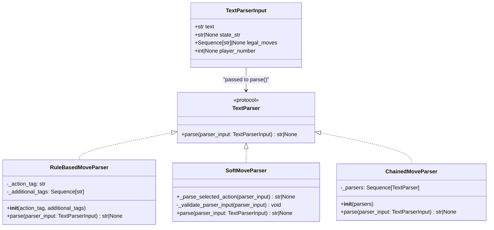
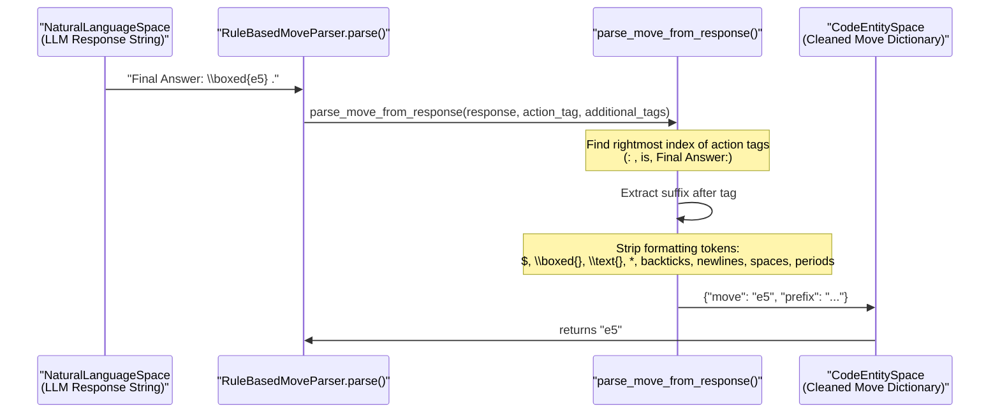
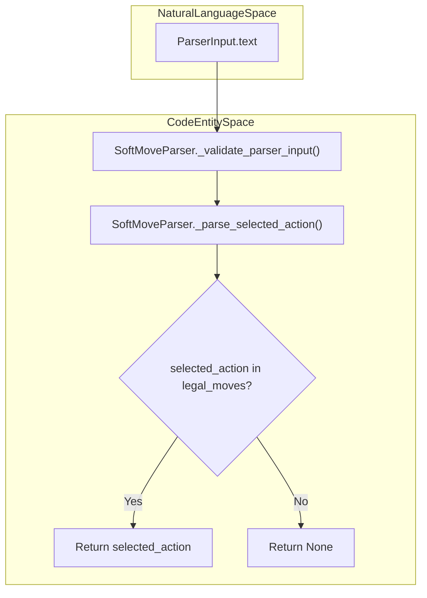
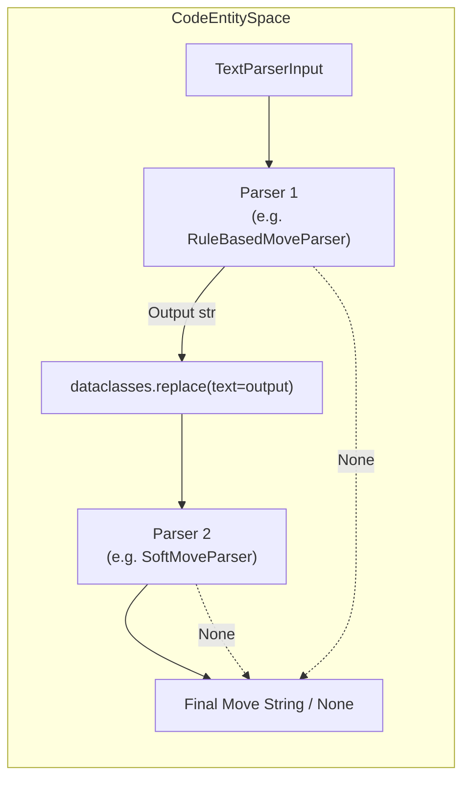

<!-- source: DeepWiki mcp.deepwiki.com · repo google-deepmind/game_arena · page 2.4 Parsing System · fetched 2026-10-26 -->

# Parsing System

Relevant source files

The following files were used as context for generating this wiki page:

- [game_arena/harness/parsers.py](game_arena/harness/parsers.py)
- [game_arena/harness/parsers_test.py](game_arena/harness/parsers_test.py)

The parsing system converts raw LLM text responses into valid game move representations. Located primarily in `game_arena/harness/parsers.py`, it provides a modular framework comprising rule-based extraction, fuzzy or soft matching against legal moves, and sequential parsing pipelines (`ChainedMoveParser`) to handle the inherently unstructured outputs of language models.

Sources: [game_arena/harness/parsers.py:15-168]()

## Core Data Structures and Protocol

The parsing module defines a standard protocol (`TextParser`) and a structured input container (`TextParserInput`) to unify how different parsers access raw text, game states, and legal move sets.

| Class / Protocol | Role | Key Attributes / Methods |
|------------------|------|--------------------------|
| `TextParserInput` | Dataclass holding parsing context | `text`, `state_str`, `legal_moves`, `player_number` [game_arena/harness/parsers.py:80-86]() |
| `TextParser` | Structural subtyping protocol for parsers | `parse(self, parser_input: TextParserInput) -> str \| None` [game_arena/harness/parsers.py:88-93]() |

Title: "Parser Protocol and Classes"
Sources: [game_arena/harness/parsers.py:80-168]()

## Rule-Based Parsing

The `RuleBasedMoveParser` utilizes `parse_move_from_response` to extract move strings via delimiter scanning and string normalization [game_arena/harness/parsers.py:23-71, 116-136]().

### Extraction and Cleaning Flow

Title: "Natural Language to Code Entity Space: Rule-Based Move Parsing"
Sources: [game_arena/harness/parsers.py:23-71, 116-136]()

The helper `parse_move_from_response` searches for the rightmost occurrence of action tags (defaulting to `"Final Answer:"`, `":"`, and `"is"`), slices the subsequent substring, and cleans out LaTeX commands (`\boxed`, `\text`), markdown formatting (`*`, `` ` ``), dollar signs, and trailing punctuation [game_arena/harness/parsers.py:23-66]().

Sources: [game_arena/harness/parsers.py:23-71, 116-136]()

## Soft Move Parsing

The `SoftMoveParser` validates selected actions against the list of legal moves provided in `TextParserInput` [game_arena/harness/parsers.py:138-168](). 

Title: "Soft Matching Pipeline"
Sources: [game_arena/harness/parsers.py:138-168]()

If input fields such as `state_str`, `legal_moves`, or `player_number` are missing, `_validate_parser_input` raises a `ValueError` [game_arena/harness/parsers.py:149-160](). Subclasses or specific game implementations override `_parse_selected_action` to map soft-matched strings to exact game actions [game_arena/harness/parsers.py:141-147]().

Sources: [game_arena/harness/parsers.py:138-168]()

## Chained Parsers

The `ChainedMoveParser` sequences multiple `TextParser` instances, passing the output text of one parser as the input text (`TextParserInput.text`) of the next [game_arena/harness/parsers.py:96-114]().

Title: "ChainedMoveParser Sequence Execution"
Sources: [game_arena/harness/parsers.py:96-114]()

If any parser in the sequence returns `None`, the `ChainedMoveParser` short-circuits and immediately returns `None` [game_arena/harness/parsers.py:106-113]().

Sources: [game_arena/harness/parsers.py:96-114]()

## Testing and Validation

The parsing behavior is thoroughly verified in `game_arena/harness/parsers_test.py`, which validates edge cases such as trailing whitespaces, newlines, LaTeX boxed answers (`\boxed{}`, `\text{}`), dollar sign wrappers, and period suffixes [game_arena/harness/parsers_test.py:25-159]().

Sources: [game_arena/harness/parsers_test.py:25-159]()

---

