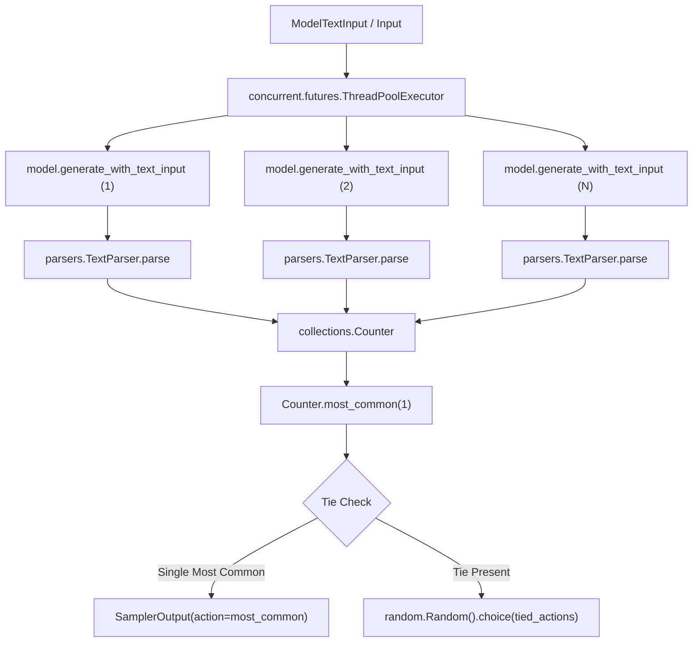
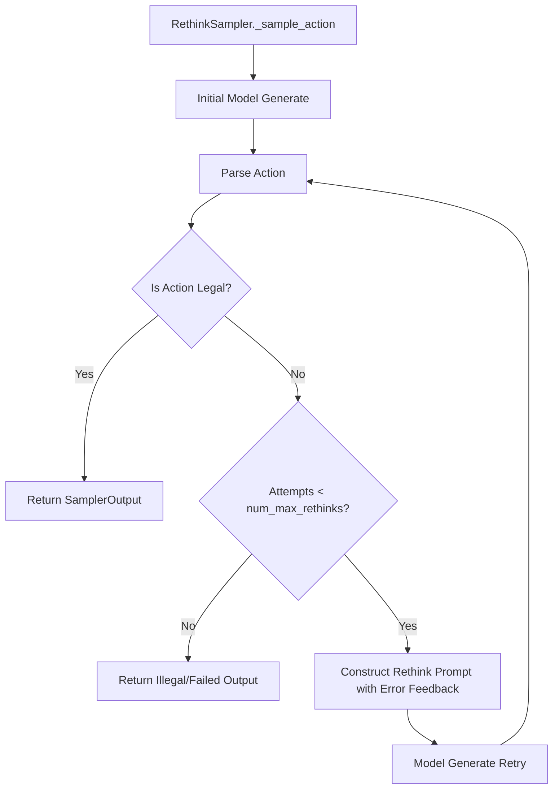
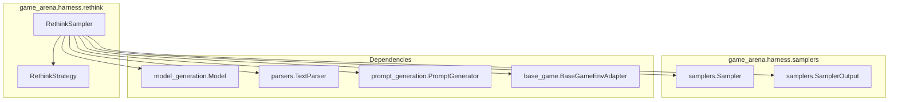

<!-- source: DeepWiki mcp.deepwiki.com · repo google-deepmind/game_arena · page 2.5 Sampling Strategies · fetched 2026-10-26 -->

# Sampling Strategies

Relevant source files

The following files were used as context for generating this wiki page:

- [game_arena/harness/rethink.py](game_arena/harness/rethink.py)
- [game_arena/harness/samplers.py](game_arena/harness/samplers.py)

## Purpose and Scope

This document covers the reliability mechanisms implemented in `game_arena/harness/samplers.py` and `game_arena/harness/rethink.py`. These components improve the probability of obtaining valid game moves from LLM responses by addressing challenges such as format violations, rule infractions, and parsing failures.

For information about how model responses are parsed into moves, see [Parsing System](#2.4). For details about the agent system that orchestrates these sampling strategies, see [Agent System](#2.1).

Sources: [game_arena/harness/samplers.py:15-26](), [game_arena/harness/rethink.py:15-29]()

## Core Sampler Interfaces

The harness defines foundational data classes and abstract protocols for samplers in `game_arena/harness/samplers.py`.

- `MoveType`: An enumeration defining `LEGAL`, `ILLEGAL`, and `NO_ACTION_TAG` outcomes [game_arena/harness/samplers.py:28-34]().
- `SamplerOutput`: A frozen dataclass holding the `action`, `extracted_action`, `matched_action`, `generate_returns`, `auxiliary_outputs`, and `move_type` [game_arena/harness/samplers.py:35-45]().
- `Sampler`: A protocol requiring an `__init__` with a model and `sample_action_with_text_input` [game_arena/harness/samplers.py:47-57]().
- `MultimodalSampler`: Extends `Sampler` to support `sample_action_with_image_text_input` [game_arena/harness/samplers.py:59-66]().

Sources: [game_arena/harness/samplers.py:28-66]()

## Majority Voting Strategy

`MajorityVoteSampler` and `MajorityVoteMultimodalSampler` enforce self-consistency by sampling multiple responses in parallel and choosing the most frequent valid move [game_arena/harness/samplers.py:68-181]().

### Process Flow

Title: "Majority Vote Sampler Execution Flow"

Sources: [game_arena/harness/samplers.py:68-162]()

### Implementation Details

`MajorityVoteSampler.__init__` accepts a model, `num_samples`, a `parser`, and `max_workers` (defaulting to 10) [game_arena/harness/samplers.py:78-88](). It uses a `ThreadPoolExecutor` to concurrently invoke `generate_fn` across the requested number of samples [game_arena/harness/samplers.py:110-116](). Frequencies of parsed actions are aggregated using a `collections.Counter` [game_arena/harness/samplers.py:123-125]().

Sources: [game_arena/harness/samplers.py:68-162]()

## Rethinking Strategy

`RethinkSampler` implements a sequential sampling loop that prompts the model again with error feedback when an illegal or unparseable move is generated [game_arena/harness/samplers.py:47](), [game_arena/harness/rethink.py:56-187]().

### Rethink Strategies

The `RethinkStrategy` enumeration defines the supported feedback modes:
- `RETHINK` [game_arena/harness/rethink.py:47]()
- `RETHINK_WITH_ENV` [game_arena/harness/rethink.py:48]()
- `RETHINK_WITH_ENV_ILLEGAL_HISTORY` [game_arena/harness/rethink.py:49]()
- `RETHINK_WITH_ENV_RULE` [game_arena/harness/rethink.py:50]()

Sources: [game_arena/harness/rethink.py:46-51]()

### Process Flow

Title: "Rethink Sampler Iteration Loop"

Sources: [game_arena/harness/rethink.py:56-187]()

### Code Integration

Title: "RethinkSampler Component Architecture"

Sources: [game_arena/harness/rethink.py:56-89](), [game_arena/harness/samplers.py:35-57]()

---

