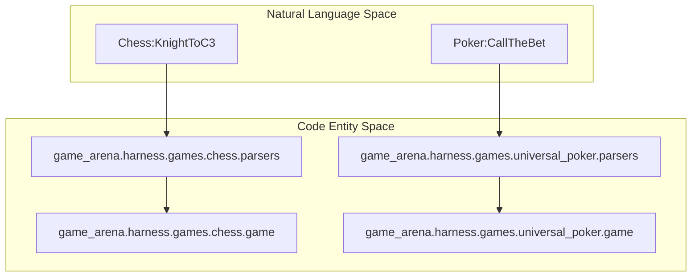
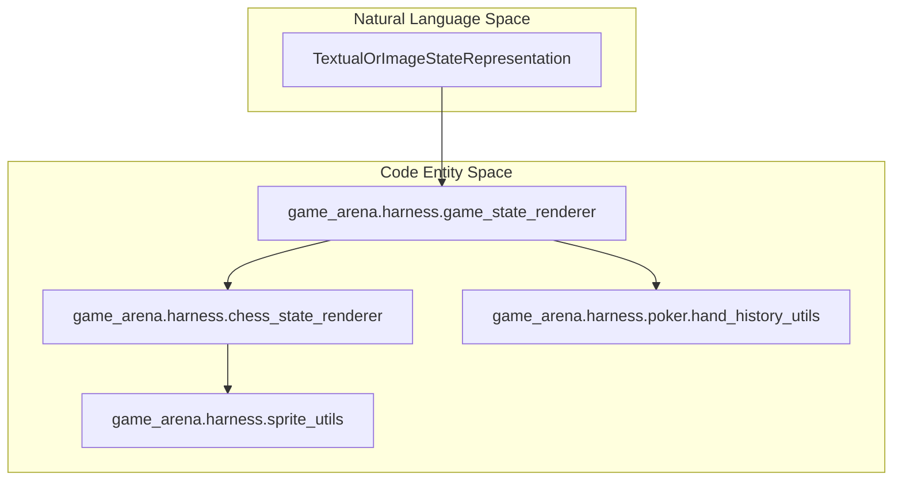

<!-- source: DeepWiki mcp.deepwiki.com · repo google-deepmind/game_arena · page 3 Game Support · fetched 2026-10-26 -->

# Game Support

Relevant source files

The following files were used as context for generating this wiki page:

- [README.md](README.md)

The Game Support subsystem of Game Arena coordinates game environments, rules enforcement, state tracking, and notation formatting. Game Arena relies on [OpenSpiel](https://github.com/google-deepmind/open_spiel) as its underlying game engine while providing higher-level Python abstractions, game-specific packages, rendering utilities, and LLM interaction pipelines [README.md:63-72]().

Sources: [README.md:63-72]()

## Game Abstraction Layer

The game abstraction layer wraps OpenSpiel game states and actions into consistent interfaces utilized by prompts, parsers, and samplers [README.md:65-76](). Core adapters manage turn progression, legal move extraction, and canonical state representations like Forsyth-Edwards Notation (FEN) for chess [README.md:74-76](). 

For complete technical details on base game adapters, OpenSpiel state wrappers, notations, readable state representations, and move history interfaces, see [Game Abstraction Layer](#3.1).

Sources: [README.md:65-76]()

## Supported Games

Game Arena supports a subset of two-player games implemented in OpenSpiel, organized under dedicated packages within `harness/games/` [README.md:63-68](). These include chess, go, connect_four, tic_tac_toe, and universal_poker. Each game package implements its own game logic wrappers, custom parsers, prompt templates, rethink strategies, and game-specific agents [README.md:63-120]().

For detailed breakdowns of each supported game package, game.py implementations, prompt templates, and agent integration, see [Supported Games](#3.2).

Sources: [README.md:63-145]()

## Game State Rendering and Formatting

To support multimodal models and human-readable debugging interfaces, game states are rendered into various formats including canonical text notation, alternative dictionary representations, ASCII grids, and rendered board images [README.md:80-88](). Specialized rendering utilities handle visual representations such as chess board sprites and poker hand histories [README.md:80-88]().

For deep technical details on state renderer modules, sprite utilities, hand history helpers, and textual versus image state representations, see [Game State Rendering and Formatting](#3.3).

Sources: [README.md:80-88]()

---

